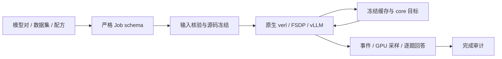

# MirrorOPD 0.2 全面重构说明

状态：当前版本为 0.2.1。实现、核心测试、完整词表、多模型、长预算原生验证及单进程推理组的 FileStore 启动验证已通过。本文说明当前实现、验证证据和适用范围；正式三算法 50 outer 实验另按冻结配置运行，只有完整审计通过后才计为完成。

日常操作与失败处理在[运行与复现](运行与复现.md)维护，模块关系在[架构](架构.md)维护。本文保留版本切换、算法语义及已归档的验证条件和证据，不以历史提案中的接口代替当前入口。

## 重构范围与版本边界

0.2 删除旧的生产接口、缓存格式、算法模式别名和实验专用启动脚本，不提供兼容包装。生产算法统一为 `on_policy`、`mdpo`、`bpo`；所有任务经同一个配置解析器和运行器执行。

重构前版本固定在 Git 标签 `archive/pre-refactor-20261015`，对应 commit `74f78a2`。旧源码另有[可校验归档](../data/refactor-20261015/legacy-source.tar.gz)，由 `data-manifest.json` 恢复。历史报告与原始实验数据保留，已删除源码的历史链接指向该归档；旧报告的命令不代表当前接口。

主要退役内容包括原 `training/` 的 launcher、suite、worker、handoff、watcher、重复 GPU 预约实现，以及一次性 rollout、scoring、分析和绘图脚本。独立数学参照保存在 `reference/`，理论主稿、历史图表与数据没有删除。主切换提交 `107c218` 修改 246 个文件，新增 4072 行、删除 31017 行；这一提交的文件行数差不等于运行性能结论。

## 当前结构

| 位置                 | 职责                                                            | 边界                             |
| -------------------- | --------------------------------------------------------------- | -------------------------------- |
| `core/`              | reward、冻结缓存、概率、目标、诊断、词表契约                    | 纯张量计算，不依赖 Ray/verl      |
| `runtime/`           | 配置、数据、输入指纹、源码快照、预约、进程、事件、metrics、审计 | 不复制优化公式                   |
| `integrations/verl/` | 布局转换、后端配置编译、原生回调与固定补丁                      | 调度、FSDP、vLLM 仍由上游负责    |
| `profiles/`          | 模型、数据集、训练配方                                          | 组合成一个严格且版本化的 Job     |
| `scoring/`           | 数学、GSM8K、精确匹配和自定义 scorer                            | 可独立于 verl 导入               |
| `reference/`         | 独立数学参照                                                    | 用于验证生产公式，不作为训练入口 |
| `tests/`             | 数学、模型、缓存、数据、运行与原生控制流测试                    | 全部由 pytest 收集               |



缓存由类型化对象携带，包含 anchor version、teacher identity、tokenizer identity、合法词表、temperature、signal 和 estimator。κ/η 不再作为每 token 张量反复传输。中心估计使用 Top-J＋tail 或完整词表，动作积分使用采样或完整求和；组合错误、未知字段和旧模式会直接报错。

完整积分缓存保存归一化 target，不再在每个 inner 重复从完整教师概率构造 target。完整中心与采样动作的组合只需保留完整 anchor，释放不再使用的完整教师概率。

一次训练的调用顺序是 `cli → Job → run_job → prepare_inputs → snapshot_sources → compile_backend → 原生 trainer`。每个 outer 先从当前学生生成 response，再执行 anchor 和 teacher 打分，构造冻结缓存；每个 inner 只重算当前学生概率、loss 和诊断。更新后同步 rollout 权重，评测使用单独协议和预算。`audit_run` 在释放预约前核对事件、源码和评测产物，成功后才写完成状态。

阅读核心实现时，`config.py` 定义算法、signal、估计器和缓存上下文；`signal.py` 计算稳定的幂均值 reward；`distributions.py` 复用归一化常数与已物化概率；`cache.py` 分开构造 anchor 缓存和教师冻结量；`objectives.py` 是三算法唯一的生产损失实现；`diagnostics.py` 生成按需诊断；`vocabulary.py` 校验合法 token 与模型输出层的对应关系。

运行层的 `config.py` 组合 profile，`data.py` 规范化输入，`preflight.py` 把模型、数据和评测协议绑定到内容身份。`provenance.py` 核验后端并冻结源码，`reservation.py` 管理 GPU 预约，`processes.py` 管理任务进程树。`events.py` 提供结构化流，`metrics.py` 归约有效 token 的充分统计量，`tracking.py` 将同一批记录投影到 W&B。`evaluation.py` 校验逐题样本和统计口径，`audit.py` 判断实验是否完整，`runner.py` 组合上述生命周期。

后端接入中，`compiler.py` 将 Job 编译为原生配置；`adapter.py` 处理 padding、ragged 布局与预测位置；`bridge.py` 接管缓存、损失和更新回调；`model.py` 处理合法词表与 dropout；`reward.py` 只负责任务判分；`evaluation.py` 调度采样并保存逐题产物；`bootstrap.py` 准备固定上游及补丁；`rendezvous.py` 和 GPU 专用的 `vllm_executor.py` 在实际 EngineCore 进程中配置单进程推理组的 FileStore。评测编排与纯评测审计分开，数学判分与训练 reward 分开，分别由对应模块维护。

## 算法语义

固定前缀下，锚点、教师与当前学生分别为 $q,T,p_\theta$。三个算法使用同一个冻结 reward：

$$
A(a)=\frac{\log[1-\eta+\eta(T_a/q_a)^\kappa]}{\kappa\eta},\qquad A_{0,\eta}(a)=\log(T_a/q_a).
$$

生产参数域统一为 $0\le\kappa\le1$、$0<\eta\le1$，不保留旧生产入口的无限 η 或其他外推约定。令 $U=\log(p_\theta/q)$、$K_T=-\mathbb E_qA$、$K_S=\operatorname{KL}(q\Vert p_\theta)$，采样 loss 的停止梯度系数为

$$
c_{\mathrm{on}}=-A-\widehat K_T,\qquad
c_{\mathrm{BPO}}=\frac{U+\widehat K_S}{\eta}-A-\widehat K_T,\qquad
c_{\mathrm{MDPO}}=e^U\left(\frac U\eta-A\right).
$$

on-policy 强制每个新 batch 一次完整更新，在该点 $p=q$。MDPO/BPO 可以复用同一 batch 做多个 inner；学生相关量重算，锚点和 target 保持冻结。训练按全局有效 response token 归约，评测按每题相同次数采样求平均。

完整 BPO 目标为

$$
L_{\mathrm{BPO}}=\frac1{2\eta}\mathbb E_q\left[\left(C_q(\log p_\theta-\log m)\right)^2\right],\qquad
m_a=\frac{q_ae^{\eta A(a)}}{\sum_bq_be^{\eta A(b)}}.
$$

完整 MDPO 返回 $\operatorname{KL}(p_\theta\Vert m)/\eta$，相对旧的未归一化表达增加一个冻结常数，梯度保持一致。完整 on-policy 求和仍被标注为 score surrogate。`loss_kind` 明确区分 `score_surrogate` 与 `conditional_objective`，不把二者的前向数值放在同一目标曲线中解释。

Top-J 是中心估计的支持集，训练生成保持全支持。完整动作积分覆盖已采样前缀下的词表，不枚举所有可能的历史前缀。普通教师 KL 只在 κ=0 或 η=1 等相应端点与 reward 中心重合，通用字段使用 `frozen_reward_center`。

### κ=0.5、η=0.2 的展开与估计

令 $h_a=0.8+0.2\sqrt{T_a/q_a}$，并假定合法词表上 $q_a,T_a>0$。此时 $A(a)=10\log h_a$，归一化 target 可以完全展开为

$$
\begin{aligned}
q_ae^{0.2A(a)}
&=q_ah_a^2
=0.64q_a+0.32\sqrt{q_aT_a}+0.04T_a,\\
Z&=0.68+0.32\sum_b\sqrt{q_bT_b},\\
m_a&=\frac{0.64q_a+0.32\sqrt{q_aT_a}+0.04T_a}{0.68+0.32\sum_b\sqrt{q_bT_b}}.
\end{aligned}
$$

记 $d_a=\log(p_a/q_a)-2\log h_a$，完整 BPO 和 MDPO 分别为

$$
\begin{aligned}
L_{\mathrm{BPO}}
&=2.5\sum_aq_a\left(d_a-\sum_bq_bd_b\right)^2\\
&=2.5\sum_aq_a\left[\log\frac{p_a}{q_a}-2\log\left(0.8+0.2\sqrt{\frac{T_a}{q_a}}\right)-\sum_bq_b\log\frac{p_b}{q_b}+2\sum_bq_b\log\left(0.8+0.2\sqrt{\frac{T_b}{q_b}}\right)\right]^2.
\end{aligned}
$$

$$
L_{\mathrm{MDPO}}=5\sum_ap_a\left[\log p_a-\log\left(0.64q_a+0.32\sqrt{q_aT_a}+0.04T_a\right)+\log\left(0.68+0.32\sum_b\sqrt{q_bT_b}\right)\right].
$$

BPO 中的 $\log Z$ 在减去 $q$ 中心时抵消。MDPO 中的 $\log Z$ 对当前学生参数是冻结常数，但保留它才能报告真正的归一化 KL。生产代码在 log 域构造 target，避免直接相除和指数造成数值溢出。

在采样动作 $a\sim q$ 上，三个下降系数展开为

$$
\begin{aligned}
c_{\mathrm{on}}(a)&=-10\log h_a-\widehat K_T,\\
c_{\mathrm{BPO}}(a)&=5\left[\log(p_a/q_a)+\widehat K_S\right]-10\log h_a-\widehat K_T,\\
c_{\mathrm{MDPO}}(a)&=(p_a/q_a)\left[5\log(p_a/q_a)-10\log h_a\right].
\end{aligned}
$$

每个 token 的 surrogate 是 $\operatorname{stopgrad}(c(a))\log p_a$。完整词表中心为 $K_T=-10\sum_aq_a\log h_a$、$K_S=\sum_aq_a\log(q_a/p_a)$。令 $J$ 为冻结 anchor 的 Top-J 集合，$R$ 为其补集，$q_R=\sum_{a\in R}q_a$，教师和学生的 tail mass 类似定义，则分区估计为

$$
\widehat K_T=-10\left[\sum_{a\in J}q_a\log\left(0.8+0.2\sqrt{T_a/q_a}\right)+q_R\log\left(0.8+0.2\sqrt{T_R/q_R}\right)\right],
$$

$$
\widehat K_S=\sum_{a\in J}q_a\log(q_a/p_a)+q_R\log(q_R/p_R).
$$

空 tail 的贡献取零。tail 被合并成一个分区，因此该中心估计一般有偏；增加 Top-J 或使用完整中心可以检验这个近似。anchor head、tail、动作概率，以及教师 reward 和中心在 outer 内冻结；当前学生动作概率、head/tail、$U$、$K_S$ 和 MDPO ratio 每个 inner 更新。on-policy 的一次 fresh 更新满足 $p=q$，同样可以使用上述 reward；η 对 on-policy 的影响来自 reward 形状。

## 数据集与模型复用

模型、数据集、训练配方分别配置，可选内置 profile 或自己的 JSON 文件。变量只从显式 `--var` 提供，不加载父目录 `.bashrc`。字段覆盖使用 `--set section.field=value`；解析后只有一个完整 Job，未知字段和类型错误在启动前拒绝。

数据准备支持 parquet、JSONL、CSV，使用显式列映射处理 prompt、answer 与 data source，规范化为后端 parquet。文本 prompt 转为 user message；message 列表保留内容。训练可以缺参考答案，并明确记录可用标签数；默认验证数据必须有参考答案。UID 由输入文件内容、split 和行号确定，重复文本也有独立样本身份。

模型要求本地 Hugging Face causal-LM artifact。student/teacher 可以有不同模型宽度和不同的 padded output head，但必须有相同 token-to-ID 语义、特殊 token 和共享 chat template。合法词表之外的 padded rows 不参与归一化、采样或梯度。没有共享模板时要求显式配置，避免补造模型格式。

预检核对文件 byte hash、模型和词表身份、训练及验证各自的 prompt 长度与上下文预算。文件内容身份重新计算，不用可能缓存或精度不足的 stat 时间替代内容校验。训练模型的 dropout 被关闭，使相同权重下的打分与梯度策略一致。

## 可观测性与完成条件

事件 schema 为 2，每个 producer 单独写 append-only JSONL 流。记录 run/config/source 身份、事件 ID、时间、phase、outer/inner/update 坐标、耗时、RSS、错误类型和错误信息。不同任务的环境 writer 分开缓存，避免复用另一个 run 的事件流。

优化事件只由 rank0 写出，但数值来自完整的 micro-batch 与 DP 归约。统计先合并 sum、sum of squares、min、max 和 count，再生成均值、标准差和 RMS；不会平均 micro-batch 均值。空 rank 使用内部中性统计值，最终事件不写非有限数。MDPO 的 importance ratio/ESS 与实际更新一致，BPO/on-policy 不显示一个未用于更新的 IS 权重。

`outer` 是从 0 开始的冻结窗口，`outer_completed` 是完成轮数；`update` 是从 0 开始的优化索引，`updates_completed` 是已完成更新数。优化诊断标注 `pre_update`，梯度范数是裁剪前值，同时记录实际 clip scale 与是否裁剪。

原生链路不再为蒸馏计算被丢弃的 PPO loss、advantage 或 return。数学判分是任务监测，不加入当前 teacher reward。W&B 可选，使用独立的 outer、update、evaluation 横轴；本地事件和原始回答是审计依据。

上游 `timing_s` 中混入的 prompt/response 长度被映射为资源 token 指标，抢占次数保留次数单位；`-1` 表示不可用的抢占统计不发布为有效计数。工具调用时间仍保留秒单位。相应回归测试同时检查长度、计数和真实耗时，避免仅凭上游字段前缀推断单位。

评测记录题目 UID、sample index、实际 request seed、实际 server weight version、正确性/分数、response token 数和 finish reason。每个请求的 seed 按 phase、权重版本、UID、sample index 独立确定；异步顺序不再隐式决定训练和评测随机数流。该约定属于 0.2 版本变化，不宣称与旧随机轨迹逐位相同。

完成审计检查预定更新数、窗口和 inner 坐标、有限数、fresh anchor、rollout version、完整评测轮次、每题样本组、协议与实际预算，核对逐行数据和摘要。退出码 0 单独不足以判定完成。

## 单进程推理组的启动

训练使用四卡 FSDP 数据并行，每个 vLLM replica 的 executor group 为 world size=1、内部 DP=1。vLLM 0.10 的默认实现先选取空闲 TCP 端口、关闭临时 socket，再等待 worker 启动并监听，存在端口竞争窗口。0.2.1 为这些独立的单进程组配置不同的 FileStore；训练进程组仍使用自己的共享 store。

vLLM 的 EngineCore 通过 spawn 启动，父进程的模块赋值不会自动保留。原生后端选择 `SingletonFileStoreExecutor` 类，在实际 EngineCore 的 executor 初始化入口安装 rendezvous，然后继续使用上游的 worker、消息队列和模型执行实现。较大的 executor group 或内部 DP 会被拒绝，不会误用彼此独立的 store。

新增四卡 canary 实际记录了四个 EngineCore 的四条不同 FileStore URI，完成两次更新及前后评测。270 项测试、干净补丁重放和新 wheel 的隔离检查均通过；所有 `core/` 源文件与 `v0.2.0` 逐字节相同。失败的 TCP 启动和未通过 FileStore 审计的初版尝试保留在[修复验证归档](../data/refactor-20261015/portfix-evidence.tar.gz)中。

更新包后需使用匹配的新后端目录；运行器会拒绝旧补丁，不覆盖旧后端。正式实验重启使用新输出目录，保留失败现场。

## 入口与产物

GPU 命令要求已准备匹配的软件环境、固定后端、本地模型和数据，以及可预约的 GPU。数学配方默认启用 W&B，需使用已有凭据；不使用云端记录时配置 `logging.wandb.enabled=false`，本地事件和审计仍保留。下例的 `/models`、`/data` 和 `/backend` 均需替换为实际目录，内置模型与数据 profile 的相对结构见包内 JSON。

```bash
mirroropd plan --recipe math-four-gpu --models deepseek-justrl --dataset dapo-math \
  --var model_root=/models --var data_root=/data --algorithm on_policy

mirroropd run --recipe math-four-gpu --models deepseek-justrl --dataset dapo-math \
  --var model_root=/models --var data_root=/data --algorithm on_policy \
  --set training.outer_steps=2 --set evaluation.question_limit=4 \
  --backend /backend --output /runs/canary

mirroropd status /runs/canary
mirroropd audit /runs/canary
```

`run --prepare-only` 完成核验、源码快照和 `backend.yaml` 编译，不启动训练。`suite` 依次执行所选算法，遇到失败即停止。`backend --output PATH` 只准备固定基线及匹配补丁，不覆盖其他变更。

运行目录必须是新目录，准备和正式运行也使用各自的新目录。失败后先查看 `state.json`、事件和 `backend.log`，修复原因后换新目录重跑；当前入口没有恢复已完成 outer 的协议。

每个运行目录保存 `job.json`、`inputs.json`、`backend.yaml`、`run.json`、`source/manifest.json`、事件流、`backend.log`、GPU 采样、逐题 JSONL 与 `verification.json`。模型和数据身份绑定实际输入，运行源码复制后校验；后端只接受固定 commit 加完整版本化补丁。

GPU 预约以物理设备身份为单位。借用预约需确认原 owner 是同一暂停进程；子进程清理核对 PID/start time，只处理本任务进程树。原生 Ray 显式使用 local，不执行全局 `ray stop`。大型 scratch 和短 socket 路径位于磁盘 cache，不使用受限 tmpfs。

## 验证与成本

270 项当前全仓测试已经通过，包含独立目标梯度、归一化端点、缓存 schema 与冻结、padding/EOS/预算末 action、真实模型参数梯度、ragged 运输、不等长与空 rank 全局统计、数据和 scorer、并发预约、事件隔离、完成审计、原生控制流、维护工具契约，以及占用 TCP 端口下的 FileStore 和 executor 初始化位置测试。固定补丁已在干净基线重放后再次运行全部测试。

机器可读结果保存在 [0.2.0 基线摘要](../results/refactor-20261015/summary.json)、[kernel 基准](../results/refactor-20261015/kernel-benchmark.json)、[环境版本](../results/refactor-20261015/environment.json)、[云端日志核验](../results/refactor-20261015/cloud-verification.json) 和 [0.2.1 启动修复验证](../results/refactor-20261015/portfix-verification.json)。[原生验证归档](../data/refactor-20261015/validation-evidence.tar.gz) 包含实际运行配置、输入身份、源码快照、事件、回答、日志和审计结果，由 `data-manifest.json` 记录解压后 SHA-256；归档不包含原模型权重、派生训练 parquet 或 checkpoint；数据准备按输入文件 SHA-256 和记录的配置重建。

wheel 在仓库外目录解包验证：内置 profiles、后端补丁和判分许可证完整；CLI plan 可用；旧 `training` 模块不在 wheel 中。GPU 软件环境仍按已验证环境清单准备，wheel 不代替 CUDA/vLLM/FlashAttention 安装。

GPU kernel 基准使用同一真实模型缓存、V=151665、16 与 56 个前缀，预热 3 次、测量 10 次。54 个新条件覆盖三算法、中心/积分组合和诊断级别；其中 16 个条件与旧实现直接比较。最大逐坐标梯度差 1.94e-7，相对 L2 差 2.77e-6。下表为 56 前缀、full 诊断下的中位时间：

| 算法与估计器                   | 旧实现 ms | 0.2 ms | 旧时间/新时间 |
| ------------------------------ | --------: | -----: | ------------: |
| on-policy，Top-J＋tail sampled |     2.047 |  1.625 |         1.260 |
| MDPO，Top-J＋tail sampled      |     1.469 |  1.646 |         0.893 |
| BPO，Top-J＋tail sampled       |     1.474 |  1.615 |         0.913 |
| MDPO，完整积分                 |     2.004 |  1.394 |         1.438 |
| BPO，完整积分                  |     2.206 |  1.603 |         1.376 |

完整积分复用归一化 target 和概率结果，基准分配峰值下降；部分 Top-J full 诊断分支仍有额外检查成本。这里是 loss 与诊断 kernel 的比较，诊断合同也已清理，不能外推为整模型吞吐加速。不同诊断级别保持梯度一致。

基准输入按块压缩保存，`make data` 恢复后可以重组并校验完整 SHA-256；旧基准程序与精确源码放在验证归档中。新基准与原生矩阵的复现入口为：

```bash
PYTHONPATH=src python experiments/benchmarks/kernel.py \
  --inputs data/refactor-20261015/benchmark-inputs.json \
  --output runs/reproduced-kernel.json --gpu 0 --lease-root /gpu-leases

PYTHONPATH=src python experiments/benchmarks/native_validation.py \
  --output runs/reproduced-native --backend upstream/TA-OPD-v2 \
  --model-root /models --data-root /data --lease-root /gpu-leases
```

七组原生四卡运行通过完整审计，共 22 次真实优化更新：

| 模型与目标                     | 算法      | 更新数 | 评测                                 |
| ------------------------------ | --------- | -----: | ------------------------------------ |
| 真实 1.5B 模型，Top-J sampled  | on-policy |      2 | 训练后 4 题 × 2，短预算              |
| 真实 1.5B 模型，Top-J sampled  | MDPO、BPO |   各 4 | 训练前后各 4 题 × 2，短预算          |
| 不同宽度的微型 Qwen2，完整词表 | MDPO、BPO |   各 4 | 训练前后各 4 题 × 2                  |
| 不同宽度的微型 Qwen2，完整词表 | on-policy |      2 | 训练前后各 4 题 × 2                  |
| 真实 1.5B 模型，原训练长度     | on-policy |      2 | 训练前后各 4 题 × 16，response=31744 |

微型模型使用 JSONL 问答、合法词表 32、学生/教师 hidden size 128/256，以及 padded vocab 64/96。完整词表求和、不同模型尺寸和输出层填充分别进入实际原生链路。初版 head dimension=16 的 fixture 触发了固定软件栈 FlexAttention 的 CUDA 错误，失败日志保留在归档中；当前 fixture 使用学生 head dimension=64，验证范围受该软件栈约束。

长预算运行保持训练 batch=64、prompt=2048、response=7168，测试 prompt=4096、response=31744、context=35840、temperature=0.7、top-p=0.9、每题 16 次采样。初始评测共生成 406285 token，均长约 6348，其中一条实际用满 31744 token；两轮评测耗时约 320 秒和 285 秒。训练更新的梯度范数约 1.18、1.16。所有运行的优化有效 token 计数还与实际 rollout 总 token 数逐 outer 核对。小样本成绩只证明链路，不作任务能力或算法排序结论。

## 适用条件

当前原生后端验证范围为单机 FSDP、SP=1、rollout TP=1；核心要求完整合法词表。支持的模型还受固定版本 HF/verl/vLLM 的能力约束，不能据模型配置可解析就宣称所有架构可运行。checkpoint 保存频率可配置，默认保持原配方关闭；没有增加跨版本或位级一致的恢复承诺。

正式三组 50 outer 使用[已提交的冻结配置](../results/training/math-four-gpu-v02-20261015/plans/requirements.json)：on-policy 共 50 次更新，MDPO/BPO 各 800 次更新；570 题各采样 16 次，在 outer 0、5、10、…、50 评测，共 11 轮。0.2.1 的重启目录为 `runs/math-four-gpu-v02-20261015-attempt-02/{on_policy,mdpo,bpo}`，每组以自己的 `verification.json` 为完成依据。配置已冻结，正式完成状态由运行记录更新；单一 seed、不同 inner 更新量与跨引擎数值误差仍需在研究结论中说明。

## 后续改进的优先级

接下来的优先工作是建立正式实验基线：三算法使用相同数据、初始化、采样评测与明确的更新预算，至少分别报告按 outer、优化次数和实际时间的曲线。当前小样本验证只支持实现可运行及审计完整的结论，不能决定哪种算法更好。

完整词表缓存的空间复杂度仍为 $O(NV)$，其中 $N$ 是有效前缀数，$V$ 是合法词表大小。当前 kernel 基准已经显示完整积分分支的时间与显存收益，但尚未证明长序列整模型的收益。进一步优化应先测量 anchor、teacher、student、缓存运输和诊断各自耗时，再决定是否增加分块、降低诊断频率或改变缓存驻留方式；数学目标与估计量的变化需要另立实验。

原生接入仍依赖固定 verl 补丁。升级后端时，先重放补丁并执行缓存运输、全局归约、生成 seed/版本、评测预算的合同测试，再运行四卡 canary。当前只有一个生产后端，没有引入通用后端插件框架；出现第二个实际后端后，再从两个实现提取共同接口。

长期训练需要补充恢复协议：明确 checkpoint 中的模型、优化器、调度器、outer/inner、随机数、缓存版本和观测游标，并用中断后继续训练的结果核验一致性。现有保存开关不构成完整的恢复保证，恢复协议应作为独立功能实现和验证。
