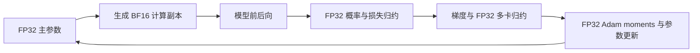

# 数值精度选择与 One-Shot OPD 对齐

本文面向已经了解学生、教师和训练循环，但不熟悉浮点数与混合精度的读者。“数值精度”指计算和存储所用的浮点格式；MATH 正确率是任务成绩，二者不能混称。后续数学对照以 One-Shot OPD 的固定公开版本为参照，优先保持其学生混合精度，再明确列出算法与资源调度差异。

生产实验推荐继续采用 FP32 学生主参数、BF16 前后向的主要矩阵运算、FP32 梯度归约与 Adam moments，以及 BF16 教师和生成。概率、log-prob、KL／reward 中心至少用 FP32。当前 MirrorOPD 的主要数值设置已经与该上游版本一致；把所有参数和缓存一起改成 BF16，不符合这一对齐目标。

## 浮点格式提供的两种能力

浮点（Floating Point，FP）数使用符号、指数和有效数字表示一个数。FP32、FP16 分别表示 32 位和 16 位浮点格式；BF16 来自 Brain Floating Point，也是 16 位格式。指数决定能覆盖多大的数值范围；有效数字决定相近数能否区分。位数相同的两种格式可以在这两方面作不同取舍。

| 格式             | 每元素字节 | 指数位／显式小数位 |     最大有限值，近似 |     1 附近相邻数间隔 | 主要用途                     |
| ---------------- | ---------: | ------------------ | -------------------: | -------------------: | ---------------------------- |
| FP64，`float64`  |          8 | 11／52             | $1.80\times10^{308}$ | $2.22\times10^{-16}$ | 小规模数学参照和梯度核验     |
| FP32，`float32`  |          4 | 8／23              |  $3.40\times10^{38}$ |  $1.19\times10^{-7}$ | 主参数、优化器状态、概率归约 |
| FP16，`float16`  |          2 | 5／10              |                65504 |  $9.77\times10^{-4}$ | 有配套损失缩放的半精度训练   |
| BF16，`bfloat16` |          2 | 8／7               |  $3.39\times10^{38}$ |  $7.81\times10^{-3}$ | 本项目的主要模型计算和推理   |

表中间隔是 `torch.finfo(dtype).eps`，不是所有数值位置的固定绝对误差。数变大，绝对间隔也会变大；舍入误差还取决于实际运算。上述数值可用以下 CPU 代码检查，不需要初始化 CUDA：

```python
import torch

for dtype in (torch.float64, torch.float32, torch.float16, torch.bfloat16):
    info = torch.finfo(dtype)
    print(dtype, torch.empty((), dtype=dtype).element_size(), info.max, info.eps)
```

BF16 与 FP32 的指数位数相同，因此 BF16 比 FP16 更能容纳大的激活或梯度；FP16 在相同数值量级能区分更细的差别。BF16 仍有明显舍入误差，不能把它理解为“精度等于 FP32、显存减半”。低精度运算中的累加方式也依赖具体 kernel 和后端设置[^pytorch-numerics]。

FP16 常配合损失缩放：先把 loss 放大，让小梯度更容易保留，反向后再还原梯度。它不能修复所有前向溢出。BF16 通常不需要因 FP16 的窄指数范围而使用这种缩放。混合精度训练仍需保留足够精度的参数更新和累加状态[^nvidia-mixed]。

## 一次训练有多处独立的精度选择

### checkpoint、主参数与前向副本

checkpoint dtype 是权重文件的存储格式。将 BF16 checkpoint 读成 FP32，只会精确表示文件里已有的 BF16 数值，不会恢复保存前丢失的信息。后续更新可以在 FP32 上累积新的细小变化。

学生主参数是优化器实际更新的长期权重。设某个参数为 1，一次更新量为 $10^{-6}$。FP32 能表示这次变化，直接把结果存回 BF16 时，这次变化会被舍入掉。以下是表示能力的示例，不是完整 AdamW 模拟：

```python
import torch

print(torch.tensor(1.0, dtype=torch.float32) - 1e-6)
print(torch.tensor(1.0, dtype=torch.bfloat16) - 1e-6)
```

保留 FP32 主参数、每次计算时生成 BF16 前向副本，可以同时保留细小更新和较低的矩阵计算成本。全分片数据并行（Fully Sharded Data Parallel，FSDP）、offload 和混合精度共同管理这些状态。offload 将暂不使用的参数或优化器状态移到 CPU，改变驻留位置而不改变数值格式；“权重文件是 BF16”不足以说明训练时只有一份 BF16 权重。

### 矩阵运算、梯度归约与优化器

BF16 前向不表示每个中间量和累加器都为 BF16。自动混合精度按算子选择计算方式，底层矩阵 kernel 也有自己的累加和输出规则。反向中的主要矩阵运算同样受低精度计算影响；最后将梯度转成 FP32，不会恢复先前舍入掉的信息。

梯度归约是多 GPU 汇总梯度的通信步骤，和单个矩阵乘法内部的累加不同。当前使用 FP32 归约，避免再为通信把分片梯度压低精度。AdamW 的一阶、二阶 moments 在当前 FP32 主参数配置下保留 FP32，避免长期状态跟着低精度舍入。



该图表示主要数据关系，不能据图把梯度归约看成发生在反向之后的单一同步点。FSDP 可以在反向过程中逐包装单元通信。

### 教师、生成与概率证据

教师不更新参数，不需要学生那样的 Adam 状态。当前教师权重和主要前向计算采用 BF16，输出 log-prob 和幂均值 reward 的计算至少采用 FP32。

生成由独立 vLLM 副本执行，当前权重和默认键值缓存（Key/Value cache，KV cache）使用 BF16。KV cache 是生成时的注意力状态，与 BPO／MDPO 保存的冻结概率证据分别管理。降低 KV dtype、降低训练 cache dtype、改变学生主参数 dtype，是三种不同的实验改动。

概率归一化、极小尾部、log-prob 差以及中心化减法容易放大舍入影响。当前[概率实现](../src/mirroropd/core/distributions.py)与[信号实现](../src/mirroropd/core/signal.py)对 BF16／FP32 输入使用 FP32 概率运算，对 FP64 输入保留 FP64。模型先以 BF16 产生 logits，再升 FP32 归约，可以减少后续误差，但不能恢复 logits 计算已经损失的信息。

### TF32、FP8 与量化

TensorFloat-32（TF32）是部分 NVIDIA GPU 执行 FP32 矩阵运算时可采用的计算模式，张量仍占 FP32 存储。它使用较短的输入有效数字，不能当作另一种两字节权重格式；严格 FP32 数值对照需记录并控制 TF32 设置。数学上相同的分块、批处理或不同引擎计算，也不保证逐位相同[^pytorch-numerics]。

FP8、INT8／INT4 权重量化、低精度 KV 和低精度优化器需要各自的算子、缩放及误差验证。当前 Job 的 `Precision` 仅接受 `fp32` 和 `bf16`，五个字段也不独立配置 TF32 或 BF16 GEMM 的内部归约开关；严格数值参照需额外保存实际后端设置。这些其他存储格式不属于已交付选项。为了对齐 One-Shot OPD，先不把它们加入基线。

## One-Shot OPD 的固定版本与当前映射

参照版本为 `Thinking-Space/One-Shot-OPD` 提交 `6b6b1782cc3f04749dd077de19353f839f6bc048`。论文没有把所有数值 dtype 分别列出；下面依据该提交的 recipe、FSDP engine 与 teacher worker，而非将代码默认值追认为每次论文运行的实测配置[^oneshot-paper][^oneshot-recipe][^oneshot-engine][^oneshot-teacher]。

| 环节               | One-Shot OPD 固定代码                 | 当前 MirrorOPD                                 | 对齐判断                                     |
| ------------------ | ------------------------------------- | ---------------------------------------------- | -------------------------------------------- |
| 学生主参数         | FSDP `model_dtype=fp32`               | `precision.parameters=fp32`                    | 一致                                         |
| 学生计算参数       | mixed precision BF16                  | `precision.forward=bf16`                       | 一致                                         |
| 学生归约／buffers  | FP32／FP32                            | `precision.reduction=fp32`／`buffers=fp32`     | 一致                                         |
| 学生 Adam moments  | 当前默认 FP32 主参数对应 FP32 moments | 同左                                           | 一致；保存实际 optimizer state dtype         |
| 教师参数与主要前向 | `MODEL_DTYPE=bfloat16`                | `precision.teacher=bf16`，共享 forward 为 BF16 | 一致                                         |
| 教师 FSDP buffers  | teacher worker 配置 BF16              | compiler 的共享 mixed policy 为 FP32           | 存在配置差异，需按实际 buffer 核验影响       |
| vLLM 生成          | BF16                                  | 由 `precision.forward=bf16` 编译为 BF16        | 一致                                         |
| 概率与中心         | teacher Top-K 归一化显式升 FP32       | 概率、signal、中心至少 FP32                    | 核对逐算子语义，不能据此宣称两条梯度程序相同 |

因此，推荐显式保留当前设置：

```json
{
    "precision": {
        "parameters": "fp32",
        "teacher": "bf16",
        "forward": "bf16",
        "reduction": "fp32",
        "buffers": "fp32"
    }
}
```

`precision.teacher` 控制教师初始化参数类型；当前[编译器](../src/mirroropd/integrations/verl/compiler.py)把 `forward`、`reduction`、`buffers` 组成的 mixed policy 同时传给 actor 和教师 ref。只把 `teacher` 改成 FP32，不等于教师主要前向已经改为 FP32。`forward` 还会改变生成 dtype，不是只影响学生输出层的局部选项。

纯 FP32 适合小规模数值参照，成本与原生 kernel 选择均有变化。当前固定后端会为 FP32 FSDP forward 将 FlashAttention 路径切到 SDPA；该保护不等于所有模型、长度和 FP32 rollout 组合已经验证。正式数学比较继续使用上面的混合精度，不把全 FP32 原生训练当默认路径。

在[运行指南](运行与复现.md)所述的已安装环境中，以下命令仅展开并校验配置，不读取占位模型目录或启动 GPU，可用于确认显式精度字段：

```bash
python -m mirroropd plan \
  --recipe math-four-gpu --models deepseek-justrl --dataset dapo-math \
  --var model_root=/models --var data_root=/data \
  --algorithm on_policy \
  --set precision.parameters=fp32 --set precision.teacher=bf16 \
  --set precision.forward=bf16 --set precision.reduction=fp32 \
  --set precision.buffers=fp32 --set logging.wandb.enabled=false \
  --output runs/precision-alignment-plan.json
```

## 后续数学实验的对齐顺序

精度先保持上述组合，再逐项固定数据与训练协议。当前配方与论文默认值仍有以下差异[^oneshot-paper]：

| 控制项                     | One-Shot OPD 论文数学设置                             | 当前数学配方                                   | 后续比较处理                                            |
| -------------------------- | ----------------------------------------------------- | ---------------------------------------------- | ------------------------------------------------------- |
| 学生／教师                 | DeepSeek-R1-Distill-Qwen-1.5B／JustRL-DeepSeek-1.5B   | 相同模型对                                     | 固定实际权重 revision、tokenizer 与模板                 |
| batch／每 prompt 回答数    | 64／1                                                 | 64／1                                          | 保持一致                                                |
| 训练 prompt／response 上限 | 1024／7168                                            | 2048／7168                                     | 论文复现用 1024，并核验保留的输入；其他长度单列         |
| AdamW／学习率              | betas=(0.9,0.999)，$10^{-6}$                          | 相同                                           | 同时记录 eps、scheduler、warmup，未披露值不补称论文设置 |
| weight decay／梯度裁剪     | 0.01／1.0                                             | 0／2.0                                         | 对齐组显式覆盖，既有结果保留原条件                      |
| 训练温度／top-p            | 1／1                                                  | 1／1                                           | 同时固定 top-k、终止规则及采样 seed                     |
| 数学评测                   | 每题 16 次，response31744；公开 recipe T0.7／top-p0.9 | 相同主要采样配置                               | 固定逐题输入、scorer 和完整样本审计                     |
| 训练预算                   | 主现象 300 步；部分实验延长                           | 50 outer；MDPO/BPO 每轮 16 inner               | 同时报 outer、optimizer 更新数、生成 token 与耗时       |
| 数学主实验监督             | Student Top-16 目标；机制实验另用 sampled-token       | 幂均值信号、Top-J＋tail 中心和独立动作积分选项 | 属于算法差异，不能只按数字 16 声称已经对齐              |

公开 launcher 默认普通 prompt4096、one-shot prompt8192、Top-K reward 关闭，和论文数学表格不同。复现论文应显式覆盖，而不能直接照抄 launcher 默认值。原脚本默认 8 卡，教师 micro-batch24、动态组包和生成预留 0.75，也不能只改卡数后当作安全的四卡设置；容量推算见[显存报告](2026-10-17-显存优化与分阶段测量.md)。

One-Shot OPD 的 Student Top-16 训练目标与本仓库 `topj_tail` 中心不是同一个对象。当前 `on_policy` 选择也不会自动切换成上游的 Top-16 梯度程序。论文数学主实验的严格基线应使用固定上游实现，或经过独立梯度核验的新接入；当前只能逐项说明已对齐的控制变量，不能标成完整论文复现。

对 BPO／MDPO 的算法研究，保持 κ、η、中心与动作积分为显式实验变量。为对齐基线而改变这些量，会改变研究目标，必须单列条件。优先对齐数值计算和数据／优化器／评测协议，再按生成预算、更新预算或时间预算分别比较。

## 精度选择与缓存选择分别验证

改变 dtype 会改变数值舍入和存储成本；改变 full-vocab／sampled 积分会改变梯度估计；改变缓存或重算策略会改变状态复用与执行成本。三者分别记录，才能判断结果差异来自哪里。

后续生产默认保持与上游相近的 BF16 计算和 FP32 更新。小规模公式参照用 FP64；局部梯度与 kernel 比较用明确记录的 FP32／TF32 设置。任何更低精度缓存、FP8 或量化方案都作为独立消融，不并入基线。

完整词表算出一个 KL 标量，并不要求长期保存完整分布；当前标量中心与完整动作积分的差别、重算方案和现有缓存限制见[算法与实现](算法与实现.md#完整词表标量动作积分与缓存的区别)。真实显存结果、正常四卡量级和测量边界以[显存报告](2026-10-17-显存优化与分阶段测量.md)为准。

### 参考文献

[^pytorch-numerics]: PyTorch contributors. Numerical accuracy. PyTorch 2.7 documentation. [浮点计算、TF32 与低精度归约](https://docs.pytorch.org/docs/2.7/notes/numerical_accuracy.html).

[^nvidia-mixed]: NVIDIA. Train With Mixed Precision. NVIDIA Deep Learning Performance documentation. [混合精度训练与参数更新](https://docs.nvidia.com/deeplearning/performance/mixed-precision-training/index.html).

[^oneshot-paper]: Fu, Z., He, B., Zuo, Y., et al. Rethinking On-Policy Distillation of Large Language Models II: One Training Example. arXiv 2026. [论文全文](https://arxiv.org/html/2609.04172v1).

[^oneshot-recipe]: Thinking-Space. One-Shot-OPD recipe，固定提交 6b6b1782cc3f04749dd077de19353f839f6bc048. GitHub 2026. [公共配置](https://github.com/Thinking-Space/One-Shot-OPD/blob/6b6b1782cc3f04749dd077de19353f839f6bc048/recipe/_common.sh).

[^oneshot-engine]: Thinking-Space. One-Shot-OPD FSDP engine，固定提交同上。GitHub 2026. [学生参数与计算精度](https://github.com/Thinking-Space/One-Shot-OPD/blob/6b6b1782cc3f04749dd077de19353f839f6bc048/verl/verl/workers/engine/fsdp/transformer_impl.py).

[^oneshot-teacher]: Thinking-Space. One-Shot-OPD teacher worker，固定提交同上。GitHub 2026. [教师模型与精度策略](https://github.com/Thinking-Space/One-Shot-OPD/blob/6b6b1782cc3f04749dd077de19353f839f6bc048/verl/verl/workers/fsdp_teacher_worker.py).
