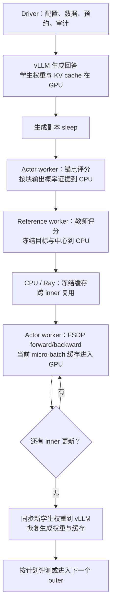
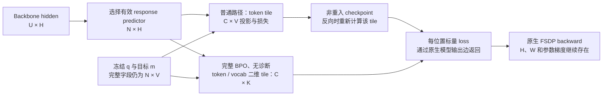

# MirrorOPD 显存优化与分阶段测量

MirrorOPD 的显存优化调整冻结缓存的布局、评分输出运输、语言模型输出层的投影和概率归约。信号、中心估计器与动作积分各自保持原有语义；改变 Top-J、诊断策略或 sampled/full 是另一项实验选择。本报告沿 CLI、原生 verl、FSDP worker、缓存运输和目标内核解释当前实现，并把可计算的存储量与实际测量分开。

18 个固定输入 CUDA 条件均通过参数梯度比较，但分块没有在所有条件下降低峰值。真实 1.5B 师生模型的短程完整 BPO 中，锚点和教师评分的 worker allocated 峰值分别下降约 221 MiB、697 MiB，训练只下降约 73 MiB；整卡采样峰值从 16.571 GiB 变为 16.567 GiB。当前证据支持局部工作区缩减，不能据此宣称整套训练显著节省显存或加速。

[测量汇总](../results/memory-audit-20261017/native-summary.json)、[CUDA eager](../results/memory-audit-20261017/head-eager.json)、[CUDA chunked](../results/memory-audit-20261017/head-chunked.json)和[证据文件清单](../results/memory-audit-20261017/evidence-files.json)保存数值与内容身份。生产代码按 `ad52997` 的字节快照冻结；完整执行源码还由各 run 的 source_id 固定。维护工具升级中的 UTC 别名和配置表达式整理不作为性能改动。评分 staging 的 Top-J 元数据预算另有边界修复，默认 J=16 的分块大小保持一致。

## 进程、阶段与缓存生命周期

每个 outer 先用当前学生生成回答，再冻结锚点概率和教师信号，随后做 inner 更新。锚点是冻结的概率证据，不额外复制一份学生模型。学生训练实例与冻结教师通过原生 FSDP 调度；vLLM 是独立的生成实例，TP=1 时每张生成卡保存完整学生权重。



[编译器](../src/mirroropd/integrations/verl/compiler.py)把严格 Job 映射到固定 verl：学生 FP32 主参数、BF16 前向、FP32 梯度归约，教师 BF16，参数与优化器可 offload。FSDP 的 train/eval context 负责阶段进入和退出时的状态迁移；[后端补丁](../src/mirroropd/integrations/verl/backend.patch)在 worker 的完整 train/infer 边界采样，在训练前让生成副本休眠，在更新后同步权重。offload、梯度检查点和 vLLM sleep 原已属于训练框架能力，不能全部算成此次分块内核的收益。

同一张卡可能同时有训练 worker、vLLM engine 和通信缓冲。参数 offload 或 vLLM sleep 也不意味着 CUDA context 消失。一个 worker 的 PyTorch 峰值与整张卡的占用描述不同对象。

## 尺寸、精度与计量对象

| 符号        | 含义                                                                           |
| ----------- | ------------------------------------------------------------------------------ |
| $S$         | 运输时的序列槽位总数，包括 prompt 与 padding，例如 $B(P_{max}+R_{max})$        |
| $U$         | remove-padding 后送入模型的有效 prompt 与 response 位置数                      |
| $N$         | 有效 response predictor 数，$N\le U\le S$                                      |
| $N_\mu$     | 当前 GPU micro-batch 的有效 response predictor 数                              |
| $V,H$       | 合法词表大小、隐藏宽度；物理输出层可能有额外 padded vocabulary                 |
| $J,C,K$     | Top-J 支持大小、token 分块、词表分块                                           |
| $P_s,P_T,D$ | 学生参数量、教师参数量、FSDP 数据并行度                                        |
| $s_z,s_p$   | logits 与概率证据的每元素字节数；正常 BF16 前向取 $s_z=2$，FP32 概率取 $s_p=4$ |

GiB、MiB 分别按 $2^{30}$、$2^{20}$ 字节计算。以下缓存预算讨论生产 FP32 概率；FP64 数学参照有不同的每元素成本。

PyTorch 的 `memory_allocated` 统计当前进程中张量占用的分配器内存，`memory_reserved` 统计缓存分配器管理的内存。缓存块释放了张量后仍可保留，`empty_cache` 不能释放仍在使用的张量；官方 CUDA 内存说明[^pytorch27]给出了这些指标的区别。NVML 则观察整卡，包含其他进程与不受该 PyTorch 分配器统计的分配。不能把多个进程在不同时刻的峰值相加，称为整卡同时峰值。

任意时刻的预算可以分解为

$$
M(t)=M_{state}(t)+M_{cache}(t)+M_{activation}(t)+M_{collective}(t)+M_{workspace}(t).
$$

阶段峰值是 $\max_{t\in phase}M(t)$，并不等于各项独立最大值之和。后文给出参数与缓存的可计算项；激活、FSDP 预取、临时聚合及分配器保留的具体峰值由执行路径和时序决定，不用总量差值冒充某一项的实测。

### 按阶段组合预算

下表在同一时刻组合主要张量项。$M_{\theta,s}$、$M_{\theta,T}$ 为当时驻留 GPU 的学生/教师参数分片，$G$ 为 FSDP 聚合与通信工作区，$A_f,A_b$ 为前向/训练激活，$W$ 为该阶段的投影、归约或运输临时量。$M_{state,s}$ 包含训练时实际加载的参数、梯度和优化器状态；offload 后不能继续按全部驻留计数。

| 阶段与进程      | 主要 CUDA 存储表达式                                  | 需要保留的条件                                       |
| --------------- | ----------------------------------------------------- | ---------------------------------------------------- |
| vLLM 生成       | $2P_s+M_{KV}+A_{decode}+W_{decode}$                   | TP=1、BF16 权重；整卡还包含其他进程/context          |
| 学生锚点评分    | $M_{\theta,s}+G_s+A_f+M_{evidence,\mu}+W_{score}$     | eager 投影 U 位置，chunked 选择 N 个 response 并分块 |
| 教师评分        | $M_{\theta,T}+G_T+A_f+M_{q,\mu}+W_{score}$            | 完整中心的 anchor 输入仍含 $N_\mu V$ 字段            |
| 学生 inner 训练 | $M_{state,s}+G_s+A_b+M_{cache,\mu}+W_{head/backward}$ | 完整缓存、VH 权重梯度、FSDP 临时量仍需容量           |
| 权重同步        | $M_{actor,live}+W_{gather/send}+M_{vLLM,live}$        | 两侧权重可能重叠，KV 的恢复时机由后端控制            |
| vLLM 评测       | 与生成式相同，使用评测的序列数和长度                  | 评测预算与训练预算分别计算                           |

这些表达式用于预算和定位，没有把未知临时项设为零。实际 worker allocated、reserved 与整卡样本在后面的同一阶段分别列出。

## 冻结缓存：只保留需要的字段与有效 response

[缓存实现](../src/mirroropd/core/cache.py)把完整词表字段 `anchor_full`、`target_full` 存成 $[N,V]$，按 response offsets 运输。标量、Top-J IDs 和 Top-J 概率仍沿序列槽位布局。[适配层](../src/mirroropd/integrations/verl/adapter.py)独立处理这两种 offsets，避免把 prompt 与 padding 扩成完整词表；行重排和切分使用原生 nested-aware 操作。

令完整字段数为

$$
F=\mathbf 1_{center=full}+\mathbf 1_{integration=full}.
$$

完整动作积分要求完整中心，因此合法组合的 $F$ 为 0、1 或 2。完整字段 payload 为

$$
M_{full}=FNVs_p.
$$

若把同样字段展开到全部序列槽位，则需要 $FSVs_p$；仅布局变化节省 $F(S-N)Vs_p$。这个比较是存储表达式，不是把当前 eager 分支当作旧版 padded 实现。当前 eager 和 chunked 已共同使用紧凑缓存。

正常非最小缓存的保守稀疏 payload 为

$$
M_{sparse}=S\left[1+8+J(8+s_p)+4s_p+8J\mathbf 1_{diagnostics=full}\right].
$$

其中 valid 为 1 字节，action 与支持 IDs 为 int64，四个标量字段为锚点 tail/action、教师 action 和 reward center。J=16、FP32 时，基础缓存为每槽 217 字节，full 诊断增加教师支持 IDs 后为 345 字节。尚未完成教师评分的 anchor 只有每槽 209 字节。

`mdpo + sampled + diagnostics=none` 的系数不需要完整中心与支持集。[桥接层](../src/mirroropd/integrations/verl/bridge.py)为它建立显式 `action_only` 上下文，只保留 valid、action、锚点 action LP 与教师 action LP：

$$
M_{action-only}=17S.
$$

该路径减少保存与运输的证据，不会省去学生 sampled log-probability 所需的全词表归一化计算。BPO sampled 仍需要更新中的学生中心，不能复用这个最小合同。

### 实际缓存与容量上界

真实短程运行的 $B=4$，prompt/response 上限均为 256，因此 $S=2048$；实际 response predictor 为 $N=644$，合法词表 $V=151665$。单个 anchor 完整字段为 390,689,040 字节，连同 $209S$ 稀疏字段，实际 `anchor.created` 记录为 **391,117,072 字节**，与表达式一致。

完整冻结缓存两字段加稀疏 payload 约为 745.60 MiB。按 $S$ 展开两个完整字段则约需 2.314 GiB，仅完整字段布局就有约 68.6% 的节省。预检采用最大 $N=4\times256=1024$，而非已观察到的 644；相应预算约 1.158 GiB，默认 2 GiB 可以通过。

常用数学配方 $B=64,P_{max}=2048,R_{max}=7168$ 的最坏完整字段仍约为 **518.4 GiB**，加稀疏字段约 518.5 GiB，默认 2 GiB 会拒绝。相同槽位数下，Top-J=16、full 诊断的稀疏 payload 约为 194.06 MiB，MDPO action-only 约为 9.56 MiB。分块没有消除完整证据的 $NV$ 下界；切换估计器应作为不同的科学条件记录。

`cache_bytes` 只约束冻结字段 payload，不约束整个主存或 GPU。`old_log_probs`、TensorDict/Ray 运输、重排与拼接副本、模型及优化器另占空间。[容量检查](../src/mirroropd/runtime/memory.py)在预约 GPU 前用最坏响应长度检查，评分时再按实际有效前缀数检查。

## 评分与输出层的分块执行



### 分块评分与主存输出

[Projection.score](../src/mirroropd/integrations/verl/projection.py)先选择有效 response hidden，再按块计算线性投影、锚点统计或教师目标。每块的最终证据立即 `detach().cpu()`，避免把整次评分的输出列表留在 GPU。主存中的分块列表随后需要 `cat`，拼接时旧分块与新连续缓冲可同时存在，因此局部主存瞬时量可能接近两份输出 payload。

评分 tile 采用保守容量

$$
\rho=FVs_p+\max(512,m_{sparse,one}),\qquad
C_{score}=\min\left(C,\left\lfloor\frac{B_{stage}}{\rho}\right\rfloor\right).
$$

$B_{stage}$ 为 `scoring_buffer_bytes`，$m_{sparse,one}$ 由同一缓存容量函数计算。无法放入一个 predictor 时明确失败。原先固定的 512 字节 allowance 会低估较大 J 的支持 IDs、概率和诊断；例如 J=64 时，anchor 的 IDs 与概率就需 768 字节。现在有对应拒绝反例及默认词表回归测试。真实测量的 J=16、完整两字段、64 MiB staging 预算仍给出 $C_{score}=55$。

该预算针对输出 staging；输入缓存、backbone、投影、幂均值 reward 的临时量仍在 GPU。教师评分前仍可能已有完整 anchor 字段，完整证据也仍需进入训练 micro-batch。

### 一般训练路径

原生 eager 模型先投影 remove-padding 后的全部位置，主要 logits 为 $[U_\mu,V]$，之后损失再选择 response。分块路径将有效 response hidden 打包为 $[N_\mu,H]$，按 token tile 计算输出层及完整损失，再通过非重入 checkpoint 丢弃中间量，反向时重算。

一般词表工作区从全位置 logits 与其概率临时量，改为与 $CV$ 成比例的 tile。仍保留 backbone 激活、打包 hidden、原模型参数与 $VH$ 参数梯度；检查点增加投影和损失的重算。减少 autograd 保存的 storage 不保证降低执行中的 CUDA 峰值。

[概率实现](../src/mirroropd/core/distributions.py)按 token/vocab 块累加 log-normalizer，按需读取 action/head LP。selected LP 的反向仍包括归一化项；完整条件目标需要完整分布梯度时使用真正的 log-softmax。不能把 sampled action LP 直接替换成 raw action logit。

### 完整 BPO 的二维投影

仅 `bpo + integration=full + diagnostics=none` 进入[二维线性内核](../src/mirroropd/core/linear_bpo.py)。令 raw logits 为 $z=hW^\top+b$，概率温度为 $\tau$，冻结锚点为 $q$，冻结归一化目标为 $m$，并定义 $C_qx=x-\mathbb E_qx$。由于 $q$ 的质量为 1，

$$
\log p=z/\tau-\log\sum_v\exp(z_v/\tau),
$$

$$
C_q(\log p-\log m)=C_q(z/\tau-\log m).
$$

完整 BPO 的条件损失为

$$
L=\frac{1}{2\eta}\sum_vq_v e_v^2,\qquad
e_v=z_v/\tau-\log m_v-\sum_uq_u(z_u/\tau-\log m_u).
$$

对 $z_j$ 求导时，$\partial e_v/\partial z_j=(\mathbf1_{v=j}-q_j)/\tau$，且 $\sum_vq_ve_v=0$，所以

$$
\frac{\partial L}{\partial z_j}
=\frac{1}{\eta\tau}\sum_vq_ve_v(\mathbf1_{v=j}-q_j)
=\frac{q_je_j}{\eta\tau}.
$$

外部固定 token 权重为 $a_i$ 时，设 $G_{iv}=a_iq_{iv}e_{iv}/(\eta\tau)$，线性层反向为

$$
\nabla_hL=GW,\qquad \nabla_WL=G^\top h,\qquad
\nabla_bL=\sum_iG_i.
$$

因此可以按 $C\times K$ tile 计算中心与残差，反向再次生成 tile 并累加梯度，无需学生 softmax 或完整 $N_\mu\times V$ logits。代码还先减去一个公共 logit，降低大公共偏置对相减的影响。

这里没有消除完整 q/target 的 $FN_\mu V$ 存储或 $VH$ 参数梯度。自定义反向使用概率精度累加，必要时还要转换回投影 dtype；FP32 输出权重梯度缓冲本身仍约为 $4VH$。当前只支持一阶梯度。full 诊断会转回一般路径，不能沿用二维工作区结论。

## 参数、FSDP 与生成缓存的量级

真实师生模型各有 1,777,088,000 个参数，safetensors 存储均为 BF16，共 3,554,176,000 字节。隐藏宽度 1536，物理词表 151936，合法共享词表 151665。下表为张量存储项，不把这些项假设为同时驻留的实际峰值。

| 对象与条件                      | 表达式                    |  单卡量级 |
| ------------------------------- | ------------------------- | --------: |
| FP32 学生主参数分片，D=4        | $4P_s/D$                  | 1.655 GiB |
| FP32 学生梯度分片，D=4          | $4P_s/D$                  | 1.655 GiB |
| 两份 FP32 Adam moment 分片，D=4 | $8P_s/D$                  | 3.310 GiB |
| 上三项全部驻留的条件量          | $16P_s/D$                 | 6.620 GiB |
| BF16 教师参数分片，D=4          | $2P_T/D$                  | 0.827 GiB |
| TP=1 的独立 vLLM 学生完整权重   | $2P_s$                    | 3.310 GiB |
| 物理 LM head 的 FP32 梯度       | $4\times151936\times1536$ | 0.869 GiB |

FSDP 的临时 all-gather 与预取还与包装单元参数量 $P_{unit}$ 有关，BF16 参数聚合项与 $2P_{unit}$ 同量级；不能只用 $P_s/D$ 估算前后向峰值。offload 决定这些状态何时驻留 CPU 或 GPU，不改变其字节总量。评分通常不需要学生 Adam 状态，训练则要加载或更新这些状态。

当前 Qwen2 有 28 层、2 个 KV heads、head dimension 128。BF16 KV 的逻辑存储为

$$
M_{KV}=2L n_{KV}d_{head}s_{KV}\sum_iT_i
=28672\sum_iT_i\ \text{bytes}.
$$

即每个缓存 token 28 KiB。vLLM 按 block 和可用预算预分配池，实际保留量由 block 数决定，不等于当前活跃 token 的上述逻辑量。vLLM 0.10 的 worker 源码[^vllm010]以配置的设备预算扣除非 KV 内存后确定 KV 空间；`gpu_memory_utilization` 不是整个训练程序的显存上限。

## 测量设计与计量边界

CUDA 内核实验采用 H800、FP32、$N=256,V=32768,H=256$、token tile32、vocab tile4096、seed522，2 次预热、5 次计时，报告中位数。三算法 × sampled/full × none/basic/full 诊断，共 18 个配对条件。两条路径保留相同的非最小缓存以隔离执行策略，不把 MDPO action-only 的裁剪混入该比较。每条件比较 hidden 与输出权重梯度，要求 `atol=2e-6, rtol=2e-4` 且相对 L2 不超过 2e-4。

真实运行使用 DeepSeek-R1-Distill-Qwen-1.5B 学生和 JustRL-DeepSeek-1.5B 教师，固定源快照、四张 H800、FSDP4/SP1/rollout TP1，FP32 主参数、BF16 前向、FP32 归约。输入为 16 条短算术训练 prompt 与 4 条短算术评测 prompt，用来测执行而非正式数学能力。每条路径一个 outer、两个 inner，batch4/micro1，学习率 1e-6，κ=0.5、η=0.2，完整中心与完整 BPO，无诊断，J=16；开启参数、优化器 offload 和梯度检查点。

训练 prompt/response 上限 256/256；初始化和训练后均对四题各生成两次，评测 response128，temperature0.7/top-p0.9。vLLM memory fraction0.15、每 replica 最多 4 条序列。两条路径均实际生成 644 个训练 response predictor，通过完整运行审计。

[阶段测量程序](../experiments/benchmarks/memory_stages.py)同时启用现有 `profile_phases` 与 250 ms NVML 采样。[汇总程序](../experiments/benchmarks/memory_report.py)重新执行 run 审计，配对完整 span，只接受 worker 外层的 `phase_peak` 作为该 worker 的 CUDA 阶段峰值；嵌套 `projection.*` 的计数器继承外层，不能当作单独重置过的峰值。缺失、失败或未闭合 span 会拒绝汇总。

NVML 样本是瞬时整卡峰值的下界；短暂峰值可能落在采样间隔。RSS/PSS 仅在边界读取，表中为各 rank 边界最大值，不是主存阶段峰值。每个模式只运行一次，顺序为 eager 后 chunked；CUDA 初始化、调度和异步数值差异限制耗时比较。BF16 两条执行路径不承诺逐位相同的多步训练轨迹。

## 测量结果

### 固定输入 CUDA 内核

下表选择无诊断条件；完整 18 条件见 JSON。峰值为同一进程的 CUDA allocated，包含本实验 resident 张量，排除 backbone、optimizer、通信和 vLLM。

| 算法 / 动作积分   | eager 峰值 MiB | chunked 峰值 MiB | eager 中位 ms | chunked 中位 ms |
| ----------------- | -------------: | ---------------: | ------------: | --------------: |
| on-policy sampled |         226.31 |           257.16 |          6.25 |           33.71 |
| MDPO sampled      |         226.31 |           257.16 |          6.16 |           33.48 |
| BPO sampled       |         226.31 |           257.16 |          7.05 |           41.90 |
| on-policy full    |         448.31 |           321.16 |          0.96 |           15.10 |
| MDPO full         |         384.31 |           321.16 |          0.90 |           13.16 |
| BPO full          |         293.31 |           262.31 |          9.29 |           23.18 |

18 个条件的参数梯度均通过阈值。sampled 的保存 storage 减少，但实际 allocated 峰值上升约 31 MiB，运行也更慢。full 条件降低峰值，但仍有分块、归约和重算成本。结果不支持把 checkpoint 保存量下降直接解释为 CUDA 峰值下降。

### 真实模型分阶段显存

worker 列取四个 rank 中最大的 PyTorch allocated 阶段峰值，训练取两次 inner 的最大值；NVML 列取对应 driver 阶段内四张卡的最大样本。没有 worker span 的阶段使用“—”。

| 阶段                         | worker eager MiB | worker chunked MiB | 整卡 eager GiB | 整卡 chunked GiB |
| ---------------------------- | ---------------: | -----------------: | -------------: | ---------------: |
| 准备至初始评测前，含模型加载 |                — |                  — |         14.663 |           14.663 |
| 新 rollout                   |                — |                  — |         14.645 |           14.645 |
| 锚点评分                     |          3028.61 |            2807.61 |          6.151 |            5.878 |
| 教师评分                     |          2901.03 |            2204.02 |          6.096 |            6.038 |
| 两次 inner 训练              |         10477.10 |           10404.07 |         16.571 |           16.567 |
| 更新后至末评测前，含权重同步 |                — |                  — |         12.432 |           14.532 |
| 初始化与末尾评测             |                — |                  — |         15.763 |           15.782 |

准备和权重同步区间没有独立 worker 峰值插桩；它们按相邻 driver 事件的墙钟边界汇总 NVML。权重同步区间约 1.3 秒，采样结果尤其不能当作精确瞬时峰值或单一组件的占用。

教师评分的 live allocated 少约 697 MiB，但 reserved 峰值只从 3308 MiB 变为 3248 MiB，整卡样本下降约 60 MiB。训练 allocated 少约 73 MiB，reserved 峰值只从 13970 MiB 变为 13966 MiB；全程序整卡峰值也只少约 4 MiB。缓存分配器保留空间与多个 CUDA context 的存在，使局部张量收益不能直接变成同幅度整卡收益。

### 边界主存与耗时

| worker 阶段 | eager RSS GiB | chunked RSS GiB | eager PSS GiB | chunked PSS GiB |
| ----------- | ------------: | --------------: | ------------: | --------------: |
| 锚点评分    |         5.741 |           5.943 |         5.276 |           5.505 |
| 教师评分    |         8.622 |           9.078 |         7.980 |           8.462 |
| inner 训练  |         9.268 |           9.715 |         8.443 |           8.910 |

这些是单 rank 的最大边界读数。RSS 会重复计算共享页，不能乘四当作物理主存；PSS 也不能由不同 rank 的独立最大值相加得到同时峰值。CPU 输出列表、拼接和状态 offload 都需要主存，预算不能只看 GPU。

| driver 阶段                | eager 秒 | chunked 秒 |
| -------------------------- | -------: | ---------: |
| rollout                    |    2.080 |      1.998 |
| 锚点评分                   |    5.885 |      3.346 |
| 教师评分                   |    6.110 |      6.252 |
| 两次 inner 的 optimization |    8.657 |      9.281 |
| 最后评测                   |    1.383 |      1.383 |

首次评测包含额外启动/预热，分别为 37.118、55.177 秒，不与末尾评测混合求平均。当前单次顺序对照只描述这组执行，不能给出稳定吞吐排名。固定输入 CUDA 内核的 5 次中位数也只覆盖该内核范围。

## 配置选择与适用范围

| 配置                               | 当前作用与代价                                        |
| ---------------------------------- | ----------------------------------------------------- |
| `memory.cache_bytes`               | 完整冻结 payload 的主存预算；超限失败，不自动换估计器 |
| `memory.scoring_buffer_bytes`      | 评分输出 tile 的保守 staging 预算，不是 GPU 总量上限  |
| `memory.token_chunk_size`          | 一般投影与评分的 token 上界；小块增加调用与重算       |
| `memory.vocab_chunk_size`          | 二维 BPO 的词表块；一般路径仍有完整 V 的 token tile   |
| `memory.projection`                | `eager` 为完整原生投影，`chunked` 改执行与保存方式    |
| `memory.teacher_parameter_offload` | 独立选择教师参数 offload；null 继承训练参数设置       |
| `memory.profile_phases`            | 在 worker 边界同步并重置 CUDA 峰值，改变计时条件      |

分块输出层当前要求 SP=1、remove-padding、非 fused 的标准线性输出层，明确支持 Qwen2/Qwen3/Llama/Mistral 的该输出合同；自定义 logit 变换不能仅凭相同 model_type 推断等价。完整证据、模型状态和输出权重梯度仍需实际容量预算。

对 sampled 小 batch，当前 CUDA 对照支持保留 eager 作为比较条件，不支持仅因“分块”就优先选择 chunked。完整词表评分有局部峰值收益，但实际训练收益还取决于 $N_\mu,V,H$、FSDP 状态和 KV 池。下一步若要优化整卡峰值，应先核对同一配置下的 reserved、offload 与生成副本生命周期，再做等输入、重复运行的对照。

## 复现与原始证据

以下 GPU 命令使用物理 GPU0–3 或 GPU0，先核对空闲状态，复用项目预约目录。程序只清理自己的进程，不停止其他 Ray 集群。模型文件与软件环境按[运行指南](运行与复现.md)准备。

```bash
PYTHONPATH=src python experiments/benchmarks/memory.py \
  --device cuda --gpu 0 --lease-root /path/to/gpu-leases \
  --execution eager --prefixes 256 --vocab 32768 --width 256 \
  --chunk 32 --vocab-chunk 4096 --iterations 5 \
  --output runs/memory-reproduce/head-eager/summary.json

PYTHONPATH=src python experiments/benchmarks/memory.py \
  --device cuda --gpu 0 --lease-root /path/to/gpu-leases \
  --execution chunked --prefixes 256 --vocab 32768 --width 256 \
  --chunk 32 --vocab-chunk 4096 --iterations 5 \
  --baseline runs/memory-reproduce/head-eager/summary.json \
  --output runs/memory-reproduce/head-chunked/summary.json

PYTHONPATH=src python experiments/benchmarks/memory_stages.py \
  --output runs/memory-reproduce/native --model-root /path/to/models \
  --backend /path/to/pinned-backend --lease-root /path/to/gpu-leases

PYTHONPATH=src python experiments/benchmarks/memory_report.py \
  --input runs/memory-reproduce --output results/memory-reproduced
```

指定匹配环境的 Python，并使用全新输出目录。重跑当前源码会产生新的 source_id；复算原测量应使用归档或原 run 的冻结源码，不以相近提交名称代替字节身份。数值输入由固定 seed 生成，头部基准的梯度文件保留在各输出目录。

[原始证据归档](../data/memory-audit-20261017/phase-evidence.tar.gz)包含实际 Job、输入身份、逐题输出、事件、NVML、完整源码快照及分析用程序，文件 SHA-256 由清单固定。`make data` 按[data manifest](../data-manifest.json)恢复 tar，再用 Python `tarfile` 的 `filter="data"` 解压到新的磁盘目录。归档不包含模型权重、checkpoint 或大型合成梯度；模型内容身份与外部依赖由各 run 保存。

实现与估计器的更广正确性证据继续见[实现对照](experiments/2026-10-17-幂均值镜像蒸馏实现与估计器对照.md)，本报告只承担显存机制、量级与测量的解释。

### 参考文献

[^pytorch27]: PyTorch contributors. CUDA semantics: Memory management. PyTorch 2.7 documentation. [CUDA 内存与异步执行说明](https://docs.pytorch.org/docs/2.7/notes/cuda.html#cuda-memory-management).

[^vllm010]: vLLM contributors. vllm.v1.worker.gpu_worker. vLLM 0.10.0 documentation. [固定版本 worker 源码与内存预算说明](https://docs.vllm.ai/en/v0.10.0/api/vllm/v1/worker/gpu_worker.html).
