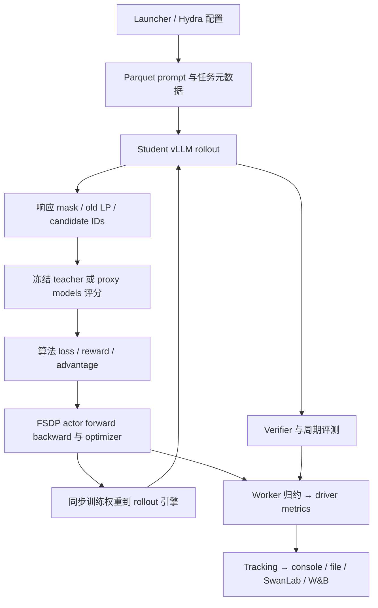

# 上游训练框架与后端审计

本报告保存固定上游版本的执行与数据合同：教师评分怎样到达 loss、分布式归约怎样影响目标、日志字段是否真正到达 logger，以及源码可核实的失败路径。算法定义与固定项目提交见[算法对照](2026-10-15-上游算法语义与源码对照.md)。这些结论不构成当前 MirrorOPD 对全部上游模式、并行布局或恢复功能的支持承诺。

官方 verl 另固定 `fc72e2f384212470868a9928b62baedb9bcc3ff0`，One-Shot 固定 `6b6b1782cc3f04749dd077de19353f839f6bc048`；引用文件均相对于对应仓库。旧审计有 CPU 函数核验，没有六项目完整训练 benchmark。

## 共同执行链及代表入口

### 主链路

每轮 prompt 先由 student 生成，再对已访问的 prefix 和动作进行 teacher forcing 评分。教师通常不在主蒸馏步骤生成替代答案。生成、评分、训练和同步的服务可以并发；`async` agent/server 命名本身不证明跨 outer 采用 stale-policy 异步训练。

| 维度           | ResOPD                                     | TA-OPD                                    | Rethinking                              | A2                                              | One-Shot                                   | LSPD                                        |
| -------------- | ------------------------------------------ | ----------------------------------------- | --------------------------------------- | ----------------------------------------------- | ------------------------------------------ | ------------------------------------------- |
| 算法接入       | distillation registry + 独立 tensor kernel | registry + logits processor               | teacher reward + candidate PPO          | 四模型 prep + 专属 OPD actor/controller         | OPD mixin + teacher worker + PPO           | actor 直接调用 regression kernel            |
| 教师执行       | 独立 vLLM teacher pool                     | 独立 vLLM teacher pool                    | FSDP causal LM 的 RewardModel role      | target base / proxy expert / proxy base scoring | FSDP teacher，与 actor pool 共置并 offload | frozen RewardModelWorker，独立 teacher pool |
| 主要支持       | teacher Top-K + 实际动作                   | teacher Top-K + 聚合 tail；SC 另需动作    | student/teacher/intersection/union 候选 | student candidate set；支持跨 tokenizer 映射    | sampled；可选 student Top-K reward/metric  | sampled；可选 candidate regression          |
| 默认训练形式   | 停止系数的校正梯度                         | direct coarse reverse KL                  | PPO clipped candidate surrogate         | state-centered relative utility + PPO           | sampled teacher-gap + PPO                  | Huber log-prob regression + entropy         |
| 回放           | 发布入口单次 batch 更新                    | SC 有行为 LP correction；非 replay buffer | 主入口新 rollout 更新                   | 编排 OPD/GRPO schedule，非 LSPD FIFO            | 主入口新 rollout 更新                      | RB 明确 CPU FIFO replay                     |
| 内部更新可见性 | outer 汇总                                 | outer 汇总                                | outer 汇总                              | driver cycle + actor RPC count                  | outer 汇总                                 | outer 汇总；RB 内部更新再归约               |

### 主入口设置对照

这些值是固定源码中的代表性发布入口，而不是六项目的公平 benchmark。模型规模、任务、GPU 划分、响应预算、评测协议和更新次数均不同。

| 项目       | 代表模型 / GPU 组织                                                 | 训练生成与 batch                                                   | 主要算法设置                                                    | 评测入口特点                                        |
| ---------- | ------------------------------------------------------------------- | ------------------------------------------------------------------ | --------------------------------------------------------------- | --------------------------------------------------- |
| ResOPD     | Qwen3.5-4B → 27B；4 student + 4 teacher GPU                         | batch8、n1、mini8、epochs1；prompt1024/response2048                | teacher K4、lr1e-6、full-support sampling、无额外 PG/KL/entropy | 发布脚本不测初始；框架默认 greedy n1                |
| TA-OPD     | Qwen3-1.7B → 30B-A3B；6 student + 2 teacher GPU                     | batch72、n4、mini36；prompt1024/response7168                       | K16、lr1e-6、默认 TA；teacher TP1                               | 初始验证；默认 val n1、T0.7、top-p0.95              |
| Rethinking | launcher 指定 student/teacher；8 GPU Slurm 模板                     | n4、K16、mini64；batch 由并行参数生成；response7168                | only_stu、student_p、lr1e-6、PPO                                | 默认 test_freq=-1；主要使用独立离线生成/判分        |
| A2         | target Qwen3-8B、proxy expert/base Qwen3-4B；8 GPU、rollout TP2     | batch1024、n1、mini1024；response16384                             | K16、state baseline、lr1e-6、seq-mean-token-mean                | 初始验证关闭；每 10 步测试；默认 n16、T1            |
| One-Shot   | recipe 可切单/多 teacher 与任务                                     | one-shot 题目重复成 batch，仍持续 student rollout；默认训练 Top-K0 | token_reward_direct + vanilla PPO，额外 KL 关闭                 | 数学 recipe 默认 n16、T0.7、top-p0.9、response31744 |
| LSPD       | student/teacher 受 preflight 合同限制；默认 2 actor + 2 teacher GPU | 64 prompt × n4；普通版 4 updates/outer；RB256 updates/outer        | 默认 Huber 阈值 5、entropy0.1、sampled Top-K0                   | n16、T0.7、top-p0.95、response7168                  |

ResOPD README 表格的 response32768 与实际 launcher2048 不同，本文采用 launcher。TA dataclass 的 clamp 默认值也被 Hydra distillation YAML 的 null 覆盖，发布入口实际不启用该 clamp。类默认值、配置文件和 CLI 覆盖必须沿实际链路核对。

## 官方 verl 的实际调用链

官方 `distillation.enabled` 启动 `MultiTeacherModelManager`，按配置拆分 teacher resource pool，为每个 teacher 创建若干 inference replica。agent loop 在生成 student response 后，把完整 prompt+response token IDs 发给 teacher server 请求 `prompt_logprobs`。server 返回的 `teacher_ids` 与 `teacher_logprobs` 经 pad/unpad 后进入 actor engine。其 loss 有两个入口：完整 logits 处的 callback 计算 teacher-topk loss；最终 loss 处执行 sampled estimator 或聚合 callback 的每位置输出。[^verl-verl-manager] [^verl-verl-loss]

teacher 通过配置 key 路由，single-teacher 自动命中唯一模型；multi-teacher 缺 routing key 或不存在的 key 会报错。teacher 服务管理器核验每个 replica 的 GPU 数与节点边界，支持 vLLM 与 SGLang，并把 Prometheus 与 RLInsight 监控接到 teacher replica。资源布局和 teacher routing 是执行后端的职责，算法侧只需要逐行 teacher identity 及固定版本。[^verl-verl-manager] [^verl-verl-model]

当前 teacher 请求始终使用 temperature=1，非 1 配置只触发警告。它请求一个无关续写 token，以获得全部 prefix 的 prompt 评分；续写不进入目标。vLLM 的 sampled 模式用已有 token LP，topk 模式按返回 rank 挑 teacher 自己的 topk 并丢弃落在 topk 外的已有 token；首位置缺 LP，通过移位和末尾 dummy 把评分转到预测位置坐标。任意 chosen IDs 评分、温度重新归一化与尾部条件采样都没有作为该 teacher manager 的接口暴露。[^verl-verl-manager] [^verl-verl-vllm]

FSDP 的 teacher-topk direct kernel 在 current student 完整 logits 上 gather 冻结 teacher IDs。Ulysses 先把 teacher IDs/LP按sequence切分，loss与模型logits逐位置对齐，再回收完整每位置输出。可选chunked路径以FP32 logsumexp+gather 替代完整 log_softmax 缓冲，减少 forward 临时峰值；它没有定制 backward 以保证全部 saved tensors 也同样有界，chunk 大小不能当成训练显存上界。[^verl-verl-fsdp]

Megatron 保持词表分片。它用跨 TP 的 MAX/SUM 得到全词表 normalizer，global token IDs 映射到 local shard，只有所属 shard 贡献 teacher 项。loss、teacher-active mass 与 diagnostics 经 collective 聚合；custom backward 构造每个 local vocab coordinate 的精确梯度。它还从各 shard 收集局部 topk 再选全局 topk，以计算 overlap。CP 的 THD/BSHD 预处理与词表 TP 相互独立。[^verl-verl-megatron]

## 支持矩阵

| 能力                                      | 官方 inference teacher + FSDP actor | 官方 inference teacher + Megatron actor | One-Shot FSDP teacher + FSDP actor                        |
| ----------------------------------------- | ----------------------------------- | --------------------------------------- | --------------------------------------------------------- |
| 实际 response action 的 teacher LP        | 已有                                | 已有                                    | 已有                                                      |
| teacher-own Top-K                         | 已有，冻结 teacher IDs              | 已有，global IDs 与 local vocab mapping | forward 内部已有，最终 reward 没有以该支持集训练          |
| student/anchor指定IDs的teacher评分        | teacher manager 未暴露              | teacher manager 未暴露                  | 已有 student IDs 评分                                     |
| 非 1 teacher 评分温度                     | 该路径固定 1                        | 该路径固定 1                            | logits 除以 teacher 温度                                  |
| teacher-topk raw FKL direct backward      | 已有                                | 已有 custom backward                    | OPD reward 入口不承担此任务；vendored direct 入口另行存在 |
| sampled KL estimator 转 PG                | 已有                                | 已有                                    | k1 差值冻结后转 PG                                        |
| student Top-K 冻结 reward 逐 candidate PG | 原生 direct 入口没有此语义          | 原生 direct 入口没有此语义              | 已有，仅单 epoch/full minibatch 更新                      |
| tail mass 作为独立积分单元                | 没有该目标入口                      | 没有该目标入口                          | 没有该目标入口                                            |
| 精确固定 anchor 期望/残差 square          | 原生路径没有                        | 原生路径没有                            | 公共 One-Shot 版本没有；MD-OPD 增量另行审查               |
| 多教师执行                                | 独立 server pool 和 routing         | 独立 server pool 和 routing             | actor GPU pool colocated FSDP teacher                     |
| teacher/student tokenizer 映射            | 没有通用映射层                      | 没有通用映射层                          | 直接复用相同 token IDs                                    |

所有“已有”均指源码存在相应路径，不代表本轮运行了 GPU 验证。异构 teacher 使用相同 vocab 大小还不足以保证语义一致；tokenizer 词表、special IDs、chat 模板和 prefix tokenization 必须核验并加入模型身份。

## off-policy、归一化与同步

官方 rollout correction 把 training 旧 snapshot LP 与实际 rollout LP 的差作为 log ratio，支持 token 或 sequence 权重、clipping、batch normalization 和 rejection。decoupled 模式冻结 old/rollout 校正，PPO 另用 current/old ratio；bypass 把 oldLP 设为 rolloutLP，由 loss 处理 current/rollout。它们解决不同身份之间的比率，不能再无条件乘上一遍 Mirror/MDPO 比率。[^verl-verl-correction]

token action 级校正并不能恢复参数变化后的 prefix 访问测度。有限支持采样的 top-p/top-k 删除动作时，有限重要性比率也不能恢复未知尾部。本仓库采样章节给出缺失支持项；统一配置编译器必须验证目标与行为分布的支持条件，或者明确目标只是已缓存 prefix 上的固定测度目标。

官方`agg_loss`的`token-mean`用全局有效 response token 数并乘 DP size；sequence 平均是另一种测度。candidate 轴必须先按目标聚合，不能把 K 个候选当 K 个独立 response token 改变分母。本仓库 `sections/01_prefix_measure_and_reduction.tex` 证明各 micro batch 先局部均值再直接累积改变权重，也说明 sequence 长度依赖未来动作会改变条件动作分布。统一 `ReductionSpec` 要携带当前 optimizer batch 的 token 计数、DP 平均约定、candidate reduction 及一次 optimizer step 边界。[^verl-verl-agg]

官方权重同步已有`CheckpointEngineManager.update_weights(global_steps)`：非 naive 模式关闭/abort 请求，释放 KV cache，建通信拓扑，发送 actor 与接收 rollout 权重，finalize，再恢复 cache 和 unfinished requests。版本随 weight update 传递。这些设施应复用。Mirror 需要在自己的 outer 完成后调用，并明确是否允许 partial trajectory 跨权重版本继续；若坚持一个 outer 对应一个行为 snapshot，首版应禁止混合版本 trajectory。[^verl-verl-sync]

模型 checkpoint 和 window 恢复分别处理。官方 actor/critic/dataloader checkpoint 不等于保存 Mirror 评分 cache、outer/inner 索引、支持集或固定 teacher 中心。第一版限定 outer 完成且 hard sync 完成的恢复边界，可以减少持久化对象；跨 outer replay 和 exact mid-inner resume 要求额外保存 cache、snapshot、sampler 状态与身份 hash。

## TA/OPD 的 dispatch 与缓存失败路径

TA 的 FSDP/VeOmni dispatch 在 `trainer/distillation/losses.py:149-176` 按 loss mode 选择 reverse、TA、normalized、MOPD 和 sample-corrected 内核。但同一函数的 Megatron 分支 `178-183` 无条件选择 `megatron_losses.compute_forward_kl_topk`；因此在 Megatron 下配置 `taopd_reverse_kl_topk`、`normalized_reverse_kl_topk` 或 `sample_corrected_ta_opd` 并不会得到所选目标，实际执行 teacher-weighted forward KL。这是阻断统一接口的硬错误，必须在抽象层把 loss identity 与 backend kernel 绑定并做 dispatch assertion。[^ta-ta-dispatch]

sample-corrected 的 producer 是 FSDP logits processor，consumer 是 `compute_sample_corrected_ta_opd_loss`（`trainer/distillation/losses.py:486-574`）。direct-loss 模式强制读取 `data['old_log_probs']`（`519-523`），表示 rollout 行为分布必须随 batch 保存；policy-gradient 模式将行为 log-prob 设为 `None`（`510-518`），意图让 PPO 外层承担 ratio，但随后 `526` 无条件执行 `behavior_logp_y.detach()`。因此 policy-gradient 配置会在进入内核前对 `None` 解引用；这不是数学差异而是不可达路径。

OPD 的 producer-consumer 在 `verl/workers/actor/dp_actor.py:451-624`：producer 先计算学生 top-k、教师在学生 support 上的 log-prob；`only_tch` 再按教师 ID gather 学生 log-prob；`union` 拼接两套 ID 并以 `teacher_in_student_mask` 去重；`union-intersection` 使用对称差且关闭归一化权重。consumer 在 `update_policy`（同文件 `732` 起）把 producer 保存的 `student_top_k_ids` 或 `union_top_k_ids` 传回 forward，修复了重新 top-k 导致的 apples-to-oranges 错配。统一设计必须把“support IDs、对应当前/行为 log-prob、mask、proposal measure”作为同一 immutable token-support record 传递，不能只传 K 个数值张量。[^ta-opd-actor]

OPD 的 student_p reward 在 producer 的 `no_grad` 路径下先按 support 归一化，再将 $-w_i\log(p_i/q_i)$ 交给外层 PPO；训练时不对 $w_i$ 求导。因此它是冻结支持、冻结权重的 score surrogate，不能仅因权重来自学生概率就称为 normalized conditional-KL 的 direct autodiff。只有额外满足精确居中、正确 ratio 与固定 sampling measure 的条件，两种总体梯度才有可证明的关系。union-intersection 关闭归一化，还额外改变了质量尺度。

## 稀疏缓存、并行与数值边界

TA/SC-TA 的通信缓存为每个有效 token 的 $k$ 个教师 ID/log-prob，加 sampled teacher log-prob 和行为 sampled log-prob；学生端仍需要 full-vocabulary logsumexp，不能把 top-k cache 的 $O(Nk)$ 大小误写成整个 student forward 的复杂度。normalized 当前实现先建立 full student log_softmax，TA 采用 logsumexp 后 gather，仅 upcast $k$ 列，这减少了 float32 全词表概率张量，但 full logits 与 model output head 仍在。

`log1mexp`（FSDP `496-503`）使用 expm1/log1p 双分支避免尾质量直接做 $1-P$ 的 cancellation；代码同时将 log mass clamp 到 `-1e-6`。它把真实尾质量小于约 $10^{-6}$ 的位置替换成 floor，且 clamp 区域的 tail derivative 为零；因此严格 exact-value/exact-gradient 断言应限定在 floor 未激活区域。`torch.logsumexp(student_logits).float()` 是归约后 upcast，不是归约前提升 dtype；低精度 logits 的归约舍入仍需测试。

Ulysses 路径对 teacher ID/log-prob 按 sequence 分片，FSDP 学生端拥有完整词表；Megatron 使用词表并行 forward-KL custom autograd，其 scatter-add 与 teacher-weighted gradient 不能原样用于 TA reverse-KL。统一 backend contract 必须分开支持 sequence-sharded 和 vocab-sharded log-normalizer/gather/backward，并以同一微型词表枚举校验。OPD union 最多保存 $2k$ 候选，并再做学生在教师 support 的 forward；去重 mask 有效但不会缩短固定张量，内存预算应按 $2k$ 而非去重后的实际集合大小计算。

OPD 默认是 student top-k、$k=16$、`student_p` 权重；论文报告 top-k 大于 4 的收益有限，且重叠率与长序列 suffix 漂移显著影响 reward。该经验不能替代 TA 的教师 support 保证：student-only support 对教师尾部没有 coverage，teacher-only support 对学生高概率尾部没有 coverage，union 只是显式扩大支持，仍不自动成为全词表 KL。

## 字段到 logger 的实际条件

### 六仓共有的框架能力

静态检查六个 `compute_data_metrics` 得到 35 个共有 literal key。下面按族展开；A2 主 hetero 路径只直接写其中部分，值模型/multi-turn 字段也各有条件。

| 共同字段族                                                                        | 基本定义                                  | 比较限制                                                 |
| --------------------------------------------------------------------------------- | ----------------------------------------- | -------------------------------------------------------- |
| `training/global_step`、`training/epoch`                                          | driver cycle 与数据 epoch                 | 不是 optimizer update 计数                               |
| `critic/score/{mean,max,min}`                                                     | token_level_scores 沿响应求和后的统计     | One-Shot 被 teacher reward 覆盖；A2 直接写正确率         |
| `critic/rewards/{mean,max,min}`                                                   | token_level_rewards 的 sequence 统计      | 可包含 teacher signal 或 KL reward，非统一 task accuracy |
| `critic/advantages/{mean,max,min}`、`critic/returns/{mean,max,min}`               | 所配置 advantage/returns 统计             | direct 蒸馏/回归可能不消费它们；零过滤和 3D 口径不同     |
| `critic/values/{mean,max,min}`、`critic/vf_explained_var`                         | value 与 return 统计                      | 仅 use_critic；不能由 critic 前缀推断启用 critic         |
| `response_length/{mean,max,min,clip_ratio}`                                       | 有效响应长度，等于长度上限的比例          | clip_ratio 不是从 finish_reason 统计                     |
| `response_length_non_aborted/{mean,max,min,clip_ratio}`、`response/aborted_ratio` | 排除零长响应后的长度、零长比例            | 六仓代码都有，不能归为某一仓独有                         |
| `prompt_length/{mean,max,min,clip_ratio}`                                         | 有效 prompt 长度与等于上限比例            | 受各数据 schema、截断与模板影响                          |
| `num_turns/{mean,max,min}`、`tool_call_counts/{mean,max,min}`                     | 多轮/tool 元数据统计                      | 只有 batch 携带元数据才出现                              |
| `timing_s/{stage}`                                                                | marked_timer 或服务返回的 stage 统计      | 不保证所有 key 单位真是秒；阶段可嵌套                    |
| `timing_per_token_ms/{stage}`                                                     | stage 毫秒/对应 token 分母                | gen 用 response，常规训练 stage 用 prompt+response       |
| `perf/total_num_tokens`、`time_per_step`、`throughput`                            | batch 全有效 token、outer 秒、每 GPU 吞吐 | 不等于新增 response tokens/s；不乘inner reuse            |
| `global_seqlen/*`                                                                 | 分配前后 batch 负载均衡统计               | 属于调度诊断，非算法性能目标                             |

公共吞吐公式为

$$
\mathrm{throughput}=\frac{\sum_i(T_i^{prompt}+T_i^{response})}{\mathrm{step\_seconds}\times N_{GPU}}.
$$

GPU 分母来自所使用 resource pool；独立 teacher pool 成本不保证自动计入。LSPD-RB 同一 batch 训练 256 次也没有让上述分子自动乘 256，所以此字段不足以表示训练 token 处理吞吐。

二维路径的 score/reward 一般沿响应维求和。三维候选路径还存在实现差异：One-Shot 先 `flatten(start_dim=1)` 再求和，得到每条响应的全部 token/candidate 总和；Rethinking/LSPD 的 helper 仍只 `sum(-1)`，输入三维时先消去 K，随后均值还会平均时间位置。例子中一条响应有两个位置，candidate 贡献分别为 (1,2) 和 (3,4)，前者序列总和为 10，后者均值为 5。因此 `critic/score/mean` 的“sequence score”注释不能保证三维实际统计是同一对象；padding 位置也会进一步影响旧路径均值。

### 优化与显存 namespace

| 类别           | Res / TA / One-Shot                                              | Rethinking / LSPD                         | A2 主 OPD                                                   |
| -------------- | ---------------------------------------------------------------- | ----------------------------------------- | ----------------------------------------------------------- |
| 梯度与 LR      | `actor/{grad_norm,lr}`                                           | 同左                                      | `opd/actor/{grad_norm,lr}`                                  |
| PPO 诊断       | `actor/{pg_loss,pg_clipfrac,ppo_kl,pg_clipfrac_lower}`，路径条件 | 同名，但 LSPD 默认 regression 不消费 PPO  | `opd/actor/{opd_loss,pg_clipfrac,ppo_kl,pg_clipfrac_lower}` |
| allocator 峰值 | `actor/perf/max_memory_{allocated,reserved}_gb`                  | `perf/max_memory_{allocated,reserved}_gb` | `opd/memory/max_{allocated,reserved}_gb`                    |
| CPU used       | `actor/perf/cpu_memory_used_gb`                                  | `perf/cpu_memory_used_gb`                 | `opd/memory/cpu_used_gb`                                    |
| MFU            | `perf/mfu/actor`                                                 | `perf/mfu/actor`                          | generic 分支可有；专属 OPD 路径不能照搬                     |

`actor/entropy`、`actor/entropy_loss` 与 LSPD 的 `actor/opd_student_entropy_token_mean` 还要区分评分时点和计算方式：old-policy forward 的完整 entropy、训练 loss 中的 entropy 项和 current-policy regression 诊断不是一个字段。A2 对应 `opd/entropy_mean`。同名 PPO 配置也需核对实际使用值：A2 候选分支读取 dual-clip 配置后又将 `clip_ratio_c` 固定为 10，该参数不能直接按配置名进行有效消融。

allocator max 通常是该 PyTorch 进程的历史峰值，CPU used 来自整机 `psutil.virtual_memory()`；它们都不能代替全部 teacher/vLLM 进程的显存和主存成本。微 batch/DP/更新窗口归约又取决于 Metric 对象或 max/min/mean 规则。日志中的 `actor/loss`、`actor/pg_loss` 和算法 objective 也不是自动同义。

### validation 与生成样例

共同动态格式是 `val-core/{data_source}/{var}/{metric}` 与 `val-aux/{data_source}/{var}/{metric}`。primary var 通常优先 acc，否则 reward；最大生成数对应的 mean/majority/best 进入 core，其他变量和样本数进入 aux，LSPD 额外包含 pass。A2 可配置省略 var 层和按 benchmark 宏平均的 math_avg，所以固定名称还要读配置。

mean@N 是逐题 N 条评分均值后按题平均；majority/best 可以涉及 bootstrap 子集，`/std`是子集重采样统计再跨题聚合，不能直接当均值的标准误。LSPD 经验 pass@N 是每题至少一条正确后按题平均。A2 的 math_avg 对 benchmark 宏平均，与 570 题合并的 micro 均值不同。

`val/generations` 是条件启用的 Table，而非 scalar；需要 W&B 开启和 log_val_generations>0。Rethinking 的 SwanLab 训练图像、独立离线 eval 文件，以及 A2 distribution-KL 文件是另外的输出合同。

### rollout correction、方差 proxy 与 ESS

较新 verl 中的 rollout/FSDP mismatch correction、IS/clip 统计、speculative decode 指标属于框架能力，不是 TA/Res/One-Shot 独有算法定义。它们按配置和实际 batch 字段出现。TA SC 内部的 tail ratio 和 LSPD replay 也不能与这个 correction 混称。

Res/TA/One-Shot共享的 `variance_proxy/{proxy1_signal_strength,proxy2_total_power,proxy3_pure_noise,expected_a_squared,expected_w}` 要求 `sum_pi_squared`、old LP、advantages 齐备。其基本构造为

$$
W_i=\sum_t\left[1-2b(a_{it}\mid s_{it})+\sum_vb(v\mid s_{it})^2\right],\qquad Q=\mathbb E_i[\bar A_i^2W_i].
$$

proxy1 用日志 grad_norm 平方，proxy2 用上述 logit score 范数式量，proxy3 再作差并截非负。两种范数空间、实际 distillation gradient 和所用 task advantages 未必一致，因此不能解释为 ResOPD control-variate 的实测参数梯度方差。原生缺少输入时这些字段不出现，部分缺 grad 情况填 0 也不是观测到零信号。

LSPD 的 `opd_topk_effective_k` 仅是候选权重有效数。真正 IS ESS 为 $(\sum w)^2/\sum w^2$，须声明 ratio 角色、有效 token 分母和采样测度；LSPD-RB 没有 IS，不能把 effective_k 当它的 off-policy 安全性指标。

### Top-K clipfrac 的分母问题

Rethinking、One-Shot 和 A2 的候选 PPO 存在相同口径：values 是 $[B,T,K]$，mask 为 $[B,T,1]$，`masked_mean`的分子广播覆盖 K，分母仍只 sum prefix mask。因此日志等价于

$$
\mathrm{clipfrac}_{logged}=\frac{\sum_{i,t,a}m_{it}1[\mathrm{candidate\ clipped}]}{\sum_{i,t}m_{it}},
$$

范围为 $[0,K]$。候选比例应在分母再乘 K 或有效 candidate 计数。`ppo_kl`同样可变成候选 log-ratio 的和，而非概率加权 KL。三仓这个同名量不能直接和 sampled 二维 PPO 的 0–1 clipfrac 叠图。

### overlap 的可比性

| 项目       | 主算法实际 overlap                         | 支持与归约                                                    |
| ---------- | ------------------------------------------ | ------------------------------------------------------------- |
| Res        | 默认 resopd collector 没有                 | 不以别的 mode 字段补齐                                        |
| TA         | `actor/distillation/overlap_ratio`         | 师生原生等 K 集合 $I/K$，masked micro 均值再归约              |
| Rethinking | `val-topk/overlap_ratio`                   | 训练 rollout 上的师生 $I/K$，另有位置 chunk                   |
| A2         | 四对 `a2opd/topk_overlap_*`                | target/base/proxy各角色，跨词表有映射条件                     |
| One-Shot   | `opd/top_k_overlap_ratio`                  | teacher worker metric-only 或 reward 模式，worker scalar 归约 |
| LSPD       | 主 sampled regression 没有独立默认 overlap | 继承 Top-K 分析代码不等于默认启用                             |

这些交集比例通常不是 Jaccard，也没有同时报告 macro/pooled Jaccard。head mass 还必须标明“哪一个分布在谁选出的集合上求和”。overlap-token advantage、candidate weighted A 和 sampled score coefficient 有不同公式，应保留不同名称。

### ResOPD 的字段

#### 实际蒸馏指标

以下完整名称已包含 driver 追加的 `actor/`。

| 最终上传 key                               | 定义与条件                                                  |
| ------------------------------------------ | ----------------------------------------------------------- |
| `actor/distillation/loss`                  | 训练归约后的 forward 估计值；其 backward 为 ResOPD 梯度程序 |
| `actor/distillation/loss_min`、`loss_max`  | 有效 token 上 forward value 的极值                          |
| `actor/distillation/student_mass`          | student 在 teacher 支持 $S$ 上的概率质量均值                |
| `actor/distillation/teacher_mass`          | teacher 在自身支持 $S$ 上的质量均值                         |
| `actor/distillation/resopd_head_hit`       | $1[a\in S]$ 的均值                                          |
| `actor/distillation/resopd_centered_event` | $1[a\in S]-P_S$ 的均值；理想当前分布下期望 0                |
| `actor/distillation/resopd_tail_log_ratio` | $\log(\tau_p/\tau_t)$ 的均值，含数值 guard                  |

默认 `resopd` collector 不输出 overlap、mass extrema 或 `sample_correction`。仓库存在其他蒸馏模式的这些字段，不能因此归入 ResOPD 默认指标。诊断先取每 micro-batch 有效 token 均值再框架归约；loss 的 global scaling 不自动保证诊断也是全 token sum/count 归约。

### TA-OPD 的字段

#### 实际指标与分支条件

| 最终上传族                                                          | 默认 TA | normalized / unnormalized | SC-TA | 定义                                                |
| ------------------------------------------------------------------- | ------- | ------------------------- | ----- | --------------------------------------------------- |
| `actor/distillation/loss`、`loss_min`、`loss_max`                   | 有      | 有                        | 有    | 模式对应 forward loss/估计值及极值                  |
| `actor/distillation/{student,teacher}_mass`                         | 有      | 有                        | 有    | 两策略在 teacher 原生 head 上的质量                 |
| `actor/distillation/{student,teacher}_mass_{min,max}`               | 有      | 有                        | 无    | head mass 极值                                      |
| `actor/distillation/overlap_ratio`                                  | 有      | 有                        | 有    | 原生 student/teacher Top-K 的 $I/K$                 |
| `actor/distillation/overlap_token_advantage`                        | 有      | 有                        | 有    | 非空交集 prefix 上的负 forward-KL 单 token 贡献诊断 |
| `actor/distillation/sampled_outside_topk_frac`                      | 无      | 无                        | 有    | 实际动作不在 teacher head 的比例                    |
| `actor/distillation/sample_correction`                              | 无      | 无                        | 有    | SC forward scalar 减 stopped coarse scalar 的均值   |
| `actor/distillation/cov_student_log_student{,_min,_max}`            | 无      | 有                        | 无    | head 权重与 student log-prob 的协方差式诊断         |
| `actor/distillation/cov_student_log_teacher{,_min,_max}`            | 无      | 有                        | 无    | head 权重与 teacher log-prob 的协方差式诊断         |
| `actor/distillation/cov_student_minus_teacher_residual{,_min,_max}` | 无      | 有                        | 无    | 上面两个量之差                                      |
| `actor/distillation/tail_weighted_cov{,_min,_max}`                  | 无      | 有                        | 无    | head/tail mass 加权的残差诊断                       |

上表 `{,_min,_max}` 展开为三个具体名称。normalized 模式令 $h_a=p_a/P_S$、$j_a=t_a/T_S$，其中一个协方差式量为

$$
C_{sp}=\sum_a h_a^2\log h_a-\left(\sum_a h_a^2\right)\left(\sum_a h_a\log h_a\right).
$$

teacher 对应量把 $\log h_a$ 换成 $\log j_a$；residual 为二者差，tail-weighted 项为 $P_S(1-P_S)$ 乘 residual。unnormalized 分支使用不同的原始 head 权重，字段同名不保证与 normalized 数值直接可比。这些量也不是参数梯度的实测 covariance。

默认 TA/coarse 与 SC 的 overlap-token 诊断在交集上使用原始 full-normalized 概率；normalized 路径使用 head 重新归一化后的概率。固定某 prefix，默认路径的诊断形式是

$$
-\frac1{\lvert H^S\cap H^T\rvert}\sum_{a\in H^S\cap H^T}t_a\log(t_a/p_a).
$$

随后只在交集非空的 prefix 上平均。它不是 score-function 前面的训练 coefficient，也不是完整 forward KL。

默认 direct TA 路径仍先计算 PPO 诊断再将任务 policy loss 置零，所以 `actor/pg_loss`、clipfrac、ppo_kl 的出现不证明 PPO 参与优化。Res direct 路径已跳过这段无用计算。当前 SC + `use_policy_gradient=True` 非默认路径存在对 None behavior LP 调用 `.detach()` 的问题，不能列为验证通过的支持组合。

### Rethinking：Top-K 训练诊断字段

下列名称不追加 actor 前缀。**`val-topk` 和 `val-extrema` 实际来自训练 rollout 的更新前诊断。** 有字段名字并不代表它来自测试集。

| 最终 key / 模板                                                                     | 定义与条件                                                     |
| ----------------------------------------------------------------------------------- | -------------------------------------------------------------- |
| `val-topk/overlap_ratio`                                                            | 有效 prefix 上 $I/K$，非 Jaccard                               |
| `val-topk/adv_intersection`、`adv_only_stu`、`adv_only_tch`                         | 相应集合内有效 candidate 的加权 A 均值；集合非空且对应概率可得 |
| `val-topk/{student,teacher}_p_sum_intersection`                                     | 每非空交集 prefix 上先加原始概率，再平均                       |
| `val-topk/max_student_p_intersection`                                               | 每非空交集 prefix 的最大 student 概率，再平均                  |
| `val-topk/{teacher_p,adv}_at_max_student_intersection`                              | 上述同一个 candidate 的 teacher 概率或 A                       |
| `val-topk/max_teacher_p_intersection`                                               | 每非空交集 prefix 的最大 teacher 概率，再平均                  |
| `val-topk/{student_p,adv}_at_max_teacher_intersection`                              | 上述同一个 candidate 的 student 概率或 A                       |
| `val-extrema/{max,min}_adv_{intersection,only_stu,only_tch}`                        | 每个 prefix 的集合内 A 极值，再对非空 prefix 平均              |
| `val-extrema/{student,teacher}_p_at_{max,min}_adv_{intersection,only_stu,only_tch}` | A 极值 candidate 上的原始概率，再平均                          |
| 上述族的 `_chunk_{start}_{end}` 后缀                                                | 按每 1024 个 response 位置切段重算；不是另一测试 split         |

这些 extrema 表示“逐 prefix 极值的平均”，不能当 batch 全局极值。symmetric-difference 训练时，overlap 仍观察原生两集合的交集，说明诊断集合与训练集合确实分开。

训练数据统计另有 `critic/true_reward/{mean,max,min}` 和更细的 `critic/advantages/*`：`abs_mean`、`abs_max`、`std`、`extreme_count`、`direct_{mean,max,min}`、`mean_overall`、`mean_sum_over_k`，以及动态 `mean_first_{cutoff}` / `direct_mean_first_{cutoff}`。部分 mean 排除零，3D max/min 又可能包含零槽；与四个较新 verl 路径的 mask 均值不同。

### Rethinking：SwanLab 图像与 W&B 支持

`viz/candidate_counts`、`viz/overlap_ratio_student`、`viz/overlap_ratio_teacher` 在第 1 步及每 10 步构造 `swanlab.Image` 后进入 Tracking。额外 `is_plot` 分支还直接 `swanlab.log` teacher entropy/advantage scatter 和均值 line 图，绕过 Tracking。

所以切 logger 为 W&B 可以转发通用标量，但这些 SwanLab 对象和直连图像没有自动变成 W&B artifact 的合同。README 提到官方 verl 的 `distillation/overlap_ratio` 与这里主实现的 `val-topk/overlap_ratio` 也要分开。

### A2：最终 W&B 字段

worker 结果经 `merge_worker_metrics(prefix='opd')` 后实际为 `opd/actor/*`；driver 的 `a2opd/*` 和 `hetero/*` 保持名称。默认 OPD hetero 路径没有完整调用公共 `compute_data_metrics`，不能把它拥有的 35 个公共代码字段全部列为默认产物。

| 最终 key / 族                                                                                                                                  | 触发条件与解释                                                   |
| ---------------------------------------------------------------------------------------------------------------------------------------------- | ---------------------------------------------------------------- |
| `a2opd/proxy_kl`、`proxy_kl_ema`                                                                                                               | OPD 准备启用；EMA 输入经过预算范围的正值处理                     |
| `a2opd/target_transfer_kl`、`transfer_gap`                                                                                                     | Top-K>1；上面的 candidate categorical KL                         |
| `a2opd/anchor_kl`                                                                                                                              | old target 对固定 target base 的 KL                              |
| `a2opd/budget`、`lambda`                                                                                                                       | controller 当前值；自适应关闭也可有固定值                        |
| `a2opd/budget_adaptive_source`                                                                                                                 | proxy=0、transfer=1、valreward=2；编码存在不代表启用自适应       |
| `a2opd/anchor_kl_ratio`                                                                                                                        | dual 启用且 budget 就绪，$K_{anchor}/\mathcal B$                 |
| `a2opd/budget_reward`、`budget_reward_delta`、`budget_reward_snr`                                                                              | val-reward 自适应；delta/SNR 需至少两次 reward                   |
| `a2opd/token_importance_mean`                                                                                                                  | token emphasis 开启；候选 utility 方差均值                       |
| `a2opd/advantage_std`、`advantage_abs_mean`                                                                                                    | driver 在有效 prefix 的 K 维 A 上统计，零无效槽仍影响分母        |
| `a2opd/topk_overlap_target_vs_base_ratio`                                                                                                      | target/base原生IDs可得；$I/K$                                    |
| `a2opd/topk_overlap_target_vs_teacher_ratio`                                                                                                   | target/proxy expert；跨词表时需有效映射                          |
| `a2opd/topk_overlap_target_vs_teacher_base_ratio`                                                                                              | target/proxy base；映射条件同上                                  |
| `a2opd/topk_overlap_teacher_vs_teacher_base_ratio`                                                                                             | proxy expert/base；要求共同 action space                         |
| `opd/actor/opd_loss`、`opd_weighted_loss`                                                                                                      | PPO backward surrogate；默认 weight1，两者相等                   |
| `opd/actor/opd_student_log_prob`、`opd_teacher_log_prob`、`opd_teacher_base_log_prob`、`opd_teacher_delta_log_prob`                            | 3D 路径先 sum K 后 agg，并受 loss scale 影响；不是单动作 LP 均值 |
| `opd/actor/opd_topk`                                                                                                                           | 当前 candidate 张量 K                                            |
| `opd/actor/opd_advantages_{mean,std,max,min,abs_mean,positive_frac,negative_frac}`                                                             | worker 先 sum K 再统计 prefix，含中心化消去                      |
| `opd/actor/{pg_clipfrac,ppo_kl,pg_clipfrac_lower}`                                                                                             | current/old PPO 诊断；不是 teacher KL                            |
| `opd/actor/{grad_norm,lr}`                                                                                                                     | OPD 更新的优化器量                                               |
| `opd/actor/opd_cross_token_mask_ratio`                                                                                                         | cross-token mask 存在时的有效覆盖率                              |
| `opd/actor/a2opd_token_emphasis_mean`                                                                                                          | token emphasis 开启                                              |
| `opd/entropy_mean`、`opd/top_k`                                                                                                                | 更新前 target entropy 与配置 K                                   |
| `opd/memory/{max_allocated_gb,max_reserved_gb,cpu_used_gb}`                                                                                    | 专属 OPD worker 的 allocator peak 和整机 CPU used                |
| `hetero/student_{all_correct,mixed,all_wrong}_group_count`                                                                                     | 任务正确率分组计数                                               |
| `hetero/{grpo,opd}_candidate_group_count`、`hetero/opd_candidate_row_count`                                                                    | 分支可用组/行数                                                  |
| `hetero/student_response_length_mean`、`student_rollout_correct_mean`、`student_rollout_correct_std`、`student_rollout_correct_group_mean_std` | 学生任务/长度统计                                                |
| `hetero/update_phase_is_{grpo,opd}`                                                                                                            | schedule phase 编码；both 时两个值都为 false                     |
| `hetero/{grpo,opd}_skip_{no_candidate,by_schedule}`                                                                                            | 相应跳过分支发生才出现                                           |
| `training/{actor,grpo,opd}_update_steps`                                                                                                       | 成功 actor 更新 RPC 次数，不是内部 optimizer steps               |
| `critic/score/{mean,std,max,min}`、`critic/rewards/mean`、`grpo/rollout_correct_group_mean_std`                                                | driver 直接写任务正确率；没有 critic 也出现                      |
| `a2opd-val/{original-val-key}`                                                                                                                 | 额外 budget 验证 loader 和 val-reward source 开启                |

额外 GRPO 分支启用后有 `grpo/actor/grpo_pg_loss`、`grpo/actor/grpo_advantages_*`、`grpo/actor/{grad_norm,lr,pg_clipfrac,ppo_kl,pg_clipfrac_lower}` 和 `grpo/entropy_mean`。纯 GRPO 非 hetero 路径另回填普通 `actor/*` aliases；不要把这些条件字段混入默认 OPD。

独有时间族包括 `timing_s/opd_{actor_load,actor_forward,base_forward,ref_forward,base_ref_forward,proxy_parallel_wall,ref_models_wall,actor_offload,prepare_total}` 与 `timing_s/update_policy_opd`。`timing_s/opd_student_base_parallel_enabled` 和 `timing_s/opd_actor_param_offload` 实际是布尔值，通用 namespace 重命名将它们放进 seconds 类，不能按秒解释。

跨词表还输出 `hetero/cross_token_topk_{translatable_candidate_ratio,translatable_prob_mass,min2_candidates_ratio}` 和 ref-axis 对齐覆盖模板；完整位置见字段索引。独立 distribution-KL eval 输出 JSON/CSV/文本，没有沿主 Tracking 上传。定义但未调用的 `_add_topk_overlap_metrics` 中 intersection/union/top1 字段也不属于现有训练日志。

### One-Shot：独有和条件指标

| 最终 key                                                | 定义与条件                                                                       |
| ------------------------------------------------------- | -------------------------------------------------------------------------------- |
| `opd/token_reward_mean`                                 | 全有效 token teacher-gap 平均；3D 候选时先 sum K                                 |
| `opd/teacher_logp_mean`                                 | 实际 sampled action teacher LP 的 token 均值                                     |
| `mopd/routed/{teacher}`                                 | 每 teacher 路由的 response 行数，单 teacher 也可有默认名称                       |
| `opd/top_k_overlap_ratio`                               | 任一 Top-K 用途开启；原生师生集合 $I/K$，worker scalar 再归约                    |
| `opd/top_k_mode`                                        | 1=驱动训练，0=metric-only                                                        |
| `opd/top_k_student_mass`                                | student 在 student 候选集合上的质量                                              |
| `opd/top_k_teacher_mass`                                | teacher 在同 student 集合上的质量，非 teacher 原生 Top-K 覆盖率                  |
| `opd/top_k_reward_mean`                                 | 候选 reward sum K / 有效 token；metric-only 也计算                               |
| `template/valid_ratio`、`valid_count`、`rejected_count` | template 生成输入的过滤统计                                                      |
| `template/reject_{reason}`                              | 动态拒绝原因计数，例如 too_short、empty_response、meta_response、no_math_content |

优化字段已有 `actor/*` 时 `rename_dict` 不重复加前缀；engine 的裸 `grad_norm/lr/loss` 变为 `actor/*`，资源量变成 `actor/perf/*`，mfu 特判为 `perf/mfu/actor`。teacher Top-K 诊断先在 worker 内部取 scalar，再平均 worker，缺 token 分子分母时不能恢复全局 token 加权值。

`variance_proxy/*` 是共享框架功能，默认 recipe 未开启 `calculate_sum_pi_squared`。它不是 One-Shot 独有算法量，也不代表实际参数梯度方差。

### LSPD：实际字段

| 最终 key                                                           | 定义与条件                                                     |
| ------------------------------------------------------------------ | -------------------------------------------------------------- |
| `actor/opd_objective`                                              | regression penalty 减 entropy 项，固定 seq-mean-token-mean     |
| `actor/opd_squared_logprob_token_mean`                             | 实际 penalty 均值；默认 Huber，因此字段名不总对应平方          |
| `actor/opd_student_entropy_token_mean`                             | current 完整词表 entropy 均值，非 sampled surprisal            |
| `actor/opd_entropy_coeff`、`opd_log_ratio_clip`                    | 实际 entropy 系数与阈值                                        |
| `actor/opd_teacher_rollout_weight`                                 | 双 source 混合权重；默认单 source 时不代表 teacher 生成比例    |
| `actor/opd_log_ratio_clipfrac`                                     | 阈值外比例；squared 模式硬置 0                                 |
| `actor/opd_log_ratio_tailfrac`                                     | 各模式都测 $\lvert\delta\rvert>c$ 的比例                       |
| `actor/opd_log_ratio_abs_max_unclipped`                            | 有效 candidate 最大原始 $\lvert\delta\rvert$；max 归约保留极值 |
| `actor/opd_sampled_full_vocab`                                     | 二维 sampled 路径 1、三维 candidate 路径 0                     |
| `actor/opd_topk_effective_k`                                       | 二维 1；三维候选权重的 $1/\sum w^2$，非 IS ESS                 |
| `replay/size`、`max_size`、`trajectories_added`                    | RB 当前行数、容量、本 outer 入队行数                           |
| `replay/batch_size`、`updates_per_rollout`、`trajectories_sampled` | 每次行数、更新 RPC 次数、抽样行数总和（含重复）                |
| `eval/num_training_rollouts_generated`                             | 固定 batch 公式 `global_steps × train_batch_size × n`          |

有 source 标签时另有 `actor/opd_{student_rollout,teacher_rollout}_{squared_logprob_token_mean,student_entropy_token_mean,objective,response_count}`；发布普通/RB 入口默认不提供该 source。`actor/opd_updates_per_rollout_batch` 只属于另一个 `opd_off_policy` loss 分支，不能用它表示默认 RB 的 256 次更新。EOPD 字段也是其他模式。

LSPD worker 使用 list metrics，归约按 key 含 max 取 max、含 min 取 min、其他取 mean；RB 先归约每次更新，再同样归约整个 reuse 窗口，lr 例外保留最后值。因此 mean 字段仍隐藏 256 次内部轨迹，max 字段却保留极值；不能把二者都概括成“均值之均值”。

开启 W&B 且 `log_eval_by_rollouts` 生效时，仅 `val-core/AMC23/*`、`AIME24/*`、`AIME25/*` 绑定到上述 rollout 计数轴，`step_sync=True`。MATH-500 与 val-aux 仍使用 global step。LSPD 另实现实际 sample 集合的 `pass@N`，One-Shot 当前验证分类没有对应 pass 分支；bootstrap `best@N` 与经验 pass 不能同名混写。

## 评分需求决定执行成本

先编译 objective 的评分需求，再决定模型执行计划。sampled MDPO、head-tail BPO 和 live full-center residual 的成本不同，不应全部调用同一个 always-full diagnostics forward。

| Recipe                   | outer 冻结内容                                       | inner live 内容                           | 额外注意                                    |
| ------------------------ | ---------------------------------------------------- | ----------------------------------------- | ------------------------------------------- |
| sampled reverse-KL score | behavior 与 teacher action LP                        | current action LP                         | 旧 proposal 需要 action IS                  |
| Mirror MDPO              | anchor/teacher action LP                             | current action LP                         | head/tail 仅为可选诊断                      |
| Mirror Mean              | action LP、teacher center                            | current action LP                         | center 的精确性改变目标                     |
| Mirror BPO               | action LP、anchor head/tail、teacher center          | current action/head/tail                  | current center 每次重算，coefficient 停梯度 |
| MOPD live residual       | anchor state evidence、teacher state evidence        | current action 与 live anchor expectation | 不能把 live expectation 放入 detached RPC   |
| coarse teacher KL        | teacher-selected IDs、teacher head/tail              | current head/tail                         | 分区目标直接反传                            |
| HETS/ResOPD/SC-TA        | teacher-selected support 与 teacher action/head/tail | current action/head/tail 与 surrogate     | deterministic 与 stochastic 项分别处理      |

相同评分可以被不同 recipe 复用，评分自身不包含 reward 解释。需求缓存键至少包含 distribution version、layout ID、support hash、temperature/action transform、dtype 和 required outputs。模型名相同不足以共享缓存。

## 显存与主存的成本模型

对一个 micro-batch，完整 logits 的最低存储是 $N V b$ 字节，$N$ 为实际经过 LM head 的 prediction 数、$V$ 为词表大小、$b$ 为 dtype 字节数。full logits、float32 log-softmax、概率、teacher/student 临时张量和 autograd 保存量会叠加。

例如 N=2048、V=151936 时，一份 BF16 logits 为约 0.580 GiB，一份 FP32 为约 1.159 GiB。这里还没有加入模型权重、activation、optimizer、KV cache、FSDP all-gather 和 CUDA workspace。缓存只存 N×K 并不使全部计算降为 O(NK)：normalizer 与全局 Top-K 仍要扫描完整词表。

第一项优化是只对有效 response prediction 计算所需 logits，避免 prompt/padding 的无用 LM-head 输出。第二项是复用一个 full-vocabulary normalizer 和指定 IDs gather，减少 full log-softmax/probability 副本。第三项是按 token 与 vocabulary 分块；真正避免 N×V materialization 需要 tile 化 LM-head 和相应 backward，不能在 full logits 已生成后才切块并称为解决峰值。

精确 $E_q\log p$ 需要完整 anchor 权重与当前 log probability 的配对。只存 head/tail 不能恢复该积分。可选方案是保存完整 frozen anchor evidence、重新执行冻结 anchor、或使用经过验证的 paired/tiled reduction；它们分别消耗主存/通信、计算和 backend 开发成本。选择近似 center 是算法变化，不能作为透明内存优化。

温度变换后的 normalizer 必须在目标分布上重算。有限 teacher-own Top-K 无法恢复任意温度的全词表 normalizer。TP 下使用全局 logsumexp 和全局 token IDs；每 shard 的 local Top-K 不能直接解释为全局支持集。

### 内存阶段与资源所有权

至少划分 rollout、anchor scoring、teacher scoring、actor forward/backward、optimizer、weight sync、evaluation、checkpoint 八个阶段。每个阶段声明需要常驻的模型、KV cache、frozen evidence 与 buffers；phase transition 明确释放 owner，不依赖 Python 垃圾回收的偶然时机。

actor/reference/teacher 的参数 offload、optimizer offload 与 inference sleep 是独立开关。参数卸载降低显存，却增加 CPU/pinned 主存和 PCIe 传输；低显存设备不应默认卸载所有模型。FSDP full-state export/hard sync 的瞬时 GPU 与主存峰值单独测量。

Ray object store、worker Python heap、共享页、pinned cache、FSDP CPU gradients、tokenizer/dataloader 和重复 teacher worker 都进入主存预算。多个进程 RSS 相加会重复计算共享页，报告 PSS/USS、system available、swap 与 Ray object store 使用。容量 admission 依据每阶段峰值和余量，不仅看 nvidia-smi 静态空闲。

## 精度与数值稳定

区分模型参数、activation、logits、normalizer、probability mass、loss reduction、gradient accumulation、optimizer master state 和 cache dtype。不能用一个 `model_dtype` 代表整条数值链。归一化、tail mass 与全局 sum/count 优先在 FP32 累积；数学 oracle 使用 FP64。

tail 使用稳定 log1mexp，并对 empty/full support 分支显式处理。概率质量合法性与数值修正分别记录；任意 mass floor/clamp 都可能改变 value 和 gradient，应成为 numerical policy，报告激活次数和阈值。importance ratio 的 overflow、KL 函数 clipping 与 optimizer gradient clipping 分别观测。

验证分三层：相同 dtype 的 legacy parity；FP64 oracle 对生产精度的误差；两个 scoring backend 对相同模型与 token 的数值差异。vLLM 与 FSDP 在同一权重下的 action LP 差异属于 proposal 契约误差，不能由高相关系数替代最大偏差、分位数和长轨迹累积分析。

## MirrorOPD 0.2 的显存、缓存与 KL 改进优先级

本节将四个官方框架对照到 MirrorOPD 当前核心及固定 TA-OPD 后端。字节哈希、CPU 审查程序与结果见[审查数据](../../results/framework-memory-review-20261015/cpu-audit.json)。核心审查对应 `3048245ad3942cd5e2de2ece7900c59584f15293` 所在工作区；审查期间变化的非核心文件单独记录。没有修改生产内核或启动 GPU 训练。

### 已有能力与实际瓶颈

当前已有冻结锚点、冻结教师中心、inner 内重算学生中心、合法词表裁剪、预测位置对齐、全局 token 归约及 rollout 权重版本核验。FSDP 参数/optimizer offload、BF16 前向、FP32 归约、梯度检查点、remove-padding 和 rollout sleep 也已接入。优化应保留这些合同。

编译器显式关闭 fused kernels、动态 batch 和 Torch compile；适配层要求未分片词表及 SP=1。模型先输出完整 logits，Mirror 再计算概率统计。直接开启上游 fused kernel 或增加 SP 会绕过 callback 所需数据，不属于普通调参。

实际链路为学生生成 → actor anchor 评分 → FSDP reference teacher 评分 → CPU 批次缓存 → actor 多次 inner 更新 → 权重同步。当前没有采用官方 verl 的独立 inference teacher pool。

| 热点              | 当前位置                                                        | 影响                                                                                                  |
| ----------------- | --------------------------------------------------------------- | ----------------------------------------------------------------------------------------------------- |
| 完整词表先物化    | 后端 `FSDPEngineWithLMHead.forward_step/prepare_model_outputs`  | LM head 先返回完整 logits，之后才过滤 response 或取 Top-J                                             |
| FP32 副本         | `core/distributions.py:from_logits`                             | BF16 logits 整体转 FP32；full diagnostics 另建立完整 log-softmax                                      |
| 重复归一化        | 后端 `logprobs_from_logits` 与 Mirror callback                  | 普通 sampled LP 与核心 normalizer 分别计算；Mirror loss 重新计算 action LP                            |
| 诊断参与路径选择  | `core/objectives.py:compute_loss`                               | full diagnostics 在有梯度上下文选择 materialized log-softmax，不能因指标最终 no-grad 就认为没有图成本 |
| full 缓存布局扩张 | `core/cache.py:scatter_valid`、`adapter.py:restore_predictions` | prompt/padding 槽位也保存 V 维字段                                                                    |
| scoring 输出积累  | 后端 `forward_backward_batch`、`TrainingWorker.infer_batch`     | microbatch 结果先加入 `output_lst`，整批汇总后才 `.cpu()`；full cache 峰值可随 rank 内批次增长        |
| 无用中心计算      | `core/cache.py:score_teacher`                                   | sampled MDPO、无诊断时仍构造 head/tail 和教师中心，score 不消费这些量                                 |
| 内存归因不足      | `runtime/events.py`、runner 与后端 metrics                      | driver phase/RSS、整卡每秒采样和进程历史 allocator max，尚不能精确定位各阶段持有者                    |

### full 缓存先做容量控制与紧凑运输

取合法词表 V=151665。一条 7168-token 响应的一份 FP32 完整分布约为 4.05 GiB；将 2048-token prompt 一同放入 9216 个槽位后约为 5.21 GiB。full center 保存 `anchor_full`；full integration 另保存同样大小的 `target_full`，仅这两份字段的单序列配置上界约为 10.41 GiB。

64 条序列按 9216 槽位估算，一份字段为 333.25 GiB，两份为 666.50 GiB；只存有效的 7168 个 response predictor，两份仍约 518.39 GiB。这是容量估算，实际长度、DP 分配与临时副本需另测。将 microbatch 降到 1 无法解决整批 scoring 输出积累、driver/Ray 主存和 full 证据运输的所有成本。

CPU 布局检查使用 2×12 个槽位、4 个有效 predictor、V=128。`anchor_full` 实际为 `[2,12,128]`，占 12288 bytes；有效位置紧凑存储只需 2048 bytes，相差 6 倍。full integration 又有同样大小的 `target_full`。这验证了存储布局，没有测量 GPU 峰值。

建议依次实现：准备阶段对 full 字段、GPU scoring 输出及 host/Ray 容量进行 admission；冻结证据按 response predictor 和 offsets 紧凑保存；每个 scoring microbatch 完成后及时转入有上限的 host/staging 缓冲；inner 只搬运当前 microbatch。恢复序列坐标时只恢复标量结果，不恢复整个 `[B,T,V]`。full anchor 的重算、CPU 保存与 tile streaming 分别权衡计算、主存和通信；改成近似 center 属于算法变化。

### 先减少重复工作，诊断降级不保证降低峰值

新增 CPU 调用记录确认：sampled MDPO、`diagnostics=none` 的 cache 构建仍对 `[4,16]` head 与 `[4]` tail 计算教师 reward center。可按 algorithm、estimator、diagnostics 编译最小评分需求：MDPO 最小路径只需冻结 action 证据；BPO 需要冻结教师中心和 live 学生中心；full diagnostics 才要求 teacher Top-J 与完整 entropy。字段裁剪应同步类型合同，不用没有意义的占位值维持旧形状。

slime／Miles 值得借鉴的是 loss 声明统计需求、复用既有 LP。Mirror 可复用单个 normalizer/action gather，或省去未消费的普通 LP 分支；teacher callback 也可返回它已计算的 action LP。复用前必须核实消费者、温度、合法词表和 dtype，不能将 vLLM rollout LP 直接替代 FSDP anchor LP。[^memory-slime][^memory-miles]

现有[GPU 内核基准](../../results/refactor-20261015/kernel-benchmark.json)给出以下 BPO 条件：56 个 prefix、Top-J＋tail、sampled integration。

| Diagnostics | Median forward/backward | Peak allocated |
| ----------- | ----------------------: | -------------: |
| none        |                1.285 ms |     226.81 MiB |
| basic       |                1.332 ms |     226.82 MiB |
| full        |                1.615 ms |     194.44 MiB |

该基准从已物化 logits 开始，包含基准持有的输入与缓存，不能代表整模型训练。full 更慢却有较低峰值，不同归一化和反向保存路径的存储行为需要实测。新增 CPU 检查也确认 basic/full 都有完整 `[8,1024]` 反向依赖。不能承诺切 basic 必然节省显存。

诊断切换在三算法、三种 center/integration 组合上保持相同梯度，适合评估基本指标常开、完整指标按审计需要采样；周期诊断调度当前未实现。采样诊断改变观测范围，性能比较须报告实际指标成本。

### 优先借鉴 TRL 在 LM head 之前分块

TRL dense kernel 从 hidden states 和 LM-head 权重出发，沿 token/vocabulary 分块、在线归一化，并在 backward 中重新投影。Mirror 的 `chunk_size=64` 目前只限制 tail/entropy 辅助循环，不能限制模型 logits、整体 FP32 upcast、full cache 或整个 backward 的峰值。[^memory-trl-kernel]

建议保留小规模 eager 核心作参照，新增接收 hidden states、LM head 和冻结证据的内部执行路径。先只投影有效 response predictor，再在投影处融合 selected LP、normalizer、tail 与必要矩，最后实现词表 tile 和自定义 backward。比较范围应包括 LM head、cache 构建与运输，而非仅 loss 算子。

可以复用上游的 tile、FSDP 参数收集与工作区管理；普通 teacher-top-k forward KL 或 reverse-KL backward 不能原样替代 BPO 的中心化平方残差梯度。

### full BPO 可以消去学生 softmax normalizer

令归一化冻结 anchor 为 $q$，冻结目标为 $m$，当前学生为 $p_\theta=\operatorname{softmax}(z_\theta)$。现有 full BPO 目标为：

$$
L=\frac{1}{2\eta}\sum_vq_v\left(\log p_v-\log m_v-\mathbb E_q[\log p-\log m]\right)^2.
$$

定义 $x_v=z_v-\log m_v$、$\mu=\sum_vq_vx_v$、$Z=\sum_v\exp z_v$。由 $\sum_vq_v=1$：

$$
\begin{aligned}
\log p_v-\log m_v&=x_v-\log Z,\\
\mathbb E_q[\log p-\log m]&=\mu-\log Z,\\
L&=\frac{1}{2\eta}\sum_vq_v(x_v-\mu)^2.
\end{aligned}
$$

再用 $\partial\mu/\partial z_j=q_j$ 和 $\sum_vq_v(x_v-\mu)=0$：

$$
\frac{\partial L}{\partial z_j}
=\frac{1}{\eta}\sum_vq_v(x_v-\mu)(\mathbf1_{v=j}-q_j)
=\frac{q_j}{\eta}(x_j-\mu).
$$

full BPO 的精确目标与梯度可以直接由 raw logits 和冻结证据计算，无需 student softmax。若 $\log m=\log q+\eta R-\log Z_m$，目标归一化常数也会被中心化消去。适合两遍 tile reduction：先求均值，再计算中心化平方与梯度；避免以易相消的 $E[x^2]-E[x]^2$ 代替稳定中心化。

CPU FP64 检查在 0、+10000、−10000 公共 logit 偏移下验证了目标值和梯度。该结论仅适用于 full conditional BPO；sampled surrogate 直接把 `log p(a)` 换成 `z(a)` 一般改变单样本梯度，Top-J 近似中心也需另证。生产 kernel 尚未改写。

### 中心、KL 方向与停止梯度必须保留

令幂均值 reward 为 $R$，$C_T=-E_qR$，$u=\log p-\log q$，$K_S=\mathrm{KL}(q\Vert p)$。sampled BPO 的下降系数为：

$$
c(a)=\frac{u(a)+K_S}{\eta}-R(a)-C_T.
$$

教师中心在 outer 冻结，学生中心每个 inner 重算，系数整体停止梯度，只有 action LP 接收 score 梯度。当前代码已遵守。`student_anchor_kl` 的方向是 $q\Vert p$，幂均值教师中心一般也不是普通 KL。不能直接换成 verl k3、统一 `clamp_min(0)` 或裁剪比率后仍称为等价优化。上游 k1 detached-PG 的梯度写法可参考，Mirror 自己的中心和 MDPO 比率要保留。[^memory-verl-loss]

现有 `power_reward` 使用 log1p/expm1/logaddexp，tail 用直接 masked logsumexp，概率运算使用 FP32。改成 `1-sum(head)` 或压缩为 BF16 需要核验 head mass 接近 1、极端 ratio、J=0/J=V、padding 和参数梯度，不能仅比较 loss 标量。

### 缓存优化服从冻结窗口

当前 FSDP reference 用 `use_cache=False` 对整序列评分，没有常驻 teacher KV；已经每个 outer 只评分一次，inner 复用冻结证据。典型 16-inner 设置中，跨 batch teacher memoization 的增量收益需先测重复 prefix 比例，优先级低于 full cache 布局和 live logits 工作区。

| 对象                        | 复用边界                                          |
| --------------------------- | ------------------------------------------------- |
| Teacher action/chosen-ID LP | 固定 teacher、相同 prefix、温度、支持集和位置规则 |
| Anchor head/tail 与教师中心 | 当前 outer 且 signal/estimator 匹配               |
| Student center/ratio        | 当前 inner 的学生权重版本，不能长期冻结           |
| Rollout KV                  | 相同权重版本；当前 wake/同步边界 reset 应保持     |
| Teacher KV                  | 更换为常驻 inference teacher 后才有执行意义       |

`CacheContext` 适合窗口合同；跨 batch memoization 还需 prefix token IDs、position/mask、layout、support hash、模型/source 身份及全局 namespace。`anchor_version=3` 只在其 run 内有意义。frozen dataclass 不能阻止 tensor 原地修改，cache ownership 与只读测试仍有必要。

verl 的独立 teacher pool 可借鉴，但 Mirror 需要 anchor 指定 IDs 和 complement tail mass，teacher-own Top-K 不足以恢复这些量。Miles 逐位置 chosen-ID API 更接近需求，但要核实 patched SGLang 条件、全词表 normalizer 与温度；不能只替换 HTTP 接口。[^memory-verl-teacher][^memory-miles]

Miles 的 namespace、分阶段 offload 与 NVMe streaming 适合大模型阶段管理。当前可先分开 actor/teacher offload 的决策，测 host/pinned 容量、H2D/D2H 与切换时间。统一 offload 全开可能把瓶颈移到主存或 PCIe；暂停 actor 的磁盘卸载也不能替代 active loss 工作区和 optimizer 状态的优化。[^memory-miles-offload]

### 实施状态与验证顺序

下表保留审查时的实施优先级。当前代码已加入阶段观测、容量拒绝、最小 sampled MDPO 缓存、response-only 完整字段、评分及时转 host、response-only LM head、token 检查点与完整 BPO 二维投影。配置、限制和执行语义分别以[运行指南](../运行与复现.md)、[算法参考](../算法与实现.md)为准。CPU 基准保留了更慢的负结果；新路径的 GPU 峰值、吞吐与原生 canary 尚未执行，证据见[实现对照报告的实验 7](../experiments/2026-10-15-幂均值镜像蒸馏实现与估计器对照.md)。审查中描述的旧内存布局不再作为当前实现合同。

| 优先级 | 建议                                                     | 验证重点                                                         |
| ------ | -------------------------------------------------------- | ---------------------------------------------------------------- |
| P0     | 阶段内存计量、full cache 容量拒绝、持有者记录            | GPU/host/Ray 分开，历史峰值与阶段增量分开                        |
| P1     | 裁剪未使用的中心与字段，复用 normalizer/action LP        | 参数梯度、冻结、温度、合法词表、on-policy 更新次数               |
| P1     | response-only 紧凑 cache、scoring microbatch 及时转 host | padding/EOS/预算末 action、行重排、运输与全局 token 归约         |
| P2     | response-only LM head、tile reduction、自定义 backward   | 独立 FP64 梯度、生产精度误差、完整前后向峰值；先做 full BPO 特化 |
| P3     | 教师服务化、TP/SP、跨 batch memoization、NVMe            | 评分能力、真实命中率、传输成本与 GPU canary                      |

阶段基准分别记录 rollout、anchor/teacher scoring、actor 前后向、optimizer、weight sync、evaluation 和 checkpoint。worker 记录起止 allocated/reserved、阶段峰值、cache bytes、PSS/USS/pinned、传输字节与时间；driver RSS 不代表模型 worker。只在基准边界同步，避免给正常 microbatch 增加额外同步。

固定真实输入、prefix 数、V 和 dtype，比较三算法、center/integration、diagnostics、chunk 与 offload，分别报告 cache 构建、运输、常驻与 loss 前后向。`experiments/benchmarks/kernel.py` 已提供 logits 之后的内核基线，仍需补输出层与 transport 基准才能判断端到端收益。新增 15 项 CPU 审查与原有 105 项 core/integration 检查通过；没有新增 GPU 性能或正式训练结论。

## MirrorOPD 的交付边界

当前后端只支持固定 manifest 与 patch 组合，源码冻结核验实际字节，不凭同名目录或 commit 判断部署一致。升级时重放补丁，核对 callback 输入输出、前驱位置、合法词表、缓存运输、全局 token 归约、权重版本、评测 seed 与完整预算，再进行 GPU canary。

上游 full logits 仍影响输出层和 normalizer 成本，稀疏 teacher 通信不会把学生 forward 变成 O(NK)。同名 allocated/reserved、整卡采样、进程 RSS/PSS、整机 used 及 pinned 计数各有范围，不能互相替代。容量结论需绑定具体软件版本、模型与 offload 配置，不能由参数量直接外推。

当前运行和完成检查见[架构](../架构.md)、[运行指南](../运行与复现.md)及[日志与评测](../日志与评测.md)。上述历史实现差异只用于维护判断；未实施的 capability planner、多后端插件框架、词表分片和 resume 不登记为已交付能力。

### 参考文献

[^verl-verl-manager]: verl. Async teacher scoring manager. 固定提交 2026. [teacher_manager.py](https://github.com/volcengine/verl/blob/fc72e2f384212470868a9928b62baedb9bcc3ff0/verl/experimental/teacher_loop/teacher_manager.py#L35).

[^verl-verl-model]: verl. Multi-teacher deployment 与监控。固定提交 2026. [teacher_model.py](https://github.com/volcengine/verl/blob/fc72e2f384212470868a9928b62baedb9bcc3ff0/verl/experimental/teacher_loop/teacher_model.py#L62).

[^verl-verl-vllm]: verl. Prompt LP extraction 及预测坐标对齐。固定提交 2026. [vLLM utils](https://github.com/volcengine/verl/blob/fc72e2f384212470868a9928b62baedb9bcc3ff0/verl/workers/rollout/vllm_rollout/utils.py#L554).

[^verl-verl-loss]: verl. Distillation registry、direct/PG 选择与截断 loss clamp. 固定提交 2026. [losses.py](https://github.com/volcengine/verl/blob/fc72e2f384212470868a9928b62baedb9bcc3ff0/verl/trainer/distillation/losses.py#L230).

[^verl-verl-fsdp]: verl. FSDP Top-K forward KL. 固定提交 2026. [FSDP losses](https://github.com/volcengine/verl/blob/fc72e2f384212470868a9928b62baedb9bcc3ff0/verl/trainer/distillation/fsdp/losses.py#L75).

[^verl-verl-megatron]: verl. Vocab-parallel forward KL 及 custom backward. 固定提交 2026. [Megatron losses](https://github.com/volcengine/verl/blob/fc72e2f384212470868a9928b62baedb9bcc3ff0/verl/trainer/distillation/megatron/losses.py#L65).

[^verl-verl-correction]: verl. Rollout correction 与 rejection. 固定提交 2026. [rollout_corr_helper.py](https://github.com/volcengine/verl/blob/fc72e2f384212470868a9928b62baedb9bcc3ff0/verl/trainer/ppo/rollout_corr_helper.py#L786).

[^verl-verl-agg]: verl. Loss aggregation. 固定提交 2026. [agg_loss](https://github.com/volcengine/verl/blob/fc72e2f384212470868a9928b62baedb9bcc3ff0/verl/trainer/ppo/core_algos.py#L1140).

[^verl-verl-sync]: verl. Checkpoint engine 与 rollout 权重同步。固定提交 2026. [checkpoint engine](https://github.com/volcengine/verl/blob/fc72e2f384212470868a9928b62baedb9bcc3ff0/verl/checkpoint_engine/base.py#L510).

[^ta-ta-dispatch]: HuipengHuang. Distillation dispatch. GitHub 固定提交 62669afb. [源码](https://github.com/HuipengHuang/TA-OPD/blob/62669afb5101bfdf57dc5ddf81e78f000c5ce2fc/verl/verl/trainer/distillation/losses.py).

[^ta-opd-actor]: Thinking-Space. Candidate support producer and actor update. GitHub 固定提交 ac26e38d. [源码](https://github.com/Thinking-Space/Rethinking-OPD/blob/ac26e38d6f1572eb027597b48a9f4e01f6915ef8/verl/workers/actor/dp_actor.py).

[^memory-slime]: THUDM/slime. Sampled OPD 与 LP 调用。GitHub 2026，固定提交 `05e3b017fed9`. [源码](https://github.com/THUDM/slime/blob/05e3b017fed9e02de418c2fbac9d75602a534be5/slime/backends/megatron_utils/loss.py).

[^memory-miles]: radixark/miles. 逐位置 chosen-ID 评分与 top-k reward. GitHub 2026，固定提交 `af4413b74f33`. [源码](https://github.com/radixark/miles/blob/af4413b74f33f072883b6fbc760cccba3d56160d/miles/rollout/on_policy_distillation.py).

[^memory-trl-kernel]: huggingface/trl. LM-head 分块散度与自定义反向。GitHub 2026，固定提交 `cdfe756f3ea9`. [源码](https://github.com/huggingface/trl/blob/cdfe756f3ea9d47c2a6c59d6ebb529986cad8a4e/trl/kernels/chunked_divergence.py).

[^memory-verl-loss]: verl-project/verl. Distillation direct/PG 及 KL 估计器。GitHub 2026，固定提交 `5b550b0c3dad`. [源码](https://github.com/verl-project/verl/blob/5b550b0c3dad8c7bb7aab834a3fe195f8cdfc517/verl/trainer/distillation/losses.py).

[^memory-verl-teacher]: verl-project/verl. 教师评分请求接口。GitHub 2026，固定提交 `5b550b0c3dad`. [源码](https://github.com/verl-project/verl/blob/5b550b0c3dad8c7bb7aab834a3fe195f8cdfc517/verl/experimental/teacher_loop/teacher_manager.py).

[^memory-miles-offload]: radixark/miles. 阶段 offload 与 optimizer streaming. GitHub 2026，固定提交 `af4413b74f33`. [源码](https://github.com/radixark/miles/blob/af4413b74f33f072883b6fbc760cccba3d56160d/docs/advanced/disk-offload.md).
