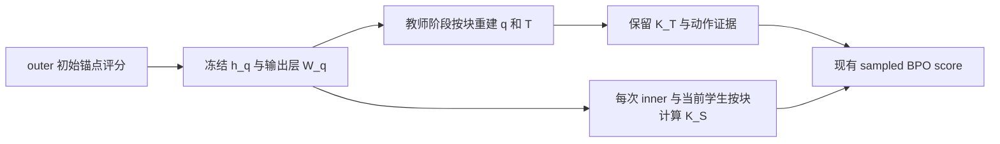

# DeepSeek-V4 蒸馏显存方案与开源实现调研

证据截止 2026-10-18。本文核对 DeepSeek-V4 报告 5.2.2 节、官方公开文件，以及可借鉴的 hidden／预测头／KL 实现。对 MirrorOPD 的建议保留当前 sampled 更新，只借用冻结证据表示和归约执行方式。

结论是：可以借用，最直接的来源是 Nitrobrew 的独立实现和 TRL 的双维度分块散度代码。Liger 提供另一路成熟的融合损失参照。DeepSeek 官方已检查的发布范围中，没有对应 5.2.2 整套教师调度和 OPD KL 内核的可直接接入实现；verl 中相关接入仍有 Draft PR 和 RFC。不能把报告描述、独立 kernel、框架草案和已完成的生产集成混为一谈。

## 原报告怎样降低内存占用

原报告的技术链路可拆成五项，分别针对不同存储对象。下表概括用户提供的 5.2.2 节内容及其资源含义；“重算开销可忽略”是报告对其自身系统的描述，不作为本项目性能结论。[^deepseek-report]

| 设计                                         | 减少的主要成本                       | 仍然存在的成本                             |
| -------------------------------------------- | ------------------------------------ | ------------------------------------------ |
| 教师权重集中存储、按需加载和类似 ZeRO 的分片 | 多教师权重同时常驻 GPU／DRAM 的压力  | 活跃层、通信缓冲、总存储容量和读盘时间     |
| 只缓存教师最后一层 hidden                    | 长期保存和传输每 token 完整词表分布  | hidden 本身、版本信息和重建所需预测头      |
| 训练时重建 logits、融合 KL                   | 长期完整 logits 和若干逐算子中间分配 | 投影计算、归一化、分块临时量和参数梯度     |
| 按教师索引分组，依次使用预测头               | 多个完整教师 head 同时驻留           | 当前 head、分组和原顺序映射                |
| 后台异步加载／卸载                           | 有足够计算可重叠时，减少等待         | 带宽限制、同步、缓冲生命周期和未隐藏的 I/O |

“教师数量理论上无上限”应理解为 GPU 不需要同时容纳所有教师；总存储、I/O 和训练时间仍然随实际教师与样本增长。异步提交也不自动保证关键路径上没有等待；需要用实际时间线确认预取、消费和释放的顺序。

只缓存 hidden 解决长期表示问题，不能单独证明计算时完全没有 logits 临时张量。原报告没有公开 5.2.2 中投影和 KL 的具体 kernel 接口；不能据“TileLang KL”推断其 GEMM／softmax／反向的全部融合边界。

## 隐状态缓存与分块重算节省显存的原理

对 $N$ 个有效预测前缀，最后一层隐状态记为 $h\in\mathbb R^{N\times H}$，输出头为 $W\in\mathbb R^{V\times H}$，输出为

$$
z=hW^\top+b,\qquad p_a=\exp(z_a-\log Z),\qquad \log Z=\log\sum_{a=1}^{V}e^{z_a}.
$$

每个前缀需要自己的 hidden，但所有前缀共享同一份输出头。保存 logits 或 log-probabilities 需要 $O(NV)$，保存 hidden 加共享输出头需要 $O(NH+VH)$。本项目 $H=1536$、合法词表 $V=151665$，完整分布的宽度约为 hidden 的 99 倍。FP32 概率改存 BF16 hidden 时，每 token 的字节比约为 197.5；这个比例只比较两种表示，不是训练整卡显存下降比例。

单条长度 7168 的响应，一份 FP32 完整 q 约 4.05 GiB，一份 BF16 hidden 为 21 MiB。冻结输出头另外需要约 0.435 GiB，且可供该窗口全部响应共享。要重建旧锚点 q，必须保存真正送入输出头的最终归一化后 hidden、对应版本的输出头及 bias、温度和合法词表。若使用已经更新的输出头，得到的分布就不再是原锚点。完整 hidden 表示不主动丢弃词表类别，实际浮点舍入仍须核验。

保存 hidden 只减少长期证据；若一次执行整个 $hW^\top$，瞬时输出仍是 $N\times V$。计算时将 token 切成 C、词表切成 K，每次只生成 $C\times K$，把归一化和散度贡献归约为每前缀标量后释放。C=64、K=4096 时，一份 FP32 块为 1 MiB。扫描所有词表仍要完成；变化在于大矩阵的存活范围和同时驻留量。多次投影、同步或搬运可能增加时间。

对 sampled BPO，教师中心 $K_T$ 在一个 outer 窗口内不变，只需算一次并缓存标量；学生中心 $K_S=\operatorname{KL}(q\Vert p)$ 随每次 inner 更新改变，须用冻结 q 与当前 p 重新计算。完整词表中心归约不意味着完整词表动作更新：中心停止梯度，最终仍由采到的 action log-probability 接收现有 score 系数。重算替代的是大缓存，不能把更新后的 $K_S$ 误用为冻结常数。

多教师按需加载和排序主要减少同时驻留的模型／输出头数量，与 hidden 表示、投影分块分别作用于不同对象。模型参数、优化器状态、backbone 激活、通信缓冲以及学生输出头梯度仍然存在。端到端峰值须按实际阶段测量，不能将表示压缩比例或一个临时块的大小当成完整训练峰值。

## 开源代码的实际覆盖

[机器可读审计](../../results/deepseek-opd-research-20261018/source-audit.json)保存固定版本、公开文件范围、PR 状态与验证结果；[源码证据](../../data/deepseek-opd-research-20261018/source-evidence.tar.gz)保存已阅读的候选代码及各自许可证。

| 来源                                 | 核验版本                                        | 实际可用内容                                                                      | 接入限制                                           |
| ------------------------------------ | ----------------------------------------------- | --------------------------------------------------------------------------------- | -------------------------------------------------- |
| DeepSeek 官方模型发布                | HF `b5968e9190ef611bbf34a7229255be88a0e937c1`   | 模型配置、编码与推理实现；推理 kernel 包含量化、GEMM、稀疏注意力等                | 不是完整教师调度／训练 KL 系统                     |
| Nitrobrew 独立库                     | `17f6f16b7451929209ac495c6b0ea0fcc4d0cedc`      | 双侧 hidden＋head、按词表块计算 forward／reverse KL、自定义重算反向               | 研究型小库；没有全套调度、mask、bias 或跨引擎接线  |
| TRL `chunked_divergence.py`          | `cdfe756f3ea9d47c2a6c59d6ebb529986cad8a4e`      | token／词表双分块、在线归一化、head gather、bias／logit scale／softcap 和重算反向 | 依赖 TRL 相邻 helper；默认块及投影精度需改造和核验 |
| Liger fused-linear JSD／distillation | `ff8ce5857420cee06865f40ffa8a60309bf2b458`      | 双侧 hidden＋head 的投影和蒸馏、token 分块、教师停止梯度及相关测试                | 部分路径仍有 C×V 临时量；不是教师权重调度器        |
| verl Nitrobrew PR #6194              | head `8650c6f845a2dcdd866bb9645768a66b8e552446` | hidden 通信、teacher head 加载、FSDP／Megatron 接线与测试代码                     | Draft、未合并；FSDP 接口仍保留 student logits      |
| verl RFC #6705                       | 公开 issue 状态为 Open                          | 单教师池切权重、TransferQueue 传 hidden、按教师分组的设计                         | 提案；第一版明确不含 fused KL 或 prefix cache      |

官方公开范围核验包含模型文件清单、TileKernels、DeepGEMM 和 deepseek-recipe 的公开树。TileKernels 的存在不等于报告中所有内部训练 kernel 均已开放。这里的结论限于已检查发布物，不声称所有外部仓库都没有相关实现。[^deepseek-release][^tilekernels]

DeepSpeed ZeRO-3／ZeRO-Infinity 已提供参数分片、CPU／NVMe offload 和预取机制，可以作为权重管理的现成组件；它们不是 DeepSeek 多教师排课、hidden 存储和 KL 计算的完整复刻。当前 MirrorOPD 使用固定 FSDP 后端，不应为借用这一思想同时迁移整个训练栈。[^zero]

### Nitrobrew：最小、易核对的词表流式归约

独立库接收学生 hidden、教师 hidden 及各自输出矩阵，允许两者隐藏宽度不同，但要求共同词表。每次只投影词表的一个块，使用在线最大值、指数和及加权矩归约 KL；自定义 backward 再次投影，避免保存全部概率表。它使用 PyTorch／`torch.compile`，不是 DeepSeek 官方 TileLang 内核。[^nitrobrew]

以固定前缀上的 $p=\operatorname{softmax}(z_p)$、$q=\operatorname{softmax}(z_q)$ 为例，

$$
\operatorname{KL}(q\Vert p)
=\mathbb E_q[z_q-z_p]-\log Z_q+\log Z_p.
$$

在线归约维护分块最大值和经过同尺度重标定的指数／加权和，最后组合归一化常数即可得到标量。不必把每块拼成完整 $N\times V$ 数组。其词表工作区为 $O(NK)$；结合外层 token 块 C，才进一步成为 $O(CK)$。hidden、head 和正常的参数梯度不包含在这个工作区界中。

源码仍在 backward 分配完整形状的输出权重梯度 $V\times H_s$，这是参数梯度，不会随“不保存 logits”消失。公开 mean／sum 分支还读取 `grad_output.item()`；对 GPU 同步和执行图的影响需要实测。

独立仓库共 3 个提交，最近推送日期为 2026-04-28，含实现和 benchmark，但没有独立测试目录。它适合作为可审阅原型与数值参照，暂不把它直接当成本项目已经验证的 FSDP 依赖。

### TRL 与 Liger：融合范围和精度需要逐项比较

TRL 固定源码的 `ChunkedDivergenceFunction` 从双方 hidden 和 head 开始；按 token 与词表块投影，保存 hidden、head、归一化统计，在反向时重算。它还使用 `maybe_gather_lm_head_ctx` 管理参数收集，值得对照我们的 FSDP 接缝。默认 token 块 4096、词表块 32768，一份 FP32 投影缓冲就是 512 MiB，两份为 1 GiB；“分块”不意味着默认配置已经适合本项目。[^trl]

TRL 的投影策略还涉及 FP32 输出：支持时使用低精度乘法的 FP32 输出，否则将该块操作数升 FP32 做 GEMM。它与“先得到 BF16 logits 再升 FP32”存在舍入差异。借用时应按[数值精度指南](../2026-10-17-数值精度选择与One-Shot-OPD对齐.md)保持对照条件，不把精度变化混进执行布局实验。

Liger 的 fused-linear JSD 路径从双方 hidden＋head 投影，但其 token 块内仍生成 C×V 的 logits／log-prob 等临时量。它在 forward 内求出所需梯度，backward 再按上游梯度缩放，具有自己的反向与归约合同；chunked distillation 基类另支持 bias、mask 与可选硬标签 CE。不能仅凭名称相近就替换本项目的 stopped-score 更新。[^liger]

Liger 当前固定源码还区分 PyTorch2.8 前后的 FP32 投影输出能力，本项目运行环境为 2.7.1。直接搬入默认精度、chunk 或归约策略，都需要独立核验。另一个 `fused_linear_kl_div` 接口接收完整目标概率，并不自动解决教师信号的长期存储问题。

### verl 接入尚不能等同于主线能力

PR #6194 仍是 Draft、`merged_at=null`。其 FSDP `compute_nitrobrew_kl` 接收 `student_logits`，对应 autograd Function 还保存该 tensor；这条接线主要减少教师信号存储／通信，不能等同于独立库从双方 hidden 开始的内存边界。PR 正文端到端速度和训练图部分仍有占位项，不作为已复现性能证据。[^verl-pr]

该 PR 的 teacher manager 还提供截断 SVD，使用 $W_T\approx W_{up}P_{down}^{\top}$ 并传输压缩 hidden。完整 hidden 重建与截断 SVD 属于不同方案；降低秩通常会改变教师分布，不能一并称为无损。第一版复用不启用这项近似。

RFC #6705 提供了有价值的所有权与排序思路：按教师执行后，将记录按原 batch index 放回，保留原样本集、mask 和 token 权重。它明确是提案，并未交付完整调度或 fused kernel。当前 MirrorOPD 只有一个教师，多教师切换和集中式存储还没有直接消费者，优先解决单窗口的冻结证据成本。[^verl-rfc]

## 对 MirrorOPD sampled 路径的复用建议

### 优先缓存锚点 hidden，而非增加所有教师的长期缓存

当前 MDPO action-only sampled 无诊断只保存动作证据，已经比 hidden 缓存小。为它增加一份长期教师 hidden，会增加存储，除非另有实际诊断消费者。

默认 BPO 完整中心＋sampled 通过保存完整 q 支持重复计算学生中心；本文后面的实现章节记录新增 hidden 路径。最有价值的改造是缓存锚点 $h_q$、冻结预测头 $W_q$、温度与归一化证据，按需重建 q；教师阶段只计算一次冻结 $K_T$ 和动作 reward，完成后无需为这些 sampled 更新长期保留教师 hidden。实现状态与完整条件见[算法参考](../算法与实现.md#完整词表标量动作积分与缓存的区别)。

缓存应取真正送入 LM head、已经完成最终归一化的 hidden。重建时仍须截取共同合法词表，排除模型为计算对齐而填充的输出行，并绑定温度、prefix／action 对齐和冻结权重版本。维度相同不足以证明 token ID 语义相同。



可以借用 Nitrobrew forward-KL 的数值路径：把当前学生作为第一个分布、冻结锚点作为其“teacher”输入，得到 $K_S=\operatorname{KL}(q\Vert p)$。调用须在无梯度统计路径中；随后仍由本项目现有 score 系数决定反向，不对这个 KL 输出直接调用 backward。

教师中心须保留现有幂均值定义。对于 κ>0，

$$
A(\Delta)=\frac{\log[(1-\eta)+\eta e^{\kappa\Delta}]}{\kappa\eta},\qquad
K_T=-\sum_a q_a A(\log T_a-\log q_a).
$$

κ=0 时使用几何极限；η=1 时同样有 $A=\log(T/q)$。在这两个条件下 $K_T=\operatorname{KL}(q\Vert T)$；其他设置一般不能用普通 KL kernel 替代。

例如 $q=(0.5,0.3,0.2)$、$T=(0.4,0.1,0.5)$、κ=0.5、η=0.2，$K_T=0.1517463201$，而普通 $\operatorname{KL}(q\Vert T)=0.2578973159$。差别来自目标定义，不是舍入误差。因此第一版应复用分块投影、稳定归一化与缓冲管理，再调用现有 `power_reward` 逐块归约 $K_T$。

### 可得到的存储变化

沿用四卡数学设置的上界：batch64、prompt2048、response7168，有效前缀 $N=458752$，V=151665，H=1536。下表是冻结证据存储，不是 GPU 整卡峰值。

| 对象                                      | 存储计算                  |                   数值 |
| ----------------------------------------- | ------------------------- | ---------------------: |
| 一份完整 q，FP32                          | $4NV$                     |      259.193 GiB，全局 |
| 一份 hidden，BF16                         | $2NH$                     |       1.3125 GiB，全局 |
| 一个 FP32 前缀标量                        | $4N$                      |         1.75 MiB，全局 |
| 一份冻结输出头，BF16，物理词表 151936     | $2\times151936\times1536$ |             0.4347 GiB |
| h_q＋标量／动作证据＋一份输出头的拟议布局 | 按现有序列槽标量布局估算  | 约 1.760 GiB，全局单份 |

该 1.760 GiB 是仅保留最小动作／标量的拟议表示；下面实际实现继续保留已有 Top-J／诊断字段，预算更大。四个 rank 各留一份 head 时，上述最小拟议 host payload 约 3.065 GiB，还须计运输、拼接和 pinned 副本。这个方案相对完整 q 表节省存储，但比当前 Top-J／action-only 证据更大，不能声称对三条路径都降低缓存。

执行上可保留当前 token 块 64，再尝试词表块 4096：每份 FP32 C×K 缓冲为 1 MiB，两份投影缓冲合计 2 MiB。相比完整 C×V 归一化，它有机会限制词表工作区；中间归约、head、hidden、梯度和 allocator 保留量须分别测量，不能把 2 MiB 称为训练峰值。

### 接入顺序与判定条件

1. 保留当前完整 q 版本作参照，新增 hidden 表示；在 `core/cache.py`、容量预算和 verl projection／wire 中同时明确其身份、shape 与所有权。冻结 head 必须属于原 anchor version，不能引用更新后的输出层。
2. 先用当前 PyTorch 与相同 BF16／FP32 语义实现 token／词表分块统计，验证精确中心＋sampled BPO 的系数与参数梯度；不同时更换精度、目标或归约权重。
3. 第一版采用有界同步搬运，测量重投影、host transport 和 GPU 工作区。只有 I/O 等待成为实际瓶颈后，再加入 pinned buffer、独立 stream、CUDA event 与异步预取；多个全量缓冲会吃掉部分节省。
4. 用相同轨迹和模型检验中心值、参数梯度、EOS／截断末位置、全局 token 归约、冻结窗口、异常后的释放与缓存预算。随后运行四卡原生 canary，才扩大到正常长度。
5. 基准同时报告 cache 构建、CPU／GPU 峰值、评分和每次 inner 时间。若中心或梯度超过预设误差、缓存版本不一致或端到端成本不可接受，保留参照路径；不以“论文称重算可忽略”代替判定。

优先复用的是低维冻结表示、在线归约和参数管理的已有办法。TileLang、Triton 或 `torch.compile` 是执行手段，是否有收益取决于真实形状和框架接缝；标准 KL loss 不直接替换 sampled BPO／MDPO 公式。

## MirrorOPD 的实现、实验与覆盖范围

### 当前实现与所有权

长期决策已整理为 [Agent Note](../../.agents/notes/implemented/architecture/2026-10-18-隐状态锚点与精确中心重算.md)，与此前输出层分块决定互链。新配置是 `memory.anchor_storage=hidden`，只接受 BPO、`center=full`、`integration=sampled`；默认仍为 `log_probs`。这是新增存储与执行路径，没有增加第三方库、SVD、量化或异步服务，也没有改变 Top-J／MDPO 配方。

[实现](../../src/mirroropd/core/hidden.py)按 token／词表块归约 logZ、教师幂均值中心、学生 KL、动作概率及诊断。`anchor_hidden` 与 `anchor_logz` 只按有效 response predictor 保存，使用与完整词表字段相同的独立 jagged offsets；现有标量与 Top-J 字段继续随序列位置传输。教师 hidden 仅用于当下评分，完成后保留教师动作概率和冻结中心，后续 inner 不保留教师分布。

[共享 head 管理](../../src/mirroropd/runtime/frozen_head.py)在 actor rank0 的真实 head forward 内捕获对应权重，截取合法词表、按有效投影 dtype 复制到 host，再原子发布到运行目录 `cache/anchor-heads/<outer>.pt`。driver 等待整个 anchor pass 完成后才派发 teacher，避免各 rank／microbatch 的 forward 内 barrier。读取时核对完整窗口 context；每个 actor／teacher 进程至多缓存一个 host head，每次 forward 同步搬至设备。下一 outer 清理旧文件；已有同版本文件拒绝覆盖。读者依赖共享运行目录，当前没有等价恢复承诺。

这个同步 MVP 增加了每个窗口的共享文件 I/O，以及每个使用 head 的 forward 的 host→device 搬运。它不提供 DeepSeek 所述异步预取，也没有证明“重算开销可忽略”。预算包含一份 head；四 rank 的 host 副本、拼接和运输副本另占内存。head 文件是运行缓存，不能作为独立 checkpoint 使用。

当前实现保留原有 Top-J 字段，供诊断或复用既有缓存合同。以 B64、P2048、R7168、H1536、V151665、BF16 hidden、FP32 概率计算，单份全局 payload 加一份保守 head 预算为无诊断 1.868 GiB、完整诊断 1.938 GiB。head 预算含可能存在的 bias；实际 Qwen head 无 bias。它们均是 admission 上界，不包含多 rank 副本，也不是整卡显存测量。前面的 1.760 GiB 对应进一步删减元数据的最小拟议布局，不能当成当前结果。

### sampled 更新的反向语义

中心、比率、reward 与整个 BPO score 系数均停止梯度；对记录动作 a 的归一化 LP，仍保留

$$
\frac{\partial[c\,\log p_a]}{\partial z_b}
=c(\mathbf 1_{a=b}-p_b),\qquad c=\operatorname{stopgrad}(c).
$$

自定义一阶反向按块重建 p，再计算 hidden、head 和 bias 梯度，避免保存学生完整 logits／softmax。标准线性层的 $V\times H$ 参数梯度仍然存在。当前 backward 为 FP32 累计还会转换 $K\times H$ 权重块和 $C\times H$ hidden 块，额外临时量包含 $O(CK+KH+CH)$，不能只报一份 $C\times K$ logits 的大小。forward 与 backward 保留实际低精度投影和温度除法的转换边；概率统计及分块梯度累计使用 FP32，FP64 测试使用 FP64。分块会改变归约和舍入顺序，不承诺 BF16 逐位等价。

### CPU 数值、缓存与时间实验

独立完整概率参照覆盖 27 个 FP64 组合：诊断 none／basic／full、温度 0.7／1／2，以及默认 signal、κ=0、η=1。teacher hidden 与 student hidden 宽度不同，并使用 bias、非均匀正负及零上游权重。中心、loss 和学生参数梯度通过预设容差；梯度采用 `atol=3e-11, rtol=3e-11`。附加检查覆盖 Top-J 空支持／全支持、padding、有效 token 加权、空响应、真实 Qwen2 全参数梯度、合法词表裁剪、head／hidden 冻结窗口、jagged 重排／切分、容量和发布失败清理。

CPU FP32／BF16 另用 N9、V113、H32、temperature0.7 对照 eager 完整 logits。FP32 loss 最大绝对差为 1.91×10⁻⁶，hidden／head 梯度相对 L2 误差最大 2.23×10⁻⁷。BF16 loss 最大绝对差同为 1.91×10⁻⁶；hidden 梯度误差为 0，head 梯度相对 L2 误差约 0.272%。BF16 的 head 梯度差异涉及 token 块分别转换后累加，需在原生 FSDP 中继续核验；本结果只覆盖所列 CPU 输入。

配对基准使用 seed1810、N512、V8192、H128、Top-J16、basic 诊断、温度 0.7、κ0.5、η0.2、token 块 32、词表块 1024。每条路径在独立新进程内先分别预热两种存储路径一次，再测一次缓存构建和一次更新；每种精度、每种存储各三次，线程数 2。两个模式使用相同随机输入和完整中心，只改变证据表示与执行。下表为中位数，逐次值与范围保留在[统计及审计](../../results/hidden-anchor-20261018/audit.json)、[FP32 原始结果](../../results/hidden-anchor-20261018/cpu-fp32.json)和 [BF16 原始结果](../../results/hidden-anchor-20261018/cpu-bf16.json)。

| 精度 | 表示      | 缓存 MiB | 共享 head MiB | 进程峰值 RSS MiB | 构建 ms | 前反向 ms |
| ---- | --------- | -------: | ------------: | ---------------: | ------: | --------: |
| FP32 | log_probs |   16.106 |         0.000 |           637.88 |   144.4 |      99.2 |
| FP32 | hidden    |    0.358 |         4.000 |           594.07 |   216.3 |     146.3 |
| BF16 | log_probs |   16.106 |         0.000 |           623.43 |    88.1 |      73.2 |
| BF16 | hidden    |    0.233 |         2.000 |           604.89 |   223.5 |     152.7 |

BF16 的冻结证据加 head 从 16.106 MiB 降到 2.233 MiB，约减少 86.1%；局部前反向中位时间从 73.2 ms 增到 152.7 ms，约为 2.09 倍。FP32 也减少缓存，但局部前反向从 99.2 ms 增到 146.3 ms。两项都是当前小形状 CPU 的观测，不能推广为 GPU 的速度比。RSS 是整个 Python／Torch 进程从启动起的高水位，包含预热与运行时；缓存下降比例不会等比例转化为 RSS 下降。共享机器的时序扰动及仅三次重复限制了时间结论。

表中的前反向时间只含输出层投影、中心、loss 与 backward，不含 `optimizer.step()` 或 backbone。基准也没有测量 Ray、共享 head 文件或 FSDP，CUDA allocated／reserved 结果均为空。8 张本机 GPU 均有其他任务的活动上下文，因此新增四卡原生训练和正常长度显存实验尚未执行。原生 canary 的模型／数据预检、固定后端核验、源码冻结与配置编译单独完成，不算 GPU 链路通过。保留显式开关，不能把前述张量预算写成实际 GPU 峰值，也不声称任务成绩或完整训练验证。

### 复现与下一阶段测量

[源码归档](../../data/hidden-anchor-20261018/source.tar.gz)与[逐文件哈希](../../data/hidden-anchor-20261018/source-files.json)固定测量涉及的实现和检查程序；外部库研究仍使用前面的单独源码证据。CPU 配对命令从仓库根执行：

```bash
python benchmarks/hidden_anchor.py --precision fp32 --output runs/hidden-fp32.json
python benchmarks/hidden_anchor.py --precision bf16 --output runs/hidden-bf16.json
python -m pytest -q tests/core/test_hidden.py tests/runtime/test_frozen_head.py \
  tests/integrations/test_projection.py
```

空闲 GPU 上的 head 基准可给 `hidden_anchor.py` 加 `--gpu <physical-index>`，通过正常预约后测进程内 CUDA allocated／reserved peak。四卡端到端配对使用以下两个不同输出目录，模型、轨迹和测量身份由运行器分别固定：

```bash
python benchmarks/memory_native.py --case bpo-sampled-full --center full \
  --anchor-storage log_probs --output runs/bpo-probability-native \
  --backend upstream/TA-OPD-v2-20261017 --lease-root ~/.cache/mirroropd/gpu-leases
python benchmarks/memory_native.py --case bpo-sampled-full --center full \
  --anchor-storage hidden --output runs/bpo-hidden-native \
  --backend upstream/TA-OPD-v2-20261017 --lease-root ~/.cache/mirroropd/gpu-leases
```

两项 canary 各为 2 outer、每轮 2 inner，验证更新、重新冻结与前后评测。随机 tiny Qwen2 只用于链路，不代表数学任务成绩。独立生成可能因 GPU 数值或采样执行导致轨迹差异；要比较端到端耗时和显存的因果效应，仍须检查逐条输入／响应身份，并按相同长度条件配对。只有四卡原生阶段正确、显存和时间可接受后，才扩大到 1.5B 正常数学设置；异步预取另作 I/O 基准。

## 外部 Nitrobrew 源码的局部验证

针对 Nitrobrew 固定源码，关闭 `torch.compile` 装饰器，仅在 CPU FP32 上验证源逻辑。测试包含两种 KL 方向、温度 0.7／1／2、词表块 1／7／64，共 18 个条件；学生／教师隐藏宽度 7／11、词表 37、batch2、每条 5 个位置。逐位置非均匀上游权重含零、正、负值，并检查教师不接收梯度。

18 项均通过，loss 最大绝对差 $5.89\times10^{-7}$，学生 hidden／head 梯度最大绝对差 $6.34\times10^{-8}$。容差为 `atol=3e-6, rtol=3e-5`。这确认所测条件的代数和一阶反向，不验证 CUDA 编译、BF16、GPU 峰值、FSDP 或端到端速度。[验证结果](../../results/deepseek-opd-research-20261018/cpu-semantic-check.json)与[逐文件哈希](../../data/deepseek-opd-research-20261018/evidence-files.json)绑定实际源码与检查程序。

源码归档保留 Nitrobrew／TRL／verl 的 Apache-2.0 和 Liger 的 BSD-2-Clause 许可证。外部代码作为研究和独立数值参照；下面的新增实现没有引入这些训练库或替换固定后端，三种生产算法的目标保持原定义。

复现局部检查时，在已安装 Torch 的环境从仓库根执行：

```bash
mkdir -p runs/reproduced-opd-research
tar -xzf data/deepseek-opd-research-20261018/source-evidence.tar.gz \
  -C runs/reproduced-opd-research
python runs/reproduced-opd-research/check-nitrobrew.py
python -m pytest -q tests/research/test_nitrobrew_reference.py
```

### 参考文献

[^deepseek-report]: DeepSeek-AI. DeepSeek-V4: Towards Highly Efficient Million-Token Context Intelligence，5.2.2 节。arXiv 2606.19348v1，2026. [官方技术报告](https://arxiv.org/html/2606.19348v1#S5.SS2.SSS2).

[^deepseek-release]: DeepSeek-AI. DeepSeek-V4-Pro，固定 revision b5968e9190ef611bbf34a7229255be88a0e937c1. Hugging Face 2026. [公开文件树](https://huggingface.co/deepseek-ai/DeepSeek-V4-Pro/tree/b5968e9190ef611bbf34a7229255be88a0e937c1).

[^tilekernels]: DeepSeek-AI. TileKernels. GitHub 2026，核验版本见机器可读审计。[官方 kernel 库](https://github.com/deepseek-ai/TileKernels).

[^zero]: DeepSpeed contributors. ZeRO. DeepSpeed 0.19.8 documentation，2026-10-18 访问。[参数分片与 CPU／NVMe offload](https://deepspeed.readthedocs.io/en/latest/zero3.html).

[^nitrobrew]: Tilde Research. Nitrobrew，固定提交 17f6f16b7451929209ac495c6b0ea0fcc4d0cedc. GitHub 2026. [完整词表流式 KL 实现](https://github.com/tilde-research/nitrobrew-release/blob/17f6f16b7451929209ac495c6b0ea0fcc4d0cedc/nitrobrew.py).

[^trl]: Hugging Face. Chunked divergence，固定提交 cdfe756f3ea9d47c2a6c59d6ebb529986cad8a4e. GitHub 2026. [双维度分块散度源码](https://github.com/huggingface/trl/blob/cdfe756f3ea9d47c2a6c59d6ebb529986cad8a4e/trl/kernels/chunked_divergence.py).

[^liger]: LinkedIn. Liger-Kernel，固定提交 ff8ce5857420cee06865f40ffa8a60309bf2b458. GitHub 2026. [融合投影与 JSD 实现](https://github.com/linkedin/Liger-Kernel/blob/ff8ce5857420cee06865f40ffa8a60309bf2b458/src/liger_kernel/ops/fused_linear_jsd.py).

[^verl-pr]: Tilde Research / verl contributors. Nitrobrew OPD integration，PR6194，Draft，head8650c6f845a2dcdd866bb9645768a66b8e552446. GitHub 2026，2026-10-18 核验。[接入提案与代码](https://github.com/verl-project/verl/pull/6194).

[^verl-rfc]: verl contributors. TransferQueue-Based Single-Pool Multi-Teacher Hidden-State OPD，issue6705，Open. GitHub 2026，2026-10-18 核验。[多教师调度 RFC](https://github.com/verl-project/verl/issues/6705).
