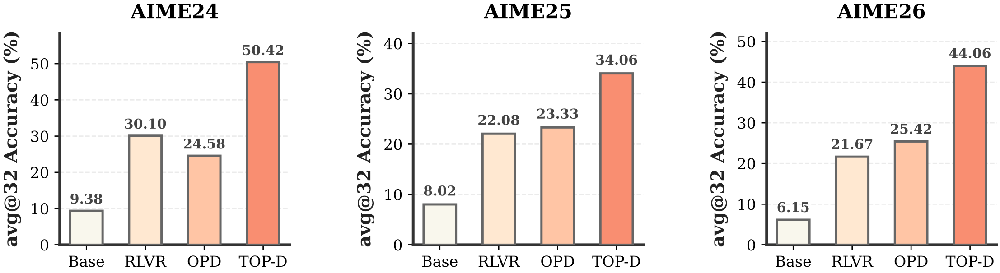
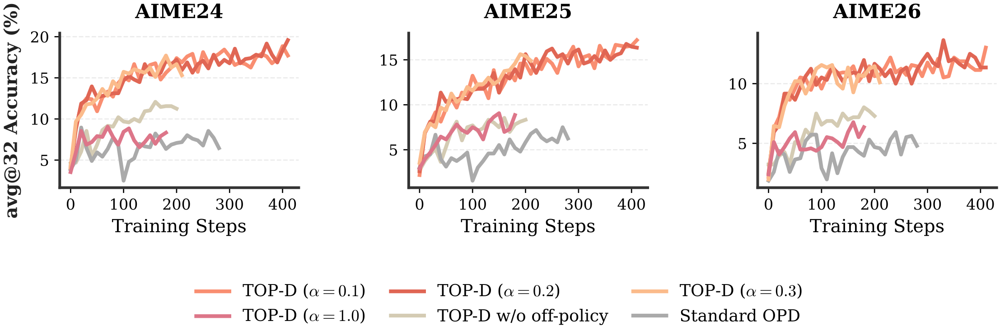

# 7. P6: TOP-D, 2607.04751

[返回横向总结](../2026-10-15-六篇OPD论文训练设置与评测结果调研.md)。

来源：Xie 等的 TOP-D 论文[^topd]。完整实现定义见§3、Algorithm1，主结果在表 2/3，1.7B 扩展评测在附录 A 表 4，全部方法的超参数在附录 B 表 5。

本篇的两个 Base 学生与普通 14B 教师没有披露实际 thinking/non-thinking 设置；30B-A3B-Instruct-2507 教师则由官方模型卡确认仅支持 non-thinking。下文分别标注两端，不把 Base 等同于 non-thinking。[^qwen-instruct-2507]

## 7.1 算法中需要固定的量

每个外循环开始复制 behavior policy 为$\pi_{old}$，由它生成当前 batch。proximal teacher 按 token 条件分布做算术插值：

$$
\widetilde\pi_T=\alpha\pi_T+(1-\alpha)\pi_{old},\qquad \widetilde r_t=\log\!\left(\alpha\frac{\pi_T(a_t\mid s_t)}{\pi_{old}(a_t\mid s_t)}+1-\alpha\right).
$$

无需真的部署第三个模型；用缓存的 teacher 与 behavior log-prob 即可计算。它不是将 log-prob 线性插值，因为后者仅缩放原始 reward。Algorithm1 在内循环之前计算 reward、return 和 advantage，之后固定这些量；不能在每个 mini-batch 把分母替换为不断更新的学生，再声称复现了同一算法。

return 使用即时 reward 加长度归一化的未来 reward：

$$
\widetilde R_t=\widetilde r_t+\frac{1}{L-t}\sum_{j=t+1}^{L}\widetilde r_j.
$$

同一 prompt 的全部 response、全部有效 token 共同计算均值和标准差后标准化；policy loss 用当前策略与 behavior 策略的 token importance ratio，采用 PPO clipped surrogate，并按该组总有效 token 数归约。式 (8) 在最后 token 出现分母 0，论文未明确终止位置的代码回退；复现时须显式约定最后 token 未来项为 0，并标明这是实现选择。标准差为 0 时的 epsilon 也未披露。

## 7.2 训练、硬件与全部超参数

| 字段                    | GRPO                                                                                         | DAPO       | 标准 OPD                                                                                       | TOP-D                        |
| ----------------------- | -------------------------------------------------------------------------------------------- | ---------- | ---------------------------------------------------------------------------------------------- | ---------------------------- |
| 数据                    | DAPO-Math-17K                                                                                | 同左       | 同左                                                                                           | 同左                         |
| 学生                    | Qwen3-1.7B-Base (thinking/non-thinking 未披露)、Qwen3-8B-Base (thinking/non-thinking 未披露) | 相同       | 相同                                                                                           | 相同                         |
| 教师                    | 无                                                                                           | 无         | Qwen3-30B-A3B-Instruct-2507 (non-thinking)；1.7B 另测 Qwen3-14B (thinking/non-thinking 未披露) | 相同                         |
| prompt cap              | 2,048                                                                                        | 2,048      | 2,048                                                                                          | 2,048                        |
| response cap            | 16,384                                                                                       | 16,384     | 16,384                                                                                         | 16,384                       |
| global batch，prompt 数 | 512                                                                                          | 512        | 512                                                                                            | 512                          |
| 每 prompt rollout       | 8                                                                                            | 8          | 8                                                                                              | 8                            |
| global response 数      | 4,096                                                                                        | 4,096      | 4,096                                                                                          | 4,096                        |
| mini-batch，prompt 数   | 32                                                                                           | 32         | 512                                                                                            | 32                           |
| mini-batch，response 数 | 256                                                                                          | 256        | 4,096                                                                                          | 256                          |
| 每批 mini-batch 数      | 16                                                                                           | 16         | 1                                                                                              | 16                           |
| off-policy epoch        | 1                                                                                            | 1          | —                                                                                              | 1                            |
| 优化器                  | AdamW                                                                                        | AdamW      | AdamW                                                                                          | AdamW                        |
| 学习率                  | $10^{-6}$                                                                                    | $10^{-6}$  | $10^{-6}$                                                                                      | $10^{-6}$                    |
| warmup                  | 10 步                                                                                        | 10 步      | —                                                                                              | —                            |
| rollout T / top-p       | 1.0 / 1.0                                                                                    | 相同       | 相同                                                                                           | 相同                         |
| PPO clip low/high       | 0.2 / 0.2                                                                                    | 0.2 / 0.28 | —                                                                                              | 0.2 / 0.2                    |
| 插值α                   | —                                                                                            | —          | 相当于原始 reward 而非完整 TOP-D 设置                                                          | 0.1 或 0.2，未逐运行说明取值 |
| 评测 response cap       | 16,384                                                                                       | 相同       | 相同                                                                                           | 相同                         |
| 评测 T / top-p          | 1.0 / 0.7                                                                                    | 相同       | 相同                                                                                           | 相同                         |

主要训练与基线复现用 4 节点×8H200=32GPU；作者称单节点 8GPU 可复现整个 pipeline，但没有附对应单节点运行计时。蒸馏实验窗口约 200–400 个 update steps，RLVR 基线另行延长，未报告已饱和。全局数据只做 1 个 off-policy epoch，16 个 mini-batch 并不等于每条数据做 16 个 epoch；标准 OPD 每全局 batch 只有一次大 batch 更新，TOP-D 则切成 16 次 mini-batch 更新。两者既有目标差异，也有每次更新的样本数和更新频率差异。

## 7.3 8B 与 1.7B 的全部 benchmark 数值

原表 2，Qwen3-8B-Base (thinking/non-thinking 未披露)，蒸馏教师 Qwen3-30B-A3B-Instruct-2507 (non-thinking)。AIME 三项用 avg@32，AMC/MATH/Olympiad 用 avg@8；括号内是相对标准 OPD 的百分点差值。

| 方法  | AIME24         | AIME25         | AIME26         | AMC23          | MATH-500      | Olympiad      |
| ----- | -------------- | -------------- | -------------- | -------------- | ------------- | ------------- |
| Base  | 9.38           | 8.02           | 6.15           | 53.13          | 75.23         | 40.08         |
| GRPO  | 30.10          | 22.08          | 21.67          | 56.33          | 76.83         | 44.92         |
| DAPO  | 32.92          | 27.81          | 32.29          | 65.39          | 81.65         | 44.23         |
| OPD   | 24.58          | 23.33          | 25.42          | 76.88          | 87.98         | 59.29         |
| TOP-D | 50.42 (+25.84) | 34.06 (+10.73) | 44.06 (+18.64) | 88.13 (+11.25) | 91.23 (+3.25) | 64.67 (+5.38) |

原表 3，Qwen3-1.7B-Base (thinking/non-thinking 未披露)；两组三项均为 avg@32。Base/GRPO/DAPO 没有教师，表中在两列组重复展示相同成绩，不能当作分别训练了两个教师版本。

| 方法  | 30B 教师（non-thinking）-AIME24 | 30B 教师（non-thinking）-AIME25 | 30B 教师（non-thinking）-AIME26 | 14B 教师（thinking/non-thinking 未披露）-AIME24 | 14B 教师（thinking/non-thinking 未披露）-AIME25 | 14B 教师（thinking/non-thinking 未披露）-AIME26 |
| ----- | ------------------------------- | ------------------------------- | ------------------------------- | ----------------------------------------------- | ----------------------------------------------- | ----------------------------------------------- |
| Base  | 3.44                            | 1.98                            | 1.88                            | 3.44                                            | 1.98                                            | 1.88                                            |
| GRPO  | 10.52                           | 7.19                            | 4.69                            | 10.52                                           | 7.19                                            | 4.69                                            |
| DAPO  | 12.29                           | 11.56                           | 8.54                            | 12.29                                           | 11.56                                           | 8.54                                            |
| OPD   | 8.96                            | 7.50                            | 5.94                            | 7.81                                            | 8.33                                            | 5.63                                            |
| TOP-D | 20.31 (+11.35)                  | 17.71 (+10.21)                  | 13.75 (+7.81)                   | 12.81 (+5.00)                                   | 14.69 (+6.36)                                   | 9.69 (+4.06)                                    |

附录 A 原表 4 补充 1.7B 在 AMC2023、MATH-500、Olympiad 的成绩；教师为 30B-A3B-Instruct，AIME avg@32，其余 avg@8。

| 方法  | AIME24         | AIME25         | AIME26        | AMC23         | MATH-500      | Olympiad      |
| ----- | -------------- | -------------- | ------------- | ------------- | ------------- | ------------- |
| Base  | 3.44           | 1.98           | 1.88          | 27.27         | 56.80         | 24.00         |
| GRPO  | 10.52          | 7.19           | 4.69          | 35.55         | 54.73         | 18.47         |
| DAPO  | 12.29          | 11.56          | 8.54          | 37.50         | 61.88         | 26.63         |
| OPD   | 8.96           | 7.50           | 5.94          | 45.70         | 71.13         | 35.83         |
| TOP-D | 20.31 (+11.35) | 17.71 (+10.21) | 13.75 (+7.81) | 54.38 (+8.68) | 77.33 (+6.20) | 43.06 (+7.23) |

8B 的 AIME2024 从标准 OPD24.58 到 TOP-D50.42，即 +25.84 pp；这是绝对差值，不能写成相对提高 25.84%。原文没有提供教师本身的同协议成绩、统一多种子误差、精确 checkpoint 选择规则，故不能计算这些实验的教师差距恢复率。

## 7.4 全部消融与结果图

| 消融                    | 设置                                                                                                                          | 结果                                                               |
| ----------------------- | ----------------------------------------------------------------------------------------------------------------------------- | ------------------------------------------------------------------ |
| 去外部 proximal teacher | Qwen3-1.7B-Base (thinking/non-thinking 未披露)←Qwen3-30B-A3B-Instruct-2507 (non-thinking)，α=1；其余仍使用 TOP-D 内部训练结构 | 训练波动且成绩下降；与“标准 OPD”仍是两条不同对照，因为内部结构不同 |
| 去内部信赖域迭代        | `w/o off-policy`，强制严格 on-policy                                                                                          | 相同训练步数下提升变慢；精确 batch/update 重配细节未完整披露       |
| α敏感性                 | α={0.1,0.2,0.3}，相同 1.7B/30B 组合                                                                                           | 稳定性、收敛速度、末期成绩差距小；没有数值表或置信区间             |
| 学习曲线                | 8B 各方法 AIME24/25/26；1.7B 消融 AIME 三项，图示到 400 步                                                                    | 结果见图 2、5；不从曲线补造末步精确值                              |

所谓“零额外开销”指不增加独立教师模型前向、reward 可代数变换，并非论文给出了端到端耗时持平的 benchmark。内循环 mini-batch 更新的总算力与不同基线的步数仍需独立计量。论文的单调改进结论依赖其理论下界与假设，不能直接替代有限 batch、PPO clipping 实训的逐步单调性验证。

## 7.5 复现缺口

AdamW betas、epsilon、weight decay、scheduler、梯度 clip、micro-batch、精度、奖励/advantage 终止处理、decoding top-k、完整模型 chat template 与 thinking 模式、GRPO/DAPO 奖励判分实现、Olympiad 具体版本、训练 seed、逐方法精确步数、逐运行α选择、评测频率和 checkpoint 选择均未完整披露。论文和所查索引未给 TOP-D 官方代码，不能套用另一篇名称相近的 Trust Region OPD 实现。

### 参考文献

[^topd]: Xie, Z., Zhang, L. L., Xie, Z., Yang, M. Trust Region Policy Distillation. arXiv 2026, 2607.04751v1. [arXiv 全文](https://arxiv.org/html/2607.04751v1).

[^qwen-instruct-2507]: Qwen Team. Qwen3-30B-A3B-Instruct-2507 Model Card. Hugging Face 2025. [官方模型卡](https://huggingface.co/Qwen/Qwen3-30B-A3B-Instruct-2507).
