# 2. P1: Semi-OPD, 2610.11291

[返回横向总结](../2026-10-15-六篇OPD论文训练设置与评测结果调研.md)。

来源：Zhao 等的 Semi-OPD 论文[^semi]。实验配置以附录 A、表 2–3 为准，主结果见表 1，成本见附录 C 表 4。

模式按附录 A 的配对设置分别写进 Student、Teacher 名称，T/NT 列仅作交叉核对。同一 checkpoint 的 thinking 与 non-thinking 视为两个模型身份。图 11 额外 Base 配对的 student 与 teacher 均未逐端给出 thinking 开关，记为“thinking/non-thinking 未披露”；原图和原始表格 JSON 保留作者标注。

## 2.1 训练与评测共享配置

| 字段              | 设置                                                                                                                                         |
| ----------------- | -------------------------------------------------------------------------------------------------------------------------------------------- |
| 算法              | OPD 每步从当前学生重新采样；Semi-OPD 训练前从初始学生采样一次，之后固定 response 和教师 log-prob，逐步重新计算当前学生 log-prob 与 advantage |
| 训练数据          | `open-r1/DAPO-Math-17k-Processed`；去重后的英文 prompt 共 14,116 条                                                                          |
| prompt 与 rollout | 每步 128 个 prompt，每个 1 条 rollout；两种方法读取相同顺序的 prompt；约 110 步为一 epoch                                                    |
| 全局 batch        | 128；mini-batch、梯度累积与 micro-batch 未披露                                                                                               |
| 优化器            | AdamW；betas=(0.9,0.999)，weight decay=0.01                                                                                                  |
| 学习率            | $10^{-6}$，constant，无 warmup                                                                                                               |
| 精度与裁剪        | BF16；gradient clipping=1.0                                                                                                                  |
| 训练采样          | temperature=1.0，top-p=1.0；采样 top-k 未披露                                                                                                |
| prompt 上限       | 2,048 tokens                                                                                                                                 |
| response 上限     | non-thinking 默认 4,096；thinking/long-CoT 默认 16,384；表 1 的标准 OPD 全部使用 16K，须与模型对扫描区分                                     |
| 训练目标          | sampled-token reverse KL；无新增 SFT 是 Semi-OPD 的默认条件                                                                                  |
| 数学评测          | AIME2024、AIME2025、AIME2026、HMMT February 2026；各自 avg@32，再取四项宏平均                                                                |
| 评测采样          | temperature=1.0、top-p=1.0；response 上限 32,768，Nemotron 为 40,960                                                                         |
| 跨域评测          | HumanEval、HumanEval+；图中为 avg@8 pass rate，不能称 pass@8                                                                                 |
| 模式与模板        | 每个组合固定 thinking 或 non-thinking，训练和评测一致；DeepSeek-R1-Distill 的模板预填 `<think>`                                              |
| 对齐诊断          | 初始学生轨迹上，学生和教师 top-64 token 集合交集大小除以 64，按 response token 加权平均                                                      |
| 框架与硬件        | NeMo-RL DTensor；vLLM 生成与评测；1–8 节点，每节点 8 张 H100，随教师规模变化                                                                 |
| 步数和种子        | 主扫描按两方法共同评测区间比较，不能统一写成“全部 100 步”；图 1b 明确均值来自 3 个种子，其余实验未统一给种子数                               |

## 2.2 全部 17 个模型组合及精确差值

以下为原表 3。学生简称 `R1-Distill` 指 `DeepSeek-R1-Distill-Qwen`，教师 `JustRL`、`Polaris`、`Light-R1`、`DeepCoder` 均为对应公开后训练 checkpoint。Qwen3 的大教师 Thinking 型对应 `Thinking-2507`。`SFT` 两行先在各自教师生成轨迹上训练 1 epoch。原表把 Cascade 缩写为 Nemotron-Cascade-2，其精确 checkpoint 在论文中未提供可点击模型链接。

| #   | Student                        | Teacher                                      | Mode | Cap | Overlap | Last-step | AUC      |
| --- | ------------------------------ | -------------------------------------------- | ---- | --- | ------- | --------- | -------- |
| n   | Qwen3-1.7B (thinking)          | Qwen3-30B-A3B-Thinking (thinking)            | T    | 16K | 58.9    | +9.4      | +7.57    |
| a   | Qwen3-1.7B (non-thinking)      | Qwen3-4B-Instruct-2507 (non-thinking)        | NT   | 4K  | 62.5    | +9.5      | +7.09    |
| p   | Qwen3-4B (thinking)            | Qwen3-30B-A3B-Thinking (thinking)            | T    | 16K | 63.8    | +6.2      | +6.22    |
| o   | Qwen3-14B (thinking)           | Qwen3-235B-A22B-Thinking (thinking)          | T    | 16K | 63.4    | +13.1     | +5.85    |
| b   | Qwen3-1.7B (non-thinking)      | Qwen3-30B-A3B-Instruct-2507 (non-thinking)   | NT   | 4K  | 59.8    | +6.8      | +5.18    |
| f   | Qwen3-4B (non-thinking)        | Qwen3-30B-A3B-Instruct-2507 (non-thinking)   | NT   | 4K  | 62.5    | +4.2      | +4.61    |
| c   | Qwen3-1.7B (non-thinking)      | Qwen3-235B-A22B-Instruct-2507 (non-thinking) | NT   | 4K  | 56.9    | +2.6      | +3.27    |
| g   | Qwen3-1.7B (SFT, non-thinking) | Qwen3-4B-Instruct-2507 (non-thinking)        | NT   | 4K  | 62.9    | +2.4      | +2.05    |
| h   | Qwen3-4B (SFT, non-thinking)   | Qwen3-30B-A3B-Instruct-2507 (non-thinking)   | NT   | 4K  | 63.1    | +0.9      | +1.50    |
| d   | Qwen3-1.7B (non-thinking)      | Qwen3-4B (non-thinking)                      | NT   | 4K  | 70.0    | +1.1      | +1.35    |
| m   | R1-Distill-7B                  | DeepCoder-14B                                | T    | 16K | 73.9    | +1.5      | +0.97    |
| e   | Qwen3-1.7B (non-thinking)      | Qwen3-8B (non-thinking)                      | NT   | 4K  | 69.4    | +0.8      | +0.54    |
| j   | R1-Distill-1.5B                | Polaris-7B                                   | T    | 16K | 69.7    | +0.1      | +0.24    |
| q   | Cascade-2-30B-A3B              | Cascade-2-Math-Expert †                      | T    | 16K | 89.3    | $-$ 0.1   | +0.09    |
| l   | R1-Distill-7B                  | Light-R1-14B                                 | T    | 16K | 72.0    | $-$ 1.7   | $-$ 0.30 |
| k   | R1-Distill-7B                  | Polaris-7B                                   | T    | 16K | 86.8    | $-$ 2.6   | $-$ 0.68 |
| i   | R1-Distill-1.5B                | JustRL-1.5B                                  | T    | 16K | 79.7    | +1.4      | $-$ 1.36 |

初始 top-64 overlap 与 AUC 收益的 Pearson 相关系数为 −0.73（17 组）。末步差值为 Semi-OPD 减 OPD 的四项平均准确率；AUC 差值是两条学习曲线之间的有符号面积除以共同训练跨度，单位仍为百分点。表中 AUC 为正共 14 组，末步为正共 14 组，但对应集合不同：JustRL-1.5B 组合末步 +1.4、AUC −1.36；Cascade 组合末步 −0.1、AUC +0.09。摘要的“最多 +13.6”不是该表末步差值的最大值，不能用它替换表中的 +13.1。

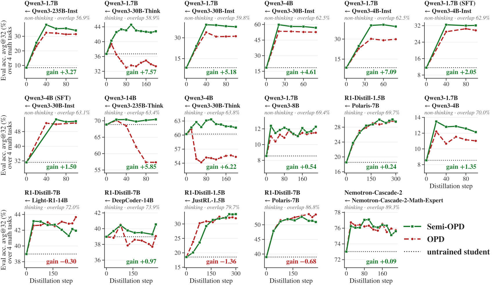

## 2.3 与其他 OPD 变体的完整数值结果

原表 1 的每个分数对 step 60、80、100 三个 checkpoint 取平均，再按 benchmark 汇总。标准 OPD 的训练 cap=16K；FastOPD cap=4K。Speculative KD、FastOPD、Relay-OPD 在第一组带 § 的分数引用其他论文；其精确运行设置不能视作由本篇重新核验。Lightning OPD 在初始学生上先做教师轨迹 SFT，再固定学生轨迹蒸馏。

| Method                                                                                                       | AIME24 | AIME25 | AIME26 | HMMT Feb26 | Avg@32 |
| ------------------------------------------------------------------------------------------------------------ | ------ | ------ | ------ | ---------- | ------ |
| Qwen3-1.7B (non-thinking) $\leftarrow$ Qwen3-4B-Instruct-2507 (non-thinking) Initial overlap ratio: 62.5%    | —      | —      | —      | —          | —      |
| Teacher                                                                                                      | 60.4   | 46.0   | 52.2   | 31.2       | 47.5   |
| Student, untrained                                                                                           | 12.6   | 9.6    | 7.4    | 6.3        | 9.0    |
| Standard OPD §                                                                                               | 35.8   | 25.5   | 23.3   | 20.1       | 26.2   |
| Speculative KD §                                                                                             | 33.1   | 30.7   | 28.9   | 20.1       | 28.2   |
| FastOPD §                                                                                                    | 42.3   | 30.4   | 26.4   | 23.6       | 30.7   |
| Lightning OPD                                                                                                | 41.0   | 28.8   | 27.5   | 22.7       | 30.0   |
| Relay-OPD §                                                                                                  | 42.7   | 32.8   | 30.5   | 24.7       | 32.7   |
| Semi-OPD (ours)                                                                                              | 50.3   | 38.9   | 41.8   | 28.0       | 39.8   |
| Qwen3-4B (non-thinking) $\leftarrow$ Qwen3-30B-A3B-Instruct-2507 (non-thinking) Initial overlap ratio: 62.5% | —      | —      | —      | —          | —      |
| Teacher                                                                                                      | 72.9   | 62.0   | 72.8   | 40.6       | 62.1   |
| Student, untrained                                                                                           | 23.6   | 18.0   | 16.8   | 14.9       | 18.3   |
| Standard OPD                                                                                                 | 55.1   | 45.3   | 49.1   | 30.0       | 44.9   |
| FastOPD                                                                                                      | 63.5   | 55.5   | 56.2   | 34.9       | 52.5   |
| Lightning OPD                                                                                                | 64.0   | 56.8   | 54.3   | 33.5       | 52.2   |
| Relay-OPD                                                                                                    | 61.1   | 48.1   | 52.5   | 32.8       | 48.6   |
| Semi-OPD (ours)                                                                                              | 66.4   | 63.1   | 62.9   | 37.4       | 57.4   |
| NM-Cascade-2-30B-A3B $\leftarrow$ NM-Cascade-2-Math-Expert Initial overlap ratio: 89.3%                      | —      | —      | —      | —          | —      |
| Teacher                                                                                                      | 82.8   | 80.0   | 76.4   | 58.2       | 74.4   |
| Student, untrained                                                                                           | 77.9   | 72.4   | 68.8   | 49.3       | 67.1   |
| Standard OPD                                                                                                 | 83.0   | 80.1   | 75.8   | 57.5       | 74.1   |
| FastOPD                                                                                                      | 83.0   | 80.7   | 77.1   | 58.4       | 74.8   |
| Lightning OPD                                                                                                | 83.2   | 79.1   | 75.7   | 56.8       | 73.7   |
| Relay-OPD                                                                                                    | 83.2   | 80.1   | 73.3   | 57.7       | 73.6   |
| Semi-OPD (ours)                                                                                              | 83.0   | 79.7   | 77.0   | 56.8       | 74.1   |

## 2.4 训练成本

原表 4 统计 100 步的 H100 GPU-hours，不含评测。Semi-OPD 包含离线 rollout、教师打分、学生优化三个阶段，不能只计优化阶段。第一、二组的 Semi-OPD 使用 4K、OPD 使用 16K；第三、四组二者都使用 16K。FastOPD 均为 4K。

| Method                                                                            | GPU-hours | Semi-OPD speedup |
| --------------------------------------------------------------------------------- | --------- | ---------------- |
| Qwen3-1.7B (non-thinking) $\leftarrow$ Qwen3-4B-Instruct-2507 (non-thinking) †    | —         | —                |
| Relay-OPD                                                                         | 173.3     | $34.7\times$     |
| OPD                                                                               | 56.8      | $11.4\times$     |
| FastOPD                                                                           | 11.7      | $2.3\times$      |
| Semi-OPD                                                                          | 5.0       | –                |
| Qwen3-4B (non-thinking) $\leftarrow$ Qwen3-30B-A3B-Instruct-2507 (non-thinking) † | —         | —                |
| Relay-OPD                                                                         | 604.4     | $19.5\times$     |
| OPD                                                                               | 199.1     | $6.4\times$      |
| FastOPD                                                                           | 77.3      | $2.5\times$      |
| Semi-OPD                                                                          | 31.0      | –                |
| Qwen3-14B (thinking) $\leftarrow$ Qwen3-235B-A22B-Thinking-2507 (thinking)        | —         | —                |
| Relay-OPD                                                                         | 1546.5    | $24.6\times$     |
| OPD                                                                               | 480.0     | $7.6\times$      |
| FastOPD                                                                           | 169.8     | $2.7\times$      |
| Semi-OPD                                                                          | 63.0      | –                |
| Nemotron-Cascade-2-30B-A3B $\leftarrow$ Nemotron-Cascade-2-Math-Expert            | —         | —                |
| Relay-OPD                                                                         | 933.5     | $14.1\times$     |
| OPD                                                                               | 301.4     | $4.5\times$      |
| FastOPD                                                                           | 147.5     | $2.2\times$      |
| Semi-OPD                                                                          | 66.4      | –                |

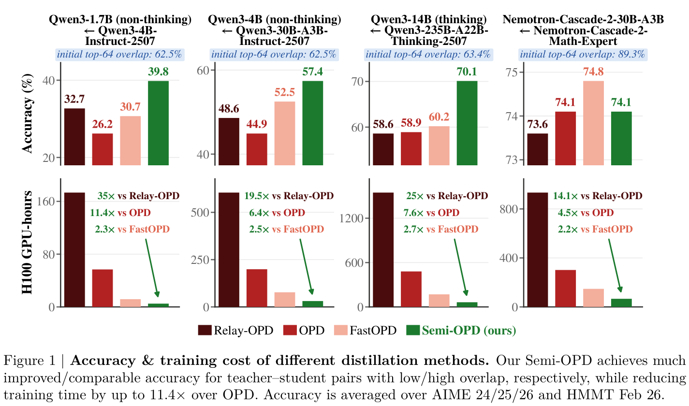

PDF 图 1 还给出第三组 Qwen3-14B (thinking)←Qwen3-235B-A22B-Thinking-2507 (thinking) 的四项平均：Relay-OPD 58.6、OPD 58.9、FastOPD 60.2、Semi-OPD 70.1。这个配置未列入表 1，故保留 PDF 原图。GPU-hour 比值是所报告训练协议的成本比较，包含长度和资源调度差异，不能解释为只替换目标函数的纯算子加速。

## 2.5 全部训练消融及曲线结果

| 实验            | 模型、变量与控制                                                                                                                                                                 | 报告结果与证据                                                                                            |
| --------------- | -------------------------------------------------------------------------------------------------------------------------------------------------------------------------------- | --------------------------------------------------------------------------------------------------------- |
| SFT warm start  | Qwen3-1.7B (non-thinking)←Qwen3-4B-Instruct-2507 (non-thinking)、Qwen3-4B (non-thinking)←Qwen3-30B-A3B-Instruct-2507 (non-thinking)；教师轨迹 SFT 1 epoch 后继续 OPD 或 Semi-OPD | overlap 62.5→62.9、62.5→63.1；Semi-OPD 仍优于 OPD，但先 SFT 低于直接 Semi-OPD；图 3                       |
| 固定轨迹来源    | 上述两个低 overlap 组合；初始学生轨迹与教师轨迹，其他条件保持一致                                                                                                                | 固定学生轨迹优于固定教师轨迹；图 4a/b                                                                     |
| 推理阶段覆盖    | 上述两组合；保留 response 的前 1/4、1/2、3/4、全部；每题 rollout 倍率 4、2、4/3、1，以保持训练 token 总量                                                                        | 完整轨迹峰值最好，前 1/4 收敛慢且低；图 4c/d；非整数倍率如何离散分配未披露                                |
| 在线训练 cap    | Qwen3-1.7B (non-thinking)←Qwen3-4B-Instruct-2507 (non-thinking)（overlap 62.5%）；R1-Distill-7B←Polaris-7B（86.8%）；cap=1K、4K、8K、16K                                         | 长轨迹损害低 overlap 组合，对高 overlap 组合有益；图 5；图的分数平均 AIME24/25                            |
| 监督目标        | Qwen3-1.7B (non-thinking)←Qwen3-4B-Instruct-2507 (non-thinking)；sampled-token 与 top-32 reverse KL                                                                              | 两种目标下 Semi-OPD 均优；图 7，k=32 可从原图确认                                                         |
| 切换到在线      | 两个低 overlap Qwen3 组合；从初始模型、Semi-OPD checkpoint、固定教师轨迹 checkpoint 启动 OPD；分别用 4K/16K cap                                                                  | 最终趋向同 cap 的在线水平；图 8 标示约 35/29、60/50，均为图中约值，不作精确末步成绩                       |
| 高 overlap 切换 | R1-Distill-7B←Polaris-7B，86.8%；Semi-OPD 后切换 OPD                                                                                                                             | 能补回与全程 OPD 的大部分差距；图 9；精确切换 checkpoint 未在文字给出                                     |
| 数学→代码       | Qwen3-1.7B (non-thinking)←Qwen3-4B-Instruct-2507 (non-thinking)，仅用数学训练                                                                                                    | HumanEval/HumanEval+ 均改善，Semi-OPD 高于 OPD；图 10，无独立末步数值表                                   |
| 初始能力        | Base 对照：Qwen3-1.7B-Base (thinking/non-thinking 未披露)←Qwen3-4B (thinking/non-thinking 未披露)；instruction 对照：Qwen3-1.7B (non-thinking)←Qwen3-4B (non-thinking)           | Base 的初始 overlap 55.2%，Semi-OPD 落后；instruct overlap 70.0%，Semi-OPD 恢复优势；图 11                |
| 训练动力学      | 除 Cascade 外 16 组，分别统计末 10 个共同 step                                                                                                                                   | 15/16 中 OPD response 比固定初始轨迹长 7%–113%；15/16 中 Semi-OPD 的正 advantage token 比例更高；图 12–16 |
| 自纠词密度      | 每步汇集 128 条 rollout；13 个固定词的整词、不区分大小写命中数，每 1,000 字符归一化；教师参照为最后一步 prompt 上 128 条教师 rollout，T=1、相同 cap                              | OPD 长度与自纠词密度持续上升；图 17；词表及样例见下段                                                     |

自纠词表为 `wait, but, hmm, actually, hold, however, yet, oh, alternatively, no, ah, oops, well`。这是语言风格代理量，不能当作真实纠错次数。附录 E 的三个样例：Qwen3-1.7B (thinking)←Qwen3-30B-A3B-Thinking-2507 (thinking) 在 step201 的 OPD 为 16,384 tokens/80 次命中并触顶，固定初始轨迹 5,688/36；R1-7B←DeepCoder14B 在 step128 为 9,016/117 对 2,228/10；Qwen3-1.7B (non-thinking)←Qwen3-30B-A3B-Instruct-2507 (non-thinking) 在 step90 为 4,096/87 并触顶，对 308/0。这些是定性示例，不是全数据均值。

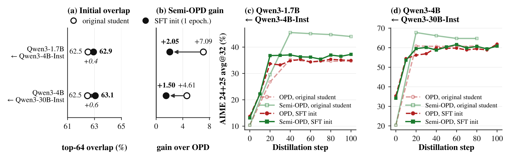

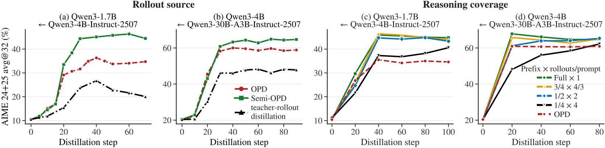

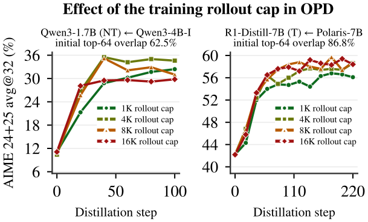

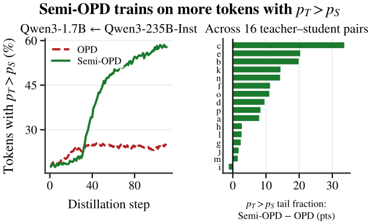 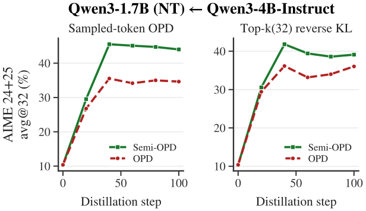

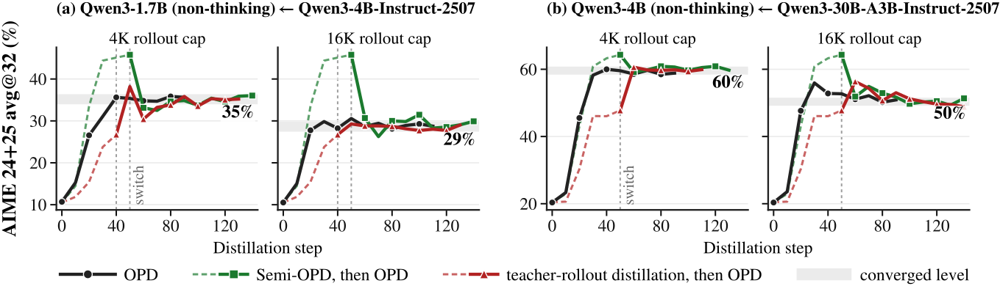

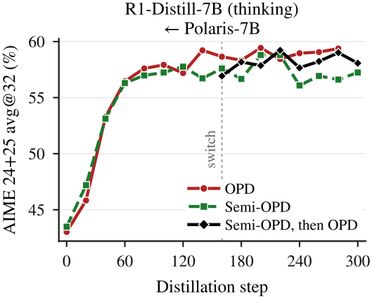

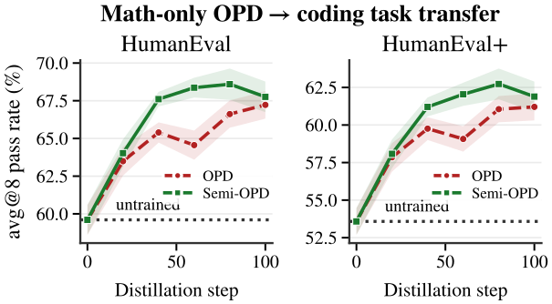

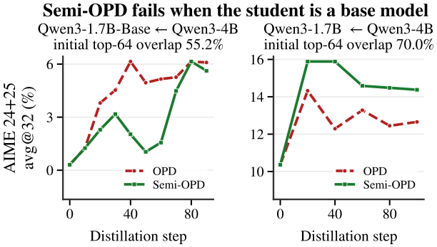

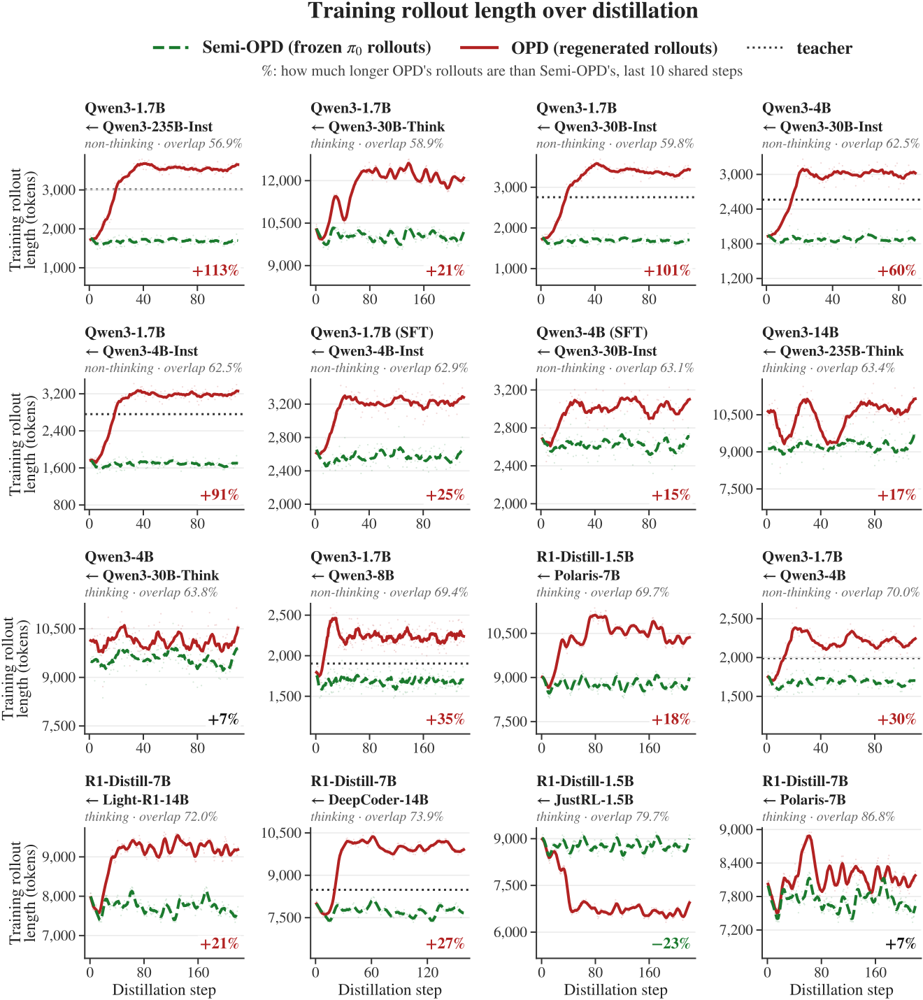

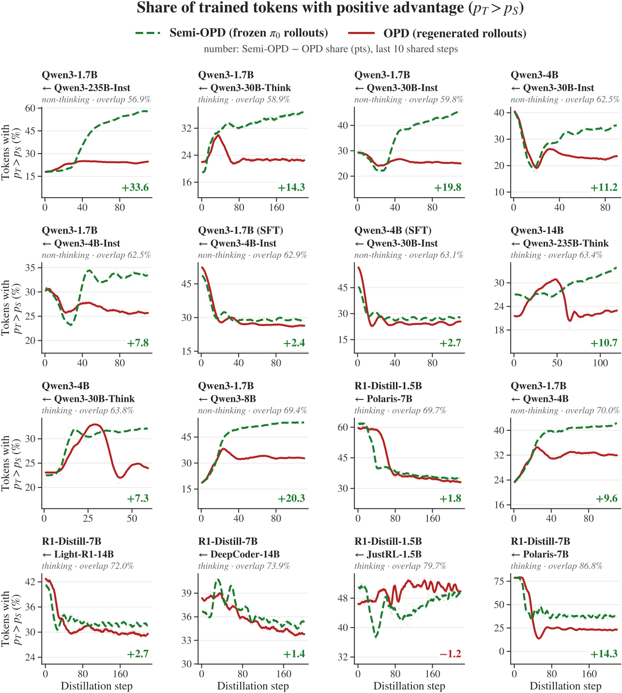

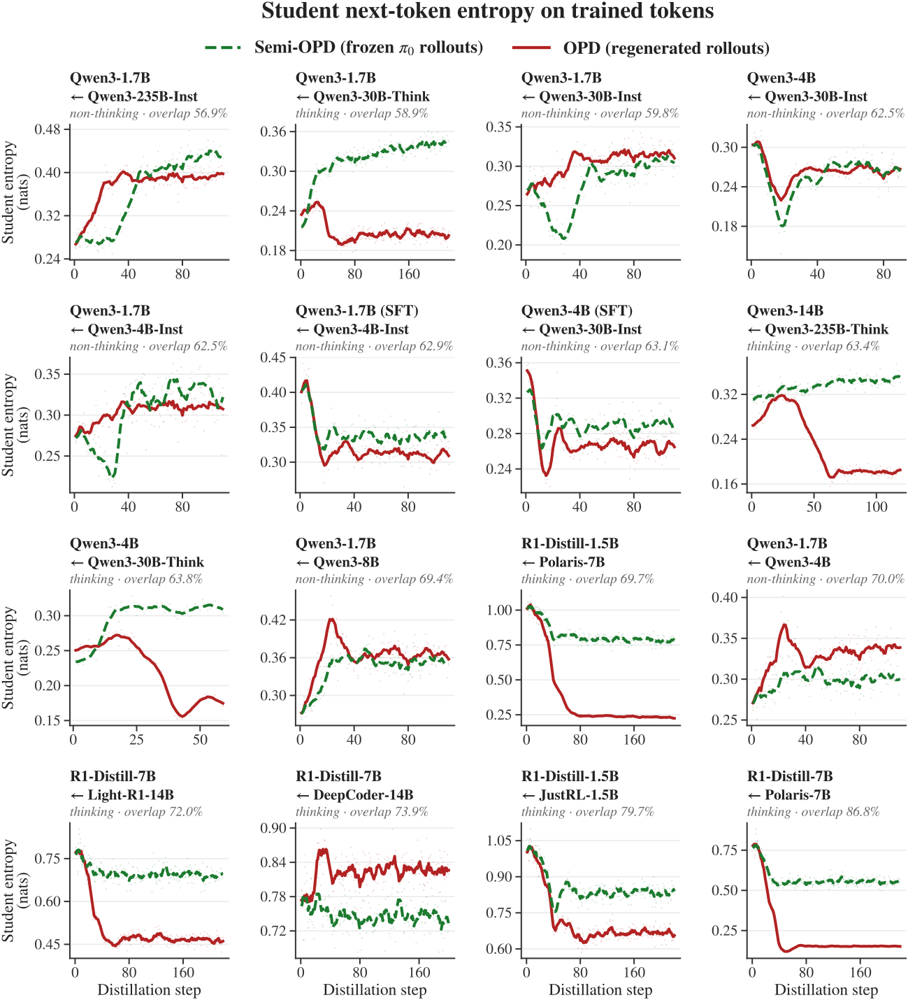

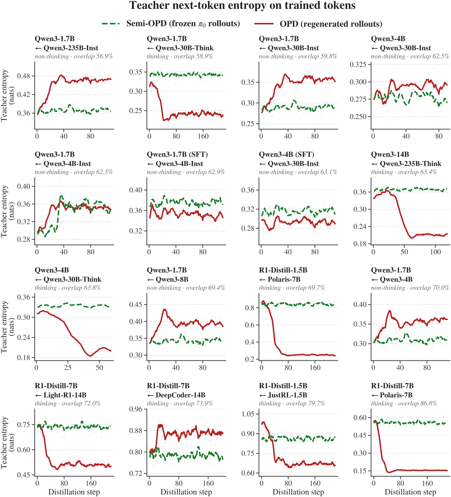

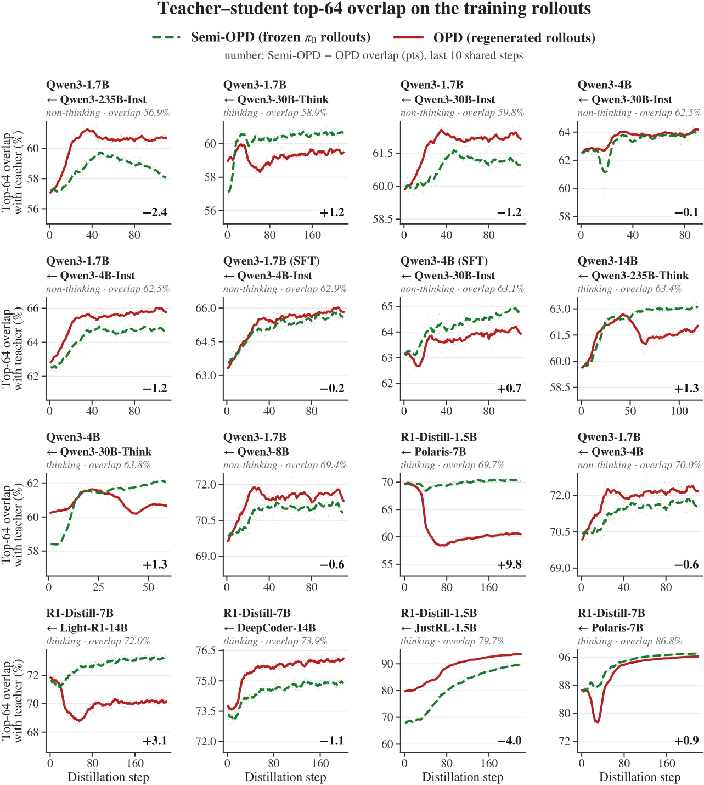

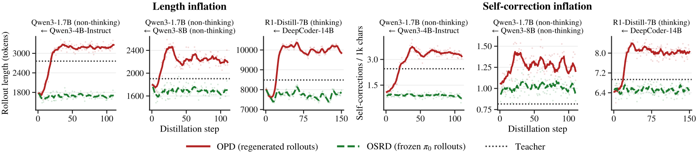

## 2.6 复现缺口

未给出所有实验的随机种子、逐组精确 GPU 分配、mini/micro-batch、缓存文件与刷新之外的详细生命周期、checkpoint 选择的一致规则、HumanEval 具体执行环境。额外 SFT 的优化器与数据过滤细节未单独披露。官方论文与所查 Hugging Face 索引未关联本篇实现；因此不能用别篇代码补齐这些字段。

### 参考文献

[^semi]: Zhao, S., Fu, Y., Jiang, J., et al. When Do We Need On-Policy Distillation? Distilling on Offline Student Rollouts Is Often Better. arXiv 2026, 2610.11291v1. [arXiv 全文](https://arxiv.org/html/2610.11291v1).
