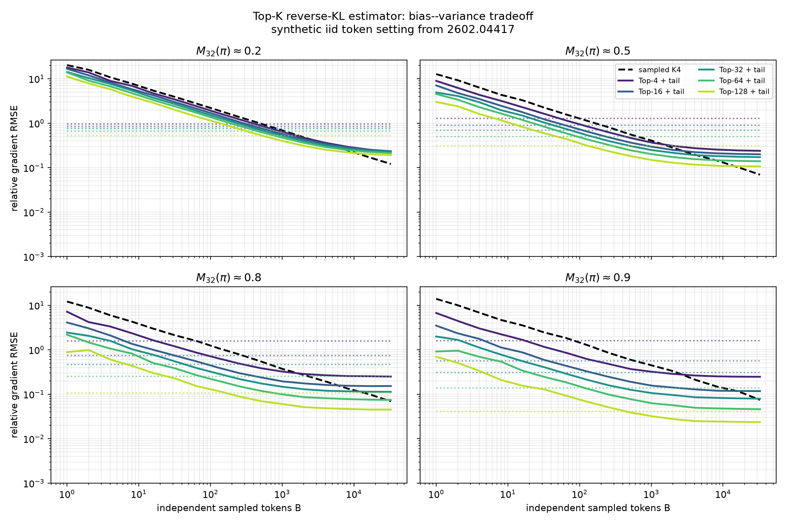

# EMA 论文 Top-K KL 合成实验复现

本目录复现 `科研/pmd-theory/2602.04417_zh_CN/example_paper.tex` 附录 G 的合成实验。实验在 archbox 的 NVIDIA GeForce RTX 4070 SUPER（12 GB）上运行，使用已有的 CUDA PyTorch 环境；没有向 `/tmp` 写入实验文件。

## 输入数据与生成方式

实验不使用训练集，也不把完整自回归轨迹混入估计量误差。每个实验情景只生成一个固定的 token-level categorical distribution pair：

$$
\pi_{\mathrm{ref}}=\operatorname{softmax}(\tilde z_{\mathrm{ref}}),\qquad
\pi=\operatorname{softmax}(s\tilde z),
$$

其中 $\tilde z,\tilde z_{\mathrm{ref}}\sim\mathcal N(0,I_{32000})$ 独立抽取。对每个目标质量 $m\in\{0.2,0.5,0.8,0.9\}$，用二分法选择 $s$，使

$$
M_{32}(\pi)=\sum_{j\in\operatorname{TopK}(\pi,32)}\pi(j)\approx m.
$$

然后在同一个固定的 $(\pi,\pi_{\mathrm{ref}})$ 上独立抽取 $B$ 个 token。这里的 $B$ 只服务于附录中的方差实验：它表示把同一个 prefix 的单-token 估计量重复平均 $B$ 次后的有效 Monte Carlo 样本量，不是 Top-K KL 训练算法要求对同一个 prefix 额外采样 $B$ 次。实际训练中，每个 prefix 只 rollout 一个 token $y_n$，先计算 logits 的 Top-$K$ 精确头部，再用这个 sampled token 做尾部修正；minibatch 中不同 prefix/token position 的平均才会带来实际的方差降低。不同 panel 的差异来自策略集中度，不来自不同的 prompt 或 rollout。

## 比较的三个估计量

真值是反向 KL 对当前 logits 的梯度：

$$
g_{\mathrm{true},j}=\pi(j)\left(\log\frac{\pi(j)}{\pi_{\mathrm{ref}}(j)}-\operatorname{KL}(\pi\Vert\pi_{\mathrm{ref}})\right).
$$

对一个 sampled token $Y\sim\pi$，脚本实现论文的 K4 自动微分形式：

$$
g_{\mathrm{K4}}(Y)=\operatorname{sg}\!\left(\log\frac{\pi(Y)}{\pi_{\mathrm{ref}}(Y)}\right)\nabla\log\pi(Y).
$$

只截断估计量计算 Top-$K$ 头部的 exact KL 梯度；实际的单-token Top-K 估计量把它和 $\mathbf1\{Y\notin S_K\}g_{\mathrm{K4}}(Y)$ 相加，其中 $S_K=\operatorname{TopK}(\pi,K)$。实验为了估计 RMSE，对这个单-token 估计量重复采样并平均，每个点重复 128 次，报告

$$
\operatorname{RelRMSE}=\frac{\sqrt{\mathbb E\lVert\hat g-g_{\mathrm{true}}\rVert_2^2}}{\lVert g_{\mathrm{true}}\rVert_2}.
$$

在 OPD 的 outer rollout 中，$Y$ 通常来自冻结的 rollout policy $\pi_k$，而 inner update 的当前策略是 $\pi_\theta$。此时单个 prefix 的尾部项需要停止梯度的重要性权重

$$
s_k(Y)=\operatorname{sg}\!\left(\frac{\pi_\theta(Y)}{\pi_k(Y)}\right),
\qquad
\mathbf1\{Y\notin S_K\}\,s_k(Y)\,r_\theta(Y)\,
\operatorname{sg}\!\left(\log\frac{\pi_\theta(Y)}{\pi_{\rm ref}(Y)}\right),
$$

其中 $r_\theta(Y)=\pi_\theta(Y)/\operatorname{sg}(\pi_\theta(Y))$。当 rollout 与当前策略同策略时，$\pi_k=\pi_\theta$，$s_k(Y)=1$；这仍然是每个 prefix 一个 sampled token，而不是对同一 prefix 采样一批 token。

实现文件是 [`ema_topk_reproduction.py`](../ema_topk_reproduction.py)，结果包含 `metrics.csv`、`metadata.json`、PNG 和 PDF 图。

进一步的 $K$ 扫描在 [`k_analysis_v2/topk_structural_sweep.png`](k_analysis_v2/topk_structural_sweep.png) 和 [`k_analysis_v2/topk_error_vs_k.png`](k_analysis_v2/topk_error_vs_k.png) 中。前一张图同时画出 head/tail mass、单个 prefix 单个 sampled token 的 RMSE，以及 bias floor；后一张图固定四个有效 Monte Carlo batch size，直接观察误差随 $K$ 的变化。

这些图给出的单-token结论是：$K$ 增大首先减少 tail mass，从而降低单-token方差；但 $K$ 不是越大越有利，因为计算和显存开销随 $K$ 增加，而 literal masked-tail 梯度的结构偏差也不由 $K$ 自动消除。对于真实 OPD 训练，图中的 $B$ 应替换为一个 minibatch 内不同 prefix/token position 的平均数量，不能解释成同一个 prefix 的重复 rollout 次数。

## 结果

临界批量大小（第一个满足 Top-K RMSE 小于只截断 RMSE 的扫描点）如下：

| $M_{32}(\pi)$ | Top-4 | Top-16 | Top-32 | Top-64 | Top-128 |
|---:|---:|---:|---:|---:|---:|
| 0.2 | 512 | 512 | 512 | 512 | 1024 |
| 0.5 | 64 | 64 | 128 | 128 | 256 |
| 0.8 | 32 | 32 | 64 | 128 | 256 |
| 0.9 | 32 | 64 | 64 | 128 | 512 |

## 对梯度无偏性的核对

实验严格照论文的“exact head + masked K4 tail”公式实现。对于固定的 $S_K$，其期望梯度为

$$
\mathbb E[\hat g_{\mathrm{TopK}}]
=g_{\mathrm{head}}+\sum_{j\notin S_K}\pi(j)\log\frac{\pi(j)}{\pi_{\mathrm{ref}}(j)}\nabla\log\pi(j).
$$

而 exact tail 的梯度还包含

$$
\sum_{j\notin S_K}\pi(j)\nabla\log\pi(j).
$$

因此，按 literal 的 masked K4 stop-gradient 写法，值估计可以无偏，但受限 tail 的自动微分梯度一般会留下一个与 $B$ 无关的结构偏差；图中 Top-K 曲线在大 $B$ 时的非零平台正是这一项，而不是 Monte Carlo 误差。这个检查是后续 MirrorOPD 理论中区分“KL 值无偏”和“KL 梯度无偏”的必要基线。若要得到严格无偏的 restricted-tail 梯度，需要额外补偿该 tail score 项，或采用与论文实现不同的 stop-gradient 约定。
