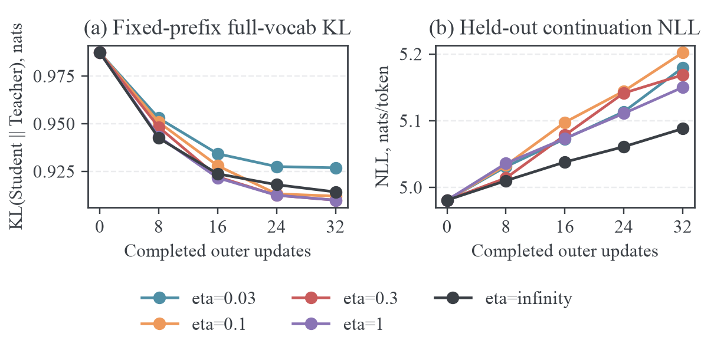
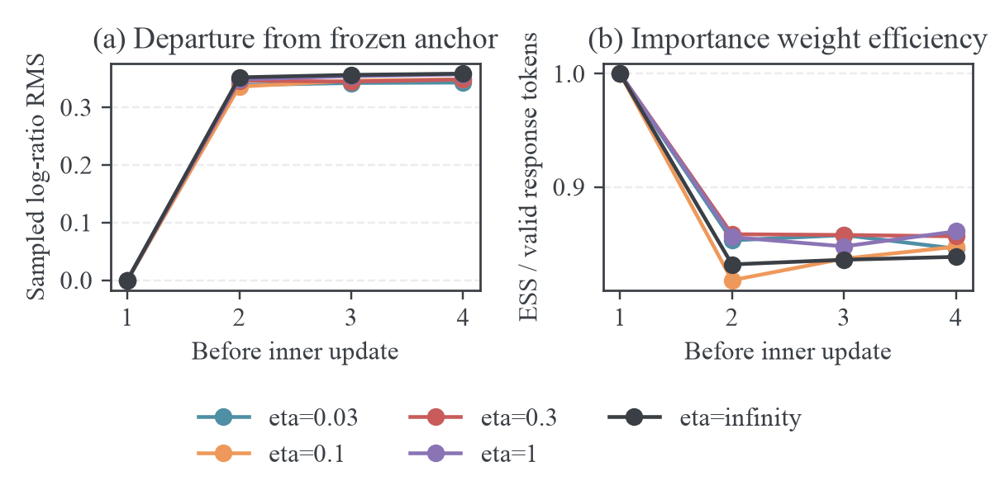

# Pythia MDPO 的 eta 对比

## 扫描目的与固定设置

此前固定配置为 $\eta=0.1$。在 MDPO 损失中，锚点 KL 的系数为 $1/\eta=10$。本轮扫描 $\eta\in\{0.03,0.1,0.3,1,+\infty\}$，保持学习率 $10^{-6}$、Pythia-14M 学生、Pythia-70M 教师、冻结 WikiText-2 数据与短上下文设置一致。数据、模型 revision、混合精度和评价位置的完整定义沿用 [Pythia 训练报告](2026-10-08-Pythia-MDPO训练设置与实测.md)。

每组 512 条不同训练 prompt，prompt batch 与 mini-batch 均为 16，micro-batch 为一条响应，每轮累积完整 batch 后执行四次 inner 更新。共 32 outer、128 次 AdamW 更新，$K=32$，每条 prompt 生成一条响应，温度一、无 top-p/top-k 截断，prompt/response 上限均为 64。每轮 hard sync。所有组使用相同初始化和配置种子；策略更新改变后，后续 on-policy 轨迹自然不同。

其中 $\eta=0.1$ 使用此前已完成的低学习率实验，另外四组新运行。损失核心只增加了正无穷端点支持，有限 $\eta$ 的算式没有改变。这是单种子有限 inner 预算的扫描，不是精确内层优化的比较。

## eta 的目标函数含义

固定外层锚点 $\pi_k$、prefix 经验测度 $d_k$ 与教师 $T$，定义

$$
r_k(s,a)=\log\frac{T(a\mid s)}{\pi_k(a\mid s)}.
$$

实际比较的总体内层目标是

$$
F_{k,\eta}(\theta)=
\mathbb E_{d_k}
\left[
\frac1\eta\operatorname{KL}(\pi_\theta\Vert\pi_k)
-\mathbb E_{\pi_\theta}r_k
\right].
$$

在一个 prefix 上展开，有

$$
\begin{aligned}
F_{k,\eta}(\theta)
&=\frac1\eta\mathbb E_{\pi_\theta}
\log\frac{\pi_\theta}{\pi_k}
-\mathbb E_{\pi_\theta}\log\frac{T}{\pi_k}\\
&=\operatorname{KL}(\pi_\theta\Vert T)
+\left(\frac1\eta-1\right)
\operatorname{KL}(\pi_\theta\Vert\pi_k).
\end{aligned}
$$

因此 $\eta<1$ 表示在教师 reverse KL 上增加非负锚点正则。$\eta=1$ 恰好得到教师 reverse KL。$\eta>1$ 时，相对于教师 reverse KL 的上述附加系数为负；直接称它为更弱的非负正则会掩盖目标变化。

对有限 $\eta>0$，在每个 prefix 的完整概率单纯形上精确求解，设

$$
Z_{k,\eta}=\mathbb E_{v\sim\pi_k}
\left[\left(\frac{T(v\mid s)}{\pi_k(v\mid s)}\right)^\eta\right],
\qquad
P_{k,\eta}^{\star}(a\mid s)=
\frac{\pi_k(a\mid s)^{1-\eta}T(a\mid s)^\eta}{Z_{k,\eta}}.
$$

将这个分布代入 KL 定义，可得

$$
\begin{aligned}
\operatorname{KL}(\pi_\theta\Vert P_{k,\eta}^{\star})
&=\mathbb E_{\pi_\theta}
\left[\log\pi_\theta-(1-\eta)\log\pi_k
-\eta\log T+\log Z_{k,\eta}\right]\\
&=\eta F_{k,\eta}(\theta)+\log Z_{k,\eta}.
\end{aligned}
$$

所以最优解为 $P_{k,\eta}^{\star}$，最优值为 $-\log Z_{k,\eta}/\eta$。$\eta=1$ 时 $Z_{k,1}=\sum_a T(a\mid s)=1$，精确最优解为教师。四次 AdamW 参数更新没有保证达到这个解。

### 正无穷端点与 vanilla OPD 的区别

本轮的 $\eta=+\infty$ 按 $1/\eta=0$ 实现，目标为

$$
F_{k,\infty}(\theta)=-\mathbb E_{d_k,\pi_\theta}
\log\frac{T}{\pi_k}.
$$

该目标去除了锚点 KL，保留冻结 reward。设一个 prefix 的有限词表中最大 reward 为 $m=\max_a r_k(a)$，则任意概率分布满足

$$
F_{k,\infty}=-\sum_a\pi_\theta(a)r_k(a)\ge-m.
$$

当且仅当全部概率质量放在 reward 最大的动作集合上时取等号。令 $A=\{a:r_k(a)=m\}$。有限 $\eta$ 最优解也满足

$$
P_{k,\eta}^{\star}(a)=
\frac{\pi_k(a)\exp(\eta[r_k(a)-m])}
{\sum_v\pi_k(v)\exp(\eta[r_k(v)-m])}.
$$

词表有限且概率支持一致时，$a\notin A$ 的指数项趋于零，而 $a\in A$ 的指数项恒为一。因此

$$
\lim_{\eta\to\infty}P_{k,\eta}^{\star}(a)=
\frac{\pi_k(a)\mathbf1[a\in A]}{\sum_{v\in A}\pi_k(v)}.
$$

若最大 reward 唯一，极限为该 token 的确定性分布。这说明无正则冻结 reward 的精确内层目标具有集中化倾向。实际有限参数更新是否出现这个倾向，需要实验观察。

vanilla reverse-KL OPD 的 reward 随当前学生变化为 $\log(T/\pi_\theta)$。在本轮定义下，它对应 $\eta=1$ 的总体梯度；$\eta=\infty$ 是删除 proximal 项的冻结 reward 对照。两者在每轮第一个 inner 状态 $\pi_\theta=\pi_k$ 的梯度相同，后续 inner 的梯度不同。

### 实际采样梯度与首步恒等式

本轮固定动作测度为 $\pi_k$，令

$$
u_\theta(s,a)=\log\frac{\pi_\theta(a\mid s)}{\pi_k(a\mid s)},
\qquad
\rho_\theta(s,a)=\exp(u_\theta(s,a)).
$$

score 梯度为

$$
\nabla_\theta F_{k,\eta}=
\mathbb E_{d_k,\pi_k}
\left[
\rho_\theta
\left(\frac{u_\theta}\eta-r_k\right)
\nabla_\theta\log\pi_\theta
\right].
$$

实际 surrogate 把整个 $\rho_\theta(u_\theta/\eta-r_k)$ 停止梯度，只对最后的 $\log\pi_\theta$ 求导。$\eta=1$ 时括号成为 $\log(\pi_\theta/T)$；$\eta=\infty$ 时成为 $-r_k$。

每轮首步 $u_\theta=0$、$\rho_\theta=1$，所以所有 $\eta$ 的首步样本 score 系数均为 $-r_k$。$\eta$ 只在模型偏离锚点后改变 proximal 梯度。跨组第一轮若 rollout 样本与数值前向一致，首步梯度应相同；异步服务的固定 seed 不保证逐 bit 相同的动作序列，后续 on-policy 轨迹也没有配对约束。

生产核心新增 CPU 枚举测试：对所有动作按锚点概率加权，逐项比较实际 surrogate 梯度与完整目标求导；验证五个 $\eta$、$\eta=1$ 的教师 KL 恒等式及无穷端点的冻结 reward 恒等式。所有测试通过。

## 实测结果

所有五组均完成 32 outer 和 128 inner 更新，正常退出。四组新运行各保存四个 checkpoint，并在相同验证前缀上完成五个时点的全词表评价。下面为 outer 32 的结果；KL 为 nats，NLL 为 nats/token。

| $\eta$    | 原始目标的 $1/\eta$ | 学生到教师 KL | 教师到学生 KL | 真实续写 NLL |   学生熵 |
| --------- | ------------------: | ------------: | ------------: | -----------: | -------: |
| 初始模型  |                   — |      0.987310 |      0.890709 |     4.980831 | 5.035230 |
| 0.03      |             33.3333 |      0.926909 |      0.944758 |     5.179526 | 4.528496 |
| 0.1       |                  10 |      0.912054 |      0.952285 |     5.202112 | 4.455692 |
| 0.3       |              3.3333 |      0.909943 |      0.946174 |     5.168605 | 4.431645 |
| 1         |                   1 |      0.909935 |      0.938502 |     5.150048 | 4.474173 |
| $+\infty$ |                   0 |      0.914251 |      0.916784 |     5.088139 | 4.541630 |



学生到教师 KL 的点估计以 $\eta=1$ 最低，与 0.3 的差异只有 $7.5\times10^{-6}$ nats，这个量级不足以支持两者优劣排序。$\eta=\infty$ 在本轮的 NLL 和教师到学生 KL 两项中最低；它的学生到教师 KL 略高于 0.3 和 1。五组均改善了学生到教师 KL，同时真实续写 NLL 与教师到学生 KL 均比初始化更高。

本轮没有得到“更强锚点正则带来更好训练效果”的证据。$\eta=0.03$ 的学生到教师 KL 改善少于其他组，NLL 也没有优于 0.3、1 和无正则组。单种子、相同更新次数的结果用于选择后续检查方向，不能据此断言无正则方法在充分训练或大模型上更好。

### 相对 eta=0.1 的配对差异

保持同一组验证文本，对最终模型逐文本计算差异，再进行配对 bootstrap。表中负值表示相对 $\eta=0.1$ 指标降低。区间只反映这批文本的抽样变化，不包括重新训练的随机性，也没有对多个比较作校正。

| $\eta$    | 学生到教师 KL 差异及 95% 区间 | NLL 差异及 95% 区间           |
| --------- | ----------------------------- | ----------------------------- |
| 0.03      | +0.01485 [0.01217, 0.01778]   | -0.02259 [-0.02838, -0.01664] |
| 0.3       | -0.00211 [-0.00424, -0.00004] | -0.03351 [-0.03960, -0.02764] |
| 1         | -0.00212 [-0.00387, -0.00040] | -0.05206 [-0.05936, -0.04482] |
| $+\infty$ | +0.00220 [-0.00231, 0.00768]  | -0.11397 [-0.12873, -0.09992] |

无正则组相对 0.1 的学生到教师 KL 区间包含零，其 NLL 明确降低。但无正则组 NLL 比初始化高 0.10731，说明它只是减轻退化，并未改善真实文本似然。

### Inner 动力学与正则项幅度



五组所有 outer 的第一个 inner 状态均满足 sampled log-ratio RMS 为零、ESS/token 数为一、锚点到学生中心为零。下面按有效 token 数加权，汇总第四次更新前的指标。中心为 anchor top-32 加聚合 tail 的 KL 数值，不是完整词表 KL。

| $\eta$    | log-ratio RMS | 锚点到学生 Tail-aware KL | ESS/token 数 | score 系数 RMS |
| --------- | ------------: | -----------------------: | -----------: | -------------: |
| 0.03      |       0.34304 |                  0.02904 |      0.84574 |       29.19213 |
| 0.1       |       0.34859 |                  0.03013 |      0.84736 |       10.10845 |
| 0.3       |       0.34836 |                  0.03086 |      0.85656 |        5.25652 |
| 1         |       0.35720 |                  0.03294 |      0.86090 |        4.21879 |
| $+\infty$ |       0.35848 |                  0.03284 |      0.83844 |        4.18627 |

更小 $\eta$ 的 proximal 项 $u_\theta/\eta$ 会放大非零 log-ratio，在本轮反映为更大的 score 系数 RMS。0.03 组第四次更新前约为 29.19，明显高于 1 和无正则组的约 4.2；这说明强正则也能产生大的恢复梯度，不能把小 $\eta$ 直接解释为小的随机梯度幅度。

模型偏离锚点的 RMS 在五组之间接近，没有按 $\eta$ 成比例缩小。这里使用 AdamW、全局 gradient clipping 和共享 transformer 参数；学习率、归一化优化器状态、动作样本及混合精度共同影响实际参数更新。观察到的 ESS 占比在 0.84–0.86 附近，也不具有随 $\eta$ 单调改善的关系。这些是经验重要性权重的集中程度，不能当作相关轨迹中独立样本数。

所有组第四次更新前的 score 系数 RMS 仍明显非零。它包含 Monte Carlo 动作噪声，不能单独作为内层停止条件。本轮固定四次更新，没有证明 inner 收敛。因此本轮可以比较同等预算下的行为，但不能验证 Gibbs 精确最优解或无正则精确求解的集中化极限。

### 保留的限制与后续设置

首先继续保留 $\eta=1$ 与无正则组作为目标语义不同的两个对照，$\eta=0.3$ 作为有限 proximal 设置。当前证据不支持将 0.03 设为默认。对于纯 reverse-KL OPD，应该用 $\eta=1$ 解释总体目标；对于删除 proximal 项的冻结 reward 对照，用 $\eta=\infty$ 标注。

在增加 inner 次数前，需要记录最后一次更新后的固定 batch 目标与梯度，并核对 FP32 前向下的参数变化。现有 BF16 前向、AdamW clipping 和有限采样的结果尚未解释 NLL 退化的全部原因；本轮没有通过修改精度、样本数或估计量来同时引入新的变量。

四组新实验实际生成约 3.24–3.25 万 response token/组，97.27%–98.83% 的响应触及 64-token 上限。验证 oracle 精确覆盖指定短 prefix 测度，结论仍局限于有长度上限的文本续写。每组累计 outer 时间约 125–127 秒，GPU 按秒记录的峰值约 4,265–4,267 MiB。SmolLM2 尚未运行。

## 记录与复现入口

每组使用相同 64 条验证文本、8,128 个 prefix、4,096 个真实 continuation token，HF FP32 前向与 FP64 词表概率聚合。outer 0、8、16、24、32 分别记录双向 KL、熵和 NLL。每组的配对 bootstrap 以文本为单位，5,000 次抽样，用于评价相对初始化的变化；它不衡量训练随机种子的差异。

原始日志与 checkpoint 留在 archbox `~/src/mirroropd/runs/pythia-mdpo-eta-*`，可引用归档在本机 `results/training/` 同名目录；原始生成文本进入 `data/pythia-wikitext/rollouts-eta-*`。扫描程序位于 [run_pythia_eta_scan.sh](../../training/run_pythia_eta_scan.sh)，聚合程序位于 [pythia_eta_scan.py](../../experiments/analysis/pythia_eta_scan.py)，绘图复用 [plot_pythia_mdpo.py](../../experiments/plotting/plot_pythia_mdpo.py) 的 `--eta-scan` 选项。

Hydra override 的 `.inf` 会解析为字符串；入口使用 `1e309`，经解析得到浮点正无穷。实际解析配置中为 `.inf` 数值，Python 核心验证只有 MDPO 支持该端点；PMD-Mean 与 BPO 继续要求有限正 $\eta$。启动失败的配置日志独立保留，未混入成功训练的指标。

```bash
# eta=1
bash training/run_pythia_mdpo.sh pythia-mdpo-eta-1 \
  actor_rollout_ref.actor.optim.lr=1e-6 \
  distillation.distillation_loss.mirror_eta=1
bash training/score_pythia_mdpo.sh pythia-mdpo-eta-1
# infinity、0.3、0.03，依次训练与评分
bash training/run_pythia_eta_scan.sh
```

每个运行名必须不存在，入口拒绝覆盖已有目录。此前 $\eta=0.1$ 的对照为 `pythia-mdpo-low-lr`，没有重复训练。结果同步到本机后逐组执行 `pythia_mdpo_report.py`，然后执行：

```bash
uv run --with numpy python experiments/analysis/pythia_eta_scan.py
uv run --with matplotlib --with numpy python experiments/plotting/plot_pythia_mdpo.py \
  --run results/training/pythia-mdpo-low-lr \
  --eta-scan results/training \
  --output results/training/pythia-eta-scan/figures
```
