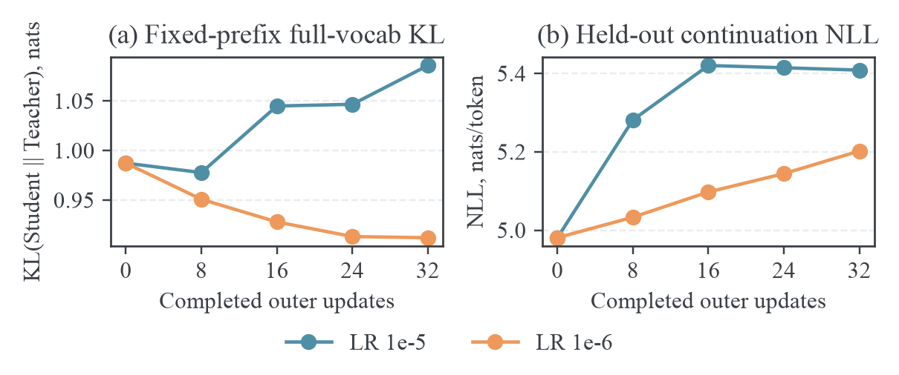
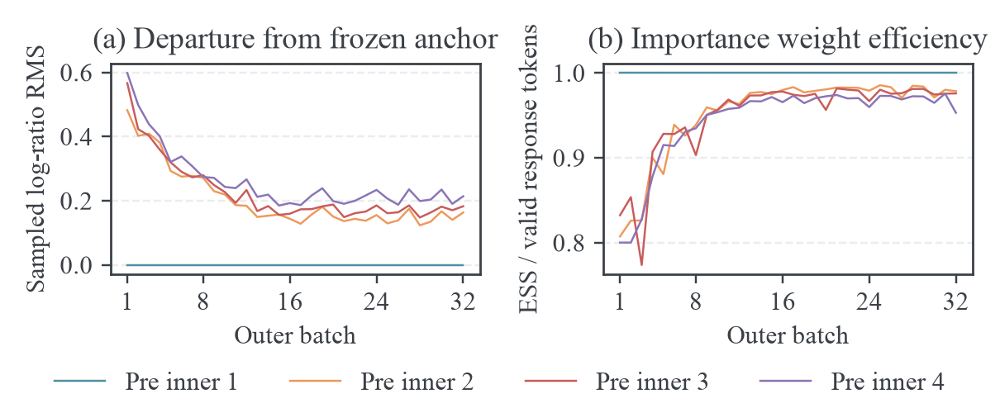

# Pythia MDPO 训练设置与实测

## 实验结论

基于 TA-OPD/verl 的 MDPO 训练已在 archbox 的 RTX 4070 SUPER 12 GB 上完成。学生为 Pythia-14M，教师为 Pythia-70M。主实验使用 512 条不同的 WikiText-2 训练前缀，执行 32 轮 outer 更新，每轮执行 4 次完整 rollout batch 的梯度更新，共 128 次优化器更新。另完成一组只将学习率从 $10^{-5}$ 降到 $10^{-6}$ 的同规模对照。两组均正常退出，checkpoint、inner 日志、outer 日志、生成文本、运行配置和 GPU 记录已经保存。

训练链路通过验证；优化效果存在明确问题。学习率 $10^{-5}$ 时，固定验证前缀上的 $\operatorname{KL}(\pi_\theta\Vert T)$ 从 0.9873 增至 1.0858 nats。学习率 $10^{-6}$ 时，这个 KL 降至 0.9121，下降 7.62%，但真实续写的负对数似然（negative log-likelihood，NLL）仍从 4.9808 增至 5.2021 nats/token。教师到学生的 KL 也增加。因此，小学习率改善了一个对齐指标，却没有达到“教师对齐改善且语言建模质量不退化”的判定标准。

这两组结果是单种子的动力学实验。它们支持后续排查学习率、数值精度和 inner 停止条件，尚不构成 MDPO 优于其他 OPD 方法的 benchmark。SmolLM2 尚未运行。

## 固定问题与判定标准

本轮首先验证两个问题：训练是否按照“rollout、冻结锚点、复用同一批数据进行 inner 更新、hard sync、重新 rollout”的顺序执行；在真实预训练语言模型中，这组有限 inner 更新是否改善独立文本前缀上的教师对齐。

链路通过的条件包括以下几项。

1. 每组恰有 32 条 outer 记录和 128 条 inner 记录，inner 索引完整覆盖每个 outer 的 4 次更新。
2. 每轮第一条 inner 记录中的学生/锚点 log-ratio 为零，重要性权重 ESS 占比为一，学生/锚点 KL 中心为零。
3. 同一轮 inner 使用冻结的锚点、教师信号和 rollout；下一轮 rollout 使用更新后的模型版本。
4. 损失与梯度有限，训练退出码为零，四个保存时点的 checkpoint 均能严格加载。
5. 每组 512 条生成记录都能对应到冻结训练集中的不同 source row。

优化效果用独立固定前缀的双向全词表 KL、学生熵和真实续写 NLL 判定。训练 surrogate 的数值和 rollout 平均 reward 用于诊断；两者不能替代固定测度上的评价。

## 模型、数据与长度

### 模型版本

Pythia 使用相同的 tokenizer 词表映射，适合先排除跨 tokenizer 对齐问题。选用相邻的小规模学生与教师，使全参数训练、精确全词表评估和多个 checkpoint 都能在现有显存内运行。模型来源是 EleutherAI 的原始模型发布[^pythia]。

| 角色 | 模型                    | 固定 revision                              |
| ---- | ----------------------- | ------------------------------------------ |
| 学生 | `EleutherAI/pythia-14m` | `cf967c0a9a04383db6f7b1108d86b2962634b4ac` |
| 教师 | `EleutherAI/pythia-70m` | `a39f36b100fe8a5377810d56c3f4789b9c53ac42` |

两个模型的输出维度均为 50,304，tokenizer 含 50,277 个 token。训练概率及全词表 oracle 均使用模型的完整输出维度。准备数据时核对两个 tokenizer 的 token→ID 映射、EOS ID 和测试文本编码。实际 rollout、学生评分和教师评分统一使用学生 tokenizer。教师参数冻结。

Pythia 是基础语言模型，本轮使用自然文本续写。没有添加 chat role、system prompt 或 assistant 结束标记。模板严格拼接消息正文，准备阶段检查模板处理后的 prompt IDs 与原始 64 个 IDs 一致。

### 数据生成

数据为 `Salesforce/wikitext` 的 `wikitext-2-raw-v1`，固定 revision 为 `b08601e04326c79dfdd32d625aee71d232d685c3`[^wikitext]。

准备程序按官方 train、validation 两个 split 分别处理文本行。过滤空行、标题行和不足 128 个 token 的行。对每个候选行取前 64 个 token 作为 prompt；仅保留这些 token 经 decode、再 encode 后完全一致的行。随后用固定数据种子 20261008 打乱 train 候选，用种子 20261009 打乱 validation 候选，分别取 512 行和 64 行。

每个保存记录包含 source row、split、prompt 文本、64 个 prompt IDs、后续 64 个真实 token IDs 和源文本 SHA-256。训练模型只看到前 64 个 token，随后自己生成。保存的原文后 64 个 token 用于 teacher-forced 评价，不进入本轮 OPD 损失。

官方 train 与 validation split 分开取样，保证验证文本不参与本次参数更新。这不能证明验证文本没有出现在 Pythia 的预训练语料中。

### Rollout 与截断

每个训练 prompt 生成一条响应，温度为 1，top-p 为 1，top-k 为 -1；遇到 EOS 或生成 64 个 token 时停止。总上下文上限为 128。这里的长度上限用于分析短上下文的 token 动力学。

主实验实际生成 32,570 个有效 response token，507/512 条轨迹触及 64-token 上限，占 99.02%。低学习率对照生成 32,292 个 token，497/512 条触及上限，占 97.07%。本轮结果针对有长度上限的续写，不应解释为自然结束的完整长轨迹结果。

上游生成日志默认 decode 会清理英文标点附近的空格，显示文本与原始 prompt 字符串有格式差异。用同一 tokenizer 的默认 decode 对照后，两组均验证 512/512 条 prompt 对应原始 IDs，且每条训练 prompt 使用一次。对应关系单独保存在 `rollout-source-index.json`。原始生成日志保存文本，没有保存每个 sampled action 的原始 ID 和完整缓存张量；因此它适合审查生成内容，不能独立重放逐 token 的全部梯度计算。

## 优化设置与算法

### 冻结设置

正式配置位于 [Pythia MDPO 配置](../../data/refactor-20261015/legacy-source.tar.gz#training/configs/pythia-mdpo.json)。训练启动入口复用现有 [TA-OPD/verl 启动程序](../../data/refactor-20261015/legacy-source.tar.gz#training/run_upstream_mirror_training.sh)，不另写 trainer。

| 参数                         | 主实验                                    | 学习率对照           |
| ---------------------------- | ----------------------------------------- | -------------------- |
| outer / prompt 数            | 32 / 512                                  | 相同                 |
| prompt batch                 | 16                                        | 相同                 |
| 每条 prompt 的 rollout 数    | 1                                         | 相同                 |
| inner 更新数 $J$             | 4                                         | 相同                 |
| mini-batch / GPU micro-batch | 16 / 1                                    | 相同                 |
| 梯度聚合                     | 完整 16 条响应的 token mean               | 相同                 |
| 优化器                       | AdamW，$\beta=(0.9,0.999)$                | 相同                 |
| 学习率 / 调度                | $10^{-5}$ / constant                      | $10^{-6}$ / constant |
| weight decay / gradient clip | 0 / 1                                     | 相同                 |
| $\eta$ / 缓存 top-$K$        | 0.1 / 32                                  | 相同                 |
| 参数更新                     | 全参数，LoRA rank 0                       | 相同                 |
| 同步                         | 每轮 inner 结束后 hard sync               | 相同                 |
| 参数与前向精度               | FP32 参数；FSDP BF16 前向，FP32 reduction | 相同                 |
| rollout / 教师评分精度       | vLLM BF16 / HF BF16                       | 相同                 |
| 训练与数据顺序种子           | 42                                        | 相同                 |
| vLLM 种子                    | 0                                         | 相同                 |
| checkpoint                   | outer 8、16、24、32                       | 相同                 |

mini-batch 等于完整 prompt batch，所以每次 inner 更新都遍历本轮所有响应。micro-batch 为一条响应，框架进行累积后执行一次优化器更新；它不会对每条响应单独执行一次参数更新。所有有效 response token 等权，长度更长的响应贡献更多 token。

固定种子不等于 GPU 运算和异步采样逐 bit 可复现。两组采用相同数据与初始化配置；由于参数更新不同，后续 on-policy 轨迹也随之不同。学习率对照控制配置差异，不是强制复用两组完全相同的训练轨迹。

### MDPO 从目标到实际梯度

外层第 $k$ 轮令冻结 rollout 策略为 $\pi_k$，prefix 经验测度为 $d_k$。教师为 $T$。对应的 token reward 为

$$
r_k(s,a)=\log\frac{T(a\mid s)}{\pi_k(a\mid s)}.
$$

在固定 prefix 测度下，MDPO 的最小化目标为

$$
F_k(\theta)=\mathbb E_{s\sim d_k}
\left[
\frac1\eta\operatorname{KL}(\pi_\theta(\cdot\mid s)\Vert\pi_k(\cdot\mid s))
-\mathbb E_{a\sim\pi_\theta(\cdot\mid s)}r_k(s,a)
\right].
$$

逐 action 求导，利用 $r_k$ 与 $\pi_k$ 冻结，以及概率归一化的 score 恒等式

$$
\mathbb E_{a\sim\pi_\theta(\cdot\mid s)}
[\nabla_\theta\log\pi_\theta(a\mid s)]=0,
$$

得到

$$
\nabla_\theta F_k=
\mathbb E_{d_k,\pi_\theta}
\left[
\left(\frac1\eta\log\frac{\pi_\theta}{\pi_k}
-\log\frac{T}{\pi_k}\right)
\nabla_\theta\log\pi_\theta
\right].
$$

完整 KL 求导产生的 $1/\eta$ 常数 score 项在该总体期望中为零，当前实现采用省略这个零期望项的估计形式。用冻结动作测度改写，记 $\rho_\theta(s,a)=\pi_\theta(a\mid s)/\pi_k(a\mid s)$，有

$$
\nabla_\theta F_k=
\mathbb E_{d_k,\pi_k}
\left[
\rho_\theta
\left(\frac1\eta\log\frac{\pi_\theta}{\pi_k}
-\log\frac{T}{\pi_k}\right)
\nabla_\theta\log\pi_\theta
\right].
$$

实际更新使用一个动作/前缀的 Monte Carlo 信号。对本轮有效 response token 集合 $\mathcal B_k$，计算

$$
L_{k,n}^{\rm score}(\theta)=
\frac1{|\mathcal B_k|}\sum_{i\in\mathcal B_k}
\operatorname{sg}\!\left[
\frac{\pi_\theta(a_i\mid s_i)}{\pi_k(a_i\mid s_i)}
\left(
\frac1\eta\log\frac{\pi_\theta(a_i\mid s_i)}{\pi_k(a_i\mid s_i)}
-\log\frac{T(a_i\mid s_i)}{\pi_k(a_i\mid s_i)}
\right)
\right]\log\pi_\theta(a_i\mid s_i).
$$

这里停止梯度作用于整个系数。计算下一次 inner 更新时，需要用当前 $\theta$ 重新计算这个系数。冻结的锚点概率和教师概率沿用本轮缓存。对 surrogate 求导恰得到上面的样本 score 梯度；surrogate 的数值本身不等于 $F_k$，不应跨 inner 或 outer 用其升降证明真实目标下降。

MDPO 的这个 score 系数不使用 $K_k^T$ 或 $K_{k,n}^\theta$ 中心。缓存 top-32 的 head/tail 概率仍用于记录中心和支持质量诊断，但本轮 MDPO 更新不是 top-32 KL reward 更新。教师 sampled-token log-prob 的归一化分母来自完整词表。修改 $K$ 会影响诊断中心，不能直接解释为修改上述 MDPO reward。

在每个 prefix 能独立优化、支持一致且内层精确求解的理想情形，最优策略为

$$
\pi_{k+1}^{\star}(a\mid s)=
\frac{\pi_k(a\mid s)^{1-\eta}T(a\mid s)^\eta}
{\mathbb E_{v\sim\pi_k(\cdot\mid s)}
[(T(v\mid s)/\pi_k(v\mid s))^\eta]}.
$$

$\eta=0.1$ 对应锚点与教师的几何插值。它规定 proximal 目标的强度；AdamW 的学习率规定参数更新幅度。这两个参数不能互相替换。本轮使用共享 transformer 参数、有限动作样本和四次 AdamW 更新，尚未验证达到这个 Gibbs 解，也没有执行 Natural Gradient 的 Fisher 预条件更新。

### 每轮执行顺序

1. 将最新学生参数同步到 vLLM，记录 rollout weight version。
2. 从冻结训练集取 16 个尚未使用的 prompt，按当前学生生成每个 prompt 的一条响应。
3. 对这些 response token 的 predecessor prefix，用学生锚点评分并冻结 action log-prob、top-32 支持及 head/tail 概率；教师完成 action 评分与中心诊断缓存。
4. 复用这 16 条响应，执行四次完整 batch 的 score-surrogate 更新。每次更新前记录 inner 指标，梯度累积完后记录 clipping 前范数并执行 AdamW。
5. 将更新后的学生 hard sync 到 rollout 服务，再进入下一个 outer。每八轮保存 checkpoint。

第一个 outer 未收敛也会在四次更新后同步。当前实现采用固定 $J=4$，没有基于内层目标或梯度的收敛停止器。四次更新应解释为本轮计算预算，不能解释为已求出内层最优解。

## 评价方法与统计单位

每个验证样本由固定的 64-token prompt 和原文 64-token continuation 构成。评价输入始终为这 128 个真实 token，与训练 rollout 无关。分别评价 prompt 的 64 个非空 prefix，以及预测 continuation 的 64 个 prefix；二者共享 prompt 的最后一个 prefix，合计每条文本 127 个位置。64 条文本总计 8,128 个 KL/entropy 位置，续写 NLL 总计 4,096 个目标 token。

学生和教师以 FP32、eval 模式进行 HF 前向。log-softmax 和概率矩计算提升至 FP64。每个位置对完整 50,304 维输出计算双向 KL，得到数值 oracle，不使用 top-$K$、尾部修正或独立动作采样来估计评价 KL。每次只评分一条 128-token 文本，词表计算按八个 prefix 分块，避免保留整个验证集的 logits。

checkpoint 使用单 rank FSDP model state，初始化单 rank Gloo process group 后 materialize ShardedTensor/DTensor，并严格加载所有 model keys。四个 checkpoint 都通过实际加载和评分。CPU 测试额外验证普通 state dict、单 rank ShardedTensor、精确 KL 和 continuation token 的预测位置对齐。

统计先在同一条文本中平均，再对 64 条文本进行配对 bootstrap。每次重采样 64 条文本，重复 5,000 次，报告相对初始模型变化的 95% percentile 区间。由于每条文本具有相同位置数，点估计也等于全 prefix 平均。这个区间刻画固定训练所得模型在验证文本上的差异，不刻画多个训练种子的随机性。不能把同一文本的 127 个相关 prefix 当成 127 个独立样本。

## 实测结果

### 固定验证前缀

| 状态                | $\operatorname{KL}(\text{Student}\Vert\text{Teacher})$ | $\operatorname{KL}(\text{Teacher}\Vert\text{Student})$ | 学生续写 NLL |
| ------------------- | -----------------------------------------------------: | -----------------------------------------------------: | -----------: |
| 初始模型            |                                               0.987310 |                                               0.890709 |     4.980831 |
| $10^{-5}$，outer 8  |                                               0.977756 |                                               1.003436 |     5.281590 |
| $10^{-5}$，outer 16 |                                               1.044912 |                                               1.070674 |     5.420331 |
| $10^{-5}$，outer 24 |                                               1.046621 |                                               1.082083 |     5.414517 |
| $10^{-5}$，outer 32 |                                               1.085772 |                                               1.108130 |     5.408573 |
| $10^{-6}$，outer 8  |                                               0.950803 |                                               0.891189 |     5.033202 |
| $10^{-6}$，outer 16 |                                               0.928000 |                                               0.907274 |     5.097592 |
| $10^{-6}$，outer 24 |                                               0.913243 |                                               0.924768 |     5.144357 |
| $10^{-6}$，outer 32 |                                               0.912054 |                                               0.952285 |     5.202112 |

KL 单位为 nats，NLL 单位为 nats/token。教师真实续写 NLL 为 4.193058，显著低于初始学生；教师在这个评价集合上确实具有更好的语言建模能力。



最终主实验相对初始模型的学生到教师 KL 增量为 0.09846，配对区间为 [0.07909, 0.11719]；NLL 增量为 0.42774，区间为 [0.39477, 0.46107]。退化不能用这 64 条文本的平均抽样误差解释。

低学习率对照的学生到教师 KL 变化为 -0.07526，配对区间为 [-0.08345, -0.06725]；NLL 变化为 +0.22128，区间为 [0.19595, 0.24704]。教师到学生 KL 增量为 +0.06158，区间为 [0.05371, 0.06960]。这三个方向一致说明：reverse KL 对齐改善与覆盖和真实文本似然退化同时发生。

学生熵从 5.03523 降到主实验的 4.77761、低学习率对照的 4.45569 nats。低学习率对照的熵接近教师的 4.43612，但熵接近仍不能推出 token 概率正确。

### Hard sync 与 inner 动力学

所有 32 轮的第一条 inner 记录均满足 log-ratio RMS 为零、ESS 占比为一、锚点到学生中心为零。这验证了每轮起点与冻结锚点一致；各轮完成后 rollout version 递增。



下面按各轮有效 token 数加权，汇总每次更新前的指标。$n=0$ 表示第一步更新前，$n=3$ 表示第四步更新前；当前日志没有额外记录第四步执行后的完整 batch 前向。

| 学习率    | $n$ | sampled log-ratio RMS | 锚点到学生 Tail-aware KL | ESS/token 数 |
| --------- | --: | --------------------: | -----------------------: | -----------: |
| $10^{-5}$ |   0 |                     0 |                        0 |            1 |
| $10^{-5}$ |   1 |               0.20545 |                  0.01169 |      0.95295 |
| $10^{-5}$ |   2 |               0.22555 |                  0.01317 |      0.95050 |
| $10^{-5}$ |   3 |               0.26108 |                  0.01572 |      0.94406 |
| $10^{-6}$ |   0 |                     0 |                        0 |            1 |
| $10^{-6}$ |   1 |               0.33604 |                  0.02890 |      0.81785 |
| $10^{-6}$ |   2 |               0.34621 |                  0.02918 |      0.83686 |
| $10^{-6}$ |   3 |               0.34859 |                  0.03013 |      0.84736 |

ESS 对本轮有效 token 上的重要性比率计算：

$$
\widehat{\operatorname{ESS}}=
\frac{(\sum_i\rho_i)^2}{\sum_i\rho_i^2},\qquad
\rho_i=\frac{\pi_\theta(a_i\mid s_i)}{\pi_k(a_i\mid s_i)}.
$$

它衡量这些经验重要性权重的集中程度。轨迹内 token 相关，所以这个数不等于独立 prefix 的统计有效样本数。它也不是 reward 加权 ESS；reward 的幅度和符号会另外影响梯度方差。

低学习率对照没有表现出更高的 ESS。其实际 on-policy 轨迹和后续梯度不同，表中还有少数大系数事件的影响，不能把学习率减十倍直接推成观测 log-ratio 减十倍。本轮没有把这些异常裁掉。最大正 score 系数为主实验的 331.75、对照的 2934.04。clipping 前梯度范数分别落在 [889.27, 8596.76] 和 [1912.41, 520285.75]，每次均超过阈值一。

全局 gradient clipping 限制梯度范数，却不直接限制参数变化对应的 KL；AdamW 还使用累积二阶矩进行各参数缩放。因而当前日志支持继续研究数值精度与参数更新的局部敏感性，不能仅凭 clipping 和有限 loss 判断已进入稳定的 Natural Gradient 收敛区间。

主实验 score 系数 RMS 在四个时点分别约为 3.913、4.970、4.520、4.128，并未趋近零。这个量含有限动作样本噪声，不是总体梯度范数；结合有限 $J$ 和高 clipping 前范数，本轮没有证明 inner 收敛。hard sync 本身通过了链路验证，outer 的教师对齐改善仍需要独立评价。

### KL 改善与 NLL 退化的反例

在一个固定 prefix 上，设真实 token 分布为 $Q=(0.8,0.2)$，初始学生 $P=(0.9,0.1)$，教师 $T=(0.7,0.3)$，更新后的学生 $P'=(0.6,0.4)$。全部分布支持一致。直接计算可得

$$
\begin{aligned}
\operatorname{KL}(P\Vert T)
&=0.9\log\frac{0.9}{0.7}+0.1\log\frac{0.1}{0.3}
=0.116322,\\
\operatorname{KL}(P'\Vert T)
&=0.6\log\frac{0.6}{0.7}+0.4\log\frac{0.4}{0.3}
=0.022582.
\end{aligned}
$$

与此同时，真实分布下的交叉熵满足

$$
\begin{aligned}
H(Q,T)&=-0.8\log0.7-0.2\log0.3=0.526135,\\
H(Q,P)&=-0.8\log0.9-0.2\log0.1=0.544805,\\
H(Q,P')&=-0.8\log0.6-0.2\log0.4=0.591919.
\end{aligned}
$$

教师优于初始学生，学生到教师的 KL 也下降，但新学生的真实 NLL 更高。这个例子证明了“教师 NLL 更好且 reverse KL 下降”不足以推出“学生 NLL 下降”。实际训练还受到共享参数与不同 prefix 测度的影响，因此评价必须同时保留双向 KL 和真实 token NLL。

## 运行资源、记录与复现

主实验累计 outer step 时间为 127.75 秒，对照为 128.45 秒；这个和包括训练轮内的 rollout、评分、更新及 checkpoint 开销，不包括框架启动与训练结束后的独立评价。GPU 按秒采样得到的峰值分别为 4265、4267 MiB。两组各保存四个完整训练 checkpoint，约 873 MiB/组，留在 archbox 的忽略运行目录，不提交权重。

运行时 Python 3.12.13、PyTorch 2.8.0、Transformers 4.57.6、vLLM 0.11.0、Ray 2.59.0、datasets 4.8.5。官方 TA-OPD 基线固定为 `62669afb5101bfdf57dc5ddf81e78f000c5ce2fc`，主仓库训练入口提交为 `15223d5`。

archbox 的实际框架源码位于 `~/src/mirroropd-taopd/verl`，第一方核心位于 `~/src/mirroropd/src`。远端不是 Git checkout，日志以文件 SHA-256 为实际部署证据。两组各核对 24 个第一方核心及框架修改的 Python 文件，均与本机源码一致。主实验 provenance 在训练结束后采集，对照在启动前采集；该时点差异写入 `source-verification.json`。没有用空的远端 `source-commit.txt` 冒充实际版本。

GPT-NeoX 接入修复了两个架构假设：普通多头注意力没有 `num_key_value_heads` 时，取 `num_attention_heads`；vLLM 的 MoE 专用 patch 对无需该 patch 的 dense 模型直接返回。先前失败停在模型初始化阶段，修复后 2 outer × 2 inner 的 smoke 和两组完整实验均通过。集成补丁在干净官方基线上成功 apply，并通过 Python 编译验证。

| 内容                           | 本机位置                                                                                                                         |
| ------------------------------ | -------------------------------------------------------------------------------------------------------------------------------- |
| 固定输入、source IDs、校验信息 | [data/pythia-wikitext](../../data/pythia-wikitext)                                                                               |
| 主实验生成文本                 | [rollouts](../../data/pythia-wikitext/rollouts)                                                                                  |
| 低学习率对照生成文本           | [rollouts-low-lr](../../data/pythia-wikitext/rollouts-low-lr)                                                                    |
| 主实验配置、全部指标与评分     | [results/training/pythia-mdpo](../../results/training/pythia-mdpo)                                                               |
| 对照配置、全部指标与评分       | [results/training/pythia-mdpo-low-lr](../../results/training/pythia-mdpo-low-lr)                                                 |
| 训练算法核心                   | [losses.py](../../data/refactor-20261015/legacy-source.tar.gz#src/mirroropd/training/losses.py)                                  |
| 框架缓存与位置适配             | [fsdp.py](../../data/refactor-20261015/legacy-source.tar.gz#src/mirroropd/integrations/verl/fsdp.py)                             |
| 精确前缀评价程序               | [checkpoint diagnostics](../../data/refactor-20261015/legacy-source.tar.gz#experiments/scoring/pythia_checkpoint_diagnostics.py) |
| 聚合、配对区间                 | [report program](../../data/refactor-20261015/legacy-source.tar.gz#experiments/analysis/pythia_mdpo_report.py)                   |
| 可复现绘图                     | [plot program](../../data/refactor-20261015/legacy-source.tar.gz#experiments/plotting/plot_pythia_mdpo.py)                       |

每组结果目录保存原始 `console.log`、`inner.jsonl`、`outer.jsonl`、GPU CSV、Hydra 完整解析配置、参数覆盖列表、数据 manifest、源码 provenance、退出码和各 checkpoint 的逐 prefix 评价。解析配置作为运行证据保持原始格式。图经过 figure-viz 审计和目检，PNG、PDF、审计文件与聚合 CSV 共同保存。

在 archbox 同步第一方源码和补丁后，用以下命令重新运行。运行名需要不存在，避免覆盖原始证据。

```bash
cd ~/src/mirroropd
~/src/mirroropd-taopd/.venv/bin/python experiments/rollout/prepare_text_mdpo.py \
  --output data/pythia-wikitext
bash training/run_pythia_mdpo.sh pythia-mdpo-reproduction
bash training/score_pythia_mdpo.sh pythia-mdpo-reproduction
bash training/run_pythia_mdpo.sh pythia-mdpo-lr-control-reproduction \
  actor_rollout_ref.actor.optim.lr=1e-6
bash training/score_pythia_mdpo.sh pythia-mdpo-lr-control-reproduction
```

本机结果聚合与绘图命令如下。

```bash
uv run --with numpy python experiments/analysis/pythia_mdpo_report.py \
  --run results/training/pythia-mdpo
uv run --with numpy python experiments/analysis/pythia_mdpo_report.py \
  --run results/training/pythia-mdpo-low-lr
uv run --with matplotlib --with numpy python experiments/plotting/plot_pythia_mdpo.py \
  --run results/training/pythia-mdpo \
  --control results/training/pythia-mdpo-low-lr \
  --output results/training/pythia-mdpo/figures
```

绘图依赖本机安装的 figure-viz 技能。模型下载、Ray scratch、checkpoint 均使用磁盘目录；本轮没有将大文件放进 `/tmp`。

## 下一阶段的固定边界

继续保留 Pythia-14M/70M、WikiText 数据与评价集合，先分别核对 FP32 前向下的更新敏感性，以及 $J$ 改变时固定 batch 的真实 proximal 目标与更新后梯度。需要加入 optimizer update 后的诊断前向，才能针对最后一个 inner 状态设计停止条件。保留 sampled-token reward，避免同时改变估计量与优化器，导致归因不清楚。

低学习率对照可以作为继续排查的起点；当前结果尚不能作为语言质量已改善的默认配方。转向 SmolLM2 时应保留同一套数据构造、完整 batch 更新顺序和双向 KL/NLL 评价，但单独核对其学生/教师 tokenizer 映射和上下文模板。扩大模型之前先解决现有评价退化，使后续实验能够检验算法，而不是只检验显存与框架兼容性。

### 参考文献

[^pythia]: EleutherAI. Pythia model releases. Hugging Face. [Pythia-14M](https://huggingface.co/EleutherAI/pythia-14m), [Pythia-70M](https://huggingface.co/EleutherAI/pythia-70m).

[^wikitext]: Salesforce. WikiText dataset release. Hugging Face. [Salesforce/wikitext](https://huggingface.co/datasets/Salesforce/wikitext).
