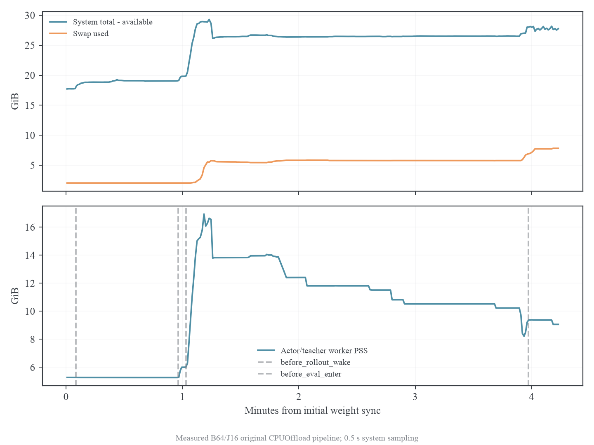
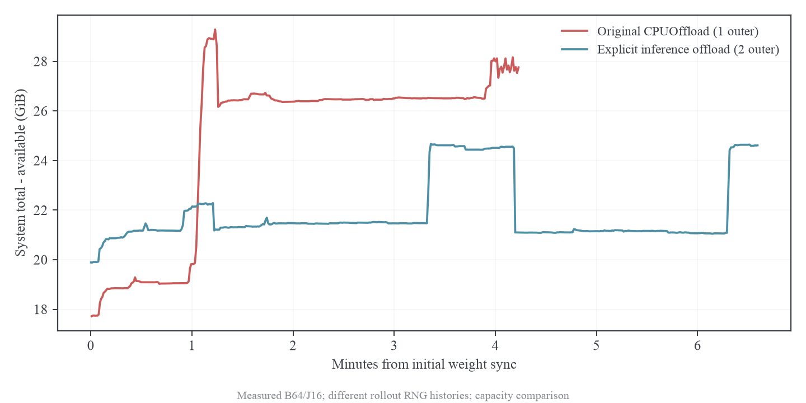

# FSDP 主机内存定位

## 结论与证据范围

主机内存压力的主要来源是 teacher 的 FSDP1 CPUOffload。SmolLM2-1.7B-Instruct 的 BF16 参数实际占 3422752768 bytes，约 3.187 GiB；FSDP 分成 25 个 flat parameter 后，PyTorch pinned host 分配器对每个块向上取整到 2 的幂，参数的实际 pinned 分配达到 6.25 GiB。CPUOffload 还预分配同形的 CPU 梯度缓冲，即使执行的是纯推理，额外占 6.25 GiB。两者合计 12.5 GiB。

这一来源由独立 teacher 实验复现，实验中没有 Ray、vLLM、actor、优化器或 GSM8K 数据缓存。因此其他服务的竞争不能解释这个内存放大。其他服务仍消耗容量；当完整训练接近保护阈值时，它们的占用、内核换页和临时搬运峰值决定某次运行是否越过阈值。原路径有成功单轮记录，也有多次失败记录，不能将问题描述为确定性的每轮内存泄漏。

## 调用链与对象生命周期

完整流程是 vLLM rollout、rollout sleep、actor anchor scoring、teacher scoring、actor J 次更新、actor 参数 offload、vLLM wake 与参数同步、KV cache 恢复。actor 与 teacher 在同一个 Ray WorkerDict 进程中，vLLM 的 server、engine 与 worker 是其他进程。

anchor scoring 与 teacher scoring 在每个 micro-batch 上临时计算 full-vocab logits，随即提取 sampled-token、top-16 概率及 tail mass。跨阶段保存的是紧凑缓存，并非整个 batch 的完整 vocab logits。失败记录中 Ray object store 使用量约 12 MB，不足以解释十余 GiB 主机内存压力。

teacher 采用 reference engine。原上游对 forward_only 的 FSDP1 强制使用 CPUOffload，且将普通 engine parameter offload 标志关闭；FSDPEngine.to 对 forward_only 提前返回。这意味着只修改配置中的 param_offload 不能改变这一行为，也不能直接关闭 CPUOffload 后仍保留原来的提前返回，否则 teacher placement 就失去了负责搬运的路径。

FSDP 在第一次 forward 前 lazy initialization，给每个参数分配 pinned CPU 参数和 CPU 梯度。torch.no_grad 控制 autograd，framework 的 forward_only 控制是否调用 backward；二者均未跳过 PyTorch CPUOffload 的缓冲初始化。仅设置 requires_grad_(False) 的独立实验也保留了全部 12.5 GiB pinned 分配。

actor 的 J=16 在同一 train_mode 中进行，每次 optimizer update 前清零梯度；micro-batch=1 的梯度按全局有效 token 分母累积。micro 更新不重新 rollout，返回的训练结果仅保留指标。profile 中 teacher 之后的 pinned reserved 在多次 inner 更新间保持约 13.63 GiB，没有随 J 线性增长的证据。

Ray 的报错时点与杀进程时点不同。teacher 首次 forward 的峰值可以先触发 Ray 杀其他 worker，调用方随后继续完成 inner 更新，直到 vLLM wake 时才收到 OutOfMemoryError。因此必须将 system 时间线、Ray 杀进程日志与阶段时间戳对齐，不能只根据 Python 最后一层堆栈归因于权重同步。

## 独立模型对照

所有对照使用同一真实 teacher、BF16、FlashAttention2、单 GPU FSDP NO_SHARD、1×256 token 输入、use_cache=False、三次 no_grad forward。统计是阶段采样值；systemd peak 包含瞬时分配，与阶段 RSS 不等价。

| 对照                             | 最大阶段 RSS | pinned reserved 最大值 | CPU 梯度实际字节 |
| -------------------------------- | -----------: | ---------------------: | ---------------: |
| FSDP CPUOffload                  |    14.00 GiB |              12.50 GiB |       3422752768 |
| requires_grad=False + CPUOffload |    14.01 GiB |              12.50 GiB |       3422752768 |
| GPU 驻留 FSDP 推理               |     1.53 GiB |                   约 0 |                0 |
| 显式参数 offload/load            |     7.82 GiB |               6.25 GiB |                0 |

GPU 驻留、冻结 CPUOffload 与显式参数搬运的首次 forward 最后一个位置全部 vocab logits，相对原 CPUOffload 的最大绝对差均为 0。显式参数搬运实验连续执行三次 forward，每次之间使用 verl 原有 load_fsdp_model_to_gpu/offload_fsdp_model_to_cpu。模型参数没有更新；这些实验检验 placement，不构成蒸馏效果实验。

逐块记录见 results/training/host-memory-profile/isolation-frozen/buffers.json。参数与梯度各 25 个块，各组实际字节合计 3422752768；逐块 rounded_bytes 合计均为 6710886400。这个加总解释了 13421772800 bytes pinned reserved，消除了只按参数量估计主机容量的误差。

## 原始完整路径的连续采样

原路径保持 B=64、J=16、micro=1、生成 2048、context2560、lr=3e-7、clip=2、eta=0.3、K=16，执行一个 outer 及 16 题最终评测，退出 0。此轮关闭新增清理动作，保留原来的 CPUOffload；采集系统时间线每 0.5 秒一条，同时记录各进程 RSS/PSS/USS/swap 和 /proc/meminfo。

本次 system total−available 峰值为 29.285 GiB，swap 从 2.053 GiB 上升至 7.833 GiB。teacher 推理前 worker PSS 约 6 GiB，随后峰值约 17 GiB；inner 期间 PSS 逐渐下降，同时 swap 上升。因此 RSS 下降不能直接解释为释放了张量，也可能是页面被换出。Ray 自己的 used-memory 计量与 total−available 不同，图中不把该曲线冒充 Ray 阈值计量。

图中第一段显著增长紧随 teacher 进入推理，后续 inner 保持高主机压力，最终同步前再次增加。其他已采样服务没有与 teacher 同量级的突增；例如 devin-2api PSS 范围约 0.23–0.48 GiB，已存在的编辑器主进程约 0.36–0.80 GiB。这些进程保留运行，没有通过停止用户服务制造低负载条件。

## 修复候选与验证要求

显式推理 offload 复用 verl 的参数搬运接口，FSDP1 teacher 不启用训练型 CPUOffload；eval 开始搬到 GPU，eval 结束搬到 CPU，teacher 参数冻结、优化器为空。actor 继续采用原来的训练及优化器 offload。该候选通过 MIRROR_INFERENCE_EXPLICIT_OFFLOAD=1 显式启用，默认保持上游行为，用于可归因对照，尚不自动改写正式配置。

GPU 阶段结束后同步 CUDA，再回收空闲 pinned 块和普通 CPU 分配器缓存。只清缓存的先前实验仍失败；删梯度缓冲后清缓存也不能避免初始化瞬时峰值。最终方案应避免分配无用缓冲，而不是在峰值过后再释放。Ray 保护阈值保持 95%，不关闭保护，不保存训练 checkpoint。

完整候选验证要求两 outer、32 次 inner、训练前和最终评测、两次权重同步、后续 rollout、退出 0，同时检查同步点 student center 与原路径首批 teacher 缓存一致性。长程训练在这些检查之后另行安排，短 profile 不能证明 50outer 稳定或算法有效。

实际候选验证已经退出 0，完成两 outer、32 次 inner、两次同步及 16 题初始/最终评测。两个 outer 的首 inner student center 均为 0，grad norm 分别为 1.78125、1.7734375，整卡采样峰值 10159 MiB。系统 total−available 峰值 24.672 GiB，swap 从 3.056 上升至 3.274 GiB，仅增加 0.218 GiB。worker 最大阶段 RSS 约 12.165 GiB，inner 结束前稳定约 8.8 GiB。结果保存在 explicit-pipeline。

两组运行的初始评测开关与 outer 数不同，因此 rollout RNG 历史不同，不能将 teacher center 或训练 loss 直接当作严格同数据消融。这里使用独立同输入 logits 差 0 检验计算一致性，完整运行只判断容量和跨阶段执行。两 outer 改善证据足以支持显式 offload 作为继续验证的方案；尚未证明长期内存平台、FP32 actor 容量或完整 1319 题评测压力。

## 复现与数据

独立程序为 experiments/analysis/fsdp_inference_memory_probe.py；系统采样程序为 experiments/analysis/host_memory_profile.py；绘图与统计程序为 experiments/analysis/host_memory_report.py。原始记录和图位于 results/training/host-memory-profile，完整运行配置与阶段记录分在 original-pipeline 和 explicit-pipeline。模型缓存、scratch 与运行日志留在 archbox 磁盘，没有写入/tmp。

### 参考文献

PyTorch 2.8 的 CPUOffload 初始化在 _flat_param.py 中 pin 参数并预分配_cpu_grad；CachingHostAllocator.h 先按 PowerOf2Ceil 取整，empty_cache 仅释放 free list 上的空闲块。这两处源码共同解释模型级缓冲、取整放大与清理的作用范围。[^fsdp] [^host]

[^fsdp]: PyTorch Contributors. FSDP FlatParameter initialization. PyTorch v2.8.0. [源码](https://github.com/pytorch/pytorch/blob/v2.8.0/torch/distributed/fsdp/_flat_param.py#L1219).

[^host]: PyTorch Contributors. CachingHostAllocator. PyTorch v2.8.0. [分配与取整源码](https://github.com/pytorch/pytorch/blob/v2.8.0/aten/src/ATen/core/CachingHostAllocator.h#L200).
