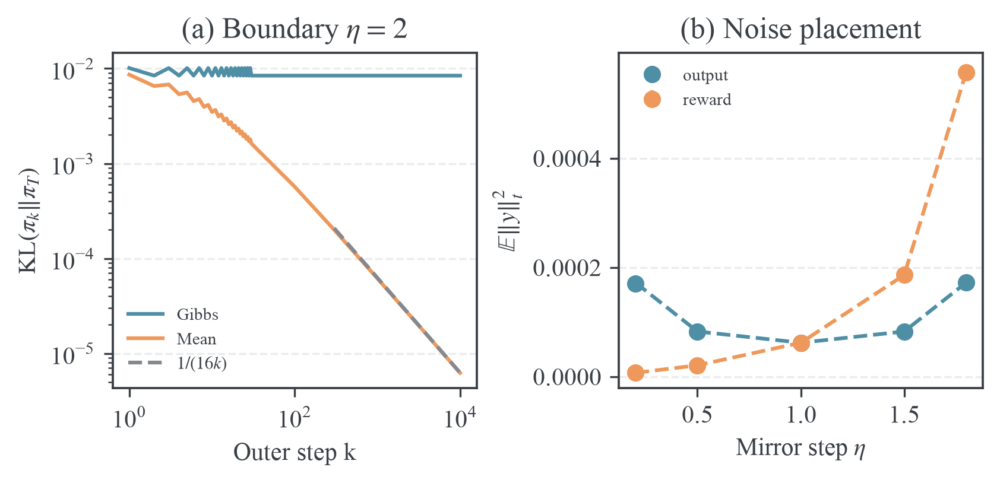

# Hard sync 动力学与噪声审计

## 问题与判定标准

本实验核验固定 prefix、有限正词表下的精确 Gibbs 与 PMD-Mean hard sync。它区分分布空间稳定性、teacher KL 单步下降、局部收敛阶数以及输出误差累积。训练模型的容量、梯度噪声与 prefix 覆盖变化不在本实验中模拟。

运行前的判据已经写入第四章：252 组 Gibbs 的跨度与三点恒等式误差小于 $10^{-12}$；36 组独立 Mean 求解与仓库参考实现差异小于 $10^{-12}$；Mean KKT 残差小于 $10^{-12}$；最小扰动下 KL 三次比值与一的偏差小于 2%；边界步长 10000 轮后 $k\mathrm{KL}$ 与 $1/16$ 的偏差小于 0.004；随机二阶矩均值落在理论值的五个标准误差内。另检查变步长乘积和固定输出偏差不动点。

## 配置与复现

- 源程序：[hard_sync_audit.py](../../experiments/toy/hard_sync_audit.py)。Gibbs 复用相同数学定义并逐点对照核心 `mirror_target`；独立 Mean 求解器使用 SciPy Lambert-W 与 Brent 求根，逐点对照核心 `mean_target`。
- 数值精度为 float64，随机种子为 20261010。随机 teacher 和 anchor 由独立标准正态 logits 的 softmax 生成，词表大小为 2、4、8，每个大小 12 组。
- 确定性轨迹的 teacher 为 $(0.2,0.3,0.5)$，方向为 $(-1,0.2,0.8)$，初值为 $q_0\propto t\exp(0.2z)$。步长为 0.5、1.5、2、2.1；边界轨迹运行 10000 轮，其余运行 30 轮。
- 随机误差实验从 teacher 出发，使用 20000 条独立路径，每条 240 步。原始坐标噪声独立服从 $N(0,0.01^2)$，再减去 teacher 均值。两种注入模型共享随机数，步长为 0.2、0.5、1、1.5、1.8。
- KL 使用去掉归一化零一阶项的稳定公式，小误差时使用九阶级数；Mean 归一化使用 `expm1` 残差。未裁剪概率和 log-ratio。
- 源码基线、最终脚本 SHA-256、NumPy/SciPy 版本与误差汇总见 [metadata.json](../../results/hard-sync-audit/metadata.json)。基线提交之后的实验脚本由该校验和唯一标识。

```bash
PYTHONPATH=src uv run --with numpy --with scipy --with torch --with matplotlib \
  python experiments/toy/hard_sync_audit.py \
  --plot-style "$HOME/.agents/skills/figure-viz/assets/mpl"
```

省略 `--plot-style` 可以在没有本机 figure-viz 的环境中复现全部数值结果。图使用 figure-viz 的论文配色与渲染审计，审计文件为空数组，表示没有发现规则问题。

## 结果

| 核验项目                                  | 结果                        |
| ----------------------------------------- | --------------------------- |
| Gibbs 三点恒等式最大绝对残差              | $1.78\times10^{-15}$        |
| 独立 Mean 与仓库参考实现最大坐标差        | $2.78\times10^{-16}$        |
| Mean KKT/归一化最大残差                   | $3.55\times10^{-15}$        |
| $\epsilon=0.01$ 时 KL 三次比值            | 1.011557                    |
| 同一点的跨度三次比值                      | 0.071591；理论极限 0.071667 |
| Mean、$\eta=2$、10000 轮的 $k\mathrm{KL}$ | 0.062303；理论极限 0.0625   |
| Gibbs、$\eta=2$、10000 轮的 KL            | 0.008420，与初始偶数轮相同  |
| 两种随机噪声、五个步长                    | 全部满足五标准误差判据      |

全部预设判据通过。逐点结果见 [cubic.csv](../../results/hard-sync-audit/cubic.csv)、[trajectories.csv](../../results/hard-sync-audit/trajectories.csv)、[noise.csv](../../results/hard-sync-audit/noise.csv) 和 [schedules.csv](../../results/hard-sync-audit/schedules.csv)。



### KL 单步收缩的反例

当初始分布为 $(10^{-12},1-10^{-12})$、teacher 为 $(0.1,0.9)$、步长为 1.1 时，Gibbs 更新使跨度缩小到原来的 0.1，而 teacher KL 从 0.105361 增大到 0.713851。完整稳定区间 $0<\eta<2$ 不能替代单步 KL 下降的证明。

当初始分布为 $(1-10^{-12},10^{-12})$、teacher 为 $(0.01,0.99)$、步长为 0.5 时，KL 比值为 0.999963。局部二阶速率 $(1-\eta)^2$ 不能当作全局 KL 比例界。两组数据见 [examples.csv](../../results/hard-sync-audit/examples.csv)。

### Mean 的局部三次收敛与边界阻尼

当扰动尺度从 0.4 降至 0.01，Mean 的 KL 三次比值从 1.4535 降至 1.0116。跨度三次比值向方向依赖的常数 0.071667 靠近。这检验了归一化乘子的二阶性质；仅有一阶线性化不能产生此预测。

边界步长 2 下，Gibbs 是精确两周期；Mean 的三阶阻尼使其收敛，teacher KL 的渐近速度为 $1/(16k)$。10000 轮值与理论常数的相对偏差约 0.315%。

### 变步长与噪声位置

步长 $\eta_k=1/(k+2)$ 的初始跨度保留比例为 $1/(k+1)$，会趋于零；改为 $1/(k+2)^2$，跨度保留比例趋于 1/2。逐轮正确方向与正步长不足以保证最终到达 teacher。

固定输出噪声的 teacher 加权二阶矩与 $1/[\eta(2-\eta)]$ 成正比，在步长一附近最小；固定 reward 噪声经指数中的步长放大后，则与 $\eta/(2-\eta)$ 成正比。减小步长对这两种误差模型的稳态影响不同。实验直接检验居中 log-ratio 的精确二阶矩；把它解释为 KL 噪声底还需要书稿中的小噪声近似。

## 验证范围

实验通过数值 oracle 检查分布空间结论，并与仓库现有 Mean/Gibbs 核心对照。它没有证明神经网络 inner 的指数收敛或均匀逐 token 误差界。第四章另外推导了保留 Mean 三次 outer 阶数所需的 $E_k=O(b_k^3)$，以及最小 anchor 概率假设下充分的 excess-loss 精度 $\delta_k=O(b_k^6)$；实际训练必须测量相应误差，才能应用这段结论。
