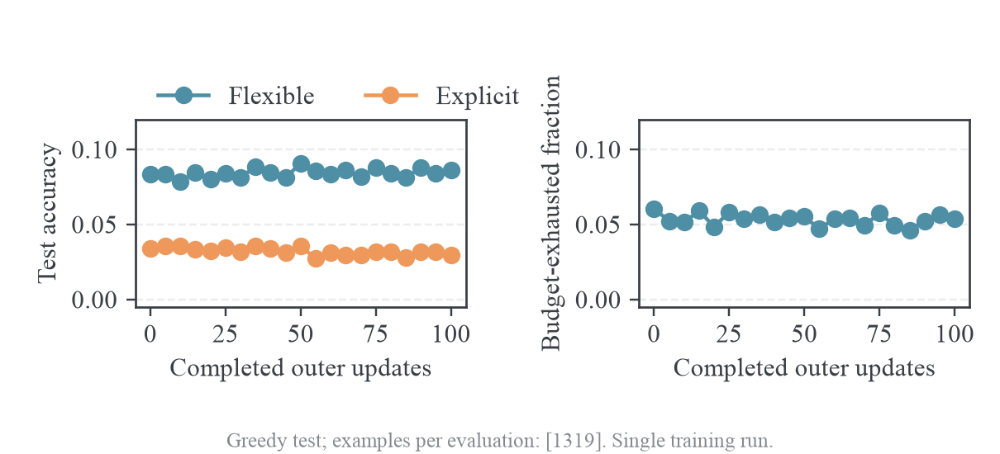

# 基础 OPD 百步结果与千步实验

## 百步训练结果

`gsm8k-smollm2-opd-onpolicy-o100-j1` 正常完成100 outer与100次optimizer update，退出码0。测试使用完整1319题GSM8K test，原生SmolLM2模板、统一`#### <number>`指令、greedy生成、2048 token上限，共进行21次评测。宽松评分优先读取`####`，其次读取boxed答案，最后读取最后一个数字；严格评分要求`####`答案正确。两种评分分别报告，避免将格式变化等同于数学能力变化。

| 学生状态                  | 宽松正确数 | 宽松准确率 | 严格正确数 | 严格准确率 |
| ------------------------- | ---------: | ---------: | ---------: | ---------: |
| 初始360M学生，outer0      |   110/1319 |      8.34% |    45/1319 |      3.41% |
| 训练100 outer后           |   114/1319 |      8.64% |    39/1319 |      2.96% |
| 宽松准确率最高点，outer50 |   120/1319 |      9.10% |    47/1319 |      3.56% |

最高点是21次测试中的事后选择，不能作为最终模型提升的无偏证据。最终宽松评分仅多答对4题，严格评分少答对6题；没有保留学生逐题生成结果，因此不能构造同题前后配对检验。目前单次训练不足以确认任务效果改善。

前10个outer的Tail-aware teacher KL均值为0.32749，最后10个outer为0.31158，下降约4.9%。该KL在每轮学生自身rollout的prefix上统计，prefix分布也随学生变化，不能当作同一固定测试集上的KL下降证明。相应sampled reward均值为−0.38688与−0.38608，基本持平。pre-clip梯度范数范围1.356--2.249，clip=2，仅4%的更新被裁剪；每轮同步点student center和log-ratio RMS均0，importance ESS fraction均1。GPU采样峰值11923 MiB。上述检查证明on-policy/J=1更新与同步可执行，没有把算法效果归因于大量梯度裁剪。

原始配置、来源指纹、inner/outer JSONL、显存采样、退出码、统计CSV与图保存在 `results/training/gsm8k-smollm2-opd-onpolicy-o100-j1/`，W&B为[jkhs04fb](https://wandb.ai/wncfht/mirror-opd-gsm8k/runs/jkhs04fb)。

## 已有 student 与 teacher 测试

旧结果见[小模型基线](../../data/refactor-20261015/legacy-source.tar.gz#experiments/results/2026-10-09-gsm8k-small-models.md)。统一答案格式复测已有原生模板、greedy、1319题、1024生成预算下的两模型完整rollout，远端目录分别为`gsm8k-smollm2-360m-instruct-answer-format-test-greedy-1024`与`gsm8k-smollm2-1p7b-instruct-answer-format-test-greedy-1024`。

旧文档的“格式无关exact numeric”并非当前训练的宽松评分。为了对齐评分含义，使用当前`mirroropd.training.gsm8k.score_response`重评旧文本，得到下表。这里是重评分已有输出，没有重新生成1024-budget轨迹；原始文本SHA-256、metadata、正确数与均值保存在`results/training/gsm8k-old-baseline-rescored/`。

| 模型或状态           | 生成预算 |     当前宽松评分 |     当前严格评分 |
| -------------------- | -------: | ---------------: | ---------------: |
| 旧初始360M student   |     1024 |  106/1319，8.04% |   42/1319，3.18% |
| 旧1.7B teacher       |     1024 | 623/1319，47.23% | 437/1319，33.13% |
| 本次初始360M student |     2048 |  110/1319，8.34% |   45/1319，3.41% |
| 本次100 outer学生    |     2048 |  114/1319，8.64% |   39/1319，2.96% |

teacher的旧结果已经显示明显能力差距；它不保证学生通过当前蒸馏目标一定取得相同GSM8K准确率。新的2048-budget teacher测试正在执行，用于补齐与训练生成预算相同的结果，完成前不以旧1024结果冒充它。

## 千步实验

按用户要求从原始360M学生重新训练1000 outer。此前关闭checkpoint，因此无法继续百步学生的权重。保留B=64、J=1、lr=3e-7、clip=2、FP32参数/BF16前向、Tail-aware K=16 KL baseline、无token IS、无KL regularizer、无任务奖励梯度，生成预算2048、context2560。共享接口中的eta不参与on-policy分支。

完整train有7473题，每epoch有116个完整batch；将epoch上限设为9，提供1044个完整batch，训练在1000 outer停止。每5 outer完整测试，含outer0与1000，共计划201次测试。保持既有测试频率以便对齐，评测耗时会占主要部分；不保存checkpoint或生成文本。

顺序入口 `training/run_gsm8k_opd_o1000.sh` 先完成teacher同协议测试，再启动 `gsm8k-smollm2-opd-onpolicy-o1000-j1`，systemd unit为`mirroropd-gsm8k-opd-o1000.service`。teacher使用与训练相同的test parquet、tokenized原生模板、评分函数、greedy和2048预算，保存逐题评分和汇总，不保存生成文本。teacher standalone vLLM与学生训练评测的batch调度不同，因此不保证后端数值逐位一致。
