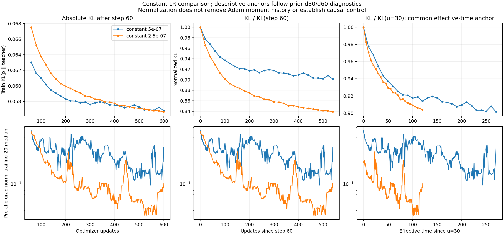

# BPO 全量梯度对照与局部曲线

## 当前实验的完整 setting

下表对应已经画图的 seed42 主条件，属于固定监督的 sampled-token BPO。它与长轨迹 OneShot OPD 的设置分别记录，不能互换。

| 项目        | 当前 setting                                                                                                           |
| ----------- | ---------------------------------------------------------------------------------------------------------------------- |
| Student     | DeepSeek-R1-Distill-Qwen-1.5B                                                                                          |
| Teacher     | JustRL-DeepSeek-1.5B                                                                                                   |
| Prompt 来源 | MD-OPD 的 DAPO train.parquet；确认种子从 row512 之后抽取多个 prompt，保留长度不超过 512 token 的完整 prompt            |
| 固定输入    | 各 seed 缓存 128 条训练与 32 条验证响应；主条件仅用前 64 条训练响应                                                    |
| Rollout     | 初始化 student 即冻结 q；temperature=1、top-p=1、top-k 关闭，自然 EOS，响应上限 256 token；seed42 全部响应达到上限     |
| Outer/inner | 单个冻结 outer，q 与 teacher 始终冻结；inner 不重新 rollout、不更新 anchor                                             |
| 每步梯度    | 8 条轨迹，按响应长度有放回抽样；合并重复轨迹后累积加权梯度，执行一次 optimizer 更新                                    |
| 梯度覆盖    | 每条抽中的轨迹使用全部有效 response token；每步未遍历全部 64 条                                                        |
| BPO 参数    | eta=0.3；sampled action surrogate；Top-16 head 加尾部桶 center；student center 每次重算并停止梯度，teacher center 冻结 |
| 数值与网络  | FP32 参数、FP32 前向，gradient checkpointing；dropout=0                                                                |
| AdamW       | betas=(0.9,0.999)、epsilon=1e-8、weight_decay=0、foreach=False                                                         |
| 裁剪        | 累积梯度后做全局 norm 裁剪，阈值 2；记录裁剪前 norm                                                                    |
| 常数 lr     | 5e-7 与 2.5e-7；各训练 600 次 optimizer 更新                                                                           |
| 搜索        | 初始 lr=1e-6，上限 1.6e-5；每步或每四步搜索；拒绝时 lr=0，矩状态仍递推一次                                             |
| 反馈        | 初始 lr=1e-6，上限 1.6e-5，目标单步 log 收缩 0.01                                                                      |
| 调度监测    | 固定 8 个轨迹簇中的 512 个位置，完整词表 BPO residual 平方；常数分支不做非必需的逐步监测                               |
| 独立审计    | 训练与验证各固定 4096 个位置，每 20 步计算完整词表 BPO、KL(student 到 teacher)、KL(q 到 student)                       |
| GPU         | 物理 GPU0–3；每个独立 worker 只见自己分配的一张卡                                                                      |

KL 图中各点是独立固定位置的测量，不是对全部训练 token 的完整词表审计。生产 surrogate 的数值不作为平方 loss，也不作为 teacher KL。

## 梯度范数与局部放大

下图按全程、前 100 步、最后 100 步分列。各列从上到下依次为训练 KL、验证 KL、裁剪前 grad norm 和实际 lr。梯度范数细线为逐步原值，粗线为包含当前步的 20 步滑动中位数；水平虚线为裁剪阈值 2。每个局部视图独立缩放纵轴，最后 100 步保留真实误差与波动。


常数 5e-7 的训练 KL 在更新 20 为 0.072165，2.5e-7 为 0.081214，前者早期更快。更新 100 时分别为 0.060988 与 0.063763。更新 600 时分别为 0.056826 与 0.056669，绝对误差差距已经很小，后者略低。最后 100 步中，5e-7 的 KL 有更多可见波动，2.5e-7 较平滑。

梯度 norm 也没有在最后完全重合。前 30 步，两个常数分支的 norm 中位数为 1.690 与 1.760，分别有 9 与 12 步触发裁剪；更新 31–60 均无裁剪，中位数为 0.780 与 0.721。最后 100 步的中位数为 0.172 与 0.0490，5e-7 有 1 步裁剪，2.5e-7 无裁剪。更大的后期 norm 与更大波动同时出现，与 minibatch/离散步幅影响一致；这组观测没有单独识别噪声底的因果来源。

## 参照 OneShot 的对齐口径

既有 MD-OPD 绘图实现同时保留绝对距离、d/d30、d/d60 与有效时间视图。参考这一口径，本次使用 step60 作为描述性锚点：两个常数分支在此前 30 步内都没有触发裁剪，norm 已显著低于阈值。第 60 步本身又是完整 KL 审计点，避免把插值值当成实测锚点。

第二个对齐使用共同有效时间 u=30。5e-7 的锚点对应 step60，2.5e-7 对应 step120，两者均为审计点。按各自锚点的 KL 归一化后比较后续相同有效时间增量；这里的 KL 含 BPO 到 teacher 的正误差底，归一化下降不能解释成 excess loss 的精确谱速率。



以上对齐排除了最初主要裁剪区间的直接展示影响，不能消除历史梯度 norm 对 Adam 矩的影响。AdamW 的参数步幅由 m/sqrt(v) 决定，不能用 lr 乘原始 norm 代替，也不能通过 d/d60 归一化建立相同 optimizer 状态。严格控制应从同一个 checkpoint 复制参数、矩状态与后续数据；本次所有原始初始化分支均保留，未通过挑选锚点隐藏早期大步收益。

## 全部 64 条 rollout 的新对照

新实验先只改变梯度数据覆盖：每次更新遍历固定的全部 64 条 rollout，每条遍历一次，使用全部有效响应 token。轨迹 j 的权重为长度 n_j 除以总长度 N，轨迹内 loss 取 token mean，因此累积梯度为全部有效 token 的均值梯度。

$$
g=\sum_{j=1}^{64}\frac{n_j}{N}\left(\frac1{n_j}\sum_{i=1}^{n_j}g_{j,i}\right)=\frac1N\sum_{j=1}^{64}\sum_{i=1}^{n_j}g_{j,i}.
$$

micro-batch 每次只前向一条轨迹以控制显存，在完成 64 条 backward 后只裁剪一次、只执行一次 AdamW 更新。这个计算过程没有轨迹重采样。它仍是固定 sampled action 与 Top-k center 的目标场，不能称为完整 action 期望下的精确 BPO。

| 项目        | 全量梯度新条件                                                                                   |
| ----------- | ------------------------------------------------------------------------------------------------ |
| 固定输入    | 复用各 seed 原来的前 64 条 rollout，与 minibatch 条件逐 token 相同                               |
| 唯一主变化  | full_batch=True，batch_sequences=64，全部 token 梯度累积后更新一次                               |
| 种子        | 42、142、242                                                                                     |
| 常数 lr     | 2.5e-7、5e-7、1e-6、2e-6、4e-6                                                                   |
| 候选调度    | 每四步二次搜索；target_rate=0.01 的反馈；沿用原规则                                              |
| 每个条件    | 600 次 optimizer 更新，38400 次轨迹 backward                                                     |
| 总预算      | 21 个条件，12600 次 optimizer 更新，806400 次轨迹 backward，206438400 个 backward response token |
| 先行 canary | seed42 的常数 5e-7、每四步搜索、反馈各 4 步；每个应恰有 256 次 backward，失败时不进入正式矩阵    |
| 保持的设置  | 256-token response、FP32、eta=0.3、Top-16 center、AdamW、裁剪与审计均保持                        |
| 资源        | 使用与既有实验相同的 GPU0–3 原子租约；等待其他阶段释放，无权使用 GPU4–7                          |

新矩阵先检验取消 minibatch 噪声后，较大 lr 是否可以稳定改善早期速度与后期误差。各曲线同时按 optimizer 更新数、真实 backward 数、耗时和累计 lr 报告。固定步数对照不能单独证明总体算力效率：full-batch 每步 backward 数显著增加。

对同一算法、相同 lr 的 minibatch 与 full-batch 条件作单因素配对。对于调度优于常数的判断，报告三个种子上与全部五个预设常数的比较，要求三个种子改善方向一致、完整误差曲线几何平均的中位改善至少 10%，最终训练和验证 BPO/teacher KL 不退化超过 5%；实际耗时收益单独判定。不根据确认数据删掉较好的常数对照。

这一步对齐全部 rollout 梯度，仍保留短轨迹以隔离 batch 因素。它没有声称对齐 OneShot 的 t22 单 prompt、7168-token 响应、BF16 或 weight_decay=0.01；长轨迹与实际生产配置的对齐必须另列条件，并明确冻结输入来源。现有短轨迹缓存不能通过改一个配置字段变成长轨迹。

配置计划在 `results/scalar-large/fullpool/plan.json`，实现复用已测试的 worker full-batch 分支，启动入口为 `training/scalar_full_pool_suite.py`。新队列不改动既有确认条件及其锁定结果。

```bash
PYTHONPATH=src:. ../envs/opd/bin/python -m training.scalar_full_pool_suite
```
