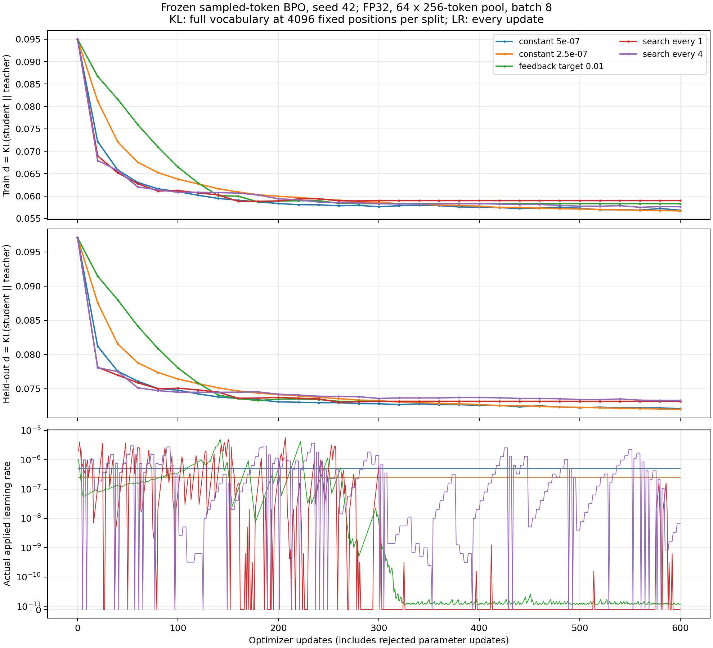

# BPO 有效时间与学习率调度诊断

## 结论与证据范围

增大全局学习率能够通过增加每次 backward 对应的数值时间来加速训练。即使轨迹在累计学习率横轴上重合，这种收益仍然具有实际意义：达到同一误差所需的 backward 更少。谱条件数改善与 backward 节省是两个独立判据。

当前标量搜索与相对下降率反馈已经写入[推导与验证](2026-10-12-BPO标量调度分析与验证.md)，精确二次模型、AdamW 与生产近似场分别讨论。大规模实验的规则和判分见[实验设计](2026-10-12-BPO标量调度实验设计.md)，独立调参结果见[大规模消融结果](2026-10-12-BPO大规模消融结果.md)。本文补充累计学习率诊断，并解释当前结果与此前 OPD 学习率扫描的关系。

目前的独立调参证明，从初始化开始使用较大的常数学习率会恶化这组 BPO 条件的完整误差。它没有验证先使用小学习率，再从同一后期 checkpoint 增大学习率的效果。后期增大是否有效，必须单独通过分叉实验判定。

## 既有实验支持的学习率范围

MD-OPD 周报[^md-opd]中的 M4 扫描使用 DeepSeek-R1-Distill-Qwen-1.5B、JustRL-DeepSeek-1.5B、DAPO-Math-17k 全量和 vanilla ratio 配方，训练 279 步。周报记录的 sampled-token 距离终值如下。

| 常数学习率       | 距离终值 |
| ---------------- | -------: |
| $5\times10^{-7}$ |   0.0127 |
| $10^{-6}$        |   0.0055 |
| $2\times10^{-6}$ |   0.0029 |
| $5\times10^{-6}$ |   0.0013 |
| $10^{-5}$        |   0.0013 |
| $10^{-4}$        |   0.0529 |

这些是既有周报的归档读数，本次未重新下载 W&B 原始记录。它们支持该配方在 $5\times10^{-6}$ 附近获得较快吸收，并在更大步长出现饱和、最终发散。它们没有测量固定 BPO 的完整 residual 平方，不能直接替代当前实验的判分。

当前 OneShot 进展[^oneshot]提供更直接的固定监督对照。相同 BF16 前向、相同 395862 个固定动作下，$5\times10^{-7}$ 训练 600 步的最终绝对差为 0.0207191，$10^{-6}$ 训练 300 步为 0.0220962。两条曲线在共同有效时间点接近，因此标准学习率用约一半更新数达到接近的拟合程度。该证据只覆盖已完成的两个条件，其余学习率与种子继续独立判分。

## 精确二次模型中的累计学习率

令精确 excess loss 为

$$
E=\frac12\sum_i\lambda_i e_i^2,
\qquad e_{n+1,i}=(1-\alpha_n\lambda_i)e_{n,i}.
$$

当所有步长满足 $0\le\alpha_n\lambda_i<1$，取对数得到

$$
\log\frac{|e_{N,i}|}{|e_{0,i}|}
=\sum_{n=0}^{N-1}\log(1-\alpha_n\lambda_i)
=-\lambda_i\sum_n\alpha_n-\frac{\lambda_i^2}{2}\sum_n\alpha_n^2-\cdots.
$$

因此小步极限中的时钟是累计学习率。取参考学习率 $\alpha_0=10^{-6}$，定义

$$
u_N=\frac{1}{\alpha_0}\sum_{n=0}^{N-1}\alpha_n.
$$

恒定学习率下，它退化为 $u_N=(\alpha/\alpha_0)N$。变化学习率时不能使用当前学习率乘总步数，因为它会把过去的更新按当前步幅重新计时。较大离散步长还引入 $\sum_n\alpha_n^2$ 等高阶项，相同累计学习率不保证相同轨迹。

梯度流中定义 $\tau=\alpha_0u$，则

$$
E(u)=\frac12\sum_i\lambda_i e_i(0)^2\exp(-2\alpha_0\lambda_i u),
\qquad \kappa(u)=-\frac{d\log E}{du}=2\alpha_0\mathbb E_w[\lambda].
$$

快方向先被吸收，使 $\kappa$ 下降。若要求每步 log 收缩约为 $r_*$，局部近似给出

$$
r_n\approx\kappa(u_n)\frac{\alpha_n}{\alpha_0},
\qquad \alpha_n\approx\frac{\alpha_0r_*}{\kappa(u_n)}.
$$

这正是后期增大学习率的动力学动机。它增加单位 backward 的时间增量，不需要改变特征方向。

固定二次目标的全方向稳定条件仍为 $0<\alpha_n<2/\lambda_{\max}$。快方向当前误差很小，并不会改变这个全局边界。以 $H=\operatorname{diag}(1,100)$ 为例，慢方向希望使用 $\alpha=1$，但快方向的乘子为 $1-100=-99$；任意残留或重新注入的快方向误差都会迅速放大。快方向严格为零且之后不被注入时，大步可以只作用于慢方向，这才是缩小活跃谱后放宽边界的理想条件。

## 两条当前算法与有效时间的关系

相对下降率反馈使用

$$
r_n=\log(Q_{n-1}/Q_n),
\qquad \alpha_n=\alpha_{n-1}\operatorname{clip}(r_*/r_n,1/2,5/4).
$$

在局部小步、同一目标、方向近似不变时，代入 $r_n\approx\kappa\alpha_{n-1}/\alpha_0$ 得到 $\alpha_n\approx\alpha_0r_*/\kappa$。因此这个规则包含有效时间逻辑。当前实现直接按单步收缩作反馈，没有显式估计窗口内的单位有效时间吸收率；loss 上升就减半，对测量平台和随机梯度引起的短期上升很敏感。

搜索沿当前 AdamW 方向 $d$ 测量

$$
Q(\alpha)=Q(0)-A\alpha+B\alpha^2/2,
\qquad A=\nabla Q^\top d,
\qquad B=d^\top H_Qd.
$$

精确二次情况下选择 $A/B$，并实际 forward 验证。它优化当前方向的下降量，不直接最大化累计有效时间。若监测目标与 minibatch 更新方向失配，使 $A\le0$，精确二次模型中任何正步长都不能下降；此时增大 lr 没有帮助。实际非线性模型中的局部搜索也不能保证找到远处的下降区间。

AdamW 中累计 lr 是诊断横轴，精确时钟还包含矩状态。令包含权重衰减的方向为 $d_n$，则

$$
\frac{\theta_{n+1}-\theta_n}{u_{n+1}-u_n}=-\alpha_0d_n.
$$

不同学习率分支在相同 $u$ 上拥有不同更新次数，矩状态按更新次数递推。例如一阶矩的记忆核为 $\beta_1^{n-j}$；恒定学习率下写成有效时间差便成为 $\beta_1^{\alpha_0(u_n-u_j)/\alpha}$。改变学习率也改变矩记忆在有效时间轴上的尺度。因此曲线重合需要实验验证，不能从参数增量除以学习率的恒等式推出。

## 当前 BPO 数据的有效时间诊断

本次对已完成的调参记录按实际 `applied_lr` 累积计算 $u$。完整训练 BPO 由独立 4096 位置审计给出，以下比值均以各自初始化为分母。表中明确区分 $u=60$ 的实测审计点与插值。共同时间点的 log 插值单独保存在[诊断数据](../../results/scalar-large/tune/effective-time-diagnostic.json)，不能视为逐步实测。

| 常数学习率         | 到达 $u=60$ 的更新数 | 完整 BPO 比值 |
| ------------------ | -------------------: | ------------: |
| $2.5\times10^{-7}$ |                  240 |      0.178281 |
| $5\times10^{-7}$   |                  120 |      0.210797 |
| $10^{-6}$          |                   60 |      0.272107 |
| $1.5\times10^{-6}$ |                   40 |      0.404300 |
| $2\times10^{-6}$   |                   30 |      0.576525 |

最后一行使用更新 20 与 40 的 log 插值，其余四行均为实测审计点。当前 BPO 的中高学习率轨迹没有满足同一有效时间上的误差重合。这里的完整目标诊断与此前 sampled-token 距离不同，不能把数值大小跨目标比较。

当前 BPO 主条件使用 FP32 前向、64 条 256-token 固定轨迹、每步 8 条长度加权抽样、Top-16 加尾部桶 center、$\eta=0.3$、无权重衰减、裁剪阈值 2。当前 OneShot 固定 OPD 条件使用 BF16 前向、64 条最长 7168-token 轨迹的完整 batch、固定动作 log-prob 回归、权重衰减 0.01、裁剪阈值 1。这些变化共同改变梯度场、方差、曲率、数值表示及 AdamW 状态。当前数据无法把稳定学习率范围缩小归因于其中某一项。

调参中反馈 target_rate=0.01 在 240 步累计只走到 $u=37.1282$，每步搜索走到 $u=103.4028$，每四步搜索走到 $u=165.5667$。常数 $5\times10^{-7}$ 走到 $u=120$，$2.5\times10^{-7}$ 走到 $u=60$。反馈后期的小步直接浪费 backward；搜索即使累计时间较大，也没有得到同一路径上的更低完整误差。

反馈遇到有限精度平台时会出现自我强化：参数改变量小到无法改变 forward 读数，观测 $Q_n=Q_{n-1}$，实现再次减半。当前日志中的 $10^{-11}$ 量级学习率与这一机制相容；尚未逐参数核验这些步骤的实际位移，不能将其全部归因于舍入。每步搜索后期大量拒绝，也需要区分方向失配、监测集误差和数值差分失效。

## 后期扩大 lr 的独立验证

现有从初始化出发的常数扫描检验了全程使用大步长。后期扩大 lr 的因果验证应从小学习率分支的相同 checkpoint 分叉：完整复制参数、AdamW 矩、随机状态与固定监督，随后分别保持原学习率或提高到 $10^{-6}$、$2\times10^{-6}$、$4\times10^{-6}$、$8\times10^{-6}$。各分支复用相同后续 minibatch 序列，同时记录更新数、backward 数、累计 lr 和实际耗时。

判据是更早持续通过相同完整误差阈值，同时验证误差与 teacher KL 保持预先规定的容差。只有某个后期增大分支优于同状态常数分支，才可确认后期存在可利用的大步空间。该补充实验独立于当前已经锁定的五种子确认，不修改正在执行的候选规则或主判分。

低成本调度应以窗口吸收率为依据：在窗口两端计算 $\widehat\kappa=\log[(Q_a-Q_*)/(Q_b-Q_*)]/(u_b-u_a)$，再提出 $\alpha=\alpha_0r_*/\widehat\kappa$，限制增幅并用后续窗口验证实际收益。共享网络的 $Q_*$ 未知时只能使用明确声明的代理，不能把原始 loss 的平台视为曲率趋零。窗口改善落在监测或数值误差内时，保持当前学习率并进行小幅有界试探，避免因相等读数无限缩步。该规则是下一阶段需要验证的设计，尚未作为胜出算法实现或宣称有效。

## 噪声底与学习率递减

后期增大学习率的推导对应确定性小步谱模型。存在 minibatch 随机梯度时，降低学习率可以压低噪声底，这给出了前期较大、后期较小的另一种动力学依据。

以一个特征方向为例，令随机梯度为 $\lambda e_n+\xi_n$，其中 $\mathbb E\xi_n=0$、$\mathbb E\xi_n^2=\sigma^2$，且本步噪声与当前误差独立。更新式为

$$
e_{n+1}=(1-\alpha\lambda)e_n-\alpha\xi_n.
$$

平方并取期望得到

$$
\mathbb E e_{n+1}^2=(1-\alpha\lambda)^2\mathbb E e_n^2+\alpha^2\sigma^2.
$$

在 $0<\alpha\lambda<2$ 时解稳态方程，得到

$$
\mathbb E e_\infty^2=\frac{\alpha\sigma^2}{\lambda(2-\alpha\lambda)},
\qquad E_\infty=\frac{\alpha\sigma^2}{2(2-\alpha\lambda)}.
$$

小步下 $E_\infty\approx\alpha\sigma^2/4$。较大 lr 加快初期吸收，较小 lr 降低后期随机波动。谱尾拖慢与噪声底限制可以同时存在；调度应通过实际误差和窗口波动区分主导机制。上述公式是随机梯度下降的一维参考模型，AdamW 的矩状态需要另行验证。

完整 rollout full-batch、无 dropout、固定标签的重复优化没有 minibatch 重采样噪声。固定 action 监督偏差、Top-k center 偏差、表示限制及数值误差仍存在，它们的误差底不会由上述随机梯度稳态公式统一解释。衰减 lr 能减小步幅和震荡，不能补回缺失监督或修正有偏更新场。

## 当前 benchmark 的数据使用方式与直接 KL 图

当前大规模主条件确实采用 minibatch：缓存含 128 条训练轨迹与 32 条验证轨迹，主条件使用前 64 条训练轨迹，每次 optimizer 更新从其中按长度权重有放回抽取 8 条，重复轨迹合并后累积梯度再更新一次。它在多次更新中复用固定 rollout pool，但每次更新没有使用全部 rollout。`full_batch=True` 的消融才会对所选 pool 全部轨迹累积梯度。实现见 `training/scalar_large_worker.py` 的 batch 分支。

当前缓存的响应上限为 256 token；seed42 的 160 条响应全部达到该上限。主条件训练监督共 16384 个响应预测位置，与 OneShot 的 395862 个长轨迹位置不同。这个短轨迹、小 batch benchmark 是本次机制实验的配置选择，不能作为与长轨迹 full-batch 相同的实验条件。后续真实训练验证需要对齐完整 rollout 梯度与长轨迹条件，现有五种子确认只能支持其明确记录的短轨迹 minibatch 范围。

以下图使用 seed42 已完成的五个 600 更新条件。上图是训练 pool 的 student–teacher 完整词表 reverse KL，中图是 held-out pool 的同方向 KL，下图是每次更新实际采用的 lr，拒绝更新按 lr=0 绘制。KL 在各 split 固定的 4096 个 prefix 上平均，每 20 步审计一次；没有把 sampled-token gap 或 BPO residual 当作 KL。



所有分支前期 KL 明显下降，后期进入较缓慢阶段。反馈在约 300 步后缩到 $10^{-11}$ 量级，每步搜索共拒绝 331 次，两者对应的 KL 进入平台。两个常数学习率的最终训练 KL 分别为 0.056826 与 0.056669，验证 KL 为 0.072072 与 0.071972，均低于本种子三个调度分支。这是单种子的直接观测，完整五种子结论另行判定。

固定 $\eta=0.3$ 时，精确 BPO 的分布目标为 $p_G\propto q^{0.7}t^{0.3}$。即使完整 BPO residual 达到零，student 到 teacher 的 KL 通常仍为正。因此 teacher KL 平台不能直接解释成 BPO 优化失败；两种误差应同时报告。

PNG、PDF 与逐点数字一起版本化，生成程序为 `experiments/plotting/plot_scalar_kl_lr.py`。复现命令如下。

```bash
PYTHONPATH=src:. ../envs/opd/bin/python -m experiments.plotting.plot_scalar_kl_lr \
    --root runs/scalar-large/confirm \
    --output results/scalar-large/confirm-kl-lr --seed 42
```

### 参考文献

[^md-opd]: MD-OPD Research Notes. One-Shot OPD / EffOPD 周报. 本地实验记录 2026. [归档周报](../../../MD-OPD/docs/2026-09-17-weekly-report-oneshot-opd-effopd.md).

[^oneshot]: MirrorOPD Research Notes. One-Shot 长期吸收实验进展. 本地实验记录 2026. [实验进展](2026-10-12-OneShot长期吸收实验进展.md).
