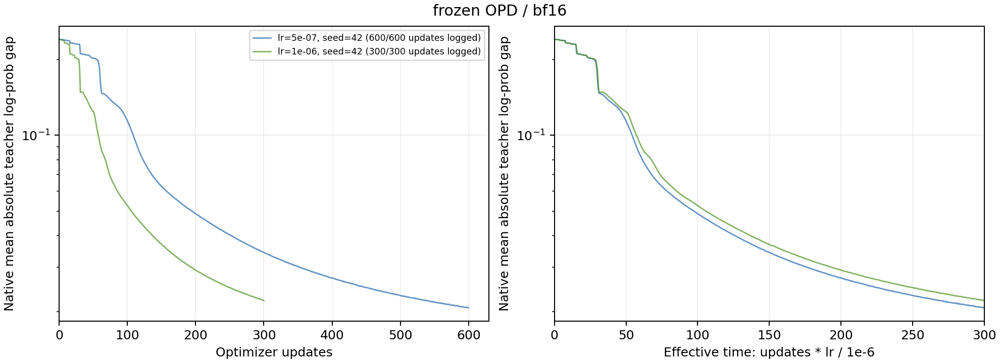
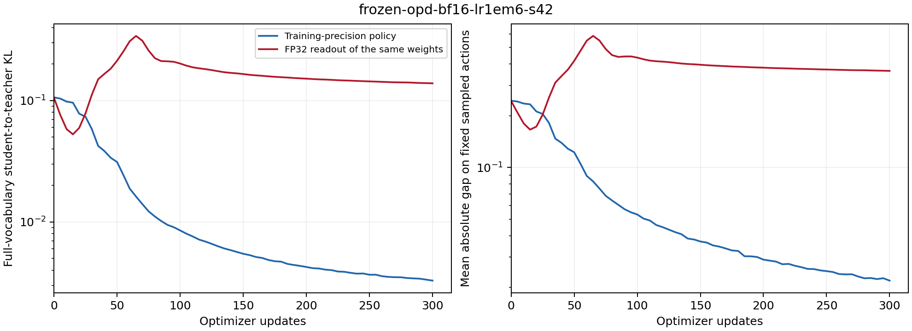

# One-Shot 长期吸收实验进展

## 当前证据与正式实验状态

正式矩阵已按 [预注册设计](2026-10-12-OneShot长期吸收与有效时间消融设计.md) 排入独立监督程序。矩阵包含 45 个条件、三个种子和 16074 次 optimizer 更新；seed42 的两个零学习率控制和两个固定监督长程条件已完成，共 908 次 optimizer 更新。标准学习率条件已完成训练，checkpoint 评测尚未全部完成，跨学习率、精度、采样方式与种子的结论仍待完整矩阵判分。

预检使用原始 DeepSeek-R1-Distill-Qwen-1.5B 学生与 JustRL-DeepSeek-1.5B 教师。seed42 的 64 条固定响应包含 395862 个有效预测位置，响应上限 7168 token，并在这些位置中均匀无放回抽取 4096 个位置记录完整词表分布。BF16 与 FP32 两种学生前向均完成四次全 batch 更新，初始锚点同步误差通过验证。教师监督固定为同一个 BF16 分布。

完整 570 题评测已验证保存的 HF checkpoint 能进入 vLLM 推理与逐题评分：MATH-500 为 345/500，AMC23 为 18/40，AIME25 为 5/30。这里评估的是 BF16 预检的 update4 模型，没有同条件初始化评测，不能将这些成绩解释为训练增益。三个测试集的预算耗尽率分别为 32.2%、55% 和 83.3%。

## 初始化基线与零学习率控制

正式初始化评测使用相同 570 题与 7168 token 预算。学生与教师的 MATH-500 正确数分别为 364/500 和 395/500，AMC23 分别为 21/40 和 27/40，AIME25 分别为 7/30 和 4/30。教师在前两个测试集上高于学生，在 AIME25 上低于学生。后续分别报告各测试集，不用训练 KL 下降代替数学答题结果。

seed42 的 BF16 零学习率条件完成四次全 batch 更新并正常退出。anchor–student KL 最大绝对均值为 $1.0879\times10^{-10}$，最大 RMS 为 $5.9314\times10^{-9}$；被检查的参数变化比例为 0，全部有效动作的绝对 log-prob 差保持不变。这通过了预注册零更新判据；同种子的 FP32 零学习率条件也已完成：最大绝对均值为$1.1897\times10^{-10}$，最大 RMS 为$5.8961\times10^{-9}$，参数变化比例为 0。另两个种子的控制条件仍待执行。

## 大批量预检中的精度差异

下表的距离均为本批全部有效动作的平均绝对 teacher–student log-prob 差。完整词表 KL 使用 4096 个固定预测位置，方向为当前学生到教师。update_before3 表示已经完成三次更新、尚未进行第四次更新。

| 学生前向 | update_before0 绝对差 | update_before3 绝对差 | update_before0 完整 KL | update_before3 完整 KL |
| -------- | --------------------: | --------------------: | ---------------------: | ---------------------: |
| BF16     |              0.239874 |              0.239209 |               0.106206 |               0.105518 |
| FP32     |              0.238875 |              0.217701 |               0.105226 |               0.085883 |

首次更新后的 anchor–student Tail-aware KL 为 BF16 的 0.00040504 和 FP32 的 0.00019788。大批量实验中的 FP32 首步锚点 KL 更小，修正了单条短响应探针中“FP32 首步幅度更大”的外推。精度改变的判据应同时检查教师距离、目标误差与后续轨迹。

检查第 0 层 Q projection 与第 12 层 MLP down projection 时，首次更新使 99.986% 的 FP32 master 参数发生变化；将这些参数转回 BF16 后，改变表示的比例只有 1.024%。这个比例仅对应被检查的两块矩阵。它证明大量小步参数变化尚未跨过 BF16 舍入边界。

两种训练精度下，四次更新后的参数位移也存在方向差异：Q projection 的位移余弦相似度为 0.63925，MLP down projection 为 0.98545。BF16 同时影响参数表示与梯度计算，当前证据不足以把全部差异归因于权重舍入。结果与复算数值在 [canary-master-delta.json](../../results/oneshot-effective-time/canary-master-delta.json)。

独立 FP32 读出使用同一组 master 权重重新计算概率，它与训练时的 BF16 策略具有不同数值定义。BF16 训练后的 FP32 读出改善，表示底层权重已发生有用移动；BF16 实际策略仍需单独测量。正式日志同时保存 native 固定前缀诊断、FP32 固定前缀诊断和训练批诊断。

## 有效时间的实验口径

正式 OPD 条件以真实 optimizer 更新数$t$定义有效时间：

$$
u=\frac{\mathrm{lr}}{10^{-6}}t.
$$

半倍、标准与两倍学习率分别执行 600、300 和 150 次更新，终点均为$u=300$。固定 rollout 条件跨学习率与学生精度复用相同 tokens 和教师标签。在线条件每次更新重新采样。时间缩放在相同 rollout 方式、精度与算法内部判断。

固定动作的`opd_noratio`梯度还有一个需要明确的目标关系。令固定语料为$\{(s_i,a_i)\}_{i=1}^{N}$，教师 log-prob 为$\ell_{T,i}$，学生 log-prob 为$\ell_{\theta,i}$。定义

$$
L_{\mathrm{fixed}}(\theta)=\frac{1}{2N}\sum_{i=1}^{N}\big(\ell_{\theta,i}-\ell_{T,i}\big)^2.
$$

逐项求导得到

$$
\nabla_\theta L_{\mathrm{fixed}}=\frac{1}{N}\sum_{i=1}^{N}\big(\ell_{\theta,i}-\ell_{T,i}\big)\nabla_\theta\ell_{\theta,i}.
$$

`opd_noratio`使用$A_i=\ell_{T,i}-\ell_{\theta,i}$，停止 advantage 的梯度，因此 surrogate 的梯度为

$$
\nabla_\theta\left[-\frac{1}{N}\sum_i\operatorname{stopgrad}(A_i)\ell_{\theta,i}\right]=\nabla_\theta L_{\mathrm{fixed}}.
$$

这是固定动作上的 log-prob 回归关系。完整词表 KL 作为独立分布诊断记录；固定动作的有符号均值不能替代当前学生的 reverse KL。BF16 计算中的 autograd 还使用浮点运算及类型转换的梯度规则，精度消融用于检验这些数值实现对实际策略变化的影响。

## 资源与复现入口

所有 GPU 任务限制在物理 GPU0–3，实验 job 与其四个 distributed rank 或四个推理 replica 作为一个整体串行执行。每个 job 启动前要求四张卡连续空闲，运行期间检查 driver 进程标识；出现外来进程时停止本实验进程组并保留原始记录。GPU4–7 不进入实验可见集合。

监督程序与运行状态位于 `runs/oneshot-effective-time-20261012/`。研究源码、配置、输入校验和原始记录分别冻结；独立 CPU 观察程序持续生成 [summary.json](../../results/oneshot-effective-time/summary.json)，尚未完成的条件保留为 pending。训练与评测完成后再按预注册判据判断长期吸收、时间缩放与精度效应。

实现入口为 [oneshot_suite.py](../../training/oneshot_suite.py)、[oneshot_worker.py](../../training/oneshot_worker.py) 和 [oneshot_effective_time.py](../../experiments/analysis/oneshot_effective_time.py)。预注册设计提交为`1a70a3b`，在隔离分支`research/oneshot-effective-time-20261012`保存。

## 独立 checkpoint 读出检查

在 seed42、BF16、lr=5e-7 的 update400 checkpoint 上，独立 CPU 前向重现了两种读出的差异。检查从原有 4096 位置 reservoir 中选择初始化 anchor–teacher KL 至少 0.02、响应位置不超过 512 的最早 8 个位置。该选择依据初始化监督，未依据训练后的精度差异选择。

在响应位置 27 的示例中，BF16 读出的 student–teacher KL 为 0.001249，FP32 读出为 0.979104。位置 12 的对应数值为 0.009583 和 0.273004。它们证明同一 checkpoint 在两种数值精度下能给出不同的条件概率；8 个早期位置不代表完整前缀总体。

这项检查在 CPU 执行，使用独立 HF 模型加载，没有使用 FSDP，也没有占用 GPU。初始选择的最早 8 个位置以高度确定的开头 token 为主，两种读出均接近教师，不能解释全体前缀的差异；完整记录一并保留。原始数值分别在 [早期位置检查](../../results/oneshot-effective-time/cpu-readout-update400.json) 和 [初始化监督差异位置检查](../../results/oneshot-effective-time/cpu-readout-informative-update400.json)。

## 首个 600 次更新的固定监督条件

seed42、BF16 前向、学习率$5\times10^{-7}$的固定监督条件已完成 600 次更新，终点有效时间为$u=300$。全部 395862 个固定动作上的平均绝对 log-prob 差从 0.239874 下降至 0.0207191。更新 100、200、300、400 的距离分别为 0.113953、0.0489151、0.0343489、0.0271870。它呈现持续数百次更新的吸收过程；原始更新次数与有效时间在本条件中相差两倍，标准及两倍学习率条件完成后才能检验曲线缩放。

在相同 4096 个固定前缀上，最终 BF16 策略到教师的完整词表 KL 为 0.00310372，初始值为 0.106206。同一 checkpoint 的 FP32 读出到教师的 KL 为 0.158452，固定位置的平均绝对动作差为 0.398323。这里的改善限于 BF16 策略；独立 FP32 前向的结果表明，训练后的精度转换会改变条件概率，不能把两种前向精度下的距离合并成同一曲线。

本条件的四个 checkpoint 均完成 570 题评测。下表使用与初始化相同的题目、贪心 BF16 推理、7168 token 预算和评分器。括号中为有效时间。

| 模型            | MATH-500 正确数 | AMC23 正确数 | AIME25 正确数 |
| --------------- | --------------: | -----------: | ------------: |
| 初始化          |         364/500 |        21/40 |          7/30 |
| 更新 100（50）  |         350/500 |        21/40 |          1/30 |
| 更新 200（100） |         360/500 |        22/40 |          3/30 |
| 更新 400（200） |         361/500 |        19/40 |          2/30 |
| 更新 600（300） |         360/500 |        18/40 |          3/30 |

最终模型相对初始化，在 MATH-500 上有 53 题由错变对、57 题由对变错，净减少 4 题；AMC23 对应 5 题和 8 题，净减少 3 题；AIME25 对应 0 题和 4 题，净减少 4 题。最终预算耗尽比例分别为 34.4%、65% 和 96.7%。固定训练样本的概率拟合已经改善，本条件的跨题正确数仍低于初始化。长程吸收与数学泛化需要分别判分，完成其余种子和在线条件后再判断这组结果的稳定性。

## 两种学习率的阶段性共同时间点

seed42 的 BF16 固定监督对照已记录三个共同有效时间点，标准学习率条件已完成 300 次更新。两种条件的输入轨迹、教师缓存、优化器与前向精度相同；配置差异为学习率、总更新数、run 名称和按有效时间安排的 checkpoint 步数。

| 有效时间 | 半倍学习率更新数 | 半倍绝对差 | 标准学习率更新数 | 标准绝对差 | 半倍完整词表 KL | 标准完整词表 KL |
| -------- | ---------------: | ---------: | ---------------: | ---------: | --------------: | --------------: |
| 50       |              100 |   0.113211 |               50 |   0.122630 |       0.0267815 |       0.0311743 |
| 100      |              200 |  0.0481751 |              100 |  0.0531980 |      0.00772170 |      0.00851300 |
| 200      |              400 |  0.0271598 |              200 |  0.0290373 |      0.00396157 |      0.00426175 |

这些距离使用相同 4096 个固定前缀的 BF16 独立读出。三点的标准与半倍学习率绝对差之比分别为 1.0832、1.1043 和 1.0691。结果支持继续检验有效时间，并显示曲线没有精确重合。两倍学习率、完整轨迹及其余种子尚未完成，因此预注册离散度判据仍为 pending。数值与配置校验在 [阶段性共同时间点](../../results/oneshot-effective-time/partial-bf16-s42-common-time.json)。

## AdamW 与有效时间的关系

实际训练使用梯度裁剪后执行 AdamW 更新。以下等式对应 [训练实现](../../training/oneshot_worker.py) 的更新顺序，描述实数算术中的优化器；浮点舍入另行讨论。令第$t$次更新前的固定语料梯度为$g_t$，裁剪阈值为$c=1$，裁剪后的梯度为

$$
\widetilde g_t=\min\left(1,\frac{c}{\lVert g_t\rVert_2}\right)g_t.
$$

零梯度时裁剪倍率取 1。实现使用数值稳定项处理除法。AdamW 从$m_0=v_0=0$开始，对每个参数坐标执行

$$
\begin{aligned}
m_{t+1}&=\beta_1m_t+(1-\beta_1)\widetilde g_t,\\
v_{t+1}&=\beta_2v_t+(1-\beta_2)\widetilde g_t^{\odot2},\\
\widehat m_{t+1}&=\frac{m_{t+1}}{1-\beta_1^{t+1}},\\
\widehat v_{t+1}&=\frac{v_{t+1}}{1-\beta_2^{t+1}},\\
\theta_{t+1}&=(1-\alpha\lambda)\theta_t-\alpha\frac{\widehat m_{t+1}}{\sqrt{\widehat v_{t+1}}+\epsilon}.
\end{aligned}
$$

平方、开方和除法均逐坐标计算。实验使用$\beta_1=0.9$、$\beta_2=0.999$、$\lambda=0.01$、$\epsilon=10^{-8}$，$\alpha$为恒定学习率。写成包含权重衰减的更新方向

$$
F_t=\lambda\theta_t+\frac{\widehat m_{t+1}}{\sqrt{\widehat v_{t+1}}+\epsilon},
\qquad
\theta_{t+1}-\theta_t=-\alpha F_t.
$$

定义参考学习率$\alpha_0=10^{-6}$和有效时间$u_t=(\alpha/\alpha_0)t$，则一次更新的时间增量为$\Delta u=\alpha/\alpha_0$。逐步相除得到

$$
\frac{\theta_{t+1}-\theta_t}{u_{t+1}-u_t}=-\alpha_0F_t.
$$

如果不同学习率的更新方向在相同参数位置接近同一个函数$F(\theta)$，上述差分近似同一个微分方程

$$
\frac{d\theta}{du}=-\alpha_0F(\theta).
$$

这给出按学习率乘更新数对齐曲线的依据。该条件要求更新方向接近一致，有限步长仍会产生离散误差；同一有效时间下的参数相近也需要在相同概率定义和固定前缀上测量距离。

AdamW 状态具有额外的原始更新次数依赖。展开一阶矩递推可得

$$
m_{t+1}=(1-\beta_1)\sum_{j=0}^{t}\beta_1^{t-j}\widetilde g_j.
$$

二阶矩具有同样的指数权重结构。滞后$k$次更新的权重相对当前梯度缩小为$\beta^k$。令它等于$e^{-1}$，得到指数记忆尺度

$$
k_{\mathrm e}=-\frac{1}{\log\beta}.
$$

两个状态的尺度分别约为 9.49 次和 999.50 次更新。映射到有效时间后，尺度为$(\alpha/\alpha_0)k_{\mathrm e}$，随学习率改变。因此，在梯度随参数变化时，半倍与标准学习率在相同有效时间下积累的历史权重通常不同。若裁剪后梯度恒定为$g$，偏差校正会给出$\widehat m=g$和$\widehat v=g^{\odot2}$，此时该状态差异消失；原始次数依赖本身不能证明曲线必然偏离。

BF16 条件还使用$Q_{\mathrm{BF16}}(\theta_t)$执行前向，而优化器更新 FP32 master 参数。$Q_{\mathrm{BF16}}$为离散舍入映射，master 参数移动与实际策略概率变化之间存在数值阈值。不同学习率还会改变跨过阈值的顺序及后续梯度。实验分别保存梯度范数、裁剪倍率、参数位移、BF16 表示变化和两种概率读出，完成矩阵后再依据这些证据解释偏差来源。

## 标准学习率条件的长期吸收首个判分点

seed42 标准学习率条件已写出第 200 次更新后的全体固定动作测量。预注册距离使用 395862 个固定动作的 BF16 log-prob 平均绝对差，$d_{100}=0.0525956$、$d_{200}=0.0292306$，得到$d_{200}/d_{100}=0.555761$，通过首个分量的 0.8 阈值。第 300 步最终独立评分得到$d_{300}=0.0220962$，因此$d_{300}/d_{100}=0.420115$，也通过 0.7 阈值。本种子的两个分量均通过；另外两个种子尚待执行，要求至少两个种子通过的总体判据保持 pending。这项测量与上表 4096 位置的独立读出分开记录。

## 标准学习率条件的完整训练核验

seed42、BF16、学习率$10^{-6}$的固定监督条件完成 300 次 optimizer 更新并以 exit code 0 退出。更新记录覆盖 update_before0 至 299，第 300 步独立最终评分覆盖全部 395862 个固定动作。W&B run `7476b461` 已结束，300 条训练记录的全部数值与本地原始日志完全一致。训练快照的 24 个源码 SHA-256 逐个核对通过，资源记录中的进程均属于本实验登记的 GPU0–3 进程。

最终 4096 固定前缀上的 BF16 学生到教师 KL 为 0.00329026，平均绝对动作差为 0.0219178。同一 master 权重的 FP32 读出到教师 KL 为 0.138567，绝对动作差为 0.365289，再次呈现跨前向精度的读出差异。该条件的 checkpoint 数学评测尚未全部完成，准确率结论独立等待完整 570 题结果。

半倍学习率 600 步和标准学习率 300 步均达到$u=300$，全部固定动作的最终绝对差分别为 0.0207191 和 0.0220962。两倍学习率和其余种子尚待运行，因此完整时间缩放判据仍为 pending。已核验的训练日志、W&B 记录、配置和源码签名归档于研究分支的 `data/oneshot-effective-time-20261012/frozen-opd-bf16-lr1em6-s42/`。

## 单卡评测初始化

每个评测 replica 是独立的 world-size-one 进程组，在已登记的单张 GPU 上初始化。后续初始化使用本地`/tmp`中的独立临时目录及 FileStore，然后交给 vLLM 建立单卡执行环境。每次使用新的初始化文件路径，目录覆盖初始化和生成的生命周期。这采用 PyTorch 2.7 文档中的文件初始化方式[^pytorch-file-init]；四个独立 CPU Gloo 进程组已并行验证 FileStore 初始化、归约和临时目录清理；该检查未使用 GPU，NCCL 与 vLLM 实际复验等待四卡重新空闲。结果保存在 [FileStore CPU 检查](../../results/oneshot-effective-time/file-store-cpu-probe.json)。

## 已完成条件的完整曲线

下图展示 seed42 已完成的半倍与标准学习率固定监督条件，分别执行 600 和 300 次更新。左图使用真实 optimizer 更新数，右图使用有效时间$u$；两图均包含最终独立测量。右图中的两条曲线接近，仍有可见偏差。两倍学习率及其余种子尚待执行，图中只承载当前两个条件的完整观测。

标准学习率条件的精度读出如下图。两条曲线使用同一个时点的 master 权重、相同 4096 个固定前缀和相同 BF16 教师监督。蓝色曲线是训练精度下的 BF16 策略；红色曲线是同一权重的 FP32 前向读出。红色曲线来自读出检查，不能当作 FP32 训练条件。

两条已完成条件的 FP32 读出均在早期改善，随后完整词表 KL 和动作绝对差升高，最终仍高于初始化；BF16 策略则持续接近教师。这呈现了训练精度与转换后策略之间的分歧。FP32 训练消融尚待执行，当前结果不能单独判定权重舍入、梯度数值误差各自的因果贡献。完整读出数值在 [精度读出 CSV](../../results/oneshot-effective-time/snapshots/seed42-two-rates/precision-readouts.csv)，图和表的原始日志签名在同目录的 manifest 中。

### 参考文献

[^pytorch-file-init]: PyTorch Contributors. Distributed communication package: Shared file-system initialization. PyTorch 2.7 Documentation. [PyTorch distributed](https://docs.pytorch.org/docs/2.7/distributed.html#shared-file-system-initialization).
