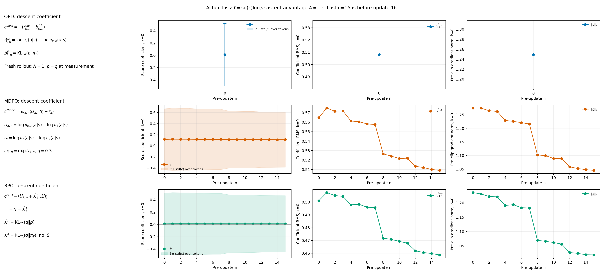
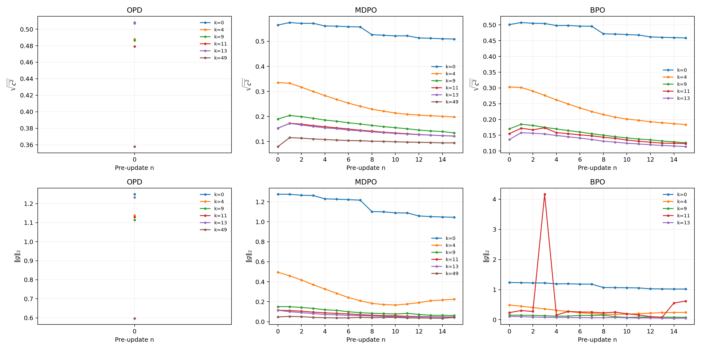
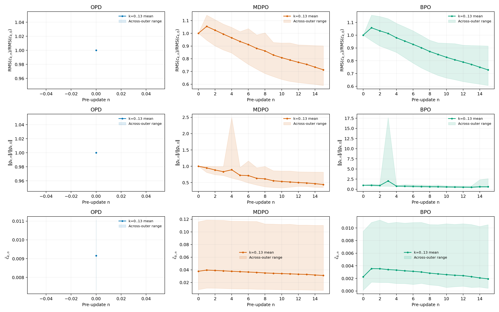
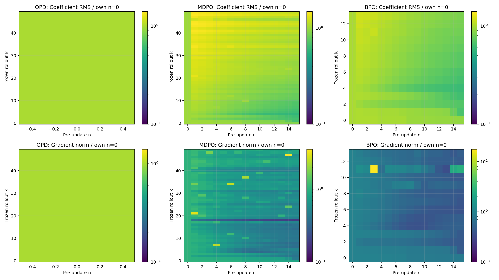
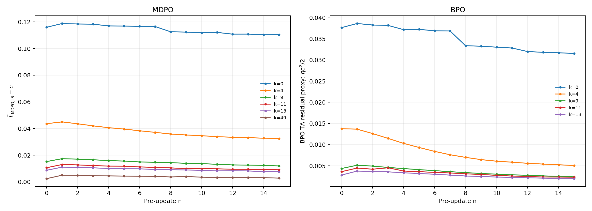
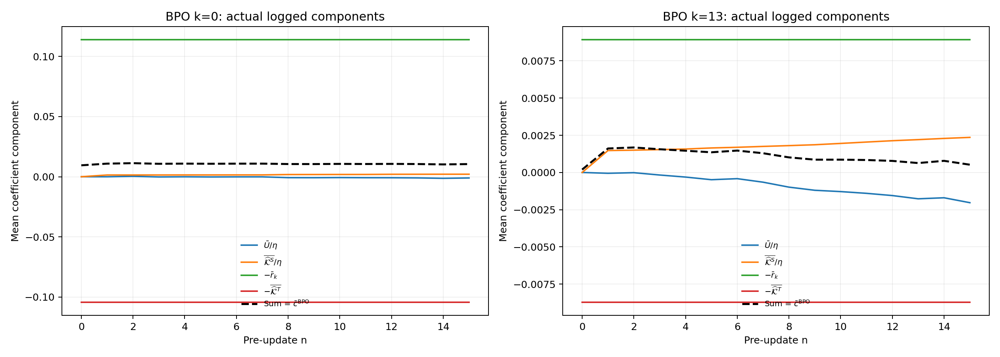
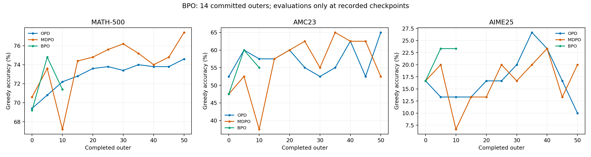
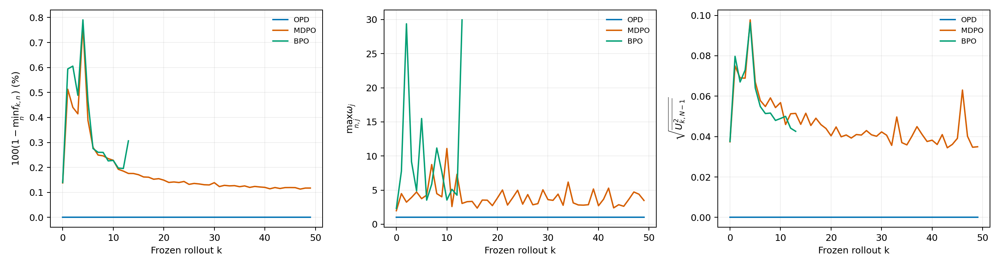

# 师生评测、inner 系数与统一指标设计

## 本次核验结果

MD-OPD 的完整数学评测确实采用每题随机生成 16 次，再取 mean@16。它还使用 temperature=0.7、top-p=0.9、31744-token 回答预算；当前 MirrorOPD 则为 greedy、每题 1 次、7168-token 预算。两个协议不仅生成次数不同，解码分布和长度预算也不同。后续应保留独立协议名称，不能只把 mean@1 改成 mean@16 后直接比较。

actor 与 teacher 的主要精度设置已经对齐：两个项目均为 actor FP32 参数存储、BF16 前向，teacher BF16 参数存储、BF16 前向。冻结 teacher 的 FSDP reduce/buffer 配置尚有差别，不能笼统称为所有精度逐项相同。

学生初始化评测和教师评测都有已有记录。当前三组正式运行各有一次完整 570 题的学生 greedy 初始化；MD-OPD 还保存了完整师生长预算 mean@16 基线，且本次已从 W&B 在线核实。尚未找到教师在本次 greedy、7168-token 预算下的完整 570 题结果。

OPD 的当前 overlap 恒为 1 来自定义：它比较当前学生与本轮冻结 anchor，测量时正好相同。MD-OPD 比较学生与教师 Top-k，两者不是同一个量。统一日志必须同时命名对象和统计口径。

本文固定 BPO 快照为北京时间 2026-10-12 08:08:58，包含 14 个完整 outer、224 次更新与 outer0/5/10 的完整评测。旧审计的四轮快照保持不变。新增图展示三算法的系数、梯度、轮内目标估计和 BPO 新结果；末尾提供自动更新入口，后续 BPO 进展由运行中的监控程序单独呈现。

## 多次生成的评测协议

### MD-OPD 实际实现与 mean@16

[MD-OPD 实现对照](../../results/training/math-4gpu/followup-20261012/2026-10-12-MD-OPD实现对照.md) 核对了当前 recipe 与 21 份已归档运行配置。21 份配置均为验证 n=16、do_sample=true、temperature=0.7、top-p=0.9、top-k=-1、max_tokens=31744。训练 temperature=1 与验证 temperature=0.7 分别配置，不能从训练温度推断测试温度。

MD-OPD 的 `ray_trainer.py:810–813` 重复每题输入并保留同题 UID；`metric_utils.py:1001–1016,1060–1077` 先在题内计算生成均值，再在测试集题目间平均。令测试集有 $D$ 题，每题生成 $R$ 次，第 $i$ 题第 $j$ 次的正确标记为 $z_{ij}\in\{0,1\}$：

$$
\widehat A_{\mathrm{mean@}R}=\frac1D\sum_{i=1}^D\frac1R\sum_{j=1}^{R}z_{ij}.
$$

单题 16 次中 4 次正确，对 mean@16 贡献 0.25。其 pass@16 贡献为 1；多数票准确率还取决于 16 个答案的分布。三个指标测量的问题不同，不应合并成一个笼统 accuracy。

$$
\widehat A_{\mathrm{pass@}R}=\frac1D\sum_i\mathbf1\left\{\sum_jz_{ij}>0\right\}.
$$

若用总共 $R$ 次生成估计 $h\le R$ 次机会的成功概率，令 $C_i=\sum_jz_{ij}$，MD-OPD 使用组合估计：

$$
\widehat A_{\mathrm{pass@}h}=\frac1D\sum_i\left[1-\frac{\binom{R-C_i}{h}}{\binom Rh}\right].
$$

固定随机解码协议时，多次生成提高单次回答成功率的估计精度，不因平均次数变多而提高其期望。设第 $i$ 题在该协议下单次成功率为 $p_i$，条件于固定题目，独立生成时有

$$
\mathbb E\widehat A_{\mathrm{mean@}R}=\frac1D\sum_i p_i,
\qquad \operatorname{Var}(\widehat A_{\mathrm{mean@}R})=\frac1{D^2R}\sum_i p_i(1-p_i).
$$

因此同一采样协议下，从 $R=1$ 增至 16，条件 Monte Carlo 标准误缩小到四分之一。测试集题目覆盖、训练种子变化和题间难度差异仍然保留；16 次生成不会把 30 道 AIME 变成 480 道独立测试题。跨题泛化的 bootstrap 应以题目为聚类单位，比较 checkpoint 时保留逐题结果。

greedy 重复 16 次属于推理复现性检查。理想确定性实现下 16 次相同，平均没有新增随机采样信息；若不相同，应报告逐题输出不一致率及判分翻转率，定位后端数值与调度。不能用这些实现差异充当独立采样的 pass@16 能力。

### 建议的共同协议

| protocol_id                 | 生成方式               | 每题次数 | 回答预算 | 用途                            |
| --------------------------- | ---------------------- | -------- | -------- | ------------------------------- |
| greedy-l7168                | greedy，T=0            | 1        | 7168     | 保持当前三正式 run 的可比较结果 |
| sample-t0p7-p0p9-l7168-r16  | 随机，T=0.7、top-p=0.9 | 16       | 7168     | 分离采样平均与长度预算的影响    |
| sample-t0p7-p0p9-l31744-r16 | 随机，T=0.7、top-p=0.9 | 16       | 31744    | 对齐 MD-OPD 历史数学协议        |

后续两个仓库采用相同 protocol_id、模型、题目、模板、scorer 与长度上限。初始化学生与教师各执行一次共同完整评测，保存每题全部回答、答案、正确标记、EOS 与预算结束原因。当前长预算历史基线可以作为已有证据展示；由于缺少题目输入哈希和模型文件哈希，它不能替代新统一部署的字节级基线核对。

实际改动还包括完整性核验：每次评测应有 570 个唯一题目、每题 16 条生成，共 9120 条回答；题内缺生成、重复 UID 或漏题都应单独报错。当前 `audit_math_run.py` 针对每次 570 条生成设计，不能只增加 val_kwargs.n 而保持旧核验。独立验证 max_tokens、do_sample、score 输入与字段名称也必须同步。

MD-OPD 的 `std@16` 是每题 16 次观测的标准差再做题间聚合，不是测试集平均准确率的标准误。统一字段应写明 `within_question_std_mean`，置信区间另算，避免把生成多样性与评测不确定性混成一个误差条。

## 已有学生与教师基线

### 本次短预算 greedy 学生初始化

| 正式运行 | MATH-500 | AMC23 | AIME25 | 生成协议     |
| -------- | -------- | ----- | ------ | ------------ |
| OPD      | 69.4%    | 52.5% | 16.67% | greedy-l7168 |
| MDPO     | 70.6%    | 47.5% | 16.67% | greedy-l7168 |
| BPO      | 69.2%    | 47.5% | 16.67% | greedy-l7168 |

这三组都从原始学生开始。初始化不齐发生在训练前，已有审计说明异步 replica 调度和非确定性推理尚未固定。后续共享初始化输出与重复推理检查优先于把任一分数指定为唯一真实 baseline。

### MD-OPD 已有完整 mean@16 师生基线

MD-OPD 的 [绘图配置](../../../MD-OPD/plots/config/runs.py) 将 student 绑定到 `6uorrk2k`，teacher 绑定到 `u87buult`。两者 W&B 均为 finished、val_only，创建于 2026-09-09，使用原始三数学测试集完整验证。在线配置与 history 已归档，详细核验见 [师生基线记录](../../results/training/math-4gpu/followup-20261012/2026-10-12-BPO进展与师生基线核验.md)。

| sample-t0p7-p0p9-l31744-r16           | MATH-500         | AMC23              | AIME25             |
| ------------------------------------- | ---------------- | ------------------ | ------------------ |
| DeepSeek-R1-Distill-Qwen-1.5B student | 83.25%           | 72.03125%          | 23.75%             |
| JustRL-DeepSeek-1.5B teacher          | 89.1125%         | 89.375%            | 39.16667%          |
| teacher 减 student                    | +5.8625 个百分点 | +17.34375 个百分点 | +15.41667 个百分点 |

数值分别来自学生[^student-baseline] 与教师[^teacher-baseline] 的线上完整结果。它们支持 teacher 在该长预算随机采样协议下强于原始 student。不能把 teacher 89.1125% 画成本次短预算 greedy MATH 曲线的水平参考线；也不能从这个结果推出 teacher 在 greedy-l7168 下的精确成绩。

目前缺的是同本次 greedy-l7168 协议的 teacher 完整评测，而不是 teacher 从未评测。两个问题必须区分。

## actor、teacher 与 rollout 精度

| 角色和阶段                        | MD-OPD 核实配置               | MirrorOPD 当前三正式 run |
| --------------------------------- | ----------------------------- | ------------------------ |
| actor 参数存储                    | FP32                          | FP32                     |
| actor 前向                        | BF16 mixed precision/autocast | BF16 mixed precision     |
| actor gradient reduce / buffer    | FP32 / FP32                   | FP32 / FP32              |
| teacher 参数存储 / 前向           | BF16 / BF16                   | BF16 / BF16              |
| teacher FSDP reduce / buffer 配置 | BF16 / BF16                   | FP32 / FP32              |
| vLLM rollout dtype                | BF16                          | BF16                     |
| log-prob / Top-k 归一化           | 相关路径转 FP32 计算          | 相关路径转 FP32 计算     |

MD-OPD actor 的 mixed_precision=null 会在 engine 中解析为 BF16 param_dtype、FP32 reduce_dtype、FP32 buffer_dtype；model_dtype=fp32 负责参数载入与存储。teacher worker 则按其 BF16 dtype 载入并使用 BF16 autocast，FSDP 三项均由该 dtype 指定。MirrorOPD teacher 也是 BF16 参数与前向，只是 reduce/buffer 配置不同。冻结教师不反传，因此 reduce dtype 并不意味着存在教师梯度通信。

“主要精度对齐”成立，“全部配置完全相同”不成立。统一配置要为 actor、teacher、rollout 分别记录 parameter_storage、forward、reduce、buffer、normalization 与 optimizer_state dtype。归一化时转 FP32 不会消除 BF16 前向产生的 logit 误差。

## overlap 的对象与 MD-OPD 当前代码问题

沿用旧书，当前学生为 $p=\pi_{k,n}$，冻结 anchor 为 $q=\pi_k$，teacher 为 $t=\pi_T$，头部大小为 $J$。

$$
O_{pq}(s)=\frac{\lvert\operatorname{Top}_J(p(\cdot\mid s))\cap\operatorname{Top}_J(q(\cdot\mid s))\rvert}{J},
$$

$$
O_{pT}(s)=\frac{\lvert\operatorname{Top}_J(p(\cdot\mid s))\cap\operatorname{Top}_J(t(\cdot\mid s))\rvert}{J}.
$$

MirrorOPD 当前 `support_overlap` 是 $O_{pq}$；MD-OPD 当前 `opd/top_k_overlap_ratio` 是 $O_{pT}$。OPD 每轮只有 $n=0$ 更新前的观测，$p=q$，故 $O_{pq}=1$。这是一项同步自检，不提供 teacher 对齐程度。MDPO/BPO 在 $n>0$ 离开 anchor，该量才开始变化；现在没有同一冻结批次在最后 optimizer 之后的 $n=N$ 重测。

例如学生与 anchor 的头部均为 `{1,2,3,4}`，teacher 头部为 `{3,4,5,6}`，当前 MirrorOPD 记录 1，MD-OPD 记录 0.5。既不能把 1 解读为完全吻合 teacher，也不能因这个差异认定 OPD 没有学习。

统一字段应分别为 `support/student_anchor/top_j_overlap` 与 `support/student_teacher/top_j_overlap`。Top-k 集合一致也不保证概率值一致：两个策略可以拥有相同排序但不同分布。Jaccard 为 $O/(2-O)$，它又是另一种集合统计，不应只改字段名。

MD-OPD 还有两项需要在统一前处理的实现差异：

1. 当前 overlap/mass 先在各 DP rank 对本 rank token 求均值，再等权平均 rank。两 rank 若分别有 10、90 个 token，局部 overlap 为 0.2、0.8，当前记录为 0.5，正确全 token 加权均值为 0.74。应上传分子和分母，跨 rank 汇总后再除；现有最终 scalar 不能还原缺失的分母。
2. 当前 vLLM 以 tokenizer 长度设置 action 支持，而 HF actor/teacher 路径仍按完整 output logits 归一化。此模型的 output head 为 151936 列，tokenizer 支持为 151665 个 ID。MirrorOPD 已修复该支持差异，当前 MD-OPD 源码尚未同步这项处理。271 列的数量不能独自量化效果影响，需要实测支持外质量与相同 prefix 的 log-prob。

若完整输出支持为 $\mathcal W$、可采样支持为 $\mathcal V$，定义 $Z_p=\sum_{a\in\mathcal V}p_{\mathcal W}(a)$，则对 $a\in\mathcal V$，$p_{\mathcal V}(a)=p_{\mathcal W}(a)/Z_p$。教师学生 log-ratio 的关系为

$$
\log t_{\mathcal V}(a)-\log p_{\mathcal V}(a)=\log t_{\mathcal W}(a)-\log p_{\mathcal W}(a)+\log Z_p-\log Z_t.
$$

这项随 prefix 变化的质量修正不能通过增加 Top-k 或改图标题消除。统一时应先统一实际 action 支持，再统一 loss、中心估计和日志，避免同一个 KL 名称对应不同归一化分母。

## score 系数与 inner 动态

### 三种系数的展开与符号

旧书定义

$$
U_{k,n}=\log\frac{\pi_{k,n}}{\pi_k},\qquad r_k=\log\frac{\pi_T}{\pi_k},\qquad \omega_{k,n}=e^{U_{k,n}},\qquad r^{\mathrm{cur}}_{k,n}=r_k-U_{k,n}=\log\frac{\pi_T}{\pi_{k,n}}.
$$

为区别旧书 K4 的特殊 score surrogate 记号，实际下降系数写为 $c^{\mathrm{score}}$，以下图中缩写为 $c$。损失与梯度为

$$
\ell^{\mathrm{score}}=\operatorname{sg}(c)\log\pi_{k,n}(a\mid s),\qquad g=\widehat{\mathbb E}_k[c\psi_{k,n}],\qquad \psi_{k,n}=\nabla_\theta\log\pi_{k,n}.
$$

写成策略梯度上升时，对应 advantage 为 $A^{\mathrm{score}}=-c$。当前 `token_advantage` 实际保存 $c$，不应将其正号误读为提高 sampled action 概率。

$$
c^{\mathrm{OPD}}=-(r^{\mathrm{cur}}+b_{pT}),\qquad b_{pT}=\widehat{\operatorname{KL}}_{\mathrm{TA}}(p\Vert t),
$$

$$
c^{\mathrm{MDPO}}=\omega\left(\frac{U}{\eta}-r_k\right),
$$

$$
c^{\mathrm{BPO}}=\frac{U+\widehat{\mathcal K}^{S,\mathrm{TA}}}{\eta}-r_k-\widehat{\mathcal K}^{T,\mathrm{TA}},\qquad \eta=0.3.
$$

Tail-aware 中心的具体展开为

$$
\widehat{\mathcal K}^{S,\mathrm{TA}}=\sum_{a\in\mathcal H_k}q_a\log\frac{q_a}{p_a}+q_{\mathcal T}\log\frac{q_{\mathcal T}}{p_{\mathcal T}},
$$

$$
\widehat{\mathcal K}^{T,\mathrm{TA}}=\sum_{a\in\mathcal H_k}q_a\log\frac{q_a}{t_a}+q_{\mathcal T}\log\frac{q_{\mathcal T}}{t_{\mathcal T}}.
$$

OPD baseline $b_{pT}$ 则把左侧 $q$ 换成当前 $p$，保留同一头尾划分。正式 OPD 的 $n=0$ 恰有 $p=q$。每个系数整体停止梯度后乘 score；不能再对其内部的 $U$、中心或 ratio 求一次导数。

### 系数均值、RMS 与梯度图



图 1 将每种公式放在对应行左侧。均值为 $\bar c=M_k^{-1}\sum_jc_j$，阴影为 token 分布的 $\bar c\pm\sqrt{\overline{c^2}-\bar c^2}$，不是置信区间。RMS 为 $\sqrt{\overline{c^2}}$，梯度为裁剪前全局范数 $\lVert g\rVert_2$。OPD 只有 $n=0$ 一个点，不连出不存在的轮内训练过程；MDPO/BPO 有 $n=0\ldots15$，最后点仍是第 16 次更新之前。



图 2 包含第一轮、outer index 4/9/11、BPO 最新完整轮 index13，以及 OPD/MDPO 已完成运行的 index49。相同 $k$ 的三个 run 采样 prefix 不相同，曲线用于观察各自轮内演化，不作为逐 token 配对对照。



图 3 每轮先除以自己的 $n=0$ 值，再跨共同 14 轮取平均；阴影为跨轮最小至最大。纵轴分别是 $\mathrm{RMS}(c_{k,n})/\mathrm{RMS}(c_{k,0})$、$\lVert g_{k,n}\rVert/\lVert g_{k,0}\rVert$、$\bar c_{k,n}$。

| 前14轮的跨轮统计              | OPD         | MDPO    | BPO     |
| ----------------------------- | ----------- | ------- | ------- |
| 首 inner 系数 RMS 均值        | 0.49391     | 0.28162 | 0.25884 |
| 末次 pre-update 系数 RMS 均值 | 0.49391     | 0.20045 | 0.18718 |
| 每轮末/首系数 RMS 比例的平均  | 1，仅一个点 | 0.71335 | 0.72820 |
| 首 inner 梯度范数均值         | 1.20010     | 0.41779 | 0.41478 |
| 末次 pre-update 梯度范数均值  | 1.20010     | 0.21287 | 0.25387 |
| 每轮末/首梯度范数比例的平均   | 1，仅一个点 | 0.44000 | 0.62593 |

多数轮中，MDPO/BPO 的 16 次复用确实降低了 score 系数量级和梯度。但系数没有普遍降至 0，末段仍有更新信号；仅凭这个下降不能证明求解了固定 prefix 的完整子问题。



图 4 第一行是系数 RMS 的末/首演化，第二行是梯度范数；颜色使用对数比例，保留大于 1 的异常。OPD/MDPO 各 50 行，BPO 14 行。共同窗口图只比较前 14 轮；全程热图同时展示 MDPO 后期的变化，避免拿前几轮代替全程。

MDPO index49 的系数 RMS 从 0.07979 增至 0.09449，系数均值从 0.002422 增至 0.002816，而梯度范数从 0.04806 降到 0.04269。不同统计不必同时单调下降。BPO index11 的 inner3 梯度范数达到 4.166，触发 clip=2，clip scale 约为 0.4801；其 ESS 为 0.999012，系数 RMS 为 0.17367。该点在新增图中保留，不能继续沿用旧四轮快照的“BPO 尚无裁剪”结论。

### 原目标估计与收敛条件



MDPO 的原目标在固定 prefix 上为 $L=\mathbb E_{d_k,p}[U/\eta-r_k]$。按冻结 $q$ 的 action 重写后，现有系数均值恰好是这个目标的 IS 数值估计：

$$
\widehat L_{\mathrm{MDPO,IS}}=\widehat{\mathbb E}_{q}\left[\omega\left(U/\eta-r_k\right)\right]=\bar c^{\mathrm{MDPO}}.
$$

它与训练记录的 $\overline{c\log p}$ 不同；后者只承载解析 score 梯度，不是目标值。$\bar c^{\mathrm{MDPO}}$ 可以用作同一轮冻结 batch 的目标轨迹，但参数是根据该 batch 自适应更新的，不能把它冒充独立 holdout 目标或跨不同访问测度的统一 loss。

BPO 生产系数为 Tail-aware 残差除以 $\eta$，所以由 RMS 可得到

$$
\widehat L_{\mathrm{BPO,TA-residual}}=\frac1{2\eta}\widehat{\mathbb E}_q[(R^{\mathrm{TA}})^2]=\frac\eta2\overline{(c^{\mathrm{BPO}})^2}.
$$

它是实际残差数值代理。由于使用近似中心，且生产用解析 score 形式停止梯度，该量的直接 autograd 梯度一般不等于生产 BPO 梯度。完整 BPO 的目标和偏差已在上次报告推导；不能将图中代理标为已精确优化的完整 BPO loss。



图 6 逐项画 $\bar U/\eta$、$\overline{\widehat{\mathcal K}^{S,\mathrm{TA}}}/\eta$、$-\bar r_k$、$-\overline{\widehat{\mathcal K}^{T,\mathrm{TA}}}$，虚线为四项之和 $\bar c^{\mathrm{BPO}}$。程序直接验证这个线性恒等式。MDPO 的两项为 $\overline{\omega U}/\eta$ 和 $-\overline{\omega r_k}$，当前日志只存边际矩，没有存这两个交叉矩，不能用 $\bar\omega\bar U$ 或 $\bar\omega\bar r_k$ 伪造展开图。

MDPO 收敛不要求每个 token 的 $c$ 为 0。精确 Gibbs 解满足

$$
U^*=\eta r_k-\log Z_k,\qquad c^{\mathrm{MDPO},*}=-\frac{\log Z_k}\eta\omega^*.
$$

该系数通常非零，但完整条件梯度为

$$
\mathbb E_q[c^*\psi^*]=-\frac{\log Z_k}\eta\mathbb E_q[\omega^*\psi^*]
=-\frac{\log Z_k}\eta\mathbb E_{p^*}\psi^*=0.
$$

完整 BPO 在逐 prefix 精确 Gibbs 解处残差为 0；生产近似中心、共享神经网络与有限训练 batch 不具备这个理想前提。OPD 只有一次 inner，现有日志根本不能给出其轮内收敛曲线。

因此当前结论是“存在明显轮内优化进展，完整收敛尚未建立”。后续收敛诊断应补 post-inner 的 $n=N$ 测量、实际参数更新范数、独立 holdout prefix/action 的原目标与总体梯度，以及近似中心的误差。提前停止需要这些量持续达到阈值，而不是只规定 coefficient RMS 接近 0。

## 最新 BPO 性能与 ESS



| 完成 outer | OPD MATH / AMC / AIME | MDPO MATH / AMC / AIME | BPO MATH / AMC / AIME |
| ---------- | --------------------- | ---------------------- | --------------------- |
| 0          | 69.4 / 52.5 / 16.67%  | 70.6 / 47.5 / 16.67%   | 69.2 / 47.5 / 16.67%  |
| 5          | 70.8 / 60 / 13.33%    | 73.6 / 52.5 / 20%      | 74.8 / 60 / 23.33%    |
| 10         | 72.2 / 57.5 / 13.33%  | 67.2 / 37.5 / 6.67%    | 71.4 / 55 / 23.33%    |

BPO 完整训练曲线已到 outer14，最新测试仍为 outer10；不能把 outer10 成绩写成 outer14 的效果。BPO 在 outer5 的 MATH 高于两组，但到 outer10 回落，最终 50 轮尚未完成。



| 当前固定数据范围      | OPD 50轮           | MDPO 50轮            | BPO 14轮             |
| --------------------- | ------------------ | -------------------- | -------------------- |
| ESS fraction 最低     | 约 1               | 0.992315             | 0.992093             |
| ESS fraction 平均     | 约 1               | 0.998771             | 0.998150             |
| action ratio 最大     | 约 1               | 11.0976              | 29.9530              |
| action ratio 最小     | 约 1               | $9.52\times10^{-14}$ | $9.82\times10^{-10}$ |
| 该 ratio 是否进入损失 | 否，fresh weight=1 | 是                   | 否                   |

MDPO 当前这一次运行没有表现出严重的动作 IS 权重集中度退化，且 800 次更新的裁剪前梯度最大 1.275，未触发 clip=2。这支持“本次 $\eta=0.3,N=16,\alpha=10^{-6}$ 的局部 action IS 尚稳定”，不支持“MDPO 从此不会因为 off-policy 或其他优化问题退化”。

$$
f_{\mathrm{ESS}}=\frac{\bar\omega^2}{\overline{\omega^2}}=\frac1{1+\mathrm{CV}(\omega)^2}.
$$

ESS 只衡量样本 action ratio 的集中度。它没有涵盖以下对象：

1. 系数与 score 的联合尾部。梯度二阶矩涉及 $\mathbb E_q[\omega^2(U/\eta-r_k)^2\lVert\psi\rVert^2]$，只看 $\mathbb E_q\omega^2$ 不足以控制它。
2. 未被这批动作覆盖的尾部区域与自适应复用误差。每个 prefix 只观察一个真实 action，统计来自训练 batch，参数还依赖它。
3. 多次 hard sync 后累计位移与新 rollout 的 prefix 分布。每轮 ratio 重置到 1，不约束跨 outer 的教师吸收或长度变化。
4. 最终答案质量。MDPO outer10 准确率回落时，ESS 仍然良好；这不是动作权重坍缩的证据。

BPO 按 anchor 测度训练，不应用 IS；其 ESS 只是一项 student-anchor 漂移诊断。BPO 的 inner3 梯度尖峰与高 ESS 共存，进一步说明这个量不能用于给所有算法签发“优化已安全”的结论。

## 统一日志与 W&B 的实施设计

详细规范见 [蒸馏统一日志与评测指标规范](../operations/2026-10-12-蒸馏统一日志与评测指标规范.md)。它沿用旧书 $\pi_k,\pi_{k,n},\pi_T,U,r_k,\omega$，与当前书 $q_k,p_{k,n},t$ 建立对应；$\rho$ 保留概率空间同步系数含义，不再拿它同时指 IS ratio。

| 规范字段                                | 数学对象或事件                  | 现有来源及处理                                |
| --------------------------------------- | ------------------------------- | --------------------------------------------- |
| `signal/U_student_anchor`               | $U=\log p-\log q$               | Mirror sampled_log_ratio，保持原义            |
| `signal/r_teacher_anchor`               | $r_k=\log t-\log q$             | 明确 frozen reward                            |
| `signal/r_teacher_student`              | $r^{cur}=\log t-\log p$         | MD-OPD `opd/adv_*` 默认诊断更接近此对象       |
| `optimization/score_coefficient`        | 实际下降系数 $c^{score}$        | Mirror token_advantage 改为此名               |
| `optimization/ascent_advantage`         | $A^{score}=-c^{score}$          | mean 取负，min/max 取负后交换，std/RMS 不变   |
| `ratio/omega_student_anchor`            | $p/q$                           | 三算法均可记录，另写 applies_action_is        |
| `kl/anchor_teacher/tail_aware_j16`      | $\widehat K_{qT}$               | frozen teacher center                         |
| `kl/anchor_student/tail_aware_j16`      | $\widehat K_{qp}$               | student center                                |
| `kl/student_teacher/tail_aware_j16`     | $\widehat K_{pT}$               | OPD 当前 baseline；不复用 teacher_center 名称 |
| `support/student_anchor/top_j_overlap`  | $O_{pq}$                        | 当前 Mirror overlap                           |
| `support/student_teacher/top_j_overlap` | $O_{pT}$                        | 当前 MD-OPD overlap，改为全token聚合          |
| `objective/mdpo/is_value`               | $\overline{\omega(U/\eta-r_k)}$ | 与 MDPO 系数 mean 数值相等，语义单独命名      |
| `quality/<suite>/<protocol>/mean_at_16` | 题内采样平均后题间平均          | 与 greedy accuracy、pass_at_16 分开           |

每个 token 量跨 micro-batch 和 DP rank 合并 `count,sum,sum_sq,min,max` 后求统计。MD-OPD 已有正负比例、绝对均值等字段，可加入实际 $c^{score}$ 的正负 fraction、正负贡献与可合并分位数；不能把原始 reward 的正负统计贴成实际优化系数。额外记录 MDPO 的 $\omega U$、$\omega r_k$ 交叉矩，支持完整分项诊断。

本地记录分为 rollout_snapshot、inner_pre_update、inner_post_update、outer_post_sync 与 evaluation 事件，每条带 actor/anchor/behavior 版本、prefix/batch ID 和测量时点。真实 optimizer 更新计数由完成一次更新后递增，禁止一般情形下用 `outer*epochs+inner` 代替。DP worker 只输出数学充分统计，global rank 0 写一条唯一记录；W&B 由单一日志所有者上传。

W&B 默认 `_step` 只作为上传事件编号。每次 payload 显式带新 rollout 数、完成 outer 数、optimizer 更新数、新生成 token 数、训练时间、端到端时间，关闭隐式 step_sync。rollout 快照与 inner aggregate 使用不同字段根，排除旧日志的同名双写。固定提供等 rollout、等更新、等训练时间三个性能面板，用户不必手动猜 step 的含义。

实现顺序应为共同支持与全 token 归约、规范事件与实际系数采集、统一评测协议及逐题输出、W&B 映射与面板。历史数据能可靠转换的字段保留 provenance；缺少的 post-inner、分位数、完整 KL 和逐题配对标为缺失，不能由边际矩补造。

本次只交付设计和分析程序，尚未将这套规范装入两个仓库的生产 trainer。现有 BPO 按启动配置继续运行，避免中途改变训练观测或目标。

## 图片更新与复现

固定图表在 [followup 结果目录](../../results/training/math-4gpu/followup-20261012/figures/) 中。原有 16 组对比图也已经用新 BPO 快照全部重画；本报告再展示 8 组针对系数、收敛与最新节点的图。旧审计目录保持历史快照。

实时图入口为 [自动更新的 BPO 性能图](../../runs/math-policy-followup/live/figures/22-latest-quality.png)、[实时 inner 系数图](../../runs/math-policy-followup/live/figures/18-selected-outers-coefficients.png)、[实时 ESS 图](../../runs/math-policy-followup/live/figures/23-latest-is-ess.png) 和 [监控状态](../../runs/math-policy-followup/live/status.json)。这些图属于运行产物，与固定快照分开；页面重新加载后可看到新图。

[监控程序](../../experiments/analysis/watch_math_policy.py) 每 30 秒检查一次本地 outer JSONL，每当新完整 outer 写出便更新系数、梯度、目标、性能与 ESS 图，检测训练 exit-code 后停止。它只读取日志，使用 CPU 绘图，不改训练进程、原始 run 或 W&B。更新用临时渲染目录和文件替换发布，避免正在生成的 PNG 被读取。状态文件记录真实完成 outer、评测节点与最后更新时间。

```bash
PYTHONPATH=. CUDA_VISIBLE_DEVICES='' ../envs/mirroropd/bin/python experiments/analysis/math_policy_coefficients.py \
  --raw results/training/math-4gpu/audit-20261012/raw \
  --bpo-raw results/training/math-4gpu/followup-20261012/raw \
  --output results/training/math-4gpu/followup-20261012/figures
```

```bash
PYTHONPATH=. CUDA_VISIBLE_DEVICES='' ../envs/mirroropd/bin/python experiments/analysis/watch_math_policy.py \
  --source runs/dapo-deepseek-bpo-o50-j16 \
  --baseline-raw results/training/math-4gpu/audit-20261012/raw \
  --output runs/math-policy-followup/live
```

复现固定快照前执行 `make data`；入库 gzip、文件长度和 SHA-256 由 data-manifest 管理。多次生成协议的训练后完整评测尚未在本次新启动，不能将建议的 mean@16 写成已有正式三算法结果。

### 参考文献

[^student-baseline]: 本项目. math_student，DeepSeek-R1-Distill-Qwen-1.5B 完整数学 mean@16 基线. Weights & Biases 2026 配置归档，运行创建于 2026-09-09. [student baseline](https://wandb.ai/wncfht/One-Shot-OPD/runs/6uorrk2k).

[^teacher-baseline]: 本项目. math_teacher，JustRL-DeepSeek-1.5B 完整数学 mean@16 基线. Weights & Biases 2026 配置归档，运行创建于 2026-09-09. [teacher baseline](https://wandb.ai/wncfht/One-Shot-OPD/runs/u87buult).
