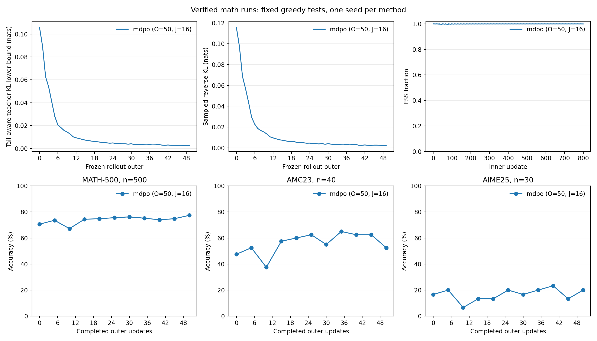

# 数学 MDPO 五十轮训练结果

## 完整运行结果

正式 MDPO 完成 50 个 outer，每个 outer 在同一冻结 rollout 上执行 16 次全局更新，共 800 次更新。最后一次全量评测得到 MATH-500 77.4%、AMC23 52.5%、AIME25 20%，相对本次初始化分别提高 6.8、5、3.33 个百分点。训练中的教师对齐诊断下降，数学验证器分数提高；测试轨迹包含 outer10 的明显回落，随后恢复。

运行名为 `dapo-deepseek-mdpo-o50-j16`，启动源码版本为 `87ec5155f4ee4f7904aa275cf580261542350c82`。实际退出码为 0；W&B 3o5o72du 已 finished，保留 851 条历史记录。[完整核验](../../results/training/math-4gpu/dapo-deepseek-mdpo-o50-j16-verification.json) 确认 800 次唯一更新、51 条 outer 记录、11 次全量 570 题评测，以及 GPU 0–3 的采样记录。

## 训练条件与执行语义

学生为 DeepSeek-R1-Distill-Qwen-1.5B，教师为 JustRL-DeepSeek-1.5B。训练使用原始 DAPO 17917 条数据，测试使用原始 MATH-500 500 题、AMC23 40 题和 AIME25 30 题。完整配置、模型与数据校验方法见 [四卡数学蒸馏实验](2026-10-12-四卡数学蒸馏实验.md)。

| 参数                                 | 实际设置                                                                               |
| ------------------------------------ | -------------------------------------------------------------------------------------- |
| GPU 与并行                           | 物理 0–3；FSDP=4、TP=1、SP=1                                                           |
| 全局 batch / mini-batch / 每题生成数 | 64 / 64 / 1                                                                            |
| outer / inner                        | 50 / 16；共 800 次全局优化更新                                                         |
| actor / anchor / teacher micro-batch | 1 / 1 / 1；动态 batching 关闭                                                          |
| 优化器                               | AdamW，lr=1e-6、weight decay=0、clip=2                                                 |
| eta / Top-k                          | 0.3 / 16                                                                               |
| prompt / response / context          | 2048 / 7168 / 9216 token                                                               |
| 训练采样 / 测试生成                  | temperature=1、top-p=1、top-k=-1 / greedy、temperature=0                               |
| 精度与显存设置                       | FP32 参数，BF16 前向，FP32 reduce/buffer；参数及优化器 offload、gradient checkpointing |
| vLLM 资源                            | memory utilization=0.25，每 replica 最多 32 条序列                                     |
| 验证批量 / 频率                      | val batch=null；初始化及每五 outer 全量测试                                            |
| 种子                                 | 数据及模型 42；生成 replica 0–3                                                        |

每个 outer 的起点重新生成 64 条回答，并冻结锚点与教师缓存。16 次更新复用这些 action 和 prefix，随后把训练权重同步给 rollout 模型。日志索引完整覆盖 outer_call=0–49、inner_step=0–15，外层 rollout 权重版本为 0–49。运行从原始学生初始化，预检权重没有参与正式训练。

数学验证器分数用于观察，训练配置中的 use_task_rewards 和 use_policy_gradient 均为 false。MDPO 实际系数、停止梯度、缓存、EOS 对齐和全局 token 归约经过 [性能回落时的算法复查](2026-10-12-MDPO前十步性能回落检查.md)。该复查给出了原目标与生产系数的对应关系，以及 eta 的每轮约束含义；CPU 完整 action 枚举的梯度误差最大为 5.96e-8。

## 训练信号与多次 inner 更新

下表比较前十个和后十个 outer 的算术平均。KL center 与采样 reward 取每个 outer 的 inner_step=0，即参数更新前的 frozen rollout 快照；数学验证器分数和训练截断率取对应 outer 的训练批。J=16 时，前十条 inner 记录属于同一个 outer，因此使用 outer 作为前后窗口单位。

| 指标                         | 前十个 outer | 后十个 outer |
| ---------------------------- | -----------: | -----------: |
| Tail-aware teacher KL center |   0.04497818 |   0.00279389 |
| 冻结采样蒸馏 reward          |  -0.04851898 |  -0.00250254 |
| 数学验证器分数               |   0.45312500 |   0.57031250 |
| 训练回答预算耗尽率           |    50.46875% |    39.37500% |

Tail-aware（尾部聚合）KL center 使用 16 个选出 token 与一个尾部桶，是完整词表 KL 的下界诊断。采样 reward 是教师与冻结锚点在真实采样 action 上的 log-prob 差。两个量的趋势支持访问前缀上的教师对齐加强；每轮访问前缀和回答长度发生变化，固定前缀完整 KL 的下降幅度仍需专门测量。

锚点和教师相关量在每个 outer 的 16 次更新中保持冻结；学生 center、采样 log-ratio 和重要性比率随 inner 更新变化。起点 student center RMS 最大为 1.09e-7，采样 log-ratio RMS 最大为 1.15e-7，说明每轮重新同步。全程有效样本量比例最低为 0.992315，平均为 0.998771；动作重要性比率最大为 11.10。该比例描述当轮动作权重的集中程度；累计模型变化由多次 outer 更新产生。

800 次更新的梯度范数范围为 0.031–1.275，低于裁剪阈值 2，实际裁剪比例为 0。全部诊断值有限。标量 score surrogate loss 的数值不作为 KL 目标值报告。

## 全量测试与生成预算

| 测试集   |         初始化 |   outer50 最终 |           变化 | 初始 / 最终预算耗尽率 |
| -------- | -------------: | -------------: | -------------: | --------------------: |
| MATH-500 | 353/500，70.6% | 387/500，77.4% |  +6.8 个百分点 |         28.8% / 25.6% |
| AMC23    |   19/40，47.5% |   21/40，52.5% |    +5 个百分点 |         52.5% / 52.5% |
| AIME25   |   5/30，16.67% |      6/30，20% | +3.33 个百分点 |       83.33% / 73.33% |

最终 MATH-500 增加 34 道正确题，AMC23 增加 2 道，AIME25 增加 1 道。AIME25 最终仍有 22/30 条回答耗尽 7168 token 预算，平均回答长度为 6716.9 token；MATH-500 和 AMC23 的长度均值分别为 3972.306、5662.375 token。成绩按相同预算解释。

outer10 三项准确率曾回落至 67.2%、37.5%、6.67%；outer25 三项分别恢复到 75.6%、62.5%、20%。AMC23 在 outer35 达到 65%，最终回落至 52.5%；AIME25 在 outer40 达到 23.33%，随后波动。完整曲线保留这些变化，最终采用预先安排的 outer50 结果。

本次只有一个训练种子，未保存逐题配对输出，AMC23 与 AIME25 的题数分别为 40 和 30。初始到最终的聚合正确数变化只能支持本次运行的观测结论。原始 DAPO 与 MATH-500、AMC23、AIME25 的精确题目重叠分别为 2、5、0 条，按用户指定保持原始数据；AMC23 的重叠限制其泛化解释。

## 资源与比较范围

全程采样 GPU 峰值为 36745 MiB，即 35.88 GiB。actor 框架记录的 peak reserved 为 33.49 GiB，两者统计范围不同。该运行正常退出，未发生 OOM。训练 outer 耗时均值为 218.82 秒，该字段不包含周期评测及初始化。

[共同配置差异](../../results/training/math-4gpu/formal-config-comparison.json) 核实正式 on-policy 与 MDPO 的模型、数据、batch、学习率、长度预算和评测策略一致，差异为算法、epoch 数及运行名称和输出路径。on-policy 50 outer/J1 执行 50 次更新，MDPO 50 outer/J16 执行 800 次更新；本次是用户指定的相同 outer 数比较，计算量不同。

两次正式运行各自的初始 greedy 成绩有差异，因此改善量分别使用各自初始化评测。MDPO 与 on-policy 的最终曲线构成这两次运行的实测比较，方法优劣还需要重复种子和计算量控制。BPO 的正式结果已完成，三组完整解释见 [三方法比较](2026-10-12-四卡数学蒸馏完整比较.md)。

## 图与复现



图由 [数学训练分析脚本](../../experiments/analysis/math_training_report.py) 从通过完整核验的原始日志生成。数值结果保存在 [comparison.json](../../results/training/math-4gpu/mdpo-final-analysis/comparison.json)、[测试差值](../../results/training/math-4gpu/mdpo-final-analysis/benchmark-deltas.csv) 和 [逐次 inner 诊断](../../results/training/math-4gpu/mdpo-final-analysis/dapo-deepseek-mdpo-o50-j16/inner-dynamics.csv)。矢量图为 [comparison.pdf](../../results/training/math-4gpu/mdpo-final-analysis/comparison.pdf)。

```bash
source ../.bashrc
fht-mirror
PYTHONPATH="$PWD:$PYTHONPATH" python experiments/analysis/math_training_report.py \
  --run runs/dapo-deepseek-mdpo-o50-j16 \
  --verification-root results/training/math-4gpu \
  --output results/training/math-4gpu/mdpo-final-analysis
```
