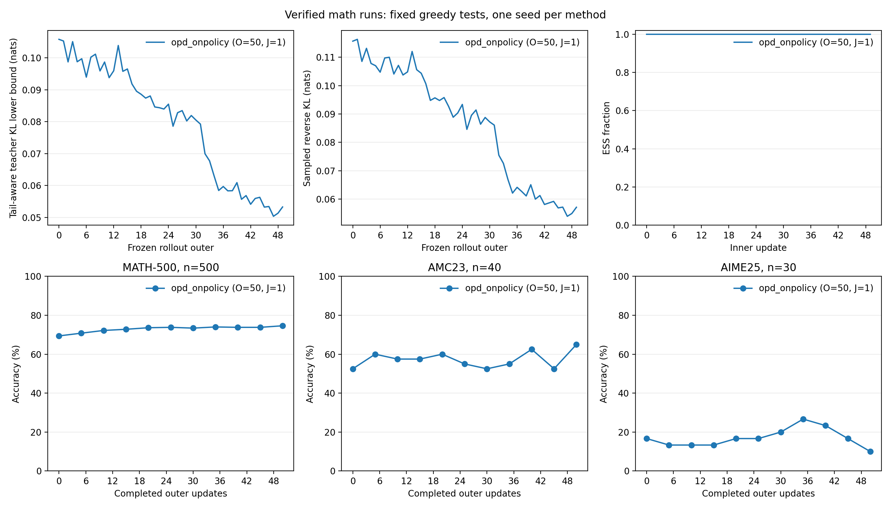

# 数学 OPD 五十步训练结果

## 结论与运行范围

本次完整 on-policy 蒸馏完成 50 次新 rollout 和 50 次全局优化更新。训练中的学生到教师 KL 诊断下降，采样蒸馏 reward 提高，MATH-500 与 AMC23 的最终准确率超过本次初始化评测。AIME25 的正确题数从 5 降至 3，最终 90% 的回答耗尽生成预算。因此，这次运行支持模型发生有效学习和两项测试改善，同时记录了 AIME25 的退步。

运行名为 `dapo-deepseek-opd-o50-j1`，实际训练源码版本为 `d89e875f97738d1154fc2449720f9f5fd552ae27`。进程正常结束，退出码为 0。W&B 运行 wass1wqb 已 finished，服务端保留 101 条历史记录；本地和在线记录都通过 [完整核验](../../results/training/math-4gpu/dapo-deepseek-opd-o50-j1-verification.json)。MDPO 与 BPO 的正式结果仍待各自完成。

## 模型、数据与训练条件

学生为 DeepSeek-R1-Distill-Qwen-1.5B，教师为 JustRL-DeepSeek-1.5B。训练使用 MD-OPD 原始 DAPO train.parquet 的 17917 条记录，测试使用原始 MATH-500、AMC23、AIME25，共 570 题。模型与输入校验信息、环境及完整候选配置见 [四卡实验设计](2026-10-12-四卡数学蒸馏实验.md) 和运行目录中的 model-data-audit.json、resolved-config.yaml。

| 参数                                 | 实际值                                                                          |
| ------------------------------------ | ------------------------------------------------------------------------------- |
| 物理 GPU                             | 0、1、2、3；四卡 FSDP，TP=1、SP=1                                               |
| 全局 train batch / mini-batch        | 64 / 64                                                                         |
| 每题生成数 / inner epoch             | 1 / 1                                                                           |
| actor / anchor / teacher micro-batch | 1 / 1 / 1                                                                       |
| 学习率 / weight decay / 梯度裁剪     | 1e-6 / 0 / 2                                                                    |
| prompt / response / context 上限     | 2048 / 7168 / 9216 token                                                        |
| 训练采样                             | temperature=1、top-p=1、top-k=-1                                                |
| 测试生成                             | greedy、temperature=0、每题一次                                                 |
| 参数精度与 offload                   | FP32 参数，BF16 前向，FP32 reduce/buffer；参数及优化器 offload                  |
| 其他显存设置                         | gradient checkpointing；vLLM memory utilization=0.25、每 replica 最多 32 条序列 |
| Tail-aware Top-k / Mirror eta        | 16 / 0.3；on-policy 的单次更新不使用多步 Mirror 修正                            |
| 数据与模型种子                       | 42；生成 replica 种子 0–3                                                       |
| 评测频率                             | 初始化及 outer=5、10、…、50，每次全量 570 题                                    |

本地 inner 日志具有 50 个唯一的 `(outer_call, inner_step)`，分别为 `(0,0)` 至 `(49,0)`。outer 日志有 51 条，含初始化及 50 次更新后的记录。每个 outer 的 rollout 权重版本递增一次，学习率始终为 1e-6。数学验证器分数只用于观察，不作为训练的任务奖励或策略梯度输入。

## 训练信号

以下值为前十次和后十次更新的算术平均。inner 诊断记录于相应优化更新之前，各 outer 使用新生成的回答和前缀。

| 指标                            |      前十次 |      后十次 |
| ------------------------------- | ----------: | ----------: |
| Tail-aware 学生到教师 KL center |  0.10042642 |  0.05407696 |
| 采样蒸馏 reward                 | -0.10968796 | -0.05771235 |
| 数学验证器分数                  |  0.34531250 |  0.46875000 |
| 训练回答预算耗尽率              |   62.34375% |   49.06250% |

蒸馏 reward 是回答 token 上教师与学生 log-prob 差的聚合量。其负值对应本次采样的反向 KL 估计。该 reward 从 -0.10969 提高到 -0.05771，与 KL center 下降的方向一致；数学验证器分数同时提高 12.34 个百分点。

Tail-aware（尾部聚合）KL center 将选出的 16 个 token 与一个尾部桶组成聚合分布，得到完整词表 KL 的下界。这里的前后比较还包含访问前缀分布的变化，不能据此报告固定前缀上的完整词表 KL 降幅。实际记录显示聚合诊断下降约 46.15%；标量 surrogate loss 不作为 KL 目标数值解释。

每次更新前的学生与新 rollout 锚点一致：student center RMS 最大 1.15e-7，采样 log-ratio RMS 最大 1.22e-7，有效样本量比例最低为 0.9999999999999841。梯度范数范围为 0.525–1.408，低于裁剪阈值 2，实际裁剪比例为 0。这些量支持本次 50 次更新均执行 fresh-rollout on-policy 链路。

## 完整测试结果

| 测试集   | 初始正确数与准确率 | 最终正确数与准确率 |     准确率变化 | 初始 / 最终预算耗尽率 |
| -------- | -----------------: | -----------------: | -------------: | --------------------: |
| MATH-500 |     347/500，69.4% |     373/500，74.6% |  +5.2 个百分点 |         30.0% / 27.6% |
| AMC23    |       21/40，52.5% |       26/40，65.0% | +12.5 个百分点 |         50.0% / 40.0% |
| AIME25   |       5/30，16.67% |        3/30，10.0% | -6.67 个百分点 |        83.33% / 90.0% |

MATH-500 的最终结果增加 26 道正确题，AMC23 增加 5 道，AIME25 减少 2 道。AIME25 在 outer35 达到 8/30，随后回落至最终 3/30；报告采用最终 50 步结果，完整轨迹保留在图和数值记录中。

AIME25 最终有 27/30 条回答耗尽 7168 token 预算，回答长度均值为 6792.1 token。这个条件限制当前配置对长推理的评测覆盖；仅凭截断不能断言延长预算会恢复正确率。正式 MDPO/BPO 保持相同预算，后续比较将同时展示准确率和截断情况。

该实验只有一个训练种子，未保存逐题配对输出，不能据此给出配对显著性检验。原始 DAPO 与 MATH-500 有 2 条完全相同题目，与 AMC23 有 5 条，与 AIME25 有 0 条；此次按用户指定保留原始数据。AMC23 的 12.5% 精确重叠也限制其泛化解释。

## 资源与在线日志

GPU 监控只覆盖物理 0–3，启动器同时限制 CUDA_VISIBLE_DEVICES=0,1,2,3。全程采样显存最高 36745 MiB，即 35.88 GiB；actor 框架记录的 peak reserved 为 33.30 GiB，两者统计范围不同。该运行未发生 OOM。训练 outer 平均耗时 96.15 秒，这一指标不包含周期性测试及初始化时间。

在线 W&B 记录含唯一 inner_update=0–49 和完整 evaluation_outer=0、5、…、50。初始记录、50 条 inner 记录和 50 条 outer 记录合计 101 条，周期评测合并在对应 outer 记录中。在线最终测试值与本地原始日志一致。

## 图与复现



图由 [数学训练分析脚本](../../experiments/analysis/math_training_report.py) 从已核验的原始日志生成。数值结果保存在 [comparison.json](../../results/training/math-4gpu/onpolicy-final-analysis/comparison.json)、[测试差值](../../results/training/math-4gpu/onpolicy-final-analysis/benchmark-deltas.csv) 和 [逐次更新诊断](../../results/training/math-4gpu/onpolicy-final-analysis/dapo-deepseek-opd-o50-j1/inner-dynamics.csv)。可导出的矢量图为 [comparison.pdf](../../results/training/math-4gpu/onpolicy-final-analysis/comparison.pdf)。

```bash
source ../.bashrc
fht-mirror
PYTHONPATH="$PWD:$PYTHONPATH" python experiments/analysis/math_training_report.py \
  --run runs/dapo-deepseek-opd-o50-j1 \
  --verification-root results/training/math-4gpu \
  --output results/training/math-4gpu/onpolicy-final-analysis
```
