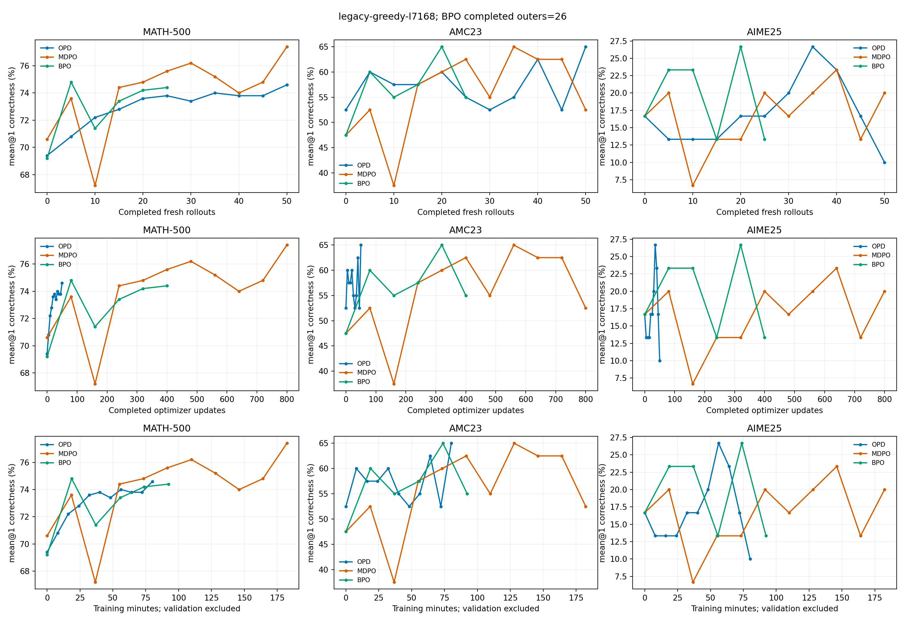
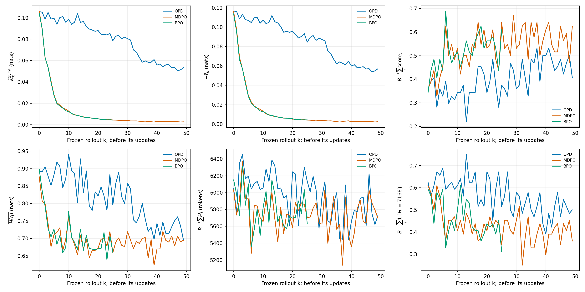
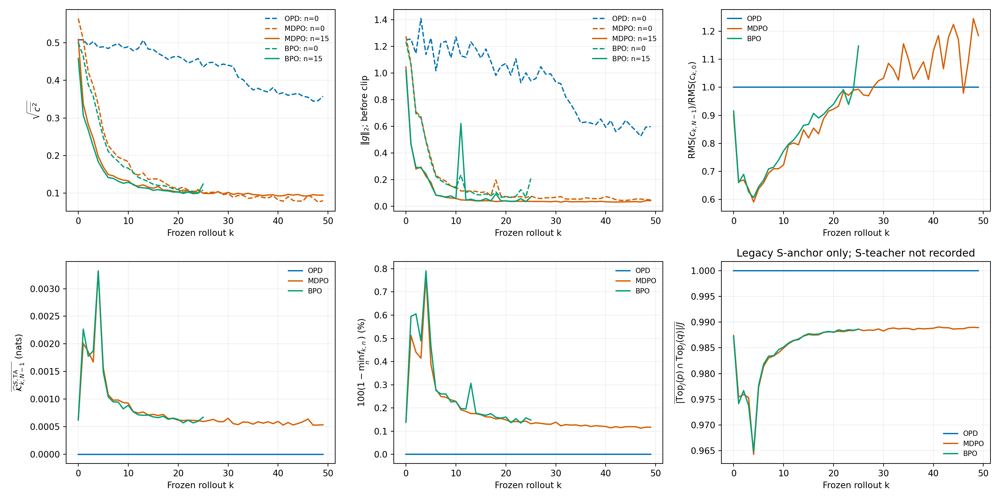
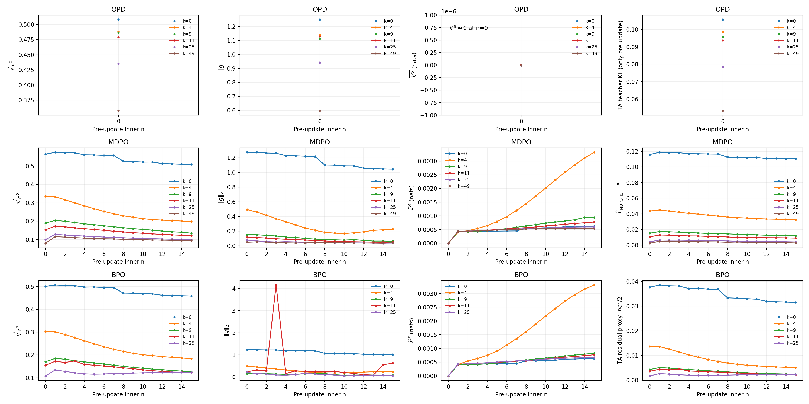
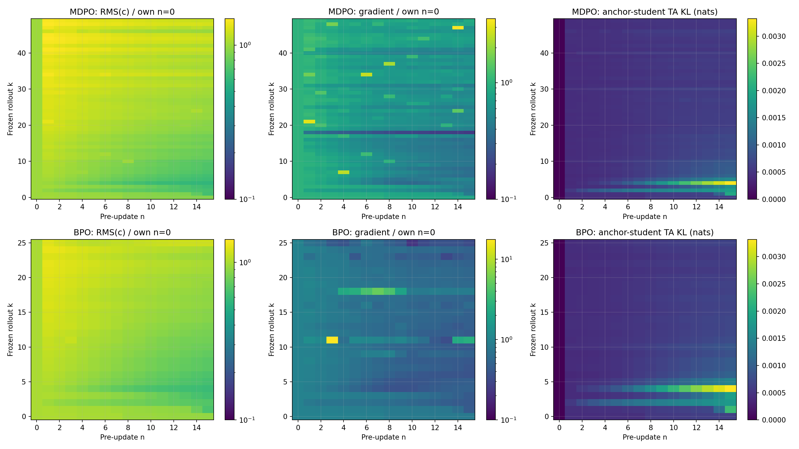
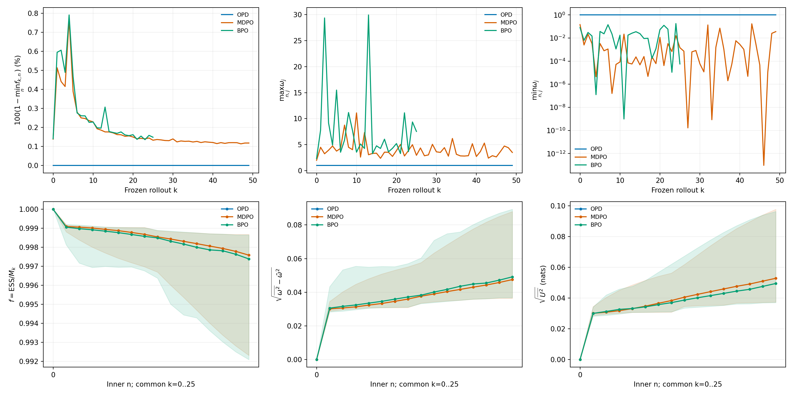
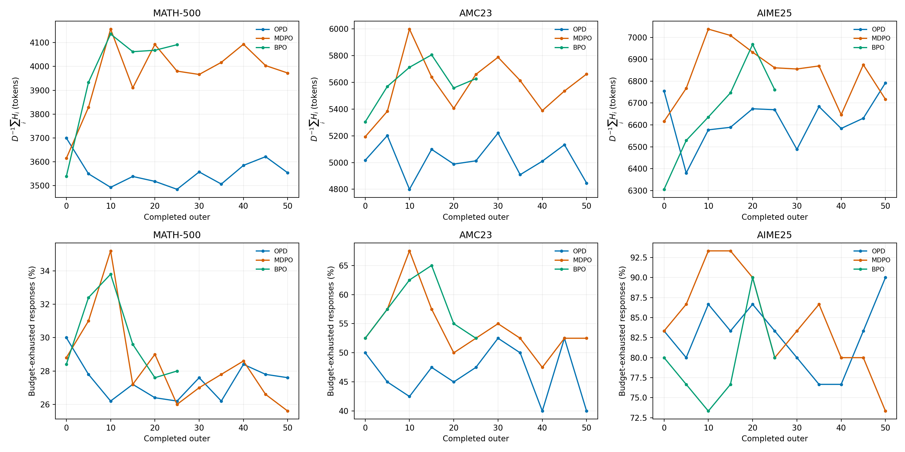
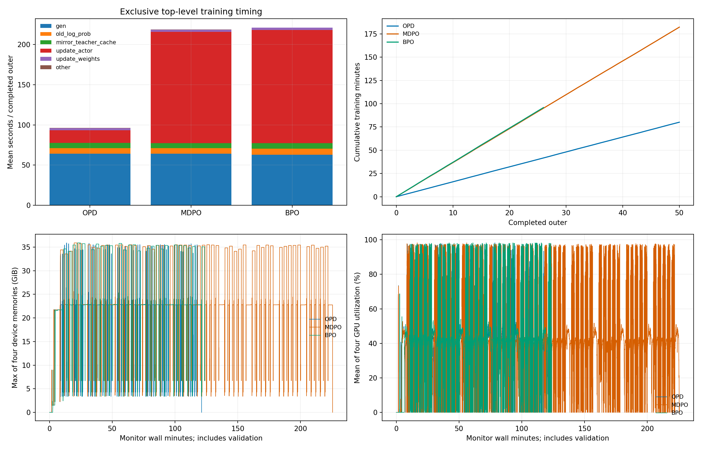
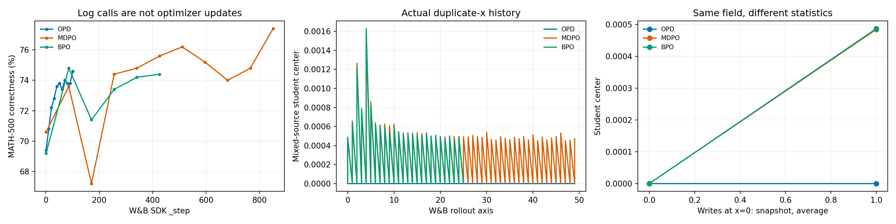
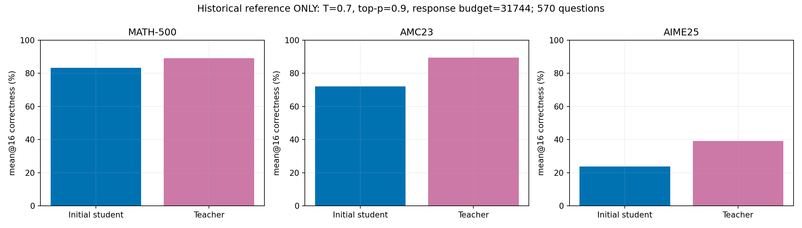

# 数学蒸馏三算法的学习效率、inner 优化与日志审计

## 阅读入口与结果范围

本报告合并原来的三算法日志审计与师生评测报告。实验设置、数学目标、outer 学习、inner 优化、采样权重、生成预算、资源和实现变更各自成节；W&B 字段和事件合同由 [统一指标规范](../operations/2026-10-12-蒸馏统一日志与评测指标规范.md) 持续维护。实验解释引用该规范，避免两个文档分别定义同一个字段。

现有证据支持 MDPO 在相同新 rollout 轮数下更快降低访问前缀上的教师对齐诊断，最终 MATH-500 与 AIME25 分数高于 OPD。它没有展示全面更好的数学性能：最终 AMC23 为 MDPO 52.5%、OPD 65%。两者优化次数为 800 对 50、训练耗时为 182.35 对 80.13 分钟；同 outer 的优势不能直接改写为同计算预算的优势。

固定分析采用北京时间 2026-10-12 09:03:53 的新 BPO 快照：26 个完整 outer、416 次更新，完整评测到 outer25。OPD 和 MDPO 的完整 50 轮快照保持不变。各运行 W&B 的原始 history、配置与抓取时点独立保存，在线上传晚于本地或更早到达的记录只用于核对，不替代本地完整 outer 的边界。

| 方法            | W&B ID   | 完整 outer / 更新 | 测试节点    | 当前数据状态      |
| --------------- | -------- | ----------------- | ----------- | ----------------- |
| OPD[^opd-run]   | wass1wqb | 50 / 50           | 0、5、…、50 | finished，退出码0 |
| MDPO[^mdpo-run] | 3o5o72du | 50 / 800          | 0、5、…、50 | finished，退出码0 |
| BPO[^bpo-run]   | gp7pyuj6 | 26 / 416          | 0、5、…、25 | 固定快照仍running |

实时进展在 [实时图目录](../../runs/math-policy-followup/live/figures/) 与 [状态文件](../../runs/math-policy-followup/live/status.json)。固定报告不随后台绘图改写事实，实时图每个完整 outer 刷新，BPO 退出后停止。最新完整训练轮与最新测试轮分别显示。

## 数据、配置与公平比较单位

### 模型、数据与已有训练设置

学生为 DeepSeek-R1-Distill-Qwen-1.5B，冻结教师为 JustRL-DeepSeek-1.5B。三运行使用原始 DAPO 17917 条训练记录；测试为 MATH-500 500题、AMC23 40题、AIME25 30题，共570题。模型 revision 字段为 null，本地模型名和配置不能替代完整 checkpoint hash。共同词表、special IDs、原生模板及数据文件 hash 的实际核验保存于各运行的 model-data-audit。

| 设置                                      | 旧三正式run实际值                                                                            |
| ----------------------------------------- | -------------------------------------------------------------------------------------------- |
| 硬件 / 并行                               | GPU0–3，四张H800 80GiB；FSDP4、TP1、SP1                                                      |
| train batch / mini-batch / 每题训练生成数 | 64 / 64 / 1                                                                                  |
| 每轮inner更新数                           | OPD 1；MDPO/BPO 16                                                                           |
| actor / anchor / teacher micro-batch      | 每GPU均1；动态batching关闭                                                                   |
| 优化器                                    | AdamW，lr=1e-6、weight decay=0、clip=2，常数学习率                                           |
| 镜像系数 / 头部大小                       | eta=0.3 / Top-J=16                                                                           |
| 训练 prompt / response / context          | 2048 / 7168 / 9216                                                                           |
| 训练采样                                  | temperature1、top-p1、top-k−1；允许EOS结束                                                   |
| 旧正式测试                                | greedy、temperature0、每题1次、response7168                                                  |
| 测试计划                                  | 初始化与每5outer全570题；val batch=null                                                      |
| actor精度                                 | FP32参数、BF16前向、FP32 reduce/buffer                                                       |
| 冻结teacher精度                           | BF16参数与前向、FP32 reduce/buffer配置，无训练梯度                                           |
| 内存设置                                  | 参数/优化器offload、gradient checkpointing、vLLM memory utilization0.25、每replica最多32序列 |
| 随机设置                                  | 数据及模型seed42；生成replica seed0–3；异步调度、未启用全确定性                              |
| 目标中的额外奖励                          | task rewards=false、policy gradient=false、entropy coefficient0                              |

50个outer对应3200条新回答，约为训练数据行数的17.86%，不等于完整训练epoch覆盖。response长度决定有效prefix数，因此等rollout轮数也不等于等新token数。

原始DAPO与MATH-500有2条、AMC23有5条、AIME25有0条精确题目重叠。AMC23的12.5%精确重叠限制泛化解释。本报告保持原始数据，后续去重成绩应另设明确benchmark，不能给既有结果换成无污染标签。

旧OPD源码commit为 `d89e875f97738d1154fc2449720f9f5fd552ae27`，MDPO为 `87ec5155f4ee4f7904aa275cf580261542350c82`，BPO为 `ac54a612fb9ef0692b5b65d6c7dae620bdbb39a9`。首次审计逐项核对了各459个来源文件；新诊断和评测代码的提交不改变旧run的启动版本。当前第一方源码已有新功能，不能再把“当前文件与旧hash相同”当作全仓库事实。

### 四种预算与测量时点

第 $k$ 轮先用 $\pi_k$ 生成回答，再进行 $N$ 次inner更新，最后同步成 $\pi_{k+1}=\pi_{k,N}$。旧正式配置中B=mini，故一次epoch恰有一次optimizer更新：

$$
u_{k,n}=kN+n,\qquad n=0,\ldots,N-1.
$$

这是本次配置的派生索引。改变mini-batch、动态inner次数、提前停止或resume后，应由实际optimizer事件计数；一般情形不能继续用epochs相乘。inner第n点测量更新前的 $\pi_{k,n}$，第15点尚未执行第16次更新。

评测节点 $K$ 表示完成K个outer，关联 $KN$ 次更新。累计训练时间为

$$
T_{train}(K)=\sum_{j=1}^{K}\mathrm{timing\_s/step}_j.
$$

它不含初始化与周期评测；端到端时间另含模型启动、评测、保存和等待。曲线分别按新rollout轮数、optimizer更新数、训练时间展示。新response token预算另由 $\sum_kM_k$ 计算；不能将MDPO16次重复处理的token叫16倍新数据。

旧框架的outer行在更新后上传，部分内容仍描述更新前采到的训练回答。训练verifier分数、response长度和clip ratio属于本轮 $\pi_k$，不是已更新的 $\pi_{k,N}$；actor诊断又是多条pre-update记录的汇总，不能把整行称为一个更新后模型snapshot。

## 数学对象、目标与实际下降系数

### 沿用书稿符号与经验测度

旧书的冻结anchor、当前student、teacher分别为 $\pi_k,\pi_{k,n},\pi_T$；当前书的 $q_k,p_{k,n},t$ 与它们逐项对应。下面简记 $q=\pi_k$、$p=\pi_{k,n}$、$t=\pi_T$。prefix为 $s=(x,y_{<t})$，action为当前位置实际生成的token。

$$
U_{k,n}(s,a)=\log\frac{p(a\mid s)}{q(a\mid s)},\qquad
r_k(s,a)=\log\frac{t(a\mid s)}{q(a\mid s)},\qquad
\omega_{k,n}(s,a)=e^{U_{k,n}(s,a)}.
$$

$$
r^{cur}_{k,n}=r_k-U_{k,n}=\log(t/p),\qquad
\mathcal K_k^T=KL(q\Vert t),\qquad
\mathcal K_{k,n}^S=KL(q\Vert p).
$$

$\mathcal K^S$的方向从anchor到student，与MDPO目标中的 $KL(p\Vert q)$ 相反。$N$是每轮更新次数，$J$是Top-J头部大小，$R$是每题测试生成数；运行名j16指N16，不能与J16混用。

有效回答长度 $H_i$ 包含实际EOS、排除prompt与padding。预算终止保留实际最后action，不伪造EOS。记有效token总数 $M_k=\sum_iH_i$，生产token平均为

$$
\langle z\rangle_k=\frac1{M_k}\sum_{i=1}^{B}\sum_{t=1}^{H_i}z(s_{i,t},a_{i,t}).
$$

长回答贡献更多prefix。每题先平均再跨题平均会改变这个目标。固定访问测度 $d_k$ 是由本轮anchor产生的token-prefix测度；inner保持prefix和action批次不变，只有p更新。改变访问测度、模型分布和Monte Carlo误差应分别解释。

score为 $\psi=\nabla_\theta\log p(a\mid s)$，其anchor条件均值为 $\bar\psi=\mathbb E_q\psi$。在p不等于q时，$\bar\psi$一般不为零。

### 共同字段与不同算法目标

实际下降系数写 $c^{score}$，图中缩写c，避免与旧书K4估计器的c混淆：

$$
\ell^{score}=\operatorname{sg}(c)\log p(a\mid s),\qquad
\nabla\ell^{score}=c\psi,\qquad
A^{score}=-c.
$$

最后一个量是将同一更新写成策略梯度上升时的advantage。旧MirrorOPD的token_advantage实际保存c；MD-OPD的opd/adv统计则主要保存teacher-current log-ratio。二者不能只改名便合成一个advantage曲线。

| 算法         | 负目标                                                 | 下降系数                                 | action测度     |
| ------------ | ------------------------------------------------------ | ---------------------------------------- | -------------- |
| OPD          | $\mathbb E_{d_k}KL(p\Vert t)$                          | $-(r^{cur}+b_{pT})$                      | fresh p        |
| Token-IS OPD | 同上，prefix仍固定                                     | $-w(r^{cur}+b_{pT})$，$w=p/\beta_k$      | 行为 $\beta_k$ |
| MDPO         | $\mathbb E_{d_k,p}[U/\eta-r_k]$                        | $\omega(U/\eta-r_k)$                     | anchor q       |
| PMD-Part     | $\frac12\mathbb E_{d_k,q}(U-\eta r_k+\log Z_k)^2$      | $U-\eta r_k+\log Z_k$                    | anchor q       |
| PMD-Mean     | $\frac12\mathbb E_{d_k,q}(U-G_k)^2$                    | $U-G_k$，$G_k=\eta(r_k+\mathcal K_k^T)$  | anchor q       |
| BPO          | $\frac1{2\eta}\mathbb E_{d_k,q}(U-G_k+\mathcal K^S)^2$ | $(U+\mathcal K^S)/\eta-r_k-\mathcal K^T$ | anchor q       |

PMD-Mean已有生产primitive，PMD-Part已有categorical参考实现，尚无本次神经网络正式run。图只展示真实OPD/MDPO/BPO，不复制其他算法曲线伪装为未来方法结果。指标规范同时覆盖六算法，区分共同量、原目标、残差和target类型。

OPD每轮只有一次fresh更新，当前 $b_{pT}$ 使用Tail-aware的 $KL(p\Vert t)$ baseline。它action无关，完整p期望下 $\mathbb E_p[b\psi]=0$。若直接将该模式改为复用旧rollout的N大于1而仍用权重1，就不再是fresh-policy更新；本次配置没有这种误用。

### MDPO的目标、梯度与Gibbs解

对每个prefix展开原目标：

$$
\begin{aligned}
L_{MDPO}(p)&=\sum_a p_a\left[\frac{\log p_a-\log q_a}\eta-\log t_a+\log q_a\right]\\
&=KL(p\Vert t)+(\eta^{-1}-1)KL(p\Vert q).
\end{aligned}
$$

eta0.3对应7/3倍本轮anchor约束。anchor每轮更新，不能视为相对初始模型的永久约束。对p和logp同时求导，再用 $\mathbb E_p\psi=0$：

$$
\begin{aligned}
\nabla L_{MDPO}&=\mathbb E_p[(U/\eta-r_k+1/\eta)\psi]\\
&=\mathbb E_p[(U/\eta-r_k)\psi]\\
&=\mathbb E_q[\omega(U/\eta-r_k)\psi].
\end{aligned}
$$

生产对最后一行的系数停止梯度。完整action期望下删除的 $\omega\psi/\eta$ 为零，有限动作batch上不恒为零；这是旧书选择的控制变量，而非漏求导。完整action枚举与原目标梯度误差小于6e-8。Tail-aware中心不进入MDPO的更新系数。

归一化乘子lambda的内点条件为

$$
\eta^{-1}(\log p_a+1)-(\eta^{-1}-1)\log q_a-\log t_a+\lambda=0.
$$

移项并归一化得到

$$
p_a^*=\frac{q_a^{1-\eta}t_a^\eta}{Z_k},\qquad
Z_k=\sum_aq_a^{1-\eta}t_a^\eta.
$$

Hessian对角元为 $1/(\eta p_a)>0$，故固定prefix的categorical最优点唯一。还有精确目标gap分解：

$$
L_{MDPO}(p)=\frac1\eta KL(p\Vert p^*)-\frac1\eta\log Z_k.
$$

固定同一prefix、每轮精确求解并同步时，指数递推得到 $\pi_k\propto\pi_0^{(1-\eta)^k}\pi_T^{1-(1-\eta)^k}$。eta0.3时十轮初始指数为0.0282475。真实神经网络、AdamW、有限动作与变化prefix不满足精确求解假设；该式解释局部小步为何能形成大累计位移，不是实测收敛速度。

### Tail-aware中心与BPO近似偏差

令 $\mathcal H_k=Top_J(q)$，$\mathcal T_k$为剩余词表。Tail-aware将整个尾部合为一个类别：

$$
\widehat{\mathcal K}^{S,TA}=\sum_{a\in\mathcal H_k}q_a\log(q_a/p_a)+q_{\mathcal T}\log(q_{\mathcal T}/p_{\mathcal T}),
$$

teacher中心同理把p换成t。完整尾部逐项拆开：

$$
\begin{aligned}
\sum_{a\in\mathcal T}q_a\log(q_a/p_a)
&=\sum_{a\in\mathcal T}q_a\left[\log(q_{\mathcal T}/p_{\mathcal T})+\log\frac{q_a/q_{\mathcal T}}{p_a/p_{\mathcal T}}\right]\\
&=q_{\mathcal T}\log(q_{\mathcal T}/p_{\mathcal T})+q_{\mathcal T}KL(q(\cdot\mid\mathcal T)\Vert p(\cdot\mid\mathcal T)).
\end{aligned}
$$

定义缺失中心 $\delta_S=\mathcal K^S-\widehat{\mathcal K}^{S,TA}\ge0$，teacher同理为deltaT。高head mass不能独自保证小gap，因为尾部条件KL没有仅依质量的有限上界。

完整BPO残差 $R=U-\eta(r_k+\mathcal K^T)+\mathcal K^S$ 满足 $\mathbb E_qR=0$，并有 $\nabla\mathcal K^S=-\bar\psi$，于是

$$
\nabla L_{BPO}=\eta^{-1}\mathbb E_q[R(\psi-\bar\psi)]
=\mathbb E_q[(R/\eta)\psi].
$$

生产替换成Tail-aware中心后，系数差为 $-\delta_S/\eta+\delta_T$，总体梯度差为

$$
g_{TA}-g_{full}=\mathbb E_{d_k}[(-\delta_S/\eta+\delta_T)\bar\psi].
$$

p=q时此项为零，后续一般非零。四action枚举中J2的最大梯度误差为0.012649，解析偏差式验证至9.22e-8，J覆盖完整词表时误差降至1.49e-7。这证明生产BPO是近似完整中心BPO，不能据该反例把真实模型误差定为2.7%或解释全部成绩变化。

MDPO中心只作诊断，OPD的p测度baseline只改变有限样本方差；Mean/BPO的q测度中心误差会影响总体梯度。统一指标时必须保留这项算法区别。

## Outer学习与数学性能

### 同预算曲线与初始化差异



图1各列为MATH-500、AMC23、AIME25，各行横轴依次为完成新rollout轮数、完成optimizer更新数、累计训练分钟；纵轴为本次greedy每题一次的正确率百分比。折线只连接真实检查点。BPO的训练数据到26轮、测试只到25轮，图不补造第26轮成绩。outer20曾达到AMC65%、AIME8/30，到outer25又回落为55%、4/30，不能按最好节点推断最终优势。

准确率为 $D^{-1}\sum_i\mathbf1\{\mathrm{verifier}(\hat y_i,y_i^*)=1\}$，本次D分别为500、40、30。初始化成绩如下：

| 方法初始化 | MATH  | AMC   | AIME   |
| ---------- | ----- | ----- | ------ |
| OPD        | 69.4% | 52.5% | 16.67% |
| MDPO       | 70.6% | 47.5% | 16.67% |
| BPO        | 69.2% | 47.5% | 16.67% |

三者差异发生于训练前。数据和模型seed42没有固定每题到replica的路由、batch布局与低精度算术。训练首批有效token为386982、386114、393684，也说明实际动作/prefix不同。不能将这些差异归因于算法已经学习；也不能在缺逐题输出和路由证据时声称全部由某个vLLM算子造成。

| 完成outer | OPD MATH / AMC / AIME | MDPO MATH / AMC / AIME | BPO MATH / AMC / AIME |
| --------- | --------------------- | ---------------------- | --------------------- |
| 5         | 70.8 / 60 / 13.33%    | 73.6 / 52.5 / 20%      | 74.8 / 60 / 23.33%    |
| 10        | 72.2 / 57.5 / 13.33%  | 67.2 / 37.5 / 6.67%    | 71.4 / 55 / 23.33%    |
| 15        | 72.8 / 57.5 / 13.33%  | 74.4 / 57.5 / 13.33%   | 73.4 / 57.5 / 13.33%  |
| 20        | 73.6 / 60 / 16.67%    | 74.8 / 60 / 13.33%     | 74.2 / 65 / 26.67%    |
| 25        | 73.8 / 55 / 16.67%    | 75.6 / 62.5 / 20%      | 74.4 / 55 / 13.33%    |
| 50        | 74.6 / 65 / 10%       | 77.4 / 52.5 / 20%      | 尚未完成              |

全部11个OPD/MDPO检查点和6个BPO检查点保存在 [评测表](../../results/training/math-4gpu/review-20261012/tables/evaluation.csv)。最终预定节点OPD的MATH增加26题、AMC增加5题、AIME减少2题；MDPO分别增加34、2、1题。最终MDPO减OPD为MATH+14题、AMC−5题、AIME+3题。单seed、初始化差异、小测试集与精确重叠限制算法优劣的推广。

MDPO首次实测达到MATH73.6%在18.47分钟，OPD在32.13分钟；但MDPO36.64分钟跌至67.2%，55.01分钟恢复至74.4%。这是一条有更早门槛和中途回退的轨迹，不能概括为持续更快。

OPD全程训练预算80.13分钟内，MDPO最后一个已测点是73.2分钟的outer20：MATH74.8%、AMC60%、AIME13.33%。与OPD最终74.6%、65%、10%相比，MATH仅多1题、AMC少2题、AIME多1题；它不是80.13分钟精确checkpoint对照，但足以说明最终+2.8个百分点没有建立等时的同等优势。

最佳检查点另有选择偏差：OPD AIME最佳8/30、MDPO最佳7/30，最终却分别3/30与6/30。不能拿一方最佳值对另一方预定终点。没有逐题配对输出无法做McNemar检验，没有多seed无法估计训练随机性的区间。

### 访问前缀上的教师拟合



图2六项依次为 $\langle\widehat{\mathcal K}_k^{T,TA}\rangle_k$、$-\langle r_k\rangle_k$、$B^{-1}\sum_i\mathrm{score}_i$、$\langle H(q)\rangle_k$、$B^{-1}\sum_iH_i$、$B^{-1}\sum_i\mathbf1\{H_i=7168\}$。熵为 $H(q)=-\sum_aq_a\log q_a$。教师中心、reward、熵只取首inner n0；任务与长度取生成该批次的训练记录，均属于更新前pi_k。

| 窗口                  | OPD前10轮 / 后10轮    | MDPO前10轮 / 后10轮   |
| --------------------- | --------------------- | --------------------- |
| teacher TA中心        | 0.100426 / 0.054077   | 0.044978 / 0.002794   |
| sampled frozen reward | −0.109688 / −0.057712 | −0.048519 / −0.002503 |
| 首inner熵             | 0.884060 / 0.730207   | 0.742201 / 0.692012   |
| verifier通过率        | 0.345313 / 0.468750   | 0.453125 / 0.570313   |
| train预算命中比例     | 62.34 / 49.06%        | 50.47 / 39.38%        |

末个已记录rollout的teacher TA中心为OPD0.053305、MDPO0.002646、BPO0.004339。MDPO/BPO在复用训练下更快降低该访问测度上的拟合诊断。因为d_k、长度与prefix难度变化，这不是固定probe的完整KL下降量。

$-\langle r_k\rangle$是每prefix实际动作的Monte Carlo估计，TA中心是聚合分布的确定下界。两者的均值差包含采样误差，不能把差值直接叫完整尾部gap。MDPO末轮 sampled值约0.002422、TA中心约0.002646，前者更小并不违反KL下界；完整gap需要同prefix full-vocab计算。

## Inner优化与收敛判据

### 同时观察Outer优化量与轮内轨迹



图3上行分别画系数RMS、裁剪前梯度范数、每轮末/首系数RMS比例。前两项虚线n0、实线n=N−1；OPD只有一个点，不产生轮内变化。下行是末次pre-update的 $\langle\widehat{\mathcal K}^{S,TA}\rangle$、每轮最差 $100(1-f_{ESS})$、已有student-anchor Top-J交集比例。旧run没有teacher原生IDs，因此不制造另外两对支持曲线。



图4每行对应一算法，每列分别为 $\sqrt{\langle c^2\rangle}$、$\Vert g\Vert_2$、$\langle\widehat{\mathcal K}^{S,TA}\rangle$、算法特定目标/代理。曲线选取k0、4、9、11、共同窗口末轮以及该算法已完成的最后一轮。OPD所有点仅在n0，第四列是TA教师KL诊断，不是更新后的收敛路径。

MDPO第四列使用精确可从系数mean恢复的训练batch目标估计：

$$
\widehat L_{MDPO,IS}=\langle\omega(U/\eta-r_k)\rangle=\langle c^{MDPO}\rangle.
$$

这与 $\langle c\log p\rangle$ 的surrogate数值不同，也不是独立holdout目标。BPO第四列使用生产TA残差的数值代理：

$$
\widehat L_{BPO,TA-residual}=\frac1{2\eta}\langle(R^{TA})^2\rangle=\frac\eta2\langle(c^{BPO})^2\rangle.
$$

TA残差的直接autograd不等于生产BPO解析score梯度；图必须保留proxy标签。PMD-Part未来需有完整或明确近似的logZ，PMD-Mean应使用自己的平方残差目标，不统一成一个没有定义的actor loss。



图5两行是MDPO与BPO，三列分别为RMS(c)除本轮n0值、梯度范数除本轮n0值、TA student中心绝对值。前两列使用对数色标，保留超过1的尖峰；第三列以0为绘图下界，浮点约1e-7的负KL误差保留于表格。OPD没有多inner，不填一块全1热图假装动力学。

前14轮MDPO每轮末/首系数RMS比例均值0.71335、BPO0.72820；梯度比例分别0.44000、0.62593，支持轮内优化进展。全50轮MDPO系数比例均值却为0.94057，说明早期下降不能代替后段。index49的RMS从0.07979增至0.09449，目标IS估计从0.002422增至0.002816，梯度从0.04806降到0.04269。不同量不必同时单调。

BPO index11、inner3梯度为4.166，触发clip2，scale约0.4801；当时ESS0.999012、系数RMS0.17367。系数分布没有同尺度爆炸，但参数梯度包含score Jacobian与跨token相关。这个观测排除了“ESS高就保证所有优化量稳定”的解释，没有确定尖峰的因果来源。

### Advantage、student中心与真正收敛的区别

$\mathcal K^S=KL(q\Vert p)$表示本轮离开anchor多远，起点为0。它增长并稳定可以伴随成功优化；它始终为0也可以只是没有更新。既不能要求它归零，也不能单凭它稳定判定到达目标。

MDPO在Gibbs解处满足

$$
U^*=\eta r_k-\log Z_k,\qquad
c^*=-\omega^*\log Z_k/\eta,
$$

其系数通常非零，却有

$$
\mathbb E_q[c^*\psi^*]=-\frac{\log Z_k}\eta\mathbb E_q[\omega^*\psi^*]
=-\frac{\log Z_k}\eta\mathbb E_{p^*}\psi^*=0.
$$

一个可枚举的例子是q=(0.5,0.5)、t=(0.9,0.1)、eta0.3。Gibbs解p*=(0.659073,0.340927)，此时K^S=0.053357，系数为(0.438902,0.227036)，系数mean0.332969，categorical梯度约1e-16。两个“未归零”量与完整收敛同时成立；初始化K^S=0反而仍有非零梯度。

完整Part/BPO可以在逐prefix Gibbs target让残差归零。Mean的中心化target $G=\eta(r+\mathcal K^T)$ 满足 $\mathbb E_qG=0$，非恒定G有 $\mathbb E_qe^G>1$，因此直接拟合U=G违反归一化。Mean最优条件为

$$
U_a-G_a+\lambda e^{U_a}=0,\qquad \sum_aq_ae^{U_a}=1,
$$

$$
U_a^*=G_a-W_0(\lambda e^{G_a}).
$$

lambda由归一化确定；其残差通常也非零。不同inner算法不能用统一的“advantage RMS必须趋零”停止规则。

| 观察对象                    | 能回答的问题                      | 不能单独推出的结论                  |
| --------------------------- | --------------------------------- | ----------------------------------- |
| 实际c/A的矩与正负贡献       | 梯度信号规模、是否被极端token主导 | 完整目标已最小化                    |
| K^S及reverse anchor KL      | 本轮相对anchor的位移和信赖约束    | 距teacher或目标的剩余距离           |
| ESS与ratio矩                | 动作权重集中度和局部漂移          | prefix覆盖、梯度方差、答案质量      |
| 固定probe原目标或target gap | 同一对象的优化进展                | 全局神经网络最优或最终数学能力      |
| 梯度及真实参数更新          | stationarity与实际优化器活动      | 无saddle、无投影误差或无holdout退化 |
| 独立holdout目标与任务评测   | 固定batch以外的效果               | 在其他预算/任务也同样有效           |

短期应补同一冻结batch的post-inner n=N及固定probe的前后目标、实际更新范数和holdout梯度。镜像方程残差 $U-\eta r+\log Z$适合Gibbs方法；Mean用自身target和目标gap。当前没有完整logZ或独立holdout测量，结论限定为已有优化进展，完整收敛尚未建立。

## IS、ESS与Off-policy稳定性



图6上行按k画每轮最差ESS缺失百分比、所有inner/token的ratio最大值和最小值；最小值使用对数轴。下行在三者共同26轮窗口中，按n画ESS fraction、ratio标准差、U的RMS；实线跨轮均值、阴影跨轮最小至最大，不是置信区间。

条件动作IS为

$$
\mathbb E_q[\omega h\mid s]=\sum_aq_a(p_a/q_a)h_a=\mathbb E_p[h\mid s].
$$

它保持d_k，不把冻结prefix分布改成当前完整trajectory访问分布。实际vLLM行为与HF anchor的数值差另用rollout-correlation字段观测，不能拿U在重置时接近0代替行为一致性证明。

$$
ESS=\frac{(\sum_j\omega_j)^2}{\sum_j\omega_j^2},\qquad
f=\frac{ESS}{M_k}=\frac{\bar\omega^2}{\overline{\omega^2}}=\frac1{1+CV(\omega)^2}.
$$

程序逐记录验证该恒等式至1e-12。固定参数总体极限中 $f\to[1+\mathbb E_{d_k}\chi^2(p\Vert q)]^{-1}$；相关token与batch自适应使实际ESS不是独立样本数。

| 数据范围          | OPD50轮           | MDPO50轮 | BPO26轮  |
| ----------------- | ----------------- | -------- | -------- |
| ESS最低           | 约1               | 0.992315 | 0.992093 |
| ESS均值           | 约1               | 0.998771 | 0.998468 |
| 最大ratio         | 约1               | 11.0976  | 29.9530  |
| 最小ratio         | 约1               | 9.52e-14 | 9.82e-10 |
| 该ratio进入loss   | 否，fresh weight1 | 是       | 否       |
| 已触发裁剪的inner | 0                 | 0        | 1        |

MDPO这一次800更新没有严重动作权重坍缩，梯度最大1.275也低于clip2。但加权梯度二阶矩还含 $\omega^2(U/\eta-r)^2\Vert\psi\Vert^2$，仅控制权重二阶矩不足以控制它；未采到的尾部、跨outer累计位移和最终答案质量也不在ESS中。

BPO/Mean/Part按q积分，不乘omega；它们的ESS只作anchor漂移诊断。每轮hard sync使ratio重置1、ESS重置1，不能解释为模型始终停在初始化附近。最后pre-update n15也不是第16次更新后的最终ESS。

## 支持重叠、Union与Intersection

### 三对原生Top-J集合

令 $H_p=Top_J(p)$、$H_q=Top_J(q)$、$H_T=Top_J(t)$，对任意一对集合定义

$$
I_{XY}=|H_X\cap H_Y|,\qquad C_{XY}=|H_X\cup H_Y|=2J-I_{XY},
$$

$$
O_{XY}=I_{XY}/J,\qquad Jac_{XY}=I_{XY}/C_{XY}.
$$

用C表示并集大小，避免与log-ratio U混淆。student-teacher为主要教师对齐诊断；student-anchor为本轮集合漂移；anchor-teacher为本轮起点。n0有p=q，故O_pq=1、O_pT=O_qT，后两者不必1。

新代码每对记录intersection_count、union_count、intersection_fraction、jaccard，共12个逐token量。teacher原生Top-J IDs随outer冻结，student每inner重算；先合并有效token充分统计再求mean/std/RMS。旧support_overlap保留student-anchor别名。历史run没有teacher原生IDs，不能从teacher在anchor头部上的log-prob猜出teacher原生Top-J；否则极易把选出的同一组ID误报成overlap1。

两个四元素集合交集2个时，O=0.5、并集6个、Jaccard=1/3。逐token有Jac=O/(2−O)，但其非线性函数不与跨token均值交换，不能把旧overlap mean直接转换成全局Jaccard mean。另有pooled Jaccard，即所有交集成员总数除所有并集成员总数，可由相同归约权重的O mean转换；它偏向并集较大的prefix，独立命名，不能与逐prefix平均混用。一个完全相同、一个不重叠的J4例子中，mean Jaccard0.5，pooled为1/3。

并列边界沿用torch.topk的原生成员选择，集合内部返回顺序不影响统计。J0表示关闭诊断，原始零值是工程约定；J等于全词表时三个集合全相同，比例结构性为1，也不证明分布概率相同。

### MD-OPD的候选支持策略是另一项设置

| top_k_strategy     | 用于候选奖励的集合 | 默认权重归一化           |
| ------------------ | ------------------ | ------------------------ |
| only_stu           | H_p                | 归一化                   |
| only_tch           | H_T                | 归一化                   |
| intersection       | H_p交H_T           | 归一化                   |
| union              | H_p并H_T，去重复   | 归一化                   |
| union-intersection | 两集合的对称差     | 不归一化，保留原概率质量 |

这些策略决定在哪些候选action上计算top-k reward，不是给overlap图选择分母。MD-OPD默认log_prob_top_k0、metric_top_k16，只观察集合，实际采样action仍用于奖励；21份归档中20份如此，另一份才启用top-k训练。student_p、teacher_p、none又控制候选权重，规范必须分别记录support_selection、reward_weight_mode、normalization。

当前MD-OPD还把各rank的overlap比例等权平均。10/90个token两rank的局部0.2/0.8，rank均值0.5，全token均值0.74。统一时传分子与分母，再全局归约；缺分母的历史scalar不能精确重建。

Top集合统计不等于概率质量重叠。完整共同词表上的 $\sum_a\min(p_a,t_a)=1-TV(p,t)$需要完整概率。现有student_head_mass为p(H_q)，不是p(H_p)。字段必须同时注明概率来自谁、集合由谁选择。

## 生成预算、师生基线与新评测协议



图7上行是每题平均生成token，下行是预算耗尽回答的百分比，横轴为真实评测节点。预算结束与错误不是同一事件；当前旧日志只有聚合值，没有同题结束位置、答案抽取与正确性配对，不能分解所有回落原因。

MDPO outer10的MATH/AMC/AIME预算耗尽35.2/67.5/93.33%，准确率67.2/37.5/6.67%。后续恢复说明它不是终态。最终AIME预算耗尽OPD27/30、MDPO22/30，平均长度6792.1、6716.9。目标没有限时答案或verifier奖励，token拟合与固定预算数学分数不必同向。

### 已完成的后续评测改动

| 参数                  | 旧正式run          | 新默认配置                                             |
| --------------------- | ------------------ | ------------------------------------------------------ |
| 验证每题生成数        | 1                  | 16                                                     |
| 验证采样              | greedy，T0、top-p1 | 随机，T0.7、top-p0.9                                   |
| 验证response上限      | 7168               | 31744                                                  |
| 验证prompt上限        | 2048               | 4096，独立于训练                                       |
| vLLM最大context       | 9216               | 35840                                                  |
| 训练prompt / response | 2048 / 7168        | 2048 / 7168                                            |
| 每次完整生成数        | 570                | 9120                                                   |
| 逐题输出              | 未保存             | UID、sample_index、回答、score、finish_reason、token数 |

已移植MD-OPD的独立max_tokens合同，贯通数据集prompt限制、agent请求、single-turn返回和tensor padding。验证不再在旧7168长度处截断。核验570唯一UID、每UID完整0–15采样索引、9120总回答，并重算mean@16/pass@16核对汇总。旧n1缺逐题文件的运行保留兼容，新n16必须具备这些证据。

每次评测输出protocol ID和参数；模型checkpoint版本独立记录，不能因为每次换权重就换protocol ID。当前ID哈希解码/长度/R；完整dataset/scorer/template hash合同见统一规范。UID由来源和稳定题目标识构造，计数相同但UID重复、漏题或缺样本都会失败。

新共享context升至35840。新launcher的Ray与临时路径改放磁盘上的runs/math-4gpu-runtime，避免长验证张量与spill占满容量受限的/tmp。每次最坏生成预算9120×31744=289505280 token，旧值570×7168=4085760，比例70.86；这不是实测耗时倍数。KV比例0.25与并发32不变也不保证长序列容量和吞吐，应先做独立GPU canary。CPU已验证8000-token返回完整保留、4096+31744 padding及完整Hydra解析；未执行新GPU评测，也没有将运行中BPO改成新协议。

## 耗时、显存与字段语义



图8左上相加gen、anchor forward、teacher cache、actor update、weight sync，other取step减顶层项；嵌套agent_loop请求计时不重复相加。右上为累计训练分钟；下行分别为同一监控tick四卡device memory最大值、四卡utilization均值，横轴监控墙钟，包含初始化与测试。

| 每轮平均秒数   | OPD50轮 | MDPO50轮 | BPO26轮 |
| -------------- | ------- | -------- | ------- |
| 生成           | 64.110  | 64.220   | 62.836  |
| anchor         | 6.933   | 6.831    | 7.606   |
| teacher cache  | 6.531   | 6.327    | 6.697   |
| actor全部inner | 15.617  | 138.527  | 141.070 |
| 同步           | 2.750   | 2.679    | 2.748   |
| 全训练step     | 96.154  | 218.823  | 221.194 |

OPD生成占66.7%、MDPO actor占63.3%。相同50轮新数据时，MDPO训练时间增加2.276倍、更新次数16倍，每更新摊销训练成本从96.15降至13.68秒；重复动作仍不等于16倍新数据。OPD10次周期评测约33.65分钟，MDPO约35.94分钟，分别占训练加周期评测的29.6%与16.5%。初始化评测没有独立计时，监控总差额不能全算初始化评测。

三个设备采样峰值约35.884、35.884、35.903GiB。actor allocator reserved高水位约33.30、33.49GiB与整卡值不是同一个统计范围；max字段会跨返回列表取最大，但取样早于随后offload且没有每轮重置，不是该轮瞬时峰值。W&B system监测还包含GPU4–7，报告只用独立gpu.csv的0–3。

outer throughput为 $(prompt+response\ tokens)/(4T_{step})$，MDPO16次复用不乘16；它不能比较actor反向吞吐。MFU是按模型参数、序列长度平方、设备理论算力估算的proxy，不是NVML利用率。完整公式和具体取样位置见统一指标规范及 [资源核验](../../results/training/math-4gpu/audit-20261012/2026-10-12-运行资源核验.md)。

actor/cpu_memory_used实际是整机used RAM约282GiB，不是actor独占。主存日志单PID RSS约10.75GiB；pinned current计数约624GiB而reserved约7.875GiB，当前计数语义不支持把624GiB当真实驻留或已证实泄漏。应分别报告进程组PSS、整机内存和可核验的分配计数。

## W&B语义审计与已经修复的写入问题



图9是旧线上记录的缺陷证据。左图横轴SDK上传次数，OPD50轮共101次、MDPO共851次；它不是optimizer预算。中图同一rollout横轴混写student中心起点与inner均值；右图直接展示MDPO的x0两个值：约−1.53e-9与0.00048477。

旧logger在inner首点写outer_student_center，outer又将actor/mirror聚合映射到同名字段，却不提供新的rollout轴。SDK默认step_sync继承前一轴，造成同x不同对象。OPD N1均值等于首点，缺陷被数值一致掩盖。

当前logger已将首inner写入rollout__、整轮actor统计写入aggregate__，绑定独立轴并显式step_sync=false。inner_update按完整rank-zero optimizer记录序号计数，避免outer×epochs在多mini或变N时错位；inner_step_index替换误称的inner_epoch_index。CPU回归验证旧失效场景及新字段互斥，当前payload核验保存在provenance中。历史原始history保持不变，新代码不等于旧图被线上自动修复。

inner文件每个测量对应更新前状态，上传集中在outer末尾；timestamp几乎相同不能差分成真实inner秒数。聚合std/RMS是各inner的统计再平均，不是池化token分布的矩。下一轮n0已经换anchor和prefix，不能补上前轮n=N的末态。

## 既有师生的独立协议参考



历史student6uorrk2k[^student-run]与teacheru87buult[^teacher-run]已在线核实为val_only、finished，三个完整测试集、每题R16、T0.7、top-p0.9、response31744。它们不是旧greedy7168曲线的参考水平线。

| 长预算mean@16 | MATH     | AMC       | AIME      |
| ------------- | -------- | --------- | --------- |
| student       | 83.25%   | 72.03125% | 23.75%    |
| teacher       | 89.1125% | 89.375%   | 39.16667% |

对D题、每题R个正确标记z，

$$
mean@R=\frac1D\sum_i\frac1R\sum_jz_{ij},\qquad
pass@R=\frac1D\sum_i\mathbf1\{\sum_jz_{ij}>0\}.
$$

R16中4次正确对mean贡献0.25、对pass贡献1。固定随机解码协议下增加R提高单回答成功率的估计精度，不提高其期望；独立生成条件下方差为 $D^{-2}R^{-1}\sum_ip_i(1-p_i)$。greedy重复是复现性检查，不能作为独立采样能力；按题bootstrap也不能把同题16次当16道独立题。

## 后续实验与代码状态

短期判定标准先固定：MDPO能否在共同评测下以更少GPU时间达到并持续保持性能；BPO中心误差是否明显改变真实梯度；减少复用是否用更多新prefix换得更高等时质量。若训练KL下降而固定probe不改善，访问测度变化应重新进入解释。

| 实验轴       | 候选与控制                       | 主要证据                                    |
| ------------ | -------------------------------- | ------------------------------------------- |
| inner预算    | N1/4/8/16，其余参数固定          | 等时性能、新token、末态目标、更新成本       |
| 镜像约束     | eta0.1/0.3/0.6                   | 完整probe目标gap、anchor位移、任务与长度    |
| 参数步长     | lr3e-7/1e-6/3e-6                 | 实际参数更新、目标改善、波动与资源          |
| BPO/Mean中心 | J16/64/256、full probe、尾部修正 | deltaS/deltaT、gradient gap、成本           |
| 生成预算     | 同checkpoint的7168/31744         | 同题正确变化、答案位置、EOS、耗时           |
| 新数据覆盖   | 等时刷新更多outer或调整B         | 新prefix/trajectory覆盖，防止仅复用3200回答 |

MDPO的J不进入action系数，扫J只验证诊断与开销；BPO/Mean的J影响近似目标。eta改变每轮子问题，lr改变参数步，N改变冻结批次优化预算，三者不能当同一个缩放。当前MDPO/OPD没有clip触发，提高clip没有解决已观察回退的依据。

工程上OPD优先生成吞吐，MDPO优先actor micro-batch与offload。每次只改变一项，用最长response验证全token归约和峰值。FP32参数存储保留小更新，不能只为省显存退回BF16存储。减少不进入MDPO梯度的诊断频率需要先profile，不能宣称已知固定提速比例。

本次已实现三对支持诊断、独立长预算R16验证与核验、W&B snapshot/aggregate分离。PMD-Part生产logZ、固定probe、post-inner及完整规范命名适配仍待实施。正在训练的BPO按原始协议继续，实际backend源码未被覆盖；新补丁已在隔离checkout组合重放。后续新run使用显式MIRROR_UPSTREAM_ROOT指向闲置已patched backend，preflight会拒绝旧验证链路并提供准备命令。

## 图表组织、数据与复现

唯一当前入口是 [review结果目录](../../results/training/math-4gpu/review-20261012/)。其figures只放10组当前问题图，tables保存逐inner/outer/evaluation及summary，raw保存新BPO固定输入，provenance保存核验。早期40组图归入archive/audit-0730与archive/followup-0808；原始证据目录保留，兼容符号链接指向同一份物理图，不复制另一套当前结果。

| 图组       | 解释的问题                      | 时点               |
| ---------- | ------------------------------- | ------------------ |
| 01质量预算 | 同rollout、同更新、同时间的性能 | 更新后真实测试     |
| 02外层学习 | 教师对齐、熵、任务与长度        | 生成本轮批次的pi_k |
| 03外层优化 | 每轮首/末系数、梯度及漂移       | pre n0/nN−1        |
| 04轮内进展 | 系数、K^S、梯度、目标的关系     | 选定k的pre n       |
| 05轮内热图 | 全程局部进展和异常              | 所有(k,n)          |
| 06IS/ESS   | 轮内与轮间权重集中度            | action条件比率     |
| 07生成预算 | 长度与结束预算是否改变          | 测试输出           |
| 08资源     | 分项瓶颈与端到端监控            | stage与device采样  |
| 09日志语义 | step及同名字段为何误导          | 旧W&B实际history   |
| 10师生参考 | 另一解码协议的真实能力          | 历史R16长预算      |

[统一绘图入口](../../experiments/analysis/math_training_review.py) 复用 [记录解析](../../experiments/analysis/math_run_records.py)，同时验证完整outer、排除pending inner、每次评测题数/生成数及ESS恒等式。后台绘图也调用同一入口，避免实时图与报告各维护一套公式。

```bash
make data
PYTHONPATH=. CUDA_VISIBLE_DEVICES='' ../envs/mirroropd/bin/python experiments/analysis/math_training_review.py \
  --raw results/training/math-4gpu/audit-20261012/raw \
  --bpo-raw results/training/math-4gpu/review-20261012/raw \
  --reference-raw results/training/math-4gpu/followup-20261012/raw \
  --output results/training/math-4gpu/review-20261012
```

实时图有相同01–08名称，另两个历史语义/协议图固定保留。状态文件给实际完成轮和最后评测节点；报告、固定快照和live各有明确边界，不将后台进展冒充本次固定结论。新raw由gzip和data-manifest校验恢复，原始采样字节与数值不做格式化。

### 参考文献

[^opd-run]: 本项目. dapo-deepseek-opd-o50-j1. Weights & Biases 2026. [OPD](https://wandb.ai/wncfht/mirror-opd-dapo-math-4gpu/runs/wass1wqb).

[^mdpo-run]: 本项目. dapo-deepseek-mdpo-o50-j16. Weights & Biases 2026. [MDPO](https://wandb.ai/wncfht/mirror-opd-dapo-math-4gpu/runs/3o5o72du).

[^bpo-run]: 本项目. dapo-deepseek-bpo-o50-j16. Weights & Biases 2026. [BPO](https://wandb.ai/wncfht/mirror-opd-dapo-math-4gpu/runs/gp7pyuj6).

[^student-run]: 本项目. math_student. Weights & Biases 2026. [历史student](https://wandb.ai/wncfht/One-Shot-OPD/runs/6uorrk2k).

[^teacher-run]: 本项目. math_teacher. Weights & Biases 2026. [历史teacher](https://wandb.ai/wncfht/One-Shot-OPD/runs/u87buult).
