# 数学三算法日志审计与学习效率比较

## 结论与证据范围

本文比较策略内蒸馏（On-Policy Distillation，OPD）、镜像下降策略优化（Mirror Descent Policy Optimization，MDPO）与旧书定义的中心化 BPO；三个分支的实际目标和梯度在下文分别展开。

这组实验已经展示 MDPO 在相同新 rollout 数下更快地降低访问前缀上的教师对齐诊断，最终 MATH-500 与 AIME25 分数也高于 on-policy OPD。它没有展示全面更好的数学性能：最终 AMC23 是 MDPO 52.5%、OPD 65%。它也没有建立相同优化次数下的速度优势：MDPO 更新 800 次，OPD 更新 50 次；两者训练阶段分别耗时 182.35 与 80.13 分钟。按训练时间比较，MDPO 的 MATH 曲线先明显回落、再恢复，不能用最终分数或 KL 单独概括为“始终学得更快”。

代码审计发现了确定的日志问题。W&B 的 `outer_student_center` 同时接收每轮首个 inner 的更新前快照和整轮 inner 的均值。两种统计使用同名字段，并被 `step_sync` 放在同一个 rollout 横坐标，导致 MDPO 的横轴 0 同时出现约 0 和 0.000485。这个图形差异来自统计对象冲突，不能解释为初始化 student 没有对齐 anchor。W&B 默认 `_step` 还把日志写入次数当作横轴，OPD 和 MDPO 每轮的写入次数分别为 2 和 17，直接比较会严重错位。

算法核对支持 MDPO 的目标、停止梯度、缓存冻结、响应位置对齐、全局 token 归约与 hard sync 符合旧书的生产策略梯度定义。BPO 则需要单独说明：它以 Tail-aware KL 下界替代旧书的完整 KL 中心，该替代在离开 anchor 后会改变总体梯度。完整 action 枚举验证了这个偏差。它是明确的生产近似；现有训练聚合日志不足以量化这项近似对数学分数的影响。

本文使用北京时间 2026-10-12 07:30:43 固定的本地原始日志快照，并独立读取 W&B 全量 history、system stream 与配置。OPD 和 MDPO 已正常结束；BPO 快照有 4 个完整 outer、64 次可与 outer 对应的更新，另有第 5 轮的 16 次 inner，尚未写出该轮评测和 outer 记录。所有正式对比图统一采用 BPO 前 4 个完整 outer，避免训练状态、耗时与评测节点彼此错配。BPO 只出现初始化评测点，本文不提供其最终性能结论。

| 方法 | 运行名                     | W&B ID   | 完整 outer / 更新 | 本地 outer / inner 行数 | 在线 history / system 行数 | 状态                |
| ---- | -------------------------- | -------- | ----------------- | ----------------------- | -------------------------- | ------------------- |
| OPD  | dapo-deepseek-opd-o50-j1   | wass1wqb | 50 / 50           | 51 / 50                 | 101 / 942                  | finished，退出码 0  |
| MDPO | dapo-deepseek-mdpo-o50-j16 | 3o5o72du | 50 / 800          | 51 / 800                | 851 / 1776                 | finished，退出码 0  |
| BPO  | dapo-deepseek-bpo-o50-j16  | gp7pyuj6 | 4 / 64            | 5 / 80                  | 84 / 219                   | running，快照无终点 |

W&B 与本地已上传标量逐项相等：OPD 检查 12785 项，MDPO 检查 69785 项，BPO 检查 6725 项，差异均为 0。BPO 在线尚缺 `inner_update=79`，这是快照时间附近的上传进度差异。原始数值没有被 W&B 改写；问题发生在字段复用、横轴和解释层。线上运行分别见 W&B OPD[^wandb-opd]、MDPO[^wandb-mdpo]、BPO[^wandb-bpo]。

完整证据保存在 [审计结果目录](../../results/training/math-4gpu/audit-20261012/)，其中 [快照 manifest](../../results/training/math-4gpu/audit-20261012/raw/snapshot-manifest.json) 记录源文件 SHA-256，[线上与本地核对](../../results/training/math-4gpu/audit-20261012/raw/wandb-local-parity.json) 保存逐标量校验结果。三运行各 459 个来源文件均与启动 provenance 匹配，核对记录见 [源码一致性](../../results/training/math-4gpu/audit-20261012/source-consistency.json)。本报告没有改变生产训练目标或中断正在运行的 BPO。

## 实验设置与符号

### 模型、数据、生成与资源配置

三组采用共同配置；解析后的配置差异仅为算法、inner 次数及运行名称和路径，见 [配置比较](../../results/training/math-4gpu/formal-config-comparison.json)。OPD 源码 commit 为 `d89e875f97738d1154fc2449720f9f5fd552ae27`，MDPO 为 `87ec5155f4ee4f7904aa275cf580261542350c82`，BPO 为 `ac54a612fb9ef0692b5b65d6c7dae620bdbb39a9`。不同 commit 不等于不同损失实现：本次按文件 SHA-256 核对了实际运行源码。

| 项目                             | 三组共同实际设置                                                                                                           |
| -------------------------------- | -------------------------------------------------------------------------------------------------------------------------- |
| 学生 / 教师                      | DeepSeek-R1-Distill-Qwen-1.5B / JustRL-DeepSeek-1.5B，本地模型目录；模型 revision 字段为 null                              |
| tokenizer 与模板                 | 共同词表、special token ID；使用模型原生 chat template，模板 SHA-256 在 model-data-audit 中                                |
| 训练数据                         | 原始 DAPO，17917 条；每轮 64 题，每题 1 条回答                                                                             |
| 测试数据                         | 原始 MATH-500 500 题、AMC23 40 题、AIME25 30 题，共 570 题                                                                 |
| 训练覆盖                         | 完整 50 outer 只取 3200 条 rollout，即数据集规模的约 17.86%；实际有效 token 数随回答长度变化                               |
| 全局 batch / mini-batch          | 64 / 64；actor、anchor、teacher 每 GPU micro-batch 均为 1                                                                  |
| 优化器                           | AdamW；参数学习率 $\alpha=10^{-6}$，weight decay=0，梯度全局范数裁剪阈值 2；学习率未变化                                   |
| Mirror 系数 / 头部大小           | $\eta=0.3$ / $J=16$；OPD 无多步镜像约束                                                                                    |
| prompt / response / context 上限 | 2048 / 7168 / 9216 token；训练 prompt 最大 1493、测试最大 796，均未触及 prompt 上限                                        |
| 训练生成                         | temperature=1，top-p=1，top-k=-1，采样开启，EOS 可结束                                                                     |
| 测试生成                         | greedy，temperature=0，每题一次；初始化与每 5 outer 全量评测                                                               |
| 验证输入                         | val batch=null，一次提交 570 题；不保存逐题生成文本、不保存训练中间 checkpoint                                             |
| 数据与模型种子                   | 42；rollout replica 使用 0–3 的各自种子；异步调度                                                                          |
| 硬件与并行                       | 本机物理 GPU 0–3，H800 80 GiB；FSDP=4，TP=1，SP=1                                                                          |
| actor 精度                       | FP32 参数存储、BF16 前向、FP32 reduce/buffer；参数和优化器 offload                                                         |
| teacher 精度                     | BF16 参数，BF16 前向、FP32 reduce/buffer；参数 offload，仅前向，无需优化器 offload                                         |
| 显存与 batching                  | gradient checkpointing；动态 batching 关闭；vLLM memory utilization=0.25，每 replica 最多 32 序列，batched token 上限 9216 |
| 额外目标                         | task rewards=false、policy gradient=false、entropy coefficient=0；没有 verifier reward、长度奖励或 EOS 特殊奖励            |
| 软件                             | torch 2.7.1+cu126、vLLM 0.10.0+cu126、transformers 4.57.6、Ray 2.59.0、verl 0.9.0.dev0                                     |

表中参数精度区分 actor 与 teacher。旧记录中笼统的“FP32 参数”适用于学生参数和优化器更新，不能扩展为教师也存储 FP32。vLLM 的 0.25 是其资源预算配置，不能据此计算 actor 峰值或四卡总训练显存。

原始训练与测试集有精确题目重叠：MATH-500 为 2 题，AMC23 为 5 题，AIME25 为 0 题。AMC23 的 12.5% 精确重叠限制其泛化解释。数据按此前指定保持原始版本；后续 clean benchmark 应另报去重结果，不能把现有分数改名为无污染泛化指标。

### 沿用旧书的 outer、inner 与 KL 记号

本文遵循 [旧书第一章](../book-old/chapters/01_problem_and_exact_solution.tex)、[四种 inner 算法](../book-old/chapters/02_four_inner_algorithms.tex) 与 [OPD 实例化](../book-old/chapters/02_opd_instantiation.tex)。冻结 anchor 为 $\pi_k$，当前学生为 $\pi_{k,n}$，教师为 $\pi_T$，prefix 为 $s=(x,y_{<t})$，action 为实际生成的下一个 token $a=y_t$。每轮开始满足 $\pi_{k,0}=\pi_k$，结束 hard sync 为 $\pi_{k+1}=\pi_{k,N}$。

旧书用 $N$ 表示 inner 更新次数，用 $J$ 表示 Top-$J$ 头部大小。运行名 `j16` 实际指 $N=16$，配置 `topk=16` 才对应旧书 $J=16$。OPD 为 $N=1$，MDPO/BPO 为 $N=16$，三者均为 $J=16$。下文不沿用运行名中容易混淆的 J。

$$
U_{k,n}(s,a)=\log\frac{\pi_{k,n}(a\mid s)}{\pi_k(a\mid s)},\qquad r_k(s,a)=\log\frac{\pi_T(a\mid s)}{\pi_k(a\mid s)},\qquad \omega_{k,n}=e^{U_{k,n}}.
$$

$$
\mathcal K_k^T(s)=\operatorname{KL}(\pi_k(\cdot\mid s)\Vert\pi_T(\cdot\mid s)),\qquad \mathcal K_{k,n}^S(s)=\operatorname{KL}(\pi_k(\cdot\mid s)\Vert\pi_{k,n}(\cdot\mid s)).
$$

$$
\psi_{k,n}(s,a)=\nabla_\theta\log\pi_{k,n}(a\mid s),\qquad \bar\psi_{k,n}(s)=\mathbb E_{a\sim\pi_k}[\psi_{k,n}(s,a)\mid s].
$$

两个 KL 中心均从 anchor 出发，其方向不能由“student center”“teacher center”的英文名推断。$\mathbb E_{\pi_k}[r_k\mid s]=-\mathcal K_k^T(s)$，$\mathbb E_{\pi_k}[U_{k,n}\mid s]=-\mathcal K_{k,n}^S(s)$。MDPO 的约束另用 $\operatorname{KL}(\pi_{k,n}\Vert\pi_k)$，方向与 student center 相反。

有效回答长度 $H_i$ 包含实际 EOS，排除 prompt 与 padding。记每轮有效回答 token 总数为 $M_k=\sum_{i=1}^B H_i$。生产统计和损失按 token occurrence 等权：

$$
\widehat{\mathbb E}_k[z]=\frac1{M_k}\sum_{i=1}^B\sum_{t=1}^{H_i}z(s_{i,t},a_{i,t}),\qquad \widehat L_k=\widehat{\mathbb E}_k[\ell].
$$

旧书的冻结前缀访问测度为 $d_k$；经验版本记为 $\widehat d_k$。长回答贡献更多 prefix，改变长度分布也会改变该测度。把每题先平均再跨题平均会改变权重和目标，不能当作无声的日志修复。跨 micro-batch、四个数据并行 rank 先归并 token 充分统计再求均值，避免等权平均长短不同的 micro-batch。

### Tail-aware 中心与图中统计定义

在每个 prefix 上，以 anchor 的 Top-$J$ 构成 $\mathcal H_k(s)$，其余词表构成尾部 $\mathcal T_k(s)$。令 $q=\pi_k$、$p=\pi_{k,n}$、$t=\pi_T$，并记 $q_{\mathcal T}=\sum_{a\in\mathcal T}q_a$。Tail-aware（尾部聚合）把尾部合并成一个类别：

$$
\widehat{\mathcal K}_{k,n}^{S,\mathrm{TA}}(s)=\sum_{a\in\mathcal H_k}q_a\log\frac{q_a}{p_a}+q_{\mathcal T}\log\frac{q_{\mathcal T}}{p_{\mathcal T}},
$$

$$
\widehat{\mathcal K}_k^{T,\mathrm{TA}}(s)=\sum_{a\in\mathcal H_k}q_a\log\frac{q_a}{t_a}+q_{\mathcal T}\log\frac{q_{\mathcal T}}{t_{\mathcal T}}.
$$

对 OPD 的当前 teacher baseline，把上式中的左侧 $q$ 换成当前 $p$，仍使用 anchor 的固定头部划分；正式 $N=1$ 的更新前 $p=q$，因此三算法的首 inner teacher center 具有共同定义。数值微小负值约 $10^{-7}$ 来自浮点归一化误差，不能解释为数学 KL 为负。

外层 actor 聚合对含 max 的字段取最大、含 min 的字段取最小，其余统计通常取 inner 算术均值。把 16 个 std 的均值称为合并 token 分布的 std，或把 16 个 ESS 的均值称为合并 ESS，都会改变含义。本报告所有权重和 token 矩分析直接使用 inner 原始记录。

图中 `mean` 是 $\overline z=\widehat{\mathbb E}_k[z]$，`std` 是 $\sqrt{\overline{z^2}-\overline z^2}$，`rms` 是 $\sqrt{\overline{z^2}}$；min/max 是本次全部有效 token 的极值。它们不是跨训练种子的误差条。所有 inner 指标均在该次 optimizer 更新之前测量，$n=15$ 表示已完成 15 次更新后的策略，尚未完成第 16 次更新。

## 日志审计：第一个点与横轴错位

### 同名字段混合快照与整轮均值

[tracking.py](../../src/mirroropd/training/tracking.py) 的 `log_inner_records` 在 $n=0$ 写入 `04_kl_centers/outer_student_center/mean`，并明确设置 `00_axes/outer_rollout_step=k`。同一文件的 `log` 又把外层 actor 聚合值映射到完全相同的字段，外层记录只设置 `outer_step=k+1`，没有重新设置 `outer_rollout_step`。

W&B 的 `define_metric(step_metric=...)` 默认启用 `step_sync`，缺失的自定义横轴会沿用最后一个值[^wandb-axis]。因此 MDPO 的首轮线上 history 实际包含：

| 在线写入   | `_step` | `outer_rollout_step` | `outer_step` | student center mean  | 测量对象                                             |
| ---------- | ------- | -------------------- | ------------ | -------------------- | ---------------------------------------------------- |
| 首个 inner | 2       | 0                    | 沿用此前值   | $-1.53\times10^{-9}$ | $\widehat{\mathcal K}_{0,0}^{S,\mathrm{TA}}$，更新前 |
| 首轮 outer | 18      | 沿用 0               | 1            | 0.0004847701         | 16 条 pre-update 统计的算术平均                      |

完整线上字段保存在 [MDPO history](../../results/training/math-4gpu/audit-20261012/raw/dapo-deepseek-mdpo-o50-j16/wandb-history.jsonl)，最小 logger 复现见 [payload 冲突](../../results/training/math-4gpu/audit-20261012/logger-payload-collision.json)。OPD 只有一条 inner，聚合值约等于首 inner，因此图上接近 0；MDPO/BPO 的后续 inner 已离开 anchor，聚合值大于 0。这个不齐与算法本身不矛盾，但同名同轴使图表表达错误。

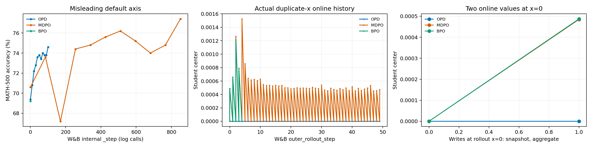

图 1 左图使用真实 `_step`，纵轴为 MATH-500 greedy 准确率；中图使用实际线上 `outer_rollout_step` 与混合来源的 student center；右图直接列出同一个 $k=0$ 的两次写入。该图用于展示日志缺陷，后续算法分析全部使用独立 JSONL 的干净首 inner 快照。

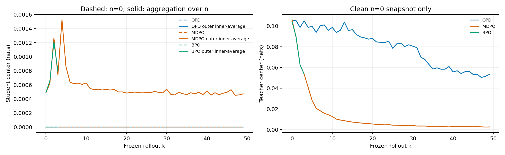

图 2 左图虚线为 $\widehat{\mathbb E}_k[\widehat{\mathcal K}_{k,0}^{S,\mathrm{TA}}]$，实线为 $N^{-1}\sum_{n=0}^{N-1}\widehat{\mathbb E}_k[\widehat{\mathcal K}_{k,n}^{S,\mathrm{TA}}]$；右图只保留 $n=0$ 的 $\widehat{\mathcal K}_k^{T,\mathrm{TA}}$。每轮首点 student center 接近 0，说明 anchor 重置正常。

修复应把来源写成不同字段，例如 `rollout_snapshot/teacher_center` 与 `inner_aggregate/student_center`，各自只绑定一种横轴。快照轴为 $k$；更新后评测轴为完成轮数 $k+1$；整轮均值需要明确记录关联的 rollout $k$，同时保留完成更新次数。应显式带上横轴并关闭隐式 `step_sync`，防止遗漏被悄悄补齐。历史字段已经混合，当前可从 JSONL 重建正确图；重命名未来字段不会自动修复旧 history。

### 日志计数、更新次数和评测次数

一轮 OPD 写 1 条 inner 和 1 条 outer，MDPO/BPO 写 16 条 inner 和 1 条 outer。初始化额外写一次，因此 $k$ 轮完成后的内部日志步大致为

$$
\mathrm{SDKStep}_{\mathrm{OPD}}(k)=1+2k,\qquad \mathrm{SDKStep}_{\mathrm{MDPO}}(k)=1+17k.
$$

两者完成 50 轮时为 101 与 851。这个计数衡量日志写入，不衡量 optimizer 更新。inner 的零基索引是 $u=kN+n$，测量策略为 $\pi_{k,n}$；每轮评测关联 $k+1$ 轮完成与 $(k+1)N$ 次更新。图中必须分清“更新前第 u 点”和“完成 u 次更新”。

当前 `inner_update=kN+n` 依赖 batch=mini-batch、每 epoch 只有一次 optimizer 更新。若减小 mini-batch，`epochs` 不再等于每 outer 更新次数，该公式会错位；后续必须改用独立递增的全局更新计数，并把 `inner_epoch_index` 与实际 mini-batch update index 分开。当前三组配置没有触发此潜在错误。

W&B 的 inner 点由 actor 写 JSONL 后在 outer 末尾成批上传。同轮 16 个点的 `_timestamp` 接近，不能差分这些时间来计算单 inner 耗时。当前单 inner 更新后耗时只能由整轮 `update_actor/N` 作摊销描述；若要逐 inner 精确计时，必须在 worker 端记录 optimizer 前后的单调时钟。

### 初始化评测和训练首批本来就不同

清除字段冲突后，三运行的训练首批和 greedy 初始化仍有差别：

| 更新前对象               | OPD        | MDPO       | BPO        |
| ------------------------ | ---------- | ---------- | ---------- |
| 首批有效回答 token $M_0$ | 386982     | 386114     | 393684     |
| teacher center mean      | 0.10575944 | 0.10598939 | 0.10429233 |
| $-\overline r_0$         | 0.11565517 | 0.11594259 | 0.11377110 |
| student center mean      | 约 0       | 约 0       | 约 0       |
| 初始化 MATH-500          | 69.4%      | 70.6%      | 69.2%      |
| 初始化 AMC23             | 52.5%      | 47.5%      | 47.5%      |
| 初始化 AIME25            | 16.67%     | 16.67%     | 16.67%     |

三个 rollout 长度与 token 统计不同，说明输入 action/prefix 集合并非逐 token 相同。相同学生权重只要求在相同 prefix 上分布相同，不要求不同 rollout 的 KL 平均数严格一致。各组 baseline 不齐发生在训练之前，不能归因于算法已经更新。

运行配置 `full_determinism=false`，异步请求按 replica 负载路由，四个 replica 的生成种子不同。训练采样受路由与随机流消费影响。greedy 消除的是随机抽样，仍受浮点计算、batch 布局和调度影响。vLLM 官方明确默认不保证运行可复现，并区分 seed、确定调度与 batch invariance[^vllm-repro]。这提供可检验的解释，但当前没有保存逐题输出或逐请求调度证据，无法把本次 greedy 差异精确归因给某一个机制。当前部署 vLLM 0.10.0，不能直接假设最新版的 batch-invariance 开关在此版本可用。

后续应先把同一初始化模型在同一部署上重复评测 3 次，保存每题回答、token IDs、结束原因和 score，测出评测噪声。训练比较同时使用各自初始化差值和绝对分数；只有一致评测器、固定请求顺序与实测复现性建立后，才适合共用一个 baseline。

## 三算法目标、梯度与代码正确性

### On-policy OPD：新 rollout 的单次 KL 更新

每轮使用新 rollout，在冻结 $d_k$ 上最小化当前学生到教师的反向 KL：

$$
L_{\mathrm{OPD}}(\theta;d_k)=\mathbb E_{s\sim d_k}\sum_a p_a(\log p_a-\log t_a).
$$

对固定 prefix 逐项求导：

$$
\begin{aligned}
\nabla L(s)&=\sum_a(\nabla p_a)(\log p_a-\log t_a)+\sum_a p_a\nabla\log p_a\\
&=\sum_a p_a\psi_a(\log p_a-\log t_a+1)\\
&=\mathbb E_p[(\log p-\log t)\psi].
\end{aligned}
$$

最后一步由 $\mathbb E_p\psi=\nabla\sum_a p_a=0$。对任意 action 无关的 prefix baseline $b(s)$，$\mathbb E_p[b\psi]=0$。生产系数为

$$
c^{\mathrm{OPD}}=-(r^{\mathrm{cur}}+b),\qquad r^{\mathrm{cur}}=\log\pi_T-\log\pi_{k,n},\qquad b=\widehat{\operatorname{KL}}_{\mathrm{TA}}(\pi_{k,n}\Vert\pi_T).
$$

正式 $N=1$，测量时 $p=q$，没有动作 off-policy 校正。Tail-aware baseline 仍是 action 无关控制变量，在固定参数完整 action 期望中不引入这项 KL 梯度偏差。有限 batch 下 baseline 会改变梯度噪声，故 OPD 和 MDPO 第一个 batch 的实际梯度范数无需完全相等。

若把 `opd_onpolicy` 直接配置成 $N>1$，后续仍用旧 action、权重仍为 1，便失去 fresh-policy 条件。当前正式配置没有这种误用。当前代码的 `opd_is` 是另一个动作 IS 分支，本组三运行未执行它。

### MDPO：动作 IS 与有限镜像约束

旧书的负镜像目标为

$$
L_{\mathrm{MDPO}}(p;q,t)=\mathbb E_{d_k,p}[U/\eta-r_k]=\frac1\eta\mathbb E_{d_k}\operatorname{KL}(p\Vert q)-\mathbb E_{d_k,p}r_k.
$$

对每个 prefix 展开：

$$
\begin{aligned}
L(s)&=\sum_a p_a\left[\frac{\log p_a-\log q_a}{\eta}-\log t_a+\log q_a\right]\\
&=\sum_a p_a(\log p_a-\log t_a)+(\eta^{-1}-1)\sum_a p_a(\log p_a-\log q_a)\\
&=\operatorname{KL}(p\Vert t)+(\eta^{-1}-1)\operatorname{KL}(p\Vert q).
\end{aligned}
$$

实际 $\eta=0.3$，第二项系数为 $7/3$。它约束本轮相对 anchor 的变化，每轮 hard sync 后 anchor 更新，不能视为相对初始模型的永久限制。

同时微分 $p$ 与 $U$，随后使用零均值 score 并换采样测度：

$$
\begin{aligned}
\nabla L(s)&=\mathbb E_p[(U/\eta-r_k+1/\eta)\psi]\\
&=\mathbb E_p[(U/\eta-r_k)\psi]\\
&=\mathbb E_q[\omega(U/\eta-r_k)\psi].
\end{aligned}
$$

生产 [losses.py](../../src/mirroropd/training/losses.py) 在 `no_grad` 中构造系数，然后返回其与当前 action log-prob 的乘积：

$$
c^{\mathrm{MDPO}}=\operatorname{sg}[\omega(U/\eta-r_k)],\qquad \ell^{\mathrm{score}}=c^{\mathrm{MDPO}}\log p(a\mid s),\qquad \nabla\ell^{\mathrm{score}}=c^{\mathrm{MDPO}}\psi.
$$

教师/学生 Tail-aware 中心不进入 MDPO 系数。独立四 action 枚举中，改变 $J$ 不改变 MDPO 梯度，和原始完整目标梯度最大误差小于 $6\times10^{-8}$。若直接对 $\omega(U/\eta-r_k)$ 反传，会多出 $\omega\psi/\eta$；该项完整期望为零，但有限 action batch 上不为零。生产删去它符合旧书的控制变量约定。

Gibbs 解由严格凸目标得到。引入归一化乘子 $\lambda$，对 $p_a>0$ 求导：

$$
\eta^{-1}(\log p_a+1)-(\eta^{-1}-1)\log q_a-\log t_a+\lambda=0.
$$

$$
\log p_a=(1-\eta)\log q_a+\eta\log t_a-1-\eta\lambda,
\qquad p_a^*=\frac{q_a^{1-\eta}t_a^\eta}{\sum_bq_b^{1-\eta}t_b^\eta}.
$$

Hessian 对角元为 $1/(\eta p_a)>0$，故最小点唯一。固定同一 prefix、每轮精确求解的理想递推为

$$
\pi_k(a)\propto\pi_0(a)^{(1-\eta)^k}\pi_T(a)^{1-(1-\eta)^k}.
$$

归纳步骤将第 $k$ 轮指数乘以 $1-\eta$，教师指数再加 $\eta$，分别得到 $(1-\eta)^{k+1}$ 和 $1-(1-\eta)^{k+1}$。$\eta=0.3$ 时十轮的初始策略指数为 0.0282475。这个推导说明多次局部小步可以形成大累计位移；真实 AdamW、共享网络、有限动作与变化 prefix 不满足精确求解假设，不能把该指数当作实测收敛率。

### BPO：完整中心的目标与生产近似的差异

旧书的 BPO 中心化最优性残差为

$$
G_k=\eta(r_k+\mathcal K_k^T),\qquad R^{\mathrm{BPO}}=U-G_k+\mathcal K^S,
\qquad L_{\mathrm{BPO}}=\frac1{2\eta}\mathbb E_{d_k,q}[(R^{\mathrm{BPO}})^2].
$$

精确中心满足 $\mathbb E_qR^{\mathrm{BPO}}=0$，并有 $\nabla\mathcal K^S=-\bar\psi$，于是

$$
\begin{aligned}
\nabla L(s)&=\frac1\eta\mathbb E_q[R^{\mathrm{BPO}}(\psi-\bar\psi)]\\
&=\frac1\eta\mathbb E_q[R^{\mathrm{BPO}}\psi]-\frac1\eta\mathbb E_q[R^{\mathrm{BPO}}]\bar\psi\\
&=\mathbb E_q\left[\left(\frac{U+\mathcal K^S}\eta-r_k-\mathcal K^T\right)\psi\right].
\end{aligned}
$$

生产使用上式的 score surrogate，实际把中心替成 $\widehat{\mathcal K}^{S,\mathrm{TA}}$ 和 $\widehat{\mathcal K}^{T,\mathrm{TA}}$。它不乘 $\omega$，因为原 BPO 损失就是按 $q$ 积分。BPO 的 ratio/ESS 用于观察学生离开 anchor 的程度，不是实际进入其梯度的 IS 权重。

Tail-aware 下界遗漏的量可以精确写出。对尾部项展开：

$$
\begin{aligned}
\sum_{a\in\mathcal T}q_a\log\frac{q_a}{p_a}
&=\sum_{a\in\mathcal T}q_a\left[\log\frac{q_{\mathcal T}}{p_{\mathcal T}}+\log\frac{q_a/q_{\mathcal T}}{p_a/p_{\mathcal T}}\right]\\
&=q_{\mathcal T}\log\frac{q_{\mathcal T}}{p_{\mathcal T}}+q_{\mathcal T}\operatorname{KL}(q(\cdot\mid\mathcal T)\Vert p(\cdot\mid\mathcal T)).
\end{aligned}
$$

因此

$$
\delta_S=\mathcal K^S-\widehat{\mathcal K}^{S,\mathrm{TA}}=q_{\mathcal T}\operatorname{KL}(q(\cdot\mid\mathcal T)\Vert p(\cdot\mid\mathcal T))\ge0,
$$

同理定义 $\delta_T\ge0$。生产系数与完整中心系数相差 action 无关常数 $-\delta_S/\eta+\delta_T$，但其期望 score 是 $\mathbb E_q\psi$，不是 $\mathbb E_p\psi$：

$$
g_{\mathrm{TA}}-g_{\mathrm{full}}=\mathbb E_{s\sim d_k}\left[\left(-\frac{\delta_S(s)}\eta+\delta_T(s)\right)\bar\psi(s)\right].
$$

在 $p=q$ 时 $\bar\psi=0$，该总体偏差消失；离开 anchor 后一般不为零。对独立 categorical logits，$\psi(a)=e_a-p$，故 $\bar\psi=q-p$。高 head mass 也不能独自给出小偏差保证，因为尾部条件 KL 没有上界。$\eta=0.3$ 还把 student 缺失中心放大 $10/3$ 倍。

独立四 action 枚举采用 $q=(0.4,0.3,0.2,0.1)$、$t=(0.05,0.15,0.3,0.5)$、student logits $=(-0.3,0.2,0.7,-0.1)$、$\eta=0.3$。$J=2$ 时生产与完整 BPO 梯度最大绝对差为 0.012649，约为完整梯度最大分量 0.46538 的 2.7%；解析偏差公式吻合至 $9.22\times10^{-8}$。$J=4$ 覆盖完整词表时误差降至约 $1.49\times10^{-7}$。结果见 [BPO 中心梯度枚举](../../results/training/math-4gpu/audit-20261012/bpo-coarse-center-gradient.json)。这是目标差异的反例，不能当作本次真实模型的 2.7% 梯度误差估计。

BPO 应被描述为“使用 Tail-aware 中心的生产 BPO”，不能描述为全词表理论的精确实现。后续优先在固定 prefix 子集上测量完整 $\delta_S,\delta_T$ 和对应梯度偏差，再比较 full center、较大 $J$、额外 action 样本尾部修正。只增加 $J$ 不保证梯度偏差单调下降，因为两项误差的抵消也会变化。

### 三者共同实现检查

| 检查项         | 实际证据与判断                                                                                                     |
| -------------- | ------------------------------------------------------------------------------------------------------------------ |
| 冻结缓存       | anchor 与 teacher 在每个 outer 开始构建；同 outer 所有 inner 复用，MDPO/BPO teacher center 与 frozen reward 不变化 |
| hard sync      | 每轮首 inner 的 $U$ RMS 与 student center RMS 约 $10^{-7}$，符合 $\pi_{k,0}=\pi_k$；实际 rollout 权重版本递增      |
| 更新次数       | OPD 各轮 `(k,0)` 唯一；MDPO 各轮 `(k,0\ldots15)` 完整，共 800 次；无重复 rank 写入                                 |
| action 位置    | 从 action 前驱位置取 logits，保留实际 EOS 和预算结束的最后 action，排除 prompt/padding                             |
| 词表支持       | HF 归一化前裁剪到 rollout tokenizer 支持，避免历史 padded-vocab 差异；当前三正式 run 使用修复后的路径              |
| 梯度归约       | mini-batch 使用全 DP 有效 response token 数归一化；不是各 micro-batch mean 等权相加                                |
| 梯度裁剪       | 日志是裁剪前范数；当前阈值 2，正式 OPD/MDPO 及 BPO 前四轮均未触发                                                  |
| PPO / verifier | Mirror 分支先返回 score surrogate；配置残留的 PPO advantage/return 和任务 score 不代表参与梯度                     |
| 优化器         | 普通 AdamW；旧书 categorical Fisher 自然梯度的一步到 Gibbs target 定理不适用于这次运行                             |

`score_coefficient` 与 `token_advantage` 在当前实现保存同一个下降梯度系数。正系数乘 $\log p$ 后做梯度下降，并不等于常见策略梯度上升里的正 advantage。`actor/distillation/loss` 是 $\overline{c\log p}$，其正负与下降不能解释成 KL 或 MDPO 原目标的下降。

这些检查排除了已检查路径的确定性接线错误；BPO 中心近似、有限样本复用与推理后端数值差异仍应按各自定义评估。前十轮旧审计的“没有算法 bug”只覆盖其列出的 MDPO 路径，不能扩展成所有三算法、所有同名日志都准确。

## Off-policy 的 IS 与 ESS 变化

### 定义、推导和解释限制

重要性采样（Importance Sampling，IS）在固定 prefix 上把动作积分从 $q$ 换成 $p$：

$$
\mathbb E_{a\sim q}[\omega(s,a)h(s,a)]=\sum_a q_a\frac{p_a}{q_a}h_a=\sum_a p_ah_a=\mathbb E_{a\sim p}[h(s,a)].
$$

它保持 $d_k$ 不变，不校正新学生的完整轨迹访问分布。要转成当前完整轨迹期望，还会涉及此前 action ratio 的乘积。当前算法明确优化固定测度子问题，因此不能拿单 token ratio 冒充整条回答的 IS 权重。

有效样本量（Effective Sample Size，ESS）由本次所有有效 token 的权重计算：

$$
\mathrm{ESS}_{k,n}=\frac{(\sum_{j=1}^{M_k}\omega_j)^2}{\sum_{j=1}^{M_k}\omega_j^2},\qquad f_{k,n}=\frac{\mathrm{ESS}_{k,n}}{M_k}=\frac{\overline\omega^2}{\overline{\omega^2}}.
$$

由经验方差恒等式得到

$$
\mathrm{CV}_{k,n}^2=\frac{\overline{\omega^2}-\overline\omega^2}{\overline\omega^2},\qquad f_{k,n}=\frac1{1+\mathrm{CV}_{k,n}^2}.
$$

绘图程序对每条记录验证该恒等式，绝对误差容限 $10^{-12}$。在固定参数、独立足量采样且 $\mathbb E_q\omega=1$ 的总体极限中，

$$
\mathbb E_q\omega^2=\sum_a\frac{p_a^2}{q_a}=1+\chi^2(p\Vert q),\qquad f\longrightarrow\frac1{1+\mathbb E_{d_k}\chi^2(p\Vert q)}.
$$

实际同一回答内 token 相关，当前参数还依赖复用的训练 batch，日志 ESS 是权重集中度描述，不能直接作为独立样本数或统计显著性检验的样本量。加权梯度方差还取决于 $(U/\eta-r_k)\psi$，高 ESS 不等于梯度低方差，更不等于答案性能改善。

### 全程与轮内观察

| 有效 inner 范围               | OPD 50 更新         | MDPO 800 更新        | BPO 前四轮 64 更新   |
| ----------------------------- | ------------------- | -------------------- | -------------------- |
| ESS fraction 最小             | 约 1                | 0.99231506           | 0.99394506           |
| ESS fraction 均值             | 约 1                | 0.99877066           | 0.99798633           |
| ratio mean 范围               | 约 1                | 0.999038–1.000545    | 约 1.000000–1.000563 |
| ratio 最小                    | 0.99999803          | $9.52\times10^{-14}$ | 0.00632299           |
| ratio 最大                    | 1.00000191          | 11.0976              | 29.3752              |
| $U$ RMS 最大                  | $1.22\times10^{-7}$ | 0.0977877            | 0.0797359            |
| $n=N-1$ ESS fraction 跨轮均值 | 约 1                | 0.99815360           | 0.99542964           |
| $n=N-1$ ratio std 跨轮均值    | 约 0                | 0.0415601            | 0.0657302            |

MDPO 最差 ESS 对应经验 CV 为 $\sqrt{1/0.99231506-1}=0.0880$。总体权重集中度良好，但其最小 ratio 非常小，说明某些旧 action 的当前概率已显著降低；BPO 少数 action ratio 达到 29.38，也没有让全 token ESS 崩溃。几万个或几十万个低漂移 token 能在总体平均中覆盖少数尾部动作，需同时看极值、分组和系数。

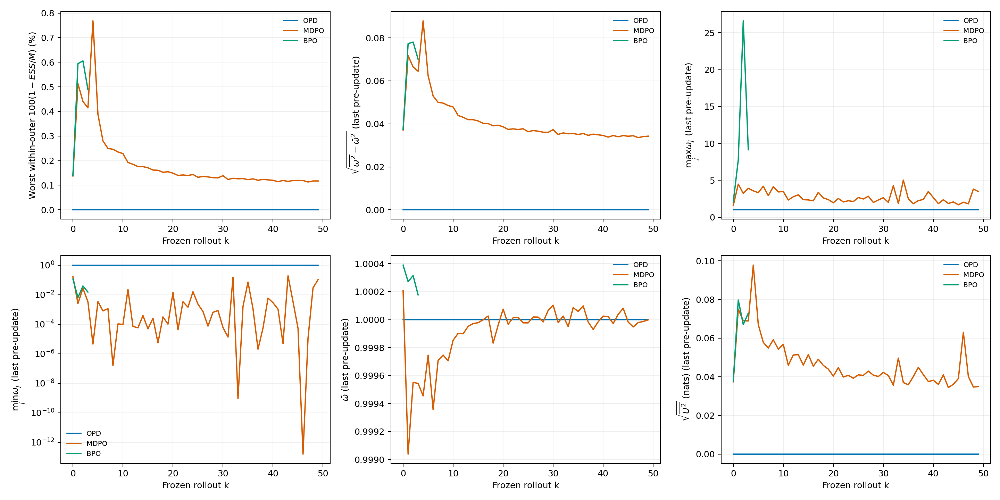

图 3 左上纵轴为 $100(1-\min_n f_{k,n})$，使用缺失比例放大差异；其余为末次 pre-update 的 $\operatorname{std}(\omega)$、$\max\omega$、$\min\omega$、$\overline\omega$、$\sqrt{\overline{U^2}}$。横轴始终为生成冻结 batch 的 $k$。原图把 ESS 放在 0–1.02 的纵轴范围，0.992 与 1 的区别几乎看不见，容易误判“完全没有 off-policy 漂移”。

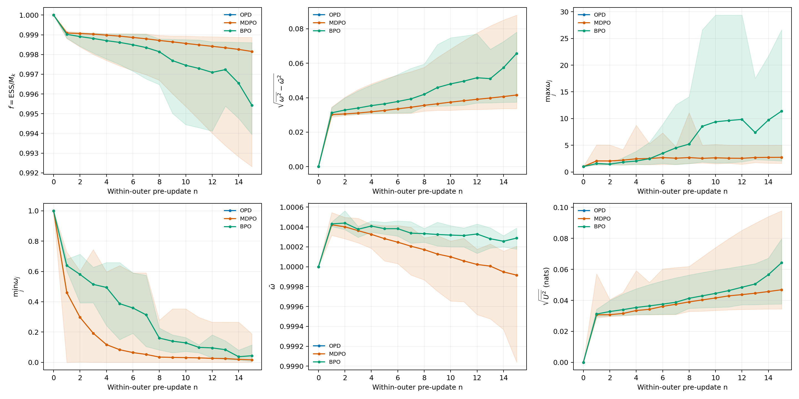

图 4 每个 $n$ 的实线为跨完整 outer 的算术均值，阴影为这些 outer 的最小至最大值；它不是置信区间。每轮 $n=0$ ratio 约 1、ESS 约 1，随后通常出现偏离。MDPO 的 $n=15$ 平均 ESS 为 0.998154，BPO 前四轮为 0.995430；两个样本窗口不同，应结合下图逐轮判断，不能据此宣称 BPO 全程比 MDPO 更差。

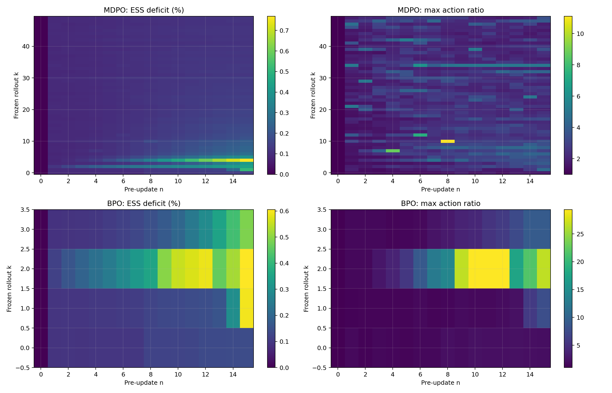

图 5 横轴 $n$、纵轴 $k$，左侧颜色为 $100(1-f_{k,n})$，右侧为 $\max_j\omega_j$。BPO 只显示四行，明确体现证据范围。热图保留了同步后回到 ESS=1 的重复结构，支持“每轮局部漂移后重置 anchor”，而非“全程一直在初始化附近”。

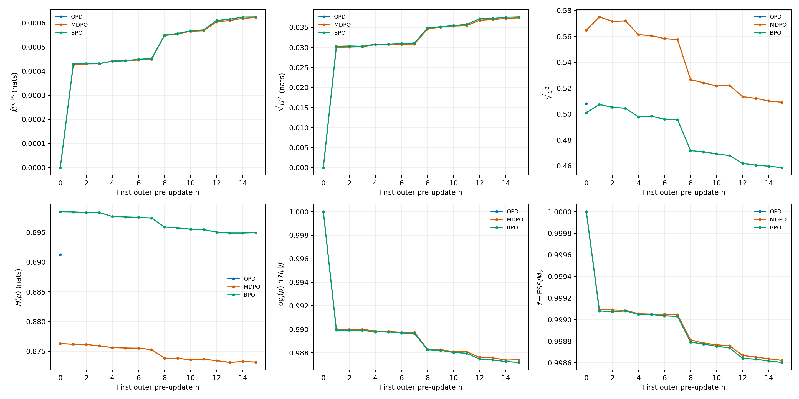

图 6 六项分别为 $\overline{\widehat{\mathcal K}^{S,\mathrm{TA}}}$、$\sqrt{\overline{U^2}}$、$\sqrt{\overline{c^2}}$、$\overline{H(p)}$、当前 Top-$J$ 与 anchor Top-$J$ 的集合交集比例、ESS fraction。第一轮开始 student center 与 $U$ 为 0，随后变化；MDPO/BPO 从同样未更新状态出发的事实在该图中直接可见。

当前日志没有第 16 次更新后的 frozen-prefix ESS。把 $n=15$ 叫“outer 最终 ESS”会少算一次更新；下一轮 $n=0$ 已换 anchor 和 batch，也不能补上这个测量。后续应添加一次不反传的 post-inner snapshot，并按回答、任务、head/tail、EOS 和长度组报告 ratio 与 ESS。原始 moment 日志没有分位数，不能从均值和方差推造 p95/p99 或 action 直方图。

## 三算法指标轨迹与学习速度

### 教师对齐与访问测度变化

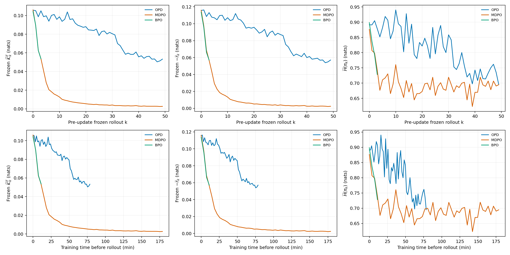

图 7 三列分别为 $\overline{\widehat{\mathcal K}_k^{T,\mathrm{TA}}}$、$-\overline r_k$、$\overline{H(\pi_k)}$，熵为 $H(p)=-\sum_a p_a\log p_a$。第一行按 $k$，第二行按该 rollout 前累计训练分钟。所有点只取 $n=0$，避免把 16 次重复的冻结教师诊断当作 16 份新证据。$-\overline r_k$ 是实际动作的 full-vocab reverse-KL 单动作估计，Tail-aware center 是每个 prefix 的聚合 KL 下界；两者数值与方差不同。

| 指标窗口                   | OPD 前十轮  | OPD 后十轮  | MDPO 前十轮 | MDPO 后十轮 |
| -------------------------- | ----------- | ----------- | ----------- | ----------- |
| teacher center mean        | 0.10042642  | 0.05407696  | 0.04497818  | 0.00279389  |
| frozen sampled reward mean | -0.10968796 | -0.05771235 | -0.04851898 | -0.00250254 |
| 首 inner entropy mean      | 0.88405960  | 0.73020658  | 0.74220075  | 0.69201222  |
| verifier score mean        | 0.34531250  | 0.46875000  | 0.45312500  | 0.57031250  |
| train clip ratio mean      | 62.34375%   | 49.06250%   | 50.46875%   | 39.37500%   |

MDPO 第 49 轮首 inner teacher center 为 0.00264562，OPD 为 0.05330457。从共同量级的首批约 0.106 出发，MDPO 的访问前缀教师诊断降得更快、更低。BPO 前四轮从 0.104292 降到 0.053632，说明早期也在对齐教师；完整后段和评测仍缺失。

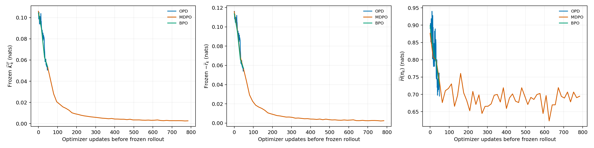

图 8 使用相同纵轴定义，横轴为 rollout 前累计更新 $kN$。OPD 覆盖 0–49 更新前点，MDPO 覆盖 0–784，两个方法在相同少量更新区间的有效测量密度不同。MDPO 每轮内没有对更新后的当前学生重新测量 $\operatorname{KL}(p\Vert t)$；冻结 teacher center 的平坦 inner 曲线不能作为更新后教师 KL 不变的证据。

本次曲线支持新 rollout 利用率和访问前缀上的对齐效率判断，不能推出固定 prefix 的完整 KL 降低同样比例。每轮访问前缀、长度、难度与熵均变化，低熵容易 prefix 的权重变化也会改变均值。应增加固定 probe prefix 集，以共同支持计算完整 KL、Tail-aware gap 和当前学生到教师的 KL，区别模型变化与训练访问测度变化。

### 梯度、系数与支持集变化

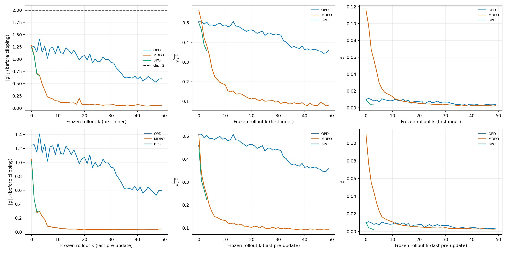

图 9 三列为裁剪前梯度范数 $\lVert g_{k,n}\rVert_2$、系数 RMS $\sqrt{\overline{c^2}}$、系数均值 $\overline c$。第一行取 $n=0$，第二行取 $n=N-1$。系数均值与 RMS 不等于参数梯度范数，梯度还乘 score 并跨 token 聚合。

OPD 梯度范数范围 0.5254–1.4085；MDPO 为 0.03116–1.27513；BPO 前四轮为 0.2876–1.2360，全部低于 clip=2。当前质量回落无法归因于持续梯度裁剪。MDPO 对齐教师后 reward 量级减小，系数和梯度也减小；AdamW 的自适应预条件使梯度范数不能直接换算成参数更新长度，需额外记录 $\lVert\Delta\theta\rVert$ 与相对参数范数。

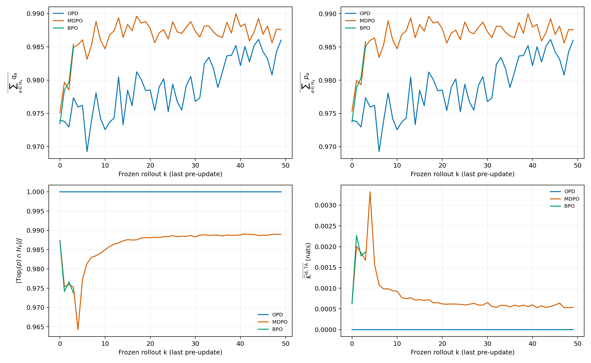

图 10 的 head mass 为 $\sum_{a\in\mathcal H_k}q_a$ 或 $\sum_{a\in\mathcal H_k}p_a$，support overlap 为 $\lvert\operatorname{Top}_J(p)\cap\mathcal H_k\rvert/J$，student center 为 $\overline{\widehat{\mathcal K}_{k,N-1}^{S,\mathrm{TA}}}$。这些量支持跟踪支持集漂移；head mass 约 0.97–0.99 不等于覆盖了全部 KL 或梯度信号，尾部条件差异由前述 $\delta$ 表达。

### 数学性能：三种预算横轴

评测准确率定义为

$$
A_b(k)=\frac1{m_b}\sum_{i=1}^{m_b}\mathbf1\{\mathrm{verifier}(\hat y_i^{(k)},y_i^*)=1\},\qquad m_b\in\{500,40,30\}.
$$

“相对初始化改善”是 $100[A_b(k)-A_b(0)]$ 个百分点。每题一次 greedy；日志只有聚合正确数，缺少同题正确/错误配对轨迹。

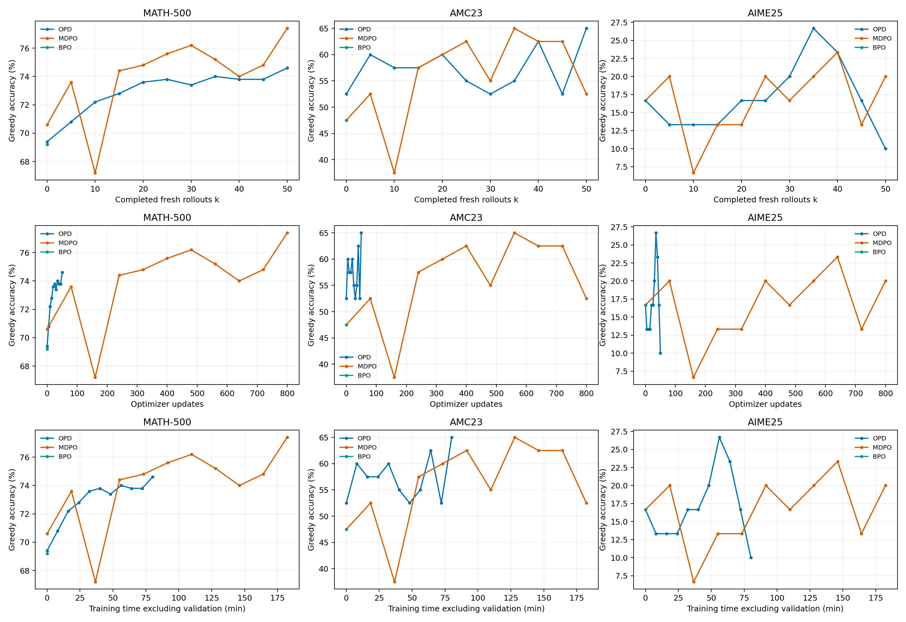

图 11 每列为一个测试集；第一行横轴为完成新 rollout 轮数，第二行为完成 optimizer 更新数 $kN$，第三行为累计训练分钟。BPO 只有初始化点，避免连出尚不存在的学习曲线。图中折线只连接实测检查点；没有在缺失点创建评测结果。

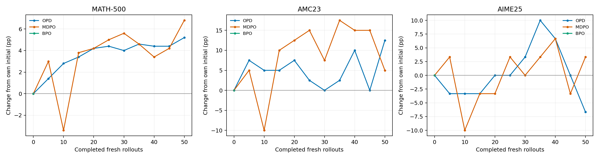

| 完成 outer | OPD MATH | MDPO MATH | OPD AMC | MDPO AMC | OPD AIME | MDPO AIME |
| ---------- | -------- | --------- | ------- | -------- | -------- | --------- |
| 0          | 69.4%    | 70.6%     | 52.5%   | 47.5%    | 16.67%   | 16.67%    |
| 5          | 70.8%    | 73.6%     | 60%     | 52.5%    | 13.33%   | 20%       |
| 10         | 72.2%    | 67.2%     | 57.5%   | 37.5%    | 13.33%   | 6.67%     |
| 15         | 72.8%    | 74.4%     | 57.5%   | 57.5%    | 13.33%   | 13.33%    |
| 20         | 73.6%    | 74.8%     | 60%     | 60%      | 16.67%   | 13.33%    |
| 25         | 73.8%    | 75.6%     | 55%     | 62.5%    | 16.67%   | 20%       |
| 30         | 73.4%    | 76.2%     | 52.5%   | 55%      | 20%      | 16.67%    |
| 35         | 74%      | 75.2%     | 55%     | 65%      | 26.67%   | 20%       |
| 40         | 73.8%    | 74%       | 62.5%   | 62.5%    | 23.33%   | 23.33%    |
| 45         | 73.8%    | 74.8%     | 52.5%   | 62.5%    | 16.67%   | 13.33%    |
| 50         | 74.6%    | 77.4%     | 65%     | 52.5%    | 10%      | 20%       |

| 最终效果              | OPD                   | MDPO                  | MDPO 减 OPD           |
| --------------------- | --------------------- | --------------------- | --------------------- |
| MATH 最终正确数 / 500 | 373                   | 387                   | +14 题，+2.8 个百分点 |
| MATH 相对自身初始     | +26 题，+5.2 个百分点 | +34 题，+6.8 个百分点 | 改善多 1.6 个百分点   |
| AMC 最终正确数 / 40   | 26                    | 21                    | -5 题，-12.5 个百分点 |
| AMC 相对自身初始      | +5 题，+12.5 个百分点 | +2 题，+5 个百分点    | 改善少 7.5 个百分点   |
| AIME 最终正确数 / 30  | 3                     | 6                     | +3 题，+10 个百分点   |
| AIME 相对自身初始     | -2 题，-6.67 个百分点 | +1 题，+3.33 个百分点 | 改善多 10 个百分点    |

对于“更快”，可以作四个有边界的判断：

1. 按新 rollout 数：MDPO 的教师诊断下降更快，MATH 多数中后期检查点更高；outer10 的明显回落说明数学性能不是单调优势。
2. 按优化次数：现有评测节点缺少相同更新预算的正式对照。MDPO 首次训练后评测已经完成 80 次更新，超过 OPD 全程 50 次；据此不能建立等 optimizer 次数的优势。
3. 按训练时间：MDPO 首个 outer5 检查点在 18.47 分钟得到 MATH 73.6%；OPD 在 32.13 分钟的 outer20 首次实测到 73.6%。但 MDPO 在 36.64 分钟掉到 67.2%，到 55.01 分钟恢复为 74.4%；OPD 同时间附近 outer35 为 74%。MDPO 有更早达到门槛的观测，也有严重中途回落，持续稳定优势未建立。
4. 按最终性能：MDPO MATH/AIME 更高，AMC 更低；不同任务必须分别报告。单 seed、初始化差异、小测试集与题目重叠限制算法优劣的推广。

OPD 完整训练时间预算约 80.13 分钟。MDPO 在这个预算内最后一个实测点是 outer20 的 73.2 分钟，MATH 74.8%、AMC 60%、AIME 13.33%；下一个 outer25 已到 91.5 分钟。与 OPD 最终 74.6%、65%、10% 对照，MATH 的 0.2 个百分点差仅为 1 题，AMC 更低，AIME 多 1 题。这个预算内已观测点比较不能替代 80.13 分钟精确 checkpoint，但足以说明“MDPO 最终多 2.8 个百分点”没有建立相同训练时间的同等优势。

同一算法的最佳检查点也不能与另一算法预定终点比较。OPD AIME 最佳为 outer35 的 8/30，MDPO 最佳为 outer40 的 7/30；最终分别为 3/30 和 6/30。报告保留轨迹，正式终点按事先 50 轮规则。AMC 每题 2.5 个百分点，AIME 每题 3.33 个百分点，少数题目就会产生大幅摆动。没有逐题结果无法做 McNemar 配对检验，没有多 seed 无法估计训练随机性的区间。

### 长度、预算与性能回落

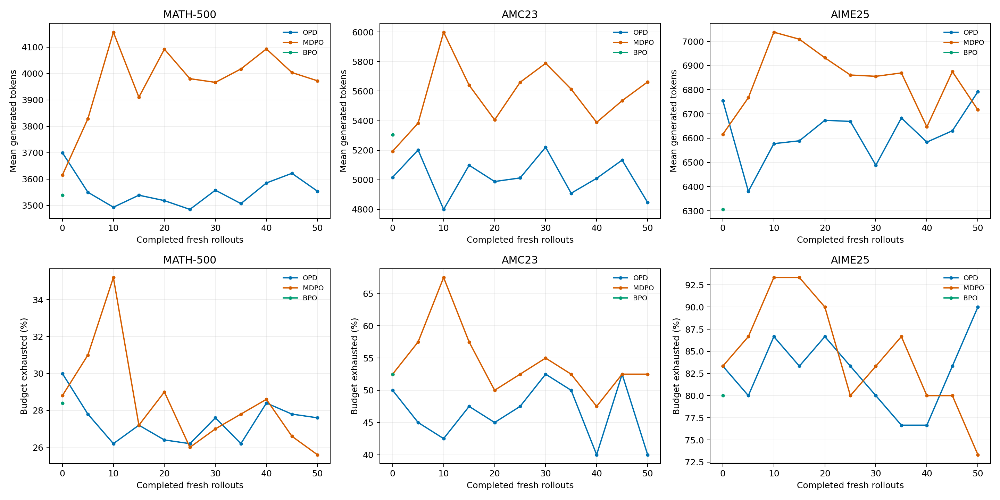

图 13 上行是 $m_b^{-1}\sum_i H_i$，下行是 $100m_b^{-1}\sum_i\mathbf1\{\text{budget exhausted}\}$。预算结束与错误不是同一事件；题目可在最后 token 前给出正确答案，也可自然 EOS 后答错。当前只保存聚合值，无法分解这些交叉类别。

MDPO outer10 的 MATH/AMC/AIME 预算耗尽率分别为 35.2%/67.5%/93.33%，同时准确率为 67.2%/37.5%/6.67%。后续恢复证明这不是整个 run 的终态。现有趋势不能把质量回落全部归因于截断；也缺少教师在相同模板与预算下的逐题评测，不能断言教师的长思考就是回落原因。

最终 OPD 的 AIME 27/30、MDPO 22/30 条回答耗尽预算，平均长度分别 6792.1 与 6716.9 token。两个方法在困难长推理数据上的预算压力仍很大。当前目标只对齐条件 token 分布，没有最终答案 reward 或限时完成目标；对齐 KL 与固定预算答案准确率不必同向。

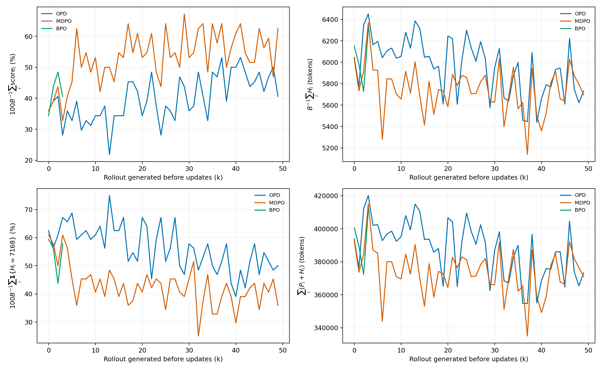

图 14 verifier score 是 $B^{-1}\sum_i\mathrm{score}_i$，训练平均长度是 $B^{-1}\sum_i H_i$，clip ratio 为训练日志的长度上限命中比例，`perf/total_num_tokens` 包含本批 prompt 与 response token。训练 verifier 在本轮更新前的 rollout 上产生，虽在 outer 更新后的日志中写出，语义仍属于 $\pi_k$。它只用于观察；`critic/rewards`、advantages、returns 的存在不意味着任务奖励进入 Mirror 梯度。

## 耗时、吞吐、GPU 与主机内存

### 阶段耗时与计算复用

累计训练时间定义为

$$
T_{\mathrm{train}}(k)=\sum_{j=1}^{k}\mathrm{timing\_s/step}_j.
$$

该字段包围训练轮，周期评测另由 `timing_s/testing` 记录。图 11 的时间轴排除初始化、周期评测、框架启动与退出；它衡量训练效率。端到端时间另用 GPU 监控覆盖区间，保持训练时间与端到端时间各自明确。

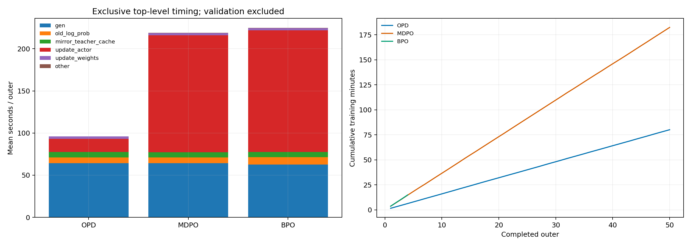

图 15 柱图只相加 `gen`、`old_log_prob`、`mirror_teacher_cache`、`update_actor`、`update_weights`，其余取 `step` 减去这些顶层项。`agent_loop/generate_sequences` 是 `gen` 内部的请求统计，不能再次相加。数学评分主要在 agent loop 内，顶层 `reward` 很小不意味着 verifier 总成本为零。

| 每 outer 平均秒数             | OPD，50 轮 | MDPO，50 轮 | BPO，前四轮            |
| ----------------------------- | ---------- | ----------- | ---------------------- |
| 生成 `gen`                    | 64.110     | 64.220      | 62.700                 |
| anchor forward `old_log_prob` | 6.933      | 6.831       | 8.595                  |
| teacher cache                 | 6.531      | 6.327       | 6.195                  |
| actor 更新                    | 15.617     | 138.527     | 144.341                |
| 同步 rollout 权重             | 2.750      | 2.679       | 2.759                  |
| 其他顶层开销                  | 0.212      | 0.239       | 0.236                  |
| 训练合计                      | 96.154     | 218.823     | 224.826                |
| 每优化更新摊销训练秒数        | 96.154     | 13.676      | 14.052                 |
| 每优化更新摊销 actor 秒数     | 15.617     | 8.658       | 9.021                  |
| 周期评测每次 570 题           | 201.926    | 215.620     | 快照尚无训练后完整评测 |

OPD 的生成阶段占训练轮约 66.7%，actor 占 16.2%；MDPO 生成占 29.3%，actor 占 63.3%。复用 16 次没有重复生成和教师打分，整轮时间只增加 2.276 倍，而更新数增加 16 倍。每次更新摊销训练成本因此降低约 7.03 倍。这个资源优势明确存在，但重复动作/前缀没有增加同等数量的新训练样本，不能把摊销更新成本直接当作统计效率或数学性能优势。

OPD 50 轮训练 4807.68 秒，10 次周期评测 2019.26 秒；MDPO 训练 10941.14 秒，10 次周期评测 2156.20 秒。周期测试占“训练加周期评测”的约 29.6% 与 16.5%。GPU 监控总覆盖分别约 7276.83 秒与 13541.27 秒，即 2.02 与 3.76 小时；其余包括初始化评测和框架启动等。初始化评测本身没有独立 `testing` 时长，不能把总差额全部标为初始化评测耗时。

现有 `perf/throughput` 定义为

$$
\mathrm{throughput}_{\mathrm{log}}=\frac{\mathrm{prompt\ tokens}+\mathrm{response\ tokens}}{4\,\mathrm{timing\_s/step}}.
$$

它按一轮 token 计一次，且除以 GPU 数，MDPO 的 16 次复用没有乘 16。因此不能用此字段得出“MDPO 训练计算吞吐更低”。建议分开记录生成 token/s、actor 处理 response token/s、更新/s、新 trajectory/s 和端到端 task accuracy/GPU-hour。处理 token 数也应区分新 token 与重复读取 token。

模型 FLOPs 利用率（Model FLOPs Utilization，MFU）是另一套结构代理统计。设单个训练 batch 的 prompt 加 response 长度为 $\ell_i$，总 token 数为 $M_{\mathrm{all}}=\sum_i\ell_i$，模型层数为 $L_{\mathrm{model}}$，attention head 数为 $h$，head 维度为 $d_h$，源码估计的 dense 参数量为 $P_{\mathrm{dense}}$，则

$$
F_{\mathrm{proxy}}=6P_{\mathrm{dense}}M_{\mathrm{all}}+6L_{\mathrm{model}}hd_h\sum_i\ell_i^2,\qquad \mathrm{MFU}_{\mathrm{train}}=\frac{F_{\mathrm{proxy}}}{\Delta t\times4\times989\times10^{12}}.
$$

989 TFLOP/s 是该部署源码对 H800 的设备表值，$\Delta t$ 是对应 train batch 的耗时；前向分支再除以 3。outer actor MFU 算术均值为 OPD 0.14743、MDPO 0.15452、BPO 前四轮 0.15782。MDPO 聚合各 inner 的 MFU，因而复用语义与只计一次新批次 token 的 `perf/throughput` 不同。MFU 不包含实际 kernel 算术逐项测量，也不是 NVML 利用率；不能把 15% MFU 和 55% GPU utilization 当作同一尺度。来源与公式细节在资源审计中列出。

### 显存、利用率与监控对象

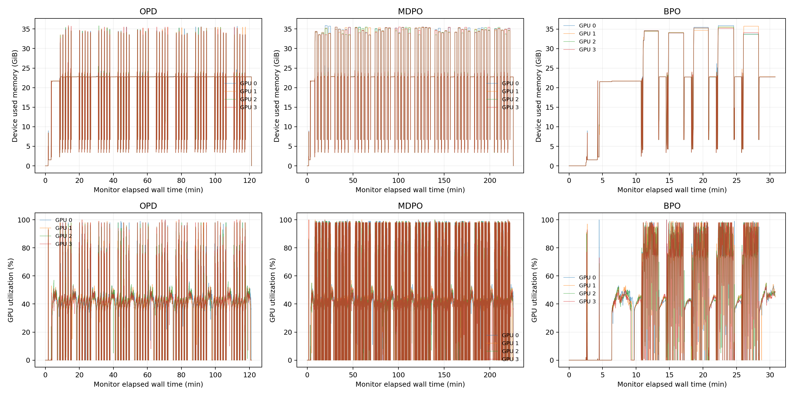

图 16 上行是每张物理 GPU 的设备已用内存，单位 GiB；下行是 nvidia-smi 的 GPU utilization，单位 %。横轴从每个 run 监控启动时刻计分钟，包含初始化与评测。W&B system stream 还监测 GPU 4–7，这些卡不是本 run 的四卡训练资源，不能将其使用量归入本实验。图使用启动器独立 `gpu.csv` 的 0–3 记录。

| 资源指标                          | OPD                   | MDPO                  | BPO 快照              |
| --------------------------------- | --------------------- | --------------------- | --------------------- |
| 独立设备采样显存峰值              | 36745 MiB，35.884 GiB | 36745 MiB，35.884 GiB | 36765 MiB，35.903 GiB |
| 四卡采样利用率均值                | 38.17%                | 55.55%                | 44.64%，短窗口        |
| actor 日志 peak reserved 最高记录 | 约 33.30 GiB          | 约 33.49 GiB          | 约 33.51 GiB，前四轮  |
| OOM                               | 完整运行无 OOM        | 完整运行无 OOM        | 快照期间无 OOM        |

nvidia-smi 峰值包含设备上所有进程和 CUDA 上下文；actor 的 PyTorch allocated/reserved 只覆盖对应 allocator，含 max 的字段取返回列表最大值，但取样早于随后 offload 阶段，且 peak 没有每轮重置。两种数值不同正常，不能相加，也不能把 actor reserved 当成全设备峰值。显存设备容量约 80 GiB，当前设备峰值约占 45%，说明有容量余地；直接加 micro-batch、KV 配额或关闭 checkpointing 的实际安全边界仍须长序列 canary 验证。

增加 $N$ 后显存峰值基本相同，因为内层逐次执行、没有为 16 次更新同时保留 16 套计算图。利用率提高与更长 actor 工作阶段一致。四卡平均功耗约为 OPD 每卡 210 W、MDPO 每卡 316 W，但功耗包含评测和启动阶段；比较能效需要积分 $E=\sum_g\int P_g(t)\,dt$ 并明确同一性能门槛，不能只比较平均功率。

### 主机 RAM 与 pinned memory 字段

`actor/perf/cpu_memory_used_gb` 来自整机 virtual memory 的 used 值，本次约 282–285 GiB。它不是 actor 进程 RSS，也不是 optimizer 独占内存。应与每进程 RSS（resident set size）、PSS（proportional set size）、USS（unique set size）分开报告。

现有 host memory 日志中，MDPO 的 pinned `allocated_bytes.current` 可累计到约 624 GiB，而相应 `reserved_bytes.current` 约为 7.875 GiB，进程 RSS 峰值约 10.75 GiB。当前计数器出现 `current allocated > current reserved` 的语义矛盾，不能将 624 GiB 当作真实常驻 pinned 内存或已证实内存泄漏。原始字段保留，结论应基于进程 RSS/PSS、系统可用内存与真实 pin 分配追踪共同核对。详细资源字段来源及数值见 [资源审计](../../results/training/math-4gpu/audit-20261012/2026-10-12-运行资源核验.md)。

## 后续超参数与验证方案

### 先建立可比较的测量协议

下一组实验应先验证两个命题：在共同评测器下，MDPO 是否以更少 GPU 时间达到并持续保持数学性能门槛；BPO 中心近似是否足以改变更新方向和最终效果。若固定 prefix 全 KL 不改善而训练 KL 继续下降，说明访问测度变化影响了现有解释。若 MDPO 的等时优势在多 seed 中消失，说明当前单次轨迹不足以支持方法优势。

应先完成以下测量改进：

1. 拆分 rollout snapshot、inner aggregate、post-inner 与 evaluation 字段，每次显式记录关联 $k,n$、完成更新数和时间；用不重复的字段避免 W&B 自动补轴造成同 x 混合对象。
2. 增加每轮最后更新后的 frozen-prefix 诊断，记录当前 teacher KL、ratio/ESS、实际参数更新范数、EOS 和 head/tail 分组；保存逐 inner 本地计时。
3. 固定一组覆盖短/长、自然结束/预算耗尽、低/高熵、常见/尾部 action 的 probe prefix，至少数千有效 token；在可承受子集上完整词表计算 KL 和 BPO center gap。
4. 保存所有 benchmark 逐题输出、答案抽取、结束原因、token IDs、任务 score；重复初始化评测 3 次，确认实际后端版本支持的确定性措施。
5. 独立评测 teacher，在相同模板、7168 预算下建立上限/方向参考；对同一批 checkpoint 增加 14336 预算评测，形成准确率—token—时间曲线。

固定 probe 应冻结数据，不随训练变化；训练 rollout 则继续按各方法生成。相同新 rollout 次数、相同更新次数、相同训练时间和相同新 response token 预算应分别报告。后两种预算没有保证在同一 outer 点相交，需要预设保存 checkpoint 的时间/更新节点，而非在缺失曲线上插值后宣称实测结果。

### 优先调整 inner 次数和镜像系数

当前 $N=16$ 的 ESS 良好，未给出必须减少复用的权重退化证据；数学曲线中途回落、训练 token 覆盖少与最终小测试集波动，说明仍需比较更低复用与更多新 prefix 的收益。第一轮扫描建议保留 $\alpha=10^{-6}$、$\eta=0.3$，比较 $N\in\{1,4,8,16\}$，以相同训练 GPU 时间评测，而不是全部固定 50 outer。

$\eta$ 控制镜像目标的 teacher 插值，$\alpha$ 控制 AdamW 参数更新，$N$ 控制每轮冻结 batch 的优化预算，三个参数应分别消融。降低 $\eta$ 会增大 $U/\eta$ 的锚点约束，降低 $N$ 会更早刷新 prefix，降低 $\alpha$ 会缩小单次参数步；三者不是同一个操作。当前 gradient clip 未触发，调大 clip 没有解决已观察问题的依据。

| 后续组     | 控制与候选                                                    | 主要判据                                                           |
| ---------- | ------------------------------------------------------------- | ------------------------------------------------------------------ |
| 复用预算   | MDPO，$N=1,4,8,16$，固定其余参数                              | 等时 MATH/AIME、达到门槛并维持的时间、新 prefix 数、post-inner ESS |
| 镜像约束   | 较优 $N$ 下 $\eta=0.1,0.3,0.6$                                | teacher full KL、对 anchor 位移、数学/预算回落；不以 ESS 单项决定  |
| 参数步长   | 固定 $N,\eta$，$\alpha=3\times10^{-7},10^{-6},3\times10^{-6}$ | 实际更新范数、梯度/系数、稳定性能及 GPU 时间                       |
| BPO 中心   | $J=16,64,256$；full-center probe 与尾部样本修正               | $\delta_S,\delta_T$、gradient gap、同预算性能及中心计算成本        |
| 新数据覆盖 | 改变 batch 或等时 outer 数，保持 optimizer 预算记录           | 新 token/prefix 覆盖和尾部任务改善，避免只重复原 3200 trajectories |
| 长推理预算 | 同 checkpoint，7168 / 14336 response token                    | 同题正确变化、答案位置、结束原因、时间与显存                       |

MDPO 的 $J$ 不影响 action 更新，只影响中心诊断与缓存/计算。对 MDPO 扫描 $J$ 不能作为更好镜像超参数的证据；BPO 的 $J$ 影响生产梯度，才是算法近似消融。OPD baseline 的 $J$ 影响有限样本噪声与开销，也应与 MDPO 区分。

### 工程提速与显存候选

OPD 当前瓶颈是长回答生成；MDPO 当前瓶颈是 actor 更新。整批 570 题验证已使四 replica 有足量待处理请求，但训练每轮 64 条、每 replica 约 16 条，`max_num_seqs=32` 不是训练实际同时活跃数量的保证。增加该上限前应检查实际队列、KV 占用与 decode 吞吐，不能仅依据标称并发提升。

actor micro-batch=1、动态 batching 关闭、checkpointing 和参数/optimizer offload 均启用，优先做长序列 micro-batch=2 的 canary，再考虑 4。它减少小 micro-batch 的框架/通信开销，但 token 归一化与实际 optimizer 次数必须不变；需要验证 7168-token 极端样本、全局 mask 和负载平衡，确保吞吐改善真实且无 OOM。

显存有约 44 GiB 余量，可依次测试 actor 参数保留 GPU、optimizer 保留 GPU、关闭部分 checkpointing 或提高 vLLM KV 配额。每次只改变一项，记录峰值设备/allocator、分项秒数和完整 greedy 评测。FP32 参数存储解决过小更新被 BF16 参数舍入吞掉的问题，不能仅为省显存恢复 BF16 学生参数而忽略更新可辨识性。

训练阶段 actor 的 16 次重复更新约 138.53 秒，每次摊销 8.66 秒。可减少不参与 MDPO 梯度的 full-vocab entropy/support overlap 等诊断计算频率，但需先单独 profile；现有日志没有将这些诊断与模型 forward/backward 分开计时，不能声称已测到其固定百分比成本。减少诊断会影响可观测性，应保留首、末 inner 和固定 probe，并明确取样频率。

周期全量评测约 202–216 秒，OPD 中占训练加周期评测约 29.6%。探索阶段可降低全量频率、使用固定小 probe 定位配置，再按预定节点完整评测；最终 benchmark 始终保留全部 570 题。当前 checkpoint 关闭限制事后同模型补测和配对输出，下一轮至少保存初始化、回落节点、固定预算节点与终点，建立性能解释所需证据。

对于训练目标本身，加入 verifier、长度或预算奖励会改变现有纯教师蒸馏问题。应在完成共同评测和超参数扫描后另设目标对照；不能把这些改动描述成对当前 MDPO 公式的修复。

## 复现、图表目录与验证

[绘图与统计程序](../../experiments/analysis/math_policy_audit.py) 通过 `make data` 可从入库 gzip 与 `data-manifest.json` 恢复固定快照，校验原始字节和 SHA-256。程序从固定快照读取数据，校验 outer/inner 连续性、每次评测 570 题和 ESS/CV 恒等式，生成 16 组 PNG/PDF 图及逐 inner、逐 outer、逐评测 CSV。原始日志、线上 history/system/config、统计表、源码一致性与完整 action 枚举均随证据目录保存。

```bash
make data
../envs/mirroropd/bin/python experiments/analysis/math_policy_audit.py \
  --raw results/training/math-4gpu/audit-20261012/raw \
  --output results/training/math-4gpu/audit-20261012/figures
```

独立 CPU 核验执行如下命令，验证 BPO 偏差公式、MDPO 完整 action 梯度与 logger 同名字段复现。

```bash
PYTHONPATH=src CUDA_VISIBLE_DEVICES='' ../envs/mirroropd/bin/python experiments/analysis/math_policy_code_probe.py \
  --raw results/training/math-4gpu/audit-20261012/raw \
  --output results/training/math-4gpu/audit-20261012
```

数值入口为 [summary.json](../../results/training/math-4gpu/audit-20261012/figures/summary.json)、[evaluation.csv](../../results/training/math-4gpu/audit-20261012/figures/evaluation.csv)、[inner.csv](../../results/training/math-4gpu/audit-20261012/figures/inner.csv) 与 [outer.csv](../../results/training/math-4gpu/audit-20261012/figures/outer.csv)。每幅 PNG 有同名 PDF，可用于放大或排版。BPO 后续数据不得覆盖本次快照；新的完成结果应另存新快照并重跑核验。

### 参考文献

[^wandb-opd]: 本项目。dapo-deepseek-opd-o50-j1 在线运行与原始指标。Weights & Biases 2026. [OPD run](https://wandb.ai/wncfht/mirror-opd-dapo-math-4gpu/runs/wass1wqb).

[^wandb-mdpo]: 本项目。dapo-deepseek-mdpo-o50-j16 在线运行与原始指标。Weights & Biases 2026. [MDPO run](https://wandb.ai/wncfht/mirror-opd-dapo-math-4gpu/runs/3o5o72du).

[^wandb-bpo]: 本项目。dapo-deepseek-bpo-o50-j16 在线运行与原始指标。Weights & Biases 2026. [BPO run](https://wandb.ai/wncfht/mirror-opd-dapo-math-4gpu/runs/gp7pyuj6).

[^wandb-axis]: Weights & Biases. Run.define_metric 与 log 的自定义横轴行为。官方 Python SDK 文档 2026. [Run API](https://docs.wandb.ai/ref/python/experiments/run/).

[^vllm-repro]: vLLM Team. Reproducibility. 官方文档 2026. [Reproducibility](https://docs.vllm.ai/en/stable/usage/reproducibility/).
