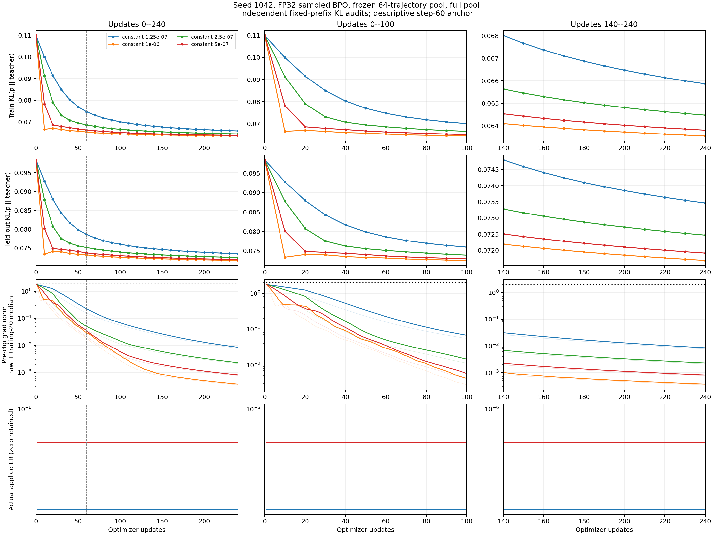
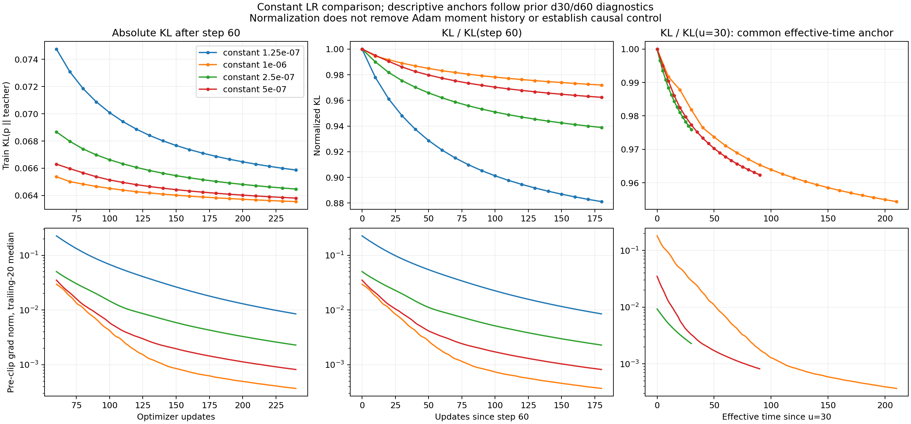

# BPO 全量扫描首批结果

## 证据范围与设置

八点 fullpilot 中，1.25e-7、2.5e-7、5e-7、1e-6 四组已经正常完成，各 240 次更新。本报告只引用这些已经完成的条件，不使用运行中的较大 lr 曲线进行最终排名。seed1042 是校准种子，多种子确认与相同 checkpoint 阶段分叉尚未完成。后续 teacher/student/domain 矩阵仍处于设计阶段，没有启动。

本次固定同一初始 DeepSeek-R1-Distill-Qwen-1.5B rollout pool，teacher 为 JustRL-DeepSeek-1.5B。每步使用全部 64 条轨迹，每条响应上限 256 token；本 pool 每条均达到长度上限。全量有效 token 均值梯度累积 64 次 backward 后，执行一次 AdamW 更新。FP32、dropout=0、betas=(0.9,0.999)、epsilon=1e-8、weight_decay=0、clip=2、eta=0.3。生产场是 sampled action 与 Top-16 加尾部桶 center，不能称为完整词表期望梯度。

每 10 步在固定训练/验证各 4096 个 prefix 上计算完整词表 BPO 与 teacher reverse KL。初始训练 BPO 为 0.0353461342，teacher KL 为 0.1098647512。全部四组有相同初始审计值，各有 15360 次 backward、17760 次 forward；训练 backward token 数均为 3932160。没有搜索 forward，没有拒绝更新，也没有触发梯度裁剪。

## 已完成四组的比较

| lr      | 240 步完整训练 BPO | BPO / 初始 | 训练 teacher KL | 验证 teacher KL | 达到 BPO / 初始 ≤ 0.2 的步数 | 最后 20 步 grad norm 中位数 |
| ------- | ------------------ | ---------- | --------------- | --------------- | ---------------------------- | --------------------------- |
| 1.25e-7 | 0.00588932         | 0.166618   | 0.0658654       | 0.0734599       | 130                          | 0.00848934                  |
| 2.5e-7  | 0.00530175         | 0.149995   | 0.0644719       | 0.0724670       | 70                           | 0.00228590                  |
| 5e-7    | 0.00506060         | 0.143173   | 0.0638046       | 0.0719107       | 50                           | 0.000816879                 |
| 1e-6    | 0.00512286         | 0.144934   | 0.0635472       | 0.0716837       | 40                           | 0.000368333                 |

阈值步数要求该点及下一审计点均低于阈值，并在剩余观测期内保持低于阈值；审计间隔为 10 步，阈值时间存在区间分辨率限制。对应物理 backward 次数分别为 8320、4480、3200、2560。四组在 240 步内都没有达到完整 BPO 的 0.1 倍阈值，不能填入外推步数。

在这四个条件中，1e-6 的全程归一化 log-loss 曲线积分最小，5e-7 的终点训练 BPO 最小。完整 BPO 和 teacher KL 终点的排序不同，符合 eta=0.3 的 BPO 对齐目标与 teacher 本身不同这一事实。当前数据支持较大 lr 加速早期优化；它没有证明后期必须增大 lr，也没有定位八点网格的全局最佳值。

各条件训练时间为 2729–2747 秒，约 45.5–45.8 分钟。这是四卡并发下各 worker 记录的运行耗时，不包含此前生成固定 cache 的成本。相同 forward/backward 预算下耗时接近，速度差异主要体现在达到阈值所需更新数量。

## 有效时间与 grad norm 的读法

对于这些常数条件，采用更新后测量的有效时间 $u_n=n\alpha/10^{-6}$。共同 $u=30$ 上恰有对应审计点：

| lr      | 更新步 | BPO / 初始 | 训练 teacher KL |
| ------- | ------ | ---------- | --------------- |
| 1.25e-7 | 240    | 0.166618   | 0.0658654       |
| 2.5e-7  | 120    | 0.170716   | 0.0660622       |
| 5e-7    | 60     | 0.179720   | 0.0662988       |
| 1e-6    | 30     | 0.201570   | 0.0665859       |

共同有效时间下 teacher KL 接近，但完整 BPO 存在可见差异。这说明“lr × step”是值得检验的时间参照，不能把所有指标与所有 lr 都强制解释成同一路径重标定。此比较同时包含 Adam 矩历史差异，相同 checkpoint 分叉将进一步检验单步因果响应。

全量 pool 的裁剪前 grad norm 随训练持续降低，1e-6 最后 20 步的中位数已降至 3.68e-4，完整训练 BPO 仍为初始值的约 14.5%。这个读数支持继续区分生产近似场的平衡、完整目标的剩余误差和网络可实现性。它不能单独证明存在不可约误差底，也不能将当前 grad norm 解释成完整审计 BPO 的梯度范数。

## 曲线

全程、前 100 步和最后 100 步统一绘制 teacher KL、grad norm 和 lr。最后 100 步是 update140–240，绘图程序已根据实际预算生成窗口，避免沿用 600 步实验的 update500–600 空窗口。



下图给出固定 step60 和共同有效时间 u=30 的描述性对齐。四组均未触发 clip，因此裁剪不是本次相对变化的解释。归一化仍不能消除 Adam 历史。



按更新、backward 和耗时的完整 BPO/验证 teacher KL 对照保存在同目录 low-lr-complete-seed-1042.png/pdf。该目录是首批不可变快照，与 controller 后续生成的完整 fullpilot 报告分开保存。

## 复现与后续判定

数据位于 results/scalar-large/fullpool-lr-study/snapshots/low-lr-complete。runs.csv 保存四组的完整统计，raw/manifest.json 保存 16 份日志归档的原始与压缩 SHA-256。归档包含 summary、audits、updates 和 checkpoint 索引，不把大 checkpoint 权重写入 Git。checkpoint 权重仍位于原运行目录，阶段分叉继续使用原路径。

先在仓库根目录用下面的 CPU 命令恢复日志，核验原始与压缩内容后，再运行现有分析与绘图模块。此命令不会启动训练。

```python
import gzip
import hashlib
import json
from pathlib import Path

root = Path.cwd()
snapshot = root / "results/scalar-large/fullpool-lr-study/snapshots/low-lr-complete"
restored = root / "runs/scalar-large/snapshots/low-lr-complete"
for entry in json.loads((snapshot / "raw/manifest.json").read_text())["files"]:
    packed = (root / entry["archive"]).read_bytes()
    assert hashlib.sha256(packed).hexdigest() == entry["archive_sha256"]
    original = gzip.decompress(packed)
    assert hashlib.sha256(original).hexdigest() == entry["original_sha256"]
    target = restored / entry["run"] / entry["file"]
    target.parent.mkdir(parents=True, exist_ok=True)
    target.write_bytes(original)
```

```bash
python -m experiments.analysis.scalar_large_report \
    --root runs/scalar-large/snapshots/low-lr-complete \
    --output results/scalar-large/fullpool-lr-study/snapshots/low-lr-complete
python -m experiments.plotting.plot_scalar_large \
    --root runs/scalar-large/snapshots/low-lr-complete \
    --output results/scalar-large/fullpool-lr-study/snapshots/low-lr-complete/figures
python -m experiments.plotting.plot_scalar_kl_lr \
    --root runs/scalar-large/snapshots/low-lr-complete --seed 1042 \
    --output results/scalar-large/fullpool-lr-study/snapshots/low-lr-complete/figures
python -m experiments.plotting.plot_scalar_diagnostics \
    --source results/scalar-large/fullpool-lr-study/snapshots/low-lr-complete/figures/teacher-kl-and-lr-seed-1042.json \
    --output results/scalar-large/fullpool-lr-study/snapshots/low-lr-complete/figures
```

接下来等待 2e-6、4e-6、8e-6、1.6e-5 的完整校准结果。如果最高 lr 的曲线积分获胜，按预登记规则扩展网格；之后进行 update40/120/240 的相同 checkpoint 分叉及三 seed 确认。完整任务尚未结束，现阶段不宣称 search 或 feedback 已优于强常数对照。
