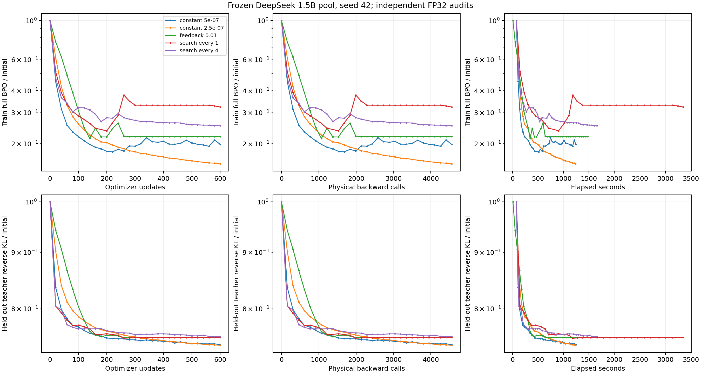

# BPO 小批量五池确认阶段结果

## 结论与证据范围

原确认矩阵共 25 个条件，目前有 24 个正常完成。两个常数和 search every 1 / every 4 均完成五个 seed，feedback 完成四个 seed，尚缺 seed442。两个搜索规则在五池上全部劣于预先锁定的 5e-7 常数基线，且运行耗时更长。feedback 已完成的四个 seed 同样没有收益，完整五 seed 汇总仍待最后一组完成。

本报告分析原有小批量设置，与当前全部 64 条 rollout 的全量梯度 sweep 分开保存。它不作为全量梯度调度的结论，也不改变正在运行的预登记矩阵。后续换 teacher/student/domain 的实验仍没有启动。

## 固定设置与比较规则

Student 为 DeepSeek-R1-Distill-Qwen-1.5B，teacher 为 JustRL-DeepSeek-1.5B。每个 seed 冻结一个 64 条、response cap=256 的 pool，inner 不重新 rollout。seed 为 42、142、242、342、442，每个条件运行 600 次 optimizer 更新，每 20 步审计固定训练/验证各 4096 个 prefix 的完整词表 BPO 和 KL。

训练使用 sampled-action BPO，Top-16 加尾部桶 center，eta=0.3。网络为 FP32、dropout=0；AdamW betas=(0.9,0.999)、epsilon=1e-8、weight_decay=0、clip=2。每步按轨迹有效响应长度概率有放回抽取 8 条，重复轨迹在同一步合并梯度计算，因此实际 backward 次数低于 600 × 8。跨算法复用同一 seed 的抽样 RNG；同一 seed 的终点 backward 数一致。

校准阶段预先锁定 5e-7 和 2.5e-7 两个常数；主比较基线是 5e-7。搜索和反馈的原初始 lr 为 1e-6，上限 1.6e-5，反馈目标吸收率为 0.01。搜索使用固定 proxy，评估原生 Adam 方向的候选步长；拒绝时参数 lr=0，但 Adam 状态仍更新。这些是原实验设置，未根据确认结果更改。

新全量实验将调度起始 lr 对齐到其校准最佳常数，并改用无重复抽样的全部 64 条梯度。两套实验同时改变了梯度采样方式和标量起点，因此最终比较也需要保留这些差异，不能将结果变化单独归因于 batch 因素。

主误差指标为固定 600 步内完整训练 BPO 的几何平均归一化误差。定义

$$
G=\exp\left[\frac{1}{600}\int_0^{600}\log\frac{Q_n}{Q_0}\,dn\right],
\qquad \operatorname{Increase}=\frac{G_{\mathrm{scalar}}}{G_{\mathrm{constant}}}-1.
$$

积分在实际审计点之间用梯形法计算。表中误差增加为正表示更差。终点误差使用同一 $Q_{600}/Q_0$，不把 teacher KL 当成训练 BPO。耗时比来自各 worker 的原始记录，包含其审计与 proxy 评估，不包含此前生成 cache 的成本。

## 五池搜索结果

| 算法           | seed | 几何平均误差增加 | 终点训练 BPO 增加 | 耗时 / 常数 | 参数更新拒绝次数 |
| -------------- | ---- | ---------------- | ----------------- | ----------- | ---------------- |
| search every 1 | 42   | 50.38%           | 62.96%            | 2.637       | 331              |
| search every 1 | 142  | 381.08%          | 352.32%           | 2.059       | 151              |
| search every 1 | 242  | 37.67%           | 23.45%            | 2.257       | 254              |
| search every 1 | 342  | 75.43%           | 68.97%            | 2.496       | 328              |
| search every 1 | 442  | 413.00%          | 369.58%           | 2.858       | 471              |
| search every 4 | 42   | 34.53%           | 27.62%            | 1.321       | 35               |
| search every 4 | 142  | 279.33%          | 281.33%           | 1.264       | 46               |
| search every 4 | 242  | 249.68%          | 312.36%           | 1.232       | 38               |
| search every 4 | 342  | 128.72%          | 127.31%           | 1.280       | 41               |
| search every 4 | 442  | 245.42%          | 225.81%           | 1.227       | 25               |

每步搜索拒绝了 151–471 次参数更新，搜索每四步拒绝了 25–46 次。拒绝仍消耗完整训练 backward，无法用“执行了 600 次 optimizer step”说明发生了 600 次有效参数下降。降低搜索频率减小了 forward 和耗时开销，但两个规则都没有达到预登记误差改善条件。

这些失败与“沿原生方向做标量搜索”的具体规则有关。固定 proxy 与训练小批量不是同一测度，停止梯度的近似中心场也不保证等于完整审计 BPO 的梯度。当前统计支持检验方向一致性与 proxy 代表性；它本身没有辨认出哪一项机制贡献最大。

## 四池反馈结果

| seed | 几何平均误差增加 | 终点训练 BPO 增加 | 耗时 / 常数 | 末尾实际 lr |
| ---- | ---------------- | ----------------- | ----------- | ----------- |
| 42   | 21.25%           | 10.53%            | 1.182       | 1.6e-11     |
| 142  | 17.55%           | 3.71%             | 1.156       | 1.6e-11     |
| 242  | 91.07%           | 98.92%            | 1.150       | 2.0e-11     |
| 342  | 127.34%          | 162.55%           | 1.193       | 2.0e-11     |

四组的最低 lr 都到达 1.6e-11，即上限 1.6e-5 的百万分之一。这是实现中的 lr 下限，不是从 BPO 曲率推导出的最优值。参数更新没有被显式拒绝，backward 仍执行，但后期位移被极小 lr 限制。反馈将 proxy 的非下降反复转为减小 lr，在这套设置中产生了停滞式行为。

四个已完成的配对均比基线更差，当前配置已经不满足“全部 seed 改善”的必要条件。最后一个 seed 仍需跑完，才能报告完整五池误差和耗时汇总；这里不输出五池中位数、符号检验或总体通过标记。

达到完整 BPO 初始值的 0.2 倍阈值时，5e-7 在这四个 seed 上分别需要 140、140、180、120 步，feedback 在 600 步内均未满足连续两审计点通过条件。未达到的阈值保持删失，不从末尾极小 lr 外推所需步数。

## 原始记录、曲线与复现

结果保存在 results/scalar-large/confirm-snapshot-24。主目录的 runs.csv 包含全部 24 组的终点误差、稳定阈值、实际 forward/backward/token 数和耗时。paired-confirmation.json 是四池 feedback 的配对报告；search-every1 与 search-every4 子目录各有完整五池报告，两个 overall_success 均为 false。locked-selection.json 保留校准阶段的原始选择，raw/manifest.json 校验其 SHA-256。

raw 目录包含 24 组 × summary/audits/updates 的 72 份确定性 gzip 归档。manifest 为每份记录保存运行名、文件名、原始路径、归档路径及两种 SHA-256。按 manifest 解压并校验到 runs/scalar-large/snapshots/confirm-24，方法与[《BPO 全量扫描首批结果》](2026-10-13-BPO全量扫描首批结果.md)的恢复代码相同，只需替换 snapshot 与 restored 路径。

每个 seed 的更新/backward/耗时曲线保存在 figures，显示完整训练 BPO 与验证 teacher KL。下图是 seed42；其他四个 seed 使用相同坐标和绘图规则。



恢复日志后运行以下 CPU 命令，重算主报告并生成曲线。原始校准主候选为 feedback，因此主配对报告保留它，搜索结果单独按各自配置配对，不能从确认误差重新挑选主候选。

```bash
python -m experiments.analysis.scalar_large_report \
    --root runs/scalar-large/snapshots/confirm-24 \
    --selection results/scalar-large/confirm-snapshot-24/locked-selection.json \
    --output results/scalar-large/confirm-snapshot-24
python -m experiments.plotting.plot_scalar_large \
    --root runs/scalar-large/snapshots/confirm-24 \
    --output results/scalar-large/confirm-snapshot-24/figures
```

单独的搜索配对复现如下。配置从各算法实际记录中读取，基线仍来自已锁定的校准文件。

```python
import json
from pathlib import Path

from experiments.analysis.scalar_large_report import rows_at, summarize

root = Path("runs/scalar-large/snapshots/confirm-24")
output = Path("results/scalar-large/confirm-snapshot-24")
selection = json.loads((output / "locked-selection.json").read_text())
for every in (1, 4):
    candidate = next(
        run["summary"]["config"]
        for run in rows_at(root)
        if run["row"]["seed"] == 42
        and run["row"]["method"] == "search"
        and run["row"]["search_every"] == every
    )
    summarize(
        root,
        output / f"search-every{every}",
        selection | {"primary_scalar_config": candidate},
    )
```

后续按原队列完成 feedback seed442 与其余消融；当前全量 sweep 继续优先运行。这份旧设置的失败证据完整保留，用于判断下一轮优化是否解决了已观察到的问题。
