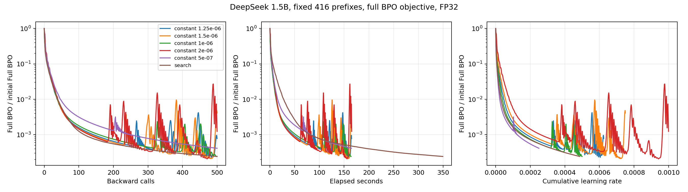
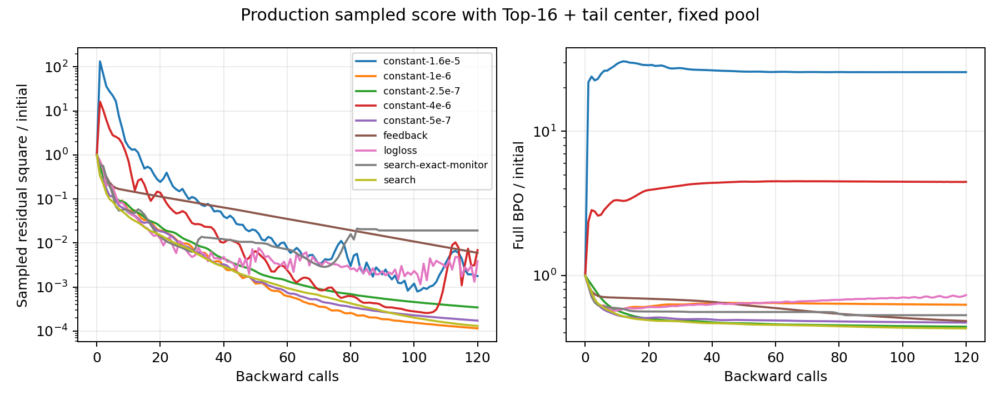
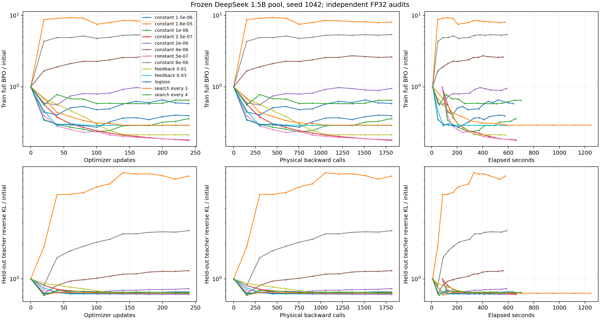
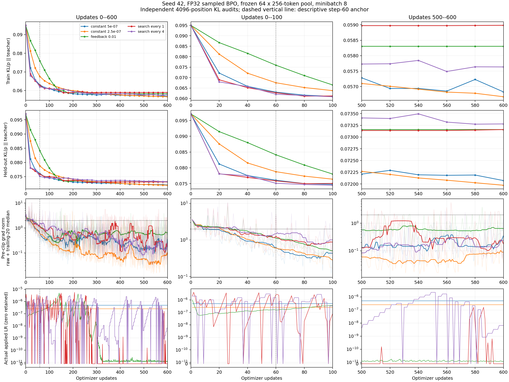
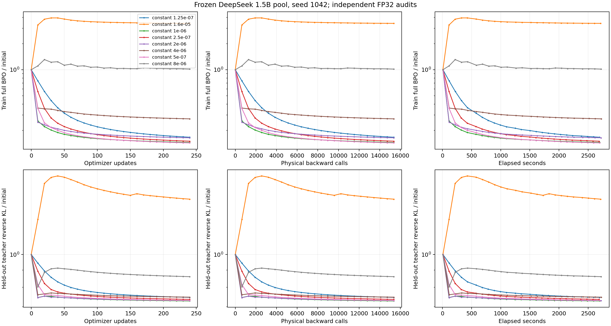
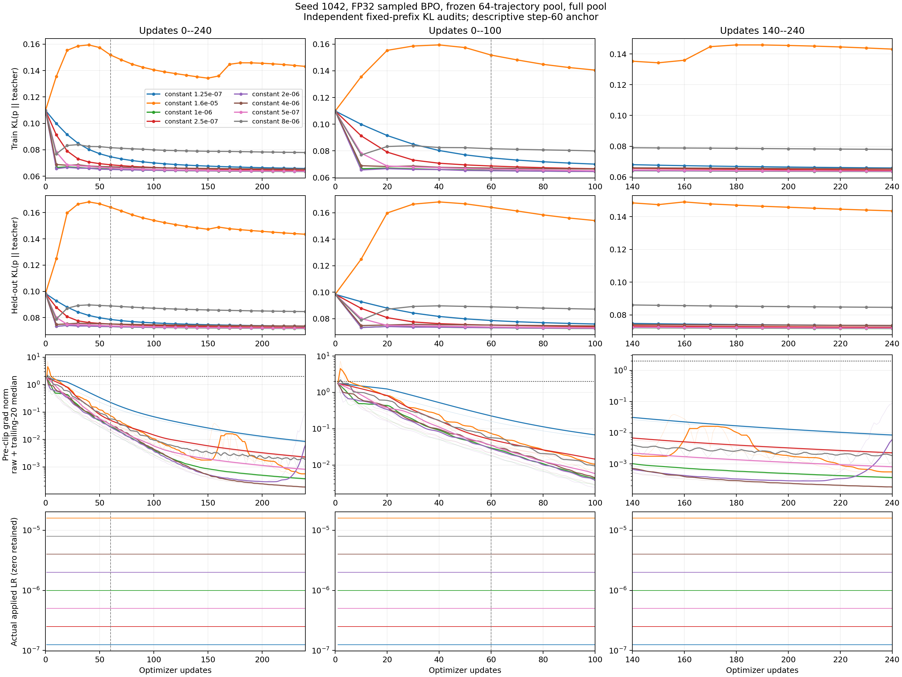
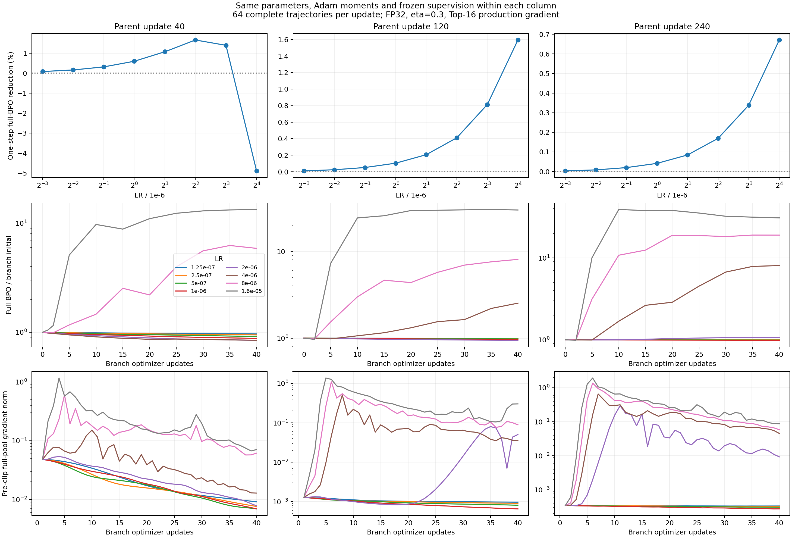
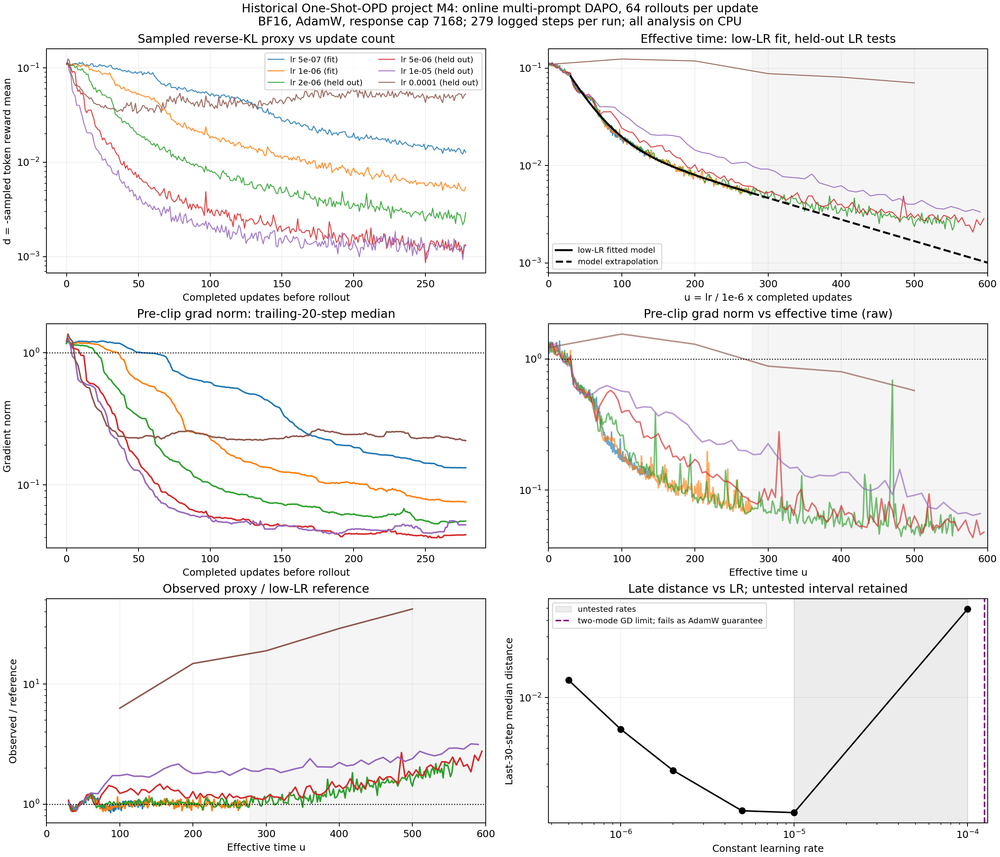
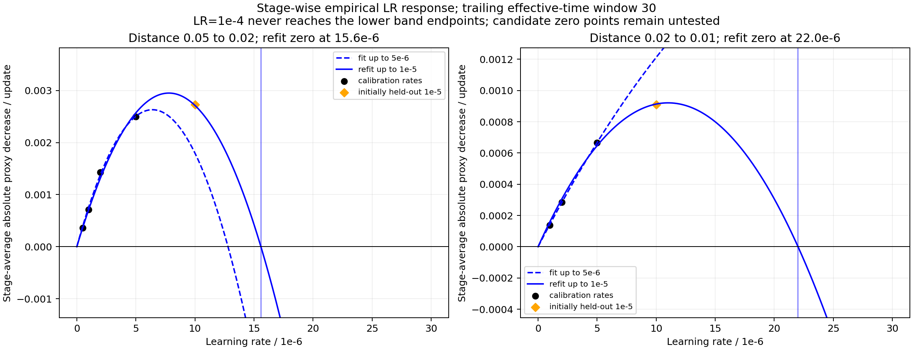

# BPO 标量调度实验总报告

## 当前结论与实验进度

完整 BPO 的冻结二次结构支持沿当前 AdamW 方向选择全局步长，但没有验证一种普遍胜过充分调参常数 lr 的调度。416-prefix 的精确 BPO 搜索减少了严格阈值所需 backward，同时增加了 forward 和耗时。短轨迹生产更新中，旧搜索与反馈在已完成确认上更差；全量 64 条梯度的最佳全程常数为 1e-6，终点最小完整 BPO 对应 5e-7。同状态分叉证明阶段最佳 lr 会变化，而且单步最佳与连续 40 步最佳不同。

本报告是这条研究线的唯一实验结果维护入口，汇总已完成基准、OPD 参照、生产 BPO 基线及剩余计划。每个实验分别记录 setting、结果和分析。理论完整证明仍维护在[当前书稿动力学章节](../book/sections/dyn_scalar_schedule.tex)，原始记录、图和配置保留在 data/results；旧的独立结果正文合并到这里。

当前长轨迹 BPO 队列等待 GPU0–3，没有本实验的训练 worker 正在执行。完成 hook 等待整个剩余队列退出，再一次性生成 CPU 报告；这里不恢复定期手动轮询。用户已取消新的多 seed 确认，已完成的重复保留。teacher/student/domain 扩展仍未启动。

| 编号 | 实验                             | Setting 概要                                         | 完成状态                             | 主要结论                                         |
| ---- | -------------------------------- | ---------------------------------------------------- | ------------------------------------ | ------------------------------------------------ |
| A    | 可控二次谱                       | 48 维，3 个条件数，2 种坐标，GD/AdamW，5 seeds       | 690 条轨迹完成                       | 搜索没有普遍超过 AdamW 常数网格                  |
| B    | 分类模型与 center                | 128 prefix、32 类、线性/非线性、固定 sampled actions | 540 条轨迹完成                       | 经验 residual 下降不保证完整 BPO 下降            |
| C    | 小型语言模型完整 BPO             | 13 prompt、416 prefix、完整词表梯度                  | FP32/BF16 对照完成                   | FP32 搜索省 backward，未省总时间                 |
| D    | 小型语言模型生产场               | 同一 416 prefix、Top-16、sampled action              | 120 步分支完成                       | 标量规则无法补回更新场失配                       |
| E    | 生产池独立调参                   | seed1042、64 条 × 256、minibatch8                    | 13 组 × 240 步完成                   | 常数 5e-7 胜出，反馈误差高 32.2%                 |
| F    | 精确 Gibbs target 的 center 偏差 | 调参 pool 全部 40960 prefix                          | 完成                                 | 高 head 质量仍存在 target 处更新偏差             |
| G    | 小批量五池确认                   | 5 pools、600 步、两个常数及三种调度                  | 24/25；最后一组取消                  | 两种搜索在五 seed 全部更差；反馈四 seed 全部更差 |
| H    | 全量梯度常数扫描                 | seed1042、全部 64 条 × 256、FP32                     | 8 组 × 240 步完成                    | 1e-6 全程最佳；8e-6/1.6e-5 终点恶化              |
| I    | 同状态阶段分叉                   | 同一 parent 的参数与 Adam 矩、8 lr、40 步            | 24 组全部完成                        | 中期短程 2e-6 有小幅收益，晚期 1e-6 最好         |
| J    | 历史在线 OPD lr 扫描             | DAPO 多 prompt、BF16、每步新 rollout                 | 6 组 × 279 行历史分析完成            | 已测可用最高 1e-5，1e-4 明显反弹                 |
| K    | OneShot 固定监督与精度参照       | 64 条长响应、395862 actions、全 batch                | BF16 三 lr 完成；FP32 330 步部分实验 | 有效时间近似成立；FP32 更快但仍持续吸收          |
| L    | 多轮生产 BPO 基线                | 50 outer × 16 inner、长响应、四卡 FSDP               | 800 步与 11 次评测完成               | MATH/AMC 改善，AIME 最终下降                     |
| M    | 当前剩余验证                     | seed42 长轨迹四 lr、17 组机制消融                    | 尚未启动，等待 GPU0–3                | 无结果，不计作完成                               |

## 指标、监督与共同设置

冻结一轮 outer，$q$ 是 sampling/anchor，$t$ 是 teacher，$p_\theta$ 是 student。精确 residual 与 BPO 为

$$
R=C_q[\log(p_\theta/q)-\eta\log(t/q)],\qquad C_qf=f-\mathbb E_qf,
\qquad Q=\frac{\mathbb E_{\mu,q}R^2}{2\eta}.
$$

完整词表 BPO 是独立目标；生产 residual 平方与 coefficient × log_prob surrogate 分别记录。后者的数值只承载梯度，不能直接当作平方 loss。完整 teacher 距离为 $D_T=\mathbb E_\mu\operatorname{KL}(p_\theta\Vert t)$。历史 signed sampled-token proxy 和固定动作绝对差也单独命名，不能混成同一个 d。

$\eta=0.3$ 时，可表示自由 logits 的 BPO 最优分布为 $p_G\propto q^{0.7}t^{0.3}$。其 teacher KL 通常为正，但不是任意 student 的 teacher KL 下界。模型中的未知最优误差 $Q_*$ 与有限预算末段参考值分别处理；本报告的 Q/Q0 都是原始目标比值，没有减去未经识别的 floor。

| 项目              | C–I 的语言模型共同设置                                                                             |
| ----------------- | -------------------------------------------------------------------------------------------------- |
| Student / teacher | DeepSeek-R1-Distill-Qwen-1.5B / hbx/JustRL-DeepSeek-1.5B                                           |
| 模型 revision     | student ad9f0ae0864d7fbcd1cd905e3c6c5b069cc8b562；teacher 0637e4096c789c67f9eecbe8355e0bdeddede1c2 |
| 训练              | 全参数，dropout=0，gradient checkpointing；主条件 FP32                                             |
| AdamW             | betas=(0.9,0.999)、epsilon=1e-8、weight_decay=0、foreach=False                                     |
| 梯度裁剪          | 全部 micro-batch 累积后一次全局裁剪，阈值 2                                                        |
| BPO               | eta=0.3；q、teacher、prefix、action 在 inner 固定，无成对 token                                    |
| 生产 center       | 冻结 q 的 Top-16 加尾部桶；student center 每次重算后停止梯度                                       |
| 资源              | 本研究 GPU 工作仅物理 0–3；J 的旧八卡训练只读取历史记录                                            |

E–I 的数据来自 DAPO train.parquet，完整 prompt 不截断，只选择不超过 512 token 的记录。六 seed 各准备 128 条训练、32 条验证响应，共 245760 prefix；主训练使用前 64 条，共 16384 prefix。生成 temperature=1、top-p=1、无 top-k 截断、自然 EOS、response cap=256。现有这些 pool 的响应均达到上限。seed1042 的调参与其他 seed 的 prompt 抽样范围分离，所有 lr 在相同条件内复用相同 tokens。

小批量每步按响应长度概率有放回抽取 8 条，合并重复轨迹后计算梯度，所以实际 backward 不等于更新数 × 8。全量条件逐条遍历全部 64 条，轨迹内 token mean 乘以长度占比，故

$$
g=\sum_j\frac{n_j}{N}\frac1{n_j}\sum_{i=1}^{n_j}g_{j,i}=\frac1N\sum_{j,i}g_{j,i}.
$$

全量一次更新有 64 次真实 backward，但仍是固定 sampled action 的经验场，不能称为完整 action 期望梯度。独立评分固定训练/验证各 4096 prefix，FP32 完整词表计算 Q、teacher KL、anchor KL 和动作绝对差。

主排序量为几何平均归一化完整 BPO，记 $A=N^{-1}\int_0^N\log(Q_n/Q_0)dn$、$G=\exp A$。积分用实际 audit 的梯形法。比较改善为 $1-G_{\rm scalar}/G_{\rm constant}$；终点、验证误差、backward/forward/token 数和耗时另报。E 的常数额外记录逐步 proxy，只用于更新轴选参；G/H 的常数只执行必需 forward，才能比较部署成本。

C/D 的严格阈值要求连续五步；E–I 的稀疏审计要求连续两个 audit。表格记录合格区间起点，确认还需要后续状态。persistent 使用整个已完成预算判定反弹，不是实时停止规则。未达阈值保持删失，不外推一个完成 step。

### 被比较的标量规则

| 规则                     | 更新语义                                                                                                 |
| ------------------------ | -------------------------------------------------------------------------------------------------------- |
| 常数 lr                  | 不变换 loss，按原生 AdamW 更新                                                                           |
| search every 1/4         | 一次梯度与一次 moments 更新后固定方向；同一 proxy 的 0/h/2h forward 拟合步长，实测接受；每 1 或 4 步搜索 |
| feedback                 | 由上一 proxy 的 log 收缩调节下一 lr，增长倍率最多 1.25，非下降时减半；0.01/0.03 是不同条件               |
| inverse-lr / 方向 Polyak | 仅早期基准：按 loss 倒数增 lr，或用 0.05Q/(g^Td) 提标量，均有上限                                        |
| log/sqrt loss            | 全局梯度缩放，改变 Adam 矩历史；作为方向机制对照，不算严格保持原方向的 lr 规则                           |

具体公式、接受回退和伪代码在后文。所有搜索试探固定缓存与方向，不在 trial 中再次 backward 或更新 moments。

## 实验 A：可控二次谱

### Setting

48 维 FP64，条件数 10/1000/100000，对齐与随机旋转坐标，5 seeds；GD 与 AdamW，共 690 条轨迹，各最多 800 步。AdamW 常数网格 0.003/0.01/0.03/0.1/0.3/1，搜索上限 1；GD 网格 0.1/0.5/1/1.8/1.99，搜索上限 8。还比较 inverse-lr、feedback、方向 Polyak、log/sqrt loss；后三种 loss 缩放不视作保持 Adam 原方向的 lr 调度。

任意正定二次 H 可嵌入 BPO。取均匀 q、词表大小 V=d+1、中心子空间正交基 B，令

$$
B^\top B=I,\quad B^\top\mathbf1=0,\quad J=\sqrt{\eta V}BH^{1/2},\quad
J^\top F_qJ/\eta=H.
$$

最后一式来自均匀 q 的 Fisher 在中心子空间等于 I/V。H 只用于定义 benchmark，搜索没有构造新 Hessian 或预条件器。

### 结果

完整条件的终值中位数如下，常数按各自网格最低中位终值选取；失败提前退出的高误差保留，不算达标：

| 优化器 | 条件数 | 坐标 | 常数 lr | 常数 Q/Q0 | search Q/Q0 | feedback Q/Q0 |
| ------ | ------ | ---- | ------- | --------- | ----------- | ------------- |
| GD     | 10     | 对齐 | 1.8     | 1.62e-140 | 3.71e-157   | 2.19e-11      |
| GD     | 10     | 旋转 | 1.8     | 2.51e-141 | 1.73e-156   | 2.13e-11      |
| GD     | 1000   | 对齐 | 1.99    | 0.00139   | 0.000551    | 0.000373      |
| GD     | 1000   | 旋转 | 1.99    | 0.000925  | 0.000805    | 0.000234      |
| GD     | 100000 | 对齐 | 1.99    | 0.278     | 0.247       | 0.244         |
| GD     | 100000 | 旋转 | 1.99    | 0.281     | 0.278       | 0.264         |
| AdamW  | 10     | 对齐 | 0.3     | 1.81e-37  | 1.27e-37    | 4e-11         |
| AdamW  | 10     | 旋转 | 0.1     | 8.05e-37  | 1.22e-37    | 3.99e-11      |
| AdamW  | 1000   | 对齐 | 1       | 3.11e-37  | 1.61e-37    | 4.51e-11      |
| AdamW  | 1000   | 旋转 | 0.3     | 6.17e-09  | 1.07e-18    | 1.51e-10      |
| AdamW  | 100000 | 对齐 | 1       | 5.05e-06  | 4.52e-05    | 0.00045       |
| AdamW  | 100000 | 旋转 | 1       | 0.0551    | 0.0814      | 0.103         |

旋转坐标、条件数 1000、连续五步低于 1% 的 AdamW 例子：

| 规则        | 达标步数，五 seeds      | 中位数 |
| ----------- | ----------------------- | ------ |
| 常数 lr=1   | 107、89、93、79、121    | 93     |
| search      | 146、121、123、104、127 | 123    |
| feedback    | 180、177、166、166、162 | 166    |
| 方向 Polyak | 152、142、131、299、122 | 142    |

### 分析

搜索在部分 GD 情形省步数，但没有普遍胜过 AdamW 常数网格。只与 lr=0.01/0.1 比，会夸大收益。完整逐条件统计在 results/scalar-schedule/quadratic-aggregate.csv，690 条轨迹在 quadratic-expanded.json.gz。

## 实验 B：分类模型与 center

### Setting

FP64，128 固定 prefix、32 类、24 维特征，共享线性或非线性参数；q、teacher 和 action pool 冻结。完整目标、完整 center sampled score、Top-8/Top-1 加尾部桶分别比较，每 prefix 1 或 8 个独立 q 动作，不使用成对损失。5 seeds，共 540 条轨迹，最多 500 步，AdamW 网格与 A 相同。线性 logits 为 Xθ，非线性 logits 为 Xθ+0.2(Xθ)²；24 维特征按10^(-2)到1缩放，初始θ标准差0.1，teacher参数增加标准差0.4的扰动。

### 结果

以下为完整 Q/Q0 的五 seed 中位终值；常数列选各网格最低中位数，搜索从 0.01 开始：

| 参数与更新方式           | 动作数/prefix | center       | 常数 lr 网格最低中位终值 | search 中位终值 |
| ------------------------ | ------------- | ------------ | ------------------------ | --------------- |
| 共享线性完整目标         | 完整词表      | 完整 32 类   | 2.67007e-19              | 4.40674e-24     |
| 共享线性 sampled score   | 1             | 完整 32 类   | 0.585784                 | 0.588321        |
| 共享线性 sampled score   | 8             | 完整 32 类   | 0.000167791              | 0.000373094     |
| 共享线性 sampled score   | 8             | Top-8 加尾部 | 0.0770524                | 0.423075        |
| 共享线性 sampled score   | 8             | Top-1 加尾部 | 0.143899                 | 0.720239        |
| 共享非线性 sampled score | 1             | 完整 32 类   | 0.623421                 | 0.629547        |
| 共享非线性 sampled score | 8             | 完整 32 类   | 0.0507676                | 0.0980878       |
| 共享非线性 sampled score | 8             | Top-8 加尾部 | 0.286999                 | 0.83756         |
| 共享非线性 sampled score | 8             | Top-1 加尾部 | 0.372218                 | 1.1556          |

### 分析

线性模型完整目标可到数值精度附近；固定动作与粗 center 的误差不同，代理搜索不能恢复缺失的梯度。500步终值不证明不可约误差底，sampled分支还可能未完全优化。非线性目标未验证为可表示，0.372 或 1.156 的终值不能全部解释成统计偏差。原始轨迹在 categorical-expanded.json.gz，汇总在 categorical-aggregate.csv。

## 实验 C：416-prefix 完整 BPO 与精度对照

### Setting

seed20261012，DAPO 前 16 行选出 13 条无 padding prompt，prompt 最多 64 token、response 32 token，关闭 EOS 提前终止，共 416 prefix。q 生成 temperature=1、top-p=1、top-k=0；q/teacher 分布冻结。精确梯度直接优化完整词表 Q，主 FP32 条件 500 步，BF16、logloss 和反馈为 120 步对照。短响应和截断 prompt 只用于优化 benchmark。FP32/BF16 复用相同 tokens、q/t 缓存与 SHA；BF16 原生学生初始 Q=0.0427783169，与 FP32 初值不同，分别按本分支初始化归一化。

### 结果

初始 Q=0.0413170，到初始 0.1% 的严格阈值结果为：

| 规则                          | 连续五步达标 backward | 该时刻累计 forward | 该时刻耗时/秒 | 保持低于阈值直至第 500 步的起点 | 第 500 步目标/初始目标 |
| ----------------------------- | --------------------: | -----------------: | ------------: | ------------------------------: | ---------------------: |
| 常数 $5\times10^{-7}$         |                   251 |                253 |          82.8 |                             251 |               0.000415 |
| 常数 $10^{-6}$                |                   159 |                161 |          52.3 |                             456 |               0.000244 |
| 常数 $1.25\times10^{-6}$      |                   144 |                146 |          47.7 |                             461 |               0.000781 |
| 常数 $1.5\times10^{-6}$       |                   136 |                138 |          44.9 |                          未达到 |               0.004110 |
| 常数 $2\times10^{-6}$         |                   131 |                133 |          43.6 |                          未达到 |               0.001243 |
| scalar search，初始 $10^{-6}$ |                   117 |                469 |          82.3 |                             117 |               0.000243 |

连续五步列是区间起点，确认需要随后四步；forward 和耗时也对应起点。搜索比最快达标常数 2e-6 少 10.7% backward，但 forward 为 3.53 倍、耗时为 1.89 倍。要求之后直到第 500 步始终低于阈值时，搜索起点 117、最佳稳定常数 251，耗时基本相同。

以下 120 步对照的完整计数单列，不与 500 步终值直接排名：

| 条件       | 精度 | 终点 Q/Q0 | Forward | 耗时/秒 | 拒绝次数 |
| ---------- | ---- | --------- | ------- | ------- | -------- |
| 常数 1e-06 | BF16 | 0.035668  | 122     | 15.55   | 0        |
| search     | BF16 | 0.040673  | 878     | 50.61   | 77       |
| 常数 4e-06 | FP32 | 0.061179  | 122     | 40.33   | 0        |
| feedback   | FP32 | 0.008242  | 122     | 40.49   | 0        |
| logloss    | FP32 | 0.002387  | 122     | 40.57   | 0        |

logloss 在 120 步内把 1% 阈值从默认常数的 39 步降到 27，终值为初始 0.239%，未达 0.1%；它改变 moments 并大量触发裁剪。反馈的 1% 阈值为 114 步。BF16 的常数/search 120 步终值为 3.57%/4.07%，搜索拒绝 77 次、使用 878 次 forward。

### 分析

FP32 搜索改善严格 backward 阈值和 late rebound，未获总时间收益。其 10–60、100–150、400–450 窗口平均 -ΔlogQ 为 0.0612、0.0108、0.00184，吸收仍持续变慢。BF16 精细差分没有迁移收益，logloss 短期速度也不能当成 lr 等价效果。



原始每条分支、计数和阈值在 results/scalar-schedule/lm-runs.csv 及 lm-*.json/jsonl。这是一套可表示性与固定 pool 的小型参考，不是长轨迹数学能力验证。

## 实验 D：416-prefix 生产更新场

### Setting

与 C 相同 tokens 与初始 Q，训练改为生产 sampled action、Top-16 加尾部桶、stop-gradient center，120 步。search 分别用经验 residual 或完整 Q 验收；它们都保持生产 Adam 方向。

### 结果

| 条件                 | 经验 residual 平方 / 初值 | 完整 Q / 初值 | Forward | 耗时/秒 | 拒绝次数 |
| -------------------- | ------------------------- | ------------- | ------- | ------- | -------- |
| 常数 1.6e-05         | 0.00177564                | 25.750857     | 122     | 43.69   | 0        |
| 常数 1e-06           | 0.000115186               | 0.626545      | 122     | 43.23   | 0        |
| 常数 2.5e-07         | 0.000344303               | 0.441024      | 122     | 40.68   | 0        |
| 常数 4e-06           | 0.00688592                | 4.463677      | 122     | 40.82   | 0        |
| 常数 5e-07           | 0.000172739               | 0.471017      | 122     | 40.69   | 0        |
| feedback             | 0.00598425                | 0.483065      | 122     | 40.60   | 0        |
| logloss              | 0.00384827                | 0.730649      | 122     | 40.73   | 0        |
| 完整 Q 验收 search   | 0.0192676                 | 0.530131      | 680     | 109.01  | 36       |
| residual 验收 search | 0.000131114               | 0.429535      | 482     | 86.84   | 0        |

常数 1.6e-5 的 teacher KL 从 0.1107 升到约 0.931。经验平方下降与完整对齐恶化可同时发生。

### 分析

搜索相对默认 1e-6 有改善，但接近更小常数 2.5e-7，且成本更高。完整误差单调验收仍无法生成缺失的下降方向。它证明标量规则不能替代 center/监督估计的修正，数据在同目录 lm-fp32-sampled-*。



## 实验 E：生产池独立调参

### Setting

共同模型与 64×256 pool，seed1042，minibatch8，共 13 条 × 240 步，每 20 步完整审计。八常数、search 每步/每四步、feedback 目标 0.01/0.03、logloss 全保留。固定 proxy 为 8 条轨迹簇上的 512 位置。常数逐步 proxy 是调参诊断开销，不用于最小部署耗时比较。

### 结果

| 条件              | 几何平均归一化完整 BPO | 终点完整 BPO/初值 | 验证 BPO | 验证 teacher reverse KL | 拒绝更新数 |
| ----------------- | ---------------------: | ----------------: | -------: | ----------------------: | ---------: |
| constant-5e-07    |               0.240015 |          0.181925 | 0.012525 |                0.072346 |          0 |
| constant-2.5e-07  |               0.264154 |          0.178281 | 0.012621 |                0.072874 |          0 |
| constant-1e-06    |               0.303000 |          0.359068 | 0.015031 |                0.073525 |          0 |
| feedback-rate0.01 |               0.317188 |          0.213022 | 0.013332 |                0.073989 |          0 |
| feedback-rate0.03 |               0.317470 |          0.288432 | 0.013380 |                0.073383 |          0 |
| logloss-control   |               0.350563 |          0.394270 | 0.016438 |                0.074025 |          0 |
| search-every1     |               0.356424 |          0.290525 | 0.015091 |                0.074307 |        112 |
| constant-1.5e-06  |               0.547855 |          0.584489 | 0.020179 |                0.076201 |          0 |
| search-every4     |               0.633186 |          0.648867 | 0.017869 |                0.075348 |          8 |
| constant-2e-06    |               0.814232 |          0.949511 | 0.028598 |                0.081394 |          0 |
| constant-4e-06    |               2.246289 |          2.613436 | 0.076243 |                0.115658 |          0 |
| constant-8e-06    |               4.715627 |          5.388226 | 0.185583 |                0.253830 |          0 |
| constant-1.6e-05  |               7.686400 |          8.039044 | 0.348909 |                0.740785 |          0 |

### 分析

5e-7 的 G 最低，2.5e-7 终点略低，两者锁定为确认基线。最佳 scalar 是 feedback0.01，但 G 仍高 32.2%，未达到更好判据。完整选择 SHA-256=3efe1de50f91488812cf44f052bdfec83be16c06f2c8e564e1cf9bf6b06b0f47；没有根据后续确认重选候选。

共同 u=60 时，2.5e-7、5e-7、1e-6、1.5e-6 的实测 Q/Q0 为 0.178281、0.210797、0.272107、0.404300；2e-6 的 log 插值为 0.576525。曲线不严格重合。反馈最终 u=37.1282，每步/每四步搜索 u=103.4028/165.5667，较大的累计时间未换来更低完整误差。



数据为 results/scalar-large/tune/runs.csv、effective-time-diagnostic.json 及 raw/manifest.json。记录真实 applied_lr 后累计 u，插值与审计点分别标识。

## 实验 F：理想 target 处的 center 偏差

### Setting

在调参 seed 的全部 40960 prefix 上，由完整 q/t 构造精确 Gibbs target，不训练参数。Top-16 与 Top-64 的平均 q 质量覆盖为 99.719%/99.958%，测量 target 处近似 residual 与 logit 更新场。

### 结果

| center          | teacher KL 缺失量均值 | target 处 residual 偏差平方均值 | target 处 logit 更新场范数均值 |
| --------------- | --------------------: | ------------------------------: | -----------------------------: |
| Top-16 加尾部桶 |            0.00166818 |          $2.47761\times10^{-6}$ |         $9.76546\times10^{-5}$ |
| Top-64 加尾部桶 |           0.000187002 |          $6.18257\times10^{-8}$ |         $1.11286\times10^{-5}$ |

### 分析

即使精确 residual 为零，近似场仍可非零，高 head 质量不能替代完整 center。这里是 target 分布的 logit 场，不是神经网络最终梯度或误差，不能单独解释训练平台。分析入口 experiments/analysis/scalar_center_bias.py；结果为 results/scalar-large/center-bias-s1042.json，与 q/t 缓存校验独立于优化轨迹。

## 实验 G：小批量五池确认与平台

### Setting

seed42/142/242/342/442，各固定 64×256 pool、minibatch8、600 步；每 20 步完整审计。常数 5e-7/2.5e-7，搜索从 1e-6 起、上限 1.6e-5，每步或每四步；反馈从 1e-6 起、target=0.01。确认只计算算法必需 proxy。同一 seed 的梯度抽样索引配对复用，重复轨迹合并后的实际 backward 数一致。已完成 24 组；feedback seed442 被用户取消。

### 结果

两个常数在全部五个 pool 上的结果一并保留；后续标量比较始终使用校准锁定的 5e-7，不按每个 seed 的终点重新挑基线：

| seed | G，5e-7  | G，2.5e-7 | 终点 Q/Q0，5e-7 | 终点 Q/Q0，2.5e-7 | 验证 teacher KL，5e-7 / 2.5e-7 |
| ---- | -------- | --------- | --------------- | ----------------- | ------------------------------ |
| 42   | 0.215395 | 0.206624  | 0.198311        | 0.153431          | 0.072072 / 0.071972            |
| 142  | 0.216494 | 0.226531  | 0.204509        | 0.287526          | 0.072334 / 0.071976            |
| 242  | 0.207092 | 0.204614  | 0.198522        | 0.150766          | 0.077605 / 0.077346            |
| 342  | 0.199376 | 0.198518  | 0.180009        | 0.149140          | 0.074485 / 0.074261            |
| 442  | 0.221650 | 0.215708  | 0.235868        | 0.170628          | 0.067853 / 0.067539            |

误差增加为相对锁定常数 5e-7 的增加量，正值表示更差：

| 算法           | seed | 几何平均误差增加 | 终点训练 BPO 增加 | 耗时 / 常数 | 参数更新拒绝次数 |
| -------------- | ---- | ---------------- | ----------------- | ----------- | ---------------- |
| search every 1 | 42   | 50.38%           | 62.96%            | 2.637       | 331              |
| search every 1 | 142  | 381.08%          | 352.32%           | 2.059       | 151              |
| search every 1 | 242  | 37.67%           | 23.45%            | 2.257       | 254              |
| search every 1 | 342  | 75.43%           | 68.97%            | 2.496       | 328              |
| search every 1 | 442  | 413.00%          | 369.58%           | 2.858       | 471              |
| search every 4 | 42   | 34.53%           | 27.62%            | 1.321       | 35               |
| search every 4 | 142  | 279.33%          | 281.33%           | 1.264       | 46               |
| search every 4 | 242  | 249.68%          | 312.36%           | 1.232       | 38               |
| search every 4 | 342  | 128.72%          | 127.31%           | 1.280       | 41               |
| search every 4 | 442  | 245.42%          | 225.81%           | 1.227       | 25               |

| seed | 几何平均误差增加 | 终点训练 BPO 增加 | 耗时 / 常数 | 末尾实际 lr |
| ---- | ---------------- | ----------------- | ----------- | ----------- |
| 42   | 21.25%           | 10.53%            | 1.182       | 1.6e-11     |
| 142  | 17.55%           | 3.71%             | 1.156       | 1.6e-11     |
| 242  | 91.07%           | 98.92%            | 1.150       | 2.0e-11     |
| 342  | 127.34%          | 162.55%           | 1.193       | 2.0e-11     |

反馈四组最低 lr 均为 1.6e-11，是实现的 lr 下限，不是曲率最优值。5e-7 达到 Q/Q0≤0.2 的四 seed 步数为 140/140/180/120，反馈都未满足连续两个审计点通过条件。搜索拒绝仍做 backward 并更新 moments，optimizer step 数不等于有效参数下降次数。

### 分析

两种搜索的五 seed 完整报告均为 overall_success=false。反馈四个已完成配对均更差，已经违背全部 seed 改善的必要条件，但不填入完整五 seed 中位数或符号检验。主候选不从这些结果重选。512-prefix proxy、minibatch 方向、center 偏差与差分分辨率的贡献尚待机制消融识别。

seed42 中 5e-7/2.5e-7 的训练 KL 在 step20 为 0.072165/0.081214，step100 为 0.060988/0.063763，step600 为 0.056826/0.056669；大 lr 前期快，晚期接近且波动更大。最后 100 步 grad norm 中位数为 0.171671/0.0489653。



step60 是此前 30 步不裁剪且有直接 KL 审计的描述性锚点；共同 u=30 对应 step60/120。这样的归一化不能消除 Adam 历史，也不替代 I 的同状态分叉。

用 seed42/142/242 的末尾六个审计点中位数作有限预算参考，要求之后仍在容差内并剩至少三个 audit：

| 平台口径                   | lr     | step 中位数（范围） | u 中位数（范围） |
| -------------------------- | ------ | ------------------- | ---------------- |
| 完成已观测绝对下降的约 95% | 5e-7   | 180（160–180）      | 90（80–90）      |
| 同上                       | 2.5e-7 | 280（200–300）      | 70（50–75）      |
| 末段 KL 参考值 ±1%         | 5e-7   | 420（340–500）      | 210（170–250）   |
| 同上                       | 2.5e-7 | 460（460–480）      | 115（115–120）   |

平台依赖预算与容差，不能称为渐近最优值，更不能把 u=70–90 压成一次 7e-5–9e-5 更新。完整误差、阈值成本、72 份日志归档及 SHA 在 results/scalar-large/confirm-snapshot-24；两个搜索子目录提供五 seed 配对，主配对文件明确 missing_seeds=[442]。平台统计在 confirm-kl-lr/plateau-diagnostic.json。

## 实验 H：全量梯度八点常数扫描

### Setting

与 E 使用相同 seed1042、相同前 64 条 tokens，改为每次遍历全部轨迹，FP32、eta=0.3、Top-16、AdamW 和 clip 保持一致。八个 lr 各 240 步，每 10 步审计；最小 lr 1.25e-7，其余网格见表。原训练 Q0=0.0353461342、teacher KL0=0.1098647512。每组 15360 backward、17760 forward、3932160 backward response tokens，耗时约 2729–2774 秒。

### 结果

| lr       | G        | 终点 Q/Q0 | 验证 teacher KL | 0.2 阈值 step / backward |
| -------- | -------- | --------- | --------------- | ------------------------ |
| 1.25e-07 | 0.245486 | 0.166618  | 0.0734599       | 130 / 8320               |
| 2.5e-07  | 0.198120 | 0.149995  | 0.0724670       | 70 / 4480                |
| 5e-07    | 0.175670 | 0.143173  | 0.0719107       | 50 / 3200                |
| 1e-06    | 0.171168 | 0.144934  | 0.0716837       | 40 / 2560                |
| 2e-06    | 0.189920 | 0.164154  | 0.0718767       | 50 / 3200                |
| 4e-06    | 0.308318 | 0.271436  | 0.0735736       | 未达到                   |
| 8e-06    | 1.079505 | 1.016984  | 0.0846115       | 未达到                   |
| 1.6e-05  | 3.468410 | 3.421197  | 0.1435253       | 未达到                   |

全部八组正常完成，最高 lr 未胜出，未扩展 3.2e-5/6.4e-5。四个较小 lr 没有裁剪；8e-6/1.6e-5 分别有 1/3 次裁剪。所有条件在 240 步内都未达到 Q/Q0≤0.1。

相同 seed1042/tokens/lr 的 batch 对照如下。终点可直接比较；保持阈值的审计间隔为小批量 20 步、全量 10 步，成本起点按对应实际计数：

| lr      | minibatch8 终点 Q/Q0 | 全部 64 终点 Q/Q0 | minibatch 保持 0.2 至末段的 backward | 全量对应 backward |
| ------- | -------------------- | ----------------- | ------------------------------------ | ----------------- |
| 1.6e-05 | 8.039044             | 3.421197          | 未达到                               | 未达到            |
| 1e-06   | 0.359068             | 0.144934          | 未达到                               | 2560              |
| 2.5e-07 | 0.178281             | 0.149995          | 1358                                 | 4480              |
| 2e-06   | 0.949511             | 0.164154          | 未达到                               | 3200              |
| 4e-06   | 2.613436             | 0.271436          | 未达到                               | 未达到            |
| 5e-07   | 0.181925             | 0.143173          | 1206                                 | 3200              |
| 8e-06   | 5.388226             | 1.016984          | 未达到                               | 未达到            |

全量每步更贵；对 5e-7，虽然阈值更新数减少，真实 backward 仍更多。E 常数的额外逐步 proxy 也使旧耗时不能直接作为最小部署成本。因此这里不将更低终点或更少 optimizer step 表述为整体算力效率改善。

### 分析

1e-6 的 G 最低，5e-7 的终点 Q 最低；1e-6 达到 0.2 阈值比 2.5e-7 少 30 步、1920 次 backward。2e-6 更大但未更快，4e-6 终点更高，8e-6/1.6e-5 比初始化更差。数据验证的是有限预算实测范围，不是精确最大 lr 或数学无界发散。

共同 u=30 上，1.25e-7/2.5e-7/5e-7/1e-6 的 Q/Q0 为 0.166618/0.170716/0.179720/0.201570，而 teacher KL 为 0.0658654/0.0660622/0.0662988/0.0665859。teacher KL 更接近，Q 仍可区分。累计时间近似因指标而异。

1e-6 最后 20 步 grad norm 中位数 3.68e-4，Q 仍约 14.5% 初始值；4e-6 norm 更低，约 1.84e-4，Q 却约 27.1%。小生产梯度不能直接证明完整 Q 已优化到更好的点。





完整审计每 10 步，阈值存在该间隔的分辨率；实际首次合格 audit 成本与下一点确认成本区分。数据在 fullpool-lr-study/fullpilot/runs.csv 与 raw/manifest.json。首批四组的早期快照仅作为原始历史保存，主结论使用完整八组。

## 实验 I：同状态阶段分叉

### Setting

从 H 的 1e-6 胜出分支 update40/120/240 快照分叉，各比较相同八 lr，执行 40 次全量更新，共 24 条。参数、Adam 一二阶矩及 bias-correction step、q/t、tokens、评分位置均保持；只改下一步 lr，分支日志计数重新从零开始，真实 Adam age 继续递推。每第 1、2 步及每 5 步审计。各分支恰有 2560 backward、3616 forward、655360 backward response tokens。

三个起点 Q 为 0.0066763164、0.0055386091、0.0051228627；同一阶段八分支首步 grad norm 完全一致，分别为 0.04807254、0.001270292、0.0003439368。首批 12 份保留快照的 Adam step、矩形状/FP32 和 64×step backward 计数已经 CPU 元数据核验；状态结构核验不等于全部权重字节校验。

### 结果

| lr       | parent40 后 40 步 Q/Qparent | parent120 后 40 步 Q/Qparent | parent240 后 40 步 Q/Qparent |
| -------- | --------------------------- | ---------------------------- | ---------------------------- |
| 1.25e-07 | 0.965614                    | 0.995987                     | 0.998812                     |
| 2.5e-07  | 0.946539                    | 0.990819                     | 0.996756                     |
| 5e-07    | 0.916688                    | 0.981591                     | 0.992546                     |
| 1e-06    | 0.878880                    | 0.966142                     | 0.985015                     |
| 2e-06    | 0.843791                    | 0.944341                     | 1.068059                     |
| 4e-06    | 0.845691                    | 2.531168                     | 8.079837                     |
| 8e-06    | 5.880358                    | 8.088257                     | 19.031903                    |
| 1.6e-05  | 13.374475                   | 29.990294                    | 30.922616                    |

| parent update | 已测单步最佳 lr | 单步 Q 减少 | 连续 40 步最佳 lr | 相对继续 1e-6 的终点改善 |
| ------------- | --------------- | ----------- | ----------------- | ------------------------ |
| 40            | 4e-6            | 1.6604%     | 2e-6              | 3.99%                    |
| 120           | 1.6e-5          | 1.5935%     | 2e-6              | 2.26%                    |
| 240           | 1.6e-5          | 0.6708%     | 1e-6              | 0%                       |

这里的最佳是测试网格最佳；后两阶段单步最佳在网格边缘，没有定位真正单步峰值。

### 分析

中期暂时增大 lr 有小幅收益，未达到原 10% 主改善标准，也没有形成已验证 scheduler。晚期不能继续单调加大：parent240 的 1.6e-5 首步下降 0.6708%，连续 40 步后 Q 却为起点 30.92 倍；parent120 同条件为 29.99 倍。这直接否定以单步下降最大作为长期 lr 的充分判据。

首步是同状态、同 Adam 方向的严格标量响应；后续参数与矩分化，40 步比较描述真实多步效果。大 lr 后续激发较大 grad norm 与误差，说明首步仍有收益不等于后续方向安全。没有证据证明后期最佳 lr 必须递增或递减。三个parent都来自恒定1e-6路径，不能把各阶段赢家拼成一条已验证调度：早期换lr后，后期参数和矩状态也会变化。



24 组日志与 fork 来源归档到 fullpool-lr-study/fullstage/raw，曲线 JSON 保存源 SHA 和首步 Q/norm 范围。该结果只对应校准 pool 与三个起点；三 seed 确认已取消，不作新跨 pool 稳定性声明。

## 实验 J：历史在线 OPD 的 lr 范围

### Setting

M4 周报[^prior-lr]提供历史背景；下面的尾部中位数、跨区间速度与拟合从逐 run 原始 history 重算，不直接沿用周报末值。

MD-OPD 的六个 M4 history，各 279 行。相同学生/教师、DAPO 多 prompt、每步新 rollout、batch64、一次 actor 更新、temperature=1、response cap7168。BF16 前向，AdamW betas=(0.9,0.999)、weight_decay=0.01、clip=1。历史运行是八卡，本次仅 CPU 回顾分析。指标 d=-opd/token_reward_mean 是 signed sampled-token reverse-KL Monte Carlo proxy，不是完整词表 KL，也不是单 prompt frozen 条件。

更新前测量采用 u=(t-1)lr/1e-6；另保留旧 t×lr 时钟的敏感性分析。末段取最后 30 点中位数，最低阶段取 20 步滑动中位数最小值。

### 结果

| run      | lr   |     末段 d | 末段 grad norm | 末段 d / 最低阶段 d |
| -------- | ---- | ---------: | -------------: | ------------------: |
| ybi7q89v | 5e-7 |  0.0136924 |       0.134847 |               1.011 |
| mdxt04lm | 1e-6 | 0.00564590 |      0.0746231 |               1.030 |
| yj2w13fq | 2e-6 | 0.00268895 |      0.0523482 |               1.000 |
| ml6mz58f | 5e-6 | 0.00129591 |      0.0417484 |               1.022 |
| l0a6rsc1 | 1e-5 | 0.00125336 |      0.0480800 |               1.020 |
| vmk256kl | 1e-4 |  0.0494056 |       0.221532 |               1.361 |

相同有效时间宽度 u=30 平滑后，跨阶段步数：

| lr   | d 从 0.05 到 0.02 的更新数 | d 从 0.02 到 0.01 的更新数 |
| ---- | -------------------------: | -------------------------: |
| 5e-7 |                         83 |     未在预算内达到后一端点 |
| 1e-6 |                         42 |                         73 |
| 2e-6 |                         21 |                         35 |
| 5e-6 |                         12 |                         15 |
| 1e-5 |                         11 |                         11 |
| 1e-4 |              从未达到 0.02 |              从未达到 0.01 |

仅用 5e-7/1e-6、u≥30 拟合 $D(u)=f+a_1e^{-k_1(u-30)}+a_2e^{-k_2(u-30)}$：a1=0.0642153、a2=0.0183478、k1=0.0319158、k2=0.00509165。f 贴下限 1e-8，真实 floor 未识别。独立 2e-6 在共同 u∈[30,139] 的 log RMSE=0.06940；5e-6/1e-5/1e-4 为 0.21849/0.39974/1.83962，大 lr 的时间重合明显变差。

按相同距离区间平均每步下降拟合 $v(x)=ax-bx^2$、x=lr/1e-6，加入 1e-5 后，0.05→0.02 的最佳/零下降候选为 7.795e-6/1.559e-5；0.02→0.01 为 1.101e-5/2.201e-5。改 u 窗口到 60/90 后，零点范围 1.475e-5–2.697e-5。留出 1e-5 的速率预测误差约 34%/33%，这些候选未实测。

### 分析

已测可用最高点为 1e-5，1e-4 在 step50 达到 raw 最小 d=0.0330576 后反弹，末段相对最低阶段高 36.1%；全部读数有限，不能称为数学无界发散。1e-5 与 1e-4 之间没有记录，精确最大 lr 未定位。

若把可见指数速率当成全部 GD 曲率，得到 alpha_GD=4e-6/max(k)=1.2533e-4，竟把实测反弹的 1e-4 当成稳定点。这是从衰减曲线推 AdamW 全局上限的失败检验。相同距离区间也不等于相同参数/矩/prefix，阶段拟合是候选依据，不是 Hessian 测量。





原始列、配置和 SHA 在 data/oneshot-lr-stability，分析与敏感性结果在 results/oneshot-lr-stability。它不能替代当前 FP32、eta=0.3、冻结 BPO 的 lr 范围。

## 实验 K：OneShot 固定长监督与精度参照

### Setting

seed42、同一 t22 prompt、64 条固定长响应，共 395862 actions，response cap7168；每次梯度覆盖全部响应。教师标签固定为 BF16。AdamW betas=(0.9,0.999)、epsilon=1e-8、weight_decay=0.01、clip=1；学生前向 BF16/FP32 分别读出。完整 KL 在共同 4096 固定 prefix 上计算。半倍/标准/两倍 BF16 lr=5e-7/1e-6/2e-6，预算 600/300/150，终点均 u=300。FP32 半倍条件只保留 330 步，已停止，不计完成 600 步。

固定 action 的 opd_noratio 梯度精确对应回归目标，而非直接完整 KL：

$$
L_{\rm fixed}=\frac1{2N}\sum_i(\ell_{\theta,i}-\ell_{T,i})^2,
\quad \nabla L_{\rm fixed}=\frac1N\sum_i(\ell_{\theta,i}-\ell_{T,i})\nabla\ell_{\theta,i}
=\nabla\left[-\frac1N\sum_i\operatorname{sg}(\ell_{T,i}-\ell_{\theta,i})\ell_{\theta,i}\right].
$$

动作绝对差、该回归目标、完整 teacher KL 和初始 anchor KL 分别报告。它的 weight decay、精度、长度和目标都与 H 不同。

### 结果

| 完成更新数 | BF16 动作绝对差，lr5e-7 | FP32 动作绝对差，同 lr | BF16 完整 KL | FP32 完整 KL |
| ---------- | ----------------------- | ---------------------- | ------------ | ------------ |
| 0          | 0.239874                | 0.238875               | 0.106206     | 0.105226     |
| 20         | 0.231665                | 0.171588               | 见原始记录   | 见原始记录   |
| 100        | 0.113953                | 0.0570620              | 0.0267815    | 0.00971684   |
| 200        | 0.0489151               | 0.0305508              | 0.00772170   | 0.00472888   |
| 300        | 0.0343489               | 0.0210049              | 0.00505154   | 0.00345255   |
| 600        | 0.0207191               | 未完成                 | 0.00310372   | 未完成       |

BF16 标准 lr 在 300 步的动作绝对差为 0.0220962，与半倍 600 步接近。u=50/100/200 的共同固定 prefix 读出，标准/半倍绝对差比为 1.0832/1.1043/1.0691，支持近似时间缩放，不是精确重合。第三个 BF16 条件已经完成，完整曲线见数据目录。

三个已完成BF16条件的共同u=300终点在同一4096-prefix面板上的读出如下；这里的动作差是面板均值，与上表全395862动作的均值分开：

| lr    | 更新数 | 面板动作绝对差 | 原生BF16 teacher KL | 同权重FP32转换读出KL |
| ----- | ------ | -------------- | ------------------- | -------------------- |
| 5e-07 | 600    | 0.0206040      | 0.00310372          | 0.1584518            |
| 1e-06 | 300    | 0.0219178      | 0.00329026          | 0.1385674            |
| 2e-06 | 150    | 0.0240730      | 0.00366079          | 0.1166992            |

两种精度的零 lr 四步控制中，被检查参数变化比例为零，anchor KL 最大绝对均值约 1e-10。FP32 半倍从 step100 到 300 的距离比为 0.3681，仍持续吸收。它没有将数百步学习缩成一步。

BF16 半倍条件的数学评测使用同一 570 题、greedy、cap7168：初始化 MATH/AMC/AIME 正确数为 364/21/7，最终为 360/18/3。这个初始化与 L 不同，不能互换。训练分布拟合改善与跨题正确数增加不等价。

### 分析

FP32 在 step100 的动作距离约为 BF16 一半，完整 KL 也更低，精度影响速度；FP32 仍学习数百步，BF16 舍入不能独自解释慢吸收。BF16 权重换成 FP32 前向是同 checkpoint 的转换读出，不等于 FP32 从初始化训练：BF16 600 步 checkpoint 的 FP32 KL 读出为 0.158452，而原 BF16 KL 为 0.00310372。

当前只对已完成 BF16 和部分 FP32 作局部判断，不声称 FP32 数学能力改善。原 45 条件改为 seed42 的 12 完整条件，加 330 步部分实验；现代 OneShot 的在线和镜像锚点条件由独立队列维护，取消状态见 execution-selection.json。快照记录在 results/oneshot-effective-time/summary.json，原始数据在 data/oneshot-effective-time-20261012。

## 实验 L：多轮生产 BPO 基线

### Setting

从原始学生开始，DAPO17917 题，50 outer、每轮 64 条新 rollout、16 次固定 pool inner，共 800 更新。lr1e-6、eta0.3、Top-16、weight_decay0、clip2；prompt/response/context cap2048/7168/9216。四卡 FSDP=4、TP=SP=1、FP32 master/BF16 forward、FP32 reduce、offload、gradient checkpointing。每轮更新完同步到 rollout，下一轮重置 q，Adam 矩不重置。数学奖励不进入损失。启动 commit ac54a612fb9ef0692b5b65d6c7dae620bdbb39a9，种子 42，11 次完整 570 题 greedy 评测。

### 结果

| 测试集   |         初始化 |   outer50 最终 |           变化 | 初始 / 最终预算耗尽率 |
| -------- | -------------: | -------------: | -------------: | --------------------: |
| MATH-500 | 346/500，69.2% | 376/500，75.2% |    +6 个百分点 |           28.4% / 27% |
| AMC23    |   19/40，47.5% |     24/40，60% | +12.5 个百分点 |         52.5% / 52.5% |
| AIME25   |   5/30，16.67% |   4/30，13.33% | -3.33 个百分点 |          80% / 83.33% |

同一生产链路的另外两种基本算法也已跑通，实测规模与最终成绩如下；各算法按自己初始化的变化比较：

| 方法 | outer / 全局更新 | 实际clip | MATH-500 初始→最终 | AMC23 初始→最终 | AIME25 初始→最终 |
| ---- | ---------------- | -------- | ------------------ | --------------- | ---------------- |
| OPD  | 50 / 50          | 2        | 69.40%→74.60%      | 52.50%→65.00%   | 16.67%→10.00%    |
| MDPO | 50 / 800         | 2        | 70.60%→77.40%      | 47.50%→52.50%   | 16.67%→20.00%    |
| BPO  | 50 / 800         | 2        | 69.20%→75.20%      | 47.50%→60.00%   | 16.67%→13.33%    |

OPD每轮一次更新，MDPO/BPO每轮16次；因此固定50 outer不是相同backward预算，不能由最终分数直接认定计算效率优劣。三组初始化评测也存在记录差异，不统一替换成单个初值。BPO的importance ratio仅诊断，MDPO使用比率改变动作权重；两者目标/梯度区别保留。

前十/后十 outer 的 Tail-aware teacher center 为 0.04431876/0.00280744，冻结 action reward 为 -0.04730044/-0.00255505，数学验证器分数为 0.478125/0.5640625，训练 budget 耗尽率 49.0625%/39.6875%。800 次指标有限，唯一一次裁剪比例 1/800；GPU 采样峰值 35.90 GiB、无 OOM、退出 0。

### 分析

MATH 增 30 题、AMC 增 5 题、AIME 减 1 题，采用预定 outer50 而非后挑最好 checkpoint。前缀和长度随 outer 改变，Tail-aware center 是粗支持 KL，不是固定 prefix 完整 KL，不能用这些读数识别标量调度收益。原始 DAPO 与 MATH/AMC/AIME 精确题目重叠为 2/5/0，AMC 泛化解释受重叠限制；单 seed、未保存逐题配对输出。

完整记录及数据 SHA 在 results/training/math-4gpu/final-completion-audit.json 和 data/training/math-4gpu-final-20261012。生产多轮基线证明原训练链路可运行，不提供当前 search/feedback 超过常数 lr 的证据。

## 实验 M：剩余单 seed 验证与取消条件

### Setting 与状态

用户取消未启动的三 seed 全量确认 12 组及旧 feedback seed442。原 fullpool21 组方案已被八点校准/阶段分叉取代，不再计入待执行。已完成的 24 组旧确认和 32 组新全量条件保留。原预登记、锁定选择、取消记录分别为 plan.json、selection.json、user-amendment.json；remaining-plan.json 仅列剩余顺序。

| 条件            | 数据与步数                                                 | 结果     | 检验内容                     |
| --------------- | ---------------------------------------------------------- | -------- | ---------------------------- |
| 长轨迹 canary   | seed42，64 train/16 val，cap7168，全 pool 一步 64 backward | 尚未启动 | 显存、mask、缓存与真实成本   |
| 长轨迹四常数    | 同一新长 pool，5e-7/1e-6/2e-6/4e-6，各 80 步               | 尚未启动 | 短 pool 的排序能否迁移       |
| pool16/128      | 两个预选规则各 400 步，固定 seed42                         | 尚未启动 | 固定经验覆盖与 pool 大小     |
| center64/full   | 两个规则各 400 步                                          | 尚未启动 | center 近似偏差              |
| 完整词表目标    | 两个规则各 400 步                                          | 尚未启动 | 生产方向与精确 Q 梯度的差别  |
| BF16            | 两个规则各 400 步                                          | 尚未启动 | 前向与差分分辨率             |
| full-batch      | 两个规则各 120 步，全部 64 条                              | 尚未启动 | 小批量重采样与完整 pool 梯度 |
| 三种 proxy 消融 | 主标量各 400 步，2048 位置/sample monitor/2轨迹簇          | 尚未启动 | 监测量与覆盖的影响           |

七对基础条件 14 组加三种监测条件，共 17 组机制消融。它们沿用旧锁定常数 5e-7 和 feedback0.01；不同目标的归一化误差与精确完整审计都记录，不把未调参的一组胜负解释成全部算法优劣。长 pool 是重新生成并冻结，不能说与短 pool 逐 token 相同。80 步只验证迁移与稳定性初筛，不声称长期收敛。

### 后续分析范围

这些条件固定 seed42，不再补新的跨 seed 确认。对 pool、center、精度、batch 与 proxy 分别作同因素配对，报告真实 backward/forward/token/耗时，保留失败和未达阈值。只有完整误差、验证误差与成本都支持，才称该条件下有优化收益。

剩余入口为 training/scalar_full_pool_study.py --remaining-only --skip-confirmation。只用 GPU0–3；外部占用时等资源，不终止其他任务或转用 4–7。hook 等待 controller 退出后生成 completion.json/ready.md 与 results/scalar-large/completion-reports，缺失或失败会标 needs_review。操作细节见[队列完成钩子](../operations/2026-10-13-BPO队列完成钩子.md)，不新增独立进展正文。

## 理论依据与标量规则

固定 prefix 测度的完整词表 reverse KL（反向 Kullback–Leibler 散度）满足

$$
L_{\rm OPD}=\mathbb E_\mu\operatorname{KL}(p_\theta\Vert t),\qquad
\nabla_z\operatorname{KL}(p\Vert t)=F_p(z-z_T),\qquad F_p=\operatorname{Diag}(p)-pp^\top.
$$

Fisher 矩阵 $F_p$ 随 student 变化。一般位置的 reverse-KL Hessian 还含其导数，不能直接写成 Fisher。目标附近、固定 Jacobian 的参数参考模型才有 $H\approx\mathbb E_\mu[J_c^\top F_{t,c}J_c]$。下文冻结 BPO 的 logit 二次式比这个局部近似适用范围更宽。

### 后期变慢的四类来源

1. **KL 与 logit 几何。** Reverse KL 的梯度为 $F_p(z-z_T)$，远离目标时 Hessian 还含 $F_p$ 的导数。二分类 teacher 均匀、student 概率为 $1-\varepsilon$ 时，KL 接近 $\log2$，logit 梯度却为 $O(\varepsilon\log(1/\varepsilon))$。冻结 BPO 用 $F_q$ 固定这个门控，但稀有 anchor 动作仍有小曲率。
2. **曲率谱。** 快方向先消失，剩余 loss 的权重转向慢方向。固定谱下相对吸收率的导数为 $-4\operatorname{Var}_w(\lambda)$。有限维正谱最终由最小活跃特征值控制，相对吸收率趋于正常数；不断趋零还需要接近零的谱、移动几何或误差底。共享网络的 Jacobian 变化进一步改变参数曲率。
3. **AdamW 状态。** 历史大梯度留下的二阶矩压低后续有效步长；$\beta_2=0.999$ 有约 1000 步的记忆尺度。一阶动量可以与当前梯度不对齐。学习率调度不重置这些状态，loss 变换则直接进入这些状态。Adam 的相关定义依据原论文[^adam]，当前实现的偏差修正、epsilon 和解耦 decay 核对 PyTorch 源码[^torch-adamw]。
4. **统计与数值误差底。** 表示误差、固定 action pool 的经验偏差、Top-k 尾部信息丢失、BF16 分辨率和随机 minibatch 噪声分别处理。固定 full-batch、无 dropout 的重复优化没有新的采样噪声，平台不能直接称为随机梯度噪声底。增加 lr 可以提高随机梯度稳态误差，也可以加剧固定偏差下的偏离。

只有绝对下降量减少时，单指数衰减已经足够解释。每步消除剩余误差的比例也减少时，需要考察剩余谱、方向状态或 floor。这里的“剩余误差”应是 $E=L-L_*$。BPO 的 $\eta=0.3$ target 是 Gibbs 插值分布；BPO 误差为零时 teacher KL 仍可为正，二者不能用同一阈值判断。

## 从精确二次目标得到的标量规则

### 沿既有方向的二次式

固定 AdamW 当前方向 $d$，考虑 $\theta^+=\theta-\alpha d$。在精确二次目标中，直接展开得到

$$
E(\alpha)=E-\alpha A+\frac{\alpha^2}{2}B,
\qquad A=g^\top d,\qquad B=d^\top Hd.
$$

$A\le0$ 时该方向没有正的下降步长。$A>0,B>0$ 时，最优标量和最大可实现的相对下降为

$$
\alpha_* = \frac AB,
\qquad \rho_{\max}=\frac{A^2}{2BE}\le1.
$$

令 $g=He$。在正半定二次模型中，用 $H^{1/2}$ 的 Cauchy–Schwarz 不等式得到 $A^2=(e^\top Hd)^2\le(e^\top He)(d^\top Hd)=2EB$，因此上述比例不超过 1。若 B=0，则 Hd=0、A=0，该方向只保持目标值。共享网络的局部拟合 B 可以不为正，必须按实际 forward 回退。

给定目标比例 $0<\rho\le\rho_{\max}$，较小的下降根为

$$
\alpha_\rho=\frac{2\rho E}{A+\sqrt{A^2-2B\rho E}}.
$$

这给出了稳定每步比例的准确条件：方向必须下降，目标比例不能超过方向能力，步长还要满足实际上限。单一特征值下可以恒定比例收缩；宽谱下当前方向的 $\rho_{\max}$ 可以很小，其变化取决于误差谱权重。

对普通梯度下降，代入 $d=g$ 得到

$$
\rho_{\max}=\frac{(\mathbb E_w\lambda)^2}{\mathbb E_w\lambda^2}.
$$

取两个特征值 $m,M$，并令剩余 loss 权重为 $w_m=M/(m+M)$、$w_M=m/(m+M)$，则 $\rho_{\max}=4mM/(m+M)^2$。条件数扩大时，该比例按 $1/\kappa$ 下降。全局标量无法突破给定方向的这个限制。

冻结 BPO 的优势是自由 logits 中上述二次式在远离 target 时仍精确成立；OPD 的 reverse KL 只有目标附近具有相应近似。共享非线性参数下，三点法的作用转为局部方向拟合与实测保护，其接受机制也适用于其他确定性目标，不能把实测加速全部归因于 BPO。

### 不构造 Hessian 的三点规则

额外 forward 计算同一固定目标在 $0,h,2h$ 三个标量处的值 $Q_0,Q_1,Q_2$。由两个二次式消元得到

$$
\widehat B=\frac{Q_2-2Q_1+Q_0}{h^2},
\qquad
\widehat A=\frac{Q_0-Q_1}{h}+\frac h2\widehat B.
$$

在精确二次模型中，这正好恢复 $A,B$。因此无需 Hessian、新预条件器或第二次 backward，就能拟合 $\alpha_*=\widehat A/\widehat B$。在共享网络中，用实测 forward 验证候选，限制增长幅度和 lr 上限；所有试探都固定当前方向和 Adam 状态。

拟合规则并不依赖最优值 $L_*$，因为常数项在差分中消失。指定相对下降比例的根则需要可靠的 excess loss。实际最小算法采用一维最小值搜索，避免根据未验证的 floor 强行追求固定吸收比例。

### 低开销的相对下降率反馈

在局部小步近似中，$r_n=\log(E_{n-1}/E_n)\approx\alpha_{n-1}A_{n-1}/E_{n-1}$。令目标 log 收缩为 $r_*$，可取

$$
\alpha_n=\min\left\{\alpha_{\max},\alpha_{n-1}\operatorname{clip}\left(\frac{r_*}{r_n},\frac12,\frac54\right)\right\}.
$$

观测误差上升时减半。该规则不增加 forward，但依赖上一更新的有效方向下降率。它没有当前曲率保护，动量相位改变或快方向重新出现时会上冲。早期基准目标 log 收缩为 0.03；生产池调参比较 0.01/0.03，锁定反馈为 0.01。

方向版的一阶比例规则为 $\alpha\approx\rho E/(g^\top d)$。这与 Polyak 步长及随机 Polyak 步长[^sps] 有联系；实验使用 $\rho=0.05$ 并设置上限。完整 BPO 的可表示自由 logits 最优值为零，共享网络和经验残差并不保证零最优值，因而不能直接移植 SGD 的最优值已知收敛证明。

### 时间加速与谱加速

连续梯度流中的任意正标量都是时间重参数化。它提高每个离散 step 对应的优化时间，却保持同一路径。小步常数 lr 曲线按累计 lr 重合时，应该将收益描述为数值时间利用率提高。

离散标量步序也能改变谱滤波。固定二次目标与普通梯度下降、已知可信谱端点时，Chebyshev 根对应的步序具有 $O(\sqrt\kappa)$ 的理想迭代复杂度；完整证明见书稿。该步序允许中间误差放大，依赖固定谱。当前 AdamW 的矩状态、非线性 Jacobian 和 Top-k 更新场不满足这个证明的前提。这里实现的 forward 搜索没有宣称该级别的谱加速。

## AdamW 中 loss 变换的实际含义

若对整个 loss 作 $\phi(L)$，梯度变为 $s_ng_n$，其中 $s_n=\phi'(L_n)$。从零状态开始、同一梯度历史、恒定 $s>0$ 时，Adam 一阶矩乘 $s$，二阶矩乘 $s^2$，于是

$$
\frac{\widehat m'}{\sqrt{\widehat v'}+\epsilon}
=\frac{\widehat m}{\sqrt{\widehat v}+\epsilon/s}.
$$

该恒等式还要求裁剪没有在两个分支引入不同的跨步缩放。裁剪激活范围改变时，送入 moments 的梯度历史需要重新核对。

当 epsilon 可忽略时，恒定 loss 缩放几乎完全抵消。lr 乘 $s$ 则确实把参数步长乘 $s$。这两个操作不同。

若 $s_n$ 随 loss 改变，两种矩对历史 $s_j$ 与 $s_j^2$ 的加权不同；各坐标的梯度历史也不同，因此更新方向一般不能表示成原 Adam 方向的单一标量倍数。在严格保持原 AdamW 方向的约束下，应选择 moment 更新后的 lr 调度。log/sqrt loss 是改变矩历史的单独消融。

精确目标上的 log loss 变换对应 $s\propto1/E$，sqrt loss 对应 $s\propto1/\sqrt E$。前者在梯度下降下改变时间，后者使 RMS residual 的绝对下降更接近匀速；二者都没有曲率稳定保护。生产 surrogate 上，应先计算独立 residual 平方，再将 $s$ 停止梯度后乘到 surrogate，才能获得全局梯度缩放。直接对 `coefficient * log_prob` 的数值取 log 或 sqrt 没有平方误差含义。

## 生产更新的两个失配

### 完整 center 的固定有限 pool

完整 center 下，总体 $\mathbb E_qR=0$，center 导数在 action expectation 中消失。固定有限 pool 的经验 residual 平方则满足

$$
\nabla\widehat Q=\widehat g+
\frac1\eta\operatorname{mean}_j[R_j\nabla K_{S,j}].
$$

生产 surrogate 只给出 $\widehat g$。同一 prefix 的经验 residual 均值通常不为零，所以第二项不消失。沿 surrogate 梯度对经验平方目标作单调搜索，能够拒绝原本有效的总体目标方向；经验平方下降也不能证明总体误差下降。

### Top-k 加尾部桶的 center

生产实现的 center 为 anchor 的冻结 Top-k 和一个尾部桶。KL 链式分解给出

$$
K_S=\widehat K_S+q_{\rm tail}\operatorname{KL}(q(\cdot\mid\mathrm{tail})\Vert p(\cdot\mid\mathrm{tail})).
$$

令 $\delta_S=\widehat K_S-K_S$、$\delta_T=\widehat K_T-K_T$、$b=\delta_S-\eta\delta_T$，则近似 residual 是 $R+b$。即使完整求 action expectation，更新场仍有偏差：

$$
\widehat g_z=\frac{F_q(z-z_G)}\eta+\frac{b(q-p)}\eta.
$$

$b$ 对 tail 形状的依赖一般使该场的 Jacobian 不对称，不能把它等同于完整 BPO 的固定平方目标梯度。实现核对位置是 `src/mirroropd/training/losses.py` 与 `cache.py`，Top-k 的支持在 inner 中保持冻结，student center 每次 forward 重算并停止梯度。

有限且严格正的全局梯度缩放保持原更新场的零点：$s(\theta)\widehat g(\theta)=0$ 当且仅当 $\widehat g(\theta)=0$。所以它不能把有偏场的驻点变成完整 BPO 的驻点；将 lr 设为零只会停止当前位置。这是标量规则无法替代 center 或监督估计修正的直接限制。

### BPO 二次结构与有效时间的推导

令 $z_G=(1-\eta)z_q+\eta z_T$。softmax 公共归一化常数经 $C_q$ 消除，逐项得到

$$
R=C_q(z_\theta-z_G),\qquad Q=\frac1{2\eta}\mathbb E_\mu[(z_\theta-z_G)^\top F_q(z_\theta-z_G)],
\qquad \nabla_zQ=F_q(z-z_G)/\eta,\quad H_z=F_q/\eta.
$$

它在自由 logits 中全局精确，不要求 teacher 接近 student。参数 Hessian 则由链式法则得到

$$
\nabla_\theta^2Q=\frac1\eta\mathbb E_\mu\left[J_c^\top F_{q,c}J_c+\sum_v(F_{q,c}(z_\theta-z_G))_v\nabla_\theta^2z_{\theta,c,v}\right].
$$

只有固定 Jacobian 近似下才只保留第一项。teacher 改变第二项的 residual 权重，即使 logit Hessian 不变，也不能声称真实网络曲率不变。

在二次梯度流中，$E(\tau)=\sum_iE_i(0)e^{-2\lambda_i\tau}$。用剩余 loss 权重 $w_i=E_i(\tau)/E(\tau)$，求导得到

$$
-\frac{d\log E}{d\tau}=2\sum_iw_i\lambda_i,\qquad
\frac{dw_i}{d\tau}=-2w_i(\lambda_i-\mathbb E_w\lambda),\qquad
\frac{d}{d\tau}\left[-\frac{d\log E}{d\tau}\right]=-4\operatorname{Var}_w(\lambda).
$$

这是固定监督下相对吸收率下降的精确参考模型。有限正谱最终由最慢活跃特征值控制；它没有证明实际 AdamW 的吸收率必然趋零。

离散 GD 满足 $e_{n+1,i}=(1-\alpha_n\lambda_i)e_{n,i}$。在 $\alpha_n\lambda_i<1$ 时展开

$$
\log\frac{|e_{N,i}|}{|e_{0,i}|}=-\lambda_i\sum_n\alpha_n-\frac{\lambda_i^2}{2}\sum_n\alpha_n^2-\cdots,
\qquad u_N=\sum_{n<N}\alpha_n/10^{-6}.
$$

小步时累计 lr 是优化时钟，大步时二阶项不能忽略。时变 lr 不能用当前 lr × 总步数代替累计值。AdamW 的矩按 optimizer step 递推，记忆核在恒定 lr 的 u 轴上为 $\beta^{10^{-6}(u_n-u_j)/\alpha}$，所以不同 lr 的 Q(u) 重合需要实测。

若单位有效时间 log 收缩为 $\kappa(u)$，小步下每步收缩约为 $r_n\approx\kappa(u_n)\alpha_n/10^{-6}$，保持 $r_*$ 会提出 $\alpha_n\approx10^{-6}r_*/\kappa(u_n)$。它解释后期增大 lr 的动机；全方向 GD 稳定界仍是 $2/\lambda_{\max}$。例如 H=diag(1,100)，慢方向希望 alpha=1，快方向乘子却是 -99，残留或新注入的快方向会放大。

### 平台、阈值时间和最大 lr 的区别

单方向稳定 GD、$0<\alpha\lambda<1$ 时，直接解指数递推得到

$$
T_\delta=\left\lceil\frac{\log(E_0/\delta)}{-2\log(1-\alpha\lambda)}\right\rceil,
\qquad T_\delta\approx\frac{\log(E_0/\delta)}{2\alpha\lambda},
\qquad u_\delta\approx\frac{\log(E_0/\delta)}{2\times10^{-6}\lambda}.
$$

多方向由 $\sum_iE_i(0)(1-\alpha\lambda_i)^{2n}\le\delta$ 隐式确定，没有只依赖 lr 的通用闭式。没有正阈值时，稳定小步一般只渐近达到零。

一维随机梯度参考更新 $e_{n+1}=(1-\alpha\lambda)e_n-\alpha\xi_n$，噪声均值零、方差 $\sigma^2$ 且与当前误差独立。平方取期望并解稳态得到

$$
\mathbb Ee_{n+1}^2=(1-\alpha\lambda)^2\mathbb Ee_n^2+\alpha^2\sigma^2,
\qquad E_\infty=\frac{\alpha\sigma^2}{2(2-\alpha\lambda)}.
$$

小步下 floor 约为 $\alpha\sigma^2/4$。高于平台 $\delta$ 的阈值时间为

$$
T_\delta=\left\lceil\frac{\log[(E_0-E_\infty)/\delta]}{-2\log|1-\alpha\lambda|}\right\rceil.
$$

alpha lambda=1 时直接检查首步。原始 minibatch norm 还有 $\mathbb E\|\widehat g\|^2=\|g\|^2+\operatorname{tr}\Sigma$，norm 不降不能单独证明真梯度不降。全量固定 pool 无 dropout 时没有轨迹重采样噪声，仍可能有经验偏差、表示限制和数值误差。上述随机 GD 式不是 AdamW 的精确方程。

把累计时间压成一步没有稳定性保证。$E=e^2/2$、lambda=1 的梯度流达到 1% 需 $\tau=\log100/2=2.302585$；一次采用该 alpha，实际 $E_1/E_0=(1-2.302585)^2\approx1.697$，反而增加。其稳定界是 alpha<2，alpha=1 能一步到零。

仅有 loss 与真梯度 norm，精确二次模型识别的是 $\|g\|^2/(2E)=\mathbb E_w\lambda$，不是最大曲率。单方向可用 $4E/\|g\|^2$ 推局部 GD 界，多方向不能拿它保证全局安全；teacher KL、生产 minibatch norm 和 Adam 方向也不能混入这个恒等式。

零下降边界 $2A/B$ 表示当前方向一步前后 loss 相同，参数通常仍移动。单方向 alpha lambda=2 时误差翻号、平方误差不变。它不同于梯度为零的最优点，也不同于整个训练可用的最大 lr。

## 后续 teacher、student、数据迁移设计

以下是合并保留的候选设计，没有运行，也不加入当前剩余队列。One-Shot OPD[^oneshot] 提供固定 64 条与小数据参照；Dual Nature[^dual] 将同源落实为共同的具体初始化 checkpoint。同属 Qwen 不自动等于同源，teacher 任务分数不单独决定最佳 lr。其在线实验 lr1e-5、128×4 responses 与本报告冻结 BPO 不同。

### 小模型矩阵与控制

S0=当前 DeepSeek-R1-Distill-Qwen-1.5B，TJ=当前 JustRL，TM=agentica-org/DeepScaleR-1.5B-Preview，TC=agentica-org/DeepCoder-1.5B-Preview，TN=nvidia/Nemotron-Research-Reasoning-Qwen-1.5B 的 v2 分支。TM/TC/TN 均有同初始化后训练来源[^deepscaler][^deepcoder][^nemotron]；目前本研究本地只准备 S0/TJ，其他权重未下载。正式使用锁定完整 revision，检查 token-id 映射、added/special tokens、输出词表和实际 prefix 编码，不能分别套 teacher chat template 改写同一输入。

D0=本地 DAPO，D1=zwhe99/DeepMath-103K，DC=agentica-org/DeepCoder-Preview-Dataset。D1 只使用 question，附带 R1 solution 不入 prefix[^deepmath]；DC 从 taco/primeintellect train split 选题，排除 codeforces/test 与 lcbv5 评测部分[^codedata]，按题目 ID 与规范化文本排除验证重叠。

| 条件 | Student | Teacher | 数据 | 因素                       |
| ---- | ------- | ------- | ---- | -------------------------- |
| A0   | S0      | TJ      | D0   | 基线                       |
| T1   | S0      | TM      | D0   | 同源 Math teacher          |
| T2   | S0      | TN      | D0   | 同源多域 teacher           |
| S1   | TM      | TJ      | D0   | 同规模 Math 后训练 student |
| S2   | TC      | TJ      | D0   | 同规模 Code 后训练 student |
| D1   | S0      | TJ      | D1   | Math 数据来源              |
| D2   | S0      | TJ      | DC   | 数据域                     |
| C1   | S0      | TC      | DC   | Code teacher/Code 数据     |
| C2   | S0      | TC      | D0   | Code teacher/Math 数据     |

A0/D2/C1/C2是teacher×数据域四格，避免换teacher又换数据后无法归因。S1/S2不代表纯规模实验，也不预设TJ的能力高于student。模型自身任务基线与优化指标分别测量。

### 机制、阶段与预算

换 teacher 在同 q、prefix、J 的参考模型下保持 H=E[J^TFqJ]/eta，但改变误差投影。GD 一步最优值为

$$
\alpha^*=\frac{\sum_i\lambda_i^2e_i^2}{\sum_i\lambda_i^3e_i^2}.
$$

teacher 可通过谱权重改变它，纯幅度变化在 GD 下抵消；Adam 的一步方向归一化则会改变幅度关系，必须实测。真实网络还有前述 residual 加权二阶项。student 改变 q/Fq/J 与初始误差；数据改变 mu、长度、token 分布，64 条不等于相同 token 预算。

必要的幅度补充为$t_\gamma\propto q^{1-\gamma}t^\gamma$，取 gamma0.5/1，eta 固定。初始 p=q 时完整 residual 为$R_\gamma=-\eta\gamma C_q\log(t/q)$，所以$Q_\gamma(q)=\gamma^2Q_1(q)$。它保持完整 logit 误差方向，但 Top-k 近似场需要另测，不把合成 teacher 作为公开能力排名。

候选主设计使用 16 个无放回 prompt×每题 4 条独立 q 响应，训练全部 64 条、验证 16 个不重叠 prompt。统一 cap2048，长条件 7168 另列；这个 pool 与 H 不同，A0 也新生成，不能直接复用旧曲线配对。换 teacher 复用同 q tokens/动作；换student各自生成q rollout，共同 S0 prefix 面板仅做诊断。每个新条件 Adam 从零开始，阶段分叉保留矩和真实 step。

沿用 FP32、eta0.3、Top-16、clip2、wd0；长度/精度/生成参数在条件间统一。Math/Code 消息外层结构一致，不同时换 system prompt。主表报告自然长度和截断；必要时事先定义长度匹配 pool，保持完整 token 梯度而非逐 token 重加权。

候选发现预算为九条件×五个公共 lr×160 步=7200 次更新；网格由当前完成的扫描锁定，边缘胜出才有界扩展。优先按 Q/Q0 首次到 0.7/0.4/0.2 选阶段，未达时报告缺失并补固定 step40/120/160。每阶段五 lr×20 步，总上限 2700 次更新。这里是观测原始 loss 比例，不是已知 excess loss。

原三 seed 确认提议不进入当前执行范围。迁移是否继续、选择哪几个条件、长度和后续预算须根据当前 M 完成结果再定。阈值 0.5/0.25/0.1 的 backward 速度、实际成本和验证误差共同判分，未达保持删失。只有九个条件，不能拟合高维万能 lr 公式；初始 KL/norm/teacher 分数相关性不替代同状态因果对照。

### 四卡可行性与可证伪标准

1.5B student 每卡一条件，teacher 离线评分后释放，q/t 大缓存按块读磁盘。FP32 参数、梯度、两矩基础约 16P 字节；P≈1.8B 时约 28.8GB，未含 activation/logits。64×2048×151936 的单份 FP32 词表矩阵约 79.7GB，q/t 两份约 159.3GB，不能全驻 GPU。

4B 训练基础张量已约 64GB，单卡长轨迹是否够由 canary 判断；3B/4B 家族内部配对放后期，必要时 2–4 卡分片。7B 只作为可行性检验后的离线 teacher 候选，14B/32B 及 40K–96K 训练长度不进本轮。跨家族词表不兼容的直接 token KL 不混入当前实现。

| 假设                           | 支持证据                                          | 否定或限制证据                 |
| ------------------------------ | ------------------------------------------------- | ------------------------------ |
| teacher 主要改变 residual 方向 | 同 q/prefix 差异重复出现，局部 A/B 与单步峰值一致 | 匹配距离后无规律或二次预测失效 |
| student 初始化主导             | checkpoint 变化大于数据变化，共同 prefix 仍有差异 | 差异仅来自各自 rollout         |
| 数据差异主要来自长度           | 预设长度匹配复验缩小差异                          | 匹配后保留差异                 |
| 相对位移解释可用 lr            | 按更新/参数 norm 比比较后稳定区间接近             | 同位移仍有不同反弹             |
| 低 lr 只改时钟                 | 同条件 Q(u) 近似重合                              | 系统分离或阶段排序翻转         |

记录全局 grad norm、Adam 方向 norm、参数/位移 norm、g^Td、矩 norm 和 clip，不改变方向、betas 或逐坐标机制。初始/终点能力评测使用统一预算；Math 已有 MATH/AMC/AIME，Code 使用排除训练时间重叠的固定 LiveCodeBench，成本受限 100 题 avg@1 只能筛查，不用于从确认结果挑 lr。

## 最小算法及其使用边界

伪代码中 $\lambda_{\rm wd}$ 是 AdamW 权重衰减系数，当前 BPO 为零；原有 optimizer 矩与计数按条件保留。最小算法采用未变换的 surrogate 和一次标准 AdamW moment 更新，在其固定方向上搜索一个全局 lr。监测量优先使用固定 prefix 上的完整 BPO；只能计算 sampled residual 时，接受条件只能保证经验代理下降。所有 candidate 用相同缓存、相同精度和相同 aggregation，不能每次更换 action pool。

```pseudocode
\begin{algorithm}
\caption{沿 AdamW 方向的受限 residual 搜索\\{\small\textit{Semantics: 根据正文重构}}}
\begin{algorithmic}
\INPUT frozen cache $D\sim(\mu,q)$; teacher $t$; fixed $\eta$; initial probe $h$; cap $\alpha_{\max}$; budget $N$
\OUTPUT student parameters $\theta$
\IF{$D$ contains no valid supervised token}
    \RETURN $\theta$
\ENDIF
\FOR{$n=1$ \TO $N$}
    \STATE recompute current student center on $D$
    \STATE $R_j\gets U_j+K_{S,j}-\eta(r_j+K_{T,j})$
    \STATE $g\gets\operatorname{backward}(\operatorname{mean}_j[\operatorname{stopgrad}(R_j/\eta)\log p_\theta(a_j\mid c_j)])$
    \STATE apply the unchanged global gradient clipping rule
    \STATE update AdamW moments and their counter exactly once using $g$
    \STATE $d\gets\widehat m/(\sqrt{\widehat v}+\epsilon)+\lambda_{\rm wd}\theta$
    \STATE $\theta_0\gets\theta$; freeze $d$ and optimizer state for every trial
    \STATE define $Q(a)$ by a forward at $\theta_0-a d$ on the same $D$; every installation starts from $\theta_0$
    \STATE $h\gets\min(h,\alpha_{\max}/2)$; $Q_0\gets Q(0)$; $Q_1\gets Q(h)$; $Q_2\gets Q(2h)$
    \STATE $\widehat B\gets(Q_2-2Q_1+Q_0)/h^2$; $\widehat A\gets(Q_0-Q_1)/h+h\widehat B/2$
    \STATE $S\gets\{(0,Q_0),(h,Q_1),(2h,Q_2)\}$; discard nonfinite trial values
    \IF{$\widehat A>0$ and $\widehat B>0$ and both are finite}
        \STATE $a_f\gets\min(\widehat A/\widehat B,2h,\alpha_{\max})$
        \STATE add $(a_f,Q(a_f))$ to $S$ if its value is finite
    \ENDIF
    \IF{every nonzero candidate in $S$ has value at least $Q_0$}
        \FOR{$j=1$ \TO $8$}
            \STATE $a_b\gets h/2^j$; stop this loop if $a_b$ is below the precision-dependent minimum
            \STATE evaluate $Q(a_b)$; add finite $(a_b,Q(a_b))$ to $S$
            \IF{$Q(a_b)<Q_0$}
                \STATE stop the backtracking loop
            \ENDIF
        \ENDFOR
    \ENDIF
    \STATE $(a,Q_a)\gets\operatorname{argmin}_{(b,Q_b)\in S}Q_b$; prefer $a=0$ on an exact tie
    \STATE $\theta\gets\theta_0-a d$; retain this step's moment update even when $a=0$
    \STATE $h\gets a$ if $a>0$, otherwise halve the probe subject to its numerical lower bound
\ENDFOR
\RETURN $\theta$
\end{algorithmic}
\end{algorithm}
```

缓存中的动作只在 outer 开始时按 $q$ 采样一次，inner 复用，不使用成对 token。$Q$ 由独立 forward 计算 residual 平方，surrogate 数值不进入调度。小型同面板实现可复用梯度 forward 的 $Q_0$；大 pool 的独立 proxy forward 按真实计数记录。候选集合始终包含当前点，所以没有下降方向时返回零 lr；Adam moments 仍只更新一次。分布式生产接入需要统一所有 rank 的标量统计与接受决定，当前交付验证的是独立模型 benchmark 和可复用的标量内核。

这是一维搜索的已实现规则，不是当前胜出推荐。当前实测更支持先选择充分扫描的常数；只有相同预算的完整误差和成本均改善后，才将标量调度用于对应设置。

## 可复现数据与统一维护

| 实验 | 主要证据目录                                                         | 分析/绘图入口                                                                      |
| ---- | -------------------------------------------------------------------- | ---------------------------------------------------------------------------------- |
| A–D  | results/scalar-schedule                                              | scalar_schedule_report.py；toy/scalar_schedule_benchmark.py、scalar_schedule_lm.py |
| E/F  | results/scalar-large/tune；center-bias-s1042.json                    | scalar_large_report.py、scalar_center_bias.py                                      |
| G    | results/scalar-large/confirm-snapshot-24；confirm-kl-lr              | scalar_large_report.py、scalar_plateau_diagnostic.py、plot_scalar_diagnostics.py   |
| H    | results/scalar-large/fullpool-lr-study/fullpilot                     | scalar_large_report.py、plot_scalar_large.py、plot_scalar_kl_lr.py                 |
| I    | results/scalar-large/fullpool-lr-study/fullstage                     | plot_scalar_full_stage.py；runs.csv 及 fork 日志                                   |
| J    | data/oneshot-lr-stability；results/oneshot-lr-stability              | oneshot_lr_stability.py、plot_oneshot_lr_stability.py                              |
| K    | data/oneshot-effective-time-20261012；results/oneshot-effective-time | oneshot_effective_time.py、oneshot_suite.py                                        |
| L    | data/training/math-4gpu-final-20261012                               | final-completion-audit.json、comparison.json 及启动源码快照                        |
| M    | fullpool-lr-study/remaining-plan.json、user-amendment.json           | scalar_full_pool_study.py、scalar_completion_hook.py                               |

A/B 原始轨迹 gz 和 C/D 逐步 JSON/JSONL 均保留源码/配置与计数。E 与 G 的日志 gzip 保留原始与压缩 SHA。H/I 新增归档分别 32/96 份 summary/audits/updates 及 checkpoint 索引或 fork 来源，不入库大权重。动态运行缓存和 checkpoint 在 runs，输入 tokens 与恢复路径在 data-manifest.json；恢复 q/t 从原 tokens 重建，不能重新 rollout 代替。

从仓库根目录恢复 H/I 日志的 CPU 代码如下；原始 source 字段指定确切运行目录，恢复前验证两种 SHA：

```python
import gzip
import hashlib
import json
from pathlib import Path

root = Path.cwd()
for phase in ("fullpilot", "fullstage"):
    manifest = root / f"results/scalar-large/fullpool-lr-study/{phase}/raw/manifest.json"
    for entry in json.loads(manifest.read_text())["files"]:
        packed = (root / entry["archive"]).read_bytes()
        assert hashlib.sha256(packed).hexdigest() == entry["archive_sha256"]
        original = gzip.decompress(packed)
        assert hashlib.sha256(original).hexdigest() == entry["original_sha256"]
        target = root / entry["source"]
        target.parent.mkdir(parents=True, exist_ok=True)
        if target.exists():
            assert target.read_bytes() == original
        else:
            target.write_bytes(original)
```

```bash
PYTHONPATH=src:. python -m experiments.analysis.scalar_large_report \
    --root runs/scalar-large/fullpilot --output results/scalar-large/fullpool-lr-study/fullpilot
PYTHONPATH=src:. python -m experiments.plotting.plot_scalar_full_stage \
    --root runs/scalar-large/fullstage --output results/scalar-large/fullpool-lr-study/fullstage/figures
PYTHONPATH=src:. python -m experiments.plotting.plot_scalar_kl_lr \
    --root runs/scalar-large/fullpilot --seed 1042 --output results/scalar-large/fullpool-lr-study/fullpilot/figures
PYTHONPATH=src:. python -m experiments.plotting.plot_scalar_diagnostics \
    --source results/scalar-large/fullpool-lr-study/fullpilot/figures/teacher-kl-and-lr-seed-1042.json \
    --output results/scalar-large/fullpool-lr-study/fullpilot/figures
PYTHONPATH=src:. python -m experiments.analysis.oneshot_lr_stability \
    --source ../MD-OPD/plots/runs --inputs data/oneshot-lr-stability --output results/oneshot-lr-stability
```

以上只分析已完成记录，不派发 GPU 实验。实际训练入口与原始 source revision 分开记录，运行中修改工作树不等于旧进程加载了新代码。所有阶段失败、取消和部分实验保留，不把窗口内多个点当成独立 seed。

后续数据、图、表、setting 和解释均更新本文件，不再为首批、进度、局部图或同一研究问题另建结果报告。被合并正文可从 Git 历史恢复；源码、原始记录和独立操作说明继续各自维护。

### 参考文献

[^oneshot]: Fu, Z., He, B., Zuo, Y., et al. Rethinking On-Policy Distillation of Large Language Models II: One Training Example. arXiv 2026, v1. [论文](https://arxiv.org/html/2609.04172v1).

[^dual]: Li, Z., et al. Every Coin Has Two Sides: On the Dual Nature of Generalization in On-Policy Distillation of Large Language Models. arXiv 2026, v2. [论文](https://arxiv.org/html/2608.16647v2).

[^adam]: Kingma, D. P., Ba, J. Adam: A Method for Stochastic Optimization. ICLR 2015. [论文](https://arxiv.org/abs/1412.6980).

[^torch-adamw]: PyTorch Contributors. AdamW. PyTorch 2.7 documentation 2025. [文档及源码](https://docs.pytorch.org/docs/2.7/generated/torch.optim.AdamW.html).

[^sps]: Loizou, N., et al. Stochastic Polyak Step-size for SGD. AISTATS 2021. [论文](https://proceedings.mlr.press/v130/loizou21a.html).

[^prior-lr]: MD-OPD Research Notes. One-Shot OPD / EffOPD 周报。本地实验记录 2026. [周报](../../../MD-OPD/docs/2026-09-17-weekly-report-oneshot-opd-effopd.md).

[^deepscaler]: Agentica. DeepScaleR-1.5B-Preview model card. Hugging Face 2025. [模型卡](https://huggingface.co/agentica-org/DeepScaleR-1.5B-Preview).

[^deepcoder]: Agentica. DeepCoder-1.5B-Preview model card. Hugging Face 2025. [模型卡](https://huggingface.co/agentica-org/DeepCoder-1.5B-Preview).

[^nemotron]: NVIDIA. Nemotron-Research-Reasoning-Qwen-1.5B model card. Hugging Face 2025. [模型卡](https://huggingface.co/nvidia/Nemotron-Research-Reasoning-Qwen-1.5B).

[^deepmath]: He, Z., et al. DeepMath-103K dataset card. Hugging Face 2025. [原始数据卡](https://huggingface.co/datasets/zwhe99/DeepMath-103K).

[^codedata]: Agentica. DeepCoder-Preview-Dataset dataset card. Hugging Face 2025. [数据来源与 split](https://huggingface.co/datasets/agentica-org/DeepCoder-Preview-Dataset/blob/main/README.md).
