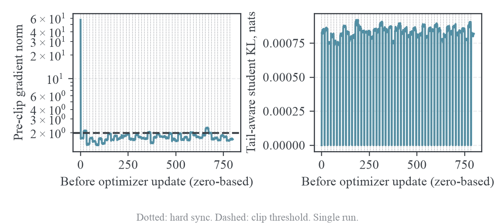
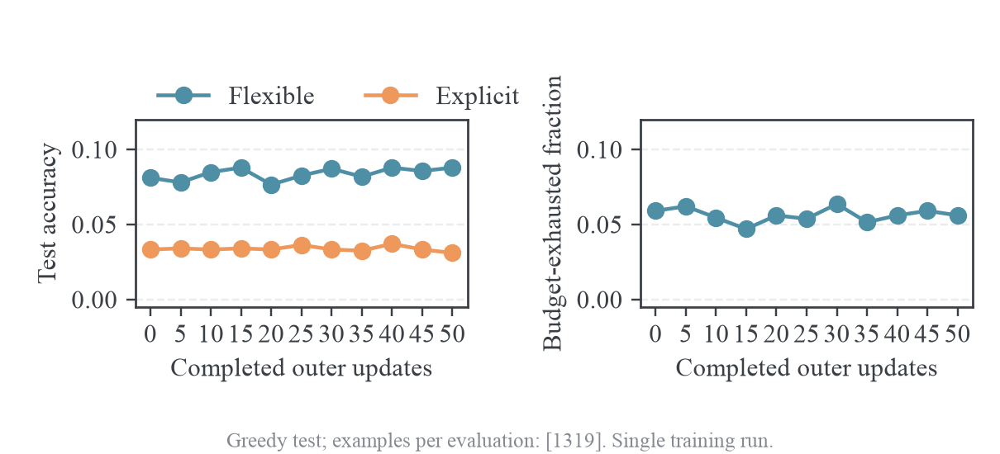

# GSM8K 训练与诊断

本报告整理 SmolLM2-360M-Instruct 学生与 SmolLM2-1.7B-Instruct 教师的旧版训练。MDPO 50 outer 的结果受到已确认的归一化错误及 BF16 参数写回影响，不能用于选择算法；后续 FP32 参数、J=1 的 OPD 实验仍没有证明持续提高任务准确率，且千步实验的固定中途快照存在明显答案格式退化。

| 运行                                  | 保存范围                                  | 可作出的判断                                         |
| ------------------------------------- | ----------------------------------------- | ---------------------------------------------------- |
| `gsm8k-smollm2-mdpo-o50-j16-clip2`    | 50 outer、800 更新，退出 0                | 保存历史结果，归一化及精度混杂限制算法解释           |
| `gsm8k-smollm2-opd-onpolicy-o100-j1`  | 100 outer、100 更新，退出 0               | 最终宽松仅多答对 4 题，严格少 6 题，没有证明提升     |
| `gsm8k-smollm2-opd-onpolicy-o1000-j1` | 固定至 2026-10-11 完整 outer434，评测 430 | 这是中途证据；本报告没有千步终点，不推断现时任务状态 |

这些运行关闭了部分 checkpoint 和逐题输出。无法从现有汇总恢复任意 checkpoint、回答文本或配对正确性，缺失证据不以插值补齐。

## 数据、模型与协议

数据准备脚本 [prepare_gsm8k.py](../../data/refactor-20261015/legacy-source.tar.gz#training/prepare_gsm8k.py) 保留官方 split 顺序。每行只有一个 user message，参考解答不进入 prompt。最终答案从原始参考解答的 `####` 后提取，放在 `reward_model.ground_truth`。两个 split 的样本数、dataset fingerprint 与 parquet SHA-256 写入 `manifest.json`；实际训练再次复制 manifest 并记录文件哈希。

所有问题使用下面的共同指令；训练与测试指令完全一致。

```text
Solve this math word problem. Show your reasoning, then put only the final numeric answer on a final line in exactly this format: #### <number>.

Problem: <question>
```

使用 tokenizer 的 `apply_chat_template(..., tokenize=True, add_generation_prompt=True)` 得到 prompt。启动审计检查其结果与原生模板文本经 `encode(..., add_special_tokens=False)` 的结果一致，避免重复 BOS。SmolLM2 原生模板自动加入它自己的默认 system message；不把 Qwen 或 DeepSeek 的模板套在 SmolLM2 上。审计完整 train/test 的每个 prompt，而不是只检查 canary 抽到的样本；该组 train 最大 288 tokens，test 最大 253，均低于 512。

学生 revision 为 `a10cc1512eabd3dde888204e902eca88bddb4951`，教师 revision 为 `31b70e2e869a7173562077fd711b654946d38674`。千步快照源码 commit 为 `c0496084ba2415e0ea3d0a7a8ae488e0571ff7f1`；各运行仍以自身 provenance 的实际文件哈希为准。旧实验使用训练温度 1、top-p=1、top-k=-1，每题一条轨迹；完整 1319 题测试为 greedy、单次生成、2048-token 回答预算。宽松评分依次读取 hash、boxed、最后一个数字；严格评分要求可解析的 `####` 答案正确。它们与当前 sampled mean@16 协议分别报告。

## MDPO 长程结果

SmolLM2-1.7B-Instruct 教师到 SmolLM2-360M-Instruct 学生的 MDPO 完成了 50 outer、800 inner，退出码为 0。GSM8K test 的 1319 道题在 outer 0、5、10、15、20、25、30、35、40、45、50 全部评测。W&B 服务端回读为 finished、851 行 history、800 行 inner 与 11 次评测。结束时有 W&B atexit 的 ConnectionResetError；它发生在最终评测与日志生成之后，服务端记录已核对完整。

该组训练没有证实有效的数学能力提升。宽松准确率从 107/1319（8.112%）到116/1319（8.795%），只增加9题；严格答案准确率从44/1319（3.336%）到41/1319（3.108%）。宽松准确率在7.657%到8.795%之间波动，末值没有超出此前 outer 15、40 的最大值。没有保留逐题回答和正确性配对，因此不能做 McNemar 检验，也不能给出可靠的配对差值置信区间。单次种子及 9 题净增不能作为成功结论。

已核实一个影响参数更新的配置缺陷：actor 参数以 BF16 存储，普通 PyTorch AdamW 在该存储精度上以 lr=3e-7 更新，没有 FP32 主参数。真实学生模型的受控 MDPO 实验显示，4 次更新后 BF16 只有 207069/361821120 个参数变化（0.05723%），FP32 有 357566093 个参数变化（98.824%）。BF16 参数位移 L2 为 0.00067489，FP32 为 0.0211172，后者约为前者 31.29 倍。实验使用同一短 prefix、同一 teacher、同一 lr、eta=0.3 和 clip=2；它验证存储精度的影响，不替代完整 FSDP 训练实验。

完整证据位于 [长程结果](../../results/training/gsm8k-smollm2-mdpo-o50-j16-clip2/analysis.json)。[参数精度实验](../../data/refactor-20261015/legacy-source.tar.gz#experiments/analysis/mdpo_precision_probe.py) 与 [实验结果](../../results/training/gsm8k-smollm2-mdpo-o50-j16-clip2/precision-probe.json) 可以独立复现。后续配置选择 FP32 参数存储；teacher 与 rollout 继续 BF16，FSDP mixed precision 的前向计算仍为 BF16。原实验的 resolved config 保留 BF16 原值，避免修改历史事实。

| 指标                             | 实测                                      | 解释                                                     |
| -------------------------------- | ----------------------------------------- | -------------------------------------------------------- |
| 训练量                           | 50 outer × 64 问题，800 optimizer updates | 3200 个训练问题采样位置，每条轨迹复用 16 次              |
| 实际 clip 阈值                   | 2                                         | 两处配置一致，来自 engine 运行日志                       |
| 被裁剪更新                       | 56/800，7%                                | 没有全程被 clip 限制                                     |
| 梯度范数                         | 1.3828–57.25                              | 初始 outer 第一次 57.25，后续多数约 1.5–2                |
| 学习率                           | 全程 3e-7                                 | 没有意外衰减为 0                                         |
| 每个 outer 同步前 student center | 全部 0                                    | 50 次 hard sync 的版本一致                               |
| 重要性权重 ESS 比例              | 最低 0.997874                             | 权重没有严重退化；也说明当前 policy 相对 anchor 移动很小 |
| 峰值显存                         | 11047 MiB                                 | 没有 OOM，actor reserved 峰值 9.7773 GiB                 |
| 不含测试的平均 outer 时间        | 173.11 秒                                 | 评测有额外时间，不能按此估计总墙钟                       |

前 10 个 outer 的 teacher center 均值为 0.310501，最后 10 个为 0.323273。sampled reward 均值从 -0.363862 到 -0.390817，更负而非趋向 0。两组数来自不同 rollout、不同问题和不同 prefix，不能将该差直接解释为固定分布上的 KL 恶化；它仍足以说明现有日志没有 teacher KL 稳定下降的证据。

第一个 outer 的 inner 0 梯度范数 57.25，inner 1 为 1.671875，随后维持约 1.7。student center 从 0 变成约 0.00083，后续 inner 没有随更新明显增长。最后一个 outer 的 inner 0 范数 1.6328125，inner 15 为 1.6484375；center 从 0 变成 0.0008192。范数骤降没有伴随 teacher/student 差距消失，不能解释为已到蒸馏最优点。





图中的 overlap 需要区分对象。当前实现比较当前 student 的 top-16 与同一 outer 的 anchor top-16，值约 0.985；它没有比较 teacher 与 student，不能据此声称 student 已接近 teacher。

## 精度影响与归一化错误

### BF16 参数写回

BF16 有 7 位显式尾数。在正规浮点数的 binade 内部，相邻表示值的间隔为

$$
\operatorname{ulp}(w)=2^{\lfloor\log_2|w|\rfloor-7}.
$$

例如 $|w|\approx0.02$ 时，间隔约为 $1.22\times10^{-4}$。若更新量小于半个间隔，按最近值舍入会把参数写回原值。AdamW 在初始阶段的更新尺度通常接近 lr 乘以归一化梯度，而该组 lr 只有 $3\times10^{-7}$。这一比较是诊断线索；实际每个坐标还受动量、二阶矩、epsilon 和裁剪影响，更新量不能统一等同于 lr。

FP32 主参数可以累计这些小更新，再在前向时转为 BF16。单纯把 forward logits 转成 FP32 没有修复参数存储精度。本仓库损失已用 float32 log-softmax，但 actor 原配置依然是 BF16 参数，二者是不同环节。

受控实验也测了未做任何 optimizer step 时的重复前向：sampled log-ratio RMS 为 0。首次更新后的 BF16 RMS 约 0.043，与生产日志同量级。因此现有受控实验没有证明“不更新也有 0.04 数值底噪”；不能把生产 KL 平台解释为纯前向路径差异。BF16 更新舍入问题已有参数差分证据，FSDP train/eval路径、累积梯度与缓存一致性仍应另做零更新测试。

### 全局 token 分母的初始化顺序

MirrorOPD 新增的`distillation_ppo_loss`分支在调用`distillation_loss`之后才调用`populate_global_batch_info`。而`distillation_loss`已经把 token 级 surrogate 交给`agg_loss`，归一化信息在此时就被使用。初始化顺序错误导致第一份 micro-batch 使用局部 token 数，后续 micro-batch 使用 global 分母，下一 outer 的第一份 micro-batch 还会沿用上一 outer 的分母。

设第一个 micro-batch 有$n_1$个有效 token，全 batch 有$N$个 token。正确梯度是

$$
g=\frac1N\sum_{m}\sum_{i\in\mathcal B_m}g_i.
$$

原实现的首次更新在没有 global 信息时得到

$$
\widetilde g=\frac1{n_1}\sum_{i\in\mathcal B_1}g_i+
\frac1N\sum_{m\ge2}\sum_{i\in\mathcal B_m}g_i.
$$

第一份 micro-batch 被放大$N/n_1$倍，这既改变尺度，也改变不同轨迹之间的相对权重。下一 outer 首次 micro-batch 使用$N_{k-1}$而非$N_k$，同样不正确。这是归一化状态错误，与参数精度无关。

修复将`populate_global_batch_info`移到任何 loss 聚合之前，覆盖每份 micro-batch 的 metadata。没有修改 token PG 系数、停止梯度、KL 方向或 outer 同步策略。生产修改保存在`patches/ta-opd-mirror-token-loss.patch`，本机与 archbox 上游运行文件已同步。回归测试`tests/test_training_metrics.py`直接执行真实 entry 函数，并预先注入错误的旧分母 999，验证整 batch 与不等长 micro-batch 划分的 loss 及梯度都等于全 batch 平均。

### 零更新对照

两次实验均显式使用 BF16 actor、lr=0、B=mini-batch=2、micro-batch=1、J=3、response 预算 128。lr 为 0 排除了参数更新，不受“BF16 小更新舍入”的解释干扰。

| 测试   | 三个 inner 梯度范数  | student center | sampled log-ratio RMS | 最终退出             |
| ------ | -------------------- | -------------- | --------------------- | -------------------- |
| 修复前 | 21、15.1875、15.1875 | 全部 0         | 全部 0                | 1，后续 Ray RAM 保护 |
| 修复后 | 8、8、8              | 全部 0         | 全部 0                | 1，后续 Ray RAM 保护 |

两次 rollout 不保证逐 token 相同，不能把 21 到 8 的差直接作为修复前后降幅。证据是各 run 内部固定权重、固定缓存、相同数据重复 inner 时，修复前第一次范数不同，修复后三次相等。参数未更新时 KL 也没有跳变，因此现有测试不支持把 0.0008 KL 平台解释成纯训练/推理前向底噪。

修复后的训练三次 update 执行完毕，但整个任务仍退出 1。BF16 零更新测试也触发 RAM 保护，说明上次 FP32 FSDP 复验失败不是 FP32 才有的问题；应独立审计模型初始化、CPU 参数/optimizer offload 和阶段切换峰值。没有关闭 Ray 内存保护，也没有把这两次失败标为成功训练。

### 修订后的归因

BF16 参数差分探针证明小更新写回受精度影响；lr=0 框架实验又证明归一化状态可在没有参数更新时改变重复 inner 的梯度范数。两个问题各有证据，原“主要是 BF16、实现正常”的判断撤回。不同 run 的 rollout 未配对，21 与 8 的范数差不能当作修复收益的定量估计。

FP32 FSDP 复验曾因 Ray 主机 RAM 保护退出 1，未完成两 outer；后续 CPUOffload 的独立容量分析与显式搬运短验证见[FSDP 故障分析](../analysis/2026-10-15-FSDP主机内存故障分析.md)。这些验证不补成一次修复后的 50-outer 算法效果实验。

## OPD 百步结果

`gsm8k-smollm2-opd-onpolicy-o100-j1` 正常完成 100 outer 与 100 次 optimizer update，退出码 0。测试使用完整 1319 题 GSM8K test，原生 SmolLM2 模板、统一`#### <number>`指令、greedy 生成、2048 token 上限，共进行 21 次评测。宽松评分优先读取`####`，其次读取 boxed 答案，最后读取最后一个数字；严格评分要求`####`答案正确。两种评分分别报告，避免将格式变化等同于数学能力变化。

| 学生状态                  | 宽松正确数 | 宽松准确率 | 严格正确数 | 严格准确率 |
| ------------------------- | ---------: | ---------: | ---------: | ---------: |
| 初始 360M 学生，outer0    |   110/1319 |      8.34% |    45/1319 |      3.41% |
| 训练 100 outer 后         |   114/1319 |      8.64% |    39/1319 |      2.96% |
| 宽松准确率最高点，outer50 |   120/1319 |      9.10% |    47/1319 |      3.56% |

最高点是 21 次测试中的事后选择，不能作为最终模型提升的无偏证据。最终宽松评分仅多答对 4 题，严格评分少答对 6 题；没有保留学生逐题生成结果，因此不能构造同题前后配对检验。目前单次训练不足以确认任务效果改善。


前 10 个 outer 的 Tail-aware teacher KL 均值为 0.32749，最后 10 个 outer 为 0.31158，下降约 4.9%。该 KL 在每轮学生自身 rollout 的 prefix 上统计，prefix 分布也随学生变化，不能当作同一固定测试集上的 KL 下降证明。相应 sampled reward 均值为−0.38688 与−0.38608，基本持平。pre-clip 梯度范数范围 1.356--2.249，clip=2，仅 4% 的更新被裁剪；每轮同步点 student center 和 log-ratio RMS 均 0，importance ESS fraction 均 1。GPU 采样峰值 11923 MiB。上述检查证明 on-policy/J=1 更新与同步可执行，没有把算法效果归因于大量梯度裁剪。

原始配置、来源指纹、inner/outer JSONL、显存采样、退出码、统计 CSV 与图保存在 `results/training/gsm8k-smollm2-opd-onpolicy-o100-j1/`，W&B 为 jkhs04fb[^source-1]。

### 旧输出的同评分重评

旧结果见[小模型基线](../../data/refactor-20261015/legacy-source.tar.gz#experiments/results/2026-10-09-gsm8k-small-models.md)。统一答案格式复测已有原生模板、greedy、1319 题、1024 生成预算下的两模型完整 rollout，远端目录分别为`gsm8k-smollm2-360m-instruct-answer-format-test-greedy-1024`与`gsm8k-smollm2-1p7b-instruct-answer-format-test-greedy-1024`。

旧文档的“格式无关 exact numeric”并非当前训练的宽松评分。为了对齐评分含义，使用当前`mirroropd.training.gsm8k.score_response`重评旧文本，得到下表。这里是重评分已有输出，没有重新生成 1024-budget 轨迹；原始文本 SHA-256、metadata、正确数与均值保存在`results/training/gsm8k-old-baseline-rescored/`。

| 模型或状态            | 生成预算 |     当前宽松评分 |     当前严格评分 |
| --------------------- | -------: | ---------------: | ---------------: |
| 旧初始 360M student   |     1024 |  106/1319，8.04% |   42/1319，3.18% |
| 旧 1.7B teacher       |     1024 | 623/1319，47.23% | 437/1319，33.13% |
| 该组初始 360M student |     2048 |  110/1319，8.34% |   45/1319，3.41% |
| 该组 100 outer 学生   |     2048 |  114/1319，8.64% |   39/1319，2.96% |

teacher 的旧结果已经显示明显能力差距；它不保证学生通过当前蒸馏目标一定取得相同 GSM8K 准确率。2048-budget 教师结果见下节千步快照表；1024 与 2048 仍为不同生成条件。

## 千步实验的固定中途快照

运行源码 commit 是 `c0496084ba2415e0ea3d0a7a8ae488e0571ff7f1`。模型审计固定 student 为 `HuggingFaceTB/SmolLM2-360M-Instruct`，revision `a10cc1512eabd3dde888204e902eca88bddb4951`；teacher 为 `HuggingFaceTB/SmolLM2-1.7B-Instruct`，revision `31b70e2e869a7173562077fd711b654946d38674`。两者词表、特殊 token ID 和原生 chat template 已核对。prompt 明确要求最后用 `#### <number>` 输出答案。

实际算法是 `mirror_opd_onpolicy`，每批 64 个 prompt，每题一条 rollout，每批一个 optimizer update，J=1。学习率固定为 `3e-7`，AdamW，FP32 参数存储、BF16 前向，梯度范数裁剪阈值为 2。训练使用 7473 道题，计划 1000 outer、epoch 上限 9；测试为完整 1319 题，greedy、每 5 outer 一次，回答预算 2048 token。训练采样为 temperature=1、top-p=1、top-k=-1。

损失配置中的 `topk=16` 用于构造 KL baseline 与支持集诊断。采样动作的 student/teacher log-prob 使用完整词表，不能将该组实验解释为“只蒸馏前 16 个 token”。`use_task_rewards=false`，数学题正确性仅作监控；`use_policy_gradient=false` 关闭的是上游可选任务 policy-loss 接线，核心 OPD 仍使用有梯度的 token-score surrogate。共享接口中的 eta=1 不参与 on-policy 分支。

inner 指标描述更新前策略。`inner.outer_call` 从 0 起，trainer 的训练 `outer.step` 从 1 起，前者 0 对应后者 1。W&B 的 `outer_rollout_step` 也使用从 0 起的索引，准确率轴 `evaluation_outer` 使用 trainer step。W&B 内部 `_step` 同时计入 inner/outer 写入，不能当作 optimizer 更新数。

本机核心 `losses.py`、`cache.py`、`metrics.py`、`tracking.py`、verl 适配层，以及现有 patched TA-OPD 的损失、FSDP optimizer 和 worker 文件，SHA-256 与此次 provenance 一致。下面的指标解释因此对应运行时实现。

宽松评分优先取最后一个可解析的 `####` 数字，其次取 boxed 答案，再回退到全文最后一个数字。严格评分要求可解析的 `####` 数字正确；explicit 评分接受 hash 或 boxed。`format_hash` 是成功解析出 hash 数字的比例，不等于文本是否出现任意 `####` 字符串。

| 状态                           | 宽松正确数及准确率 | 严格正确数及准确率 | 可解析 hash 格式比例 | 平均回答 token |
| ------------------------------ | -----------------: | -----------------: | -------------------: | -------------: |
| 初始 student，outer 0          |    111/1319，8.42% |     51/1319，3.87% |     419/1319，31.77% |         271.91 |
| 宽松最高点，outer 90           |    125/1319，9.48% |     47/1319，3.56% |     330/1319，25.02% |         292.95 |
| 最近完整评测，outer 430        |    107/1319，8.11% |      4/1319，0.30% |       65/1319，4.93% |         308.25 |
| 未训练 teacher，同预算独立评测 |   620/1319，47.01% |   436/1319，33.06% |     921/1319，69.83% |         226.74 |

outer 430 的宽松准确率比初始少答对 4 题，下降 0.30 个百分点，不能据此宣布数学能力发生统计显著下降。当前没有保留 student 逐题结果，无法对相同题目的正确/错误变化构造配对检验。outer 90 的最高点是 87 次评测中的事后选择，也不能用它证明训练获得稳定提升。

较长窗口反映了相同趋势：outer 5–100 的平均宽松准确率为 8.70%，105–200 为 8.75%，205–300 为 8.33%，305–400 为 7.80%，405–430 为 8.19%。这些是对同一测试集在不同 checkpoint 状态上的描述性均值，各次评测不独立，不能把题目数乘以评测次数增加统计样本量。

格式退化比宽松准确率的末点变化更明确。hash 格式比例从 31.77% 降到 4.93%，严格正确数从 51 降到 4，boxed 格式仍为 0。严格准确率下降同时包含格式和答案正确性的变化，不能写成“数学正确率降到了 0.30%”。宽松评分的末尾数字兜底会让格式退化在主准确率中不充分显现。

预算耗尽比例从 5.76% 降到 3.87%，同时平均回答长度增加约 13.4%。这些记录不支持“后期被更频繁截断导致格式丢失”的解释。teacher 自己同协议生成的格式率和正确率均明显高于 student，教师缺乏任务能力也不是该组结果的充分解释。教师独立 vLLM 评测与训练内评测的 batch 调度不同，不能要求数值逐位一致。

### 同步首点与集合指标

`support_overlap` 比较当前 student Top-16 与本轮冻结 rollout anchor 的 Top-16。它不比较 student 和 teacher，也不比较训练起点和当前模型。

设第 k 轮 rollout 的冻结策略为 q，更新前 student 为 p。J=1 时唯一一次记录发生在更新前，p=q。因此以下关系在每个 outer 都成立：

$$
\operatorname{Overlap}(\operatorname{TopK}(p),\operatorname{TopK}(q))=1,
\qquad D_{\mathrm{KL}}(q\Vert p)=0,
\qquad \frac{p(a)}{q(a)}=1.
$$

快照内所有 inner 的 overlap mean 均为 1，student center 均为 0，importance ratio 均为 1，sampled log-ratio 均为 0。这是该测量协议的必然结果。要观测参数更新造成的变化，需要固定同一批 prefix，额外比较 optimizer.step 前后模型，或比较当前模型与固定初始模型。

### 更新链路的证据边界

434 条完整 outer 的 pre-clip grad norm 范围为 0.92908–2.18749。仅 3 次超过裁剪阈值 2，占 0.69%；inner 的最小 clip scale 为 0.91429。因此严重梯度裁剪、梯度消失和明显非有限数值不支持作为主因。outer 的数值字段未检出 NaN 或 Infinity。

运行匹配的 FSDP optimizer 实现对有限梯度调用 optimizer.step，参数存储为 FP32。旧长程实验中 BF16 参数写回舍入和首次 batch 归一化的诊断不能直接套用到此次运行。非零梯度和源码接线仍不等于逐步参数差值测量；当前缺少每步 parameter delta、固定 prefix 的更新前后概率和 optimizer state 摘要，因此不能把“梯度正常”升级为全部参数更新的直接证明。

学习率 `3e-7` 在本 run 中固定。仅凭其数值不足以定性为“太小”；已有输出格式和长度的明显变化支持模型行为发生了漂移。下一轮应通过控制变量比较学习率与每步实际更新幅度，避免先增加学习率再寻找解释。

## 旧 overlap 首点的核查

### 集合一致与概率一致

核心代码先计算 `current_ids = log_p.topk(16).indices`，再对每个 current id 检查它是否出现在 anchor ids 中，最后对 16 个布尔值取平均。对单个有效 prefix：

$$
O(s)=\frac{\lvert\operatorname{Top16}(p(\cdot\mid s))\cap\operatorname{Top16}(q(\cdot\mid s))\rvert}{16}.
$$

因此 overlap=1 只要求集合相同，不要求 Top-16 的顺序相同，也不要求概率相同。token 均值为 1 表示此次统计的所有有效 prefix 集合都相同。教师 Top-16 没有参与这项计算。

历史 CPU 探针直接调用与部署指纹对应的`compute_mirror_opd_token_loss`。20 类分布、K=16 下，相同 logits 得到 overlap=1、student center=0；反转 Top-16 内的 logits、保持集合相同，得到 overlap=1、student center=13.83605；交换第 16 和第 17 类 logits，得到 overlap=0.9375、student center 约 $1.57\times10^{-7}$。这个反例同时说明集合完全一致可以伴随很大的 KL，一个边界成员变化也可以只对应极小的 KL。

### 后期 MDPO 的 outer 首点是 inner 平均

归档 run `2ihaqf1e`，即 `gsm8k-smollm2-mdpo-o50-j16-clip2`，首个 outer 包含 16 个 inner。`inner_step=0` 的真实 overlap 为 1；`inner_step=1` 为 0.9848151817；`inner_step=15` 为 0.9846178255。这 16 条 mean 的算术平均为 0.9856372573679648，与 `outer.step=1` 的 `actor/mirror/support_overlap/mean` 精确一致。

原因可以沿源码核对：TrainingWorker 逐 inner 保存 `output_lst`，将 finalize 后的指标通过 `append_to_dict(metrics, output)` 收集为列表；trainer 调用 `reduce_metrics`，普通 mean 字段使用 `np.mean`。因此 outer 图上的第一个点已经包含离开 anchor 后的状态，不是第一个更新前的状态。run `y7hq6m4k` 的真实首 inner 同样为 1，而首 outer 为 0.9850601679630255。旧的 `94exlzw6`、`17p6ukvn` 以及归档中有 overlap 字段的后期 MDPO 记录也满足首 inner=1。

### 早期 MDPO 的真实首 inner 存在前向不一致

更早的 run `kpi8jvdn`，即 `smollm2-mdpo-long-o32-j16-v2`，真实第一条记录为 outer_call=0、inner_step=0、measurement=pre-update。其 overlap=0.9769883548067394、student center=0.0010826191480053852、sampled log-ratio RMS=0.05663392516588201。其他早期 `smollm2-mdpo-long-o32-j16`、`smollm2-mdpo-long-b64-o32-j16-v1` 也存在约 0.977 的首 inner overlap。因此“所有历史首点低于 1 都只是 outer 平均”不成立。

该 run 的 B=32、mini-batch=32，每个 epoch 只有一个 optimizer update。历史 engine 先完成全部 micro-batch 的 forward/backward，再调用一次 optimizer step；首条 overlap 不包含微批之间的参数更新，不能由 off-policy 更新本身解释。

用主仓库 commit `5699a24` 的补丁在历史 TA-OPD `5bed008` 基线上内存重放后，`transformer_impl.py` 的 SHA-256 为 `ddaa93cdea0f5a94f004461528dc830d14525970e6371e33384b22b64cee4acf1`，`ray_trainer.py` 为 `90dbd7610b9321d1ee2c53f167bb2ec95b191e9886bc30ed45a67ec8356ef9eb`，两者与旧 run provenance 精确相同。

历史配置已经确认 anchor scoring micro-batch=1、actor training micro-batch=2，参数与前向为 BF16，注意力实现为 SDPA，use_remove_padding=false，启用 gradient checkpointing。历史 `prepare_model_inputs` 按每个 micro-batch 内的最长序列重新 padding。因此同一条序列在 cache 路径是 `(1, 本条长度)`，在训练路径是 `(2, 两条中的最长长度)`。batch 维度和 padding 长度都不同，这是代码层面的实际前向条件差异。

随后 `smollm2-mdpo-smoke-v3` 保留 BF16、SDPA、无 remove-padding 和 gradient checkpointing，将训练与 scoring micro-batch 都设为 1，真实首 inner 的 overlap=1、student center=0、log-ratio RMS=0。既有完整框架 lr=0、micro-batch 对齐实验也得到三个 inner 的 center 和 log-ratio RMS 全为 0，见 [精度与梯度累积审计](2026-10-15-GSM8K训练与诊断.md)。这些证据不支持将非零首点归因于“off-policy 必然如此”或“BF16/train-eval 必然存在这样的底噪”。

旧 run 的首点已经证明缓存与训练前向给出了不同概率；微批和 padding 形状不一致是已确认的代码条件，尚未完成因果隔离。进一步验证需在同一模型、同一批序列、lr=0 下比较 cache/train micro-batch=1/1、1/2、2/2，记录 overlap、中心、log-ratio、最大 logit 差与参数差。不能用不同 rollout 的两次 smoke 代替这一受控对照。该证据来自 CPU 探针与历史记录，不是同序列 GPU 因果对照。

## KL、reward 与任务指标

### KL 的三个不同对象

`student_center` 是 anchor 到当前 student 的尾部合桶 KL；它在此 run 的更新前为 0。`teacher_center` 是当前 student 到 teacher 的尾部合桶反向 KL baseline；J=1 的更新前 student 等于 anchor。`rollout_corr/kl` 和 `rollout_corr/k3_kl` 则检查 rollout 推理后端与训练 actor 的概率差异，它们不衡量 student 对 teacher 的蒸馏效果。后者约为 $10^{-3}$ 量级不能解释成“已经接近 teacher”。

取 student Top-K 为 S，将其余词表 R 合为一个 tail 类。记 p 为 student 分布，T 为 teacher 分布，$p_R=\sum_{a\in R}p(a)$、$T_R=\sum_{a\in R}T(a)$。记录的 teacher center 为：

$$
B_K(p,T)=\sum_{a\in S}p(a)\log\frac{p(a)}{T(a)}+p_R\log\frac{p_R}{T_R}.
$$

完整词表 KL 的尾部逐项展开为：

$$
\begin{aligned}
\sum_{a\in R}p(a)\log\frac{p(a)}{T(a)}
&=p_R\sum_{a\in R}p(a\mid R)\log\frac{p_Rp(a\mid R)}{T_RT(a\mid R)}\\
&=p_R\log\frac{p_R}{T_R}+p_R\sum_{a\in R}p(a\mid R)\log\frac{p(a\mid R)}{T(a\mid R)}.
\end{aligned}
$$

因此：

$$
D_{\mathrm{KL}}(p\Vert T)=B_K(p,T)+p_RD_{\mathrm{KL}}(p(\cdot\mid R)\Vert T(\cdot\mid R)).
$$

teacher center 低于或等于完整 KL。其跨训练下降可以来自头部分布变化、tail mass 下降以及被测 prefix 分布变化；它没有测出固定测试 prefix 上的完整 KL。

### 蒸馏 reward 与损失系数

`sampled_reward` 定义为 $r(a)=\log T(a)-\log p(a)$。对固定 prefix，完整 categorical 采样满足：

$$
\mathbb E_{a\sim p}[r(a)]=\sum_a p(a)(\log T(a)-\log p(a))=-D_{\mathrm{KL}}(p\Vert T).
$$

因此 reward 为负是正常现象，向 0 方向移动表示该采样测度下的反向 KL 估计减小。训练 actor 与 rollout 后端存在数值概率差异，且有限 token 采样有噪声，上式不是每批观测值的精确恒等式。另一个 `critic/rewards/mean` 则是 64 个训练 prompt 的 0/1 数学评分，单个正确答案即改变均值 1/64；它没有进入该组优化。

名为 `token_advantage` 的字段实际上是最小化 surrogate 的 score coefficient，和 `score_coefficient` 完全相同：

$$
c(a)=-[r(a)+B_K(p,T)]=\log p(a)-\log T(a)-B_K(p,T),
\qquad L=\operatorname{sg}(c(a))\log p(a).
$$

其中 sg 表示停止梯度。最小化 L 时正 c 贡献压低该 token 的 log-prob，负 c 贡献提高该 token 的 log-prob。这个符号和通常采用 $-A\log p$ 的 reward-maximizing advantage 相反；字段名称不能替代损失符号检查。

对同一固定 prefix，上面的尾部分解进一步给出：

$$
\begin{aligned}
\mathbb E_p[c(a)]
&=D_{\mathrm{KL}}(p\Vert T)-B_K(p,T)\\
&=p_RD_{\mathrm{KL}}(p(\cdot\mid R)\Vert T(\cdot\mid R))\geq 0.
\end{aligned}
$$

因此其均值不必为 0。baseline 为 prefix 常数，在总体 token-score 梯度中满足：

$$
\mathbb E_{a\sim p}[B_K\nabla\log p(a)]=B_K\sum_a\nabla p(a)=B_K\nabla 1=0.
$$

合桶 baseline 的近似会影响估计器的方差，却不会仅因为其低估完整 KL 就反转总体 token-score 梯度。上游 `critic/advantages/mean` 是另一条中心化的任务优势统计，接近 0 也不能判断核心 OPD 信号消失。

### 实际变化

以下窗口为 outer 1–50 与 385–434。每个 outer 指标在其 batch 内按有效 token 聚合，表中再对 50 个 batch 指标做算术平均，不是跨窗口的总 token 加权均值。

| 指标                  | 前 50 outer | 最近 50 outer | 解释                            |
| --------------------- | ----------: | ------------: | ------------------------------- |
| teacher center mean   |     0.32442 |       0.30915 | 合桶 KL 降约 4.7%，幅度小       |
| sampled reward mean   |    −0.38095 |      −0.35182 | 采样 KL proxy 改善约 7.6%       |
| token advantage mean  |     0.05653 |       0.04267 | 非零均值符合 baseline 定义      |
| token advantage RMS   |     0.93583 |       0.88315 | 信号幅度仍在，下降约 5.6%       |
| grad norm mean        |     1.68077 |       1.13071 | 非零，下降约 32.7%              |
| student entropy mean  |     1.42096 |       1.19653 | rollout prefix 上的分布趋于集中 |
| anchor tail mass mean |     0.06885 |       0.04858 | Top-16 之外的质量降低           |
| 训练 task reward mean |     0.03563 |       0.03813 | T=1 训练采样准确率仍约 3%–4%    |

蒸馏 proxy 的小幅改善与回答准确率停滞同时存在。entropy 与 tail mass 的下降符合分布变集中的现象，不能仅凭这些跨 prefix 指标宣布模型发生模式坍缩。

## 结论与证据缺口

两次完成训练和一个中途快照均未建立可靠的数学能力提升。宽松评分的末尾数字回退会掩盖答案格式退化；重复使用完整测试集选择最好节点还引入选择偏差。固定前缀完整词表 KL、逐题输出、参数差值和独立训练种子仍不足。

teacher 在学生错误推理前缀上的条件分布不同于教师独立完成题目的分布，这为“教师独立成绩高而学生没有改善”提供待检验解释。现有汇总没有对应 token 概率及回答文本，不能把答案格式退化写成已经定位的 token 机制。

原千步快照的训练 step 累计约 6.31 小时、testing 约 21.09 小时，测试占两者约 77%；该成本属于快照范围。后续实验若改变评测频率、保存策略、目标或任务奖励，应单列新协议，不改写旧记录。

## 证据与历史复现

- [MDPO 长程分析与精度探针](../../results/training/gsm8k-smollm2-mdpo-o50-j16-clip2)。
- [百步实验](../../results/training/gsm8k-smollm2-opd-onpolicy-o100-j1)及[旧输出重评分](../../results/training/gsm8k-old-baseline-rescored)。
- [千步快照审计](../../results/training/gsm8k-smollm2-opd-onpolicy-o1000-j1/audit-20261011.json)、[评测至 outer430](../../results/training/gsm8k-smollm2-opd-onpolicy-o1000-j1/validation-through-outer430.csv)和[同协议教师结果](../../results/training/gsm8k-smollm2-opd-onpolicy-o1000-j1/teacher-matched-summary.json)。

原 launcher、旧 `training/` 核心、精度探针与回归测试从[固定源码归档](../../data/refactor-20261015/legacy-source.tar.gz)恢复，过程见[维护指南](../maintenance.md)。旧 `lr=0` 探针不受当前严格正学习率配置支持，须在历史环境执行。不能用当前 CLI 和新目标替代旧版实验。

### 参考文献

[^source-1]: jkhs04fb. [来源](https://wandb.ai/wncfht/mirror-opd-gsm8k/runs/jkhs04fb).
