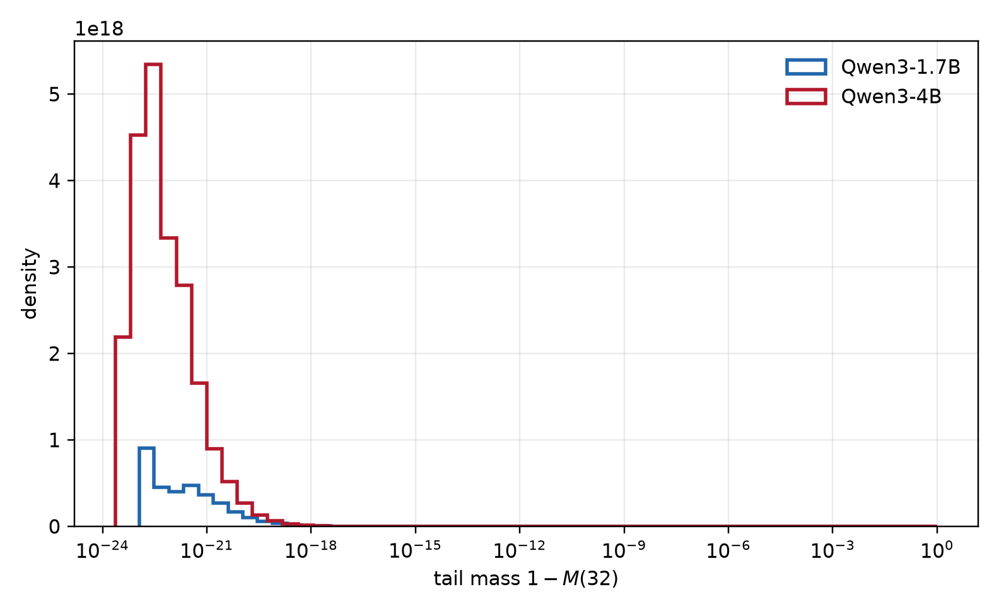

# Qwen3 轨迹与 KL 估计

本研究比较标量 Kullback–Leibler 散度（KL）的完整词表值、头部截断、单动作尾部修正、头部归一化和 tail 合桶。没有训练参数或测量完整参数梯度，数值估计误差不构成算法性能排名。

共同数据集为 GSM8K test 的 1319 题。Qwen3-1.7B 自身生成的 350,166 个前缀用于师生 pair-KL；Qwen3-4B 自身生成的 335,570 个前缀只用于该模型的质量分布。两组访问测度不同，不能逐前缀配对。

## 采样、打分与参照值

使用 GSM8K test split 的全部 1319 个 prompt。每个 prompt 只生成一条完整轨迹，temperature 为 1.0，最大新 token 数为 512；轨迹在模型自然结束时提前停止。Qwen3-1.7B 的轨迹来自已有全量 rollout，Qwen3-4B 在 archbox 上重新完成了 1319 条 rollout。

对每条保存的轨迹，使用同一个模型再次进行 teacher-forcing forward。对于 prefix $s_t$，输入是 prompt 加上此前已经生成的 token，模型输出完整 vocabulary logits；在完整 softmax 上取 $K\in\{1,2,4,8,16,32\}$ 的 top-$K$，并记录每一个 prefix 的 $M_s(K)$。模型加载采用 NF4 4-bit 权重和 bf16 计算，以适配 archbox 的 12GB GPU；softmax 仍在完整词表上计算，top-$K$ 不是 vLLM 的截断 logprob 近似。

1.7B 共得到 350166 个 prefix，4B 共得到 335570 个 prefix。每个模型均覆盖全部 1319 个 prompt。

生成使用 archbox 上的 vLLM 0.29.0。该机没有 `nvcc`，因此关闭 vLLM 的 FlashInfer sampler，仍使用 vLLM 的批量调度和 KV cache；这只改变采样内核，不改变 $T=1.0$、$p$ 或 $q$ 的数学定义。完整 rollout 原始文件保存在 archbox 的 `~/src/md-opd-work/runs/qwen3_gsm8k_student_t1/rollouts.jsonl`，共 350,166 个生成 token。

打分脚本使用 Transformers 的 `logits_to_keep`，只保留生成 token 对应的 logits。由于单张 RTX 4070 SUPER 只有 12 GiB，同时加载两个 bf16 模型会挤压激活和词表 logits，当前完整统计采用 bitsandbytes NF4 4-bit 权重、bf16 计算；因此这里的“真值”是量化后 Student/Teacher 分布的完整词表 KL，`metadata.json` 明确记录这一点。两条 pilot 轨迹已经与完整词表公式逐项核对。全量结果保存在`kl_summary_by_k.csv`，图由历史`plot_pair_kl.py`生成。

[pair-KL metadata](../../results/qwen3_gsm8k_pair_kl/metadata.json)记录模型名称、量化、采样温度、题数与前缀数，没有完整模型 revision 或权重内容哈希。这限制了原始打分分布的独立恢复，不能凭同名模型下载宣称得到完全相同输入。

## 标量估计量与随机性

对 Student 分布 $p$ 和 Teacher 分布 $q$，真值是

$$
K(p,q)=\operatorname{KL}(p\Vert q)=\sum_v p(v)\log\frac{p(v)}{q(v)}.
$$

令 $S_K$ 为 Student 概率最大的 $K$ 个 token。每个 prefix 的截断估计量、一个 sampled-token 修正估计量分别为

$$
\widehat K_{\mathrm{trunc}}=\sum_{v\in S_K}p(v)\log\frac{p(v)}{q(v)},
$$

$$
\widehat K_{\mathrm{corr}}=\widehat K_{\mathrm{trunc}}+\mathbf 1\{Y\notin S_K\}\log\frac{p(Y)}{q(Y)},
\qquad Y\sim p.
$$

真实 rollout token 就是 $Y$。因此截断的 prefix bias 是 $\widehat K_{\mathrm{trunc}}-K$，其方差为零；修正估计量的条件期望等于 $K$，条件方差为

$$
\operatorname{Var}(\widehat K_{\mathrm{corr}}\mid p,q)
=\sum_{v\notin S_K}p(v)\ell(v)^2
-\left(\sum_{v\notin S_K}p(v)\ell(v)\right)^2,
\quad \ell(v)=\log\frac{p(v)}{q(v)}.
$$

汇总表中 `rmse_trunc` 是 prefix 平均的确定性平方误差，`rmse_corrected_theory` 是 prefix 条件方差的平均开方；同时保留真实 rollout token 得到的 `rmse_corrected_observed`，用来显示单次 sampled correction 的实际波动。

## 师生 KL 与头部截断

全量 prefix 数为 350,166，平均 reference reverse KL 为 0.2693 nats。Student 的 Top-1、Top-4、Top-8、Top-32 平均质量分别为 0.9421、0.9975、0.9995、0.99996。对应截断 RMSE 从 $K=0$ 的 1.0397 降到 $K=32$ 的 0.00217；一个 sampled-token 修正的理论 RMSE 从 0.8095 降到 0.02249。因而在真实 Qwen 分布上，$K\geq 4$ 后截断的确定性误差已经小于单 token 修正的条件标准差，体现了无偏高方差与有偏低方差之间的交换关系。

真实 rollout token 的修正误差还受生成阶段 bf16 vLLM 与打分阶段 NF4 量化 Student 的轻微分布不一致影响；例如 $K=32$ 的观测平均误差为 $-2.76\times10^{-4}$，远小于其 0.0519 的观测 RMSE。理论 bias 仍按打分分布严格为零，观测 bias 不应被解读为修正估计量的条件 bias。完整数值见 [kl_summary_by_k.csv](../../results/qwen3_gsm8k_pair_kl/kl_summary_by_k.csv)，图见 [pair_kl_topk_metrics.png](../../results/qwen3_gsm8k_pair_kl/pair_kl_topk_metrics.png)。

### 冻结教师 KL 的分布

| 统计量       |          $K_k^T(s)$ |
| ------------ | ------------------: |
| prefix 数量  |              350166 |
| prompt 数量  |                1319 |
| 均值         |            0.269321 |
| 中位数       | $5.83\times10^{-5}$ |
| 75% 分位数   |             0.05144 |
| 90% 分位数   |             0.63174 |
| 95% 分位数   |             1.50558 |
| 99% 分位数   |             4.76115 |
| 99.9% 分位数 |             12.1811 |
| 最大值       |             28.5129 |

分位数说明 $K_k^T$ 是呈现明显长尾的量。约 67.55% 的 prefix 满足 $K_k^T<0.01$，约 78.55% 满足 $K_k^T<0.1$，约 92.81% 满足 $K_k^T<1$；剩余少数 prefix 对均值贡献很大。

按 prompt 先取 prefix 平均后，1319 个 prompt 的均值统计为：

| 统计量     | prompt 内平均 $K_k^T$ |
| ---------- | --------------------: |
| 均值       |              0.278203 |
| 中位数     |              0.256787 |
| 90% 分位数 |              0.442535 |
| 99% 分位数 |              0.691097 |

prefix 与 prompt 等权均值分别为 0.269321 和 0.278203，二者采用不同长度权重。仅凭均值接近不能排除长度与 KL 的相关性，需另做分桶或配对分析。

生成位置上的均值不稳定。第一个生成 token 的平均 KL 为 1.404，随后下降到第 1 个位置的 0.085，再在后续推理 token 位置反复升高。这说明 prompt 边界和推理阶段的状态分布不同，不能把所有 prefix 当成同一个条件分布来估计一个 KL。

### 各 K 的头部与修正误差

| $K$ | 平均 top-$K$ mass | Trunc bias | Trunc RMSE | Corrected 理论 RMSE |
| --: | ----------------: | ---------: | ---------: | ------------------: |
|   1 |          0.942075 |  -0.076720 |   0.393068 |            0.685574 |
|   4 |          0.997471 |  -0.004648 |   0.047614 |            0.188635 |
|   8 |          0.999493 |  -0.000937 |   0.014156 |            0.083075 |
|  16 |          0.999878 |  -0.000232 |   0.004885 |            0.039593 |
|  32 |          0.999961 |  -0.000080 |   0.002175 |            0.022486 |

## 原生 Top-K 概率质量

表中 prefix 级统计先把所有生成位置放在一起；prompt 级统计先在每个 prompt 内求平均，再对 1319 个 prompt 求统计量。

| 模型       | 层级        | mean $M(1)$ | mean $M(2)$ | mean $M(4)$ | mean $M(8)$ | mean $M(16)$ | mean $M(32)$ |
| ---------- | ----------- | ----------: | ----------: | ----------: | ----------: | -----------: | -----------: |
| Qwen3-1.7B | prefix      |    0.942075 |    0.986763 |    0.997471 |    0.999493 |     0.999878 |     0.999961 |
| Qwen3-1.7B | prompt mean |    0.945931 |    0.988731 |    0.998114 |    0.999662 |     0.999923 |     0.999976 |
| Qwen3-4B   | prefix      |    0.945300 |    0.988205 |    0.997941 |    0.999612 |     0.999899 |     0.999952 |
| Qwen3-4B   | prompt mean |    0.949406 |    0.990109 |    0.998515 |    0.999752 |     0.999938 |     0.999970 |

两个模型都表现出非常尖锐的 next-token 分布。对 prefix 直接平均时，$K=32$ 的尾部质量均值分别为 $3.90\times10^{-5}$ 和 $4.79\times10^{-5}$。换句话说，从概率质量角度看，大多数 prefix 的 top-32 已经接近完整词表。

### M(32) 的分布

prompt 级的 $M(32)$ 几乎全部集中在 1 附近，但仍有少量困难 prompt 的平均尾部质量明显更大。具体地说，prompt 级尾部质量 $1-\overline{M(32)}$ 的统计为：

| 模型       |                mean |              median |                 p90 |                 p99 | 尾部 $<10^{-3}$ | 尾部 $<10^{-4}$ | 尾部 $<10^{-5}$ |
| ---------- | ------------------: | ------------------: | ------------------: | ------------------: | --------------: | --------------: | --------------: |
| Qwen3-1.7B | $2.39\times10^{-5}$ | $1.68\times10^{-6}$ | $4.40\times10^{-5}$ | $3.77\times10^{-4}$ |          99.92% |          94.47% |          77.48% |
| Qwen3-4B   | $2.99\times10^{-5}$ | $4.27\times10^{-7}$ | $1.78\times10^{-5}$ | $8.93\times10^{-4}$ |          99.17% |          95.22% |          87.11% |

prefix 级分布更重尾，因为一个 prompt 只要出现少数几个高熵位置，就会贡献少量大尾部 prefix。

均值和中位数之间的巨大差距正是这个现象：Qwen3-4B 的 prefix 级 median tail32 只有 $7.83\times10^{-12}$，但 mean tail32 是 $4.79\times10^{-5}$。因此“$M(32)$ 很大”对典型位置成立，对每一个位置的统一上界不成立。

## 归一化与 tail 合桶

这里的归一化 Top-$K$ 变体 使用的不是未归一化截断项，而是先把两个分布限制在 Student 的 Top-$K$ 支持集 $S_K$，再分别归一化。记

$$
P_K=\sum_{v\in S_K}p(v),\qquad Q_K=\sum_{v\in S_K}q(v),
$$

则

$$
\bar p_K(v)=\frac{p(v)\mathbf 1\{v\in S_K\}}{P_K},\qquad
\bar q_K(v)=\frac{q(v)\mathbf 1\{v\in S_K\}}{Q_K}.
$$

归一化 Top-$K$ KL 的精确计算式为

$$
K_K^{\mathrm{norm}}
=\operatorname{KL}(\bar p_K\Vert\bar q_K)
=\frac{1}{P_K}\sum_{v\in S_K}p(v)\log\frac{p(v)}{q(v)}
 +\log\frac{Q_K}{P_K}.
$$

因此它不是完整词表 KL 的另一个无偏估计量，而是一个改变了目标分布的确定性近似。对固定 prefix，$K_K^{\mathrm{norm}}$ 没有 sampled-token 随机性，所以本实验中 `variance_normalized=0`；这里的 variance 指估计量条件于该 prefix 的采样方差，不是不同 prefix 之间归一化 KL 数值的方差。后者若用于 reward 归一化，应另行报告。

全量结果如下。bias 和 RMSE 都相对于完整词表 $K(p,q)$ 计算，$K=0$ 的归一化分布未定义，因此留空。

| $K$ |  mean normalized KL |       bias | variance |      RMSE |
| --: | ------------------: | ---------: | -------: | --------: |
|   1 | $5.1\times10^{-11}$ | $-0.26932$ |      $0$ | $1.03968$ |
|   2 |           $0.18540$ | $-0.08392$ |      $0$ | $0.54660$ |
|   4 |           $0.24304$ | $-0.02629$ |      $0$ | $0.28804$ |
|   8 |           $0.26058$ | $-0.00874$ |      $0$ | $0.15007$ |
|  16 |           $0.26622$ | $-0.00310$ |      $0$ | $0.08367$ |
|  32 |           $0.26805$ | $-0.00127$ |      $0$ | $0.05438$ |

在这个实验中，归一化 Top-$K$ 的 bias 与 RMSE 随 $K$ 单调下降，但在 $K=32$ 仍大于未归一化截断的 RMSE $0.00217$。原因是归一化会把头部质量重新放大到总质量一，$log(Q_K/P_K)$ 只校正头部总质量差异，无法恢复尾部的 token-wise KL；它消除了“质量不足”的尺度误差，却没有消除“尾部结构”误差。$K=1$ 时两个归一化分布都是 point mass，KL 恒为零，这正是该定义相对于完整 KL 的极端偏差。

原图 [pair_kl_topk_metrics.png](../../results/qwen3_gsm8k_pair_kl/pair_kl_topk_metrics.png) 已加入归一化 Top-$K$ 的绝对 bias、RMSE 和条件 variance 曲线；逐 $K$ 的全部列（`mean_normalized_kl`、`bias_normalized`、`variance_normalized`、`rmse_normalized`）见 [kl_summary_by_k.csv](../../results/qwen3_gsm8k_pair_kl/kl_summary_by_k.csv)。

### Tail-aware 数值

在相同的 350,166 个 prefix、相同 student Top-$K$ 支持集上，重新打分并计算

$$
K_K^{\mathrm{TA}}=H_K+P_{\mathrm{tail}}\log\frac{P_{\mathrm{tail}}}{Q_{\mathrm{tail}}}.
$$

尾部概率直接用 float64 累加，再合并小于 32 的支持集外头部 token，避免通过 $1-P_K$ 相减丢失精度。这里测试的是 student-support 的 Tail-aware 标量变体；没有复现原论文使用 teacher-support 的训练实验。

| $K$ | mean Tail-aware KL |      bias | conditional variance |     RMSE |
| --: | -----------------: | --------: | -------------------: | -------: |
|   0 |                  0 | -0.269321 |                    0 | 1.039683 |
|   1 |           0.209759 | -0.059561 |                    0 | 0.295078 |
|   2 |           0.248413 | -0.020907 |                    0 | 0.131407 |
|   4 |           0.263978 | -0.005343 |                    0 | 0.045886 |
|   8 |           0.268091 | -0.001230 |                    0 | 0.015303 |
|  16 |           0.269006 | -0.000315 |                    0 | 0.005493 |
|  32 |           0.269220 | -0.000101 |                    0 | 0.002391 |

Tail-aware 是完整 KL 的下界，偏差等于负的尾部条件 KL 贡献。嵌套支持集每增加一个 token，都细化了尾部聚合，因此 Tail-aware 单调上升，RMSE 单调下降。全量汇总和 2,000 个审计 prefix 通过了下界与单调性核对，允许 $2\times10^{-5}$ 的浮点容差。$K=0$ 时只剩一个虚拟 token，KL 严格为零。

Tail-aware 在 $K=1,2,4$ 的 RMSE 小于 Trunc；在 $K=8,16,32$ 略大。令尾部质量项为 $m$，尾部形状项为 $b\geq0$，则 Trunc 和 Tail-aware 的误差分别为 $-(m+b)$ 与 $-b$。当 $m<0$ 时，Trunc 的两项可以抵消，因而其标量 RMSE 可以更小。$K=32$ 时，Tail-aware RMSE 为 0.002391，Trunc 为 0.002175，EMA 单 token correction 的理论 RMSE 为 0.022486，Normalized 为 0.054377。这个排序针对固定分布上的 KL 数值估计，不能外推为训练性能排序。

Tail-aware 的 bias 保留符号，数值与其他估计量使用同一批前缀。

## 尾部质量能够约束什么

固定 prefix，令 p 和 q 分别为同一前缀上的 Student 与 Teacher 打分分布，并记

$$
\ell(v)=\log\frac{p(v)}{q(v)},\qquad H=\sum_{v\in S_{32}}p(v)\ell(v),\qquad T=\sum_{v\notin S_{32}}p(v)\ell(v),
$$

其中 $S_{32}$ 是 p 的 top-32 集合。真实单步 KL 为 $D=H+T$。

Trunc 估计量为 $\widehat D_{\mathrm{trunc}}=H$，所以它的条件偏差和方差是

$$
\operatorname{Bias}(\widehat D_{\mathrm{trunc}})=-T,
\qquad
\operatorname{Var}(\widehat D_{\mathrm{trunc}})=0,
\qquad
\operatorname{MSE}(\widehat D_{\mathrm{trunc}})=T^2.
$$

sampled-token Corrected 估计量先从 $p$ 采样 $Y$，若 $Y\in S_{32}$ 则回退到 $H$，若 $Y$ 在尾部则补上 $\ell(Y)$：

$$
\widehat D_{\mathrm{corr}}=H+\mathbf 1\{Y\notin S_{32}\}\ell(Y).
$$

它在条件于 prefix 时无偏，但方差为

$$
\operatorname{Var}(\widehat D_{\mathrm{corr}})
 =\sum_{v\notin S_{32}}p(v)\ell(v)^2-T^2.
$$

令尾部概率为 $\delta=1-M(32)$。当尾部 log-ratio 有界 $|\ell(v)|\le L$ 时，

$$
|T|\le \delta L,
\qquad
\operatorname{Var}(\widehat D_{\mathrm{corr}})\le \delta L^2.
$$

这给出关键的尺度差异：Trunc 的 RMSE 上界按 $O(\delta)$ 缩小，Corrected 的标准差按 $O(\sqrt\delta)$ 缩小。于是当 $\delta$ 很小时，Corrected 虽然无偏，单样本 RMSE 仍然可能大于 Trunc；它的优势是消除系统性尾部偏差，而不是保证每个 prefix 的单次 RMSE 更小。

因此，对本实验的 $M(32)$ 结果，正确结论是：$M(32)$ 大时 Trunc 通常更低方差、也常有更小 RMSE，但“只要 $M(32)$ 大就必然更好”不成立。还必须看尾部的 $\ell(v)^2$ 加权二阶矩，以及任务是否要求无偏 KL。尾部质量很小但 teacher 在尾部给出极端 log-ratio 时，Corrected 的方差仍会被少数事件主导。

仅知道 $M_s(K)=1-\delta$ 很大，不能推出 top-$K$ KL 的 RMSE 很小。原因可以通过尾部的精确分解看清楚。令

$$
S=S_K(p),\qquad
\delta=p(S^c),\qquad
\beta=q(S^c),
$$

并定义尾部条件分布

$$
p_T(v)=\frac{p(v)}{\delta},\qquad q_T(v)=\frac{q(v)}{\beta},\qquad v\in S^c.
$$

当 $\delta,\beta>0$ 时，Trunc KL 所遗漏的项满足恒等式；若 $\beta=0$ 且 $\delta>0$，则 $q$ 在 student 的尾部存在零概率，真实 KL 直接为 $+\infty$。

$$
\begin{aligned}
T
&=\sum_{v\in S^c}p(v)\log\frac{p(v)}{q(v)}\\
&=\delta\log\frac{\delta}{\beta}
  +\delta D_{\mathrm{KL}}(p_T\Vert q_T).
\end{aligned}
$$

这个公式把两个因素分开了。$M(K)$ 只给出 $\delta$，而 $T$ 还取决于 teacher 在尾部给出的总质量 $\beta$，以及两个模型在尾部条件分布上的 KL。只要 $D_{\mathrm{KL}}(p_T\Vert q_T)$ 没有统一上界，$\delta$ 再小也不能给出统一的 KL 截断误差上界。

### 无假设时的反例

考虑只有两个 token 的分布，top-1 集合为第一个 token：

$$
p=(1-\delta,\delta),
\qquad
q=(1-\delta e^{-A},\delta e^{-A}),
$$

其中 $0<\delta<1/2$，$A>0$。此时 $M(1)=1-\delta$ 可以任意接近 1，但被截断的尾部项为

$$
T=\delta\log\frac{\delta}{\delta e^{-A}}=\delta A.
$$

固定任意很小的 $\delta$，让 $A\to\infty$，就得到 $M(1)\to1$ 而 Trunc 的 bias 和 RMSE 任意大。这里 teacher 与 student 在尾部的距离是由 $q$ 的极小尾部概率造成的。因而“teacher 与 student 距离很远”确实会破坏仅根据 $M(K)$ 作出的 RMSE 判断。

反例还说明，teacher 的全局 KL 很大并不自动意味着 Trunc 一定很差：如果差异集中在 $S$ 内，Trunc 仍然可以准确保留全部主要 KL；真正决定截断误差的是被丢弃尾部的 KL，而不是总 KL 的大小。

### 需要什么额外假设

若在所有被截断 token 上有统一的 log-ratio 上界

$$
\left|\log\frac{p(v)}{q(v)}\right|\le L_K,\qquad v\in S^c,
$$

则

$$
|T|\le \delta L_K,
\qquad
\operatorname{RMSE}(\widehat D_{\mathrm{trunc}})le \delta L_K.
$$

若进一步使用尾部条件分布的上界

$$
D_{\mathrm{KL}}(p_T\Vert q_T)\le C_K,
\qquad
\left|\log(\delta/\beta)\right|\le B_K,
$$

则由精确分解得到

$$
|T|\le \delta(B_K+C_K).
$$

这才是可以把 $M(K)$ 转换为 KL 截断误差保证的条件。若 $B_K$ 或 $C_K$ 随 $K$ 增长，或者 teacher 的尾部概率 $\beta$ 远小于 student 的 $\delta$，$M(K)$ 的高质量并不能抵消尾部 log-ratio 的增长。

### Corrected 方差也需要尾部二阶矩

令 $Y\sim p$，sampled-token Corrected 估计量为

$$
\widehat D_{\mathrm{corr}}=H+\mathbf 1\{Y\in S^c\}\ell(Y),
\qquad
\ell(v)=\log\frac{p(v)}{q(v)}.
$$

写成尾部条件分布的形式，令

$$
\mu_T=\mathbb E_{p_T}[\ell(V)],
\qquad
\sigma_T^2=\operatorname{Var}_{p_T}(\ell(V)).
$$

则 $T=\delta\mu_T$，并且

$$
\operatorname{Var}(\widehat D_{\mathrm{corr}})
=\delta\sigma_T^2+\delta(1-\delta)\mu_T^2.
$$

因此 Corrected 的方差不仅由 tail event 的概率 $\delta$ 决定，还由尾部 log-ratio 的条件方差和均值决定。即使 $\delta$ 达到 $10^{-5}$，若某些尾部 token 的 teacher 概率极小，$\sigma_T^2$ 或 $\mu_T^2$ 仍可使单样本 RMSE 很大。要得到可用的 variance bound，需要假设尾部 log-ratio 有界，或者直接估计尾部二阶矩

$$
S_{2,T}=\sum_{v\in S^c}p(v)\left(\log\frac{p(v)}{q(v)}\right)^2.
$$

在实际 OPD 实验中，$M(K)$ 应当与 $\beta$、尾部条件 KL 以及 $S_{2,T}$ 一起报告；单独报告 $M(K)$ 只能说明 top-$K$ 对 student 概率质量的覆盖率，不能单独说明 KL 估计量的 bias、variance 或 RMSE。

## 合成分布对照

实验为每个情景固定生成一个 token-level categorical distribution pair：

$$
\pi_{\rm ref}=\operatorname{softmax}(z_{\rm ref}),
\qquad
\pi=\operatorname{softmax}(s z),
$$

其中 $z,z_{\rm ref}\sim\mathcal N(0,I_{32000})$ 独立抽取。对每个目标质量 $M_{32}\in\{0.2,0.5,0.8,0.9\}$，用二分法选择 $s$，使

$$
\sum_{j\in\operatorname{TopK}(\pi,32)}\pi(j)\approx M_{32}.
$$

不同 panel 只改变策略的集中度，使用同一个固定的分布对计算真值、偏差和方差。

该合成对照每个分布只用一个 sampled token（B=1）；跨前缀均值的方差还依赖相关性，不由独立动作公式单独决定。

所有图都报告相对量。对任意标量估计量，

$$
\operatorname{MSE}=\operatorname{Bias}^2+\operatorname{Var},
\qquad
\operatorname{RMSE}=\sqrt{\operatorname{MSE}}.
$$

该合成实验固定 $B=1$，所以

$$
\operatorname{RMSE}_{\rm trunc}
 =|\operatorname{Bias}_{\rm trunc}|,
\qquad
\operatorname{RMSE}_{\rm corr}
 =\sqrt{\operatorname{Var}_{\rm corr}}.
$$

对应输出如下：

- [标量 KL bias](../../results/ema_topk_reproduction/k_analysis/topk_value_bias.png)：Trunc-Top-K 的 tail bias 与 Top-K corrected 的零 bias。
- [标量 KL variance](../../results/ema_topk_reproduction/k_analysis/topk_value_variance.png)：Trunc-Top-K 的零 Monte Carlo 方差与 Top-K corrected 的 tail variance。
- [单 sampled-token 综合图](../../results/ema_topk_reproduction/k_analysis/topk_value_single_token_summary.png)：$K=0,1,\ldots,32$ 时两种估计量的 bias、variance 和 RMSE。
- [标量 KL RMSE](../../results/ema_topk_reproduction/k_analysis/topk_value_rmse_vs_k.png)：固定一个 sampled token 时两种估计量的 RMSE。
- [RMSE 交点曲线](../../results/ema_topk_reproduction/k_analysis/topk_value_rmse_crossings.png)：对每个目标 $M_{32}$，线性插值两条 $B=1$ RMSE 曲线的首个交点 $K^*$；数值见 [crossing_metrics.csv](../../results/ema_topk_reproduction/k_analysis/crossing_metrics.csv)。
- [逐点数据](../../results/ema_topk_reproduction/k_analysis/value_metrics.csv)：包含 KL 真值、head/tail 值、两种估计量的 bias、variance 和标准差。

图中的结论是：Trunc-Top-K 在小 $K$ 时可能依靠零方差取得较小的单次 RMSE，但它一般保留 tail bias；Top-K corrected 在标量上无偏，增大 $K$ 通常会降低 single-token tail variance，但由于方差还包含尾部均值平方项，个别很小的 $K$ 区间可以出现非单调变化。在该合成实验 $B=1$ 实验中，corrected estimator 的 RMSE 就是其 single-token 标准差。

## 标量权重集中度及梯度解释边界

若把每个 prefix 视为一个 sample，并把一个非负的 top-$K$ KL 标量 $R_i$ 当作样本权重，可以使用标准的权重有效样本数

$$
\operatorname{ESS}_R
=\frac{\left(\sum_{i=1}^{N}R_i\right)^2}{\sum_{i=1}^{N}R_i^2}.
$$

当 prefix 独立同分布时，归一化后的大样本形式为

$$
\frac{\operatorname{ESS}_R}{N}
\longrightarrow
\frac{\mathbb E[R]^2}{\mathbb E[R^2]}
=\frac{1}{1+\operatorname{CV}(R)^2}.
$$

这是非负标量权重的经验集中度。轨迹前缀相关，不能把结果直接解释为独立样本数。它不是普通 on-policy rollout 的 proposal ESS：如果只做未加权的 on-policy 平均，proposal 本身就是 $\pi_k$，形式上的 proposal ESS 是 $N$；ESS 的下降来自 reward 重尾，而不是采样分布错配。

在当前 1.7B rollout、4B teacher 的完整 $K_k^T$ 数据上，若把 $R_i=K_k^T(s_i)$ 作为非负标量权重，则

$$
\mathbb E[R]=0.269321,
\qquad
\mathbb E[R^2]=1.08094,
$$

给出

$$
\frac{\operatorname{ESS}_R}{N}=0.06710,
\qquad
\operatorname{ESS}_R\approx 23497
$$

（$N=350166$ 个 prefix）。这说明重尾已经把标量 reward 加权的有效样本量压到约 6.7%。这只是 $K_k^T$ 的示例；对每个 top-$K$ Trunc reward，应使用对应的逐 prefix $R_i^{(K)}$ 重新计算。

Trunc 和 Corrected 的差异可以写成

$$
R_i^{\mathrm{trunc}}=H_K(s_i),
\qquad
R_i^{\mathrm{corr}}=H_K(s_i)+\mathbf 1\{Y_i\notin S_K\}\ell_i(Y_i).
$$

Trunc 删除尾部随机项并引入 bias；Corrected 在匹配采样分布时恢复无偏性。两者标量二阶矩和经验集中度的实际排序仍需逐 K 计算，不能仅凭省略尾部项保证。因此应同时报告

$$
\mathbb E[(R^{(K)})^2],
\qquad
\operatorname{ESS}_{R^{(K)}},
\qquad
\text{Trunc bias}.
$$

### Vanilla OPD 中的 signed reward

Vanilla OPD 常用的是 token-level signed reward

$$
r(s,a)=\log\frac{\pi_T(a\mid s)}{\pi_k(a\mid s)},
$$

而不是非负的 $K_k^T(s)$。它满足

$$
\mathbb E_{a\sim\pi_k}[r(s,a)]=-K_k^T(s),
$$

并且可以正可以负。因此普通的

$$
\frac{(\sum_i r_i)^2}{\sum_i r_i^2}
$$

会因为正负抵消而接近零，不能作为稳定的 ESS 定义。对 signed reward，至少要同时报告二阶矩和信噪比

$$
\mathrm{SNR}_r
=\frac{|\mathbb E[r]|}{\sqrt{\operatorname{Var}(r)/N}},
$$

或者使用绝对权重版本

$$
\operatorname{ESS}_{|r|}
=\frac{(\sum_i|r_i|)^2}{\sum_i r_i^2}.
$$

真正用于 policy gradient 的样本是

$$
G_i=r_i\,\nabla_\theta\log\pi_\theta(a_i\mid s_i).
$$

完整梯度的均值、二阶矩和方向相关性需要另外测量。本实验没有这些观测。

即使另计算范数集中度 $(\sum_i\lVert G_i\rVert)^2/\sum_i\lVert G_i\rVert^2$，它也忽略方向抵消。例如 $G_1=v$、$G_2=-v$ 且 $v\ne0$ 时，该值为 2，而平均梯度为零。因此不能将标量 reward 的重尾或范数集中度直接写成 vanilla OPD 低梯度信噪比、低训练效率的实验证据。截断、baseline 或多样本修正对完整梯度二阶矩的影响仍须实际检验。

## 结果解释与复现

Top-32 的平均质量接近 1，与教师 KL 的均值约 0.2693 nats 同时成立；概率集中不保证两个分布相同。截断在这批分布上的 RMSE 可小于无偏单动作修正，但误差受 tail log-ratio 而非单独 tail mass 决定。归一化 Top-K 改变目标分布；Tail-aware 是指定支持集上的合桶 KL，不等同于教师支持集的训练方法。

完整词表参照来自 NF4 量化打分模型，不是 BF16 生成模型的精确条件分布。理论无偏性条件于从打分分布采样；现有 rollout 来自 BF16 vLLM，观测偏差应保留这项分布差异。每题最多 512 个新 token，达到上限的回答仍是截断轨迹，不能统一称为自然完成回答。

| 证据                         | 位置                                            |
| ---------------------------- | ----------------------------------------------- |
| pair-KL 全量表与图           | [pair-KL](../../results/qwen3_gsm8k_pair_kl)    |
| 350,166 个前缀的冻结 KL 统计 | [KT](../../results/qwen3_gsm8k_kt)              |
| 两模型各自轨迹的 Top-K 质量  | [MK](../../results/qwen3_gsm8k_mk)              |
| 合成分布数值对照             | [合成实验](../../results/ema_topk_reproduction) |

结果中的 metadata、逐点 CSV 与绘图输入保留，不重新 rollout 冒充相同轨迹。历史采样、打分与绘图程序按[历史源码恢复](../maintenance.md)查找固定归档；本轮未重跑 GPU 打分或估计器 Monte Carlo。各表中的方差条件于固定前缀，不能当作跨前缀方差、训练种子方差或梯度方差。
