# 固定监督蒸馏动力学与 BPO 优化实验报告

更新日期：2026-10-15。本报告合并 OneShot 与 BPO 标量调度两份报告，统一保存固定监督、学习率、精度、镜像蒸馏及相关 target/中心估计的历史研究。2026-10-15 新增的生产实现正确性与估计器对照按用户要求另写[实现验证报告](2026-10-15-幂均值镜像蒸馏实现与估计器对照.md)。

外层迭代 outer 建立 rollout 与冻结锚点，内层迭代 inner 复用当轮缓存；一步指一次 optimizer 更新。

前向传播、反向传播、监督 token 和墙钟时间分别计数。

研究从一个可重复的现象出发：同一批状态和教师标签可以被学生持续吸收数百步。目标是区分误差谱、AdamW 状态、数值精度和生产代理的作用，判断完整 BPO 的 logit 二次结构能否帮助选择全局学习率，同时减少达到相同误差阈值的实际成本。

后续幂均值研究改变教师 target，单独讨论，不能作为原 LR 调度假设的证据。

已有证据支持固定监督下的长期吸收和有限范围内的有效时间缩放。

当前 search/feedback 没有在生产代理上超过充分调参的常数 LR；同状态分叉只验证了局部增大学习率的有限收益。

尚未验证一个从头执行、长期优于强常数的调度，也未识别真实渐近误差底。

## 研究问题、判据与证据范围

同策略蒸馏（On-Policy Distillation，OPD）在学生访问的前缀上对齐教师；镜像下降策略优化（Mirror Descent Policy Optimization，MDPO）拟合每轮镜像目标；BPO 沿用代码名称，指中心化对数比的方差目标。

KL 是 Kullback–Leibler 散度，FP32 是单精度浮点数，BF16 是 bfloat16。

下文统一使用冻结锚点 $q$、教师 $T$、当前学生 $p_\theta$，$\eta$ 为该轮固定镜像强度。

判定实验是否支持目标时，分别检查以下三个层次。

1. 现象验证：固定数据在 update100 后仍有可重复的改善。
2. 优化验证：独立完整目标的下降速度，或达到同一阈值的成本，优于充分扫描的常数 LR。
3. 生产收益：验证误差、总耗时与稳定性同时支持改进。

代理 residual 变小、optimizer step 变少和单步下降变大，都不足以单独通过优化或生产判据。

原标量确认以几何平均误差改善至少 10% 为主判据。失败、反弹和未达阈值的条件均保留。

| 实验  | 证据与规模                                  | 状态及可回答的问题                            |
| ----- | ------------------------------------------- | --------------------------------------------- |
| 1–4   | 历史 t22；新 frozen 三 LR；精度与 online    | 固定监督与精度效应已验证；online 仅一 LR 完成 |
| 5–6   | OPD 50 更新，MDPO/BPO 各 800；原 inner 日志 | 生产训练完成；小 anchor KL 的含义可核实       |
| 7     | 六组历史在线 LR，各 279 条记录              | 仅 CPU 复算；提供高 LR 反弹参照               |
| 8–9   | 二次 690 条、分类 540 条轨迹                | 已完成；验证理想优化与代理失配                |
| 10–11 | 同一 416-prefix LM，完整/生产场 20 分支     | 已完成；比较 backward 与总成本                |
| 12–14 | 短池 13 组调参、center 诊断、24 组确认      | 已完成；最后一个确认取消                      |
| 15–16 | 全量 64 条，8 组常数、24 组同状态分叉       | 已完成；阶段 LR 与多步稳定性                  |
| 17–21 | 幂均值、序列、中心及估计器解析/缓存检查     | 已完成 CPU 分析；新增 GPU 方法训练未启动      |

历史运行只读取原始记录；当前研究 GPU 任务仅使用物理 0–3。

取消的多 seed 和 FP32 条件保持取消。

文中的计划与建议均不代表已经派发；原始执行范围保留在配置文件，末节单列待执行研究。2026-10-15 起，BPO 二样本恒等式及其训练计划取消；当前实现与 Top-J＋tail / 完整词表对照维护在[实现验证报告](2026-10-15-幂均值镜像蒸馏实现与估计器对照.md)。历史原始统计保留，退出当前算法路线。

## 统一目标、动力学与比较口径

### 三种误差各自回答的问题

固定动作上的平均绝对 log-prob 差衡量记录动作的拟合：

$$
d(\theta)=\frac1N\sum_i|\log p_\theta(a_i\mid c_i)-\log T(a_i\mid c_i)|.
$$

完整词表 reverse KL 衡量固定前缀上当前学生到教师的距离：

$$
D_T(\theta)=\mathbb E_{c\sim\mu}\sum_a p_\theta(a\mid c)\log\frac{p_\theta(a\mid c)}{T(a\mid c)}.
$$

BPO 衡量本轮 Gibbs target 的拟合。先定义相对锚点的对数比和中心化算子，再构造 residual 与平方目标：

$$
U=\log(p_\theta/q),\qquad r=\log(T/q),\qquad C_qf=f-\mathbb E_qf,
$$

$$
R=C_q(U-\eta r),\qquad Q(\theta)=\frac{\mathbb E_{\mu,q}R^2}{2\eta}.
$$

固定动作来自 $q_0$，其有符号均值的期望是 $\mathbb E_{q_0}\log(p/T)$；当前 reverse KL 的动作测度则是 $p$。二者通常不同。

anchor–student KL、teacher center 和当前 teacher KL 也分别记录。

$\eta=0.3$ 时完整 BPO 自由分布最优解为 $p_G\propto q^{0.7}T^{0.3}$；$Q=0$ 通常仍有 $D_T>0$，该值也不是所有学生的 teacher KL 下界。

### 固定监督仍然减慢的谱机制

对单前缀 softmax，$F_p=\operatorname{Diag}(p)-pp^\top$，精确 reverse-KL logit 梯度为 $F_p(z-z_T)$。一般位置的 Hessian 还包含 $F_p$ 的导数，只有目标附近固定 Jacobian 时才近似 $H=\mathbb E[J_c^\top F_{T,c}J_c]$。

例如均匀二分类教师、学生概率为 $1-\varepsilon$，KL 接近 $\log2$，logit 梯度却只有 $O(\varepsilon\log(1/\varepsilon))$；饱和几何可造成大误差、小梯度。

固定二次参考模型记 $E=Q-Q_* = e^\top He/2$，在固定特征基下梯度流有 $E_i(\tau)=E_i(0)e^{-2\lambda_i\tau}$。令 $w_i=E_i/E$，逐步求导得到

$$
\frac{dE}{d\tau}=-2\sum_i\lambda_iE_i,\quad
\frac{dw_i}{d\tau}=-2w_i(\lambda_i-\mathbb E_w\lambda),\quad
-\frac{d\log E}{d\tau}=2\mathbb E_w\lambda,\quad
\frac d{d\tau}\left[-\frac{d\log E}{d\tau}\right]=-4\operatorname{Var}_w(\lambda)\le0.
$$

快方向先消失，剩余权重转向慢方向，故相对吸收率也能下降。单指数只产生绝对下降量变小。

有限维正谱最终有正的最慢活跃速率；持续趋零还需接近零的谱、移动几何或误差底。

未知 $Q_*$ 时，原始 $Q/Q_0$ 的吸收率不能直接当作 excess loss 的吸收率。

### BPO 的精确二次结构及参数边界

令 $z_G=(1-\eta)z_q+\eta z_T$。展开 log-softmax 后，所有公共归一化常数被 $C_q$ 消去；再用 $\mathbb E_q[(x-\mathbb E_qx)^2]=x^\top F_qx$ 得到

$$
R=C_q(z_\theta-z_G),\qquad Q=\frac1{2\eta}\mathbb E_\mu[(z_\theta-z_G)^\top F_q(z_\theta-z_G)],\qquad
\nabla_zQ=F_q(z-z_G)/\eta,\quad \nabla_z^2Q=F_q/\eta.
$$

自由 logits 中该式全局成立，不要求师生接近。共享非线性参数的 Hessian 还包含 logit 的二阶导数：

$$
\nabla_\theta^2Q=\frac1\eta\mathbb E_\mu\left[J_c^\top F_{q,c}J_c+\sum_v(F_{q,c}(z_\theta-z_G))_v\nabla_\theta^2z_{\theta,c,v}\right].
$$

固定 Jacobian 才得到参数二次问题。

冻结 $q$ 固定 logit 权重，稀有 $q$ 动作仍可对应小曲率；改变 teacher 会改变误差谱权重和上述 residual 二阶项。完整推导与定理维护在[动力学章节](../../theory/book/sections/dyn_scalar_schedule.tex)。

### 有效时间与离散步长

小步 GD 的各方向满足 $e_{n+1,i}=(1-\alpha_n\lambda_i)e_{n,i}$。当 $0\le\alpha_n\lambda_i<1$ 时，对乘积取对数并展开：

$$
\log\frac{|e_{N,i}|}{|e_{0,i}|}=-\lambda_i\sum_{n<N}\alpha_n-\frac{\lambda_i^2}{2}\sum_{n<N}\alpha_n^2-\cdots,\qquad
u_N=\sum_{n<N}\frac{\alpha_n}{10^{-6}}.
$$

常数 LR 才可写成 $u=(\alpha/10^{-6})N$；时变 LR 必须累加。

连续标量梯度流只是时间重参数化；离散步序可改变谱滤波，但当前算法没有证明 Chebyshev 类谱加速。

已知固定谱、普通 GD 下的理想 Chebyshev 步序依赖可信谱端点，不能直接迁移到当前 AdamW。

### AdamW 状态与数值精度

AdamW 对裁剪后梯度 $\widetilde g_n$ 更新

$$
\begin{aligned}
m_{n+1}&=\beta_1m_n+(1-\beta_1)\widetilde g_n,\quad v_{n+1}=\beta_2v_n+(1-\beta_2)\widetilde g_n^{\odot2},\\
\widehat m_{n+1}&=m_{n+1}/(1-\beta_1^{n+1}),\quad \widehat v_{n+1}=v_{n+1}/(1-\beta_2^{n+1}),\\
\theta_{n+1}&=\theta_n-\alpha_n\left[\widehat m_{n+1}/(\sqrt{\widehat v_{n+1}}+\epsilon)+\lambda_{\rm wd}\theta_n\right].
\end{aligned}
$$

LR 在 moments 更新后乘到当前方向上。Adam 的定义与实现依据分别见原论文[^adam]和 PyTorch[^torch-adamw]。

两矩的原始更新记忆尺度为 $-1/\log\beta$，当前 betas 对应约 9.49 和 999.50 步。改变 LR 后，它们在 $u$ 轴上的记忆尺度也会改变。

曲线近似重合要求不同 LR 在相同参数位置产生接近的更新方向；Adam 的定义不能直接保证这一条件。

BF16 将 FP32 master 参数映射为离散前向权重。不同 LR 跨过舍入阈值的顺序也会影响后续梯度。

### 全局 loss 变换与 LR 的区别

对整个真实 loss 作 $\phi(Q)$，梯度变为 $s_ng_n$、$s_n=\phi'(Q_n)$。从零状态开始、同一梯度历史、恒定 $s>0$、裁剪未引入不同跨步倍率时，一阶矩乘 $s$、二阶矩乘 $s^2$，因此

$$
\frac{\widehat m'}{\sqrt{\widehat v'}+\epsilon}=\frac{\widehat m}{\sqrt{\widehat v}+\epsilon/s}.
$$

$\epsilon$ 可忽略时常数 loss 缩放几乎抵消；乘 LR 则确实放大参数位移。

时变 $s_n$ 被两矩以不同历史权重吸收，各坐标通常不再共享一个相对于原方向的倍率。log/sqrt loss 是改变 moments 的独立机制，不能当作严格保持 AdamW 方向的 LR 调度。

生产 `coefficient * log_prob` 只承载梯度；先由独立 residual 求缩放，再 stop-gradient 乘 surrogate，才具有指定梯度缩放含义。

### 完整目标与生产代理的差别

生产 residual 为 $\widehat R=U+\widehat K_S-\eta(r+\widehat K_T)$。student center 每次 forward 重算后停止梯度，teacher center 在 outer 内冻结；训练梯度为 $\widehat g=\operatorname{mean}[\operatorname{sg}(\widehat R/\eta)\nabla\log p]$。

即使使用完整 center，有限固定动作的经验平方梯度还含 $\operatorname{mean}[R\nabla K_S]/\eta$；总体 $q$ 期望中因 $\mathbb E_qR=0$ 才消失。

Top-k 加尾部桶满足完整 KL 链式分解。记 $\delta_S=\widehat K_S-K_S$、$\delta_T=\widehat K_T-K_T$、$b=\delta_S-\eta\delta_T$，完整动作期望下的近似 logit 场为

$$
K_S=\widehat K_S+q_{\rm tail}\operatorname{KL}(q(\cdot\mid\mathrm{tail})\Vert p(\cdot\mid\mathrm{tail})),\qquad
\widehat g_z=F_q(z-z_G)/\eta+b(q-p)/\eta.
$$

尾部式由 $q_a=q_Rq(a\mid R)$、$p_a=p_Rp(a\mid R)$ 代入逐项 KL 后分别求和得到。

$b$ 随尾部形状变化，更新场一般不能当作同一个固定平方目标的梯度。

任意有限正标量保持该场的零点，不能补回缺失方向。

固定 full-batch、dropout=0 时没有新的 minibatch 重采样噪声；经验偏差、表示限制和数值误差仍可存在。

### 共同模型与训练配置

实际模型均为学生 DeepSeek-R1-Distill-Qwen-1.5B、教师 JustRL-DeepSeek-1.5B；新 BPO/幂均值缓存锁定 revision 为学生 `ad9f0ae0864d7fbcd1cd905e3c6c5b069cc8b562`、教师 `0637e4096c789c67f9eecbe8355e0bdeddede1c2`。

历史版本按保存 metadata 解释，不假定逐响应同一。

| 配方               | 数据与梯度                                                               | 精度、AdamW 与正则                                                                                                                  |
| ------------------ | ------------------------------------------------------------------------ | ----------------------------------------------------------------------------------------------------------------------------------- |
| OneShot 新固定监督 | t22 同一题，64 条完整响应，cap7168，395862 actions；全部 64 条每步求梯度 | FP32 master/BF16 forward，teacher 标签固定 BF16；betas(0.9,0.999)，eps1e-8，wd.01，clip1                                            |
| 原多题生产         | DAPO17917 题，每轮新 64 条，cap7168，OPD×1、镜像×16 inner                | FP32 master/BF16 forward，FP32 reduce；lr1e-6，wd0，clip2，eta.3，Top16                                                             |
| BPO 短池           | DAPO 完整 prompt≤512，cap256；128 train/32 val；主用 64 条 16384 actions | 默认全 FP32、dropout=0、gradient checkpointing；原生 AdamW（foreach=False）betas(0.9,0.999)，eps1e-8，wd0，clip2，eta.3，Top16+tail |
| 幂均值待训练       | 同一 t22 的 64 条，每条 16 训练 +16 保留 prefix，完整动作期望            | FP32 master/BF16 forward；lr1e-6，wd0，无裁剪；与旧配方明确不同                                                                     |

新 BPO 短池生成 temperature=1、top-p=1、不截断 top-k，自然 EOS，现有响应均达到 256 上限；六 seed 各 128/32 条合计 245760 prefixes。

调参 seed1042 与确认 42/142/242/342/442 分开。

小批量每步按长度有放回抽 8 条，重复轨迹合并后 backward 实际约 7.6 次。

全量逐条遍历 64 条，按长度权重累积一次全局 token mean。单步 64 次 micro-batch backward 不等于 64 次 optimizer 更新。

### 独立评分与计算成本

BPO 独立评分使用固定 train/val 各 4096 prefixes、FP32 完整词表。

主量为 $G=\exp[N^{-1}\int_0^N\log(Q_n/Q_0)dn]$，按实际 audit 梯形积分，越小越好；终点、验证、阈值 backward/forward/token/时间另报。

小 LM 阈值要求连续 5 步，短池要求连续 2 个 audit；记录的是合格区间起点，确认还需后续点。

persistent 由整段已完成轨迹判断，不是实时停止规则；未达阈值保持删失。

## 实验索引

全部实验正文收录于本文件，下面的索引跳转到对应实验。共同动机、定义与比较口径集中说明。

| 编号 | 实验                                                     |
| ---- | -------------------------------------------------------- |
| 1    | [历史固定响应与在线响应的长期吸收](#experiment-1)        |
| 2    | [新固定长响应的三学习率与数学评测](#experiment-2)        |
| 3    | [数值精度、零更新与独立读出](#experiment-3)              |
| 4    | [新在线 OPD 的已完成半倍条件](#experiment-4)             |
| 5    | [四卡多题 OPD、MDPO 与 BPO 生产训练](#experiment-5)      |
| 6    | [原镜像 inner 的小 KL 与非零目标误差](#experiment-6)     |
| 7    | [历史多题 OPD 的 LR 速度与失效范围](#experiment-7)       |
| 8    | [可控二次谱中的标量规则](#experiment-8)                  |
| 9    | [分类共享参数与固定动作中心近似](#experiment-9)          |
| 10   | [固定 416 个前缀的完整词表 BPO](#experiment-10)          |
| 11   | [同一 LM 小规模基准的生产更新场与监测量](#experiment-11) |
| 12   | [独立短池上的十三条件调参](#experiment-12)               |
| 13   | [精确 Gibbs target 上的 Top-k 中心偏差](#experiment-13)  |
| 14   | [五个固定短池的确认与有限预算平台](#experiment-14)       |
| 15   | [全部 64 条梯度的八点常数扫描](#experiment-15)           |
| 16   | [保持参数与 Adam 状态的阶段 LR 分叉](#experiment-16)     |
| 17   | [幂均值 target 的真实缓存信号与相对噪声](#experiment-17) |
| 18   | [序列算术混合与逐 token 混合的覆盖差别](#experiment-18)  |
| 19   | [单 rollout BPO 的理想有限 inner 路径](#experiment-19)   |
| 20   | [教师中心、advantage 方差与有界辅助估计](#experiment-20) |
| 21   | [head–tail 无偏教师中心估计](#experiment-21)             |

## 固定监督、精度与生产训练

<a id="experiment-1"></a>

### 实验 1：历史固定响应与在线响应的长期吸收

#### 背景与推导

One-Shot OPD 第 5.3 节的固定响应消融复用同一 query 的初始 64 条轨迹[^oneshot]。若慢学习完全来自新状态，冻结响应后长程改善应消失。

固定动作 `opd_noratio` 实际梯度还可写成回归：

$$
L_{\rm fixed}=\frac1{2N}\sum_i(\ell_{\theta,i}-\ell_{T,i})^2,\quad
\nabla L_{\rm fixed}=\frac1N\sum_i(\ell_{\theta,i}-\ell_{T,i})\nabla\ell_{\theta,i}=\nabla\left[-\frac1N\sum_i\operatorname{sg}(\ell_{T,i}-\ell_{\theta,i})\ell_{\theta,i}\right].
$$

$\ell$ 表示记录动作的 log-prob；它与完整词表 reverse KL 分开测量。

论文采用绝对动作差，旧 signed proxy 容易因正负抵消而显示更快的“吸收”。

#### Setting

历史 t22 的 online `5aub1k4h`[^online]、frozen `ceejzu26`[^frozen] 各 300 步，学生/教师如共同设置。

lr1e-6，batch/mini-batch64、ppo_epochs1；temperature1、top-p1、top-k 关闭，prompt/response 预算 8192/7168。

FP32 master/BF16 forward，AdamW betas(0.9,0.999)、wd.01、clip1，metadata 记 8 卡；这里只读取 MD-OPD CSV。

种子字段为空，不与新 seed42 逐轨迹配对。

#### 实验结果

| run               | step | 平均绝对差 | 负平均 advantage | Top-16 overlap |
| ----------------- | ---: | ---------: | ---------------: | -------------: |
| frozen `ceejzu26` |    1 |   0.236357 |         0.103141 |       0.817851 |
| frozen `ceejzu26` |   30 |   0.195393 |         0.095805 |       0.840643 |
| frozen `ceejzu26` |  100 |   0.052585 |         0.008415 |       0.920601 |
| frozen `ceejzu26` |  200 |   0.029131 |         0.003125 |       0.933271 |
| frozen `ceejzu26` |  300 |   0.022049 |         0.001190 |       0.937154 |
| online `5aub1k4h` |   30 |   0.171506 |         0.063641 |       0.838426 |
| online `5aub1k4h` |  100 |   0.046863 |         0.005780 |       0.919153 |
| online `5aub1k4h` |  300 |   0.025069 |         0.001536 |       0.949680 |

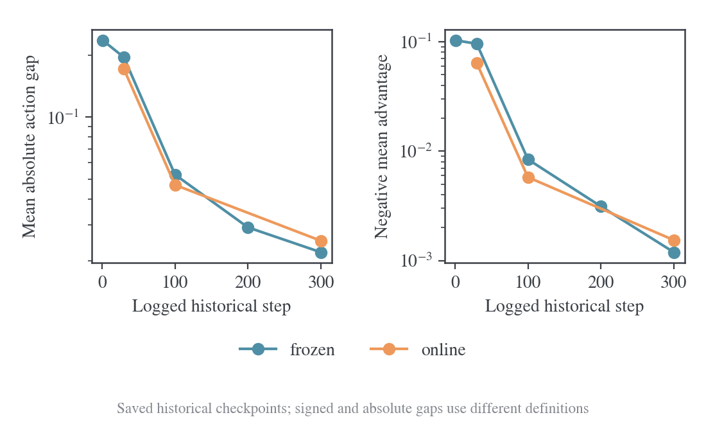

#### 实验分析

固定响应 step100→300 的绝对差由 0.052585 降至 0.022049，下降 58.1%，与新状态解释无关。

step300/30 的绝对差比为 11.28%，signed proxy 比为 1.24%，同一轨迹的“接近零”程度依赖指标定义。

当前 checkout 确认 frozen 复制首次 tokens/states，每步重算学生 log-prob 与 advantage；教师权重冻结，但评分与 Top-k 诊断仍重算。固定数据不意味着固定梯度。

历史缺少逐文件启动 SHA，因此代码时序证据弱于新四卡启动快照；数值来自原始 CSV，不把当前代码当成历史逐字节版本。

#### 结论

固定响应可以持续学习数百步；绝对动作差与有符号 proxy 必须分开解释。

<a id="frozen-lr"></a>

<a id="experiment-2"></a>

### 实验 2：新固定长响应的三学习率与数学评测

#### 背景与推导

用完全相同的长响应与教师标签排除数据变化，再检验低 LR 是否主要改变数值时间。预先定义 $u=(\alpha/10^{-6})t$；三条曲线终点均为 $u=300$。

长期吸收单种子判据为 $d_{200}/d_{100}\le.8$、$d_{300}/d_{100}\le.7$。

时间缩放判据为相同数值网格上的 log 距离离散度降低至少 30%。

原“至少两个种子”要求因用户取消额外 seed 未验证。

#### Setting

使用共同 OneShot 配方，seed42、同一 t22 prompt，完整固定 64 条响应；每卡 micro1，16 条累积后四卡一次更新。

三 LR=5e-7/1e-6/2e-6，各 600/300/150 步，无 warmup。

完整概率读出在均匀无放回固定 4096-prefix 面板，teacher 标签统一 BF16。

checkpoint 按 u50/100/200/300 保存；初始化、教师和 12 个 checkpoint 各完整 570 题，greedy、cap7168，保存逐题输出和评分 SHA。

#### 实验结果

| 学习率 | 更新预算 | 初始绝对差 | 最终绝对差 | 最终完整词表 KL |
| ------ | -------: | ---------: | ---------: | --------------: |
| 5e-07  |      600 |   0.239874 | 0.02071907 |      0.00310372 |
| 1e-06  |      300 |   0.239874 | 0.02209617 |      0.00329026 |
| 2e-06  |      150 |   0.239874 | 0.02466999 |      0.00366079 |

| 有效时间 u | 半倍学习率动作差 | 标准学习率动作差 | 两倍学习率动作差 |
| ---------- | ---------------: | ---------------: | ---------------: |
| 50         |        0.1139532 |        0.1239537 |        0.1280887 |
| 100        |        0.0489151 |        0.0525956 |        0.0631230 |
| 200        |        0.0271870 |        0.0292306 |        0.0330200 |
| 300        |        0.0207191 |        0.0220962 |        0.0246700 |

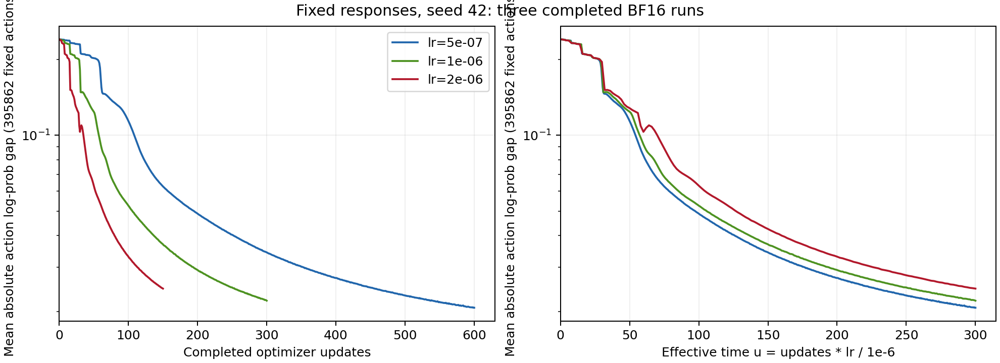

| 模型/学习率 | 更新数 | 有效时间 | MATH-500 /500 | AMC23 /40 | AIME25 /30 |
| ----------- | -----: | -------: | ------------: | --------: | ---------: |
| 初始化学生  |      — |        — |           364 |        21 |          7 |
| 冻结教师    |      — |        — |           395 |        27 |          4 |
| 5e-07       |    100 |       50 |           350 |        21 |          1 |
| 5e-07       |    200 |      100 |           360 |        22 |          3 |
| 5e-07       |    400 |      200 |           361 |        19 |          2 |
| 5e-07       |    600 |      300 |           360 |        18 |          3 |
| 1e-06       |     50 |       50 |           328 |        19 |          4 |
| 1e-06       |    100 |      100 |           344 |        19 |          5 |
| 1e-06       |    200 |      200 |           337 |        22 |          3 |
| 1e-06       |    300 |      300 |           351 |        20 |          5 |
| 2e-06       |     25 |       50 |           320 |        20 |          5 |
| 2e-06       |     50 |      100 |           338 |        20 |          6 |
| 2e-06       |    100 |      200 |           355 |        19 |          4 |
| 2e-06       |    150 |      300 |           343 |        21 |          4 |

| 学习率终点 | MATH 准确率 / 预算耗尽 | AMC 准确率 / 预算耗尽 | AIME 准确率 / 预算耗尽 |
| ---------- | ---------------------- | --------------------- | ---------------------- |
| 5e-07      | 72.00% / 34.40%        | 45.00% / 65.00%       | 10.00% / 96.67%        |
| 1e-06      | 70.20% / 35.80%        | 50.00% / 70.00%       | 16.67% / 86.67%        |
| 2e-06      | 68.60% / 40.40%        | 52.50% / 57.50%       | 13.33% / 93.33%        |

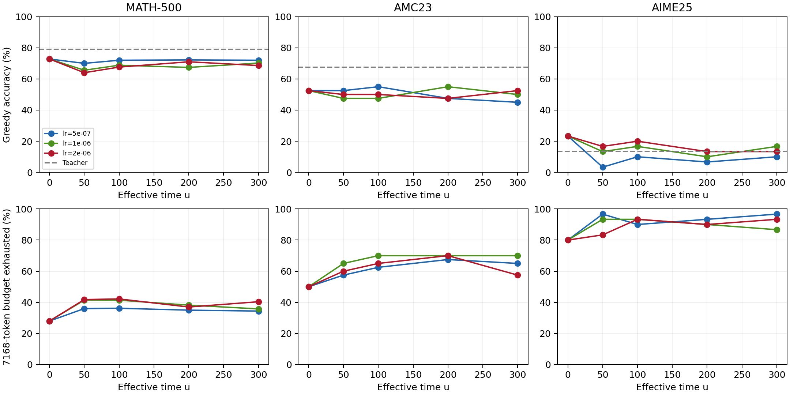

#### 实验分析

标准 LR 的 d200/d100=0.555761、d300/d100=0.420115，通过单种子长期吸收阈值。

共同数值网格 30–150 上，log 距离离散度由 0.452080 降至 0.102238，降低 77.38%；完整 u30–300 的最大/最小曲线相对差中位数 21.94%、最大 50%，故只支持近似缩放。

原 20% 判据属于取消的 FP32 扫描，不能挪用来判 BF16 失败。

终点 MATH 正确数 360/351/343 都低于初始化 364，AMC18/20/21 不高于 21，AIME3/5/4 都低于 7。

教师 AIME 也只有 4/30，不能假定教师在所有任务更强。

半倍终点 MATH 错→对 53 题、对→错 57 题，净少 4 题；AMC 净少 3 题，AIME 净少 4 题。

训练动作和完整 KL 改善，并未在该单题协议中转成跨题准确率改善；所有预定终点保留，不从中挑最好测试点。

终点比较只有一个响应池，4096 个 prefix 和 570 道测试不是独立训练 seed。题目级配对能描述该评测的变化，不能替代跨训练随机性的结论。

#### 结论

固定长监督的持续吸收与近似时间缩放成立；该协议下未获得数学测试收益。

<a id="fp32-fixed"></a>

<a id="experiment-3"></a>

### 实验 3：数值精度、零更新与独立读出

#### 背景与推导

BF16 舍入可使 FP32 master 的小位移暂时不改变前向权重，影响小 LR 的吸收速度。

需先用 lr0 检验训练/评分链路，再比较相同标签下的 BF16/FP32 训练；同 checkpoint 切换前向精度只检验读出差异，不等价于重新训练。

精度足以改变速度，仍需检验它是否解释全部长期吸收。

#### Setting

短探针：单卡、同一师生模型、单条 128-token、Top16、eta.3，各先 lr0 一次再 lr1e-6 三次；teacher 精度随学生改变，因此不是严格固定标签对照。

长 canary：使用相同的 64 条 395862 actions，teacher 固定 BF16，学生 BF16/FP32 各 4 次全 batch 更新。

正式零 LR 控制两精度各 4 次。

正式 FP32 半倍条件复用实验 2 标签、tokens 和 AdamW，lr5e-7，600 步预算在 330 条日志后停止；保留 update100/200 checkpoint，无数学评测。

独立 CPU 读出使用 BF16 update400 权重，先 8 个开头位置，再按初始化 KL≥0.02、位置≤512 预选 8 个差异位置。

#### 实验结果

这些预检分别验证训练、评分与缓存链路，不作为方法效果重复：

| 验证            | 设置                                           | 已核验结果                                                         | 分析边界                                             |
| --------------- | ---------------------------------------------- | ------------------------------------------------------------------ | ---------------------------------------------------- |
| 原在线 canary04 | B64、2 轮/2 更新、初始与最终各 570 题、BF16    | 正常退出；显存采样峰值 35161 MiB                                   | 全量评分链路验证                                     |
| 原整批 canary05 | B64、1 更新、整批 570 题输入                   | 正常退出；初始与最终 570 题完整，峰值 33493 MiB                    | 改变排队批量，保持评分协议                           |
| 原 MDPO canary  | 2 轮×16 更新；两次 16 题评测                   | 32 次更新、同步与缓存冻结通过；峰值 35267 MiB                      | 小样本不做算法优劣判断                               |
| 原 BPO canary   | 同上                                           | 32 次更新、有限诊断与冻结通过；峰值 35229 MiB                      | ESS 是诊断                                           |
| 词表支持检查    | 单卡、12 条短响应、额外 padding 词表列         | student 支持外质量约 3.04e-9–4.47e-9，teacher 约 1.01e-10–2.33e-10 | 支持统一在正式训练前完成；小质量不能解释整体学习曲线 |
| tokenizer 对照  | 原始模型与保存 checkpoint、实际输入 token 比较 | 已保存的 parity 记录通过                                           | 日志 warning 不代替实际 token 比较                   |

下表长响应读出使用 update_before3，即已完成三次更新；四次更新预算与该读出时点分开。

| 学生精度 | 初始动作绝对差 | 三次更新后绝对差 | 初始完整 KL | 三次更新后完整 KL |
| -------- | -------------: | ---------------: | ----------: | ----------------: |
| BF16     |       0.239874 |         0.239209 |    0.106206 |          0.105518 |
| FP32     |       0.238875 |         0.217701 |    0.105226 |          0.085883 |

| 更新数 | BF16 动作绝对差 | FP32 动作绝对差 | BF16 完整 KL | FP32 完整 KL |
| ------ | --------------: | --------------: | -----------: | -----------: |
| 0      |       0.2398738 |       0.2388749 |    0.1062058 |    0.1052265 |
| 20     |       0.2316651 |       0.1715883 |    0.0979900 |    0.0539338 |
| 100    |       0.1139532 |       0.0570620 |    0.0267815 |    0.0097168 |
| 200    |       0.0489151 |       0.0305508 |    0.0077217 |    0.0047289 |
| 300    |       0.0343489 |       0.0210049 |    0.0050515 |    0.0034525 |

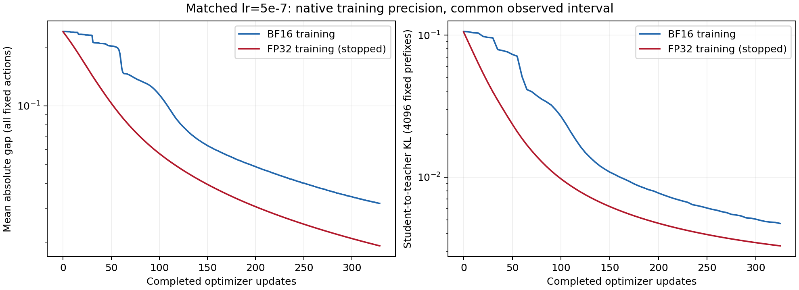

短探针首次实际更新的 student center 为 BF16 0.00040795、FP32 0.0050819；长 B64 首次 lr1e-6 对应 0.00040504/0.00019788，方向相反。

正式 lr0 两精度的被检查参数变化为 0，anchor center 最大绝对均值约 1.19e-10、RMS 约 5.93e-9，通过均值 1e-6/RMS1e-5 判据。

两个被检查矩阵逐元素加减 1e-6 再转 BF16，改变表示比例约 1.31%/1.10%；B64 首步 FP32 master 有 99.986% 被检查元素变化，转 BF16 后 1.024% 变化。四步位移余弦 Q-proj 0.63925、MLP 0.98545。

CPU 差异位置 12 的 BF16/FP32 teacher KL 为 0.009583/0.273004，位置 27 为 0.001249/0.979104；仅 8 个点，不代表总体幅度。

#### 实验分析

FP32 在 100 步的动作差约为 BF16 一半，300 步仍低约 38.8%；其 100→200/300 比为 0.5354/0.3681，仍持续学习。BF16 舍入不能独自解释数百步吸收。

长 B64 中 FP32 首步 anchor KL 更小、teacher 拟合更快，否定把短单响应的首步方向直接外推完整训练。

BF16 update600 权重改 FP32 前向时，面板 teacher KL 为 0.158452，原生 BF16 为 0.00310372；标准 LR update300 转换读出为 0.138567，FP32 从头训练到 300 却为 0.00345255。两种比较涉及不同函数与优化路径，不能混用。

独立 CPU 复现支持差异真实存在，但 8 点诊断不承担全 4096 面板的定量结论。

FP32 的 330 条更新累计约 19361 秒，BF16 半倍 600 步约 6135 秒；包含相应诊断和 checkpoint，不是纯内核 benchmark。FP32 每步更有效却每步更贵，省 step 不等于省时间。

已停止条件不填 600 步终点，不推断数学能力变化。

#### 结论

精度显著改变拟合轨迹；FP32 仍长期学习，且当前实现的墙钟成本更高。

<a id="experiment-4"></a>

### 实验 4：新在线 OPD 的已完成半倍条件

#### 背景与推导

固定监督隔离优化，在线监督则同时改变访问前缀。为比较二者，应保留共同初始 prefix 面板：最新 rollout 上的距离刻画当前访问分布，固定面板刻画相同旧状态，两个均值不能相减当成一步优化量。

在线有效时间需至少多个 LR，单条曲线不能判定缩放。

#### Setting

沿用 OneShot BF16 优化器与 t22 单题，lr5e-7，每步从当前学生重新生成 64 条、重算 teacher 标签，共 600 步。

固定初始 4096-prefix 面板持续独立读出。

worker completion 与 600 条记录、退出码 0 一致；监督进程暂停后未回收 worker，旧自动汇总仍记 5 而实际完整条件为 6。

另两个 LR 未启动，四个 checkpoint 的 570 题评测尚未运行。

#### 实验结果

| 更新步数 | 固定前缀动作绝对差 | 当前学生到教师的完整 KL |
| -------- | ------------------ | ----------------------- |
| 0        | 0.2448360          | 0.1062058               |
| 100      | 0.1370355          | 0.0341190               |
| 200      | 0.0806197          | 0.0135639               |
| 400      | 0.0578349          | 0.0072722               |
| 600      | 0.0475624          | 0.0050629               |

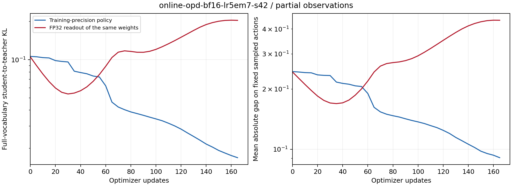

600 步耗时约 24.5 小时。

最后一批 366574 个有效动作的平均绝对差 0.0243597，当前 anchor–student 尾部桶 KL 为 0.000373435；相同终点固定初始面板绝对差 0.0475624、完整 teacher KL 0.0050629。

#### 实验分析

固定面板在 200→600 步的 KL 仍由 0.0135639 降至 0.0050629，支持在线条件下旧状态也持续吸收。最新动作差小于固定面板差可以来自访问分布与动作变化，不能归因给单一步长或从两值计算学习速度。

训练已结束，尚未做数学评测；“自动汇总 5 个完成”是控制器未回收造成的计数滞后，不代表该条件未完成。

在线 LR1e-6 与 2e-6 没有结果，当前不能将实验 2 的 77.4% 直接移用于在线缩放。

#### 结论

在线半倍条件训练完成并持续改善旧前缀；在线跨 LR 规律和任务效果尚未验证。

<a id="math-full"></a>

<a id="math-onpolicy"></a>
<a id="math-mdpo"></a>
<a id="math-bpo"></a>

<a id="experiment-5"></a>

### 实验 5：四卡多题 OPD、MDPO 与 BPO 生产训练

#### 背景与推导

单 prompt 拟合不能替代多题训练。生产基线检验三个基本算法在新 rollout、多轮锚点重设与长回答条件下能否训练，并记录任务成绩。

固定 outer 数时，OPD 每轮 1 更新、镜像方法每轮 16 更新，比较的是各自配方的终点；计算效率需另按真实 backward 预算对齐。

#### Setting

| 共同设置                             | 值                                                       |
| ------------------------------------ | -------------------------------------------------------- |
| 物理 GPU / 并行                      | 0–3 / FSDP=4、TP=1、SP=1                                 |
| 全局 batch / mini-batch / 每题生成数 | 64 / 64 / 1                                              |
| actor / anchor / teacher micro-batch | 1 / 1 / 1，动态 batching 关闭                            |
| AdamW                                | lr=1e-6，weight decay=0，gradient clip=2                 |
| eta / Tail-aware Top-k               | 0.3 / 16                                                 |
| prompt / response / context          | 2048 / 7168 / 9216 token                                 |
| 训练 / 测试生成                      | temperature=1、top-p=1、top-k=-1 / greedy、temperature=0 |
| 参数与计算精度                       | FP32 存储、BF16 前向、FP32 reduce/buffer                 |
| 显存控制                             | 参数与优化器 offload，gradient checkpointing             |
| vLLM                                 | memory utilization=0.25，每 replica 最多 32 条序列       |
| 验证                                 | 整批 570 题排队，outer0/5/10/…/50 各一次                 |
| 数据与模型种子                       | 42；生成 replica 种子 0–3                                |

DAPO17917 行、17255 唯一 prompt，训练 prompt 最大 1493，测试最大 796；MATH500/AMC40/AIME30 共 570 题。

每五 outer 及初始化评测一次，各 11 次；teacher 采样温度与训练生成如表，测试 greedy。

三条件从原始权重开始，初始化成绩按各自记录保留。

启动 commit 分别 OPD `d89e875f97738d1154fc2449720f9f5fd552ae27`、MDPO `87ec5155f4ee4f7904aa275cf580261542350c82`、BPO `ac54a612fb9ef0692b5b65d6c7dae620bdbb39a9`。

#### 实验结果

| 方法            | MATH-500，500 题      | AMC23，40 题         | AIME25，30 题            |
| --------------- | --------------------- | -------------------- | ------------------------ |
| on-policy，50×1 | 69.4% → 74.6%（+5.2） | 52.5% → 65%（+12.5） | 16.67% → 10%（-6.67）    |
| MDPO，50×16     | 70.6% → 77.4%（+6.8） | 47.5% → 52.5%（+5）  | 16.67% → 20%（+3.33）    |
| BPO，50×16      | 69.2% → 75.2%（+6）   | 47.5% → 60%（+12.5） | 16.67% → 13.33%（-3.33） |

| 方法      | 最终 MATH / AMC / AIME 正确数 | 最终 MATH / AMC / AIME 预算耗尽率 |
| --------- | ----------------------------- | --------------------------------- |
| on-policy | 373 / 26 / 3                  | 27.6% / 40% / 90%                 |
| MDPO      | 387 / 21 / 6                  | 25.6% / 52.5% / 73.33%            |
| BPO       | 376 / 24 / 4                  | 27% / 52.5% / 83.33%              |

| 方法      | Tail-aware teacher KL center | sampled reward        | 训练验证器分数      |
| --------- | ---------------------------- | --------------------- | ------------------- |
| on-policy | 0.100426 → 0.054077          | -0.109688 → -0.057712 | 0.345313 → 0.468750 |
| MDPO      | 0.044978 → 0.002794          | -0.048519 → -0.002503 | 0.453125 → 0.570313 |
| BPO       | 0.044319 → 0.002807          | -0.047300 → -0.002555 | 0.478125 → 0.564063 |

| 方法      | 更新数 | 梯度范数范围 | 裁剪次数 |  最低 ESS 比例 | GPU 采样峰值 | 训练 outer 均值 |
| --------- | -----: | -----------: | -------: | -------------: | -----------: | --------------: |
| on-policy |     50 |  0.525–1.408 |        0 |           约 1 |    35.88 GiB |        96.15 秒 |
| MDPO      |    800 |  0.031–1.275 |        0 |       0.992315 |    35.88 GiB |       218.82 秒 |
| BPO       |    800 |  0.030–4.166 |        1 | 0.992093，诊断 |    35.90 GiB |       220.72 秒 |

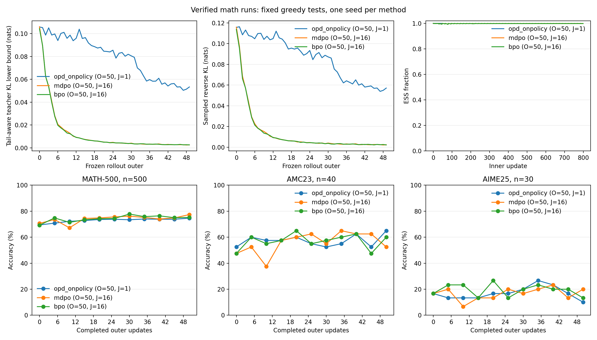

#### 实验分析

MDPO 预定 outer50 的 MATH/AIME 在三组中最高，OPD 的 AMC 最高。BPO 最终 MATH 多 30 题、AMC 多 5 题、AIME 少 1 题。

MDPO outer10 回落后恢复；BPO MATH 曾 77.8%、终点 75.2%，AIME 曾 8/30、终点 4/30，均采用预定终点而非峰值。

BPO 仅 1/800 次裁剪，发生 outer_call11/inner3，尺度 0.480077，下一梯度范数 0.15468；无 OOM，指标有限。

teacher center 与 reward 取各 outer 更新前快照，同步误差约 1e-7 RMS；prefix、回答长度逐轮改变，所以 teacher center 降幅不是固定 prefix 完整 KL 降幅。

BPO importance ratio/ESS只诊断，MDPO的ratio实际进入梯度，不能把两者解释为相同更新。

AIME 终点 73.33%–90% 回答耗尽 7168 预算，准确率含显著长度限制。

DAPO 与 MATH/AMC/AIME 精确题目重叠 2/5/0，AMC 重叠 12.5%；字符串审计不排除语义重叠。

单 seed、初始化评测不同、OPD 更新量少 16 倍，且原正式训练没有逐题配对输出，均限制方法排序。

代码公式、EOS、预算末 action、全局 token 归约、缓存和同步核验没有支持算法实现缺陷的证据，但也不能证明最优性能。

#### 结论

三种生产算法均跑通；当前终点成绩不构成相同计算预算下的方法优劣结论。

#### 后续条件：共同幂均值 reward 与 avg@16

2026-10-15 的新条件沿用本实验的模型、DAPO 多题数据、优化器、batch=64、训练回答上限 7168、50 outer、on-policy 每轮 1 更新与 MDPO/BPO 每轮 16 更新。三种方法共同使用 κ=0.5、η=0.2、Top-16＋tail、采样动作；on-policy 每轮重新采样，不乘重要性比率。其 reward 与镜像方法在新锚点处一致，推导和实现验证见[幂均值实现报告](2026-10-15-幂均值镜像蒸馏实现与估计器对照.md)。

测试改为每题 16 次随机生成，temperature=0.7、top-p=0.9、top-k=-1，prompt/response/context 上限为 4096/31744/35840。MATH500、AMC23、AIME25 共 570 题，每轮 9120 条回答；主指标为逐题 16 次正确率的平均值 `mean@16`，另保留 `pass@16` 作辅助。评测仍在 outer0/5/10/…/50，各轮保存 UID、sample index、正确性、实际长度与 finish reason。原 greedy 成绩不直接与新条件相减。

[预注册配置](../../data/math-avg-k05-e02-20261015/preregistration.json)保存问题、成功与否决条件和三组计划。`training/run_power_math_suite.py` 复用生产入口、冻结运行核心源码，使用物理 GPU 0–3 的既有排他预约，在每组结束后核验本地逐题记录及在线日志。小样本 canary 保留训练 batch 和长度预算，只把 outer 数改为 2、评测题数改为 4。按用户最新顺序，先修复与验证代码，再梳理架构和重构建议；三组正式训练尚未启动，不预填任务成绩。

CPU 验证保存为[数值与检查记录](../../data/math-avg-k05-e02-20261015/cpu-validation.json)，原始日志、对应测试源码和启动记录按 data manifest 压缩归档。重跑 canary 时使用新的 suite 名，并把 backend 指向已按 upstream manifest 重放补丁的空闲 checkout：

```bash
PYTHONPATH=.:src "$PYTHON_BIN" -m training.run_power_math_suite \
    --backend "$MIRROR_UPSTREAM_ROOT" --suite-name NEW_UNUSED_NAME --canary-only
```

该选项只执行 canary；正式三条件计划保存在预注册配置中。单机 FSDP 的 rendezvous 使用每 stage 独立的本地磁盘文件，vLLM 的 TCPStore 使用 `USE_LIBUV=0`，这些运行参数随 resolved config 保存。

on-policy 幂均值 canary 已完成，使用实现 `481046f` 与单机运行修正 `912ec72`。两轮训练 batch 各 64，梯度范数分别为 1.140153、1.179391，均未触发 clip=2；有效训练 token 分别为 409953、386085。两次更新前的学生中心 RMS 为 9.864e-8、9.951e-8，rollout version 为 0、1。物理 GPU 0–3 的设备显存采样峰值为 35069 MiB。

初始化与 outer2 各完成 4 个 MATH 题目、每题 16 次生成，合计每轮 64 条、两轮 128 条完整回答。`mean@16` 为 49/64、50/64；初始与终点评测分别有 1 条、2 条回答以 length 结束，实际长度均为 31744。UID、sample index、分数与 finish reason 的逐行审计通过；本地日志及 W&B 的 2 条 inner、2 个 outer 与两轮评测一致。审计与原始归档见[四卡验证记录](../../results/training/math-avg-k05-e02-20261015/canary-verification.json)。

四题结果只验证新 reward、真实更新与长预算 avg@16 的完整链路，不用于推断数学任务提升。canary-only 控制器已退出并释放四卡；正式三组 50 outer 的对照仍待代码梳理之后执行。新的代码职责与重构建议维护在[架构文档](../operations/2026-10-12-代码架构与跨机器复现.md)。

<a id="kl-semantics"></a>

<a id="experiment-6"></a>

### 实验 6：原镜像 inner 的小 KL 与非零目标误差

#### 背景与推导

日志 student center 是当前锚点到学生的粗粒化 KL，outer 起点 p=q 必为 0；教师通常仍不同于 q。

精确 MDPO 的完整动作目标为 $J(p)=\operatorname{KL}(p\Vert q)/\eta-\mathbb E_pr$，令 $Z=\sum_aq_a e^{\eta r_a}$，则

$$
\eta J(p)=\sum_ap_a[\log p_a-\log q_a-\eta r_a]=\operatorname{KL}(p\Vert p_G)-\log Z,\qquad p_G=q e^{\eta r}/Z.
$$

其梯度由 $\nabla p=p\nabla\log p$ 及 $\sum_a\nabla p_a=0$ 得到 $\mathbb E_q[(p/q)(U/\eta-r)\nabla\log p]$。

精确 BPO 由方差求导得到 $\mathbb E_q[(C_qU/\eta-C_qr)\nabla\log p]$。

两者自由分布 target 相同，但生产有限动作与 Top-k 场有各自近似。

#### Setting

读取实验 5 两种镜像方法各 800 条唯一 pre-update 记录，50outer×16inner；inner15 测量的是第 16 次更新之前，没有同 batch 第 16 次更新后的完整读出。

student center 支持为冻结 q 的 Top16+ 尾部桶；teacher center 与 reward 在 outer 内冻结。

在线/本地 parity 覆盖 MDPO800 条、BPO 保存前 416 条，完成状态另由全部日志审计。

#### 实验结果

| 方法 | outer_call | inner index | anchor→student KL | anchor→teacher KL | 梯度范数 |
| ---- | ---------: | ----------: | ----------------: | ----------------: | -------: |
| MDPO |          0 |           0 |              约 0 |          0.105989 | 1.275134 |
| MDPO |          0 |           1 |          0.000426 |          0.105989 | 1.274809 |
| MDPO |          0 |          15 |          0.000622 |          0.105989 | 1.044954 |
| MDPO |          4 |           1 |          0.000405 |          0.040866 | 0.459337 |
| MDPO |          4 |          15 |          0.003322 |          0.040866 | 0.224944 |
| MDPO |         49 |           1 |          0.000441 |          0.002646 | 0.053432 |
| MDPO |         49 |          15 |          0.000536 |          0.002646 | 0.042691 |
| BPO  |          0 |           0 |              约 0 |          0.104292 | 1.236035 |
| BPO  |          0 |           1 |          0.000430 |          0.104292 | 1.231237 |
| BPO  |          0 |          15 |          0.000625 |          0.104292 | 1.018401 |
| BPO  |          4 |           1 |          0.000415 |          0.039782 | 0.449914 |
| BPO  |          4 |          15 |          0.003317 |          0.039782 | 0.242985 |

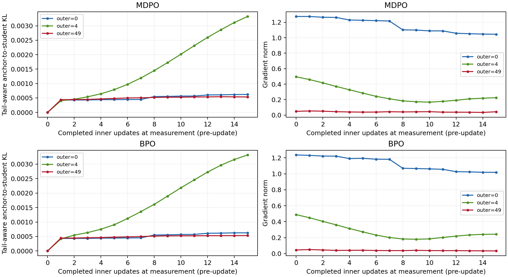

50 轮 inner1 平均 student center 为 MDPO 0.00043558、BPO 0.00043522；inner15 为 0.00079843/0.00078698。MDPO outer4 由 0.00040487 增至 0.00332241，约 8.21 倍。

二动作解析例 q=(0.5,0.5)、T=(0.9,0.1)、eta.3，精确 pG=(0.659073,0.340927)，KL(q∥pG)=0.053357，而 KL(pG∥T)=0.212805。

#### 实验分析

首轮 MDPO 梯度从 1.275134 降到 inner15 的 1.044954，BPO 从 1.236035 到 1.018401，均未接近零。

累计 800 点曲线包含 50 次重置，小台阶和重置可掩盖单轮变化；outer4 超过 8 倍的增长与“完全不动”不相容。

Top-k 中心是完整 KL 的下界。首轮锚点尾部质量约 2.49%/2.66%，即使尾部桶质量相同，桶内条件 KL 仍可非零；小尾部质量不足以给出 teacher 距离上界。

原日志缺每个 inner 的当前完整 teacher KL 与镜像目标误差，无法判定内层最优或最合适 inner 次数。

二动作例则表明即便理想内层精确求解，eta.3 仍只完成部分 teacher 移动。

#### 结论

小 anchor–student KL 可以与明显 teacher 距离、非零梯度和持续内层变化同时存在。

<a id="historical-lr"></a>

<a id="experiment-7"></a>

### 实验 7：历史多题 OPD 的 LR 速度与失效范围

#### 背景与推导

低 LR 的时间重合给出提速动机，但不能识别最大安全 LR。

沿固定方向有 $Q(\theta-\alpha d)=Q-\alpha A+\alpha^2B/2$；$A,B>0$时下降量的峰值为 A/B、零下降边界为 2A/B。

相同距离区间的跨 run 平均速度拟合只能作为候选，参数、Adam 矩和访问测度并不相同。

#### Setting

MD-OPD 六个 M4 历史 history，各 279 条、step1–279 连续，来源签名在 data/oneshot-lr-stability。

DAPO 多 prompt、每步新 64 响应、一次 actor 更新，BF16、AdamW betas(0.9,0.999)、wd.01、clip1、cap7168、vanilla loss。

原 8 卡仅作 CPU 复算。

d=-opd/token_reward_mean 是有符号 MC proxy。

reward 在 actor 更新前计算，主时钟为 u=(t−1)lr/1e-6，并保留旧 t 口径敏感性。

#### 实验结果

| run      | lr   |     末段 d | 末段 grad norm | 末段 d / 最低阶段 d |
| -------- | ---- | ---------: | -------------: | ------------------: |
| ybi7q89v | 5e-7 |  0.0136924 |       0.134847 |               1.011 |
| mdxt04lm | 1e-6 | 0.00564590 |      0.0746231 |               1.030 |
| yj2w13fq | 2e-6 | 0.00268895 |      0.0523482 |               1.000 |
| ml6mz58f | 5e-6 | 0.00129591 |      0.0417484 |               1.022 |
| l0a6rsc1 | 1e-5 | 0.00125336 |      0.0480800 |               1.020 |
| vmk256kl | 1e-4 |  0.0494056 |       0.221532 |               1.361 |

| lr   | d 从 0.05 到 0.02 的更新数 | d 从 0.02 到 0.01 的更新数 |
| ---- | -------------------------: | -------------------------: |
| 5e-7 |                         83 |     未在预算内达到后一端点 |
| 1e-6 |                         42 |                         73 |
| 2e-6 |                         21 |                         35 |
| 5e-6 |                         12 |                         15 |
| 1e-5 |                         11 |                         11 |
| 1e-4 |              从未达到 0.02 |              从未达到 0.01 |

| 距离区间  | 只用最高 5e-6 的零点候选 | 加入 1e-5 后的零点候选 | 加入 1e-5 后的最佳速率 lr |
| --------- | -----------------------: | ---------------------: | ------------------------: |
| 0.05→0.02 |                 1.280e-5 |               1.559e-5 |                  7.795e-6 |
| 0.02→0.01 |                 5.938e-5 |               2.201e-5 |                  1.101e-5 |


#### 实验分析

只用 5e-7 与 1e-6、u≥30 拟合 $\widehat D=f+a_1e^{-k_1(u-30)}+a_2e^{-k_2(u-30)}$，16 初值择最低 log 残差；a1=0.0642153、a2=0.0183478、k1=0.0319158、k2=0.00509165，训练 log RMSE 0.06855。

f 贴设定下限 1e-8，真实 floor 未识别。

留出 2e-6 在共同 u30–139 的 RMSE 0.06940，5e-6/1e-5/1e-4 则 0.21849/0.39974/1.83962，高 LR 明显偏离共同路径。

d=0.02/0.01 的拟合 u 为 99.04/166.23；相同 u30 窗口下，1e-6/2e-6 持续到 0.02 的更新前 u 为 112/114，保留平滑延迟。

若把可见速率都当作二次 GD 曲率，$k_i\simeq2\alpha_0\lambda_i$ 给出假想上限 $4\alpha_0/\max k=1.2533e-4$，错误接受实测反弹的 1e-4。

把 u99.04 压成一步也给 9.904e-5，接近同一失败点。

未激发快方向、Adam 历史、在线测度和非二次指标均使该换算失去保证。

阶段速度定义 $\bar v=(D_{high}-D_{low})/(n_{low}-n_{high})$，拟合 $\bar v(x)=ax-bx^2$、x=lr/1e-6。

加入 1e-5 后，两个阶段的峰值 7.795e-6/1.101e-5、零点 1.559e-5/2.201e-5；u 窗口 60/90 的零点范围 1.475e-5–2.697e-5。

留出 1e-5 时速度误差约 34%/33%，只拟合低 LR 时晚阶段零点不稳定甚至没有正二次惩罚。

没有到达该距离区间的 1e-4 不能作同状态局部检验。

1e-4 全部读数有限、末段仍低于初始化，但最低阶段后反弹 36.1%，属于持续对齐退化，未证明无界发散。

1e-5 到 1e-4 之间没有训练，候选 1.5e-5/2e-5/3e-5/必要时 5e-5 未执行，也不迁移为固定 FP32 BPO 的数值边界。

#### 结论

适度增大 LR 能省更新；历史衰减曲线无法可靠推出 AdamW 最大可用 LR。

## BPO 标量优化与完整梯度

<a id="experiment-8"></a>

### 实验 8：可控二次谱中的标量规则

#### 背景与推导

若标量规则在精确固定二次目标上都不能稳定胜过常数网格，就不能把神经网络失败都归因于 Top-k。

任意正定 H 可嵌入 BPO：取均匀 q、V=d+1、中心子空间正交基 B，$B^\top B=I$、$B^\top\mathbf1=0$，令 $J=\sqrt{\eta V}BH^{1/2}$。因该子空间上 $F_q=I/V$，有 $J^\top F_qJ/\eta=H$。H只定义benchmark，不供算法预条件。

#### Setting

48 维 FP64，条件数 10/1000/100000，对齐/随机旋转坐标，GD/AdamW，各 5 个种子，共 690 轨迹、最多 800 步。

Adam 常数网格 0.003/0.01/0.03/0.1/0.3/1，搜索上限 1；GD 常数 0.1/0.5/1/1.8/1.99，搜索上限 8。

还比较 inverse-lr、feedback、方向 Polyak、log/sqrt loss；后两种 loss 变换改变 Adam 状态，单独解释。

#### 实验结果

| 优化器 | 条件数 | 坐标 | 常数 lr | 常数 Q/Q0 | search Q/Q0 | feedback Q/Q0 |
| ------ | ------ | ---- | ------- | --------- | ----------- | ------------- |
| GD     | 10     | 对齐 | 1.8     | 1.62e-140 | 3.71e-157   | 2.19e-11      |
| GD     | 10     | 旋转 | 1.8     | 2.51e-141 | 1.73e-156   | 2.13e-11      |
| GD     | 1000   | 对齐 | 1.99    | 0.00139   | 0.000551    | 0.000373      |
| GD     | 1000   | 旋转 | 1.99    | 0.000925  | 0.000805    | 0.000234      |
| GD     | 100000 | 对齐 | 1.99    | 0.278     | 0.247       | 0.244         |
| GD     | 100000 | 旋转 | 1.99    | 0.281     | 0.278       | 0.264         |
| AdamW  | 10     | 对齐 | 0.3     | 1.81e-37  | 1.27e-37    | 4e-11         |
| AdamW  | 10     | 旋转 | 0.1     | 8.05e-37  | 1.22e-37    | 3.99e-11      |
| AdamW  | 1000   | 对齐 | 1       | 3.11e-37  | 1.61e-37    | 4.51e-11      |
| AdamW  | 1000   | 旋转 | 0.3     | 6.17e-09  | 1.07e-18    | 1.51e-10      |
| AdamW  | 100000 | 对齐 | 1       | 5.05e-06  | 4.52e-05    | 0.00045       |
| AdamW  | 100000 | 旋转 | 1       | 0.0551    | 0.0814      | 0.103         |

| 规则        | 达标步数，五 seeds      | 中位数 |
| ----------- | ----------------------- | ------ |
| 常数 lr=1   | 107、89、93、79、121    | 93     |
| search      | 146、121、123、104、127 | 123    |
| feedback    | 180、177、166、166、162 | 166    |
| 方向 Polyak | 152、142、131、299、122 | 142    |

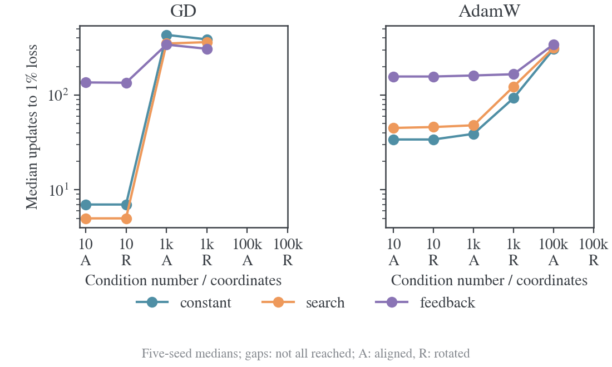

#### 实验分析

搜索在部分 GD 条件改善终值；Adam 旋转κ=1000 的终值也可更低，但阈值与终值是不同指标。该条件常数 lr1 达到连续 5 步 1% 阈值中位 93 步，search123、feedback166、Polyak142。

只与默认 0.01/0.1 常数相比会夸大收益；表中终值常数按最低中位终值选，阈值比较则按对应阈值单独扫描，二者不能互换。

固定宽谱使当前方向的可实现比例受限；旋转还改变 Adam 的坐标预条件效果。

690 条轨迹验证的是定义好的谱与种子集合，不证明所有二次问题都不能标量加速。

极小终值差异可能处于数值尺度，实际更关心达到预定阈值的成本。

#### 结论

理想二次结构支持求步长，但不自动保证胜过充分扫描的 AdamW 常数。

<a id="experiment-9"></a>

### 实验 9：分类共享参数与固定动作中心近似

#### 背景与推导

从自由 logits 转到共享参数后，动作覆盖和中心近似可能改变优化场。

完整线性目标可作为梯度正确的参照；在相同 q/T 上冻结少量动作，再改变 center 支持，能够检验“代理能拟合”是否仍意味着完整 Q 能拟合。

#### Setting

FP64，128 个前缀、32 类、24 维特征；线性 logits Xθ，非线性 Xθ+0.2(Xθ)²，特征缩放 10^-2 到 1，θ初始标准差 0.1、teacher 扰动 0.4。

每 prefix 固定 1/8 个独立 q 动作，无成对损失；完整 32 类、Top8/Top1+tail。

5 个种子，540 轨迹、最多 500 步，AdamW 网格沿用实验 8，search 初始 0.01。

#### 实验结果

| 参数与更新方式           | 动作数/prefix | center       | 常数 lr 网格最低中位终值 | search 中位终值 |
| ------------------------ | ------------- | ------------ | ------------------------ | --------------- |
| 共享线性完整目标         | 完整词表      | 完整 32 类   | 2.67007e-19              | 4.40674e-24     |
| 共享线性 sampled score   | 1             | 完整 32 类   | 0.585784                 | 0.588321        |
| 共享线性 sampled score   | 8             | 完整 32 类   | 0.000167791              | 0.000373094     |
| 共享线性 sampled score   | 8             | Top-8 加尾部 | 0.0770524                | 0.423075        |
| 共享线性 sampled score   | 8             | Top-1 加尾部 | 0.143899                 | 0.720239        |
| 共享非线性 sampled score | 1             | 完整 32 类   | 0.623421                 | 0.629547        |
| 共享非线性 sampled score | 8             | 完整 32 类   | 0.0507676                | 0.0980878       |
| 共享非线性 sampled score | 8             | Top-8 加尾部 | 0.286999                 | 0.83756         |
| 共享非线性 sampled score | 8             | Top-1 加尾部 | 0.372218                 | 1.1556          |

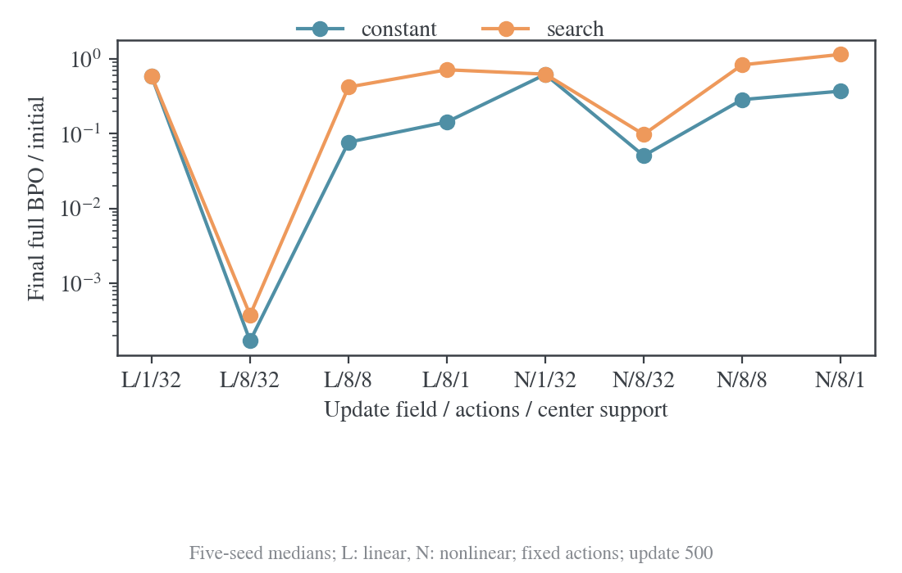

#### 实验分析

共享线性完整目标能到数值精度附近，而每 prefix 只固定 1 动作时完整 Q 仍约初始 0.586。8 动作完整 center 改善到约 0.000168，换 Top8 后约 0.0771；search 在粗 center 条件更差。

动作覆盖与 center 支持各有影响，全局步长无法制造没有观测到的梯度。

固定有限动作的 surrogate 不等于经验平方的精确梯度，完整 center 也没有消掉这一有限样本差别。

非线性 target 未验证完全可表示；500 步终值还含未收敛，不能把全部剩余误差定性为不可约统计底。

图中 L/N 分别表示线性/非线性参数；横轴第二、三项是每 prefix 固定动作数与 center 支持数，完整词表线性结果见表。

#### 结论

动作与中心近似足以破坏完整 Q 的拟合；标量搜索不能补回缺失方向。

<a id="experiment-10"></a>

### 实验 10：固定 416 个前缀的完整词表 BPO

#### 背景与推导

沿既有 AdamW 方向，精确二次目标满足 $Q(a)=Q_0-aA+a^2B/2$。三次同缓存 forward 在 0/h/2h 给出 $\widehat B=(Q_2-2Q_1+Q_0)/h^2$、$\widehat A=(Q_0-Q_1)/h+h\widehat B/2$，候选 A/B 无需第二次 backward。

神经参数中该式只局部近似，需实际 forward 验收。

本实验直接用完整 Q，先检验不受生产代理失配时是否省计算。

#### Setting

seed20261012，从 DAPO 前 16 行选 13 个无 padding prompt，prompt≤64、response32，关闭 EOS，共 416prefix。

q 生成 temperature1、top-p1、top-k0；相同 tokens 及 q/T 缓存。

完整词表 Q 梯度，FP32 主分支 500 步；BF16、反馈与 logloss120 步。

FP32 Q0=0.0413170，BF16 Q0=0.0427783169，各按本身初值归一化。

search 每步一次 backward/moments 后固定方向，试探与回退只 forward。

#### 实验结果

| 规则                          | 连续五步达标 backward | 该时刻累计 forward | 该时刻耗时/秒 | 保持低于阈值直至第 500 步的起点 | 第 500 步目标/初始目标 |
| ----------------------------- | --------------------: | -----------------: | ------------: | ------------------------------: | ---------------------: |
| 常数 $5\times10^{-7}$         |                   251 |                253 |          82.8 |                             251 |               0.000415 |
| 常数 $10^{-6}$                |                   159 |                161 |          52.3 |                             456 |               0.000244 |
| 常数 $1.25\times10^{-6}$      |                   144 |                146 |          47.7 |                             461 |               0.000781 |
| 常数 $1.5\times10^{-6}$       |                   136 |                138 |          44.9 |                          未达到 |               0.004110 |
| 常数 $2\times10^{-6}$         |                   131 |                133 |          43.6 |                          未达到 |               0.001243 |
| scalar search，初始 $10^{-6}$ |                   117 |                469 |          82.3 |                             117 |               0.000243 |

| 条件       | 精度 | 终点 Q/Q0 | Forward | 耗时/秒 | 拒绝次数 |
| ---------- | ---- | --------- | ------- | ------- | -------- |
| 常数 1e-06 | BF16 | 0.035668  | 122     | 15.55   | 0        |
| search     | BF16 | 0.040673  | 878     | 50.61   | 77       |
| 常数 4e-06 | FP32 | 0.061179  | 122     | 40.33   | 0        |
| feedback   | FP32 | 0.008242  | 122     | 40.49   | 0        |
| logloss    | FP32 | 0.002387  | 122     | 40.57   | 0        |


#### 实验分析

严格 0.1% 阈值的最快常数 2e-6 需 131 次 backward，search117，省 10.7%；forward469/133=3.53 倍，82.3/43.6 秒=1.89 倍。

若要求之后直到 500 步始终低于阈值，search 起点 117、最佳稳定常数 251，两者耗时基本相同。

persistent 借用了未来整段轨迹，只能离线比较，不能作为当步可用停止判据。

search 在 10–60、100–150、400–450 窗口平均−ΔlogQ 约 0.0612/0.0108/0.00184，吸收仍显著变慢。

BF16 search120 步终值 4.07%，略差于常数 3.57%，拒绝 77 次、878forward，精细差分未迁移成功。

logloss120 步把 1% 阈值由默认常数 39 步降至 27，但改变 moments 且大量裁剪，不能归因于同方向 LR 加速；它未达 0.1%。

#### 结论

精确 BPO 搜索可减少严格阈值的 backward，但未减少总时间，也未维持恒定吸收比例。

<a id="experiment-11"></a>

### 实验 11：同一 LM 小规模基准的生产更新场与监测量

#### 背景与推导

将实验 10 的完整梯度替换为 sampled token+Top16 center，可在相同 tokens 上检验代理失配。若真实方向不能降低完整 Q，即使用完整 Q 验收也只能缩短或拒绝步长，无法产生新的下降方向。

#### Setting

沿用实验 10 模型、FP32 初值与 416prefix，训练用固定 sampled action、Top16+tail、student center stop-gradient，各 120 步。

search 分别由经验 residual 平方或完整 Q 验收，原生 AdamW 方向保持不变；没有额外 backward 试探。

#### 实验结果

| 条件                 | 经验 residual 平方 / 初值 | 完整 Q / 初值 | Forward | 耗时/秒 | 拒绝次数 |
| -------------------- | ------------------------- | ------------- | ------- | ------- | -------- |
| 常数 1.6e-05         | 0.00177564                | 25.750857     | 122     | 43.69   | 0        |
| 常数 1e-06           | 0.000115186               | 0.626545      | 122     | 43.23   | 0        |
| 常数 2.5e-07         | 0.000344303               | 0.441024      | 122     | 40.68   | 0        |
| 常数 4e-06           | 0.00688592                | 4.463677      | 122     | 40.82   | 0        |
| 常数 5e-07           | 0.000172739               | 0.471017      | 122     | 40.69   | 0        |
| feedback             | 0.00598425                | 0.483065      | 122     | 40.60   | 0        |
| logloss              | 0.00384827                | 0.730649      | 122     | 40.73   | 0        |
| 完整 Q 验收 search   | 0.0192676                 | 0.530131      | 680     | 109.01  | 36       |
| residual 验收 search | 0.000131114               | 0.429535      | 482     | 86.84   | 0        |


#### 实验分析

常数 1.6e-5 将经验平方降至初始 0.1776%，完整 Q 却增到 25.75 倍，teacher KL 约 0.1107→0.931。代理收敛不代表完整分布对齐，正标量也不改变原更新场零点。

residual 搜索相对默认 1e-6 改善 Q，但终值 0.4295 与更小常数 2.5e-7 的 0.4410 接近，耗时 86.84 秒对 40.68 秒。完整 Q 验收 search 终值 0.5301、109.01 秒，也未胜强常数。

要求监测量单调只是限制接受的位移，不能把有偏方向变成精确目标方向。

#### 结论

生产场中代理改善与完整对齐可以相反；更可靠监测量也不能单独修复方向失配。

<a id="experiment-12"></a>

### 实验 12：独立短池上的十三条件调参

#### 背景与推导

LM 小规模基准上的收益需与充分扫描的生产常数比较，并在独立 pool 上锁定候选，避免看确认结果后重选。

全程质量采用 G，而终点和验证单列；这允许识别“前期快、后期反弹”的高 LR。

#### Setting

共同短池配方，seed1042、64×256、minibatch8，各 240 步、每 20 步完整审计。

八常数见表；search 每 1/4 步，feedback 目标 0.01/0.03，logloss。

固定 proxy 取 8 条轨迹簇的 512 位置。

常数每步 proxy 仅用于调参诊断，不用于最低部署成本对比。

#### 实验结果

| 条件              | 几何平均归一化完整 BPO | 终点完整 BPO/初值 | 验证 BPO | 验证 teacher reverse KL | 拒绝更新数 |
| ----------------- | ---------------------: | ----------------: | -------: | ----------------------: | ---------: |
| constant-5e-07    |               0.240015 |          0.181925 | 0.012525 |                0.072346 |          0 |
| constant-2.5e-07  |               0.264154 |          0.178281 | 0.012621 |                0.072874 |          0 |
| constant-1e-06    |               0.303000 |          0.359068 | 0.015031 |                0.073525 |          0 |
| feedback-rate0.01 |               0.317188 |          0.213022 | 0.013332 |                0.073989 |          0 |
| feedback-rate0.03 |               0.317470 |          0.288432 | 0.013380 |                0.073383 |          0 |
| logloss-control   |               0.350563 |          0.394270 | 0.016438 |                0.074025 |          0 |
| search-every1     |               0.356424 |          0.290525 | 0.015091 |                0.074307 |        112 |
| constant-1.5e-06  |               0.547855 |          0.584489 | 0.020179 |                0.076201 |          0 |
| search-every4     |               0.633186 |          0.648867 | 0.017869 |                0.075348 |          8 |
| constant-2e-06    |               0.814232 |          0.949511 | 0.028598 |                0.081394 |          0 |
| constant-4e-06    |               2.246289 |          2.613436 | 0.076243 |                0.115658 |          0 |
| constant-8e-06    |               4.715627 |          5.388226 | 0.185583 |                0.253830 |          0 |
| constant-1.6e-05  |               7.686400 |          8.039044 | 0.348909 |                0.740785 |          0 |


#### 实验分析

常数 5e-7 的 G=0.240015 最低，2.5e-7 终值 0.178281 略优于 0.181925，因此锁定这两个基线。

最佳 scalar feedback.01 的 G=0.317188，仍高 32.2%。

选择 SHA 为 `3efe1de50f91488812cf44f052bdfec83be16c06f2c8e564e1cf9bf6b06b0f47`，后续确认不重选。

共同 u60 时 2.5e-7/5e-7/1e-6/1.5e-6 的 Q/Q0=0.178281/0.210797/0.272107/0.404300，2e-6 插值 0.576525，不严格重合。

反馈末 u37.1282，search1/4 末 u103.4028/165.5667；更大累计时间没有保证更低完整 Q。

与 OneShot 不同的 objective、精度、短响应和 minibatch 都可能影响关系，当前比较没有单独识别各因素贡献。

#### 结论

调参未产生胜过强常数的 scalar 候选；feedback.01 仅作为预选诊断对象。

<a id="experiment-13"></a>

### 实验 13：精确 Gibbs target 上的 Top-k 中心偏差

#### 背景与推导

若粗 center 在真实 target 仍留下更新，后期平台就不能仅解释为慢谱。

对精确 target 有完整 R=0，近似残差等于中心误差 b；更新场剩 $b(q-p_G)/\eta$。

测量该量可验证偏差存在，但它不等于真实神经网络梯度，也不能直接量化平台。

#### Setting

调参 seed1042 全部 128train+32val，共 40960prefix；由完整 q/T 直接构造 Gibbs target，不训练θ。

比较 Top16/64+tail，eta.3，精确词表读出。

#### 实验结果

| center          | teacher KL 缺失量均值 | target 处 residual 偏差平方均值 | target 处 logit 更新场范数均值 |
| --------------- | --------------------: | ------------------------------: | -----------------------------: |
| Top-16 加尾部桶 |            0.00166818 |          $2.47761\times10^{-6}$ |         $9.76546\times10^{-5}$ |
| Top-64 加尾部桶 |           0.000187002 |          $6.18257\times10^{-8}$ |         $1.11286\times10^{-5}$ |

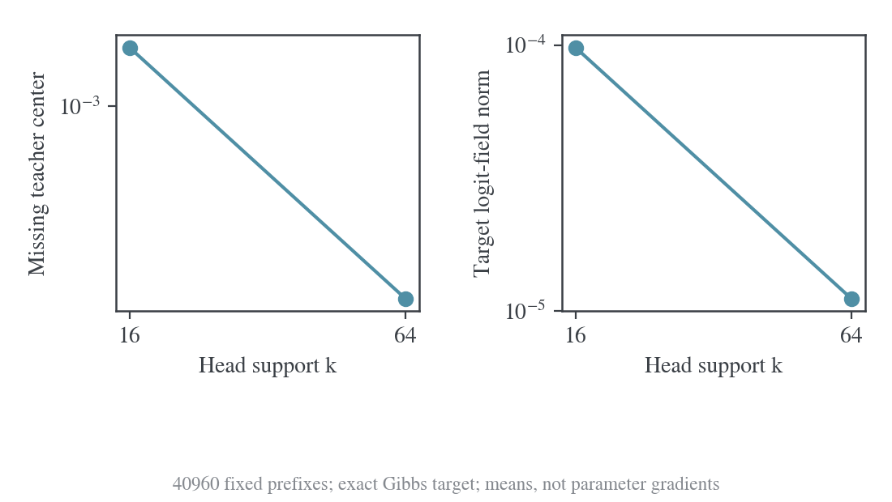

#### 实验分析

Top16/64的q质量覆盖99.719%/99.958%，但target场仍非零；扩大head后偏差平方约小40倍、场范数约小8.8倍。

高 head 质量只约束概率质量，不能替代 KL 尾部信息。

这是直接在理想分布上计算的场，网络 Jacobian 投影可能改变范数，训练也未必到达该 target。它支持中心机制消融的必要性，尚不证明 Top64 会降低真实训练终值或足以解释全部后期慢吸收。

#### 结论

粗中心在理想 target 留下可测偏差；其真实训练影响仍需同条件消融。

<a id="experiment-14"></a>

### 实验 14：五个固定短池的确认与有限预算平台

#### 背景与推导

独立调参失败后仍按预选规则完成确认，检验负面结果是否依赖单一 pool；同时量化“大 LR 早期快、晚期接近”。

平台使用有限预算参考和明确容差，避免把末段读数当真实 $Q_*$。

#### Setting

seed42/142/242/342/442，固定64×256、minibatch8、600步，audit20。

两常数 5e-7/2.5e-7；search 初始 1e-6、上限 1.6e-5、每 1/4 步；feedback 初始 1e-6、目标 0.01。

相同 seed 抽样索引配对。

24/25完成，feedback442取消。

每步重采样轨迹，但 pool、q 和 teacher 固定。

#### 实验结果

| seed | G，5e-7  | G，2.5e-7 | 终点 Q/Q0，5e-7 | 终点 Q/Q0，2.5e-7 | 验证 teacher KL，5e-7 / 2.5e-7 |
| ---- | -------- | --------- | --------------- | ----------------- | ------------------------------ |
| 42   | 0.215395 | 0.206624  | 0.198311        | 0.153431          | 0.072072 / 0.071972            |
| 142  | 0.216494 | 0.226531  | 0.204509        | 0.287526          | 0.072334 / 0.071976            |
| 242  | 0.207092 | 0.204614  | 0.198522        | 0.150766          | 0.077605 / 0.077346            |
| 342  | 0.199376 | 0.198518  | 0.180009        | 0.149140          | 0.074485 / 0.074261            |
| 442  | 0.221650 | 0.215708  | 0.235868        | 0.170628          | 0.067853 / 0.067539            |

| 算法           | seed | 几何平均误差增加 | 终点训练 BPO 增加 | 耗时 / 常数 | 参数更新拒绝次数 |
| -------------- | ---- | ---------------- | ----------------- | ----------- | ---------------- |
| search every 1 | 42   | 50.38%           | 62.96%            | 2.637       | 331              |
| search every 1 | 142  | 381.08%          | 352.32%           | 2.059       | 151              |
| search every 1 | 242  | 37.67%           | 23.45%            | 2.257       | 254              |
| search every 1 | 342  | 75.43%           | 68.97%            | 2.496       | 328              |
| search every 1 | 442  | 413.00%          | 369.58%           | 2.858       | 471              |
| search every 4 | 42   | 34.53%           | 27.62%            | 1.321       | 35               |
| search every 4 | 142  | 279.33%          | 281.33%           | 1.264       | 46               |
| search every 4 | 242  | 249.68%          | 312.36%           | 1.232       | 38               |
| search every 4 | 342  | 128.72%          | 127.31%           | 1.280       | 41               |
| search every 4 | 442  | 245.42%          | 225.81%           | 1.227       | 25               |

| 算法           | seed | 几何平均误差增加 | 终点训练 BPO 增加 | 耗时 / 常数 | 参数更新拒绝次数 |
| -------------- | ---- | ---------------- | ----------------- | ----------- | ---------------- |
| search every 1 | 42   | 50.38%           | 62.96%            | 2.637       | 331              |
| search every 1 | 142  | 381.08%          | 352.32%           | 2.059       | 151              |
| search every 1 | 242  | 37.67%           | 23.45%            | 2.257       | 254              |
| search every 1 | 342  | 75.43%           | 68.97%            | 2.496       | 328              |
| search every 1 | 442  | 413.00%          | 369.58%           | 2.858       | 471              |
| search every 4 | 42   | 34.53%           | 27.62%            | 1.321       | 35               |
| search every 4 | 142  | 279.33%          | 281.33%           | 1.264       | 46               |
| search every 4 | 242  | 249.68%          | 312.36%           | 1.232       | 38               |
| search every 4 | 342  | 128.72%          | 127.31%           | 1.280       | 41               |
| search every 4 | 442  | 245.42%          | 225.81%           | 1.227       | 25               |

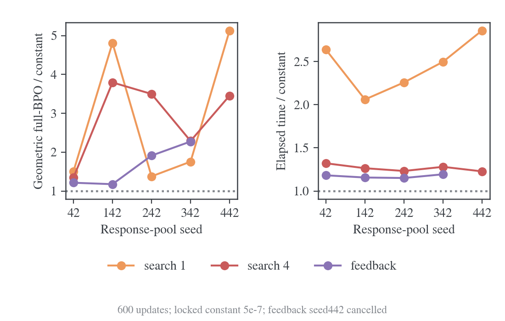

| 平台口径                   | lr     | step 中位数（范围） | u 中位数（范围） |
| -------------------------- | ------ | ------------------- | ---------------- |
| 完成已观测绝对下降的约 95% | 5e-7   | 180（160–180）      | 90（80–90）      |
| 同上                       | 2.5e-7 | 280（200–300）      | 70（50–75）      |
| 末段 KL 参考值 ±1%         | 5e-7   | 420（340–500）      | 210（170–250）   |
| 同上                       | 2.5e-7 | 460（460–480）      | 115（115–120）   |


#### 实验分析

search1 五 pool 的 G 高 37.67%–413%，耗时 2.06–2.86 倍；search4 高 34.53%–279.33%，耗时 1.23–1.32 倍。

feedback 四 pool 均更差，末 LR 约 1.6e-11–2e-11，贴实现下限，不能解释为曲率最优。

主候选缺 442，不填写完整五 seed 中位数；两搜索五 pool 完整结果均 overall_success=false。

拒绝仍消耗 backward 并更新 moments，optimizer 计数不等于有效参数下降次数。

seed42 的 5e-7/2.5e-7 在 step20 的 teacher KL=0.072165/0.081214，step100=0.060988/0.063763，step600=0.056826/0.056669，大 LR 早期快、晚期接近。

末 100 步 norm 中位 0.171671/0.0489653，随机梯度 norm 含采样协方差，不能从中单独识别真梯度。

step60 是此前 30 步不裁剪且有 KL 审计的描述锚点，共同 u30 对应 step60/120，归一化不消除 Adam 历史。

平台统计只用 42/142/242，末六 audit 中位作参考，要求之后在容差内且至少余三 audit。

95% 已观测绝对下降的 u 中位 90/70，而末段 KL±1% 是 210/115；阈值与预算改变会改变平台时间。

不能把 u70–90 换成一次 7e-5–9e-5 更新。

512-prefix 监测、mini 方向、粗 center 和差分分辨率的具体贡献尚未分离。

#### 结论

旧 search/feedback 在已完成确认中均劣于锁定常数；有限平台不提供最大 LR 公式。

<a id="experiment-15"></a>

### 实验 15：全部 64 条梯度的八点常数扫描

#### 背景与推导

有放回 minibatch 为后期引入新噪声，可能降低高 LR 稳定性。按用户要求每次遍历全部 64 条，可排除轨迹重采样；但每 prefix 仍只有一个冻结 rollout 动作，目标期望与 center 偏差继续存在。

比较更新数时必须同时报 64 次 backward 的成本。

#### Setting

复用实验 12 同 seed1042 和 tokens，改全量 64 条，每条 token mean 乘长度占比，累计为全局 token mean。

FP32、原生 AdamW、eta.3、Top16、clip2 不变。

八 LR 各 240 步、audit10，Q0=0.0353461342、teacher KL0=0.1098647512。

每组 15360backward、17760forward、3932160backward 响应 token，2729–2774 秒。

#### 实验结果

| lr       | G        | 终点 Q/Q0 | 验证 teacher KL | 0.2 阈值 step / backward |
| -------- | -------- | --------- | --------------- | ------------------------ |
| 1.25e-07 | 0.245486 | 0.166618  | 0.0734599       | 130 / 8320               |
| 2.5e-07  | 0.198120 | 0.149995  | 0.0724670       | 70 / 4480                |
| 5e-07    | 0.175670 | 0.143173  | 0.0719107       | 50 / 3200                |
| 1e-06    | 0.171168 | 0.144934  | 0.0716837       | 40 / 2560                |
| 2e-06    | 0.189920 | 0.164154  | 0.0718767       | 50 / 3200                |
| 4e-06    | 0.308318 | 0.271436  | 0.0735736       | 未达到                   |
| 8e-06    | 1.079505 | 1.016984  | 0.0846115       | 未达到                   |
| 1.6e-05  | 3.468410 | 3.421197  | 0.1435253       | 未达到                   |

| lr      | minibatch8 终点 Q/Q0 | 全部 64 终点 Q/Q0 | minibatch 保持 0.2 至末段的 backward | 全量对应 backward |
| ------- | -------------------- | ----------------- | ------------------------------------ | ----------------- |
| 1.6e-05 | 8.039044             | 3.421197          | 未达到                               | 未达到            |
| 1e-06   | 0.359068             | 0.144934          | 未达到                               | 2560              |
| 2.5e-07 | 0.178281             | 0.149995          | 1358                                 | 4480              |
| 2e-06   | 0.949511             | 0.164154          | 未达到                               | 3200              |
| 4e-06   | 2.613436             | 0.271436          | 未达到                               | 未达到            |
| 5e-07   | 0.181925             | 0.143173          | 1206                                 | 3200              |
| 8e-06   | 5.388226             | 1.016984          | 未达到                               | 未达到            |


#### 实验分析

1e-6 的 G=0.171168 最低，5e-7 终值 0.143173 最低；到 0.2 阈值 1e-6 需 40 更新/2560backward，2.5e-7 需 70/4480。

继续增到 2e-6 没有更快，8e-6/1.6e-5 终值超过初始化；全部有限正常结束，未触发扩展 32/64e-6。

四个较小 LR 无裁剪，8/16e-6 分别 1/3 次；不把反弹叫无界发散。

full-batch 改善终值、扩大可用 LR 范围，但 5e-7 达到并保持 0.2 阈值需 3200backward，minibatch 约 1206，不能仅按更新数说算力更省。

原调参常数额外 proxy 也使耗时比较不等于最小部署成本。

240 步没有任何分支到 0.1 阈值，真实最优值与更长时间行为未知。

共同 u30 的小 LR Q/Q0=0.166618/0.170716/0.179720/0.201570，teacher KL=0.0658654/0.0660622/0.0662988/0.0665859，时间重合程度依指标而异。

末 20 步 1e-6 norm 中位 3.68e-4、Q 约 14.5%，4e-6 norm 更低 1.84e-4、Q 却约 27.1%；小生产梯度不能证明更接近完整 Q 最优。

#### 结论

全量 64 条下已有可靠的有限预算常数范围；最佳 LR 随全程质量和终点判据而不同。

<a id="experiment-16"></a>

### 实验 16：保持参数与 Adam 状态的阶段 LR 分叉

#### 背景与推导

相同距离未必相同参数和优化器状态。为直接测量 LR 因果效应，固定θ、m、v、bias-correction age 与监督，改变下一 LR；首步方向严格相同。

比较 40 步终点则检验该 LR 能否持续使用，防止把一次大位移的收益当长期稳定性。

#### Setting

从实验 15 常数 1e-6 的 update40/120/240 快照，各分叉八 LR、继续 40 次全量更新，共 24 组。

每第 1、2 步及每 5 步 audit，Adam age 继承，仅实验计数归零；q/T/tokens/面板相同。

每分支 2560backward、3616forward、655360backward 响应 token。

三个起点 Q=0.0066763164/0.0055386091/0.0051228627；八分支首步 norm 逐阶段完全一致，为 0.04807254/0.001270292/0.0003439368。

首批 12 份 checkpoint 核验 339 参数状态的 step/FP32 矩形状与 64×step 计数，未声称全部权重字节校验。

#### 实验结果

| lr       | parent40 后 40 步 Q/Qparent | parent120 后 40 步 Q/Qparent | parent240 后 40 步 Q/Qparent |
| -------- | --------------------------- | ---------------------------- | ---------------------------- |
| 1.25e-07 | 0.965614                    | 0.995987                     | 0.998812                     |
| 2.5e-07  | 0.946539                    | 0.990819                     | 0.996756                     |
| 5e-07    | 0.916688                    | 0.981591                     | 0.992546                     |
| 1e-06    | 0.878880                    | 0.966142                     | 0.985015                     |
| 2e-06    | 0.843791                    | 0.944341                     | 1.068059                     |
| 4e-06    | 0.845691                    | 2.531168                     | 8.079837                     |
| 8e-06    | 5.880358                    | 8.088257                     | 19.031903                    |
| 1.6e-05  | 13.374475                   | 29.990294                    | 30.922616                    |

| parent update | 已测单步最佳 lr | 单步 Q 减少 | 连续 40 步最佳 lr | 相对继续 1e-6 的终点改善 |
| ------------- | --------------- | ----------- | ----------------- | ------------------------ |
| 40            | 4e-6            | 1.6604%     | 2e-6              | 3.99%                    |
| 120           | 1.6e-5          | 1.5935%     | 2e-6              | 2.26%                    |
| 240           | 1.6e-5          | 0.6708%     | 1e-6              | 0%                       |

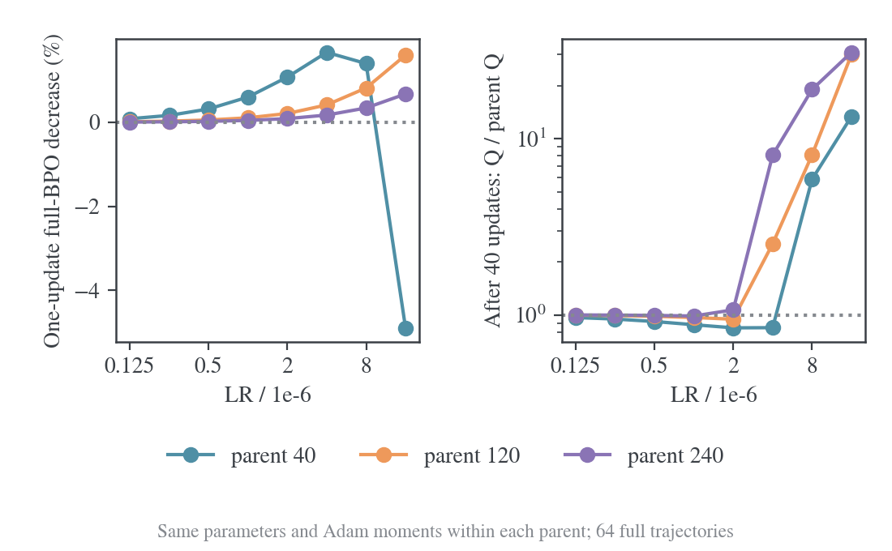


#### 实验分析

中期 40/120 起点连续 40 步最佳 2e-6，相对继续 1e-6 终点改善 3.99%/2.26%，低于原 10% 主改善标准；晚期 240 最佳回到 1e-6。

首步最佳却为 4e-6/16e-6/16e-6，后两者还在网格边缘，未定位真正单步峰值。

parent240 用 16e-6 首步 Q 下降 0.6708%，连续 40 步升至起点 30.92 倍；parent120 对应 29.99 倍。

后续θ和 moments 会分化，初始方向的局部曲率不能控制后续全部方向。结果支持中期有限幅度试探，直接否定“单步最优足以决定后续恒定 LR”。

三个 parent 均来自同一恒定 1e-6 路径，不能把阶段赢家拼成已验证 scheduler。早期切 LR 会改变后期θ/m/v，必须从头执行候选路径才能判定整体收益。

没有证据支持最佳 LR 必须随时间单调增加或减小，单 seed 也不给跨 pool 规律。

#### 结论

阶段 LR 确有差别，但局部收益小；单步最佳不能当成长期调度。

## 目标形状、序列与中心估计

<a id="power-mean-study"></a>

<a id="experiment-17"></a>

### 实验 17：幂均值 target 的真实缓存信号与相对噪声

#### 背景与推导

LR 只改变位移标量，target 形状可以改变监督方向及重尾，这是另一种方法假设。

对冻结 $q/T$，幂均值 target 与未归一化监督信号定义为

$$
p^*_{\kappa,\eta}(a)\propto q(a)\left[(1-\eta)+\eta\left(\frac{T(a)}{q(a)}\right)^\kappa\right]^{1/\kappa},\qquad
f_{\kappa,\eta}(a)=\frac1\kappa\log\left[(1-\eta)+\eta\left(\frac{T(a)}{q(a)}\right)^\kappa\right].
$$

$\kappa\to0$ 时 $f_{0,\eta}=\eta\log(T/q)$，恢复几何 target；$\kappa=0.5$是平方根，$\kappa=1$是算术。

中心 K 采用上述未归一化信号，不加 target 归一化常数。

比较时信号除以η，保持小扰动局部斜率；绝对方差下降还需对照均值梯度，不能直接当成采样效率提升。

#### Setting

CPU 读取使用相同的 64 条 t22 响应的 4096 固定 prefix，teacher 原缓存，BF16/同初始化 FP32 anchor 分别读出后 FP64 归一化；合法词表 151665。

令 $A=f_{\kappa,\eta}/\eta$；每 prefix 完整求和条件 logit 梯度 $A(a)(e_a-q)$ 的协方差 trace，prefix 间异质性不计 action 方差。

按 64 条 response 聚类 bootstrap2000 次。

无新 GPU 训练，也不等同全参数梯度方差。

#### 实验结果

| BF16 anchor，平方根 / 几何        |           强度 0.1 |           强度 0.3 |
| --------------------------------- | -----------------: | -----------------: |
| 条件 logit 方差比                 |            0.82247 |            0.76737 |
| response 聚类 95% 区间            | [0.78812, 0.85898] | [0.74017, 0.79717] |
| 方差 / 平均单前缀梯度平方的相对比 |            1.22344 |            1.12187 |
| 相对噪声的聚类 95% 区间           | [1.16376, 1.29140] | [1.07300, 1.17859] |

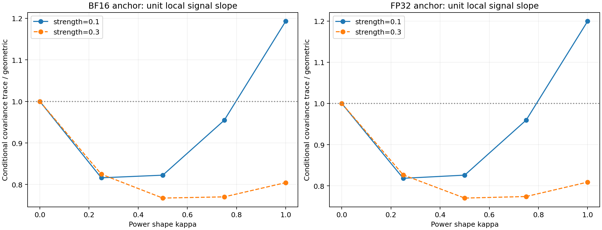

#### 实验分析

平方根绝对方差比在η=0.1/0.3 为 0.82247/0.76737，response 聚类区间均低于 1；同初始化 FP32 对应 0.82601/0.77034，方向一致。

但方差/平均单前缀梯度平方的相对比为 1.22344/1.12187，区间均高于 1。较弱信号伴随较小方差，不能据绝对方差宣布更高 batch SNR 或训练速度。

128-prefix 初始半径匹配未准确迁移完整 4096 面板；旧 batch16 prototype 的 256-prefix 半径 0.002046486、平方根/算术强度 0.10445091/0.08613148 只作历史校准。

batch64 的训练面板另行校准，保留 prefix 不参与选择。

等 target 强度、等 target 半径、等真实优化位移是不同控制，当前没有神经训练证据消除这些差别。

#### 结论

平方根改变真实监督信号且降低绝对 logit 方差，但没有验证采样效率或训练收益。

<a id="experiment-18"></a>

### 实验 18：序列算术混合与逐 token 混合的覆盖差别

#### 背景与推导

序列混合 $(1-\eta)q(y)+\eta T(y)$ 的条件 teacher 权重必须是前缀后验 $w_T(c)=\eta T(c)/[(1-\eta)q(c)+\eta T(c)]$；逐 token 始终使用η则是另一个序列模型。

若 T 对学生典型长序列的似然远低于 q，后验 teacher 权重可迅速变小。

逐 token 密集监督与序列算子的散度保证不能互换。

#### Setting

使用相同的 64 条 t22 实际响应，计算完整 response 和逐 prefix teacher/q对数似然比；固定η=0.1，沿保存序列递推后验。

逐 response 核验混合比率的望远镜恒等式，并用两步有限序列检查条件散度与序列 KL 的区别。

CPU 分析，不生成新响应。

#### 实验结果

64 条响应平均序列 log(T/q)=−652.30848；η=0.1 下沿记录响应的平均 teacher 后验仅 0.00113884，97.4256% 有效 token 的权重低于 1e-6。

条件散度改善而序列 KL 上升的两步反例保留在 [generalization-checks.json](../../results/power-mean-20261013/generalization-checks.json)。

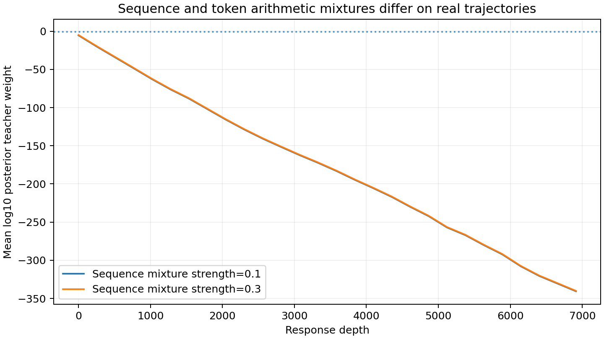

#### 实验分析

该现象描述学生典型路径的监督覆盖，解释序列一致混合可能在大部分后缀几乎失去 teacher 信号。

逐 token 固定强度避免该后验消失，但定义了不同的联合策略，不能直接继承序列混合的收缩保证。

低后验本身不证明逐 token 方法任务上更优；模型能力还取决于拟合和重新采样后的访问分布。

缓存来自一个 prompt，64 条 response 不是 64 个独立任务。

#### 结论

序列混合与逐 token 混合有不同覆盖和理论条件，不能用同一η视为等价算法。

<a id="experiment-19"></a>

### 实验 19：单 rollout BPO 的理想有限 inner 路径

#### 背景与推导

改变κ只改变冻结 target 的中心 logit 向量，固定 q/η的 BPO logit Hessian 仍是 $F_q/\eta$。

沿指定镜像路径 $p_\beta\propto q\exp(\beta f)$，$f=f_{\kappa,\eta}$；它与 $\log(p^*/q)$ 只差公共常数，有 $C_q[\log(p_\beta/q)-f]=(\beta-1)C_qf$，故 $Q(p_\beta)=(1-\beta)^2Q(q)$。

任意 AdamW 路径不等于该路径，下降 Q 不能自动保证 teacher KL 下降。

#### Setting

完整支持 3/17/127 元分布，12 个梯度/曲率检查；κ=0/0.25/0.5/1 与η=0.01/0.3/0.7/1，共 48 条理想有限 inner 路径，每条 101 点，解析求和。

指定路径解释为锚点 Fisher 预条件下的分布路径，当前训练不构造此预条件器。

CPU 检查入口 [power_bpo_algorithm.py](../../data/refactor-20261015/legacy-source.tar.gz#experiments/analysis/power_bpo_algorithm.py)。

#### 实验结果

BPO 解析梯度与有限差分最大误差 1.12e-10；48 路径上 teacher 双向 KL、总变差与平方 Hellinger 未增加，Q 与 (1−β)²逐点相符。

另一三元候选 Q 由 0.062277 降到 0.000240，teacher reverse KL 却由 0.223145 增至 1.654219，构成任意 BPO 下降的反例。

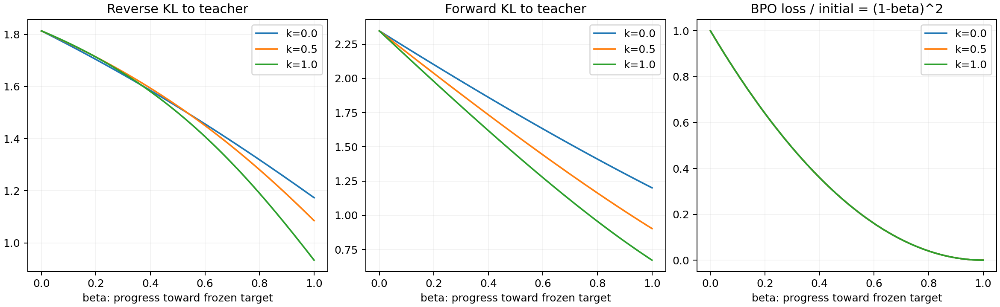

#### 实验分析

指定路径有共同散度改善，反例则表明仅优化 BPO 数值无法继承该结论。真实共享参数与 AdamW 既不精确实现锚点 Fisher 路径，也可能无法表示 target；这两项差异在神经训练结果出现前必须保留。

固定κ/η的精确分布更新可解释为新的 f 散度目标 J 上的标准熵镜像下降；κ=1 时 J 为归一化加权 JS，改变η也改变 J。

有限步下降、最后迭代 O(1/N) 与监督方差可求和性等保证的完整条件在[书稿第九章](../../theory/book/2026-10-08-%E5%9B%BA%E5%AE%9A%E6%B5%8B%E5%BA%A6Token%E7%BA%A7MirrorOPD.tex)，CPU 核验支持公式实现，不构成神经训练复杂度结论。

#### 结论

精确镜像路径具有条件保证；当前 AdamW 的任意 BPO 下降不继承 teacher 散度保证。

<a id="experiment-20"></a>

### 实验 20：教师中心、advantage 方差与有界辅助估计

#### 背景与推导

令 $A=f/\eta$、$K=-\mathbb E_qA$、$B=A+K$。

固定 prefix 的精确常数中心不改变标量条件方差，跨 prefix 中心化可移除均值异质性。

κ>0 且η<1 时 K 有有限包络；辅助估计提案可以改变 center 方差，同时保持 response 由 q 生成。

中心变小、标量方差变小和全参数梯度方差变小是三个命题。

#### Setting

480 组二元/17 元/127 元分布核验凸性、上下界、形状单调、方差界和 head–tail 区间。

使用相同的 64 条响应各固定两个 reservoir 位置，共 128 个前缀、20 个κ–η条件、2560 条条件矩。

q/T 用 FP64 归一化、完整动作精确求和；按 64 response 聚类 bootstrap2000 次。

#### 实验结果

| η   | κ   | 平均 K   | 平均标量 advantage 方差 | 非负中心估计的单样本方差 |
| --- | --- | -------- | ----------------------- | ------------------------ |
| 0.1 | 0.0 | 0.098024 | 0.205598                | 0.248994                 |
| 0.1 | 0.5 | 0.048737 | 0.159113                | 0.164072                 |
| 0.1 | 1.0 | 0.012128 | 0.206712                | 0.100654                 |
| 0.3 | 0.0 | 0.098024 | 0.205598                | 0.248994                 |
| 0.3 | 0.5 | 0.057218 | 0.152837                | 0.187256                 |
| 0.3 | 1.0 | 0.027847 | 0.150530                | 0.157468                 |

η=0.3 的平方根/几何标量方差比 0.74338，95%response 区间[0.65470,0.87757]。

κ=0 原 pooled 方差 0.262066，精确逐 prefix 中心化后 0.205598，移除 prefix 均值方差 0.056468。

平方根 Top16 中心区间宽度中位/0.9 分位=0.000251/0.154671，下界平均少估 0.004639。

κ>0、η<1 时取 $c=-\log(1-\eta)/(\kappa\eta)$、$\mu=(1-1/c)q+(1/c)T$，令 $\varphi(r)=-f_{\kappa,\eta}(r)/\eta+r-1$，估计 $Z=q\varphi(T/q)/\mu$，逐样本 0≤Z≤c、均值 K、方差≤K(c−K)。

η=0.3/κ=0.5 的辅助 teacher 权重 0.420551、上界 2.377833、平均中心方差 0.023713；原 signed q 提案 0.152837、非负 q 提案 0.187256。

独立单样本中心对应 advantage 方差 0.176550，signed 中心 0.305674、精确中心 0.152837。

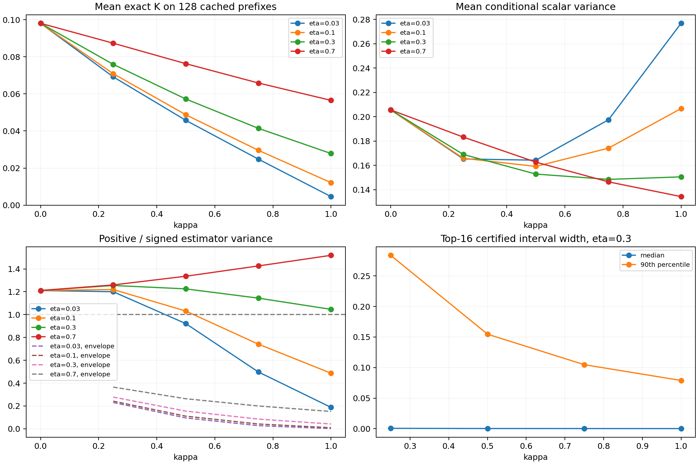

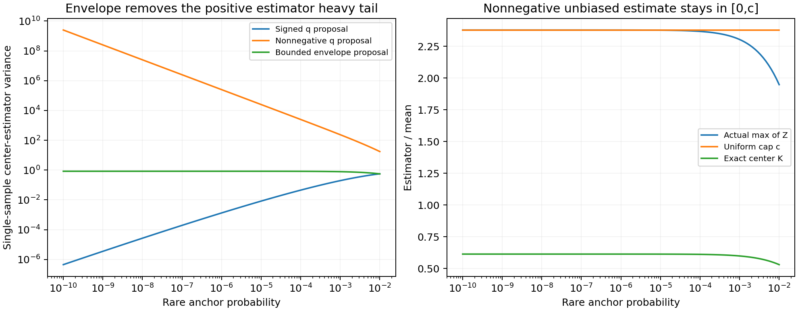

#### 实验分析

均值 baseline 并非参数方差最优。反例 q=(0.99,0.01)、T=(0.5,0.5)、κ=0.5/η=0.3 的 logit 梯度协方差 trace 由 0.92622 增至 1.07537。

小扰动下非负中心估计可将方差从二阶降至四阶，κ=0 也有此收益；稀有 q 动作又可引入 T/q 重尾。

平方根小步极限的 Hellinger 中心估计落[0,2]、方差≤K(2−K)，在该极限相对 signed 估计有至多一半的界；有限η不逐输入必胜。

独立辅助 center 与当前 action 共享时语义会变：直接用当前 token 的−A 作 K 会使$B=0$，使用同 token 非负估计会得到 T/q−1 并消除κ形状。

教师 center 在 inner 冻结，学生 center 必须随 p 重算。

完整保留学生条件中心导数时，完整 action 期望可消掉任意冻结 teacher 中心误差；生产停止系数后只乘原始 score 则需要精确中心或控制偏差。

128 个前缀 只支持这组条件矩，不能外推为 4096 全部前缀或全参数 batch 协方差。

优先在已有完整 logits 上精确求和；有界提案需要额外辅助 action 概率查询，其统计改善没有包含部署查询成本。

#### 结论

中心与信号形状的方差作用可以分离；条件 logit 收益仍需参数梯度和成本验证。

<a id="experiment-21"></a>

### 实验 21：head–tail 无偏教师中心估计

#### 背景与推导

已知 head 和两种尾部质量给出中心区间[L,U]，可把该信息用于尾部余项的无偏估计。

使用相同的 128 个前缀、κ=0.5/η=0.3，q 的 Top16/64/256 head 精确求和，尾部切线余项用 q/T 条件尾部分布混合提案，FP64。

#### 实验结果

| 中心估计器 setting              | 单样本条件方差 |   区间宽度均值 |
| ------------------------------- | -------------: | -------------: |
| 原始 −A，q 提案                 |     0.15283690 | 无该逐样本区间 |
| 全局有界包络提案                |     0.02371301 |     2.37783296 |
| 精确 head=16＋切线余项尾部估计  |     0.00015467 |     0.04087284 |
| 精确 head=64＋切线余项尾部估计  |     0.00001541 |     0.01111808 |
| 精确 head=256＋切线余项尾部估计 |     0.00000103 |     0.00307635 |

600 检查的无偏均值最大误差 3.33e-16，U-statistic 方差恒等式误差 1.33e-15。

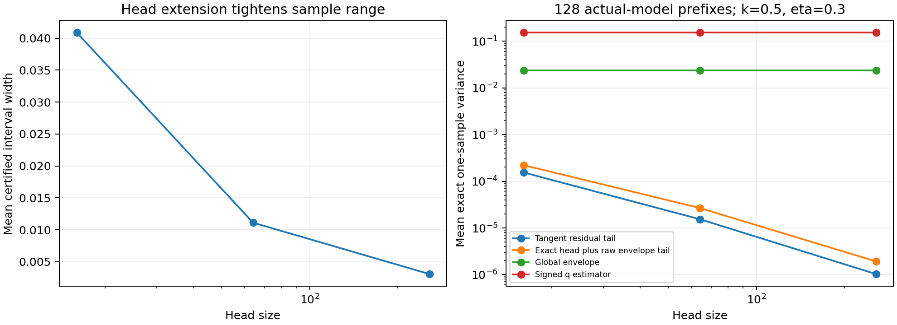

#### 实验分析

区间估计逐样本落[L,U]，M 个独立样本方差≤(K−L)(U−K)/M；head 扩大收紧最坏保证。

只有尾部质量而无尾部抽样/概率查询，不能无偏恢复中心。

完整 logits 已有时精确求和通常更直接，统计方差比没有包含缓存与查询成本。

平方根形状小步“方差/对应教师散度”的锐常数为 2，绝对最坏小步方差却在κ≈0.441928 最小，二者优化准则不同。

教师覆盖、Hellinger 几何收缩和高阶矩阈值κ≤1/p 均是有条件的解析结论。

当前全词表主更新没有 action 抽样噪声，不能用这些估计器方差收益替代训练效果。

#### 结论

辅助估计器具有可核验的无偏性和方差界；新增神经训练及部署收益尚无结果。

## 标量规则的可实现条件与最小算法

### 沿当前方向的最佳步长与比例限制

固定 AdamW moments 更新后的方向 $d$，精确二次模型有 $E(a)=E-aA+a^2B/2$，其中 $A=g^\top d$、$B=d^\top Hd$。

$A\le0$时该方向没有正下降步长；$A>0$、$B>0$时，导数为−A+aB，故

$$
\alpha_*=A/B,\qquad \alpha_{\rm zero}=2A/B,\qquad \rho_{\max}=\frac{E-E(\alpha_*)}{E}=\frac{A^2}{2BE}.
$$

由 $(e^\top Hd)^2\le(e^\top He)(d^\top Hd)=2EB$ 得$0\le\rho_{\max}\le1$。

$B=0$时半正定 H 给$Hd=0$、$A=0$，该方向不改变目标。

给定比例$0<\rho\le\rho_{\max}$，解二次方程 $aA-a^2B/2=\rho E$，选择较小根并有理化得

$$
\alpha_\rho=\frac{2\rho E}{A+\sqrt{A^2-2B\rho E}}.
$$

该式需要真实 excess loss 及方向能力，未知 $Q_*$ 时不宜强行跟踪固定比例。

GD 中 $d=g$，有 $\rho_{\max}=(\mathbb E_w\lambda)^2/\mathbb E_w\lambda^2$。

取谱 m/M、loss 权重 M/(m+M) 与 m/(m+M)，得到 4mM/(m+M)²，宽谱时按 1/κ变小；单一全局标量无法突破给定方向的限制。

零下降边界表示一步前后 loss 相同，参数仍可移动；一维αλ=2 时误差翻号而平方不变。它既不是梯度为零，也不是整段 AdamW 训练的最大可用 LR。

实验 16 直接表明局部最优还不足以控制 40 步效果。

### 已比较规则及其成本

| 规则            | 明确更新语义                                                              | 当前证据                                        |
| --------------- | ------------------------------------------------------------------------- | ----------------------------------------------- |
| 常数 LR         | 未变换 surrogate，原生 AdamW                                              | 生产主基线；按各配方独立扫描                    |
| search every1/4 | 一次 backward 与 moments 后冻结方向，0/h/2h 拟合，实际 forward 接受与回退 | 精确小 LM 省部分 backward；生产确认失败         |
| feedback        | 由上一步 proxy log 收缩调下一 LR；增幅≤1.25，非下降减半                   | 确认四 pool 更差，末期贴 LR 下限                |
| 方向 Polyak     | $\alpha\approx.05Q/(g^\top d)$、有上限                                    | 早期参考；$Q_*$未知时不继承最优值已知证明[^sps] |
| inverse-LR      | 按误差倒数提 LR、有上限                                                   | 早期参考，无曲率保护                            |
| log/sqrt loss   | 由独立残差平方求缩放，停止缩放梯度后乘 surrogate                          | 改变 Adam 矩历史；不等价于调 LR                 |

feedback 的近似依据是 $r_n=\log(E_{n-1}/E_n)\simeq\alpha_{n-1}A/E$，下一步取 $\alpha_n=\min[\alpha_{max},\alpha_{n-1}\operatorname{clip}(r_*/r_n,1/2,5/4)]$，非下降直接减半。

它跟踪上一方向，不识别当前 B，且 proxy 未必是真 E。$\beta_2$ 历史、非下降方向和误差底都可让反馈失效。

### 最小受限搜索的伪代码

下列是已实现并测试的搜索语义，不是胜出推荐。

输入动作只在 outer 起点由 q 采样，inner 固定复用；不构造成对 token 或新预条件器。

监测优先用独立完整 Q；使用经验 residual 时，只能保证该经验量的候选接受。

```pseudocode
\begin{algorithm}
\caption{沿原生 AdamW 方向的全局标量搜索\\{\small\textit{Semantics: 根据正文重构}}}
\begin{algorithmic}
\INPUT fixed cache $D\sim(\mu,q)$; teacher $T$; fixed $\eta$; probe $h$; cap $\alpha_{\max}$; budget $N$
\OUTPUT student parameters $\theta$
\IF{$D$ has no valid supervised token}
    \RETURN $\theta$
\ENDIF
\FOR{$n=1$ \TO $N$}
    \STATE recompute student center; keep teacher center frozen
    \STATE $R_j\gets U_j+K_{S,j}-\eta(r_j+K_{T,j})$
    \STATE $g\gets\operatorname{backward}(\operatorname{mean}_j[\operatorname{stopgrad}(R_j/\eta)\log p_\theta(a_j\mid c_j)])$
    \STATE apply unchanged global gradient clipping
    \STATE update AdamW moments and bias-correction counter exactly once
    \STATE $d\gets\widehat m/(\sqrt{\widehat v}+\epsilon)+\lambda_{\rm wd}\theta$; $\theta_0\gets\theta$
    \STATE freeze $d$ and optimizer state for all trials
    \STATE define $Q(a)$ by installing $\theta_0-ad$ and forwarding the same cache
    \STATE $h\gets\min(h,\alpha_{\max}/2)$; evaluate $Q_0,Q_1,Q_2\gets Q(0),Q(h),Q(2h)$
    \STATE $B\gets(Q_2-2Q_1+Q_0)/h^2$; $A\gets(Q_0-Q_1)/h+hB/2$
    \STATE $S\gets\{(0,Q_0),(h,Q_1),(2h,Q_2)\}$; discard nonfinite nonzero trials
    \IF{$A>0$, $B>0$ and both are finite}
        \STATE $a_f\gets\min(A/B,2h,\alpha_{\max})$; add finite $(a_f,Q(a_f))$ to $S$
    \ENDIF
    \IF{every nonzero trial has value at least $Q_0$}
        \FOR{$j=1$ \TO $8$}
            \STATE $a_b\gets h/2^j$; stop this loop below the numerical minimum
            \STATE evaluate $Q(a_b)$; add finite trial to $S$
            \IF{$Q(a_b)<Q_0$}
                \STATE stop the backtracking loop
            \ENDIF
        \ENDFOR
    \ENDIF
    \STATE $(a,Q_a)\gets\operatorname{argmin}_{(b,Q_b)\in S}Q_b$; prefer $a=0$ on a tie
    \STATE $\theta\gets\theta_0-ad$; retain this step's moments even if $a=0$
    \STATE use accepted $a$ as next probe; otherwise halve $h$ subject to its numerical minimum
\ENDFOR
\RETURN $\theta$
\end{algorithmic}
\end{algorithm}
```

每个候选从θ0 恢复后安装，试探不额外 backward、不推进 moments；零步也保留一次 moment 更新。

初始 Q0 必须有限，否则该步终止并记失败。

大 pool 的独立 proxy forward 按真实成本记账；分布式接入须统一所有 rank 的统计与接受决定，不能各自选 LR。

当前验证覆盖独立模型 benchmark 和标量内核，尚无生产多轮调度胜出结果。

### 平台误差与阈值时间

一维稳定 GD、0<αλ<1 时，$E_n=E_0(1-\alpha\lambda)^{2n}$，达到δ的次数为 $\lceil\log(E_0/\delta)/[-2\log(1-\alpha\lambda)]\rceil$；小步近似 $u_\delta=\log(E_0/\delta)/(2\times10^{-6}\lambda)$。

多谱由求和不等式隐式决定，通常没有仅依赖 LR 的统一闭式。

随机参考 $e_{n+1}=(1-\alpha\lambda)e_n-\alpha\xi_n$，独立零均值噪声方差σ²，平方取期望并解稳态得到

$$
\mathbb Ee_{n+1}^2=(1-\alpha\lambda)^2\mathbb Ee_n^2+\alpha^2\sigma^2,\qquad E_\infty=\frac{\alpha\sigma^2}{2(2-\alpha\lambda)}.
$$

若目标是超过平台的δ，即 E_n≤E∞+δ，且 E0>E∞，需 $\lceil\log[(E_0-E_\infty)/\delta]/[-2\log|1-\alpha\lambda|]\rceil$ 次，结果至少取 0；αλ=1 单独检查首步。

该式是随机 GD 参考，不是 AdamW 精确方程；full-batch 平台不能直接套这个噪声底。

### 累计时间不能给出最大 LR

即使一维 E=e²/2、λ=1，梯度流达到 1% 需时间 log100/2=2.302585，一步用同样α却使误差比 (1−2.302585)²≈1.697。

loss 与真 gradient norm 只能识别 $\|g\|^2/(2E)=\mathbb E_w\lambda$，无法识别最大曲率；不能从低 LR 衰减时间或生产 norm 推出全局安全上限。

<a id="registered-scope"></a>

## 待执行实验、取消范围与证据缺口

下表记录原登记范围，不把未运行条件写成结果。

合并报告不会自动启动或扩大训练；新的优先级建议与现有执行配置分开。

当前 GPU 资源交接和 hook 状态写在 runs，报告只保留与结论有关的完成范围。

原 17 消融每条件 400 步，full-batch 两个各 120 步，主标量三个 proxy 分别 2048 位置、sampled monitor 和 2 轨迹簇。

两规则对同因素配对，完整 Q/验证和真实成本同时审计。

新三 seed 全量确认 12 组、旧 feedback442、OneShot142/242 及未启动 FP32 扫描均取消。

原 fullpool21 方案已被 8 常数 +24 分叉替代，不再累计为待运行。

OneShot 原 45 条件 16074 更新改为 seed42 的 12 完整条件 4308 更新；实际 6 个完整条件共 1658 更新，另有停止 FP32330 条记录。

已完成 BF16 三固定 LR 和在线半倍；零 LR 两精度各 4 步。

原多 seed 长期吸收判据和 FP32 跨 LR20% 一致性因范围调整未验证。

执行事实以 [execution-selection.json](../../data/oneshot-effective-time-20261012/execution-selection.json) 与实际日志为准。

生命周期设置保留一个解释限制：重设 qk 后仍在 q0 动作池用 p/qk 系数，完整期望是 $\sum_ap(a)[q_0(a)/q_k(a)]c(a)\nabla\log p(a)$，一般不等于 Ep[c∇logp]；BPO 也不是完整 qk 方差梯度。

它可研究缓存外观与目标诊断，不宜当成只改变锚点周期的纯算法效果。

幂均值主网格κ={0,0.1,0.25,0.4419283735,0.5,0.75,1}，η={0.01,0.03,0.1,0.2,0.3,0.5,0.7,1}；η=0 的 loss/η未定义，以初始化参照。

batch64 每响应 16 训练 prefix、16 不重叠诊断 prefix，不是全部 response token 损失；主网格完整词表期望 M0，诊断对照 M4。

主更新 18900、canary18，额外梯度探针 792 次；50 主网格终点各 570 题，共 28500 题次，不含复用初始化。

4 次参数探针只筛均值/协方差实现，不能形成窄置信区间；吞吐需 canary 实测。

每个幂均值条件记录原生/同权重 FP32 的 target 与 teacher 双向 KL、TV/JS/Hellinger、Fisher–Rao 位移、梯度范数、系数二/四阶矩和真实成本；初/终参数冻结做完整梯度及独立动作探针。

63 条件详细 ID、fit_kappa、sampler 和采样数保留在 [配置快照](../../data/distillation-report-sources-20261015/pending-configurations.json)，研究判据见 [预注册](../../data/power-mean-20261013/preregistration.json)，已执行数值见 [training-summary.json](../../results/power-mean-20261013/training-summary.json)，正文不重复 63 行全为“待执行”的表。

teacher 中心完整求和的主更新不需要再为中心估计器开整套训练网格。

### 根据已有结果收缩后续验证

现有证据足够支持现象、精度影响和旧 search/feedback 失败。

若继续回答 LR 原问题，优先统一 64 条全量梯度，对 Top16 sampled、完整 center sampled、完整词表目标作机制对照，再从头检验极少数阶段调度；若短池没有完整误差和成本收益，则停止扩大调度实验。

有候选通过后才在长轨迹比较两个强常数与一个候选，并覆盖后期阶段。

该顺序是研究建议，不表示原 17 条件或队列已经修改。

在线跨 LR 可补齐 2 条件以检验有效时间，数学评测按要回答的任务问题选择，不机械完成所有 checkpoint。

锚点生命周期和 63 条件幂均值属于另外的问题；不应同时展开大矩阵。

多 seed 保持取消，结论限于已测 pool，不用更多 prefix 代替独立 seed。

### teacher、student 与数据迁移的保留设计

迁移依据是固定 q/prefix/J 参考$H=\mathbb E[J^\top F_qJ]/\eta$，换 teacher 保持该近似 H 但改变误差谱投影。

换 student 则改变 q/Fq/J，换数据改变μ和长度。

真实网络还有 residual 二阶项，teacher 分数不能单独决定最佳 LR。

One-Shot OPD[^oneshot]提供固定 64 条参照，Dual Nature[^dual]提醒同源应落实到具体共同初始化，不能仅凭同属 Qwen 认定。

| 条件  | Student / teacher / 数据                     | 控制目的                                  |
| ----- | -------------------------------------------- | ----------------------------------------- |
| A0    | 当前 student / JustRL / DAPO                 | 新协议基线                                |
| T1/T2 | 当前 student / DeepScaleR 或 Nemotron / DAPO | 同初始化来源、同 domain 的 teacher 变化   |
| S1/S2 | DeepScaleR 或 DeepCoder / JustRL / DAPO      | 同规模后训练 student 变化，不称纯规模实验 |
| D1/D2 | 当前师生 / DeepMath 或 Code                  | 数据来源与 domain                         |
| C1/C2 | 当前 student / DeepCoder / Code 或 DAPO      | 与 A0/D2 构成 teacher×domain 四格         |

模型来源见 DeepScaleR[^deepscaler]、DeepCoder[^deepcoder]、Nemotron[^nemotron]；使用前锁完整 revision、检查 token ID/special tokens/输出词表与同一prefix编码。

候选 pool 为 16 个无放回 prompt×4 响应、全部 64 求梯度；16 个不重叠 prompt 验证，cap2048，长 7168 另列。

换 teacher 复用 q 动作，换 student 各自 q 采样，共同 S0 面板只诊断。

FP32、eta.3、Top16、clip2、wd0 统一，按实际 token 成本计。

原候选预算九条件×五 LR×160 步=7200 更新，阶段五 LR×20 步上限 2700；当前未授权自动开展。

DeepMath 只用 question[^deepmath]；Code 选训练 split、排除评测与文本重叠[^codedata]，不把附带 teacher 解答放入 prefix。

原三 seed 提议不执行。

可用 $T_\gamma\propto q^{1-\gamma}T^\gamma$、γ0.5/1 作幅度诊断，初始完整 Q 按γ²缩放；Adam 归一化和 Top-k 场仍须实测。

仅四卡，1.5B 先离线 teacher 评分再释放；完整词表缓存分块读磁盘。

64×2048×151936 的一份 FP32 矩阵约 79.7GB，两份约 159.3GB，不能全部驻 GPU。

3/4B 需 canary 后分片，7B 仅后续离线 teacher 可行性候选，14/32B 与 40K–96K 长度不进该设计。

Math 和 Code 能力基线与优化指标分开；少量 Code 题只筛查，不据此挑选确认 LR。

## 证据、图表与复现入口

两份被替代报告的精确字节、SHA 与压缩 SHA 在 [合并来源清单](../../data/distillation-report-sources-20261015/manifest.json)，原始 10 份 OneShot 来源附件仍保留。

正文只维护本文件；旧正文从 Git 或来源数据恢复，不保留平行维护入口。

书稿继续维护完整证明，运行日志与 GPU 交接记录留在 runs/operations。

| 实验  | 原始证据及统计入口                                                                             | 复算/绘图源码                                                                      |
| ----- | ---------------------------------------------------------------------------------------------- | ---------------------------------------------------------------------------------- |
| 1、6  | MD-OPD/plots/runs；results/oneshot-inner-audit                                                 | oneshot_inner_audit.py；inner-history.csv                                          |
| 2–4   | data/oneshot-effective-time-20261012；results/oneshot-effective-time                           | oneshot_effective_time.py；oneshot_experiment_report.py                            |
| 5     | data/training/math-4gpu-final-20261012；results/training/math-4gpu/final-completion-audit.json | math_training_report.py；comparison.json；启动源码指纹                             |
| 7     | data/oneshot-lr-stability；results/oneshot-lr-stability                                        | oneshot_lr_stability.py；plot_oneshot_lr_stability.py                              |
| 8–11  | results/scalar-schedule；quadratic/categorical-expanded.json.gz；lm逐步JSONL                   | scalar_schedule_report.py；toy/scalar_schedule_benchmark.py、scalar_schedule_lm.py |
| 12–14 | results/scalar-large/tune、center-bias-s1042.json、confirm-snapshot-24                         | scalar_large_report.py；scalar_center_bias.py；scalar_plateau_diagnostic.py        |
| 15–16 | results/scalar-large/fullpool-lr-study/fullpilot、fullstage                                    | plot_scalar_full_stage.py；plot_scalar_kl_lr.py；plot_scalar_diagnostics.py        |
| 17–18 | results/power-mean-20261013；真实prefix缓存统计与来源签名                                      | power_model_audit.py；power_training_report.py；目录内 summary                     |
| 19    | results/power-bpo-algorithm/summary.json                                                       | power_bpo_algorithm.py                                                             |
| 20    | results/power-center-advantage/summary.json                                                    | power_center_advantage.py                                                          |
| 21    | results/power-center-extensions/summary.json                                                   | power_center_extensions.py                                                         |

新增六张汇总图使用 figure-viz 的 matplotlib 轨；每图 PNG/PDF 及同名 JSON 位于 [results/distillation-study](../../results/distillation-study)，JSON 保存语义/几何台账、精确聚合值、输入 SHA、样式 SHA 和实际审计结果。

可编辑源码是 [plot_distillation_study.py](../../data/refactor-20261015/legacy-source.tar.gz#experiments/plotting/plot_distillation_study.py)。

原曲线图继续引用原可复现脚本，图像数量不计实验重复；同名 PDF 用于导出。

短池确认 72 份日志、全量常数 32 份、阶段 96 份以 gzip+ 原始/压缩 SHA 归档，不将大 checkpoint 入 Git。

恢复时先校验压缩 SHA，再解压校验原始 SHA，已有目标文件只允许字节相同。

tokens 可恢复，q/T 从原 tokens 重建，不能重 rollout 冒充相同输入；数据总入口为 data-manifest.json。

FP32 停止记录另有 partial-manifest，缺失终点不补造。

```bash
# CPU 重绘新增图，不派发训练；figure-viz 根目录可用 --figure-viz 指定。
CUDA_VISIBLE_DEVICES='' PYTHONPATH=src:. ../envs/opd/bin/python -m experiments.plotting.plot_distillation_study
# 更新 OneShot 数值/图形附件，不覆盖人工维护的统一报告。
CUDA_VISIBLE_DEVICES='' PYTHONPATH=src:. ../envs/opd/bin/python -m experiments.analysis.oneshot_experiment_report
# 已完成的阶段分叉和历史 LR 可分别重算。
PYTHONPATH=src:. ../envs/opd/bin/python -m experiments.plotting.plot_scalar_full_stage --root runs/scalar-large/fullstage --output results/scalar-large/fullpool-lr-study/fullstage/figures
PYTHONPATH=src:. ../envs/opd/bin/python -m experiments.analysis.oneshot_lr_stability --source ../MD-OPD/plots/runs --inputs data/oneshot-lr-stability --output results/oneshot-lr-stability
```

复现命令只更新数值和图附件。人工维护的背景、推导、分析和结论不由旧报告拼接器自动覆盖；新增结果核验后再更新对应实验。

主张强度遵循实际测度、精度、更新预算及样本独立性，不将 CPU 恒等式、canary 通过、单 seed 训练与正式任务效果互相替代。

### 参考文献

[^oneshot]: Fu, Z., He, B., Zuo, Y., et al. Rethinking On-Policy Distillation of Large Language Models II: One Training Example. arXiv 2026, v1. [论文](https://arxiv.org/html/2609.04172v1).

[^dual]: Li, Z., et al. Every Coin Has Two Sides: On the Dual Nature of Generalization in On-Policy Distillation of Large Language Models. arXiv 2026, v2. [论文](https://arxiv.org/html/2608.16647v2).

[^adam]: Kingma, D. P., Ba, J. Adam: A Method for Stochastic Optimization. ICLR 2015. [论文](https://arxiv.org/abs/1412.6980).

[^torch-adamw]: PyTorch Contributors. AdamW. PyTorch 2.7 documentation 2025. [文档及源码](https://docs.pytorch.org/docs/2.7/generated/torch.optim.AdamW.html).

[^sps]: Loizou, N., et al. Stochastic Polyak Step-size for SGD. AISTATS 2021. [论文](https://proceedings.mlr.press/v130/loizou21a.html).

[^deepscaler]: Agentica. DeepScaleR-1.5B-Preview model card. Hugging Face 2025. [模型卡](https://huggingface.co/agentica-org/DeepScaleR-1.5B-Preview).

[^deepcoder]: Agentica. DeepCoder-1.5B-Preview model card. Hugging Face 2025. [模型卡](https://huggingface.co/agentica-org/DeepCoder-1.5B-Preview).

[^nemotron]: NVIDIA. Nemotron-Research-Reasoning-Qwen-1.5B model card. Hugging Face 2025. [模型卡](https://huggingface.co/nvidia/Nemotron-Research-Reasoning-Qwen-1.5B).

[^deepmath]: He, Z., et al. DeepMath-103K dataset card. Hugging Face 2025. [原始数据卡](https://huggingface.co/datasets/zwhe99/DeepMath-103K).

[^codedata]: Agentica. DeepCoder-Preview-Dataset dataset card. Hugging Face 2025. [数据来源与 split](https://huggingface.co/datasets/agentica-org/DeepCoder-Preview-Dataset/blob/main/README.md).

[^online]: WncFht. One-Shot-OPD online one-shot run 5aub1k4h. W&B 2026. [Run 5aub1k4h](https://wandb.ai/wncfht/One-Shot-OPD/runs/5aub1k4h).

[^frozen]: WncFht. One-Shot-OPD frozen rollout run ceejzu26. W&B 2026. [Run ceejzu26](https://wandb.ai/wncfht/One-Shot-OPD/runs/ceejzu26).
