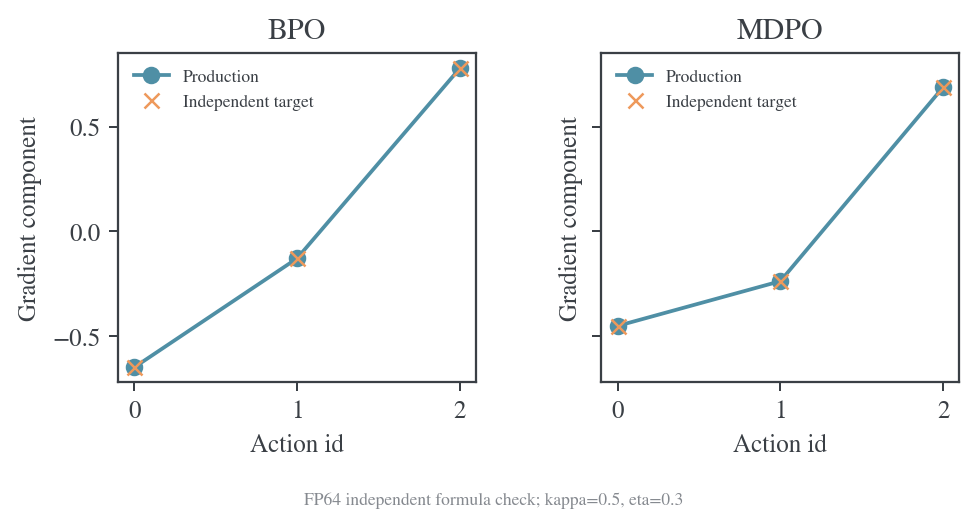
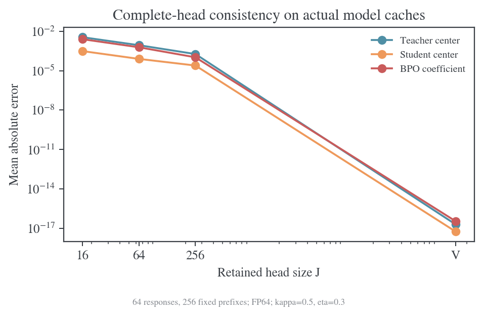
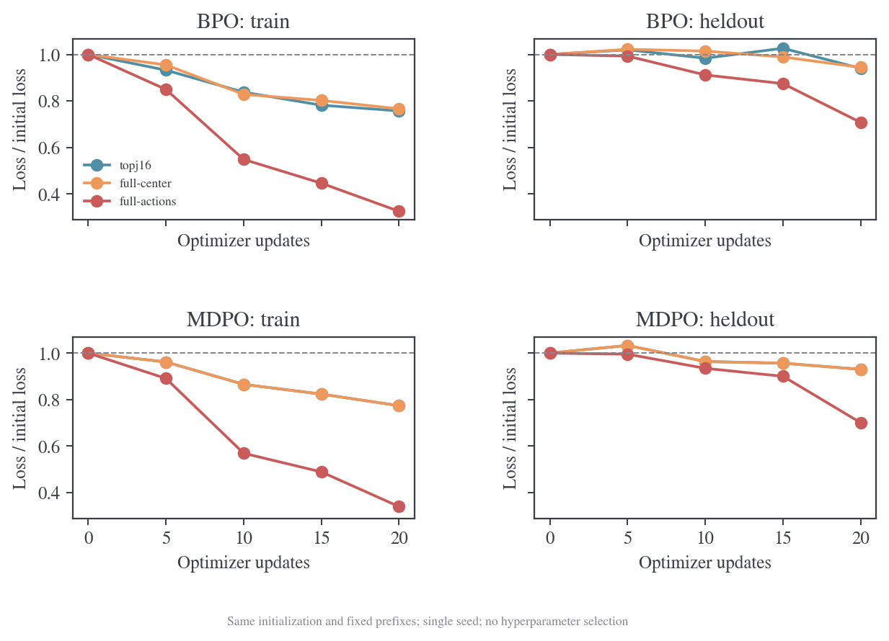
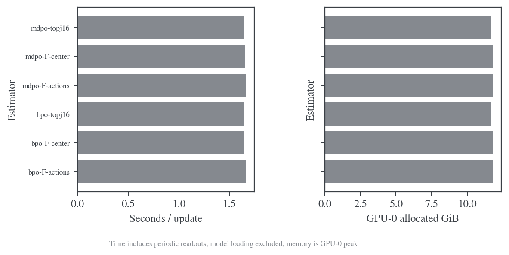
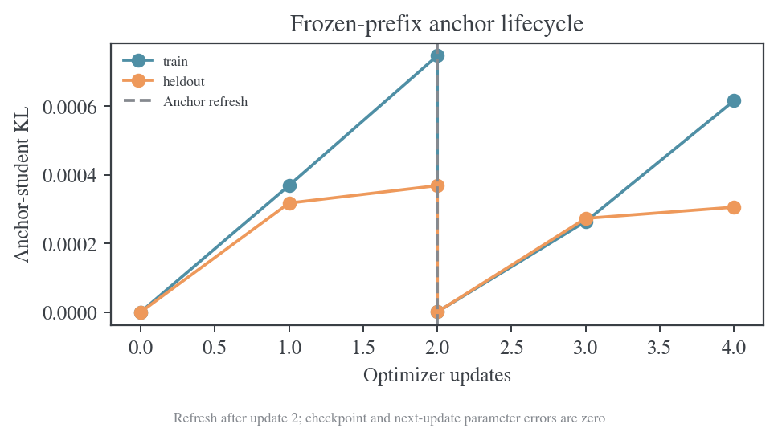
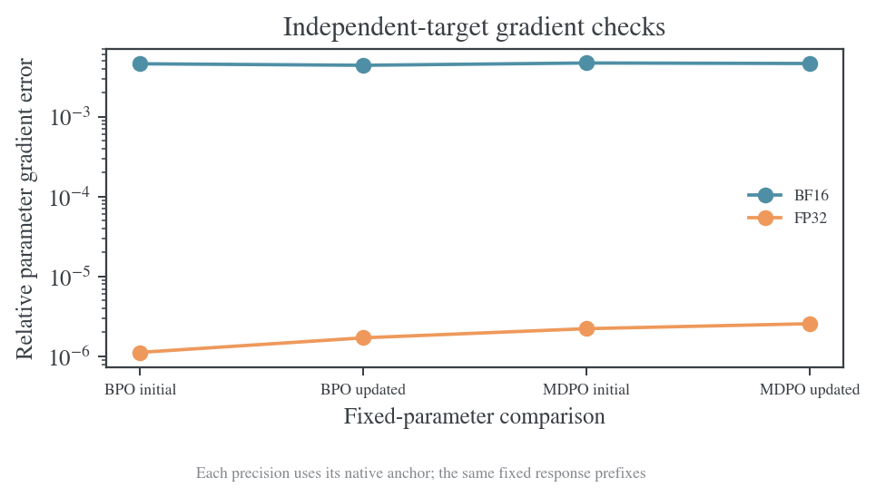
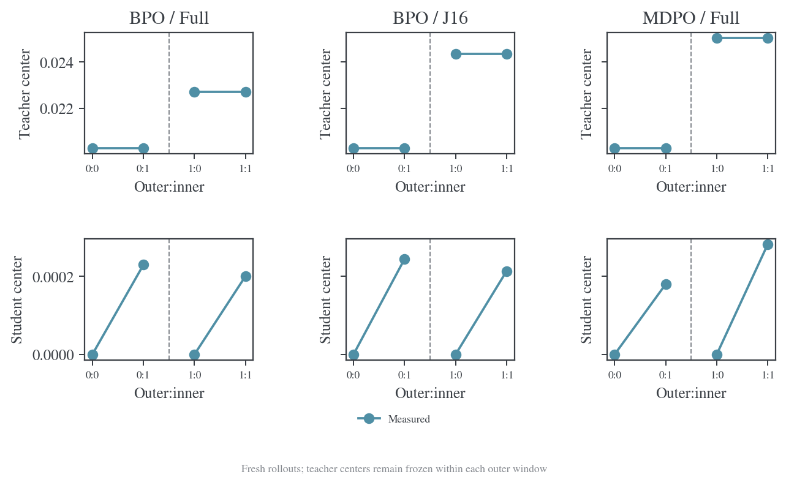

# 幂均值镜像蒸馏实现与估计器对照

更新日期：2026-10-15。研究状态：实现与六组分层验证完成。沿用[固定监督蒸馏报告](2026-10-15-固定监督蒸馏动力学与BPO优化实验报告.md)的模型、t22 数据及四卡验证方法。本报告验证生产算法与估计器，不选择 κ、η 的最佳值。

## 问题、成功条件与实验范围

目标是在生产 BPO（中心化对数比方差目标的代码名称）与镜像下降策略优化（Mirror Descent Policy Optimization，MDPO）中正确实现幂均值教师信号，提供 Top-J＋tail 和完整词表中心，以及完整动作求和损失。二样本恒等式及相关训练入口退出当前实现，历史原始记录保留。

成功条件包括：κ=0 恢复原始算法；完整词表损失及解析梯度与独立公式一致；J 覆盖全部词表时中心和采样系数一致；冻结缓存不随 inner 更新改变，学生中心持续更新；padding、EOS、温度及 outer 同步语义正确；真实模型四卡前向、反向、优化和 checkpoint 恢复通过；Top-J 误差和完整动作求和的成本均有实际测量。

任何完整词表梯度与独立目标不一致、缓存混用不同 κ/η、J=V 不收敛到完整中心、跨卡归约错误或非有限更新，均否决当前实现并阻止扩大实验。Top-J 有限截断误差属于被测对象，不能通过降低完整参照精度掩盖。

可调整项为分块大小、缓存存储位置、固定前缀数和验证更新数；目标公式、估计测度、前四张物理 GPU 的范围与误差定义保持固定。主实验 κ=0.5、η=0.3；κ=0 为兼容性对照，其他端点仅用于数值单元检查。

## 共同设置与推进顺序

学生为 DeepSeek-R1-Distill-Qwen-1.5B，教师为 JustRL-DeepSeek-1.5B；revision、完整合法词表、原 t22 轨迹、bfloat16（BF16）与 32 位浮点格式（FP32）的读出沿用历史报告，并在运行 metadata 再次核对。GPU 限物理 0–3。优化器沿用 AdamW，学习率 1e-6、weight decay 0；固定监督训练和 outer 刷新检查分开记录。

GPU 运行环境实际为 PyTorch 2.7.1+cu126、Transformers 4.57.6、vLLM 0.10.0+cu126、Ray 2.59.0、FlashAttention 2.8.3.post1，CUDA 12.6，四张 NVIDIA H800（每卡 81559 MiB）。[环境记录](../../data/power-implementation-20261015/runtime.json)保存读取值，[模型权重校验](../../data/power-implementation-20261015/model-verification.json)记录再次核对的 revision 与权重 SHA-256。原生 verl 后端以 commit `62669afb5101bfdf57dc5ddf81e78f000c5ce2fc` 加仓库补丁重建，运行源码与补丁另存可校验归档。

先做有限词表 CPU 数学验证，再做四卡真实模型分布及梯度核验，之后进行同初始化短程拟合和 outer 刷新验证。各阶段通过后才扩大规模。实验 1 为数学与缓存验证；实验 2 为真实缓存中心和梯度误差；实验 3 为四卡训练路径及开销；实验 4 为 outer 刷新与恢复。每个实验完成后补充背景与推导、Setting、实验结果、实验分析和结论。

## 共同公式与实现

KL 表示 Kullback–Leibler 散度。固定前缀的锚点、教师和当前学生分别为 $q,T,p_\theta$。相对锚点的对数比与条件中心化算子定义为

$$
U=\log(p_\theta/q),\qquad C_qh=h-\mathbb E_qh.
$$

幂均值分支取 $0<\kappa\le1$、$0<\eta\le1$，κ=0 使用连续端点。冻结教师信号为

$$
A_{\kappa,\eta}(a)=\frac{\log[1-\eta+\eta(T_a/q_a)^\kappa]}{\kappa\eta},\qquad A_{0,\eta}(a)=\log(T_a/q_a).
$$

教师中心为 $K_T=-\mathbb E_qA$，学生中心为 $K_S=\operatorname{KL}(q\Vert p_\theta)$。BPO 与 MDPO 的采样 score 系数分别为

$$
c_{\mathrm{BPO}}=(U+K_S)/\eta-A-K_T,\qquad
c_{\mathrm{MDPO}}=e^U(U/\eta-A).
$$

两种完整条件损失为

$$
\mathcal L_{\mathrm{BPO}}=\frac1{2\eta}\mathbb E_q[(C_q(U-\eta A))^2],\qquad
\mathcal L_{\mathrm{MDPO}}=\mathbb E_p[U/\eta-A].
$$

本轮归一化目标及配分函数为

$$
m_a=\frac{q_a e^{\eta A(a)}}Z,\qquad Z=\sum_bq_b e^{\eta A(b)}.
$$

代入 $\log m=\log q+\eta A-\log Z$，逐动作得到 $U/\eta-A=(\log p-\log m)/\eta-\log Z/\eta$。再用 $\sum_ap_a=1$ 求和：

$$
\mathcal L_{\mathrm{MDPO}}=\frac{\operatorname{KL}(p\Vert m)}\eta-\frac{\log Z}\eta.
$$

第二项在本轮冻结。记录拟合误差时另报 target KL，避免把目标常数当成拟合误差。

`mirror_kappa` 控制形状。`mirror_center_mode=topj_tail/full_vocab` 控制显式条件中心。`mirror_action_mode=sampled/full_vocab` 控制动作积分方式；完整动作求和要求完整缓存，非法组合直接报错。完整缓存保留冻结 $\log q,\log T$；紧凑缓存保留 head、尾部质量、动作 log-prob 和教师中心。κ、η 随教师缓存保存，inner 不允许混用不同信号参数。

信号计算使用 log 概率比，局部用 `log1p` 与 `expm1`，大比率用 `logaddexp`；κ=0 和 η=1 使用解析端点。完整动作损失直接自动微分，采样 score 系数停止梯度。FP64 输入保留 FP64，BF16 模型输出的概率计算升为 FP32。

## 实验 1：独立公式、梯度与缓存契约

### 背景与推导

仅核对损失值不能排除停止梯度、中心导数或重要性比率错误。独立参照直接从幂均值构造归一化 target，BPO 微分其 $q$ 加权中心化 log 残差，MDPO 微分 $\operatorname{KL}(p\Vert m)/\eta$。枚举动作后，生产采样 score 的梯度应与完整目标相同。

### Setting

CPU 上的 64 位浮点格式（FP64）三元分布，κ 为 0、0.5、1，η 为 0.03、0.3、1，分别检验 BPO 与 MDPO。额外覆盖 J=0/1/2/V、非锚点学生、padding、非法动作掩码、冻结缓存、学生中心刷新、κ/η 不匹配和完整缓存模式不匹配；极端 log 概率比范围为 ±10000。大 head 重叠测试使用 151665 个 token ID。现有幂均值与训练配置回归一起执行，共 107 项测试。

### 实验结果

107 项测试全部通过。完整梯度与独立目标通过绝对误差 2e-13、相对误差 2e-12 的检查。J=V 的采样系数恢复完整中心；MDPO 未加 baseline 的系数与中心模式无关。padding 梯度为零，锚点与教师没有梯度；inner 改变学生后学生中心变化，教师中心保持原值。错误缓存参数被拒绝。



完整动作模式另检验了极小锚点概率下的行为：该模式直接积分损失，不计算无用的采样重要性比率，因而不会因该比率溢出而拒绝本来有限的完整目标。该模式记录完整损失，省去没有使用的采样 score 指标。

上游 trainer 的 anchor→teacher 路由、完整向量缓存的 padding/unpadding 和旧默认配置均通过 CPU 执行检查。旧 OPD 及 PMD-mean/BPO/MDPO 语义回归通过。当前活动代码、训练入口及书稿已删除 BPO 二样本损失、对应 U 统计量与 distinct-pair 路线，历史原始数据保留。

### 实验分析

Top-J 的 BPO 系数误差恰为 $e_S/\eta-e_T$，其中 $e_S,e_T$ 是两中心近似误差。其期望梯度偏差再乘 $\mathbb E_q\nabla\log p$，不能直接把中心数值误差当作参数梯度误差。CPU 测试同时覆盖这个偏差恒等式和 MDPO 的中心独立性。

完整 head 的集合诊断采用排序查找，避免构造 V×V 张量。该改动只影响诊断的存储复杂度，与损失及梯度定义分开验证。

### 结论

数学和缓存契约通过独立验证，支持进入真实模型与四卡训练检查；CPU 结果不代表分布式训练已完成。

## 实验 2：真实缓存上的中心误差与完整梯度

### 背景与推导

Top-J＋tail 将未知尾部合并为一类，教师中心是完整中心的 Jensen 下界。扩大 head 的收益需要在真实分布上量化；J=V 则提供严格的一致性检查。完整损失还需与另一种归一化目标构造交叉核验。

### Setting

物理 GPU 0–3，每卡读取历史 seed42 缓存的 16 条响应，每条取 4 个固定随机前缀，共 64 条响应、256 个前缀。全部属于原 t22 prompt；响应生成温度 1、top-p 1、top-k 0、最大长度 7168，原 64 条响应中 29 条耗尽预算，未将其记作 EOS 完成。完整合法词表为 151665。缓存概率在 FP64 中重新归一化，当前学生为锚点 logits 加 seed 固定、标准差 0.2 的扰动；本实验没有更新模型参数。

固定 κ=0.5、η=0.3，J 取 0、16、64、256 和 V，BPO 与 MDPO 分别核验。独立完整梯度参照使用归一化幂均值 target；生产实现使用未归一化教师信号。每个条件在每条响应上保存记录，共 640 条条件记录。

### 实验结果

完整损失梯度与独立目标的最大逐坐标误差为 8.69e-15。下表按前缀数加权，列出 BPO 的平均绝对误差；数值来源为[缓存核验表](../../results/power-implementation-20261015/cache-audit.csv)。

| J      | 教师中心误差 | 学生中心误差 | BPO 采样系数误差 |
| ------ | -----------: | -----------: | ---------------: |
| 0      |    6.5435e-2 |    5.9612e-3 |        5.0386e-2 |
| 16     |    3.4880e-3 |    3.0676e-4 |        2.4656e-3 |
| 64     |    8.5997e-4 |    7.8275e-5 |        5.9917e-4 |
| 256    |    1.8219e-4 |    2.4472e-5 |        1.0336e-4 |
| 151665 |   2.0515e-17 |   5.8378e-18 |       3.5774e-17 |

### 实验分析

在这组前缀与扰动学生上，J=16 已将教师中心平均误差由 J=0 的约 0.0654 降至约 0.00349；继续扩大到 J=256 后为约 0.000182。两中心误差在 BPO 系数中可能部分抵消，因此应同时报告两个中心及净系数误差，不能只用某一个中心判断训练更新误差。

J=V 的一致性达到 FP64 舍入量级。MDPO 系数不读取教师或学生中心，切换中心模式不会改变该系数；在相同当前 logits 下，两种 sampled MDPO 的系数应一致；独立 BF16 训练运行还需控制反向传播的数值重复性。完整动作求和与 sampled MDPO 的差异来自积分方式。

### 结论

真实缓存支持中心公式、J=V 极限及完整动作梯度的正确性。有限 J 误差随 head 扩大明显减小；这一数值范围仅适用于所选单 prompt 前缀和扰动学生，训练轨迹中的误差另行测量。



## 实验 3：四卡全参数梯度与三条训练路径

### 背景与推导

分布级梯度正确后，还需核验共享网络参数、完全分片数据并行（Fully Sharded Data Parallel，FSDP）的梯度归约及真实模型前后向。三条路径分别为 Top-J＋tail 中心配记录动作、完整中心配同一记录动作、完整中心配完整动作积分。前两者只改变条件中心；后两者只改变动作积分。独立完整目标的读出用于比较，采样 score 代理的数值不作为真实损失。

若全局前缀数为 N、数据并行 rank 数为 R，每个 rank 的本地损失与梯度平均为

$$
L_r=\frac RN\sum_{i\in r}\ell_i,\qquad
\frac1R\sum_r\nabla L_r=\frac1N\sum_i\nabla\ell_i.
$$

参数梯度比较使用全部不重叠分片的平方范数之和，相对误差为

$$
\epsilon_g=\frac{\lVert g_{\mathrm{prod}}-g_{\mathrm{ref}}\rVert_2}{\lVert g_{\mathrm{ref}}\rVert_2}.
$$

方向余弦使用相同的全局内积。

### Setting

学生共 1777088000 个参数，全部训练。采用物理 GPU 0–3、FSDP、FP32 主参数和梯度归约、BF16 前后向、缩放点积注意力（scaled dot-product attention，SDPA）和梯度检查点（gradient checkpointing），AdamW 学习率 1e-6、weight decay 0、seed42。κ=0.5、η=0.3、J=16 固定，未扫描参数。主对照控制确定性算法与 CUDA 矩阵乘精度。AdamW 使用 β=(0.9,0.999)、epsilon1e-8；主训练不裁剪梯度，只记录全局范数。

全参数梯度核验取每卡 2 条响应、每条 8 个训练前缀，共 8 条响应、64 个前缀。BPO 和 MDPO 各在初始化及两次更新后，对生产完整损失与独立归一化 target 目标分别 backward，比较全部参数分片。BF16 预设门限为相对 L2 误差 3%、方向余弦 0.999；FP64 分布级严格核验仍由实验 2 独立承担。

主训练取每卡前 4 条原响应，共 16 条响应。每条固定随机抽取 16 个训练前缀和另外 16 个留出前缀，共 256＋256 个位置；训练与留出位置互斥，响应相同。保留原响应长度、EOS 和预算终止状态。六组从同一预训练学生开始，各做 20 次 optimizer 更新，每 5 步读出训练及留出误差。留出前缀与训练前缀共享响应上下文，不能解释为独立题目泛化。

### 实验结果

六组四卡两步 canary 全部完成，随后六组主对照各完成 20 步。全参数梯度核验的 BF16 相对 L2 误差为 0.004397–0.004697，方向余弦为 0.999989–0.999990；所有条件通过预设门限。该误差属于实际 BF16 前后向比较，不能写成 FP64 的机器精度一致。

下表使用共同完整读出：BPO 为完整条件方差损失，MDPO 为当前学生到归一化 target 的 reverse KL；数值均为条件前缀平均。初始训练/留出 BPO 分别为 0.0220173/0.0258322，MDPO target KL 分别为 0.00710266/0.00813625。

| 方法 | 路径               | 末训练误差 | 末留出误差 | 训练误差/初值 | 留出误差/初值 |
| ---- | ------------------ | ---------: | ---------: | ------------: | ------------: |
| BPO  | J16 中心＋记录动作 |  0.0166708 |  0.0242853 |      0.757169 |      0.940118 |
| BPO  | 完整中心＋记录动作 |  0.0168678 |  0.0243978 |      0.766115 |      0.944470 |
| BPO  | 完整中心＋完整动作 | 0.00717430 |  0.0182793 |      0.325848 |      0.707615 |
| MDPO | J16 中心＋记录动作 | 0.00549651 | 0.00756698 |      0.773867 |      0.930033 |
| MDPO | 完整中心＋记录动作 | 0.00549651 | 0.00756698 |      0.773867 |      0.930033 |
| MDPO | 完整中心＋完整动作 | 0.00241749 | 0.00570109 |      0.340364 |      0.700703 |



两种 sampled MDPO 的全部已记录测量逐项相同，最大差为零。Top-J BPO 与完整中心 BPO 的轨迹接近，但并不相同。所有更新的梯度与损失有限。

六组 20 步训练窗口为 32.81–33.21 秒，包含定期和末尾完整读出，不包含模型与缓存加载。GPU 0 峰值 allocated memory 为紧凑缓存约 11.642 GiB、完整缓存约 11.787–11.788 GiB。每组只运行一次，这些接近的耗时不能支持吞吐排名。



### 实验分析

在所选固定监督条件下，完整动作积分让训练目标和留出目标下降更多。仅把 J16 中心换成完整中心没有带来相同幅度的变化；主要差别来自动作积分方式。记录动作复用 20 次会保留经验采样误差，不能继续宣称每步都相对于当前参数条件无偏。

MDPO 的中心模式是一个明确的实现对照：未加 baseline 的系数不依赖中心，控制数值重复性后应得到相同轨迹，实际记录满足该要求。BPO 的两中心误差则会改变系数，实验 2 给出了对应的解析关系。

所有臂为了共同的完整诊断，都额外持有原始完整 q/T 参照；11.642 与 11.787 GiB 的差仅反映这套诊断程序的增量缓存开销，不能解释为生产紧凑缓存的全部内存收益。实验 2 的 FP64 张量计数中，J16 紧凑缓存每前缀 577 字节，而同 head 的完整缓存为 2427217 字节；生产 FP32 概率存储另按 dtype 计数。

这些结果验证固定目标的实现与短程拟合。它们没有比较新 rollout 分布上的任务准确率，没有多 prompt 或多 seed 结论，也没有确定最佳 κ、η 或学习率。

### 结论

三条路径均可在四卡全参数训练中运行。完整动作积分在该固定 setting 下减少了更多训练及留出误差；Top-J＋tail 保留为紧凑中心实现，完整路径提供正确性与拟合参照。

## 实验 4：锚点刷新、缓存恢复与继续训练

### 背景与推导

inner 更新期间教师中心必须冻结，学生中心持续变化；outer 刷新后，应由当前学生重建 q 和教师信号。仅加载权重并核对损失不足以证明恢复正确，还需保存 Adam 状态，并验证下一步更新一致。

### Setting

使用完整 BPO、κ=0.5、η=0.3，与实验 3 相同的四卡精度和优化器。每卡 2 条响应、每条 4 个训练及 4 个留出前缀，共 8 条响应、32＋32 个位置。做 4 次主更新，在 update2 用当前原生前向刷新冻结锚点，并从新 q 为每个固定前缀重新抽一个动作。此处保持前缀不变，单独检查 anchor 生命周期，不声称生成了新 response。

update4 保存四个本地参数分片、Adam 状态、锚点、动作及 RNG 状态。先执行一次继续训练作为参照，再扰动参数、恢复 checkpoint、重新执行相同步骤；两次验证更新单独计数，不计入 4 步主训练的对照预算。

### 实验结果

4 次主更新完成，update2 刷新后的 anchor–student KL 通过绝对值 1e-6 检查。恢复后的所有参数分片和 Adam 状态逐位一致，全部诊断最大差为 0。恢复后继续一步，与未中断的参照继续一步相比，全部参数的最大绝对差为 0。



### 实验分析

该检查同时覆盖冻结缓存内容、参数及优化器状态；继续一步的一致性排除了仅恢复权重、丢失 Adam moments 的错误。恢复限定为相同四卡拓扑，未声称支持任意 world size 的 checkpoint 重分片。

固定前缀刷新将缓存生命周期与新 response 的生成分开验证。原生 verl 的 fresh rollout、权重同步和缓存传输另做链路检查，不能用本实验替代。

### 结论

固定前缀的锚点刷新、四卡 checkpoint 恢复和下一步重现均通过。

## 实验 5：FP32 全参数梯度交叉核验

### 背景与推导

BF16 参数梯度会受到低精度乘法、归约及反向传播顺序影响。另用 FP32 前后向比较同一冻结问题下的生产损失与独立 target 目标，可提供更严格的参数梯度参照。该检查用于正确性，不恢复历史已取消的 FP32 长程优化实验。

### Setting

物理 GPU 0–3，仍为同一 1777088000 参数学生、原教师缓存、κ=0.5、η=0.3。每卡 2 条响应、每条 8 个训练及 8 个留出前缀，共 8 条响应、64＋64 个位置。主参数、模型前后向和梯度归约均用 FP32，关闭 TF32，启用确定性算法。用当前 FP32 学生重新评分固定前缀建立原生锚点，教师分布保持原缓存；该锚点与 BF16 主训练锚点不同，不能用两者的损失差作为精度收益比较。

BPO 与 MDPO 各执行一次 optimizer 更新，在更新前后分别比较生产完整损失与独立归一化 target 目标的全部参数梯度。预设门限为相对 L2 误差 1e-4、方向余弦不低于 1−1e-7。

### 实验结果

| 方法 | 状态   | 相对 L2 误差 | 最大逐参数绝对误差 |          方向余弦 |
| ---- | ------ | -----------: | -----------------: | ----------------: |
| BPO  | 初始化 |    1.1237e-6 |          4.4622e-7 | 0.999999999999390 |
| BPO  | 更新后 |    1.7092e-6 |          5.6578e-7 | 0.999999999998540 |
| MDPO | 初始化 |    2.2254e-6 |          1.9893e-6 | 0.999999999997613 |
| MDPO | 更新后 |    2.5679e-6 |          1.1176e-6 | 0.999999999996704 |

四组参数梯度比较均通过。误差覆盖全部 FSDP 参数分片，包含当前主干及词表输出层的实际反向传播。



### 实验分析

FP32 核验将真实网络的两种目标梯度差约束到 1e-6 相对量级，并覆盖离开 anchor 后的状态。它与实验 2 的 FP64 分布级核验、实验 3 的 BF16 生产精度检查承担不同职责；没有用高精度小模型结果替代实际 BF16 训练。

### 结论

完整 BPO、MDPO 在 FP32 四卡全参数网络上的梯度均与独立目标一致到记录的数值误差范围。

## 实验 6：原生 verl 的 fresh rollout 与缓存传输

### 背景与推导

固定前缀实验不经过 Ray、vLLM 和原生 trainer。原生验证还需检查 rollout 权重版本、锚点评分、教师评分、padding/unpadding、缓存传输和多次 inner 更新。每个 outer 的首次更新前应有 $K_S\approx0$；同一窗口内 $K_T$ 应完全冻结，当前学生更新后 $K_S$ 应变化。

### Setting

仍用原模型对与 t22 数据，物理 GPU 0–3，κ=0.5、η=0.3、J=16。分别运行 BPO Top-J＋tail、BPO 完整动作、MDPO 完整动作。每个条件包含两个 outer，每轮 batch4、每 prompt 槽位一条新 response、最多 32 个 token，temperature1、top-p1、关闭 top-k。每轮两个 inner epoch，mini-batch4、每卡 micro-batch1，共四次 optimizer 更新。学生全参数训练，FP32 主参数、BF16 原生模型前向，gradient clip1，学习率 1e-6、weight decay0，启用原生 remove-padding 链路。

本地 vLLM 0.10 使用 V1 engine，入口和 Ray worker 显式设置 `VLLM_USE_V1=1`。vLLM 与 Ray 的 Unix socket 临时目录均使用短磁盘路径。该实验使用 32-token 截断预算，仅验证训练链路，不评测数学准确率。

### 实验结果

三个条件全部完成。每个条件均有四条全局 optimizer 记录，outer/inner 索引依次为 `(0,0),(0,1),(1,0),(1,1)`；两个 rollout 权重版本均为 0、1，全部更新和诊断有限。每轮参与训练的 token 数为 128，与 4×32 一致，预算末 token 没有被漏掉。

| 路径          | outer | 冻结教师中心 | 首次学生中心 | 第二次更新前学生中心 |
| ------------- | ----: | -----------: | -----------: | -------------------: |
| BPO J16       |     0 |   0.02026936 |    5.1956e-9 |            2.4465e-4 |
| BPO J16       |     1 |   0.02435328 |    1.1354e-8 |            2.1390e-4 |
| BPO 完整动作  |     0 |   0.02027464 |    5.1957e-9 |            2.2972e-4 |
| BPO 完整动作  |     1 |   0.02270966 |    9.6011e-9 |            2.0077e-4 |
| MDPO 完整动作 |     0 |   0.02027464 |    5.1957e-9 |            1.8007e-4 |
| MDPO 完整动作 |     1 |   0.02502499 |    1.4605e-8 |            2.8262e-4 |

每个 outer 内两次记录的教师中心逐位相同。完整动作模式记录 `mirror/full_loss`，没有生成 sampled score 或重要性比率字段；Top-J 模式记录采样系数，未冒充完整损失。



### 实验分析

首次学生中心接近零、窗口内教师中心完全一致、后续学生中心改变，分别支持锚点重建、教师缓存冻结和当前学生重算。两个新 rollout 版本及四次更新同时经过原生传输链路，补充了 CPU stand-in 与固定前缀训练的证据。

同版本并不保证不同计算引擎的概率逐位相同。按实际 debug 代码计算的有效动作概率绝对差 $\max|\exp(\log\beta)-\exp(\log q)|$，在六个 outer 中最大为 0.0304844，其中 β 为 vLLM 采样分布、q 为 FSDP 重评分锚点。完整动作积分不依赖记录动作的采样概率；Top-J sampled 路径的解释还包含这项数值测度误差。该 canary 没有证明跨引擎采样严格无偏，也不把完整损失在两个 inner 间的变化作为单调下降保证。

### 结论

三个原生链路条件均通过配置、fresh rollout、缓存传输、窗口冻结及有效 token 检查。全词表实现已进入实际 trainer；Top-J＋tail 保留为显式近似路径，跨引擎概率差单独记录。

## 复现与证据

CPU 与源码检查使用 `make test`、`make check`、`make book` 和 `python3 scripts/book_source_audit.py`。实际 TA-OPD 补丁已在干净基线重放，结果与运行后端逐字节一致。当前 BPO 二样本函数、canary、分析入口和书稿章节已删除，原始历史统计保留。

在本机仓库根执行以下命令可重建固定监督验证。已有完成记录会跳过，运行配置与原始输入路径在对应结果目录保存。这些命令以已存在的历史缓存为前置条件；其他机器需先按历史报告准备缓存，SHA-256 不同的缓存应作为新的数据条件处理。

```bash
task_python=../envs/opd/bin/python
for phase in audit canary gradient precision train lifecycle; do
    PYTHONPATH=.:src "$task_python" -m training.power_implementation_suite --phase "$phase"
done
```

原生条件通过 `training.power_implementation_verl.py` 执行；`--backend` 指向由 manifest 与补丁重建的 TA-OPD 根目录。

```bash
PYTHONPATH=.:src "$task_python" -m training.power_implementation_verl \
    --backend upstream/TA-OPD --method bpo --estimator topj_tail
PYTHONPATH=.:src "$task_python" -m training.power_implementation_verl \
    --backend upstream/TA-OPD --method bpo --estimator full_vocab
PYTHONPATH=.:src "$task_python" -m training.power_implementation_verl \
    --backend upstream/TA-OPD --method mdpo --estimator full_vocab
```

[统计汇总](../../results/power-implementation-20261015/summary.json)关联全部完成条件、逐前缀核验及原始日志的 SHA-256。[输入与记录目录](../../data/power-implementation-20261015/)保存固定配置、GPU 所有权、梯度核验、逐步读出与源文件归档。每次运行的 source tar 和后端 patch 均经过压缩回读校验，并写入 data manifest；原始模型与约 7.3 GiB 历史缓存继续使用原 manifest，未复制入新实验目录。

制图脚本为 `experiments/plotting/plot_power_implementation.py`，统计归档脚本为 `experiments/analysis/power_implementation_report.py`。所有图来自保存数值，渲染审计结果随图版本化。实现提交为 `44c5580`；后续证据归档提交保存原生验证与最终报告。
