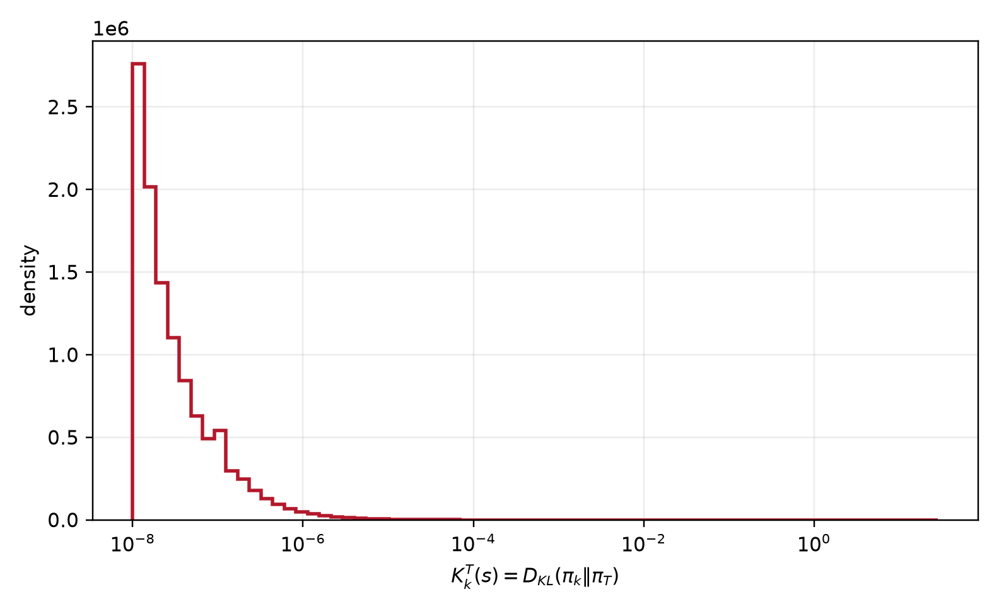
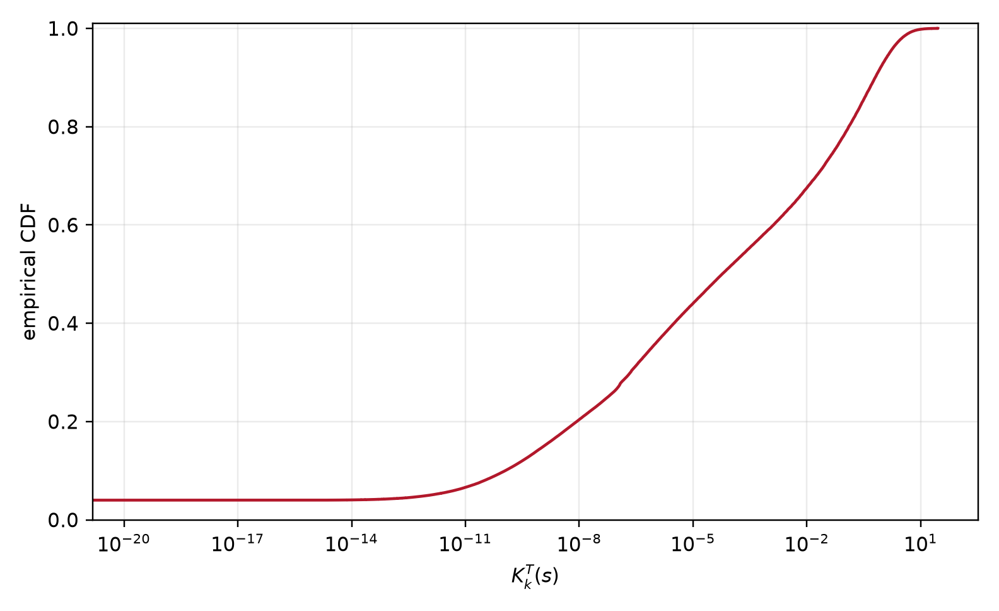
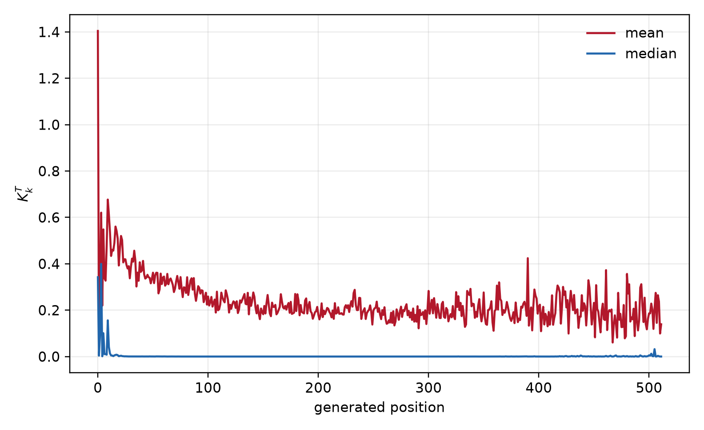
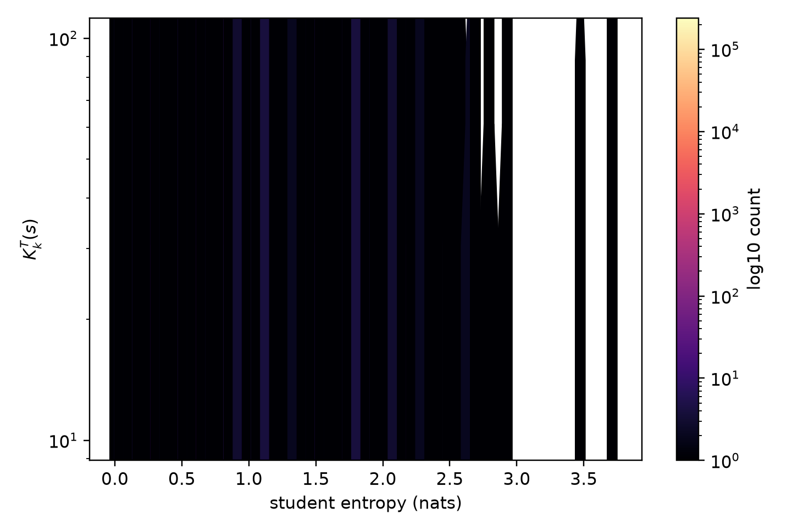

# 1.7B rollout 上的 $K_k^T$

## 定义与实验设置

第二章中的

$$
K_k^T(s)=D_{\mathrm{KL}}\!\left(\pi_k(\cdot\mid s)\middle\Vert\pi_T(\cdot\mid s)\right)
$$

在本实验中取

$$
\pi_k=\text{Qwen3-1.7B},\qquad
\pi_T=\text{Qwen3-4B}.
$$

状态 $s$ 来自 Qwen3-1.7B 在 GSM8K test split 全部 1319 个 prompt 上的完整 rollout。共得到 350166 个 prefix。对每个 prefix，分别计算两个模型的完整 vocabulary logits，再计算

$$
K_k^T(s)=\sum_{v\in\mathcal V}
\pi_k(v\mid s)\log\frac{\pi_k(v\mid s)}{\pi_T(v\mid s)}.
$$

两个模型都用 NF4 4-bit 权重和 bf16 计算，因此这里的数值是量化 scoring 模型的完整词表 KL。这个量没有对参数求导，在一个 outer step 内可以计算一次并缓存，后续所有 inner step 复用。

## 结果

| 统计量       |          $K_k^T(s)$ |
| ------------ | ------------------: |
| prefix 数量  |              350166 |
| prompt 数量  |                1319 |
| 均值         |            0.269321 |
| 中位数       | $5.83\times10^{-5}$ |
| 75% 分位数   |             0.05144 |
| 90% 分位数   |             0.63174 |
| 95% 分位数   |             1.50558 |
| 99% 分位数   |             4.76115 |
| 99.9% 分位数 |             12.1811 |
| 最大值       |             28.5129 |

分位数说明 $K_k^T$ 是一个非常重尾的量。约 67.55% 的 prefix 满足 $K_k^T<0.01$，约 78.55% 满足 $K_k^T<0.1$，约 92.81% 满足 $K_k^T<1$；剩余少数 prefix 对均值贡献很大。

按 prompt 先取 prefix 平均后，1319 个 prompt 的均值统计为：

| 统计量     | prompt 内平均 $K_k^T$ |
| ---------- | --------------------: |
| 均值       |              0.278203 |
| 中位数     |              0.256787 |
| 90% 分位数 |              0.442535 |
| 99% 分位数 |              0.691097 |

prefix 级别和 prompt 级别的均值接近，说明重尾不是由少数极长轨迹造成的；它来自不同 prompt 和不同生成位置上的局部分布差异。

生成位置上的均值不稳定。第一个生成 token 的平均 KL 为 1.404，随后下降到第 1 个位置的 0.085，再在后续推理 token 位置反复升高。这说明 prompt 边界和推理阶段的状态分布不同，不能把所有 prefix 当成同一个条件分布来估计一个 KL。

## 与 $M(32)$ 的关系

同一批 rollout 上，Student top-32 概率质量为

$$
\mathbb E[M(32)]\approx0.999961,
$$

但

$$
\mathbb E[K_k^T]\approx0.269321.
$$

这两个数字并不矛盾。$M(32)$ 只描述 Student 的概率质量是否集中在 top-32；$K_k^T$ 还包含 Student 与 Teacher 在这些 token 上的 log-probability 差异。即便 tail mass 很小，Teacher 对某些 token 的概率压得足够低，也会产生很大的 log-ratio。

同一批数据上的 top-$K$ KL 截断结果如下：

| $K$ | 平均 top-$K$ mass | Trunc bias | Trunc RMSE | Corrected 理论 RMSE |
| --: | ----------------: | ---------: | ---------: | ------------------: |
|   1 |          0.942075 |  -0.076720 |   0.393068 |            0.685574 |
|   4 |          0.997471 |  -0.004648 |   0.047614 |            0.188635 |
|   8 |          0.999493 |  -0.000937 |   0.014156 |            0.083075 |
|  16 |          0.999878 |  -0.000232 |   0.004885 |            0.039593 |
|  32 |          0.999961 |  -0.000080 |   0.002175 |            0.022486 |

因此 $M(32)$ 很大确实对应很小的**平均截断 bias**，但它不等于 $K_k^T$ 小，也不等于每个 prefix 的 KL 估计方差小。这里少数大 KL prefix 主要影响 RMSE 和高阶矩，而均值 bias 仍然很小。

## 对两个 KL 估计策略的含义

在 Algorithm 5 的 outer step $k$ 内，$K_k^T(s)$ 不随 inner index $n$ 改变。对于每个 rollout prefix，最合理的流程是：

1. rollout 时保存 prefix token IDs；
2. 用 frozen 1.7B anchor 和 frozen 4B teacher 做一次 full-vocabulary 或 top-$K$+tail-correction 计算；
3. 缓存 $K_k^T(s)$、teacher action log-prob 和需要的 tail statistics；
4. 所有 inner step 复用这个 stop-gradient 数值。

相反，

$$
K_{k,n}^{\theta}(s)=D_{\mathrm{KL}}\!\left(\pi_k(\cdot\mid s)\middle\Vert\pi_{k,n}(\cdot\mid s)\right)
$$

会随 student 的 inner 参数变化，必须在每个 inner step 重新计算，或者使用与当前 student logits 对应的估计量重新评估。

由于 $K_k^T$ 的 prefix 分布重尾，单个 rollout token 的 sampled-token 估计虽然无偏，但方差会很大。对它更适合使用：

$$
\widehat K_{k,K}^T
=\sum_{v\in S_K}\pi_k(v)\log\frac{\pi_k(v)}{\pi_T(v)}
+\frac1m\sum_{j=1}^{m}
\mathbf 1\{a_j\notin S_K\}
\log\frac{\pi_k(a_j)}{\pi_T(a_j)},qquad a_j\sim\pi_k,
$$

并同时记录尾部二阶矩。若显存允许，Teacher/anchor 的 full vocabulary logits 在 outer step 内缓存一次，后续只保存 KL 标量和少量审计统计；不应为每个 inner step 重复计算 Teacher。

## 文件

- `qwen3_gsm8k_kt/kt_prefix.csv`：350166 个 prefix 的 $K_k^T$。
- `qwen3_gsm8k_kt/kt_prompt.csv`：1319 个 prompt 的聚合统计。
- `qwen3_gsm8k_kt/plots/kt_summary.csv`、`kt_quantiles.csv`、`kt_by_position.csv`：统计表。
- `qwen3_gsm8k_kt/plots/kt_prefix_histogram.png`：prefix 级 KL 直方图。
- `qwen3_gsm8k_kt/plots/kt_prefix_ecdf.png`：prefix 级 KL ECDF。
- `qwen3_gsm8k_kt/plots/kt_by_position.png`：按生成位置的 KL。
- `qwen3_gsm8k_kt/plots/kt_vs_entropy.png`：KL 与 Student entropy 的关系。
