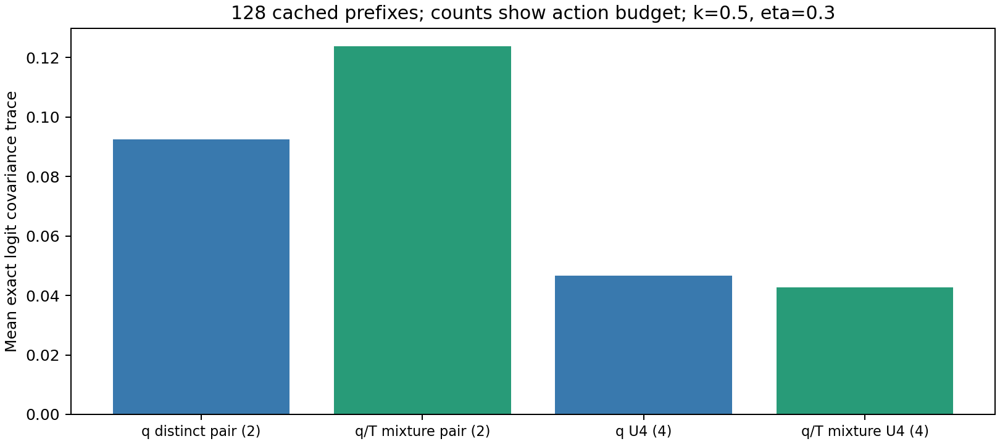

# 目标形状、序列与中心估计

[返回总报告](../2026-10-15-固定监督蒸馏动力学与BPO优化实验报告.md)。共同定义、配置和计分规则见总报告；本章是同一份报告的实验正文，编号连续，图表目录保持唯一。

## 实验 17：幂均值 target 的真实缓存信号与相对噪声

### 背景与推导

LR 只改变位移标量，target 形状可以改变监督方向及重尾，这是另一种方法假设。对冻结 $q/T$，幂均值 target 与未归一化监督信号定义为

$$
p^*_{\kappa,\eta}(a)\propto q(a)\left[(1-\eta)+\eta\left(\frac{T(a)}{q(a)}\right)^\kappa\right]^{1/\kappa},\qquad
f_{\kappa,\eta}(a)=\frac1\kappa\log\left[(1-\eta)+\eta\left(\frac{T(a)}{q(a)}\right)^\kappa\right].
$$

$\kappa\to0$ 时 $f_{0,\eta}=\eta\log(T/q)$，恢复几何 target；$\kappa=0.5$是平方根，$\kappa=1$是算术。中心 K 采用上述未归一化信号，不加 target 归一化常数。比较时信号除以η，保持小扰动局部斜率；绝对方差下降还需对照均值梯度，不能直接当成采样效率提升。

### Setting

CPU 读取使用相同的 64 条 t22 响应的 4096 固定 prefix，teacher 原缓存，BF16/同初始化 FP32 anchor 分别读出后 FP64 归一化；合法词表 151665。令 $A=f_{\kappa,\eta}/\eta$；每 prefix 完整求和条件 logit 梯度 $A(a)(e_a-q)$ 的协方差 trace，prefix 间异质性不计 action 方差。按 64 条 response 聚类 bootstrap2000 次。无新 GPU 训练，也不等同全参数梯度方差。

### 实验结果

| BF16 anchor，平方根 / 几何        |           强度 0.1 |           强度 0.3 |
| --------------------------------- | -----------------: | -----------------: |
| 条件 logit 方差比                 |            0.82247 |            0.76737 |
| response 聚类 95% 区间            | [0.78812, 0.85898] | [0.74017, 0.79717] |
| 方差 / 平均单前缀梯度平方的相对比 |            1.22344 |            1.12187 |
| 相对噪声的聚类 95% 区间           | [1.16376, 1.29140] | [1.07300, 1.17859] |

### 实验分析

平方根绝对方差比在η=0.1/0.3 为 0.82247/0.76737，response 聚类区间均低于 1；同初始化 FP32 对应 0.82601/0.77034，方向一致。但方差/平均单前缀梯度平方的相对比为 1.22344/1.12187，区间均高于 1。较弱信号伴随较小方差，不能据绝对方差宣布更高 batch SNR 或训练速度。

128-prefix 初始半径匹配未准确迁移完整 4096 面板；旧 batch16 prototype 的 256-prefix 半径 0.002046486、平方根/算术强度 0.10445091/0.08613148 只作历史校准。batch64 的训练面板另行校准，保留 prefix 不参与选择。等 target 强度、等 target 半径、等真实优化位移是不同控制，当前没有神经训练证据消除这些差别。

### 结论

平方根改变真实监督信号且降低绝对 logit 方差，但没有验证采样效率或训练收益。

## 实验 18：序列算术混合与逐 token 混合的覆盖差别

### 背景与推导

序列混合 $(1-\eta)q(y)+\eta T(y)$ 的条件 teacher 权重必须是前缀后验 $w_T(c)=\eta T(c)/[(1-\eta)q(c)+\eta T(c)]$；逐 token 始终使用η则是另一个序列模型。若 T 对学生典型长序列的似然远低于 q，后验 teacher 权重可迅速变小。逐 token 密集监督与序列算子的散度保证不能互换。

### Setting

使用相同的 64 条 t22 实际响应，计算完整 response 和逐 prefix teacher/q对数似然比；固定η=0.1，沿保存序列递推后验。逐response核验混合比率的望远镜恒等式，并用两步有限序列检查条件散度与序列KL的区别。CPU分析，不生成新响应。

### 实验结果

64 条响应平均序列 log(T/q)=−652.30848；η=0.1 下沿记录响应的平均 teacher 后验仅 0.00113884，97.4256% 有效 token 的权重低于 1e-6。条件散度改善而序列 KL 上升的两步反例保留在 [generalization-checks.json](../../../results/power-mean-20261013/generalization-checks.json)。

### 实验分析

该现象描述学生典型路径的监督覆盖，解释序列一致混合可能在大部分后缀几乎失去 teacher 信号。逐 token 固定强度避免该后验消失，但定义了不同的联合策略，不能直接继承序列混合的收缩保证。

低后验本身不证明逐 token 方法任务上更优；模型能力还取决于拟合和重新采样后的访问分布。缓存来自一个 prompt，64 条 response 不是 64 个独立任务。

### 结论

序列混合与逐 token 混合有不同覆盖和理论条件，不能用同一η视为等价算法。

## 实验 19：单 rollout BPO 的理想有限 inner 路径

### 背景与推导

改变κ只改变冻结 target 的中心 logit 向量，固定 q/η的 BPO logit Hessian 仍是 $F_q/\eta$。沿指定镜像路径 $p_\beta\propto q\exp(\beta f)$，$f=f_{\kappa,\eta}$；它与 $\log(p^*/q)$ 只差公共常数，有 $C_q[\log(p_\beta/q)-f]=(\beta-1)C_qf$，故 $Q(p_\beta)=(1-\beta)^2Q(q)$。任意 AdamW 路径不等于该路径，下降 Q 不能自动保证 teacher KL 下降。

### Setting

完整支持 3/17/127 元分布，12 个梯度/曲率检查；κ=0/0.25/0.5/1 与η=0.01/0.3/0.7/1，共 48 条理想有限 inner 路径，每条 101 点，解析求和。指定路径解释为锚点 Fisher 预条件下的分布路径，当前训练不构造此预条件器。CPU 检查入口 [power_bpo_algorithm.py](../../../experiments/analysis/power_bpo_algorithm.py)。

### 实验结果

BPO 解析梯度与有限差分最大误差 1.12e-10；48 路径上 teacher 双向 KL、总变差与平方 Hellinger 未增加，Q 与 (1−β)²逐点相符。另一三元候选 Q 由 0.062277 降到 0.000240，teacher reverse KL 却由 0.223145 增至 1.654219，构成任意 BPO 下降的反例。

### 实验分析

指定路径有共同散度改善，反例则表明仅优化 BPO 数值无法继承该结论。真实共享参数与 AdamW 既不精确实现锚点 Fisher 路径，也可能无法表示 target；这两项差异在神经训练结果出现前必须保留。

固定κ/η的精确分布更新可解释为新的 f 散度目标 J 上的标准熵镜像下降；κ=1 时 J 为归一化加权 JS，改变η也改变 J。有限步下降、最后迭代 O(1/N) 与监督方差可求和性等保证的完整条件在[书稿第九章](../../book/2026-10-08-固定测度Token级MirrorOPD.tex)，CPU 核验支持公式实现，不构成神经训练复杂度结论。

### 结论

精确镜像路径具有条件保证；当前 AdamW 的任意 BPO 下降不继承 teacher 散度保证。

## 实验 20：教师中心、advantage 方差与有界辅助估计

### 背景与推导

令 $A=f/\eta$、$K=-\mathbb E_qA$、$B=A+K$。固定 prefix 的精确常数中心不改变标量条件方差，跨 prefix 中心化可移除均值异质性。κ>0 且η<1 时 K 有有限包络；辅助估计提案可以改变 center 方差，同时保持 response 由 q 生成。中心变小、标量方差变小和全参数梯度方差变小是三个命题。

### Setting

480 组二元/17 元/127 元分布核验凸性、上下界、形状单调、方差界和 head–tail 区间；使用相同的 64 条响应各固定两个 reservoir 位置，共 128 个前缀、20 个κ–η条件、2560 条条件矩。q/T 用 FP64 归一化、完整动作精确求和；按 64 response 聚类 bootstrap2000 次。

### 实验结果

| η   | κ   | 平均 K   | 平均标量 advantage 方差 | 非负中心估计的单样本方差 |
| --- | --- | -------- | ----------------------- | ------------------------ |
| 0.1 | 0.0 | 0.098024 | 0.205598                | 0.248994                 |
| 0.1 | 0.5 | 0.048737 | 0.159113                | 0.164072                 |
| 0.1 | 1.0 | 0.012128 | 0.206712                | 0.100654                 |
| 0.3 | 0.0 | 0.098024 | 0.205598                | 0.248994                 |
| 0.3 | 0.5 | 0.057218 | 0.152837                | 0.187256                 |
| 0.3 | 1.0 | 0.027847 | 0.150530                | 0.157468                 |

η=0.3 的平方根/几何标量方差比 0.74338，95%response 区间[0.65470,0.87757]。κ=0 原 pooled 方差 0.262066，精确逐 prefix 中心化后 0.205598，移除 prefix 均值方差 0.056468。平方根 Top16 中心区间宽度中位/0.9 分位=0.000251/0.154671，下界平均少估 0.004639。

κ>0、η<1 时取 $c=-\log(1-\eta)/(\kappa\eta)$、$\mu=(1-1/c)q+(1/c)T$，令 $\varphi(r)=-f_{\kappa,\eta}(r)/\eta+r-1$，估计 $Z=q\varphi(T/q)/\mu$，逐样本 0≤Z≤c、均值 K、方差≤K(c−K)。η=0.3/κ=0.5 的辅助 teacher 权重 0.420551、上界 2.377833、平均中心方差 0.023713；原 signed q 提案 0.152837、非负 q 提案 0.187256。独立单样本中心对应 advantage 方差 0.176550，signed 中心 0.305674、精确中心 0.152837。

### 实验分析

均值 baseline 并非参数方差最优。反例 q=(0.99,0.01)、T=(0.5,0.5)、κ=0.5/η=0.3 的 logit 梯度协方差 trace 由 0.92622 增至 1.07537。小扰动下非负中心估计可将方差从二阶降至四阶，κ=0 也有此收益；稀有 q 动作又可引入 T/q 重尾。平方根小步极限的 Hellinger 中心估计落[0,2]、方差≤K(2−K)，在该极限相对 signed 估计有至多一半的界；有限η不逐输入必胜。

独立辅助 center 与当前 action 共享时语义会变：直接用当前 token 的−A 作 K 会使$B=0$，使用同 token 非负估计会得到 T/q−1 并消除κ形状。教师 center 在 inner 冻结，学生 center 必须随 p 重算。完整保留学生条件中心导数时，完整 action 期望可消掉任意冻结 teacher 中心误差；生产停止系数后只乘原始 score 则需要精确中心或控制偏差。

128 个前缀 只支持这组条件矩，不能外推为 4096 全部前缀或全参数 batch 协方差。优先在已有完整 logits 上精确求和；有界提案需要额外辅助 action 概率查询，其统计改善没有包含部署查询成本。

### 结论

中心与信号形状的方差作用可以分离；条件 logit 收益仍需参数梯度和成本验证。

## 实验 21：head–tail 无偏中心与无显式中心的样本方差 BPO

### 背景与推导

已知 head 和两种尾部质量给出中心区间[L,U]，可把该信息用于尾部余项的无偏估计。另一条路线从 $q$ 独立抽取 $M\ge2$ 个动作，令 $h_i=U(a_i)-f_{\kappa,\eta}(a_i)$，构造

$$
Q_U=\frac1{4\eta\binom M2}\sum_{i<j}(h_i-h_j)^2,\qquad
\mathbb E(h_i-h_j)^2=2\operatorname{Var}_q(h),\qquad
\mathbb E Q_U=\frac{\operatorname{Var}_q(h)}{2\eta}=Q.
$$

独立性使交叉矩等于 $(\mathbb E_qh)^2$，展开平方即得中间恒等式。它消去显式学生/教师中心，但一般增加有限 M 方差；此成对 action 研究独立于原 LR 实验的无成对 token 限制。

### Setting

使用相同的 128 个前缀、κ=0.5/η=0.3，q 的 Top16/64/256 head 精确求和，尾部切线余项用 q/T 条件尾部分布混合提案，FP64。600 个有限分布/head 检查；另对原 20 个κ–η条件计算 U2/U4 logits 协方差及混合、排除重复的 action 提案。参数未训练。四个新增 GPU canary 仅登记：U2/U4/U4-mix.5/distinct2，κ=0.5/η=0.1、batch64、lr1e-6、各 2 更新，初/终各 8 个梯度探针，均暂缓。

### 实验结果

| 中心估计器 setting              | 单样本条件方差 |   区间宽度均值 |
| ------------------------------- | -------------: | -------------: |
| 原始 −A，q 提案                 |     0.15283690 | 无该逐样本区间 |
| 全局有界包络提案                |     0.02371301 |     2.37783296 |
| 精确 head=16＋切线余项尾部估计  |     0.00015467 |     0.04087284 |
| 精确 head=64＋切线余项尾部估计  |     0.00001541 |     0.01111808 |
| 精确 head=256＋切线余项尾部估计 |     0.00000103 |     0.00307635 |

600 检查的无偏均值最大误差 3.33e-16，U-statistic 方差恒等式误差 1.33e-15。相同 4-action 预算下 U4/oracle4 条件 logit 方差比 1.26225；混合 U4 方差 0.04265285，q-U4 0.04656597、精确中心 q-oracle4 0.03689138。distinct2 为 0.09245269，对照独立 U2 0.13183027。

### 实验分析

区间估计逐样本落[L,U]，M 个独立样本方差≤(K−L)(U−K)/M；head 扩大收紧最坏保证。只有尾部质量而无尾部抽样/概率查询，不能无偏恢复中心。完整 logits 已有时精确求和通常更直接，统计方差比没有包含缓存与查询成本。

U 统计量在 target 处每个样本 loss/梯度为零，避免固定中心估计误差留下该项噪声；其额外 O(M^-2) 项使有限 M 通常差于精确中心 oracle。冻结 (q+T)/2 提案的单 action 权重≤2、样本对≤4，不做随机权重归一化，保持 population 目标。distinct2 按有序 a∼q、b∼q(·|b≠a)，校正 1−q(a)，对任意固定 Jacobian 保持期望且参数协方差不高于独立两样本；8 次 GPU 探针只会检验实现，不能单独证明协方差排序。

平方根形状小步“方差/对应教师散度”的锐常数为 2，绝对最坏小步方差却在κ≈0.441928 最小，二者优化准则不同。教师覆盖、Hellinger 几何收缩和高阶矩阈值κ≤1/p 均是有条件的解析结论。当前全词表主更新没有 action 抽样噪声，不能用这些估计器方差收益替代训练效果。

### 结论

辅助估计器具有可核验的无偏性和方差界；新增神经训练及部署收益尚无结果。
