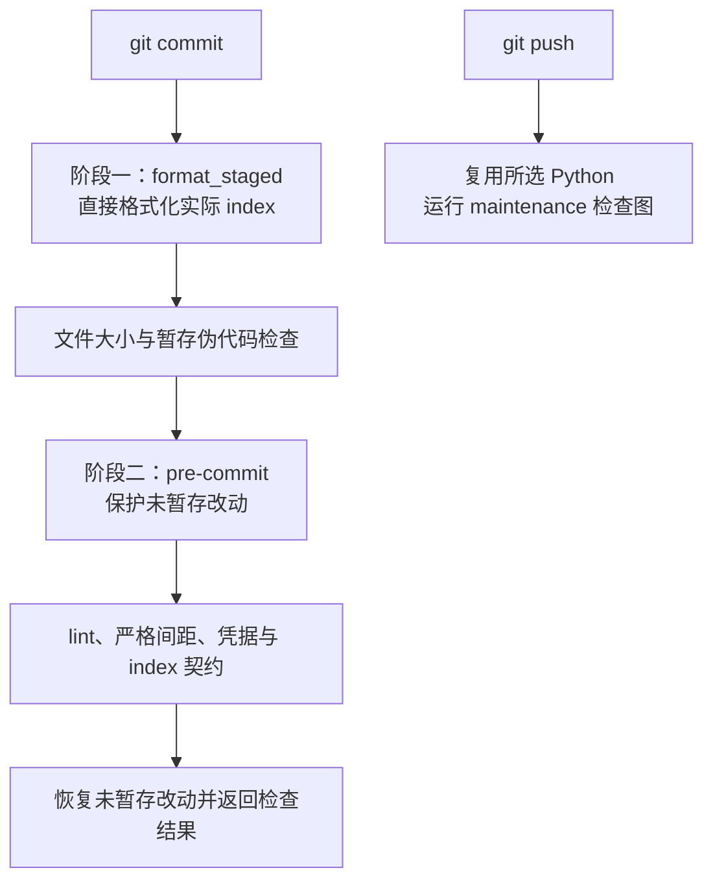

# 开发维护指南

MirrorOPD 将文档、文字与长期决策维护接入现有工具链。三个技能、共享参考和模板保存在 `.agents/`。产品行为仍由数值、运行层和后端集成测试验证。

`paper-search-reports/`、`paper-search-logs/`和`environments/`是本地检索与环境记录，均由 Git 忽略，不作为 checkout 所需文件。复现依赖以包配置、固定后端及已保存的运行证据核验。

## 本地准备

需要 Python 3.12 或以上、Node 22 或以上和 Git。从已选择的 Python 3.12 环境创建独立的维护环境：

```bash
python -m venv .venv-maintenance
.venv-maintenance/bin/python -m pip install --require-hashes -r requirements-dev.lock
npm ci
.venv-maintenance/bin/python scripts/setup.py
CROSSNOTE_SRC="$PWD/assets/.crossnote" bash scripts/crossnote-links.sh
npx playwright install chromium
```

本机可选解释器为 `../envs/opd/bin/python`。维护依赖由 `requirements-dev.txt` 与跨平台哈希锁 `requirements-dev.lock` 管理，npm 工具由 package-lock 固定。系统需要 AutoCorrect、Gitleaks、shfmt、ShellCheck、actionlint、Taplo；存在 zsh 输入时也需 zsh。Linux 浏览器缺少系统库时，使用 Playwright 的 `install-deps chromium` 安装所需依赖。CI 先安装 Homebrew，再安装这些工具和浏览器依赖。

`make bootstrap PYTHON=/path/to/python3.12` 将创建维护环境、安装锁定依赖、接入本机链接并恢复研究证据；单独接入工具链可用上面的命令。维护环境不代替 PyTorch、CUDA、vLLM、Ray 和 FlashAttention 的训练环境。

setup 保留 `.githooks`、20 MiB 文件限制、伪代码检查和 `.claude/skills`。它把所选 Python 写入本仓 Git 配置，commit/push hook 将该解释器目录和可选的本仓 `.tools/bin` 放在 PATH 前面；新终端无需再次激活维护环境。外来 hooksPath 或技能目录被拒绝且不覆盖。维护环境移动或重建后应重跑 setup，普通 `pre-commit install` 不适用于本仓已管理的入口。

## 使用入口与扫描范围

| 命令                                   | 验证范围                                                   |
| -------------------------------------- | ---------------------------------------------------------- |
| `make check-docs`                      | 当前 Markdown 链接、skill 元数据、Notes 结构与可信归档历史 |
| `make test-maintenance`                | 正常/违规输入、真实部分暂存、失败传播、hook 环境与链接迁移 |
| `make check-maintenance`               | pre-push 使用的文档、维护行为、严格间距与预览检查          |
| `make check`                           | 完整维护图、格式/lint、预览及全文件 pre-commit 检查        |
| `make test PYTHON=/path/to/opd-python` | pytest 收集的维护、数学、运行层与集成测试                  |
| `make book`                            | 核心推导的完整 PDF 与正文阅读版                            |
| `npm run test:preview`                 | Node、QuickJS 与 Chromium 的预览资源测试                   |

维护命令优先使用本仓 `.venv-maintenance`，可通过 `MAINTENANCE_PYTHON` 显式指定；产品测试继续使用 `PYTHON`。调度器的 `python/python3` 由当前解释器执行，其他工具从 PATH 查找。原生集成测试通过 `MIRROR_TEST_BACKEND` 指定固定后端；维护接入不自动启动 GPU 训练。

AutoCorrect 覆盖自有 Markdown、代码注释和字符串、YAML/JSON/JSONC、TOML 与 Shell，也发现隐藏和无扩展名脚本。`--strict` 保证真实诊断返回非零；空扫描、缺失的显式输入、早期批次失败均不能被后续成功掩盖。先用 `scripts/check_spacing.py --list` 核对范围，`--fix` 只整理 Markdown；协议、文件名、正则和测试输入逐字保留时，用带理由的局部 disable/enable，代码不自动修复。

Shell 按 shebang 分派：sh/bash 使用 shfmt 与 ShellCheck，zsh 使用 `zsh -n`；YAML 注释用语法扫描排除多行标量。Ruff 0.17 的规则与 Python 3.12 基线固定在配置和锁文件中。理论、冻结历史、证据、上游后端和 preview 载荷保留自己的检查边界；当前文档指向证据的文件链接仍检查存在性。

## 两阶段提交与推送



manual 阶段专用于本地 git-format-staged formatter。它必须在 pre-commit 隐藏未暂存内容之前执行；不能在框架隐藏改动后改写 index。Markdown formatter 用 pipefail，前一项失败不会被后一项成功隐藏。格式合并冲突保留工作区原文并报告，需审阅 `git diff` 与 `git diff --cached`；Markdownlint 修改后仍需重新暂存。

`staged_checks.py` 在项目磁盘目录 `runs/maintenance-index-*` 导出完整 index，验证将提交的链接、Notes 和归档字节。快照退出后清理，避免把较大的研究材料写入受限 `/tmp`。工作区中未暂存的修复不能掩盖 index 中的错误。

pre-push 复用同一维护环境并运行 maintenance 模式；完整格式、lint、预览与产品验证由 CI 的相应 lane 运行。数值 lane 只运行产品测试，维护 lane 运行维护行为与预览，覆盖边界不重复。远端 required checks 和分支保护仍须在托管平台核验，workflow 文件本身不证明已启用。

## MPE 预览资源

`assets/.crossnote` 保存项目内的预览事实源、生成器、测试与第三方许可；被忽略的 `.crossnote` 是本机链接层。配置和目录使用软链，两个注入脚本使用同文件系统硬链；原子保存替换源 inode 后应重跑链接脚本。实体定制不会被覆盖，全局样式只诊断，不替换已有用户配置。

```bash
npm run test:preview
node assets/.crossnote/scripts/build-parser.cjs --check
```

QuickJS 与 Playwright 为锁定的 npm 开发依赖，浏览器测试覆盖主题切换、伪代码运行时和解析器，生成段与 vendor hash 也有检查。MPE 仍要求 VS Code 安装扩展、信任工作区并允许预览脚本；浏览器测试不等于 VS Code 扩展或导出 PDF 的视觉验收。设置保留项目已有主题与禁用 wiki 索引的选择，同时接入 AutoCorrect、Ruff 和项目 Prettier 的编辑器入口。

## Agent Notes

[Agent Notes](../.agents/notes/README.md) 保存代码和当前文档不能充分解释的长期理由、真实替代方案、代价与验证。三个 skill 的调用范围见[根指令](../AGENTS.md)；不是每项机械修改都要创建记录。

文档整理只将有长期指导价值且有依据的决策理由提取为 Notes，不把实施事实、实验进度或未执行建议批量转换为决策。新记录依照 proposed、implemented、rejected 的状态维护；只对符合规则的已实施记录执行归档，归档正文和附件逐项封存。

封存哈希用于检测当前字节变化，可信 Git 基线用于拦截正文和当前哈希同时重写。本地基线是 HEAD；CI 使用 PR base 或 push before。PR 的 archive-history job 从目标分支取出检查器，避免仅用待审版本证明自身保护有效。

初次接入时，目标分支尚无检查器，该 job 要求当前没有封存记录与清单。工具链合入后再开始封存；已有封存记录后，不能退回初始化路径。远端 required checks 与分支保护须在托管平台核验，工作流文件本身不证明合并保护已生效。

## 理论来源与旧文档边界

[theory](../theory/README.md) 的长期维护稿位于 `core/`。旧书稿、理论笔记和论文稿已按用户要求提取数学内容、合并并删除；核心稿的来源表记录固定 Git 版本、原路径及校验和。理论推导与工程 `.agents/notes/` 分开维护，历史实验不作为核心稿的内容或配置来源。

理论来源、第三方材料、运行目录和冻结 Notes 退出工程文档扫描及自动格式化。原始数据、结果与文献检索证据不参与新增文档和间距检查；当前文档指向这些产物的链接仍须有效。Markdown 检查仍遍历自有隐藏规则目录，检查文件目标是否存在及是否越出仓库；不验证外部网站、锚点、HTML 链接、命令行为或自然语言正确性。

历史工程文档已按主题重新整理，接入时的[延期清单](../scripts/maintenance-deferred-docs.json)清空。当前工程 Markdown 全部接受链接和间距检查；理论源稿与冻结第三方正文仍保留自己的审定边界。格式检查不能识别过时结论、错误归因或无信息段落，内容审核仍需阅读实现与证据。

## 实验报告的日常维护

按[报告维护流程](../.agents/references/experiment-reports.md)确定问题、协议和证据，必要时使用[骨架](../.agents/templates/experiment-report.md)。同一问题更新原报告，执行流水留`runs/`；数据与图表分别在`data/`、`results/`，对应生成程序和校验信息必须可定位。

报告修订同时核对实际样本数、版本、计量单位、统计权重和未完成条件。推翻旧解释时改正结论，保留纠正依据及必要负结果。当前操作、历史重跑和只读汇总复算分别标注，不把当前 CPU 测试写成历史 GPU 重跑。

## 历史源码与证据恢复

0.2 退役的 launcher 和分析脚本保存在[固定源码归档](../data/refactor-20261015/legacy-source.tar.gz)，另有 Git 标签`archive/pre-refactor-20261015`。标签是完整旧仓库入口，tar 仅保存 manifest 中列出的退役源码，两者不等同于某一历史 run 实际执行的全部字节。先核对 run 的 provenance，再选择对应 source 快照与后端。

在仓库根执行下列只读检查和隔离恢复：

```bash
python - <<'PYCODE'
from pathlib import Path
import hashlib
import gzip
import json
import tarfile

root = Path.cwd()
archive = root / "data/refactor-20261015/legacy-source.tar.gz"
manifest = json.loads((root / "data-manifest.json").read_text())
record = next(row for row in manifest["files"] if row["archive"] == str(archive.relative_to(root)))
with gzip.open(archive, "rb") as stream:
    restored = stream.read()
assert len(restored) == record["bytes"]
assert hashlib.sha256(restored).hexdigest() == record["sha256"]
destination = root / "runs/legacy-source-review"
destination.mkdir(parents=True, exist_ok=False)
with tarfile.open(archive) as stream:
    stream.extractall(destination, filter="data")
print(destination)
PYCODE
```

恢复目录必须尚不存在。`filter="data"`要求支持该安全解压过滤器的 Python；项目基线为 Python3.12。`make data`按 manifest 恢复压缩原始记录，并拒绝覆盖校验不一致的文件。tar 成员引用如`legacy-source.tar.gz#training/...`只是定位信息；先解压才能执行文件。

恢复源码不等于恢复运行环境或输入。旧模型、缓存、checkpoint、后端修改和外部数据依各 run 记录提供；缺失时只能复算现有汇总，不宣称完整复现。旧程序可能依赖旧包与邻仓，将其放在独立历史环境，避免与当前可安装包混用。

## CI 与构建产物

CI 保留 CPU 数学及运行层测试，新增维护行为测试、文档契约、可信归档基线和 wheel 安装验证。wheel 在源码目录外安装并运行 CLI plan，检查内置 profiles、后端补丁、判分来源和许可证，构建产物上传到当前 workflow 的 artifact。

维护包没有部署或发布实现，本仓也未配置自动部署、包索引上传或 GitHub Release。构建与 artifact 保存不等于发布；若以后需要发布，应明确版本来源、目标、凭据和触发方式后再接入。

## 来源与许可

维护材料更新到本机 `agent-maintenance` 提交 `f2b7cdf`，原始方法来自 DeepSeek Harness 固定提交 `571902028a75c64c1d767f4ae5fd099485f0ddf0`[^harness]。中文规则经过提取、裁剪与重组，Python 检查工具由维护包新增；原始版权与许可保存在 [.agents/LICENSE](../.agents/LICENSE)。MirrorOPD 保留研究报告规则、既有检查器增强、固定后端和产品测试。[来源清单](../scripts/maintenance-source.json)记录采用范围、固定来源与适配理由，本指南维护实际操作入口。

### 参考文献

[^harness]: DeepSeek AI. DeepSeek Harness. GitHub 2026. [固定版本源码与许可证](https://github.com/deepseek-ai/deepseek-harness/tree/571902028a75c64c1d767f4ae5fd099485f0ddf0).
