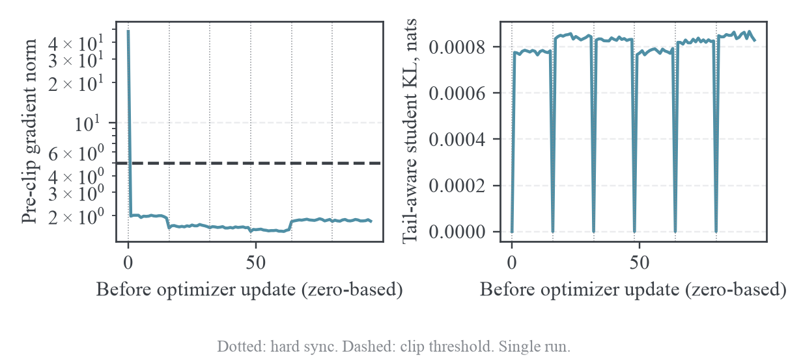
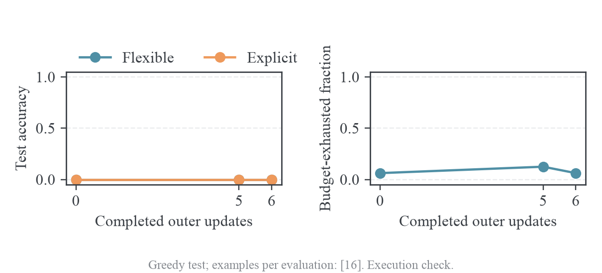

# GSM8K 训练与周期评测

## 配置与数据

`training/run_gsm8k_mdpo.sh` 启动原生聊天模板的 MDPO 实验，复用 TA-OPD/verl trainer、vLLM rollout、MirrorOPD teacher cache 和损失内核。默认 pair 为 SmolLM2-360M-Instruct student 与 SmolLM2-1.7B-Instruct teacher；两者的完整 token→ID 词表、BOS/EOS/pad ID、聊天模板一致。当前 teacher scorer 使用 student 的同一组 prefix IDs，并在同一组词表坐标上比较概率，模板和词表语义一致是实现成立的条件。

配置原件为 [gsm8k-mdpo.json](../../training/configs/gsm8k-mdpo.json)。

50 outer长程run已完成。默认budget现为50、clip为2；下表的32/5描述初次链路验证设置。参数精度审计后新增FP32 actor存储候选，完整FSDP复验因主机RAM保护失败，尚未作为已验证设置。结果与理论分析见 [长程MDPO诊断](../experiments/2026-10-09-GSM8K长程MDPO诊断.md)，正式复现实验应使用各run保存的resolved config。

| 项目                        | 设置                                   | 含义                                                                 |
| --------------------------- | -------------------------------------- | -------------------------------------------------------------------- |
| 训练/测试                   | 官方 train 7473 题 / test 1319 题      | 无 validation split，无测试训练混用                                  |
| Outer budget                | 32                                     | 完整 train 在 B=64 时每 epoch 有 116 个完整 batch，足够执行 32 outer |
| B                           | 64                                     | 每个 outer 选 64 个问题，每题 rollout 一条                           |
| J                           | 16                                     | 每份冻结 rollout 做 16 个 full-batch optimizer update                |
| Mini-batch / micro-batch    | 64 / 1                                 | 全 batch 更新；逐条累积，micro-batch 不产生单独 optimizer step       |
| lr / clip                   | 3e-7 / 5                               | 记录裁剪前 norm 与 clip scale；不是已优化的 GSM8K 超参数             |
| eta / K                     | 0.3 / 16                               | K 是缓存/center 的学生锚点 top-k，采样 top-k 仍为 -1                 |
| Prompt / response / context | 512 / 2048 / 2560                      | response 的 2048 预算独立于 prompt；完整 prompt 不截断               |
| 训练采样                    | T=1、top-p=1、n=1                      | 完整支持集采样，匹配 token IS 使用的概率分布                         |
| 测试采样                    | greedy、n=1                            | 固定输入与确定性解码，用于比较权重变化                               |
| 测试时点                    | 0、5、10、15、20、25、30、32           | 最后一步由上游 final-step 条件额外触发                               |
| 保存                        | 无 checkpoint 与 generation dump       | 记录配置、代码指纹、标量 JSONL、console、W&B、显存                   |
| 参数生命周期                | actor / teacher parameter offload 开启 | 阶段内连续使用，阶段结束释放参数显存                                 |

数据准备脚本 [prepare_gsm8k.py](../../training/prepare_gsm8k.py) 保留官方 split 顺序。每行只有一个 user message，参考解答不进入 prompt。最终答案从原始参考解答的 `####` 后提取，放在 `reward_model.ground_truth`。两个 split 的样本数、dataset fingerprint 与 parquet SHA-256 写入 `manifest.json`；实际训练再次复制 manifest 并记录文件哈希。

所有问题使用下面的共同指令；训练与测试指令完全一致。

```text
Solve this math word problem. Show your reasoning, then put only the final numeric answer on a final line in exactly this format: #### <number>.

Problem: <question>
```

使用 tokenizer 的 `apply_chat_template(..., tokenize=True, add_generation_prompt=True)` 得到 prompt。启动审计检查其结果与原生模板文本经 `encode(..., add_special_tokens=False)` 的结果一致，避免重复 BOS。SmolLM2 原生模板自动加入它自己的默认 system message；不把 Qwen 或 DeepSeek 的模板套在 SmolLM2 上。审计完整 train/test 的每个 prompt，而不是只检查 canary 抽到的样本；本次 train 最大 288 tokens，test 最大 253，均低于 512。

## 测试生命周期与日志

TA-OPD 的 `RayPPOTrainer.fit()` 在 actor update 后调用 `checkpoint_manager.update_weights(global_steps)`，把内存中的当前权重同步给 rollout worker，然后按 `test_freq` 调用 `_validate()`。这里的 checkpoint manager 负责权重传输；开启周期测试不需要在磁盘保存 checkpoint。初始测试发生在初次同步完成之后。`save_freq=-1`、checkpoint `save_contents=[]`、`resume_mode=disable`，并把 `rollout_data_dir` 与 `validation_data_dir` 设为 null。

One-Shot-OPD 同样复用 verl 的周期 validation：recipe 把 `TEST_FREQ` 传给 trainer，另行传入 validation 的 temperature、top-p、n 和 token budget。它允许随机 validation。本实验把采样设为 greedy n=1，以固定解码条件比较不同 outer 权重；训练的随机采样配置保持独立。GSM8K test 通过 verl 名为 `val_files` 的接口进入评测 loader，接口名字不意味着另建了 validation split。

W&B 的 evaluation 横轴为 `00_axes/evaluation_outer`，不是所有 history 行共享的 SDK step。inner、outer 和测试的 history 内部序号保持单调，图表各自使用 optimizer update、outer step、evaluation outer 轴。inner 每个 optimizer update 写一行，driver 在 outer 边界把新增行上传；它不是每个 micro-batch 上传一行，也不是 inner 执行期间逐条即时推送。outer 每步写一行，test 只在上述时点写入该 outer 的质量指标。

| W&B 指标                                              | 定义                                                                                 |
| ----------------------------------------------------- | ------------------------------------------------------------------------------------ |
| `01_quality/val-core/openai/gsm8k/acc/mean@1`         | 优先 `####`，其次 boxed，均无显式答案时取最后一个数值；与参考答案作 Decimal 精确比较 |
| `01_quality/val-aux/openai/gsm8k/acc_strict/mean@1`   | 只认最后一个 `####` 数字答案                                                         |
| `01_quality/val-aux/openai/gsm8k/acc_explicit/mean@1` | 只认 `####` 或数字 boxed，缺少这两类标记时判错                                       |
| `.../format_hash/mean@1`、`.../format_boxed/mean@1`   | 存在可解析的对应格式的比例                                                           |
| `.../parse_failure/mean@1`                            | 宽松规则仍找不到数值的比例                                                           |
| `.../response_tokens/mean@1`                          | 实际 response attention mask 的非 padding token 数，包括生成的 EOS                   |
| `.../eos_terminated/mean@1`                           | 最后一个有效 response token 是 EOS 的比例                                            |
| `.../budget_exhausted/mean@1`                         | 有效长度达到预算且没有 EOS 终止的比例                                                |
| `01_quality/generated_examples`                       | 该评测实际生成的回答数，默认 1319                                                    |

宽松规则能覆盖模型使用 boxed 或自然语言数字回答的情况，也会把推理段最后一个数字误当最终答案。因此必须同时看 `acc_explicit` 和 `acc_strict`，不能仅凭宽松 accuracy 判断答题能力。任务分数没有进入 MDPO 的蒸馏 reward，`distillation.distillation_loss.use_task_rewards=false`；训练中的 teacher/student token log-prob 差与这里的最终答案正确率是不同指标。

## 生产损失与同步审计

每个 outer 冻结当前 student 为 $\pi_k$，用它生成 prompt batch 的轨迹。每个 response prefix 保留 sampled token $a$、学生锚点 top-16 IDs、锚点在这些 IDs 和 sampled token 上的 log-prob，以及 tail mass。teacher 使用同一 prefix 给这些 token 打分。缓存冻结到该 outer 的全部 J 个 inner 结束，下一 outer 才重新生成数据和缓存。

MDPO 的 sampled token reward 为

$$
r_k(s,a)=\log T(a\mid s)-\log\pi_k(a\mid s).
$$

inner 的重要性比率及 score-function 系数为

$$
w_{k,\theta}(s,a)=\frac{\pi_\theta(a\mid s)}{\pi_k(a\mid s)},\qquad
c_{k,\theta}(s,a)=w_{k,\theta}(s,a)
\left[
\frac{\log\pi_\theta(a\mid s)-\log\pi_k(a\mid s)}{\eta}
-r_k(s,a)
\right].
$$

实际反向传播的 surrogate 是有效 response token 的平均：

$$
\widehat L_k(\theta)=
\mathbb E_{(s,a)\sim\text{frozen rollout}}
\left[\operatorname{stopgrad}\bigl(c_{k,\theta}(s,a)\bigr)
\log\pi_\theta(a\mid s)\right].
$$

`src/mirroropd/training/losses.py` 计算系数并停止它的梯度，使用完整学生 logits 归一化；adapter 按有效 token 数聚合 micro-batch 梯度。MDPO 的 sampled policy gradient 没有把 top-k center 当额外梯度项；teacher/student Tail-aware center 用于监控。KL 的统计值、负值 surrogate loss、最终答案 accuracy 应分别解释。

该上游版本的 FSDP engine 从 `actor.optim.clip_grad` 读取裁剪阈值，旧字段 `actor.grad_clip` 单独设为 5 不会改变实际裁剪。本次配置同时设两者为 5，启动前要求两者相等。inner JSONL 的 `clip_grad` 来自 engine 的实际 optimizer config；`grad_norm` 是裁剪前范数，`grad_clip_scale` 为 $\min(1,5/\lVert g\rVert)$。不能用 resolved config 中的旧字段来推断实际阈值。

hard sync 后第一个 inner 的锚点和当前学生相同，因此 $w=1$、sampled log-ratio 为零、student center 为零。数值误差范围内不满足这一点时，应检查模型权重版本、温度、dropout、prefix 对齐和是否记录了 update 后的值。现有数学和模型测试验证了缓存冻结、停止梯度、response 前驱位置、temperature、eta 极限、micro-batch token 加权以及同步版本；GPU canary 再验证真实模型的这一条件。

## 不兼容的 Qwen/DeepSeek pair

Qwen2.5-0.5B-Instruct 与 DeepSeek-R1-Distill-Qwen-1.5B 的 tokenizer 长度和模型 output vocab size 相同，这不足以支持共享 prefix。Qwen 的七个 token 字符串在 teacher tokenizer 中被替换，包括 `im_start`、`im_end`、`endoftext` 及若干视觉标签；Qwen 的 EOS 为 151645，而 teacher 的 EOS 为 151643。Qwen 的 ChatML 模板与 teacher 的 User/Assistant 和 think 模板也不同。

当前生产实现已经检查完整 token→ID 词表，本次额外检查 BOS/EOS/pad 和原生模板；该 pair 在启动前明确被拒绝。支持它需要为 teacher 重新序列化 prompt、对齐 response prefix 位置并处理特殊 token 的语义映射，随后验证对应 KL 的共同 token 空间。直接覆写 `tokenizer_path` 只能消除检查，不能修复预训练时的模板语义。SmolLM2 的验证结果不代表 Qwen/DeepSeek 已支持。

## 复现命令

在 archbox 运行。先准备完整数据；每个 run 名必须唯一，避免覆盖已有日志。

```bash
cd ~/src/mirroropd
~/src/mirroropd-taopd/.venv/bin/python training/prepare_gsm8k.py \
  --output-dir data/gsm8k-full
bash training/run_gsm8k_mdpo.sh gsm8k-smollm2-mdpo-o32-j16
```

默认完整测试集；`data.val_max_samples` 只用于执行链路 canary，正式实验保持 -1。模型可用 `MIRROR_STUDENT_MODEL`、`MIRROR_TEACHER_MODEL` 选择，启动前会审计同词表同模板条件。代码部署指纹、实际 Hydra overrides、resolved config、模型/数据审计、inner/outer JSONL、显存曲线与 W&B run URL 都保存在 `runs/<run-name>/`；不保存模型权重或 rollout 文本。

## 验证记录

本地 `make test` 已通过全部数学、outer/inner、真实 transformer 小模型集成测试；新增四项 GSM8K 答案与 EOS/预算测试通过。W&B mock 测试验证新增评测轴及 inner/outer 混合 history 的单调序号。上游补丁已在 manifest 固定基线上通过 `git apply --check`。

第一轮 GPU canary 为 B=2、J=1、6 outer、16 道固定 test，生成预算 2048、context 2560，退出码 0。W&B 服务端读取确认 6 个 inner 点、outer 0/5/6 三次评测，每次 generated_examples=16；宽松 accuracy 分别为 0、0.0625、0.125。这个样本量只能验证执行和记录，不能据此宣称蒸馏提升。最后一次评测平均 response 长度 278.19、EOS 比例 0.9375、预算耗尽比例 0.0625，说明少量响应确实用满了 2048 预算。

这轮检查还暴露了旧 clip 字段不生效的问题，实际阈值为 1，已修正并重新启动 B=64、J=16、clip=5 的验证。第一轮的 [W&B run](https://wandb.ai/wncfht/mirror-opd-gsm8k/runs/8ltkar5x) 与原始日志保留，不能与修复后的 clip=5 结果混为同一 setting。

修复后的 B=64、J=16 验证完成 6 outer 和 96 次 full-batch inner 更新。使用 384 道 train、16 道固定 test；完整 split 已做模板和长度审计，执行验证只抽取了这些子集。W&B 服务端确认 [run y7hq6m4k](https://wandb.ai/wncfht/mirror-opd-gsm8k/runs/y7hq6m4k) 为 finished，history 有 103 行，其中 inner 索引连续覆盖 0--95，测试时点为 0/5/6，每次回答数为 16。

| 检查项                       | 实测                                         |
| ---------------------------- | -------------------------------------------- |
| 实际 clip                    | 全部 96 行 metadata 均为 5                   |
| 同步点 student center        | 6 个 outer 的第一个 inner 均为 0             |
| 同步点 sampled log-ratio RMS | 6 个同步点均为 0                             |
| Pre-clip norm                | 1.5234--48.25；只有第一次更新裁剪，比例 1/96 |
| Importance ESS fraction      | 最小 0.998065                                |
| 整卡 / actor reserved 峰值   | 11931 MiB / 10.6426 GiB                      |
| 平均 outer 耗时              | 172.36 秒；周期测试单独计时                  |
| 三次 accuracy                | 宽松、显式和严格规则均为 0/16                |
| checkpoint / generation dump | 未生成                                       |

在同一冻结 rollout 内，teacher center 固定；student center 从同步点的 0 上升到约 $8\times10^{-4}$，剩余 inner 内变化较小。梯度范数从首次 48.25 降到约 2，后续没有持续裁剪。这个结果证明同步和记录条件成立；非零梯度、很小的 KL 和高 ESS 不等于 inner 已收敛。三个 accuracy 点均为零，也没有提供答题能力提升的证据。当前 lr、eta 和 J 是执行验证设置，完整 test 和更长训练才能用于设置选择。



图中的点是 optimizer update 前的统计，虚线为 clip=5，竖向点线为 hard sync。KL 为 top-16 加聚合 tail 的 student center，不是 full-vocab KL。绘图脚本和 figure-viz 审计一起保留，未用平滑曲线替代观测值。



这一 run 的训练和评测完成后，启动外壳在收尾时发生 EOF 读取错误：维护时直接覆盖了仍在等待 trainer 的 Bash 脚本，改变了文件读取位置。没有可核实的主进程退出码，故 [结果目录](../../results/training/gsm8k-smollm2-mdpo-b64-j16-clip5/) 的 `exit_code` 保持 null，并保留独立的 launcher 说明。W&B finished、完整 inner 和评测记录是可核实的结果，不能用它们伪造退出码 0。另行执行 B=64、J=16 的单 outer launcher check，核验不覆盖运行文件时的正常收尾。

部署纪律：训练运行期间冻结对应的源码和启动文件，结束后再同步。上传新文件采用同目录临时文件加原子 rename，避免截断被执行文件；原子替换也不能成为在正式训练中改变 Python 导入版本的理由。运行证据以启动时的实际 source SHA-256 为准，独立的模型/数据复查保留其用途，不替换启动时审计。

单 outer launcher check 保持同样的 B=64、J=16、2048 生成预算，完成 16 次更新后在 vLLM `wake_up(tags=[weights])` 阶段 OOM，退出码为 1。它没有完成最终评测；失败记录保留，不能以 inner 全部完成来判为成功。训练峰值与 rollout 唤醒峰值属于两个不同阶段，旧配置留下的显存余量不足以覆盖二者。

默认配置已启用 actor 和 teacher 的 FSDP parameter offload。teacher 仅在生成当前 outer 的冻结 cache 时加载到 GPU；actor 在整个 J 次 inner 的训练上下文内保持驻留，结束后卸载。使用上游现有的 `train_mode`、`infer_mode` 和 `update_weights` 生命周期，不降低 B、J、K 或生成预算，不修改 loss 或采样分布。修复后以两个 outer 验证训练、hard sync、后续 rollout 和最终测试。

修复后的 [offload check](https://wandb.ai/wncfht/mirror-opd-gsm8k/runs/94exlzw6) 正常退出，退出码为 0。两个 outer 完成 32 次 inner 更新，W&B 服务端确认连续 inner 索引 0--31、测试时点 0/2，各生成 16 个回答，没有模型权重文件。整卡峰值 10865 MiB，actor reserved 峰值 9.5996 GiB，平均 outer 耗时 171.34 秒。两个同步点的 student center 与 sampled log-ratio RMS 均为 0，ESS fraction 最小 0.997998。宽松、显式和严格 accuracy 均从 0/16 变成 1/16；这是小样本执行记录，不据此判断效果提升。正式默认配置已经使用这套 offload 设置，完整 1319 题、32 outer 的训练尚未执行。[原始记录、配置、分析和图](../../results/training/gsm8k-smollm2-mdpo-offload-check/) 一起归档。

异常恢复上传增加服务端 history 去重：只补不存在的 inner 索引和 outer 点，补传测试保留 evaluation_outer，`run.finish` 使用实际非零退出码。对应 mock 测试核验重复 inner 被跳过、评测轴正确以及失败状态保留。历史失败 run 的重复 history 保持原样，不删除审计证据。

## 代码来源

以上 validation 生命周期按固定 checkout 审阅：TA-OPD 的 `verl/verl/trainer/ppo/ray_trainer.py`、`verl/verl/experimental/agent_loop/single_turn_agent_loop.py`、reward manager，以及 One-Shot-OPD 的 `recipe/_common.sh` 和 trainer。上游版本与 URL 见 [upstream-manifest.json](../../upstream-manifest.json)，本仓库集成差异保存于 [TA-OPD patch](../../patches/ta-opd-mirror-token-loss.patch)。
