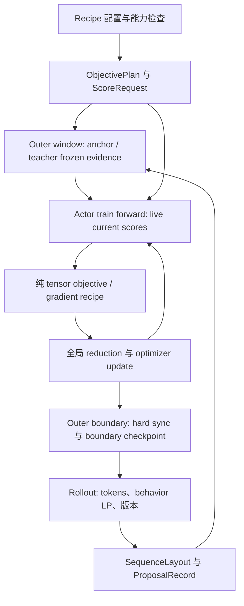

# OPD 统一抽象与 MD-OPD 接入方案

## 总体判断

MirrorOPD 与 MD-OPD 已经包含一组相互重叠但语义不同的 OPD 实现。两边都出现了 sampled token、Top-K、anchor、teacher log probability、KL、importance ratio 和 inner update，但这些名字不能直接作为统一接口。真正决定算法的是四个对象：从哪个分布抽样、对哪些 action 求和、哪些量参与反传、batch 如何归一化。

最佳统一方案应采用“共同数据契约 + 独立 objective recipe + 可替换 scoring backend”的结构。共同层只承载可验证的事实和坐标，不决定损失；objective 层声明自己的测度、支持集、停止梯度和更新窗口；backend 只负责按照请求提供 log probability、Top-K、tail 或 full-vocabulary reduction。这样可以复用实际计算，又不会把不同算法压成一个带布尔开关的巨型函数。

本方案基于 MirrorOPD `c0496084ba2415e0ea3d0a7a8ae488e0571ff7f1` 和 MD-OPD `f043a754c3d0992b4cab7dff93c80d362bc1d65a` 的源码阅读。本次不修改训练实现。

## 现有代码的真实分层

### MD-OPD 有两条 teacher 路径

第一条是定制 FSDP OPD/MOPD 路径。`fsdp_teacher_worker.py` 对 student rollout 的 response positions 做 teacher forward，`OPDTrainerMixin.compute_opd_token_reward()` 把 sampled teacher reward 或 Top-K reward 写回 batch，随后 advantage estimator 进入 `workers/utils/losses.py::ppo_loss`。MOPD residual 和 MOPD GRPO 也从这条路径获取 anchor/state 字段。

第二条是 verl 原生 distillation 路径。async teacher loop 通过 prompt logprob 接口返回 `teacher_ids` 和 `teacher_logprobs`，FSDP/Megatron logits callback 在 actor forward 中计算 sampled estimator 或 teacher-selected Top-K forward KL。它可以直接反传 distillation loss，也可以把 loss detach 后当作 policy-gradient reward。这条路径的 teacher inference、温度、支持集和训练位置与第一条路径不同。

因此，`distillation.enabled`、`fsdp_teacher.enabled`、`teacher_logprobs`、`topk` 不能在统一层被视为同一个开关或字段。第一版应保留两套 backend，先让它们输出同一个中间契约，再逐步减少重复的张量操作。

### 现有模式的语义矩阵

全文固定使用 $p$、$b$、$q$、$t$ 分别表示当前 student、真实 behavior、冻结 anchor 与 teacher。具体 recipe 可以声明 $b=q$，协议分别保存两个身份。

| 现有模式                         | 抽样/支持集                                                              | 训练权重                                                        | 反传对象                                                      | 主要实现                                                     |
| -------------------------------- | ------------------------------------------------------------------------ | --------------------------------------------------------------- | ------------------------------------------------------------- | ------------------------------------------------------------ |
| sampled OPD + vanilla PPO        | $y\sim b$                                                                | frozen teacher reward，经 $p/p_{old}$ 与可选 rollout correction | PPO ratio/clipping                                            | `fsdp_teacher_worker.py`、`opd_trainer_mixin.py`、`ppo_loss` |
| sampled OPD + `opd_noratio`      | 通常仍为 $y\sim b$                                                       | detached sampled teacher gap                                    | $-\operatorname{sg}(A)\log p(y)$                              | `opd_core_algos.py`                                          |
| sampled estimator `k1/k2/k3/...` | response action，proposal 由调用链决定                                   | KL estimator 数值或负 reward                                    | direct autograd 或 PG，取决于分支                             | `trainer/distillation/losses.py`                             |
| FSDP `vanilla_topk`              | 当前 student Top-K 候选                                                  | 每候选 advantage、ratio、clip                                   | K 维 PPO 后求和                                               | `opd_core_algos.py`、`workers/utils/losses.py`               |
| `forward_kl_topk`                | teacher Top-K $S_t$                                                      | raw teacher mass 的 partial forward KL                          | full-normalizer gather 的 direct gradient，随后上层可能 clamp | `distillation/fsdp/losses.py`、`distillation/losses.py`      |
| `mopd_resid`                     | sampled action，state expectation 在 anchor $q$ 上                       | squared state residual                                          | residual 直接反传，含 live $E_q[\log p]$                      | `opd_core_algos.py`、FSDP actor forward                      |
| `mopd_grpo`                      | sampled action                                                           | centered advantage、complement ratio、cap、gate                 | detached weighted SFT                                         | `opd_core_algos.py`                                          |
| MDPO                             | sampled action，old policy 为 proximal reference                         | sampled OPD + $\mathrm{KL}(p\Vert p_{old})/\eta$ estimator      | PPO 主项加 KL penalty                                         | `workers/utils/losses.py`                                    |
| Mirror PMD/BPO/MDPO              | frozen outer $q$ 的 sampled actions，anchor-selected $S_q$ + tail center | Mirror-specific coefficient                                     | detached score coefficient 乘 sampled current log probability | `src/mirroropd/training/losses.py`                           |

这些行不能按名称合并。例如，MD-OPD `forward_kl_topk` 使用 teacher 的支持集并保留 full-vocabulary normalizer；Mirror BPO 使用冻结 anchor 的支持集、合并 tail，并把 center 作为 stopped scalar。两者即使都叫 Top-K，也不共享概率意义。

## 已确认的实现缺口

### FSDP Top-K 配置声明大于实际行为

`fsdp_teacher_worker.py` 声明了 `only_stu`、`only_tch`、`intersection`、`union` 和 `union-intersection`。实际 `_forward_micro_batch` 对非 intersection 分支仍在 student IDs 上 gather teacher log probability；worker 输出也没有保留 teacher 自身 IDs 和 log probability。于是：

- `only_tch` 实际等于 student support；
- `union` 没有把 teacher-only candidates 接入最终 loss；
- `union-intersection` 的 2K mask 在后续权重计算中被截回 K；
- teacher Top-K 的独立支持集没有进入 `DataProto` 的训练字段。

统一层不能把这些配置名当作已经实现的能力。正确做法是让 `CandidateSet` 携带真正的 IDs、来源和有效 mask，只有 producer 确实输出 teacher-only IDs 后才开放 union recipe。

### Top-K candidate identity 在 inner update 中漂移

当前 actor forward 每次重新计算 student Top-K，随后用这些当前候选的 log probability 替换 `ppo_loss` 的输入；batch 中的 old Top-K log probability 仍对应旧候选槽位。候选 rank 改变时，第 $k$ 个位置不再表示同一个 token。trainer 目前限制 one epoch、full rollout 一个 minibatch，使全部 micro-batch 梯度积累发生在同一次 optimizer update 之前。这个限制保住当前受支持路径，却没有提供多 inner 所需的候选地址契约。

例如 old distribution 为 $(0.51,0.49)$、current 为 $(0.49,0.51)$，Top-1 slot 都记录概率 $0.51$，槽位相除得到 ratio 1；旧 token 0 的正确 ratio 是 $0.49/0.51$。union、intersection 和 candidate reward 都需要 token 身份，rank 不能承担身份。

统一实现必须冻结 `CandidateSet.ids`，训练时只对这些 IDs gather 当前 student log probability。Top-K 的重新选择只能发生在明确的 outer boundary，并生成新的 support hash。

### partial forward KL 的 clamp 改变了目标

teacher-selected Top-K 的 raw partial KL 是

$$
D_{S_t}=\sum_{v\in S_t}t(v)\log\frac{t(v)}{p(v)}.
$$

由于两边在 $S_t$ 上的质量没有归一化，$D_{S_t}$ 可以为负。当前 distillation loss 对它执行 `clamp_min(0)`；这不仅改变日志数值，也会把负值位置的梯度整个清零。统一接口必须把以下三种对象分开：

1. raw partial divergence；
2. conditional-support divergence，在 $S_t$ 上重新归一化；
3. head plus aggregate-tail divergence。

它们可以都叫 Top-K KL，但不能共享同一个 `loss_mode`。

### KL 数值 estimator 与 gradient estimator 被混在命名中

MD-OPD 的通用 KL helper 通过 `k3+` 后缀同时选择 forward score 和 backward score：forward 显示 k3，backward 使用 k2 的 straight-through 梯度。原生 distillation registry 没有把 `k3+` 注册为现成的 loss mode，helper 的能力不能直接视为 trainer 的能力。无 clipping、动作从当前 $p$ 抽样时，直接 k1、k2、k3 的期望梯度分别不是同一个 reverse KL 梯度；动作从冻结 $b$ 抽样时还需要 importance correction。

一个二元反例足以说明问题。取 $p=(0.8,0.2)$、$t=(0.6,0.4)$，reverse KL 对 student logits 的梯度为 $(0.15693268,-0.15693268)$，direct k3 的期望梯度为 $(0.2,-0.2)$，direct k1 的期望梯度为 $(0,0)$。因此统一配置不能只保存 `kl_estimator=k3`，必须分别记录 `reported_value`、`backward_recipe` 和 `proposal_measure`。

### 其他已核实的语义边界

- 定制 FSDP reward 最终使用 sampled teacher-minus-student log probability；该路径的 `kl_estimator` 配置没有选择这条算式。原生 distillation 路径的 estimator registry 才实际执行 k1/k2/k3。
- `core_algos.kl_penalty(..., full)` 仍为 `NotImplementedError`。MOPD worker 已计算 full-vocabulary state statistics，通用 full-KL training recipe 尚未因此接通。
- `discounted_token_reward` 可沿 sampled trajectory 计算 suffix return。候选 K 维每个 prefix 的第 k 个 slot 指向不同 token，沿时间累加这些 slot 不构成固定 action 的 return；广播合法只证明 tensor 运算合法。
- `metric_top_k` 用于监控，`log_prob_top_k` 用于训练候选，rollout `top_k` 是采样截断，anchor `top_k` 是 state expectation 近似。anchor K=0 表示 full expectation，而 Mirror center K=0 表示整个词表合成一个 tail、center=0，不能统一零值的含义。
- 多教师 FSDP worker 按固定 teacher 顺序、跨 rank 对齐 micro-batch 数并执行 dummy forward。这个 collective 排程保留在 backend，核心 objective 接收逐行 teacher 身份。

`forward_kl_topk + use_policy_gradient` 还存在一个组合层面的边界：给定 prefix 后，完整 Top-K 求和得到 state scalar $D_S(h)$，再 detach 它乘当前 sampled action 的 score。在正确 current 测度、无 clipping 时，条件期望为 $D_S(h)E_p[s_p]=0$；它丢掉了 direct distribution gradient。有限 batch 能出现噪声梯度，PPO clipping 能改变这个结论，但不能把这条路径解释为 direct Top-K KL 优化。现有 `DistillationConfig.__post_init__` 对此组合只打印 warning，仍允许运行；它会拒绝 direct k1。新预设不开放这个任意组合，legacy 模式保留复现用途。

同理，若未来将 helper 的 `k3+` 接入 PG 分支，detach estimator 后它的 straight-through backward 不再生效，k3 和 k3+ 会有相同 PG reward。这是新组合的语义约束，当前 registry 尚不支持该组合。统一计划应先选 gradient 语义，再解释 estimator suffix；不能认为给任意 estimator 加 PG 都保持原目标。

## 数学统一应先于接口统一

### prefix 测度与 action 测度分别记录

统一算法的总体对象写成

$$
\mathcal G(\theta)=\mathbb E_{h\sim d}\,\mathbb E_{a\sim\nu(\cdot\mid h)}[f_\theta(h,a)].
$$

$d$ 是 prefix 访问测度，$\nu$ 是 action 目标测度，实际 action proposal 记为 $\rho$。固定 outer rollout 将 $d$ 冻结。ratio $p(a\mid h)/\rho(a\mid h)$ 只能修正 action 积分，不能把旧轨迹的 $d$ 改成当前 student 的 prefix 分布；此前 action 对当前 prefix 的访问概率还没有被修正。

第一版明确处理固定 prefix 的条件更新。包含 prefix-distribution 导数的 sequence-level objective 属于独立扩展。sampled immediate teacher gap、discounted reward-to-go 和任务 GRPO 保留各自 objective 名称。

### 用残差积分表达 sampled、head-tail 与控制项

给定可精确积分的控制函数 $a$，目标测度为 $\nu$，proposal 为 $\rho$，则

$$
\widehat I_{\nu,\rho,a}(f)=I_\nu(a)+\frac{\nu(A)}{\rho(A)}[f(A)-a(A)],\qquad A\sim\rho.
$$

在 $\rho$ 覆盖随机残差的支持、积分有限、控制函数在主抽样前冻结的条件下，逐步取期望得到

$$
\begin{aligned}
\mathbb E_\rho[\widehat I]
&=I_\nu(a)+\sum_v\rho(v)\frac{\nu(v)}{\rho(v)}[f(v)-a(v)]\\
&=I_\nu(a)+I_\nu(f)-I_\nu(a)\\
&=I_\nu(f).
\end{aligned}
$$

scalar KL 中 $f$ 是 log-ratio；reverse-KL gradient 中 $f$ 是 log-ratio 乘 score 向量；Mean/BPO 中 $f$ 是 anchor-measure residual score。共同对象是积分契约，gradient kernel 根据具体 $f$ 构造可微 scalar surrogate，GPU 路径不物化参数维度的 score 向量。

正支持要求作用于随机残差：如果某个零支持区域已被 deterministic head 完整积分，不妨碍剩余残差估计；若 $\nu(v)[f(v)-a(v)]\ne0$ 而 $\rho(v)=0$，IS 无法恢复该项。top-p 缺失的 tail 若既没有精确积分，也没有可抽样 proposal，就不能宣称 full-target 无偏。

### scalar 数值与 backward 的推导

固定 prefix，令 $x_A=\log p(A)-\log t(A)$，$s_p(A)=\nabla_\theta\log p(A)$。将已采样 action 视为固定索引，直接反传得到

$$
\begin{aligned}
\nabla x_A&=s_p(A),\\
\nabla(x_A^2/2)&=x_A s_p(A),\\
\nabla(e^{-x_A}+x_A-1)&=(1-e^{-x_A})s_p(A).
\end{aligned}
$$

只有进一步指定 $A\sim p$，才有

$$
\begin{aligned}
\mathbb E_p[s_p]&=0,\\
\mathbb E_p[xs_p]&=\nabla\mathrm{KL}(p\Vert t),\\
\mathbb E_p[(1-t/p)s_p]&=-\mathbb E_t[s_p]=\nabla\mathrm{KL}(t\Vert p).
\end{aligned}
$$

current-measure reverse-KL gradient 在 proposal $\rho$ 下的 score 表达为

$$
\widehat g=\operatorname{sg}\!\left(\frac{p(A)}{\rho(A)}x_A\right)s_p(A).
$$

ratio 和系数停止梯度。直接对 $\rho$ 下的 k2 数值反传而不修正 proposal，得到 $\mathbb E_\rho[xs_p]$，不是同一个积分。配置编译阶段应把这个条件写进 gradient recipe。

### MOPD residual 与 BPO 的真正重叠

假设 actual proposal 与 anchor 都是 $q$，center 完整精确，teacher 为 $t$，MOPD floor 权重为零。定义

$$
u_a=\log p_a-\log q_a,\quad r_a=\log t_a-\log q_a,\quad C_s=-E_q[u],\quad C_t=-E_q[r],
$$

$$
R_a=u_a+C_s-\eta(r_a+C_t).
$$

MD-OPD 的真实 residual 逐项整理为

$$
\begin{aligned}
d_a&=E_q\log p+C_t-E_q\log q-(\log p_a-\log t_a)+(\eta-1)(r_a+C_t)\\
&=E_q u-u_a+r_a+C_t+(\eta-1)(r_a+C_t)\\
&=-(u_a+C_s)+\eta(r_a+C_t)\\
&=-R_a.
\end{aligned}
$$

所以

$$
L_{\mathrm{MOPD-resid}}=E_q[d_a^2]=E_q[R_a^2]=2\eta L_{\mathrm{BPO}}.
$$

这是真正应共享的 residual definition，gradient program 仍须分开。对 categorical logits，$\nabla\log p_a=e_a-p$，$\nabla C_s=p-q$，因此

$$
\nabla R_a=(e_a-p)+(p-q)=e_a-q.
$$

MOPD live-center square 与 Mirror stopped-score 分别给出

$$
g_{\mathrm{resid},a}=2R_a(e_a-q),\qquad g_{\mathrm{Mirror},a}=\frac{R_a}{\eta}(e_a-p).
$$

单样本差为

$$
g_{\mathrm{resid},a}-2\eta g_{\mathrm{Mirror},a}=2R_a(p-q).
$$

精确 center 保证 $E_qR=0$，所以总体期望梯度按 $2\eta$ 缩放后相同。有限 batch 的梯度和方差仍不同；Adam 的 epsilon、梯度裁剪和其他 loss 项还使目标缩放无法自动等同于学习率缩放。保留两个 gradient recipe，并分别验证总体等价和逐样本差值。

若 actual proposal 是 $\rho\ne q$，未修正时差值期望为 $2E_\rho[R](p-q)$。若 Mirror 使用 coarse center，令 $\widehat R=R+\delta_s-\eta\delta_t$，则 $E_q\widehat R$ 不再为零。这两种情况都会破坏上述总体等价，不能据该定理宣布两仓库的默认配置相同。

### 三种 center/control 使用不同名字

Mean/BPO 的 target centering、current-measure OPD 的 variance baseline、HETS/ResOPD 的 partition control 分别定义。

在 logits 坐标下 $E_q[s_p]=q-p$，center 误差的 bias 为

$$
\Delta g_{\mathrm{Mean}}=-\eta\delta_t(q-p),\qquad\Delta g_{\mathrm{BPO}}=(\delta_s/\eta-\delta_t)(q-p).
$$

current-measure OPD 的 action-independent baseline $B(h)$ 在正确 IS 下满足

$$
E_\rho[(p/\rho)B(h)s_p]=B(h)E_p[s_p]=0.
$$

这个 baseline 可以近似而不改变期望梯度，但它必须对主 action 条件独立。把同一个 sampled reward 当作自己的 baseline 会使系数与 score 相关；其他 prefix 的 batch mean 也不是该 prefix 的条件均值。独立辅助 action 或正确 leave-one-out 应是单独声明的 estimator。

## 统一模型：六个小协议

这些协议应是不可变 dataclass 加带形状约束的 tensor bundle。它们不是大型继承框架，也不负责执行 Ray/FSDP。协议之间通过显式字段连接，所有概率字段都带来源和版本。

### `SequenceLayout`

`SequenceLayout` 描述 token 坐标，而不是概率。它至少包含：

- `input_ids`、prompt/action 分界和每条序列长度；
- action token 在 prediction-position 中的索引映射；
- `valid_action_mask`、padding mask、terminal mask；
- packed/nested offsets、unpadding indices 和 data format；
- action-space transform，例如普通 token 或 merged EOS class。

当前 `no_padding_2_padding()` 会把完整 logits 左移一格取 response。Mirror adapter 的 cache 已经放在 predictor position，因此不能再二次 shift。将 `token index` 和 `prediction index` 分开命名，可以消除这类错误。

### `DistributionSpec`

`DistributionSpec` 描述一个概率分布的身份：

- `role`: `behavior`、`proximal`、`center`、`student` 或 `teacher`；
- model/checkpoint revision 和权重同步 version；
- temperature、top-p、top-k、repetition penalty、EOS/action transform；
- log probability 的 convention，是 sampled action、指定 IDs 还是 full vocabulary；
- support 是否绝对连续，以及零概率时的处理规则。

必须区分三个现有代码混用的角色：

1. `BehaviorSpec`：真正生成 rollout 的策略和采样变换，连同记录的 action log probability；
2. `ProximalSnapshot`：PPO old log probability 所对应的冻结 actor snapshot；
3. `CenterMeasure`：Mirror/MOPD state expectation 使用的固定分布。

某个 recipe 可以声明三者相同，但不能用一个 `anchor_log_probs` 字段默认代表三者。当前 mixin 在 sampled 行使用 rollout/teacher log probability，而 state center 来自独立 anchor module；anchor refresh 间隔大于 1 或混入 teacher rows 时，这些字段不再对应同一个测度。

### `CandidateSet`

`CandidateSet` 是 action support 的不可变身份对象，包含：

- `ids[..., K]`、去重后的 `valid[..., K]`；
- `selector`: `sampled`、`student_topk`、`teacher_topk`、`anchor_topk`、`union`、`intersection` 或 `full`；
- selector 使用的 `DistributionSpec` 和 outer version；
- support hash、K、排序与 tie-break 规则；
- action-space 身份和 omitted tail 的分区定义。

`CandidateSet` 保存地址和分区；具体 distribution 的概率、mass 和 tail log mass 放在 `ScoreBundle`。这避免 inner student 概率变化时修改 frozen support 对象。merged EOS 是 action-space 的变换，应先统一 class probability，再定义 class-aware Top-K 和 tail；单独替换 sampled EOS log probability 会使 head/tail 落在另一套 action space。

Top-K 选择只发生一次。后续 scorer 可以对同一 IDs gather 当前 student、teacher 或 anchor 的 log probability。不能从最后一个 tensor 维度推断它是 teacher support 还是 student support。

### `ScoreRequest` 与 `ScoreBundle`

`ScoreRequest` 由 objective 声明需求，backend 执行需求。需求类型包括：

- sampled action log probability；
- 指定 CandidateSet IDs 的 log probability；
- 自身 Top-K IDs；
- full-vocabulary log-normalizer、entropy、tail mass；
- $E_b[\log p]$ 这类需要 live current gradient 的 state expectation。

`ScoreBundle` 返回 tensors 和对应 `DistributionSpec`、`CandidateSet`、temperature、weight version、teacher routing key、sequence layout。backend 不返回名为 `reward` 的无上下文 tensor；reward 是 objective 对 score 的解释。

跨 RPC 和 outer cache 传输的 score 全部 detach。current student 的 differentiable action log probability、normalizer 和 live $E_q[\log p]$ 在 actor 的同一个 train forward 内生成，不通过 inference worker 返回，也不放入永久 frozen cache。`gradient_ownership=actor_forward` 是 live 项的契约。它保留 MOPD residual 的中心反传，也防止另一方向误把 teacher/anchor 带入计算图。

FSDP backend 可以提供完整 logits、arbitrary IDs gather 和 anchor expectation。async inference backend 当前提供 sampled/teacher-own Top-K，但其 prompt logprob sampling 参数固定为 temperature 1；它不能在有限 Top-K 下自动提供任意温度的 Mirror tail center。能力不足必须显式报错或降级为已声明的 estimator。

### `ObjectivePlan`

`ObjectivePlan` 是统一的数学与梯度协议，至少声明：

- `reference_objective`: 完整测度下的数学目标及独立 oracle；
- `value_definition`: 记录的 forward divergence/reward；
- `gradient_definition`: direct autograd、detached score、ratio score、residual graph 或 weighted SFT；
- `proposal_measure` 和 `target_measure`；
- 需要冻结的 fields、每次 inner 重算的 fields；
- support aggregation：full、raw partial、conditional、head-tail；
- clip、cap、gate、clamp 和它们影响的是 value 还是 gradient；
- action/token/prefix/global batch 的 reduction。

推荐把现有 recipe 注册为有限受支持的配置组合：`sampled_opd`、`sampled_kl_estimator`、`teacher_topk_forward_kl`、`topk_pg`、`mopd_residual`、`mopd_grpo`、`mirror_pmd_mean`、`mirror_bpo`、`mirror_mdpo`。每个 recipe 是纯函数和需求表，不需要一个子类。它们共享 score primitives，并分别保存 objective 和 backward 的定义。

`ReductionSpec` 作为 plan 的嵌入字段，先规约 action/candidate 维度，再规约 token/prefix/sequence。candidate mass normalization、conditional probability normalization、global token normalization 是三种运算。equal-token 与 equal-sequence 是不同目标，均值的均值也不能替代全局 sum/count。现有 Top-K clip 指标按 token count 除 K 维事件总数，结果可以超过 1；新指标必须声明 candidate mean、mass-weighted mean 或 token-level event，legacy 指标单独保留。

plan 在启动时编译出一个确定的 score 需求表和 backend 能力检查。比如 `mirror_mdpo` 的梯度只需要 sampled $p,q,t$ log probability，head/tail center 仅属于可选监控；Mean 需要 frozen teacher center；BPO 还需要每 inner 重算的 student center；live residual 需要 exact differentiable anchor expectation。不能因为当前统一函数总是计算所有诊断，就让每种算法永久承担完整 logits/Top-K 成本。

### `UpdateWindowState`

`UpdateWindowState` 描述 outer/inner 生命周期：

- `outer_id`、`inner_id`、rollout batch ID；
- behavior/proximal/center/teacher version；
- frozen `ScoreBundle` checksum；
- allowed inner reuse count 和 replay sampler policy；
- hard-sync boundary、next rollout version；
- checkpoint completeness：cold resume 或 exact resume。

当前 driver 的 checkpoint 管理保存 actor/critic 及 dataloader/global step；actor backend 可以另存 optimizer 等内容，但 driver 没有持久化 OPD anchor、outer cache、replay window 和 inner index，也没有完整的 OPD sampler/RNG 恢复契约。anchor 初始化还发生在 actor checkpoint load 之前。现有代码不能据此承诺 exact OPD resume。

第一版提供 outer-boundary resume：actor 和配置加载完成后重新构建 anchor、同步 rollout，并生成新 cache。只有模型权重的恢复叫 cold resume；同时恢复 optimizer/dataloader 且处于规定边界可叫 boundary resume；exact mid-window resume 还需保存 snapshot、cache、replay counts、inner 索引和全部相关 RNG。每个运行记录自己的恢复等级。

## 共享的低层原语

统一应抽取以下无模型、可 CPU 测试的算子：

1. `log_normalizer(logits)`：稳定的 full-vocabulary logsumexp；
2. `gather_log_probs(logits, ids)`：任意指定 IDs 的 log probability；
3. `select_topk(logits, k)`：返回真实全局 IDs，记录所用排序/tie 规则；
4. `deduplicate_support(parts)`：构造 union/intersection，同时返回来源 mask；
5. `support_mass(log_probs, ids)` 与 `tail_mass(log_probs, ids)`；
6. `conditionalize(log_probs, mass)`：明确标记 conditional support；
7. `weighted_expectation(values, measure, mask)`：区分 raw mass 与 normalized expectation；
8. stopped coefficient 乘 live log probability 的明确表达；
9. `global_token_reduce(sum, sum_sq, count, dp_size)`。

`utils/topk_logits.py` 的分块 Top-K 选择和 Mirror cache 的 head/tail 计算可以作为实现基础。纯数值内部函数可以继续返回元组；在 scorer/objective 边界包装成带语义的 bundle。两行转发或乘法不单独造 wrapper。只有索引去重、全局归一化、分块内存或梯度所有权等真实职责才值得形成共享函数。

## MirrorOPD 在统一层中的定义

MirrorOPD 的 frozen outer recipe 以 behavior/center 明确相同为前提：在 outer 采样时得到 $q$，anchor support $S_q$ 固定，teacher 对同一 $S_q$ 评分。每个 inner 只重算当前 student $p$ 的指定 IDs 和 tail。

令

$$
u=\log p(y)-\log q(y),\qquad r=\log t(y)-\log q(y).
$$

生产内核的 score coefficient 是

$$
\begin{aligned}
c_{\mathrm{PMD}}&=u-\eta(r+C_t),\\
c_{\mathrm{BPO}}&=(u+C_s)/\eta-r-C_t,\\
c_{\mathrm{MDPO}}&=e^u(u/\eta-r).
\end{aligned}
$$

训练 scalar 是 `stopgrad(c) * log p(y)`。现有生产 center 固定采用 anchor Top-K 加 aggregate tail；full、raw partial 和 conditional 是统一方案将分别声明的变体。小 K 降低缓存通信量，完整 logits forward 和 vocabulary normalizer 仍存在，不能把 $O(NK)$ payload 宣称为完整计算也变成 $O(NK)$。

### MDPO 的正确别名与极限

生产 MDPO 的总体目标是

$$
L_{\mathrm{MDPO}}=\frac1\eta\mathrm{KL}(p\Vert q)-E_p[\log t-\log q].
$$

当 $\eta=1$，逐项消去 $\log q$，得到 $L=\mathrm{KL}(p\Vert t)$。其 stopped coefficient 为 $(p/q)(\log p-\log t)$，与当前 `opd_is_no_baseline` 的 sampled coefficient 逐样本相同。这是应直接建立的 alias/equivalence test。

带 action-independent baseline 的 `opd_is` 仍与它具有相同总体梯度，但单样本可以不同。当 $\eta\to\infty$ 时，目标变成 $-E_p[\log t-\log q]$，并不等于 reverse KL。$p=q$ 的初始点上两个方向一致，随后固定 rollout 的 inner 更新使 $p\ne q$，差异显现。

`tests/test_mdpo_eta_limits.py` 已验证 eta=1 teacher KL 和 infinity frozen reward；书稿 `02_four_inner_algorithms.tex` 中把 infinity 概括为 on-policy OPD 的表述需按上述冻结信号条件重新核对。本次方案保留完整公式，不把 infinity 注册为 OPD 别名，也不修改书稿。

## 两个仓库的维护边界

MirrorOPD 保留理论、独立 CPU 数学 kernel、estimate/gradient oracle、科学 benchmark，以及目前的生产 cache/loss。MD-OPD 保留数据集与 teacher routing、Ray/FSDP/Megatron 执行、rollout、checkpoint、分布式集成和 recipe。MD-OPD 按固定 MirrorOPD commit 安装或加载核心包，不复制一份 loss。

第一阶段最多新增三个第一方职责模块：概率与支持集契约、objective/gradient 数学 kernel、需求与兼容性检查；沿用现有 `training/cache.py`、`training/losses.py`、`integrations/verl/` 和 metrics，不为每个概念创建目录。等多个调用者实际复用后再拆模块。现有 `opd_pg.py` 与生产 loss 的同义系数可逐步归一，独立参考 objective 保持自己的计算方式，避免 oracle 与被测实现共享同一错误。

TA-OPD 继续作为当前训练后端和兼容性基线。MD-OPD backend 达到 CPU parity 与真实 canary 后，再决定迁移正式实验；目录同步不能作为算法迁移完成的证据。第一版无需第三个公共 `opd-core` 仓库、通用 trainer 基类或自动 plugin 系统。

## 本仓库已有能力的保留范围

| 能力                                       | 当前地位                    | 统一时的处理                                             |
| ------------------------------------------ | --------------------------- | -------------------------------------------------------- |
| PMD-Part、Mean、BPO、MDPO 的完整目标       | `token_inner.py` 数学参考   | 保留独立 objective oracle；Part 尚未成为生产 recipe      |
| Lambert-W Mean target                      | 单 prefix 非可微 oracle     | 保留研究用途，避免纳入模型 forward                       |
| categorical / tiny-LM outer-inner          | CPU 研究与链路验证          | 使用相同语义声明，保留完整积分与 sampled 对照            |
| Mean/BPO/MDPO 和三个 OPD baseline          | `training/losses.py` 生产   | 以当前梯度程序作为 legacy parity 基线                    |
| frozen anchor Top-K + tail cache           | `training/cache.py` 生产    | 包装成 frozen evidence；sampled action 允许位于 head 外  |
| Normalized/Truncated/Tail-aware/EMA scalar | `score_pair_kl.py` 离线评分 | 归为 value-estimator catalog，不宣称已接训练             |
| HETS、ResOPD、SC-TA                        | 书稿推导与有限枚举测试      | 作为后续独立 gradient recipe，先建立纯 tensor kernel     |
| literal EMA/head-tail reproduction         | synthetic 复现与审计        | 标记 legacy gradient pairing，不作为无偏 kernel 直接抽取 |
| token moments、ESS、support overlap        | 生产诊断                    | 保留 sufficient statistics 聚合，指标需求与训练需求分离  |

### HETS 与 ResOPD 的扩展接口

令 $x_v=\log(p_v/t_v)$，$H_g=\sum_{v\in S}p_vx_vs_p(v)$，$J_A=1_{A\notin S}$。在任意覆盖残差的 proposal $\rho$ 下，HETS 的 score gradient 由 deterministic head 和 sampled tail 组成：

$$
\widehat g=H_g+\frac{p(A)}{\rho(A)}J_Ax_As_p(A).
$$

可微实现采用 stopped head coefficient 的 log-probability 求和，加 stopped tail coefficient 的 sampled log probability。ResOPD 还需要 aggregate-tail 的 live `log mass` 路径。完整数值 head 的真实 autograd 为 $H_g+\nabla P_S$，不能与 stopped tail 直接拼成无偏估计；若采用它，tail 的 score 常数也要匹配。书稿和当前复现实验已明确区分这些 backward pairing。

新增 HETS/ResOPD 不能仅在现有 scalar-center 分支塞一个 `method`。它们需要 head 的 differentiable contribution、tail control/residual 和 proposal 权重，返回结构应允许 `deterministic_surrogate + stochastic_surrogate`。这是额外的 estimator 能力，纳入统一设计，但不作为 Mirror 接入的前置依赖。

## 推荐实现顺序

### 阶段一：协议和回归，不改变旧行为

在 MirrorOPD 第一方包中新增小型 typed bundle 和纯 tensor primitives。MD-OPD 两条 backend 各自实现 producer/adapter，把现有 fields 转成 bundle，再用 legacy recipe 回归现有 loss/gradient。此阶段的验收是：旧 sampled OPD、old Top-K、MOPD residual、MOPD GRPO 的 value 和 gradient 与当前实现一致；不开放新 union 或新 resume 语义。

重点测试包括：candidate rank swap 后 IDs 不漂移、K=V 恢复 full formula、head mass + tail mass = 1、conditional 与 raw partial 数值不同、temperature mismatch 被拒绝、zero-support 被显式标记、micro-batch/DP 切分不改变梯度。

### 阶段二：修正真实支持集和 scorer 能力

把 teacher own IDs、student IDs 和 union 的所有 log probabilities 放入 `ScoreBundle`。修正 `only_tch`、`union` 和 `union-intersection` 的实际实现。训练 current student 时 gather frozen IDs，不再重新选 Top-K。将 old candidate log probability 与 current candidate log probability 的身份写入 bundle，删除依赖 one-epoch 限制的隐含假设。

这一阶段要单独保留 legacy partial forward KL 的 clamp 行为作为兼容 recipe；新 recipe 默认不 clamp，并把 raw partial、conditional、tail-aware 作为不同名字，避免静默改变历史结果。

fixed IDs 和 query 接口是 Mirror 的共同前提；完整 teacher-only union、conditional KL 新模式和 legacy 修正分别提交，不阻塞单 teacher 的 Mirror sampled 链路。按字段范围做小步迁移，比要求先重写整个 teacher 系统更容易验证行为。

### 阶段三：接入 Mirror objectives

在 MD-OPD 的 FSDP actor logits callback 中调用 Mirror adapter。driver 在 fresh rollout 后创建 `UpdateWindowState`，anchor backend 生成 frozen CandidateSet，teacher backend 完成指定 IDs/tail scoring，actor inner forward 只 gather current student。Mirror 分支绕过 PPO clipping、旧 MDPO KL、MOPD residual 和 replay。

第一版限制：单一 teacher、共享 tokenizer/vocab、temperature 统一、SP=1、full local vocab、无 top-p/k 截断、无 EOS class merge、无 cross-outer replay、outer-boundary checkpoint。每个限制都写入 `ObjectivePlan` 的 capability check，不用默认值静默降级。

### 阶段四：扩展能力

只有完成阶段三的梯度 parity 和 GPU canary 后，才考虑 sequence parallel、Megatron vocab parallel、multi-teacher routing、EOS semantic class、replay mixture 和 exact resume。每个扩展都需要新的 `DistributionSpec`/`CandidateSet` 语义和独立测试，不通过添加一个布尔 flag 复用旧路径。

## 必须先决定的假设

以下假设若不成立，算法名称和实现都要相应改变：

1. **行为测度。** 保存真实 sampling transform、action LP、生成版本，并与 actor scorer 核验。不能把 temperature=1 或截断前 logits 的 LP 直接当 transformed behavior LP。FSDP/vLLM 数值差异单独报告，disabled dropout 或可明确条件化的随机性属于分布契约。
2. **anchor 身份。** Mirror 的 $q$ 是否就是每个 outer 的行为 snapshot？若 anchor 按 refresh interval 跨多个 outer 保留，recipe 必须改成明确 off-policy center，而不能继续称 on-policy。
3. **teacher support。** teacher 是否提供 anchor 指定 IDs 的 LP 和 tail mass？只有 teacher own Top-K 时，不能无偏恢复 Mirror center。
4. **action space。** EOS merge、special-token mask、tokenizer 版本是否在 behavior、anchor、teacher、student 四者一致？不一致时必须做 class-aware distribution transform。
5. **proposal support。** 随机残差目标的非零区域必须被 actual proposal 覆盖；若 deterministic integration 已经完整处理某区域，则不要求该区域仍能抽样。missing support 不用有限 ratio cap 掩盖，报告明确的 target 变更或拒绝无偏声明。
6. **inner reuse。** 明确 optimizer update 数、mini-batch 顺序和冻结范围。均匀 mini-batch 划分本身不改原 empirical measure；优先重放或不均匀加权才改变测度。current-measure OPD 重用旧 action 要 IS；Mean/BPO 始终在固定 q 下更新，不因此额外乘 p/q。
7. **恢复语义。** 第一版采用 outer-boundary resume，并验证 actor、optimizer/dataloader、anchor 和 rollout 重建顺序。exact mid-window resume 作为独立扩展。

## 启动前编译计划与 backend 能力

所有能力以本次读到的真实代码为基线；下表描述评分执行位置，不能把某个数学 helper 存在当作 trainer 端到端已经支持。

| 评分能力                | FSDP teacher/actor                                 | async teacher prompt LP                                         | 当前 Mirror adapter                       |
| ----------------------- | -------------------------------------------------- | --------------------------------------------------------------- | ----------------------------------------- |
| sampled action LP       | 已有                                               | 已有                                                            | 已有                                      |
| teacher own Top-K       | worker 内部已有，定制 reward 最终包尚未完整传递    | 已有                                                            | 可由完整 logits 得到，生产选择 anchor IDs |
| 任意指定 IDs            | 完整 logits 上可实现，定制路径已查询 student IDs   | 当前接口未提供通用查询契约                                      | 已有 anchor IDs 评分                      |
| 任意温度的准确归一化    | FSDP forward 可做                                  | 当前 prompt LP 按温度 1；有限 Top-K 不能重建其他温度 normalizer | 调用者先缩放 logits                       |
| 固定分区 head/tail mass | 完整 logits 可算，需 bundle 接线                   | 单独 own Top-K 无法评分另一组任意 IDs                           | 已有                                      |
| live $E_q\log p$        | actor 同 forward 已有                              | inference 返回值没有 actor 计算图                               | 当前 score adapter 未提供 live 中心路径   |
| local full vocabulary   | FSDP 可用                                          | 不向 trainer 返回完整词表                                       | 第一版要求                                |
| TP/SP                   | 既有 teacher-topk distillation 有专门 backend 实现 | 由 inference 后端处理                                           | 当前 SP=1，无 TP 分片契约                 |

例如 `mirror_bpo + head_tail(anchor_topk) + arbitrary_temperature` 编译后请求：outer anchor 动作/IDs/head/tail，outer teacher 在相同 IDs 上的 head/tail 及 action，inner student 在相同 IDs 上的 head/tail 及 live action LP。选择 async teacher 时能力检查失败，不能默默切成 teacher-own Top-K；选择 FSDP 时进入现有完整 logits 执行路径。

配置采用有限预设加显式覆盖。`rollout.filter.top_k`、`objective.support.k`、`objective.center.resolution`、`diagnostics.overlap_k`各有职责。`center.resolution=full`与`head_tail(k=0)`都显式表示，不再用一个 0 表示两种语义。plan 记录中心是 exact、biased approximation 还是 unbiased sampled estimate，以及其统计/gradient 程序。

### 数据流和职责

这个循环仍由 MD-OPD 现有 trainer 驱动。`ObjectivePlan`不拥有模型、optimizer、Ray 任务或 checkpoint；`ScoreBundle`不调用 teacher；backend 不选择数学 loss；replay 是 state/trajectory sampler 而不是 cache 读写模式。已有 task reward/GRPO可以作为独立objective term 组合，系数、reduction 和采样假设分别保留。

## 本次 CPU 核验与正式 benchmark 规格

本次采用有限词表枚举核对关键关系，不把小词表验证称为吞吐或训练效果 benchmark。核验记录在 [CPU 审查证据](../../results/analysis/2026-10-10-opd-unification-audit.json)。

本机从真实 MD-OPD `kl_penalty`/`kl_penalty_forward` AST 执行 k1/k2/k3/k3+，二元例子中 reverse-KL oracle 为 $(0.15693268,-0.15693268)$。actual proposal 改成 $(0.3,0.7)$后，未修正 k2/score 梯度为 $(0.40542335,-0.40542335)$，加入正确 stopped $p/\rho$ 后恢复 oracle。teacher Top-1 partial value 为 $-0.17260924$，原始梯度为 $(-0.12,0.12)$，上层非负 clamp 后变为零。

另以 seed 20261010、9 词表、200 组独立 current/teacher/proposal 分布做 float64 完整枚举。IS score 与真实 reverse-KL gradient 的最大绝对误差为 $4.44\times10^{-16}$；未修正 score 的最大绝对误差为 1.435709，逐 case 最大坐标误差的平均值为 0.361053。这证明测度校正的必要性，不评价实训方差或性能。

archbox 上以 MD-OPD `.venv`执行 CPU 核验，抽取真实 MOPD residual 函数，配合 Mirror production cache/loss与独立BPO objective。$q=(.5,.3,.2)$、$p=(.2,.5,.3)$、$t=(.6,.1,.3)$，eta 取 0.7、1、2；full center 下 value/总体 gradient 的缩放等价误差不超过 $1.2\times10^{-7}$，单动作梯度差则分别达到 0.836117、1.005548、1.570317。proposal 改变和 coarse center 也验证了前述失效公式。

正式数值 benchmark 先固定以下规格，再实施重构。

| 项目             | 配置                                                                         | 判定                                                                                  |
| ---------------- | ---------------------------------------------------------------------------- | ------------------------------------------------------------------------------------- |
| oracle case grid | vocab=3/17/128/2048，64 seeds；K=0/1/4/32/V-1/V 中合法值；正常/尖锐/稀疏支持 | 全枚举统计期望；fp64 参考误差≤1e-10，fp32 生产按量级 atol=5e-6、rtol=2e-5             |
| estimator 统计   | sampled、raw/conditional/coarse、HETS/ResOPD；current 与 stale proposal      | 分别报告 scalar bias/RMSE、gradient bias、covariance trace、ESS；固定 prefix 条件统计 |
| identity/layout  | rank swap、union 去重、EOS class、padding、两种 tensor 布局                  | ID 一致、正确 mask、prediction 位置只转换一次                                         |
| reduction        | 同一 batch 切 1/2/4/8 micro-batches，不等长度；真实 DP 另测                  | 全局梯度不因切分变化，token/sequence 目标分别核验                                     |
| window           | J=1/2/4/16，2+ outer；版本过期、resume                                       | frozen 字段一致；新 outer 更新版本；非法 on-policy reuse 拒绝                         |

性能 benchmark 与数值正确性分开。真实模型 prefix 缓存固定后，使用相同 N、V、K 和 dtype 对比完整 log-softmax、分块 normalizer+gather、现有 Mirror cache 和统一 query；记录 peak CUDA allocated/reserved、CPU RSS、teacher forward 次数、payload 字节、tokens/s 与 cold/warm 时间。在同一单卡环境至少重复 5 次，报告中位数和范围。每次只改变一个实现因素，score 字段和梯度必须先保持一致。

最终训练效果同时按生成 token 预算、optimizer update 数和实际 wall time 比较。Top-K 可能增加每 prefix 的 action 信息，也可能改变 target 或 gradient estimator；仅对齐 outer step 不能构成公平对比。small canary、截断 rollout 与完整 GSM8K 单独标注。

## 源码导航与可复核位置

| 审查对象                            | 文件与位置                                                                                                                                                                                                                                                                                                  |
| ----------------------------------- | ----------------------------------------------------------------------------------------------------------------------------------------------------------------------------------------------------------------------------------------------------------------------------------------------------------- |
| MD 两套 teacher 与 loss 入口        | `MD-OPD/verl/verl/workers/engine_workers.py:632`；`trainer/ppo/opd_trainer_mixin.py:488`；`trainer/distillation/losses.py:230`                                                                                                                                                                              |
| Top-K 支持选择/输出缺口             | `workers/fsdp_teacher_worker.py:105`、`:235`、`:605`                                                                                                                                                                                                                                                        |
| current 候选重选与 old slot         | `workers/engine/fsdp/transformer_impl.py:1449`；`workers/utils/losses.py:58`；`opd_trainer_mixin.py:169`                                                                                                                                                                                                    |
| sampled/direct/PG及partial clamp    | `trainer/distillation/losses.py:268`、`:364`、`:370`                                                                                                                                                                                                                                                        |
| FSDP 与 Megatron partial-FKL        | `trainer/distillation/fsdp/losses.py:75`；`trainer/distillation/megatron/losses.py:218`                                                                                                                                                                                                                     |
| k-estimator forward/backward        | `trainer/ppo/core_algos.py:2187`                                                                                                                                                                                                                                                                            |
| MOPD residual/GRPO/floor            | `trainer/ppo/opd_core_algos.py:297`、`:336`、`:414`                                                                                                                                                                                                                                                         |
| teacher 温度与 routing              | `experimental/teacher_loop/teacher_manager.py:40`；`workers/config/fsdp_teacher.py:48`                                                                                                                                                                                                                      |
| anchor、replay 与恢复               | `utils/opd_anchor.py:51`；`trainer/ppo/mopd_replay_buffer.py:55`；`ray_trainer.py:1283`、`:1753`                                                                                                                                                                                                            |
| Mirror 生产与独立 oracle            | [production losses](../../data/refactor-20261015/legacy-source.tar.gz#src/mirroropd/training/losses.py)、[cache](../../data/refactor-20261015/legacy-source.tar.gz#src/mirroropd/training/cache.py)、[reference objectives](../../data/refactor-20261015/legacy-source.tar.gz#src/mirroropd/token_inner.py) |
| center 偏差与 eta 端点              | [semantic tests](../../data/refactor-20261015/legacy-source.tar.gz#tests/test_upstream_opd_semantics.py)、[eta limits](../../data/refactor-20261015/legacy-source.tar.gz#tests/test_mdpo_eta_limits.py)、[OPD baselines](../../data/refactor-20261015/legacy-source.tar.gz#tests/test_opd_baselines.py)     |
| 离线 value 与 literal-gradient 实验 | [pair scoring](../../data/refactor-20261015/legacy-source.tar.gz#experiments/scoring/score_pair_kl.py)、[EMA analysis](../../data/refactor-20261015/legacy-source.tar.gz#experiments/analysis/ema_topk_k_analysis.py)                                                                                       |
| 积分与 autograd 理论维护位置        | [residual framework](../book/chapters/03_kl_residual_framework.tex)、[autodiff](../book/chapters/03_kl_autodiff.tex)、[vector estimators](../book/chapters/03_kl_vector_catalog.tex)                                                                                                                        |

## 统一后的验收标准

最终验收不以“loss 能跑”作为标准，而按以下顺序进行：

1. **数学 oracle。** 小词表枚举 full/raw/conditional/head-tail divergence，比较 forward value、direct gradient 和 detached score gradient；覆盖 k1/k2/k3/k3+、Mirror 三种 recipe、MOPD residual。
2. **bundle parity。** 两个 MD-OPD backend 生成的 bundle 经过 adapter 后与现有 fields 逐项一致，包含 IDs、mask、temperature、support hash 和 version。
3. **生命周期。** 多 outer、多 inner 验证 frozen cache 不变，student center 每 inner 重算，hard sync 后下一 outer 生成新 behavior/support hash。
4. **布局与归一化。** packed/padded、不同 prompt/response 长度、DP 和 micro-batch 切分得到相同 global gradient；prediction position 只 shift 一次。
5. **能力门禁。** 未实现的 teacher-only union、任意温度 async scoring、SP/TP、EOS class、replay、exact resume 必须明确拒绝。
6. **GPU canary。** archbox 单卡真实 Ray/FSDP/vLLM 跑最小 outer/inner，核对 weight version、checkpoint boundary、显存和日志。
7. **正式 benchmark。** 固定数据、token budget、模型、采样、seed、outer/inner、估计量和代码 commit，比较 legacy OPD、Mirror PMD/BPO/MDPO，并分开报告 CPU parity、GPU canary 与完整效果。

统一的成功标准是：读者可以从 `DistributionSpec`、`CandidateSet`、`ScoreBundle` 和 `ObjectivePlan` 逐项回答“谁在抽样、谁被评分、在哪个支持集上求和、哪一项反传、梯度如何归一化、何时冻结和何时同步”。只要仍需根据 `top_k`、`anchor_log_probs` 或 `loss_mode` 的名字猜这些答案，统一尚未完成。
