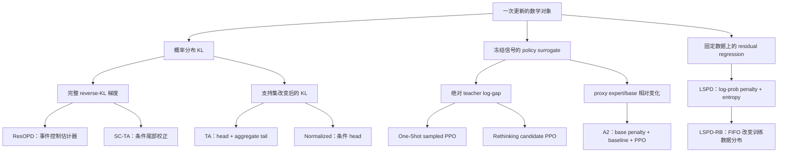

# OPD 统一伪代码与算法决策分类

## 阅读方式与统一边界

实现前先确定数学目标、动作积分、梯度程序、冻结范围和执行预算，再选择 backend。这五个决定形成一个算法 recipe。项目名称还包含数据协议、教师路由和系统编排，不能直接当作数学目标名称。

本文将 ResOPD、TA-OPD、Rethinking-OPD、A2-OPD、One-Shot-OPD 和 LSPD 放入同一套符号与伪代码框架，并补充与本地 Mirror 算法的对应关系。源码版本沿用[六项目架构与指标审计](2026-10-12-六个OPD项目训练架构与日志指标比较.md)及其[来源记录](../../results/analysis/2026-10-12-six-opd-source-metrics-audit.json)。本文新增的是数学分类和目标接口，没有将这些接口接入生产 trainer。

建议先读两个决策表和算法0，再读各 kernel。伪代码中的 `freeze` 是复制数值、IDs、mask和来源版本，`sg` 是停止梯度；原作者实现的限制与推荐统一实现分别说明。

## 一、算法分类：目标、估计器与数据协议分开



这张图按本次主实现分类。Mirror 的 Part/Mean/BPO属于固定anchor投影或其score程序，MDPO直接优化原mirror目标，后文单独连接。一个项目可以提供多个类别，例如TA同时有coarse目标和SC估计器。

### 决策表A：数学上改变了什么

| Recipe               | 数学对象                                       | 动作处理                                    | 反向程序                         | 可以据此声称的关系                                  |
| -------------------- | ---------------------------------------------- | ------------------------------------------- | -------------------------------- | --------------------------------------------------- |
| ResOPD               | 固定prefix上完整 reverse KL的梯度              | teacher head + 实际sampled action           | 停止系数、条件head均值、事件控制 | 当前完整student采样下期望梯度等于完整KL             |
| TA coarse            | head与单个tail bucket上的 reverse KL           | teacher head + 聚合tail                     | literal differentiable KL        | 改变后的确定性目标，是完整KL的粗化                  |
| TA normalized        | head条件分布 reverse KL                        | teacher head，双方重新归一化                | literal differentiable KL        | 改变后的条件目标，不约束tail内部形状                |
| SC-TA                | 固定prefix上完整 reverse KL的梯度              | coarse score + sampled within-tail residual | live ratio + stopped residual    | 正确proposal与精确分区下期望梯度等于完整KL          |
| One-Shot sampled     | 冻结teacher log-gap的PPO surrogate             | rollout实际动作                             | ratio/clipping，可有dual clip    | 属于固定signal surrogate，非当前KL literal autograd |
| Rethinking candidate | 冻结candidate贡献的PPO surrogate               | student/teacher/intersection/union          | candidate ratio/clipping后求和   | 有限支持与权重定义决定实际更新                      |
| A2 candidate         | proxy相对变化与固定base penalty的PPO surrogate | student候选与state baseline                 | candidate PPO；可选controller    | reward构造、KL监控和PPO梯度是三个对象               |
| LSPD                 | 固定action数据上的log-prob penalty与entropy    | 默认sampled，额外candidate分支              | penalty与完整entropy直接反传     | 是经验回归目标，复用旧数据不自动变成IS              |
| LSPD-RB              | 与LSPD相同的回归程序                           | 从历史response buffer采样                   | 每次重算current LP/entropy       | buffer分布和更新预算改变，teacher target固定        |

这里“完整KL梯度”指固定prefix测度上的条件分布梯度。动作IS不修正过去动作生成该prefix的概率，不自动得到完整trajectory visitation measure的导数。

### 决策表B：拿到哪些信息、允许怎样复用

| Recipe               | 冻结证据                                                  | 当前forward必须提供                      | 原实现的重要复用条件                              | 目标归约                    |
| -------------------- | --------------------------------------------------------- | ---------------------------------------- | ------------------------------------------------- | --------------------------- |
| ResOPD               | teacher head IDs/LP、动作teacher LP、rollout动作          | head/action LP、head mass与tail score    | 发布入口单次full-batch update；内核无IS           | 配置的token/sequence归约    |
| TA coarse/normalized | teacher head IDs/LP、固定prefix                           | head LP、full normalizer；coarse另需tail | 条件目标不靠动作IS；prefix仍来自固定数据          | 配置归约                    |
| SC-TA                | 上述teacher证据、proposal动作LP                           | head/tail/action LP，live action ratio   | 复用时分母必须是实际proposal；源码用old scorer LP | 配置归约                    |
| Rethinking           | 真实candidate IDs、old cross LP、权重贡献                 | 在同IDs上gather current LP               | union等已传配对数据；only_tch多更新路径有缺口     | candidate sum再prefix归约   |
| One-Shot Top-K       | old native candidate LP、teacher cross LP                 | 实际engine重新选native Top-K             | 单epoch与完整batch限制保护当前路径                | candidate sum再prefix归约   |
| A2                   | phase-pre old LP、base/proxy LP、candidate IDs、utility/A | 相同IDs上的full-normalized current LP    | both中先GRPO再prepare OPD，old scorer会改变       | 默认seq-mean-token-mean     |
| LSPD sampled         | 动作、teacher LP、mask                                    | 动作LP和完整entropy                      | 默认不保存behavior LP用于IS                       | sequence mean of token mean |
| LSPD-RB              | 多轮teacher-scored轨迹的CPU副本                           | 同上                                     | batch内无放回、更新间重采样；默认256次/outer      | 同上，另对reuse窗口记录统计 |

LSPD非默认candidate student权重由每次current forward重算并detach；它不是默认sampled路径中的额外概率权重。统一时必须单独声明权重是冻结还是随当前policy重算。

### 四种不同的“改法”

| 修改类型     | 例子                                                                | 主要验收                            |
| ------------ | ------------------------------------------------------------------- | ----------------------------------- |
| 改目标       | full KL换coarse/conditional；平方换Huber；token mean换sequence mean | 新目标公式、最优性与偏差            |
| 改估计器     | SC与Res对同一完整KL梯度使用不同tail control                         | 期望梯度、方差、评分成本            |
| 改梯度表达   | live-ratio与匹配的stopped-score；Mean square与score                 | 逐样本梯度别名，forward value可不同 |
| 改数据或编排 | one-shot prompt、multi-teacher、FIFO replay、GRPO→OPD               | 测度、版本、复用预算、同步与质量    |

One-Shot的“单题”主要属于数据协议，LSPD-RB的“RB”主要属于历史数据采样，A2的controller属于信号与约束调节。把这些名字和KL estimator放进同一个枚举，会混淆实验变量。

## 二、统一符号与不同生命周期

### 概率角色

| 符号                 | 含义                                             | 冻结时点                   |
| -------------------- | ------------------------------------------------ | -------------------------- |
| $\pi_k=q$            | outer起点student snapshot；Mirror anchor         | 第k轮开始                  |
| $\pi_{k,n}=p$        | 当前student                                      | 随实际optimizer update变化 |
| $\beta_j$            | 第j份rollout的真实生成分布，含sampling transform | 生成该数据时               |
| $o_{k,\phi}=o$       | 当前更新phase的old scorer分布                    | phase准备时                |
| $\pi_T=t$            | 普通冻结teacher                                  | teacher版本固定            |
| $\pi_B=\xi$          | A2固定target base，通常是初始化target            | 运行初始化                 |
| $\pi_E=e$、$\pi_F=f$ | A2 proxy expert与proxy base                      | proxy版本固定              |
| $d_j$                | 第j份轨迹产生的prefix测度                        | 该数据集固定               |

普通同步单phase、完整采样且scorer与rollout一致时，可以声明 $\beta_k=q=o$。这个等同性是要核验的条件。A2 both在GRPO更新后准备OPD，$o$可以是本轮中间policy；LSPD replay则混合不同j的prefix和动作。

每条缓存保存具体token IDs与版本。Top-K rank不是token身份。LP的温度、词表、EOS class、mask和prediction-position必须一致。

### 概率原语

固定prefix $s$，省略条件 $\mid s$。定义

$$
\ell_p(v)=\log p_v,\quad\ell_o(v)=\log o_v,\quad\ell_t(v)=\log t_v,\quad\psi_v=\nabla_\theta\ell_p(v).
$$

对固定集合C，定义

$$
p(C)=\sum_{v\in C}p_v,\qquad p^C_v=p_v/p(C),\qquad \tau_p=1-p(C).
$$

`full-normalized LP`是 $\ell_p$，`conditional LP`是 $\log p^C$。A2 controller使用后者构造candidate KL，但PPO ratio使用前者：

$$
\rho_v=p_v/o_v,\qquad \omega_a=p_a/\beta_j(a).
$$

$\rho$是scorer/current ratio，$\omega$是实际动作proposal correction；只有 $o=\beta_j$ 时二者相同。条件ratio $p^C_v/o^C_v$还与 $\rho_v$相差集合质量因子，不能静默替换。

### mask与归约

令 $m_{it}$ 为有效prefix mask，$h_{itv}$为有效candidate mask。统一先对candidate按recipe求和或加权，再沿prefix/response归约。

$$
\operatorname{TokenMean}(z)=\frac{\sum_{i,t}m_{it}z_{it}}{\sum_{i,t}m_{it}},\qquad
\operatorname{SeqMean}(z)=\frac1B\sum_i\frac{\sum_tm_{it}z_{it}}{\sum_tm_{it}}.
$$

DP与gradient accumulation采用全局分母，避免改变micro-batch划分就改变梯度。masked空行如何处理属于显式数据规则。候选clip比例使用 $\sum m h$，不能把三维分子除以二维prefix count。

## 三、统一训练循环与结果合同

### kernel输出

所有kernel返回同一类结果，但允许字段缺失：

```text
KernelResult:
    backward_loss       # 唯一用于 backward 的 scalar/tensor
    reported_value      # 可以不同于 backward_loss 的数值
    value_kind          # objective / stochastic_estimate / surrogate
    gradient_target     # 目标、测度、近似性质与有效条件
    diagnostics         # detached quantities + sufficient statistics
```

例如Res的reported value是随机KL估计，backward是事件控制程序；PPO的reported value是surrogate；LSPD可以报告当前经验回归objective。不能强制每种算法填一个同义的“KL loss”或“advantage”。

### 算法0：共同outer/phase/inner循环

这是推荐的统一接口。原实现的teacher调用可以嵌在agent loop或actor prep，算法意义相同，但phase边界和证据角色必须显式。

```text
Input: recipe, data/model manifests, scorer capabilities, update schedule
plan ← Compile(recipe, support, reduction, numerical policy, diagnostics)
CheckCapabilities(plan)                       # 不支持的组合在训练前拒绝
Initialize student / teacher-or-proxy / optimizer / reporter

for outer k:
    q ← Snapshot(current student)
    β_k ← ActualDecodingDistribution(q, sampling transform)
    D_new ← Rollout(prompts, β_k)
    Record(D_new: tokens, masks, behavior version, action LP, generated tokens)
    R_task ← OptionalVerifier(D_new)
    window ← PrepareWindow(D_new, recipe)       # fresh batch 或 replay enqueue

    for scheduled phase φ:                     # A2 both: GRPO 然后 OPD
        o ← OptionalOldScorerSnapshot(current student at phase preparation)
        E ← ScoreFrozenEvidence(window, o, teacher/base/proxy, plan.requests)
        E ← freeze(IDs, masks, old LP, teacher LP, targets, versions)
        control_used ← FreezeControlForThisPhase()
        A_or_target ← PrepareSignal(E, control_used, recipe)

        for each actual optimizer update n in this phase:
            D_inner ← SelectData(window, recipe)   # mini-batch / FIFO sample
            ValidateIDAndVersionAlignment(D_inner, E)
            P_live ← ScoreCurrentStudent(D_inner, requested IDs / masses)
            result ← Kernel(recipe, P_live, E, A_or_target, control_used)
            L ← GlobalReduce(result.backward_loss, masks, recipe.reduction)
            backward(L)                         # micro-batch accumulation
            MeasurePreClipGradient()
            ClipGradientIfConfigured(); OptimizerStep()
            IncrementActualOptimizerCounter()
            Report(update: pre probabilities, backward stats, budgets)

        control_next ← UpdateControllerIfEnabled(measurements, control_used)
        Report(control_used, control_next, measurement versions)

    PublishStudentWeightsToRollout()
    AssertNextRolloutVersion()
    EvaluateIfScheduled(shared evaluation protocol)
    ReportOuterEndAndCheckpointIfScheduled()
```

`ScoreFrozenEvidence`按plan调用新评分或读取每行已有target；LSPD-RB读取缓存teacher LP，不对整个buffer重新评分。没有old-scorer需求的kernel也不额外复制一套old模型。

真实实现可能把optimizer积累拆成多个forward/backward，不能把上面的一个update误当一个micro-batch。只在有重新forward时记录post概率。Rethinking的单batch优化路径、One-Shot的Top-K限制、A2的phase-pre scorer和LSPD的FIFO采样在下面展开。

## 四、TA/SC/Res：同一支持分区，不同目标或控制项

### 公共head/tail准备

本节 $S=\operatorname{TopK}(t)$，teacher IDs固定。定义

$$
x_v=\ell_p(v)-\ell_t(v),\quad P=p(S),\quad T=t(S),\quad\tau_p=1-P,\quad\tau_t=1-T,\quad\delta=\log(\tau_p/\tau_t).
$$

```text
S, lt_S ← frozen teacher native Top-K IDs and full-normalized LP
lp ← LiveLogSoftmax(student logits)             # full normalizer
lp_S ← Gather(lp, S)
P ← Sum(exp(lp_S)); T ← Sum(exp(lt_S))
logτ_p, logτ_t ← ComplementMassAccordingToNumericalPolicy(P, T)
```

teacher自己选出的head与student在teacher IDs上的概率是两种来源，diagnostic student Top-J另外计算。推荐实现给full/empty support独立分支；原TA的log1mexp先clamp至 $-10^{-6}$，原Res对tail使用dtype epsilon，数值guard激活后需按实际程序解释。

### 分区边界先于kernel选择

| 情况                     | 数学含义                                            | 当前实现与推荐门禁                                                         |
| ------------------------ | --------------------------------------------------- | -------------------------------------------------------------------------- |
| S为空                    | coarse只剩总质量1的bucket，KL为0；conditional未定义 | 原Res拒绝K=0；SC数学上可退化为纯sample score，但不是原registry的通用K0合同 |
| S为完整词表              | 真tail为空，应进入full积分分支                      | 原TA仍造guard tail，原Res也构造epsilon bucket；推荐单独分支跳过tail公式    |
| tail guard激活           | mass或log-mass被改写，literal与score别名条件变化    | 保存floor与激活率，不继承无guard的精确等式                                 |
| teacher只有head LP       | 无法知道实际tail动作的teacher log-prob              | 可以做coarse/conditional，不能做Res/SC随机tail residual                    |
| proposal缺失非零tail残差 | 有目标项却无法抽样                                  | 拒绝full无偏声明，或明确更换目标/采样方案                                  |

### 算法1：TA coarse与normalized

```text
TA_COARSE:
    L ← Sum_{v∈S}(p_v * (lp_v − lt_v)) + τ_p * (logτ_p − logτ_t)
    return backward_loss=L, reported_value=sg(L), value_kind=coarse_objective

TA_NORMALIZED:
    logp_S ← lp_S − LogSumExp(lp_S)
    logt_S ← lt_S − LogSumExp(lt_S)
    L ← Sum_{v∈S}(exp(logp_S_v) * (logp_S_v − logt_S_v))
    return backward_loss=L, reported_value=sg(L), value_kind=conditional_objective
```

coarse对head上的真实质量和一个tail bucket反传；normalized只比较head内部的相对形状。二者都无需靠rollout动作抽样估计action求和，但prefix仍来自训练数据。

取 $p=(0.2,0.3,0.5)$、$t=(0.6,0.1,0.3)$、$S=\{0\}$：conditional KL为0，coarse KL为0.334795，full KL为0.365274。单元素head归一化后双方都等于1，conditional梯度为零；coarse仍发现head质量0.2与0.6的差异。这是改变目标的具体例子。

### 算法2：SC-TA的live ratio

```text
L_coarse_score ← Sum_{v∈S}(p_v * sg(x_v)) + τ_p * sg(δ)
lp_a, lt_a ← current action LP and frozen teacher action LP
J ← 1[a∉S]
Δ_a ← sg(lp_a − lt_a − logτ_p + logτ_t)
if actual proposal action LP lb_a is available:
    W_live ← exp(lp_a − sg(lb_a))              # numerator 必须保留梯度
else:
    Require(a sampled from current full p)
    W_live ← exp(lp_a − sg(lp_a))              # forward=1, gradient=ψ_a
L ← L_coarse_score + J * W_live * Δ_a
return backward_loss=L, reported_value=sg(L), value_kind=stochastic_KL_estimate
```

冻结 $\Delta_a$ 时也冻结student tail log-mass的导数。若把 $W_{live}$整体detach，校正项不再产生所需score梯度。

源码direct collector使用 `old_log_probs`作为分母，上面写真实proposal是推荐合同。只有二者确实相同时，实际pipeline能继承推导。当前 `use_policy_gradient=True` 路径对None调用detach的问题应在capability gate中拒绝；底层函数支持None不表示该完整组合可运行。

理想分区定义

$$
H_g=\sum_{v\in S}p_vx_v\psi_v,\qquad\psi_B=\nabla\log\tau_p=\frac1{\tau_p}\sum_{v\notin S}p_v\psi_v,\qquad\mu_B=\delta\psi_B.
$$

停止coarse log-ratio后，其梯度为 $H_g+\tau_p\mu_B$。正确proposal下SC校正的期望为

$$
\mathbb E_\beta[J\omega_a(x_a-\delta)\psi_a]
=\sum_{v\notin S}p_vx_v\psi_v-\delta\sum_{v\notin S}p_v\psi_v.
$$

最后一项等于 $-\tau_p\mu_B$，与coarse控制项消去，得到完整reverse-KL梯度。proposal必须覆盖非零随机残差；有限ratio不能恢复未抽到且未精确积分的缺失支持。

同一校正也可写成 $J\operatorname{sg}(\omega_a\Delta_a)\ell_p(a)$，逐样本梯度相同，但forward scalar不同。统一接口允许这两个gradient aliases，reported value另行计算。

### 算法3：ResOPD的条件head与事件控制

以下保留原kernel的forward/backward分离，tail按其dtype epsilon guard处理。

```text
Require(a sampled from current full p)          # 原Res内核没有IS
h_v ← p_v / P, v∈S
I ← 1[a∈S]
V_head ← Sum_{v∈S}(h_v * x_v)
B_head ← Sum_{v∈S}(sg(h_v * x_v) * lp_v)
B_action ← sg(x_a) * lp_a
B_bucket ← −sg(δ) * Sum_{v∈S}(sg(p_v) * lp_v) / sg(τ_p)
event ← sg(I − P)
B ← Where(I, B_head, B_action) − event * (B_head − B_bucket)
V ← Where(I, V_head, x_a)
L ← sg(V) + B − sg(B)                          # 值=V，梯度=∇B
return backward_loss=L, reported_value=sg(V), value_kind=stochastic_KL_estimate
```

令 $\mu_H=P^{-1}H_g$。逐样本梯度展开为

$$
\widehat g_{Res}=I\mu_H+(1-I)x_a\psi_a-(I-P)(\mu_H-\mu_B)
=H_g+\tau_p\mu_B+J(x_a\psi_a-\mu_B).
$$

当前完整动作测度下

$$
\mathbb E_p[J(x_a\psi_a-\mu_B)]
=\sum_{v\notin S}p_vx_v\psi_v-\tau_p\mu_B,
$$

故完整期望与SC一样是full reverse-KL gradient。forward也满足 $\mathbb E_pV=\operatorname{KL}(p\Vert t)$。直接反传V则不等于上述事件控制程序。

### 三种tail决策并排

| 方法         | 公共head/coarse梯度 | 随机tail残差                  | 与full梯度的关系               |
| ------------ | ------------------- | ----------------------------- | ------------------------------ |
| TA coarse    | $H_g+\tau_p\mu_B$   | 无                            | 保留coarse目标，缺tail内部项   |
| SC-TA        | 同左                | $J\omega_a(x_a-\delta)\psi_a$ | 正确proposal下残差补齐full梯度 |
| ResOPD原实现 | 同左                | $J(x_a\psi_a-\mu_B)$          | 当前p动作测度下补齐full梯度    |

SC控制一个标量log-ratio乘action score；Res控制一个tail平均score向量。在当前p下，两种残差之差为 $J(\delta\psi_a-\mu_B)$，其期望为零，但两种程序逐样本不等价，需要分别比较方差。

数学上Res也能引入 $\omega_a$获得旧proposal下的残差估计，但这需要重新构造配套surrogate和合同，不是原Res代码已经具备的功能。简单复用原kernel会使 $\mathbb E_\beta(I-P)$不再为零。

## 五、PPO家族：共同kernel与不同signal

### 算法4：sampled/candidate PPO

下面统一梯度下降形式。C可以是singleton sampled action，也可以是确定性候选集合。A已经包含recipe所选择的candidate权重，不再额外乘一次概率。

```text
Input: frozen C, candidate mask, lo_C, A_C; current lp_C
logρ ← Clip(lp_C − sg(lo_C), −20, 20)           # 原源码的数值clip
ρ ← exp(logρ)
L1 ← −sg(A_C) * ρ
L2 ← −sg(A_C) * Clip(ρ, 1−ε_low, 1+ε_high)
Lclip ← Maximum(L1, L2)
if dual_clip is enabled:
    Lcand ← Where(A_C<0, Minimum(Lclip, −χ*A_C), Lclip)
else:
    Lcand ← Lclip
Lcand ← OptionalFrameworkRolloutCorrection(Lcand)
Lprefix ← SumOverValidCandidates(Lcand)
L ← Reduce(Lprefix, prefix/sequence masks, reduction)
return backward_loss=L, reported_value=sg(L), value_kind=PPO_surrogate
```

| 原路径               | dual clip                  | candidate身份和分母                                       |
| -------------------- | -------------------------- | --------------------------------------------------------- |
| Rethinking candidate | 有，按其配置               | 通常gather冻结IDs；严格单更新分支可用current.detach作分母 |
| One-Shot sampled     | vanilla含dual clip         | 实际动作ID固定，old sampled LP                            |
| One-Shot Top-K       | 无dual clip                | current每次native Top-K重选，依赖单更新限制               |
| A2 candidate         | 有，代码实际固定 $\chi=10$ | 冻结IDs，full-normalized old/current LP                   |

PPO ratio clipping、log-ratio数值clip、dual clip、额外rollout correction和优化器gradient clipping是五个不同决定。它们影响不同的计算图或数值，应有独立配置和日志。

### 算法5：绝对teacher-gap准备

```text
SAMPLED_OPD (One-Shot default):
    C ← {actual action a}
    lo_a ← FrozenOldScorerLP(a)
    lt_a ← FrozenTeacherLP(a, teacher routing)
    A_a ← sg(lt_a − lo_a)
    Run PPO kernel on this action

CANDIDATE_OPD (Rethinking / optional One-Shot):
    H_o ← NativeTopK(o); H_t ← NativeTopK(t)
    C, valid ← SelectIDs(H_o, H_t, selector)     # 去重、保留真实token身份
    lo_C, lt_C ← ScoreBothDistributionsOnSameIDs(C)
    w_C ← conditional o probabilities / conditional t probabilities / uniform
    if legacy symmetric_difference:
        w_C ← raw o / raw t / unit weights     # 原策略同时改变归一化
    A_C ← sg(w_C * (lt_C − lo_C))
    freeze(C, valid, lo_C, A_C)
    Run PPO kernel by gathering current LP on C
```

最后的冻结ID写法是推荐统一合同。Rethinking默认student、union和对称差已具备对应传输；`only_tch`准备分支只传teacher IDs，却未传其对应old cross LP，多更新分支可能退回student-slot LP。其严格单更新分支避开这一错配，不能据此宣称任意reuse安全。

One-Shot engine实际重新选current Top-K，所以启动时强制epoch1与mini=train batch。统一改造应transport固定IDs并gather；移除限制必须在这一合同成立后进行，不能只删检查。

Rethinking主要决定是支持集与候选权重；One-Shot还改变prompt协议和teacher routing。把一个题目重复成batch不会改变上面PPO kernel，它改变的是prompt分布和coverage。

## 六、A2：relative signal可表达为虚拟teacher

### 算法6：phase-pre相对utility与controller

```text
Generate D_new under β_k; optionally compute task group rewards
if scheduled GRPO:
    UpdateStudentByGRPO(D_new)                 # both 中先发生

o ← Snapshot(current student now)             # 不是自动等于outer q
C ← FrozenTopK(o), or translated valid candidates
lo_C, lξ_C, le_C, lf_C ← FrozenScoringOnSameActionSpace(C)
λ_used ← CurrentLambda()
d_C ← le_C − lf_C
u_C ← d_C − λ_used*(lo_C − lξ_C)
w_C ← SoftmaxOverValidCandidates(lo_C)
if state_baseline:
    ubar ← Sum(w_C * u_C)
    A_C ← sg(w_C * (u_C − ubar))
else:
    A_C ← ExplicitOtherBaselineRecipe(...)

K_pre ← KL(conditional o_C || conditional ξ_C)
K_proxy, K_transfer, gap ← ConditionalCandidateDiagnostics(...)
B_used ← OptionalBudgetUpdate(K_proxy, K_transfer, heldout reward)
for configured OPD updates:
    lp_C ← GatherFullNormalizedCurrentLP(C)
    L ← PPO(lp_C, lo_C, A_C, dual_clip=10)
    L ← OptionalTokenEmphasisByMaskWeight(L)
    backward; optimizer step; record actual update count
λ_next ← OptionalDualUpdate(λ_used, K_pre, B_used)
Report(λ_used, λ_next, K_pre, phase-pre version, candidate-level stats)
```

冻结utility时默认state baseline为 $\bar u=\mathbb E_{o^C}u$，contribution为 $A_v=o^C_v(u_v-\bar u)$。candidate KL使用conditional LP；PPO使用full-normalized LP。token emphasis是重新加权，不是随机删除token。上述预算、dual、token emphasis在发布默认配置中均关闭。

### 虚拟teacher恒等式

在共同action space、固定C和 $\lambda>0$ 下，定义仅用于数学解释的虚拟teacher

$$
\widetilde t_{\lambda,C}(v)
=\frac{\xi_v\exp(d_v/\lambda)}{Z_C},\qquad Z_C=\sum_{u\in C}\xi_u\exp(d_u/\lambda).
$$

逐项展开：

$$
\lambda\log\frac{\widetilde t_{\lambda,C}(v)}{o^C_v}
=\lambda\log\xi_v+d_v-\lambda\log Z_C-\lambda\log o_v+\lambda\log o(C)
=u_v-\lambda\log Z_C+\lambda\log o(C).
$$

最后两项对action是常数，state中心化后消去。因此

$$
A_v=\lambda o^C_v\left[\log\frac{\widetilde t_{\lambda,C}(v)}{o^C_v}
-\mathbb E_{o^C}\log\frac{\widetilde t_{\lambda,C}}{o^C}\right].
$$

这把A2的signal构造连接到“centered teacher gap”，backend只需提供三组固定LP与old LP，不必真正实例化虚拟teacher模型。它没有把A2的candidate PPO变成literal KL、Mirror MDPO或普通teacher rollout；support、权重、phase-pre scorer和clipping仍是独立决策。

同时 $\sum_vA_v=0$，所以sum-K advantage为零属于定义结果。用于学习诊断的量应保留每candidate的平方/RMS，不能只看prefix sum。

## 七、LSPD：经验回归与数据采样分别实现

### 算法7：regression kernel

默认二维sampled路径没有额外action概率乘数。

```text
lp_a ← LiveCurrentActionLP(input prefix, actual action)
lt_a ← sg(FrozenTeacherTargetLP)
δ_a ← lp_a − lt_a
penalty ← δ_a² / clipped-square / HuberWithoutHalf(δ_a, threshold)
H ← FullVocabularyEntropy(current p)            # 保留梯度
L ← SequenceMeanOfTokenMean(penalty − α_H*H)
return backward_loss=L, reported_value=sg(L), value_kind=empirical_objective
```

默认Huber为 $\delta^2$ 或 $2c\lvert\delta\rvert-c^2$，$c=5$、$\alpha_H=0.1$。平方、clamp、Huber改变objective与梯度，不是日志显示选项。

非默认candidate路径先按选择的权重对penalty求和；student权重随current forward重算但detach，teacher target固定。它不等于对current权重和penalty一起全微分，也不等于默认sampled Monte Carlo。

### 算法8：FIFO replay调度

```text
Initialize CPU FIFO response buffer Q, capacity=65536 rows
for outer k:
    D_new ← StudentRollout(current snapshot, n=4)
    T_new ← TeacherScoreOnActualActions(D_new)
    Q.enqueue(owned CPU copy of inputs, actions, masks, teacher LP)
    Q.evict_oldest_until_capacity()
    for n=1,...,256:
        D_inner ← UniformRowsWithoutReplacement(Q, batch_size=64)
        result ← LSPD_REGRESSION(CurrentForward(D_inner), cached teacher target)
        backward(result); optimizer step
        record update statistics
    PublishStudentToRollout()
    aggregate outer statistics and evaluate if scheduled
```

每个batch内无放回，不同update重新抽样，可以重复训练同一行。没有behavior LP和IS。普通LSPD使用本轮数据的配置mini-batches，发布设置共有4次update；RB默认256次，不能用相同outer轴比较优化预算。

如果固定经验目标就是buffer分布上的回归，直接重用成立；若想声称当前policy测度上的完整目标，则必须另定义采样和校正。FIFO、priority、coverage与sample weighting是数据测度决策，不应隐藏在cache选项里。

## 八、与Mirror Part/Mean/BPO/MDPO连接

本节固定 $\beta_k=q=\pi_k$，沿用书稿定义

$$
U=\log(p/q),\quad r_k=\log(t/q),\quad\mathcal K^S=\operatorname{KL}(q\Vert p),\quad\mathcal K^T=\operatorname{KL}(q\Vert t).
$$

| 方法 | 目标或残差                                | score系数c            | 动作积分                            |
| ---- | ----------------------------------------- | --------------------- | ----------------------------------- |
| Part | $R=U-\eta r_k+\log Z_k$                   | $c=R$                 | q下的平方投影                       |
| Mean | $R=U-\eta(r_k+\mathcal K^T)$              | $c=R$                 | q下的平方投影                       |
| BPO  | $R=U+\mathcal K^S-\eta(r_k+\mathcal K^T)$ | $c=R/\eta$            | q下中心化投影，精确中心有总体梯度桥 |
| MDPO | $\mathbb E_p[U/\eta-r_k]$                 | $c=(p/q)(U/\eta-r_k)$ | p目标，用q动作采样校正              |

```text
MIRROR_SCORE:
    q action LP / anchor IDs / teacher signal ← frozen outer evidence
    U ← sg(lp_a − lq_a); r ← sg(lt_a − lq_a)
    K_T or logZ ← frozen requested center/partition
    K_S ← requested current center when recipe needs it
    c ← selected formula in the table
    L ← sg(c) * lp_a
    return backward_loss=L, reported_value=separate objective/proxy
```

Part在本地参考实现中，尚未注册生产入口。当前生产Mean/BPO采用anchor head+tail近似center；Part需要另外的partition请求。这些事实不能被一个通用`top_k`掩盖。

Mean/Part的冻结target平方回归与score逐样本同梯度。BPO live-center回归与score只在精确条件中心、q测度下总体等价，有限样本不同；coarse center下不能默认继承等价。MDPO优化current-measure原目标，而不是随意平方某个residual。完整推导见[单仓算法抽象决策](2026-10-12-OPD单仓自包含与算法抽象决策.md)。

由此可以共享两类gradient primitive：stopped coefficient乘live LP，以及deterministic contribution加stochastic residual。PPO还需要独立的branch/clipping primitive；literal regression需要live residual/center。不能把所有算法都限制成一个sampled advantage数组。

## 九、实现前的决策清单与消融顺序

### 固定recipe必须回答的十个问题

| 决定          | 要写进plan的内容                                                                | 没有明确时的后果                    |
| ------------- | ------------------------------------------------------------------------------- | ----------------------------------- |
| 1 目标        | full/coarse/conditional KL、frozen-signal PPO、empirical regression、Mirror投影 | 同一个loss名称混入不同目标          |
| 2 prefix测度  | fresh rollout、fixed probe、FIFO或其他replay                                    | 误把动作校正当trajectory校正        |
| 3 action积分  | p、q、candidate条件权重或经验sample                                             | 多乘/少乘概率或IS                   |
| 4 概率角色    | β、outer q、phase old o、teacher/base/proxy                                     | ratio分母和KL方向错配               |
| 5 support身份 | selector、真实IDs、mask、冻结边界                                               | current/old Top-K rank错位          |
| 6 teacher信号 | sampled LP、requested IDs、native head、tail、proxy delta                       | 不足的payload被当作完整能力         |
| 7 梯度所有权  | 哪些LP/ratio/mass/residual/center是live                                         | detach后丢梯度或重复反传系数        |
| 8 数值策略    | dtype、tail floor、log-ratio clip、PPO/dual/gradient clip                       | 数学目标与实际程序不一致            |
| 9 更新与归约  | optimizer次数、mini-batch、token/sequence分母、phase schedule                   | 不公平预算和长度权重变化            |
| 10 证据与评测 | value_kind、measurement、protocol、axis、sum/count                              | surrogate冒充objective，pre冒充post |

### 推荐的实现分层

```text
Data / Model / Evaluation protocols
    ↓
Recipe plan: objective + measure + support + gradient + numerical policy
    ↓
Score requests: frozen evidence / live current scores / capability gate
    ↓
Pure tensor kernels: TA / Res / SC / PPO / regression / Mirror
    ↓
Global reduction → optimizer → sync → canonical events
    ↓
Backend adapters / JSONL / W&B / plots
```

backend负责获得指定证据与执行分布式操作，kernel负责数学，reporter负责统计语义。one-shot prompt、teacher routing、replay和controller分别在各自层次组合，不把六个trainer复制进同一个继承树。

### 分组消融

1. **相同梯度表达核验。** Mean regression/score、SC live-ratio/stopped-score，要求逐样本梯度一致。
2. **相同目标的估计器比较。** full reverse-KL reference、Res、SC，在相同prefix/proposal/support和数值策略下比较bias、variance与成本。
3. **目标近似比较。** full、coarse、conditional分别报告目标定义与tail遗漏，不把目标差异称为纯方差差异。
4. **signal比较。** absolute teacher gap、A2 relative gap、baseline选项；固定candidate身份、权重、PPO设置。
5. **数据与复用比较。** single题/full题、fresh/FIFO、更新次数；对齐generated token、optimizer updates和wall time。
6. **系统比较。** 相同kernel与梯度下替换scorer、chunking、offload、并行；独立记录payload与峰值内存。

每组一次改变一个有数学意义的决定。$\mathcal K^S$是离开anchor的距离，sum-K A可以恒为零，surrogate值可以任意偏移；inner收敛需看定义清楚的objective/proxy、candidate residual、梯度与参数变化，并在固定probe上测量。

## 十、伪代码核验与复现

核验程序为 [audit_opd_pseudocode.py](../../experiments/analysis/audit_opd_pseudocode.py)，结果为[有限词表恒等式](../../results/analysis/2026-10-12-opd-pseudocode-identities.json)。程序从固定源码提取Res和SC纯tensor函数，不加载Ray/CUDA，用独立full-KL autograd核对总体梯度；另验证A2虚拟teacher恒等式。

| 核验                                           | 结果                                        |
| ---------------------------------------------- | ------------------------------------------- |
| V=3/7、16组分布、两种head大小                  | 64个case，逐动作完整枚举                    |
| 原Res在当前p动作测度下与full梯度最大差         | $7.22\times10^{-16}$                        |
| SC在旧proposal、正确分母下与full梯度最大差     | $1.01\times10^{-7}$，源码action计算使用FP32 |
| 理想coarse literal与stopped-score梯度最大差    | $1.11\times10^{-16}$                        |
| 原Res不加IS却换成旧proposal的最大gradient bias | 1.00750                                     |
| A2 centered utility与虚拟teacher表示最大差     | $2.78\times10^{-17}$                        |

这验证的是内点有限条件分布的数学和纯kernel，不覆盖TA tail guard激活、实际teacher服务、跨词表、DP或GPU训练质量。source SHA和Torch版本随结果保存。

```bash
CUDA_VISIBLE_DEVICES='' python experiments/analysis/audit_opd_pseudocode.py \
  --upstream-root upstream \
  --output results/analysis/2026-10-12-opd-pseudocode-identities.json
```

需要安装Torch并准备来源记录指定的Res/TA checkout。六项目实际pipeline、默认入口、最终W&B字段和源码定位继续在[架构与指标审计](2026-10-12-六个OPD项目训练架构与日志指标比较.md)维护；本文负责统一数学伪代码和实现前的决策视图。
