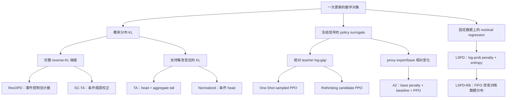

# OPD 统一伪代码与算法决策分类

## 阅读方式与统一边界

实现前先确定数学目标、动作积分、梯度程序、冻结范围和执行预算，再选择 backend。这五个决定形成一个算法 recipe。项目名称还包含数据协议、教师路由和系统编排，不能直接当作数学目标名称。

本文将 ResOPD、TA-OPD、Rethinking-OPD、A2-OPD、One-Shot-OPD 和 LSPD 放入同一套符号与伪代码框架，并补充与本地 Mirror 算法的对应关系。源码版本沿用[六项目架构与指标审计](2026-10-12-六个OPD项目训练架构与日志指标比较.md)及其[来源记录](../../results/analysis/2026-10-12-six-opd-source-metrics-audit.json)。本文新增的是数学分类和目标接口，没有将这些接口接入生产 trainer。

建议先读两个决策表和共同训练循环，再读各 kernel。`freeze` 复制数值、IDs、mask 和来源版本；正文的 `sg` 与伪代码的 $\operatorname{stopgrad}$ 同指停止梯度。caption 中的 Semantics 区分官方实现与正文重构，原作者限制在算法后说明。

算法块采用 algorithmicx 的 algpseudocode 布局约定[^algorithmicx]，预览按 pseudocode.js 语法渲染[^pseudocode-js]。正文按算法名称引用，默认不启用行号；循环显式闭合，更新预算和空集处理写入相应算法。

## 一、算法分类：目标、估计器与数据协议分开



这张图按本次主实现分类。Mirror 的 Part/Mean/BPO属于固定anchor投影或其score程序，MDPO直接优化原mirror目标，后文单独连接。一个项目可以提供多个类别，例如TA同时有coarse目标和SC估计器。

### 决策表 A：数学上改变了什么

| Recipe               | 数学对象                                           | 动作处理                                    | 反向程序                           | 可以据此声称的关系                                    |
| -------------------- | -------------------------------------------------- | ------------------------------------------- | ---------------------------------- | ----------------------------------------------------- |
| ResOPD               | 固定 prefix 上完整 reverse KL 的梯度               | teacher head + 实际 sampled action          | 停止系数、条件 head 均值、事件控制 | 当前完整 student 采样下期望梯度等于完整 KL            |
| TA coarse            | head 与单个 tail bucket 上的 reverse KL            | teacher head + 聚合 tail                    | literal differentiable KL          | 改变后的确定性目标，是完整 KL 的粗化                  |
| TA normalized        | head 条件分布 reverse KL                           | teacher head，双方重新归一化                | literal differentiable KL          | 改变后的条件目标，不约束 tail 内部形状                |
| SC-TA                | 固定 prefix 上完整 reverse KL 的梯度               | coarse score + sampled within-tail residual | live ratio + stopped residual      | 正确 proposal 与精确分区下期望梯度等于完整 KL         |
| One-Shot sampled     | 冻结 teacher log-gap 的 PPO surrogate              | rollout 实际动作                            | ratio/clipping，可有dual clip      | 属于固定 signal surrogate，非当前 KL literal autograd |
| Rethinking candidate | 冻结 candidate 贡献的 PPO surrogate                | student/teacher/intersection/union          | candidate ratio/clipping后求和     | 有限支持与权重定义决定实际更新                        |
| A2 candidate         | proxy 相对变化与固定 base penalty 的 PPO surrogate | student 候选与 state baseline               | candidate PPO；可选 controller     | reward 构造、KL 监控和 PPO 梯度是三个对象             |
| LSPD                 | 固定 action 数据上的 log-prob penalty 与 entropy   | 默认 sampled，额外 candidate 分支           | penalty 与完整 entropy 直接反传    | 是经验回归目标，复用旧数据不自动变成 IS               |
| LSPD-RB              | 与 LSPD 相同的回归程序                             | 从历史 response buffer 采样                 | 每次重算 current LP/entropy        | buffer 分布和更新预算改变，teacher target 固定        |

这里“完整 KL 梯度”指固定 prefix 测度上的条件分布梯度。动作 IS 不修正过去动作生成该 prefix 的概率，不自动得到完整 trajectory visitation measure 的导数。

### 决策表 B：拿到哪些信息、允许怎样复用

| Recipe               | 冻结证据                                                  | 当前 forward 必须提供                      | 原实现的重要复用条件                                | 目标归约                      |
| -------------------- | --------------------------------------------------------- | ------------------------------------------ | --------------------------------------------------- | ----------------------------- |
| ResOPD               | teacher head IDs/LP、动作teacher LP、rollout 动作         | head/action LP、head mass 与 tail score    | 发布入口单次 full-batch update；内核无 IS           | 配置的 token/sequence 归约    |
| TA coarse/normalized | teacher head IDs/LP、固定prefix                           | head LP、full normalizer；coarse 另需 tail | 条件目标不靠动作 IS；prefix 仍来自固定数据          | 配置归约                      |
| SC-TA                | 上述 teacher 证据、proposal 动作 LP                       | head/tail/action LP，live action ratio     | 复用时分母必须是实际 proposal；源码用 old scorer LP | 配置归约                      |
| Rethinking           | 真实 candidate IDs、old cross LP、权重贡献                | 在同 IDs 上 gather current LP              | union 等已传配对数据；only_tch 多更新路径有缺口     | candidate sum 再 prefix 归约  |
| One-Shot Top-K       | old native candidate LP、teacher cross LP                 | 实际 engine 重新选 native Top-K            | 单 epoch 与完整 batch 限制保护当前路径              | candidate sum 再 prefix 归约  |
| A2                   | phase-pre old LP、base/proxy LP、candidate IDs、utility/A | 相同 IDs 上的 full-normalized current LP   | both 中先 GRPO 再 prepare OPD，old scorer 会改变    | 默认 seq-mean-token-mean      |
| LSPD sampled         | 动作、teacher LP、mask                                    | 动作 LP 和完整 entropy                     | 默认不保存 behavior LP 用于 IS                      | sequence mean of token mean   |
| LSPD-RB              | 多轮 teacher-scored 轨迹的 CPU 副本                       | 同上                                       | batch 内无放回、更新间重采样；默认 256 次/outer     | 同上，另对 reuse 窗口记录统计 |

LSPD 非默认 candidate student 权重由每次 current forward 重算并 detach；它不是默认 sampled 路径中的额外概率权重。统一时必须单独声明权重是冻结还是随当前 policy 重算。

### 四种不同的“改法”

| 修改类型     | 例子                                                                     | 主要验收                             |
| ------------ | ------------------------------------------------------------------------ | ------------------------------------ |
| 改目标       | full KL 换 coarse/conditional；平方换 Huber；token mean 换 sequence mean | 新目标公式、最优性与偏差             |
| 改估计器     | SC 与 Res 对同一完整 KL 梯度使用不同 tail control                        | 期望梯度、方差、评分成本             |
| 改梯度表达   | live-ratio 与匹配的 stopped-score；Mean square 与 score                  | 逐样本梯度别名，forward value 可不同 |
| 改数据或编排 | one-shot prompt、multi-teacher、FIFO replay、GRPO→OPD                    | 测度、版本、复用预算、同步与质量     |

One-Shot 的“单题”主要属于数据协议，LSPD-RB 的“RB”主要属于历史数据采样，A2 的 controller 属于信号与约束调节。把这些名字和 KL estimator 放进同一个枚举，会混淆实验变量。

## 二、统一符号与不同生命周期

### 概率角色

| 符号                 | 含义                                                  | 冻结时点                     |
| -------------------- | ----------------------------------------------------- | ---------------------------- |
| $\pi_k=q$            | outer 起点 student snapshot；Mirror anchor            | 第 k 轮开始                  |
| $\pi_{k,n}=p$        | 当前 student                                          | 随实际 optimizer update 变化 |
| $\beta_j$            | 第 j 份 rollout 的真实生成分布，含 sampling transform | 生成该数据时                 |
| $o_{k,\phi}=o$       | 当前更新 phase 的 old scorer 分布                     | phase 准备时                 |
| $\pi_T=t$            | 普通冻结 teacher                                      | teacher 版本固定             |
| $\pi_B=\xi$          | A2 固定 target base，通常是初始化 target              | 运行初始化                   |
| $\pi_E=e$、$\pi_F=f$ | A2 proxy expert 与 proxy base                         | proxy 版本固定               |
| $d_j$                | 第 j 份轨迹产生的 prefix 测度                         | 该数据集固定                 |

普通同步单 phase、完整采样且 scorer 与 rollout 一致时，可以声明 $\beta_k=q=o$。这个等同性是要核验的条件。A2 both 在 GRPO 更新后准备 OPD，$o$可以是本轮中间 policy；LSPD replay 则混合不同 j 的 prefix 和动作。

伪代码中的 $\ell_p^C$ 表示 full-normalized LP 在 C 上 gather 的向量；条件分布的 LP 始终写为 $\log p^C$。局部变量的 $\gets$ 是赋值，模型、优化器、FIFO 与 controller 的持久状态修改均另作注释；所有 kernel 本身只返回结果。

每条缓存保存具体 token IDs 与版本。Top-K rank 不是 token 身份。LP 的温度、词表、EOS class、mask 和 prediction-position 必须一致。

### 概率原语

固定 prefix $s$，省略条件 $\mid s$。定义

$$
\ell_p(v)=\log p_v,\quad\ell_o(v)=\log o_v,\quad\ell_t(v)=\log t_v,\quad\psi_v=\nabla_\theta\ell_p(v).
$$

对固定集合 C，定义

$$
p(C)=\sum_{v\in C}p_v,\qquad p^C_v=p_v/p(C),\qquad \tau_p=1-p(C).
$$

`full-normalized LP`是 $\ell_p$，`conditional LP`是 $\log p^C$。A2 controller 使用后者构造 candidate KL，但 PPO ratio 使用前者：

$$
\rho_v=p_v/o_v,\qquad \omega_a=p_a/\beta_j(a).
$$

$\rho$是 scorer/current ratio，$\omega$是实际动作 proposal correction；只有 $o=\beta_j$ 时二者相同。条件 ratio $p^C_v/o^C_v$还与 $\rho_v$相差集合质量因子，不能静默替换。

### mask 与归约

令 $m_{it}$ 为有效 prefix mask，$h_{itv}$为有效 candidate mask。统一先对 candidate 按 recipe 求和或加权，再沿 prefix/response 归约。

$$
\operatorname{TokenMean}(z)=\frac{\sum_{i,t}m_{it}z_{it}}{\sum_{i,t}m_{it}},\qquad
\operatorname{SeqMean}(z)=\frac1B\sum_i\frac{\sum_tm_{it}z_{it}}{\sum_tm_{it}}.
$$

DP 与 gradient accumulation 采用全局分母，避免改变 micro-batch 划分就改变梯度。masked 空行如何处理属于显式数据规则。候选 clip 比例使用 $\sum m h$，不能把三维分子除以二维 prefix count。

## 三、统一训练循环与结果合同

### kernel 输出

所有 kernel 返回同一类结果，但允许字段缺失：

```text
KernelResult:
    backward_loss       # 唯一用于 backward 的 scalar/tensor
    reported_value      # 可以不同于 backward_loss 的数值
    value_kind          # objective / stochastic_estimate / surrogate
    gradient_target     # 目标、测度、近似性质与有效条件
    diagnostics         # detached quantities + sufficient statistics
```

例如 Res 的 reported value 是随机 KL 估计，backward 是事件控制程序；PPO 的 reported value 是 surrogate；LSPD 可以报告当前经验回归 objective。不能强制每种算法填一个同义的“KL loss”或“advantage”。

### 共同 outer/phase/inner 循环

这是推荐的统一接口。原实现的 teacher 调用可以嵌在 agent loop 或 actor prep，算法意义相同，但 phase 边界和证据角色必须显式。

```pseudocode indent=1.5em
\begin{algorithm}
\caption{共同 outer--phase--inner 训练循环\\{\small\textit{Semantics: 根据正文重构；统一执行合同}}}
\begin{algorithmic}
\INPUT recipe $\mathscr R$，manifests，$K_{\mathrm{out}}$，$R,H$，有序 phase 计划 $\Phi_k$ 与更新预算 $N_{k,\phi}$
\OUTPUT 原地更新后的 $\theta,\mathcal O$、实际更新数 $u$ 与落盘记录
\REQUIRE $K_{\mathrm{out}},N_{k,\phi}\ge0$，$R,H\ge1$；评分能力满足 recipe 请求
\STATE $\mathcal P\gets\operatorname{Compile}(\mathscr R,\text{support},\text{reduction},\text{numerics})$
\STATE $\operatorname{CheckCapabilities}(\mathcal P)$；$\theta,\mathcal O\gets\operatorname{Initialize}()$
\STATE $u\gets0$ \COMMENT{实际 optimizer update 计数}
\FOR{$k=0,\ldots,K_{\mathrm{out}}-1$}
    \STATE $\mathcal X_k\gets\operatorname{NextPromptBatch}()$
    \IF{$\mathcal X_k=\varnothing$}
        \RETURN $\theta,\mathcal O,u$ \COMMENT{数据耗尽即终止}
    \ENDIF
    \STATE $q\gets\operatorname{Snapshot}(\theta)$；$\beta_k\gets\operatorname{DecodeDistribution}(q)$
    \STATE $\mathcal D_k\gets\operatorname{Rollout}(\mathcal X_k,\beta_k,R,H)$
        \COMMENT{自回归抽样；每条回答遇 EOS 或长度 H 停止}
    \STATE $\operatorname{RecordBehavior}(\mathcal D_k,\beta_k)$；$R_{\mathrm{task}}\gets\operatorname{VerifierIfRequired}(\mathcal D_k)$
    \STATE $\mathcal W\gets\operatorname{PrepareWindow}(\mathcal D_k,R_{\mathrm{task}},\mathscr R)$
    \FOR{按顺序遍历 $\phi\in\Phi_k$}
        \STATE $o\gets\operatorname{OldScorerSnapshotIfRequired}(\theta,\mathcal P)$
        \STATE $E\gets\operatorname{Freeze}(\operatorname{ScoreOrReadEvidence}(\mathcal W,q,o,\mathcal P))$
        \STATE $C_{\mathrm{used}}\gets\operatorname{FreezeControl}(\phi)$；$A\gets\operatorname{PrepareSignal}(E,C_{\mathrm{used}})$
        \FOR{$n=0,\ldots,N_{k,\phi}-1$}
            \STATE $\mathcal D\gets\operatorname{SelectRows}(\mathcal W,\mathscr R)$；$M\gets\operatorname{GlobalValidCount}(\mathcal D)$
            \IF{$M>0$}
                \STATE $\operatorname{CheckIDsAndVersions}(\mathcal D,E)$；$\operatorname{ZeroGrad}(\theta)$
                \FOR{按确定顺序遍历 micro-batch $\mu\in\operatorname{Split}(\mathcal D)$}
                    \STATE $p\gets\pi_\theta$；$P_\mu\gets\operatorname{CurrentScores}(p,\mu,E)$
                    \STATE $K_\mu\gets\operatorname{Kernel}(\mathscr R,P_\mu,E,A,C_{\mathrm{used}})$
                    \STATE $L_\mu\gets\operatorname{GlobalReduce}(K_\mu.\texttt{backward\_loss},M,\mathcal P)$
                    \STATE $\operatorname{BackwardAccumulate}(L_\mu)$；$\operatorname{RecordDetachedStats}(K_\mu)$
                \ENDFOR
                \STATE $\operatorname{MeasureAndClipGradient}(\theta)$
                \STATE $\theta,\mathcal O\gets\operatorname{OptimizerStep}(\theta,\mathcal O)$
                    \COMMENT{原地修改模型与优化器；缓存 E 保持不变}
                \STATE $u\gets u+1$；$\operatorname{ReportUpdate}(u,k,\phi,n)$
            \ELSE
                \STATE $\operatorname{ReportSkip}(\texttt{empty-valid-batch})$ \COMMENT{不推进 optimizer}
            \ENDIF
        \ENDFOR
        \STATE $C_{\mathrm{next}}\gets\operatorname{UpdateControllerIfEnabled}(C_{\mathrm{used}})$
        \STATE $\operatorname{PublishControl}(C_{\mathrm{next}})$；$\operatorname{ReportControlVersions}()$
    \ENDFOR
    \STATE $\operatorname{SyncStudentToRollout}(\theta)$；$\operatorname{CheckRolloutVersion}()$
    \STATE $\operatorname{EvaluateAndCheckpointIfScheduled}(k,\theta)$；$\operatorname{ReportOuter}(k,u)$
\ENDFOR
\RETURN $\theta,\mathcal O,u$
\end{algorithmic}
\end{algorithm}
```

`ScoreOrReadEvidence`按 plan 调用新评分或读取每行已有 target；LSPD-RB 读取缓存 teacher LP，不对整个 buffer 重新评分。没有 old-scorer 需求的 kernel 也不额外复制一套 old 模型。

真实实现可能把 optimizer 积累拆成多个 forward/backward，不能把上面的一个 update 误当一个 micro-batch。只在有重新 forward 时记录 post 概率。Rethinking 的单 batch 优化路径、One-Shot 的 Top-K 限制、A2 的 phase-pre scorer 和 LSPD 的 FIFO 采样在下面展开。

## 四、TA/SC/Res：同一支持分区，不同目标或控制项

### 公共 head/tail 准备

本节 $S=\operatorname{TopK}(t)$，teacher IDs 固定。定义

$$
x_v=\ell_p(v)-\ell_t(v),\quad P=p(S),\quad T=t(S),\quad\tau_p=1-P,\quad\tau_t=1-T,\quad\delta=\log(\tau_p/\tau_t).
$$

```pseudocode indent=1.5em
\begin{algorithm}
\caption{固定 head 与稳定 tail 准备\\{\small\textit{Semantics: 根据正文重构；显式分区边界}}}
\begin{algorithmic}
\INPUT 当前 logits $z$，固定 IDs 集合 $S$，teacher LP $\ell_t^S$，模式 $m$，数值策略 $\mathcal N$
\OUTPUT $\ell_p^S,\ell_t^S,P,T,\log\tau_p,\log\tau_t$ 与分区状态
\REQUIRE 同一词表、prefix 与温度；$S$ 无重复 IDs
\STATE $\ell_p\gets\operatorname{LogSoftmax}(z)$；$\ell_p^S\gets\operatorname{Gather}(\ell_p,S)$
\STATE $\ell_t^S\gets\operatorname{stopgrad}(\ell_t^S)$；$P\gets\sum_{v\in S}\exp\ell_p(v)$；$T\gets\sum_{v\in S}\exp\ell_t(v)$
\IF{$S=\varnothing$}
    \IF{$m\in\{\texttt{normalized},\texttt{resopd}\}$}
        \STATE $\operatorname{Abort}(\texttt{empty-support})$ \COMMENT{终止本次 kernel}
    \ENDIF
    \RETURN $\ell_p^S,\ell_t^S,0,0,0,0,\texttt{empty-head}$
\ENDIF
\IF{$S=\mathcal V$}
    \RETURN $\ell_p^S,\ell_t^S,1,1,-\infty,-\infty,\texttt{full-head}$
        \COMMENT{调用方跳过空 tail 公式}
\ENDIF
\STATE $\log\tau_p\gets\operatorname{ComplementLogMass}(\ell_p^S,\mathcal N)$
\STATE $\log\tau_t\gets\operatorname{ComplementLogMass}(\ell_t^S,\mathcal N)$
\RETURN $\ell_p^S,\ell_t^S,P,T,\log\tau_p,\log\tau_t,\texttt{partial-head}$
\end{algorithmic}
\end{algorithm}
```

teacher 自己选出的 head 与 student 在 teacher IDs 上的概率是两种来源，diagnostic student Top-J 另外计算。推荐实现给 full/empty support 独立分支；原 TA 的 log1mexp 先 clamp 至 $-10^{-6}$，原 Res 对 tail 使用 dtype epsilon，数值 guard 激活后需按实际程序解释。

### 分区边界先于 kernel 选择

| 情况                        | 数学含义                                                   | 当前实现与推荐门禁                                                                  |
| --------------------------- | ---------------------------------------------------------- | ----------------------------------------------------------------------------------- |
| S 为空                      | coarse 只剩总质量 1 的 bucket，KL 为 0；conditional 未定义 | 原 Res 拒绝 K=0；SC 数学上可退化为纯 sample score，但不是原 registry 的通用 K0 合同 |
| S 为完整词表                | 真 tail 为空，应进入 full 积分分支                         | 原 TA 仍造 guard tail，原 Res 也构造 epsilon bucket；推荐单独分支跳过 tail 公式     |
| tail guard 激活             | mass 或 log-mass 被改写，literal 与 score 别名条件变化     | 保存 floor 与激活率，不继承无 guard 的精确等式                                      |
| teacher 只有 head LP        | 无法知道实际 tail 动作的 teacher log-prob                  | 可以做 coarse/conditional，不能做 Res/SC 随机 tail residual                         |
| proposal 缺失非零 tail 残差 | 有目标项却无法抽样                                         | 拒绝 full 无偏声明，或明确更换目标/采样方案                                         |

### TA coarse 与 normalized

```pseudocode indent=1.5em
\begin{algorithm}
\caption{TA coarse：head 加聚合 tail\\{\small\textit{Semantics: 根据正文重构；理想目标与显式空 tail}}}
\begin{algorithmic}
\INPUT 固定 prefix 上的 $p,t,S$；合法分区与数值策略
\OUTPUT backward loss $L$ 和 reported value $V$
\STATE $L\gets\sum_{v\in S}p_v\bigl(\ell_p(v)-\ell_t(v)\bigr)$
\IF{$S\ne\mathcal V$}
    \STATE $\tau_p,\tau_t\gets\operatorname{TailMass}(p,t,S)$
    \IF{$\tau_p>0$}
        \STATE $L\gets L+\tau_p\log(\tau_p/\tau_t)$
    \ENDIF
\ENDIF
\STATE $V\gets\operatorname{stopgrad}(L)$
\RETURN $\operatorname{Result}(L,V,\texttt{coarse-objective})$
\end{algorithmic}
\end{algorithm}
```

coarse 保留 head 的真实质量，并将余量合成一个类别；空 head 返回单 bucket 的零 KL，full head 跳过 tail。这是正文目标的边界重构，原 TA 的数值 guard 行为仍按后文说明区分。

```pseudocode indent=1.5em
\begin{algorithm}
\caption{TA normalized：条件 head KL\\{\small\textit{Semantics: 根据正文重构；条件目标与空集拒绝}}}
\begin{algorithmic}
\INPUT 当前 head LP $\ell_p^S$，固定 teacher head LP $\ell_t^S$，集合 $S$
\OUTPUT backward loss $L$ 和 reported value $V$
\IF{$S=\varnothing$}
    \STATE $\operatorname{Abort}(\texttt{undefined-conditional-distribution})$
\ENDIF
\STATE $a_p\gets\operatorname{LogSumExp}(\ell_p^S)$；$a_t\gets\operatorname{LogSumExp}(\ell_t^S)$
\STATE $h_v\gets\exp(\ell_p(v)-a_p)$；$j_v\gets\exp(\ell_t(v)-a_t)$，$v\in S$
\STATE $L\gets\sum_{v\in S}h_v\log(h_v/j_v)$；$V\gets\operatorname{stopgrad}(L)$
\RETURN $\operatorname{Result}(L,V,\texttt{conditional-objective})$
\end{algorithmic}
\end{algorithm}
```

coarse 对 head 上的真实质量和一个 tail bucket 反传；normalized 只比较 head 内部的相对形状。二者都无需靠 rollout 动作抽样估计 action 求和，但 prefix 仍来自训练数据。

取 $p=(0.2,0.3,0.5)$、$t=(0.6,0.1,0.3)$、$S=\{0\}$：conditional KL 为 0，coarse KL 为 0.334795，full KL 为 0.365274。单元素 head 归一化后双方都等于 1，conditional 梯度为零；coarse 仍发现 head 质量 0.2 与 0.6 的差异。这是改变目标的具体例子。

### SC-TA 的 live ratio

```pseudocode indent=1.5em
\begin{algorithm}
\caption{SC-TA：停止 residual，保留 ratio 梯度\\{\small\textit{Semantics: 官方实现忠实；TA-OPD 底层 direct kernel}}}
\begin{algorithmic}
\INPUT 固定有效 prefix，head/tail 量，实际动作 $a$，$\ell_p(a),\ell_t(a)$，可选分母 $\ell_b(a)$
\OUTPUT backward loss $L$ 和 reported value $V$
\REQUIRE 有 teacher 动作 LP；无分母时 $a\sim p$，有分母时 $a\sim b$ 且残差支持被覆盖
\STATE $x_v\gets\ell_p(v)-\ell_t(v)$；$\delta\gets\log\tau_p-\log\tau_t$
\STATE $L_0\gets\sum_{v\in S}p_v\operatorname{stopgrad}(x_v)+\tau_p\operatorname{stopgrad}(\delta)$
\STATE $\ell_p(a),\ell_t(a),\log\tau_p,\log\tau_t\gets\operatorname{Cast}(\ell_p(a),\ell_t(a),\log\tau_p,\log\tau_t,\texttt{FP32})$
\STATE $\delta\gets\log\tau_p-\log\tau_t$；$J\gets\mathbf1[a\notin S]$
\STATE $\Delta_a\gets\operatorname{stopgrad}(\ell_p(a)-\ell_t(a)-\delta)$
\IF{分母 $\ell_b(a)$ 存在}
    \STATE $\ell_b(a)\gets\operatorname{Cast}(\ell_b(a),\texttt{FP32})$
    \STATE $W\gets\exp\bigl(\ell_p(a)-\operatorname{stopgrad}(\ell_b(a))\bigr)$
\ELSE
    \STATE $W\gets\exp\bigl(\ell_p(a)-\operatorname{stopgrad}(\ell_p(a))\bigr)$
\ENDIF
\STATE $L\gets L_0+JW\Delta_a$；$V\gets\operatorname{stopgrad}(L)$
\RETURN $\operatorname{Result}(L,V,\texttt{stochastic-KL-estimate})$
\end{algorithmic}
\end{algorithm}
```

冻结 $\Delta_a$ 时也冻结 student tail log-mass 的导数。若把 $W_{live}$整体 detach，校正项不再产生所需 score 梯度。

源码 direct collector 使用 `old_log_probs`作为分母，上面写真实 proposal 是推荐合同。只有二者确实相同时，实际 pipeline 能继承推导。当前 `use_policy_gradient=True` 路径对 None 调用 detach 的问题应在 capability gate 中拒绝；底层函数支持 None 不表示该完整组合可运行。

理想分区定义

$$
H_g=\sum_{v\in S}p_vx_v\psi_v,\qquad\psi_B=\nabla\log\tau_p=\frac1{\tau_p}\sum_{v\notin S}p_v\psi_v,\qquad\mu_B=\delta\psi_B.
$$

停止 coarse log-ratio 后，其梯度为 $H_g+\tau_p\mu_B$。正确 proposal 下 SC 校正的期望为

$$
\mathbb E_\beta[J\omega_a(x_a-\delta)\psi_a]
=\sum_{v\notin S}p_vx_v\psi_v-\delta\sum_{v\notin S}p_v\psi_v.
$$

最后一项等于 $-\tau_p\mu_B$，与 coarse 控制项消去，得到完整 reverse-KL 梯度。proposal 必须覆盖非零随机残差；有限 ratio 不能恢复未抽到且未精确积分的缺失支持。

同一校正也可写成 $J\operatorname{sg}(\omega_a\Delta_a)\ell_p(a)$，逐样本梯度相同，但 forward scalar 不同。统一接口允许这两个 gradient aliases，reported value 另行计算。

### ResOPD 的条件 head 与事件控制

以下保留原 kernel 的 forward/backward 分离，tail 按其 dtype epsilon guard 处理。

```pseudocode indent=1.5em
\begin{algorithm}
\caption{ResOPD：条件 head 与中心化事件\\{\small\textit{Semantics: 官方实现忠实；ResOPD 纯 tensor kernel}}}
\begin{algorithmic}
\INPUT 当前 logits $z$，teacher 固定 $S,\ell_t^S,\ell_t(a)$，实际动作 $a$
\OUTPUT forward value 为 $V$、backward 为 $\nabla B$ 的 loss $L$
\REQUIRE $a\sim p$ 的完整动作测度；共用词表与 prefix
\IF{$\lvert S\rvert<1$ 或 $\lvert S\rvert>\lvert\mathcal V\rvert$}
    \STATE $\operatorname{Abort}(\texttt{invalid-support-size})$
\ENDIF
\STATE $d\gets\operatorname{ComputeDtype}(z)$；$\varepsilon_d\gets\operatorname{MachineEpsilon}(d)$
\STATE $\ell_p\gets\operatorname{LogSoftmax}(\operatorname{Cast}(z,d))$；$\ell_t\gets\operatorname{stopgrad}(\operatorname{Cast}(\ell_t,d))$
\STATE $p_v\gets\exp\ell_p(v)$，$v\in\mathcal V$；$h_v\gets\operatorname{Softmax}(\ell_p^S)_v$，$v\in S$
\STATE $x_v\gets\ell_p(v)-\ell_t(v)$，$v\in S\cup\{a\}$
\STATE $P\gets\sum_{v\in S}p_v$；$T\gets\sum_{v\in S}t_v$；$I\gets\mathbf1[a\in S]$
\STATE $\widehat\tau_p\gets\max(1-P,\varepsilon_d)$；$\widehat\tau_t\gets\max(1-T,\varepsilon_d)$
\STATE $\delta\gets\log\widehat\tau_p-\log\widehat\tau_t$；$V_H\gets\sum_{v\in S}h_vx_v$
\STATE $B_H\gets\sum_{v\in S}\operatorname{stopgrad}(h_vx_v)\ell_p(v)$；$B_a\gets\operatorname{stopgrad}(x_a)\ell_p(a)$
\STATE $Q_S\gets\sum_{v\in S}\operatorname{stopgrad}(p_v)\ell_p(v)$
\STATE $B_B\gets-\operatorname{stopgrad}(\delta)Q_S/\operatorname{stopgrad}(\widehat\tau_p)$
\STATE $E\gets\operatorname{stopgrad}(I-P)$
\IF{$I=1$}
    \STATE $B\gets B_H$；$V\gets V_H$
\ELSE
    \STATE $B\gets B_a$；$V\gets x_a$
\ENDIF
\STATE $B\gets B-E(B_H-B_B)$
\STATE $L\gets\operatorname{stopgrad}(V)+B-\operatorname{stopgrad}(B)$
\RETURN $\operatorname{Result}(L,\operatorname{stopgrad}(V),\texttt{stochastic-KL-estimate})$
\end{algorithmic}
\end{algorithm}
```

该 kernel 在一次有效 prefix 调用后返回，不原地更新参数；空 head 按原实现拒绝，full head 仍保留 epsilon bucket。计算 dtype 为输入 FP64 或其余浮点输入对应的 FP32，包装层负责 shape、mask 和预测位置适配。

令 $\mu_H=P^{-1}H_g$。逐样本梯度展开为

$$
\widehat g_{Res}=I\mu_H+(1-I)x_a\psi_a-(I-P)(\mu_H-\mu_B)
=H_g+\tau_p\mu_B+J(x_a\psi_a-\mu_B).
$$

当前完整动作测度下

$$
\mathbb E_p[J(x_a\psi_a-\mu_B)]
=\sum_{v\notin S}p_vx_v\psi_v-\tau_p\mu_B,
$$

故完整期望与 SC 一样是 full reverse-KL gradient。forward 也满足 $\mathbb E_pV=\operatorname{KL}(p\Vert t)$。直接反传 V 则不等于上述事件控制程序。

### 三种 tail 决策并排

| 方法          | 公共 head/coarse 梯度 | 随机 tail 残差                | 与 full 梯度的关系                 |
| ------------- | --------------------- | ----------------------------- | ---------------------------------- |
| TA coarse     | $H_g+\tau_p\mu_B$     | 无                            | 保留 coarse 目标，缺 tail 内部项   |
| SC-TA         | 同左                  | $J\omega_a(x_a-\delta)\psi_a$ | 正确 proposal 下残差补齐 full 梯度 |
| ResOPD 原实现 | 同左                  | $J(x_a\psi_a-\mu_B)$          | 当前 p 动作测度下补齐 full 梯度    |

SC 控制一个标量 log-ratio 乘 action score；Res 控制一个 tail 平均 score 向量。在当前 p 下，两种残差之差为 $J(\delta\psi_a-\mu_B)$，其期望为零，但两种程序逐样本不等价，需要分别比较方差。

数学上 Res 也能引入 $\omega_a$获得旧 proposal 下的残差估计，但这需要重新构造配套 surrogate 和合同，不是原 Res 代码已经具备的功能。简单复用原 kernel 会使 $\mathbb E_\beta(I-P)$不再为零。

## 五、PPO 家族：共同 kernel 与不同 signal

### sampled/candidate PPO

下面统一梯度下降形式。C 可以是 singleton sampled action，也可以是确定性候选集合。A 已经包含 recipe 所选择的 candidate 权重，不再额外乘一次概率。

```pseudocode indent=1.5em
\begin{algorithm}
\caption{共同 sampled/candidate PPO kernel\\{\small\textit{Semantics: 根据正文重构；显式分母与 clipping 选择}}}
\begin{algorithmic}
\INPUT 集合 $C$、冻结 full LP $\ell_o^C,A_C$、当前 full LP $\ell_p^C$、mask $h,m$、$\epsilon_-,\epsilon_+,\chi$ 与 dual 开关
\OUTPUT backward loss $L$ 与 reported surrogate $V$
\IF{全局有效 prefix/candidate 数为 $0$}
    \RETURN $\operatorname{SkipResult}(\texttt{empty-policy-batch})$
\ENDIF
\FOR{每个有效 prefix $s$}
    \STATE $L_s\gets0$ \COMMENT{该 prefix 的空候选集合贡献为零}
    \FOR{按冻结 ID 顺序遍历有效 $v\in C(s)$}
        \STATE $g_v\gets\operatorname{clip}(\ell_p(v)-\operatorname{stopgrad}(\ell_o(v)),-20,20)$；$\rho_v\gets\exp g_v$
        \STATE $A_v\gets\operatorname{stopgrad}(A_v)$
        \STATE $L_1\gets-A_v\rho_v$；$L_2\gets-A_v\operatorname{clip}(\rho_v,1-\epsilon_-,1+\epsilon_+)$
        \STATE $L_v\gets\max(L_1,L_2)$
        \IF{dual 开启且 $A_v<0$}
            \STATE $L_v\gets\min(L_v,-\chi A_v)$
        \ENDIF
        \STATE $L_v\gets\operatorname{OptionalRolloutCorrection}(L_v,s,v)$
        \STATE $L_s\gets L_s+L_v$ \COMMENT{candidate sum，不是 candidate mean}
    \ENDFOR
\ENDFOR
\STATE $L\gets\operatorname{Reduce}(\{L_s\},\text{mask},\text{reduction})$；$V\gets\operatorname{stopgrad}(L)$
\RETURN $\operatorname{Result}(L,V,\texttt{PPO-surrogate})$
\end{algorithmic}
\end{algorithm}
```

| 原路径               | dual clip                  | candidate 身份和分母                                           |
| -------------------- | -------------------------- | -------------------------------------------------------------- |
| Rethinking candidate | 有，按其配置               | 通常 gather 冻结 IDs；严格单更新分支可用 current.detach 作分母 |
| One-Shot sampled     | vanilla 含 dual clip       | 实际动作 ID 固定，old sampled LP                               |
| One-Shot Top-K       | 无 dual clip               | current 每次 native Top-K 重选，依赖单更新限制                 |
| A2 candidate         | 有，代码实际固定 $\chi=10$ | 冻结 IDs，full-normalized old/current LP                       |

PPO ratio clipping、log-ratio 数值 clip、dual clip、额外 rollout correction 和优化器 gradient clipping 是五个不同决定。它们影响不同的计算图或数值，应有独立配置和日志。

### 绝对 teacher-gap 准备

```pseudocode indent=1.5em
\begin{algorithm}
\caption{Sampled teacher-gap 的冻结信号\\{\small\textit{Semantics: 根据正文重构；One-Shot sampled 主路径}}}
\begin{algorithmic}
\INPUT 已由 $\beta_j$ 自回归生成的数据 $\mathcal D$，old scorer $o$，teacher 路由 $\mathcal T$
\OUTPUT 每个有效 prefix 的固定 $C,\ell_o^C,A_C$
\IF{$\mathcal D$ 没有有效动作}
    \RETURN $\operatorname{EmptyEvidence}()$
\ENDIF
\FOR{按数据行与时间顺序遍历有效动作 $(s,a)$}
    \STATE $t\gets\operatorname{RouteTeacher}(\mathcal T,s)$；$C(s)\gets\{a\}$
    \STATE $\ell_o(a),\ell_t(a)\gets\operatorname{ScoreSameAction}(o,t,s,a)$
    \STATE $A_a\gets\operatorname{stopgrad}(\ell_t(a)-\ell_o(a))$
    \STATE $E_s\gets\operatorname{Freeze}(C(s),\ell_o(a),A_a,\text{versions})$
\ENDFOR
\RETURN $\{E_s\}$ \COMMENT{交给 PPO；此 kernel 不更新模型参数}
\end{algorithmic}
\end{algorithm}
```

这里不重新抽 action：实际动作来自已记录的生成分布，teacher 只给同一动作评分。空数据交给训练循环跳过；单题重复和多 teacher 路由属于数据与评分协议。

```pseudocode indent=1.5em
\begin{algorithm}
\caption{Candidate teacher-gap 的支持与权重\\{\small\textit{Semantics: 根据正文重构；推荐冻结 ID 合同}}}
\begin{algorithmic}
\INPUT 固定 prefix、old scorer $o$、teacher $t$，selector、weight mode、legacy 对称差开关
\OUTPUT 固定候选 evidence $E$
\STATE $H^o\gets\operatorname{TopK}(o)$；$H^t\gets\operatorname{TopK}(t)$
\STATE $C,h\gets\operatorname{SelectUniqueIDs}(H^o,H^t,\text{selector})$
\IF{$C=\varnothing$ 或没有有效 candidate}
    \RETURN $\operatorname{ZeroCandidateEvidence}()$
\ENDIF
\STATE $\ell_o^C,\ell_t^C\gets\operatorname{ScoreOnSameIDs}(o,t,C)$
\IF{weight mode 为 student}
    \STATE $\zeta_v\gets\ell_o(v)$
\ELSE
    \IF{weight mode 为 teacher}
        \STATE $\zeta_v\gets\ell_t(v)$
    \ELSE
        \STATE $\zeta_v\gets0$ \COMMENT{uniform 或 legacy unit weight}
    \ENDIF
\ENDIF
\IF{legacy symmetric difference 未开启}
    \STATE $w_v\gets\operatorname{MaskedSoftmax}(\zeta,h)_v$
\ELSE
    \STATE $w_v\gets h_v\exp\zeta_v$ \COMMENT{原策略保留 raw mass}
\ENDIF
\STATE $A_v\gets\operatorname{stopgrad}(w_v(\ell_t(v)-\ell_o(v)))$
\RETURN $\operatorname{Freeze}(C,h,\ell_o^C,A_C,\text{versions})$
\end{algorithmic}
\end{algorithm}
```

最后的冻结 ID 写法是推荐统一合同。Rethinking 默认 student、union 和对称差已具备对应传输；`only_tch`准备分支只传 teacher IDs，却未传其对应 old cross LP，多更新分支可能退回 student-slot LP。其严格单更新分支避开这一错配，不能据此宣称任意 reuse 安全。

One-Shot engine 实际重新选 current Top-K，所以启动时强制 epoch1 与 mini=train batch。统一改造应 transport 固定 IDs 并 gather；移除限制必须在这一合同成立后进行，不能只删检查。

Rethinking 主要决定是支持集与候选权重；One-Shot 还改变 prompt 协议和 teacher routing。把一个题目重复成 batch 不会改变上面 PPO kernel，它改变的是 prompt 分布和 coverage。

## 六、A2：relative signal 可表达为虚拟 teacher

### phase-pre 相对 utility 与 controller

```pseudocode indent=1.5em
\begin{algorithm}
\caption{A2：phase-pre utility 与下一轮 controller\\{\small\textit{Semantics: 根据正文重构；保留 GRPO 到 OPD 的顺序}}}
\begin{algorithmic}
\INPUT $\mathcal D_k\sim\beta_k$，参数与优化器 $\theta,\mathcal O$，固定 $\xi,e,f$，controller $\mathcal C$，计划和更新数 $N$
\OUTPUT 原地更新后的 $\theta,\mathcal O,\mathcal C$ 与 used/next 记录
\IF{GRPO 被计划启用}
    \STATE $\theta\gets\operatorname{GRPOUpdate}(\theta,\mathcal D_k)$ \COMMENT{先发生的原地更新}
\ENDIF
\STATE $o\gets\operatorname{Snapshot}(\theta)$；$C,h\gets\operatorname{TopKOrTranslate}(o,\mathcal D_k)$
\IF{没有有效 candidate prefix}
    \STATE $\operatorname{ReportSkip}(\texttt{no-OPD-candidate})$
    \RETURN $\theta,\mathcal O,\mathcal C$
\ENDIF
\STATE $\ell_o^C,\ell_\xi^C,\ell_e^C,\ell_f^C\gets\operatorname{Freeze}(\operatorname{SameActionScores}(o,\xi,e,f,C))$
\STATE $\lambda_{\mathrm{used}}\gets\operatorname{CurrentLambda}(\mathcal C)$
\STATE $d_v\gets\ell_e(v)-\ell_f(v)$；$u_v\gets d_v-\lambda_{\mathrm{used}}(\ell_o(v)-\ell_\xi(v))$
\STATE $w_v\gets\operatorname{MaskedSoftmax}(\ell_o^C,h)_v$；$\bar u_s\gets\sum_{v\in C(s)}w_vu_v$
\IF{state baseline 开启}
    \STATE $A_v\gets\operatorname{stopgrad}(w_v(u_v-\bar u_s))$
\ELSE
    \STATE $A_C\gets\operatorname{ExplicitBaselineRecipe}(u,w,h)$
\ENDIF
\STATE $K_{\mathrm{pre}}\gets\operatorname{KL}(o^C\Vert\xi^C)$
\STATE $K_{\mathrm{proxy}},K_{\mathrm{transfer}},G\gets\operatorname{ConditionalDiagnostics}(o,\xi,e,f,C)$
\STATE $R_{\mathrm{val}}\gets\operatorname{HeldoutRewardIfRequired}(\theta)$
\STATE $\mathcal B_{\mathrm{used}}\gets\operatorname{BudgetUpdateIfEnabled}(K_{\mathrm{proxy}},K_{\mathrm{transfer}},R_{\mathrm{val}})$
\STATE $I_s\gets\sum_{v\in C(s)}w_v(u_v-\bar u_s)^2$；$m\gets\operatorname{ValidPrefixMask}(h)$
\STATE $m\gets\operatorname{TokenMaskEmphasisIfEnabled}(m,I)$
\FOR{$n=0,\ldots,N-1$}
    \STATE $\ell_p^C\gets\operatorname{GatherFullNormalizedLP}(\pi_\theta,C)$
    \STATE $L\gets\operatorname{PPO}(\ell_p^C,\ell_o^C,A_C,h,m,\chi=10)$
    \STATE $\operatorname{ZeroGrad}(\theta)$；$\operatorname{Backward}(L)$
    \STATE $\theta,\mathcal O\gets\operatorname{OptimizerStep}(\theta,\mathcal O)$
\ENDFOR
\STATE $\lambda_{\mathrm{next}}\gets\operatorname{DualUpdateIfEnabled}(\lambda_{\mathrm{used}},K_{\mathrm{pre}},\mathcal B_{\mathrm{used}})$
\STATE $\operatorname{Report}(\lambda_{\mathrm{used}},\lambda_{\mathrm{next}},K_{\mathrm{pre}},\text{phase-pre version})$
\STATE $\mathcal C.\lambda\gets\lambda_{\mathrm{next}}$ \COMMENT{原地发布；只影响后续 phase}
\RETURN $\theta,\mathcal O,\mathcal C$
\end{algorithmic}
\end{algorithm}
```

冻结 utility 时默认 state baseline 为 $\bar u=\mathbb E_{o^C}u$，contribution 为 $A_v=o^C_v(u_v-\bar u)$。candidate KL 使用 conditional LP；PPO 使用 full-normalized LP。token emphasis 是重新加权，不是随机删除 token。上述预算、dual、token emphasis 在发布默认配置中均关闭。

### 虚拟 teacher 恒等式

在共同 action space、固定 C 和 $\lambda>0$ 下，定义仅用于数学解释的虚拟 teacher

$$
\widetilde t_{\lambda,C}(v)
=\frac{\xi_v\exp(d_v/\lambda)}{Z_C},\qquad Z_C=\sum_{u\in C}\xi_u\exp(d_u/\lambda).
$$

逐项展开：

$$
\lambda\log\frac{\widetilde t_{\lambda,C}(v)}{o^C_v}
=\lambda\log\xi_v+d_v-\lambda\log Z_C-\lambda\log o_v+\lambda\log o(C)
=u_v-\lambda\log Z_C+\lambda\log o(C).
$$

最后两项对 action 是常数，state 中心化后消去。因此

$$
A_v=\lambda o^C_v\left[\log\frac{\widetilde t_{\lambda,C}(v)}{o^C_v}
-\mathbb E_{o^C}\log\frac{\widetilde t_{\lambda,C}}{o^C}\right].
$$

这把 A2 的 signal 构造连接到“centered teacher gap”，backend 只需提供三组固定 LP 与 old LP，不必真正实例化虚拟 teacher 模型。它没有把 A2 的 candidate PPO 变成 literal KL、Mirror MDPO 或普通 teacher rollout；support、权重、phase-pre scorer 和 clipping 仍是独立决策。

同时 $\sum_vA_v=0$，所以 sum-K advantage 为零属于定义结果。用于学习诊断的量应保留每 candidate 的平方/RMS，不能只看 prefix sum。

## 七、LSPD：经验回归与数据采样分别实现

### regression kernel

默认二维 sampled 路径没有额外 action 概率乘数。

```pseudocode indent=1.5em
\begin{algorithm}
\caption{LSPD sampled regression 与 entropy\\{\small\textit{Semantics: 根据正文重构；显式 penalty 分支和空行处理}}}
\begin{algorithmic}
\INPUT 固定 sample 数据 $\mathcal D$、teacher 动作 LP、mask $m$，当前 $p$，penalty mode，阈值 $c$，$\alpha_H$
\OUTPUT 当前经验 backward loss $L$ 与 reported value $V$
\REQUIRE mode 属于 squared、Huber、clamp；$c>0$，teacher target 固定
\STATE $I\gets\{i:\sum_tm_{it}>0\}$；$T_i\gets\sum_tm_{it}$
\IF{$I=\varnothing$}
    \RETURN $\operatorname{SkipResult}(\texttt{empty-valid-batch})$
\ENDIF
\FOR{每个有效 $(i,t)$}
    \STATE $\delta_{it}\gets\ell_p(a_{it})-\operatorname{stopgrad}(\ell_t(a_{it}))$
    \IF{mode 为 squared}
        \STATE $z_{it}\gets\delta_{it}^2$
    \ELSE
        \IF{mode 为 Huber}
            \IF{$\lvert\delta_{it}\rvert\le c$}
                \STATE $z_{it}\gets\delta_{it}^2$
            \ELSE
                \STATE $z_{it}\gets2c\lvert\delta_{it}\rvert-c^2$
            \ENDIF
        \ELSE
            \STATE $z_{it}\gets\operatorname{clip}(\delta_{it},-c,c)^2$
        \ENDIF
    \ENDIF
    \STATE $H_{it}\gets-\sum_{v\in\mathcal V}p(v\mid s_{it})\ell_p(v\mid s_{it})$ \COMMENT{entropy 保留梯度}
\ENDFOR
\STATE $L\gets\frac1{\lvert I\rvert}\sum_{i\in I}\frac1{T_i}\sum_tm_{it}(z_{it}-\alpha_HH_{it})$；$V\gets\operatorname{stopgrad}(L)$
\RETURN $\operatorname{Result}(L,V,\texttt{empirical-objective})$
\end{algorithmic}
\end{algorithm}
```

默认 Huber 为 $\delta^2$ 或 $2c\lvert\delta\rvert-c^2$，$c=5$、$\alpha_H=0.1$。平方、clamp、Huber 改变 objective 与梯度，不是日志显示选项。

非默认 candidate 路径先按选择的权重对 penalty 求和；student 权重随 current forward 重算但 detach，teacher target 固定。它不等于对 current 权重和 penalty 一起全微分，也不等于默认 sampled Monte Carlo。

### FIFO replay 调度

```pseudocode indent=1.5em
\begin{algorithm}
\caption{LSPD-RB：有界 FIFO 与重复更新\\{\small\textit{Semantics: 根据正文重构；补齐空数据与终止条件}}}
\begin{algorithmic}
\INPUT 初始 $\theta,\mathcal O$，固定 teacher $t$，$K_{\mathrm{out}}$，prompt loader，$R=4$，响应上限 $H$，容量 $C_Q=65536$，每轮更新数 $N=256$，请求行数 $b=64$
\OUTPUT 原地更新后的参数 $\theta$ 与 replay 记录
\STATE $Q\gets\operatorname{EmptyCPUFIFO}(C_Q)$
\FOR{$k=0,\ldots,K_{\mathrm{out}}-1$}
    \STATE $\mathcal X\gets\operatorname{NextPromptBatch}()$
    \IF{$\mathcal X=\varnothing$}
        \RETURN $\theta,Q$ \COMMENT{prompt loader 耗尽}
    \ENDIF
    \STATE $\beta_k\gets\operatorname{DecodeDistribution}(\pi_\theta)$
    \STATE $\mathcal D_k\gets\operatorname{Rollout}(\mathcal X,\beta_k,R,H)$ \COMMENT{EOS 或 H 截止}
    \STATE $T_k\gets\operatorname{FrozenTeacherActionScores}(\mathcal D_k)$
    \STATE $Q\gets\operatorname{EnqueueOwnedCPUCopy}(Q,\mathcal D_k,T_k)$ \COMMENT{原地追加；不保留 live graph}
    \WHILE{$\lvert Q\rvert>C_Q$}
        \STATE $Q\gets\operatorname{EvictOldestRow}(Q)$ \COMMENT{原地 FIFO 淘汰}
    \ENDWHILE
    \IF{$\lvert Q\rvert>0$}
        \FOR{$n=0,\ldots,N-1$}
            \STATE $b'\gets\min(b,\lvert Q\rvert)$；$J\gets\operatorname{UniformWithoutReplacement}(Q,b')$
            \STATE $K\gets\operatorname{LSPD}(\pi_\theta,J,\text{cached teacher LP})$
            \IF{$K$ 不是 skip result}
                \STATE $\operatorname{ZeroGrad}(\theta)$；$\operatorname{Backward}(K.\texttt{backward\_loss})$
                \STATE $\theta,\mathcal O\gets\operatorname{OptimizerStep}(\theta,\mathcal O)$
                \STATE $\operatorname{ReportActualUpdate}(k,n)$
            \ENDIF
        \ENDFOR
    \ELSE
        \STATE $\operatorname{ReportSkip}(\texttt{empty-replay-buffer})$
    \ENDIF
    \STATE $\operatorname{SyncToRollout}(\theta)$；$\operatorname{EvaluateAndReportIfScheduled}(k)$
\ENDFOR
\RETURN $\theta,Q$
\end{algorithmic}
\end{algorithm}
```

每个 batch 内无放回，不同 update 重新抽样，可以重复训练同一行。没有 behavior LP 和 IS。普通 LSPD 使用本轮数据的配置 mini-batches，发布设置共有 4 次 update；RB 默认 256 次，不能用相同 outer 轴比较优化预算。

如果固定经验目标就是 buffer 分布上的回归，直接重用成立；若想声称当前 policy 测度上的完整目标，则必须另定义采样和校正。FIFO、priority、coverage 与 sample weighting 是数据测度决策，不应隐藏在 cache 选项里。

## 八、与 Mirror Part/Mean/BPO/MDPO连接

本节固定 $\beta_k=q=\pi_k$，沿用书稿定义

$$
U=\log(p/q),\quad r_k=\log(t/q),\quad\mathcal K^S=\operatorname{KL}(q\Vert p),\quad\mathcal K^T=\operatorname{KL}(q\Vert t).
$$

| 方法 | 目标或残差                                | score 系数 c          | 动作积分                             |
| ---- | ----------------------------------------- | --------------------- | ------------------------------------ |
| Part | $R=U-\eta r_k+\log Z_k$                   | $c=R$                 | q 下的平方投影                       |
| Mean | $R=U-\eta(r_k+\mathcal K^T)$              | $c=R$                 | q 下的平方投影                       |
| BPO  | $R=U+\mathcal K^S-\eta(r_k+\mathcal K^T)$ | $c=R/\eta$            | q 下中心化投影，精确中心有总体梯度桥 |
| MDPO | $\mathbb E_p[U/\eta-r_k]$                 | $c=(p/q)(U/\eta-r_k)$ | p 目标，用 q 动作采样校正            |

```pseudocode indent=1.5em
\begin{algorithm}
\caption{Mirror Part/Mean/BPO/MDPO 的 score kernel\\{\small\textit{Semantics: 根据正文重构；Part 为参考接口}}}
\begin{algorithmic}
\INPUT 有效 prefix/action 数据，当前 $\ell_p(a)$，冻结 $q,t$ 的 LP/center/partition，方法 $m$，$\eta>0$
\OUTPUT backward loss $L$ 与独立 objective/proxy value $V$
\REQUIRE 实际动作 $a\sim\beta_k=q$；$m\in\{\texttt{Part},\texttt{Mean},\texttt{BPO},\texttt{MDPO}\}$；IDs 与版本一致
\IF{没有有效动作}
    \RETURN $\operatorname{SkipResult}(\texttt{empty-valid-batch})$
\ENDIF
\STATE $U\gets\operatorname{stopgrad}(\ell_p(a)-\ell_q(a))$；$r_k\gets\operatorname{stopgrad}(\ell_t(a)-\ell_q(a))$
\IF{$m=\texttt{Part}$}
    \STATE $c\gets U-\eta r_k+\operatorname{stopgrad}(\log Z_k)$
\ELSE
    \IF{$m=\texttt{Mean}$}
        \STATE $c\gets U-\eta(r_k+\operatorname{stopgrad}(\mathcal K_k^T))$
    \ELSE
        \IF{$m=\texttt{BPO}$}
            \STATE $\mathcal K_{k,n}^S\gets\operatorname{CurrentCenter}(q,p,\text{resolution})$
            \STATE $c\gets(U+\mathcal K_{k,n}^S)/\eta-r_k-\operatorname{stopgrad}(\mathcal K_k^T)$
        \ELSE
            \STATE $c\gets\exp(U)(U/\eta-r_k)$ \COMMENT{MDPO；不加 PPO wrapper}
        \ENDIF
    \ENDIF
\ENDIF
\STATE $L\gets\operatorname{stopgrad}(c)\ell_p(a)$；$V,\kappa\gets\operatorname{SeparateObjectiveOrProxy}(m,p,q,t)$
\IF{$V=\varnothing$}
    \RETURN $\operatorname{Result}(L,\varnothing,\texttt{unmeasured})$
\ENDIF
\RETURN $\operatorname{Result}(L,\operatorname{stopgrad}(V),\kappa)$
\end{algorithmic}
\end{algorithm}
```

Part 在本地参考实现中，尚未注册生产入口。当前生产 Mean/BPO 采用 anchor head+tail 近似 center；Part 需要另外的 partition 请求。这些事实不能被一个通用`top_k`掩盖。

Mean/Part的冻结target平方回归与score逐样本同梯度。BPO live-center 回归与 score 只在精确条件中心、q 测度下总体等价，有限样本不同；coarse center 下不能默认继承等价。MDPO 优化 current-measure 原目标，而不是随意平方某个 residual。完整推导见[单仓算法抽象决策](2026-10-15-单仓与算法抽象历史提案.md)。

由此可以共享两类 gradient primitive：stopped coefficient 乘 live LP，以及 deterministic contribution 加 stochastic residual。PPO 还需要独立的 branch/clipping primitive；literal regression 需要 live residual/center。不能把所有算法都限制成一个sampled advantage 数组。

## 九、实现前的决策清单与消融顺序

### 固定 recipe 必须回答的十个问题

| 决定           | 要写进 plan 的内容                                                               | 没有明确时的后果                        |
| -------------- | -------------------------------------------------------------------------------- | --------------------------------------- |
| 1 目标         | full/coarse/conditional KL、frozen-signal PPO、empirical regression、Mirror 投影 | 同一个 loss 名称混入不同目标            |
| 2 prefix 测度  | fresh rollout、fixed probe、FIFO 或其他 replay                                   | 误把动作校正当 trajectory 校正          |
| 3 action 积分  | p、q、candidate 条件权重或经验 sample                                            | 多乘/少乘概率或 IS                      |
| 4 概率角色     | β、outer q、phase old o、teacher/base/proxy                                      | ratio 分母和 KL 方向错配                |
| 5 support 身份 | selector、真实 IDs、mask、冻结边界                                               | current/old Top-K rank 错位             |
| 6 teacher 信号 | sampled LP、requested IDs、native head、tail、proxy delta                        | 不足的 payload 被当作完整能力           |
| 7 梯度所有权   | 哪些 LP/ratio/mass/residual/center 是 live                                       | detach 后丢梯度或重复反传系数           |
| 8 数值策略     | dtype、tail floor、log-ratio clip、PPO/dual/gradient clip                        | 数学目标与实际程序不一致                |
| 9 更新与归约   | optimizer 次数、mini-batch、token/sequence 分母、phase schedule                  | 不公平预算和长度权重变化                |
| 10 证据与评测  | value_kind、measurement、protocol、axis、sum/count                               | surrogate 冒充 objective，pre 冒充 post |

### 推荐的实现分层

```text
Data / Model / Evaluation protocols
    ↓
Recipe plan: objective + measure + support + gradient + numerical policy
    ↓
Score requests: frozen evidence / live current scores / capability gate
    ↓
Pure tensor kernels: TA / Res / SC / PPO / regression / Mirror
    ↓
Global reduction → optimizer → sync → canonical events
    ↓
Backend adapters / JSONL / W&B / plots
```

backend 负责获得指定证据与执行分布式操作，kernel 负责数学，reporter 负责统计语义。one-shot prompt、teacher routing、replay 和 controller 分别在各自层次组合，不把六个 trainer 复制进同一个继承树。

### 分组消融

1. **相同梯度表达核验。** Mean regression/score、SC live-ratio/stopped-score，要求逐样本梯度一致。
2. **相同目标的估计器比较。** full reverse-KL reference、Res、SC，在相同 prefix/proposal/support 和数值策略下比较 bias、variance 与成本。
3. **目标近似比较。** full、coarse、conditional 分别报告目标定义与 tail 遗漏，不把目标差异称为纯方差差异。
4. **signal 比较。** absolute teacher gap、A2 relative gap、baseline 选项；固定 candidate 身份、权重、PPO 设置。
5. **数据与复用比较。** single 题/full 题、fresh/FIFO、更新次数；对齐 generated token、optimizer updates 和 wall time。
6. **系统比较。** 相同 kernel 与梯度下替换 scorer、chunking、offload、并行；独立记录 payload 与峰值内存。

每组一次改变一个有数学意义的决定。$\mathcal K^S$是离开 anchor 的距离，sum-K A 可以恒为零，surrogate 值可以任意偏移；inner 收敛需看定义清楚的 objective/proxy、candidate residual、梯度与参数变化，并在固定 probe 上测量。

## 十、伪代码核验与复现

核验程序为 [audit_opd_pseudocode.py](../../data/refactor-20261015/legacy-source.tar.gz#experiments/analysis/audit_opd_pseudocode.py)，结果为[有限词表恒等式](../../results/analysis/2026-10-12-opd-pseudocode-identities.json)。程序从固定源码提取 Res 和 SC 纯 tensor 函数，不加载 Ray/CUDA，用独立 full-KL autograd 核对总体梯度；另验证 A2 虚拟 teacher 恒等式。

| 核验                                                  | 结果                                           |
| ----------------------------------------------------- | ---------------------------------------------- |
| V=3/7、16 组分布、两种 head 大小                      | 64 个 case，逐动作完整枚举                     |
| 原 Res 在当前 p 动作测度下与 full 梯度最大差          | $7.22\times10^{-16}$                           |
| SC 在旧 proposal、正确分母下与 full 梯度最大差        | $1.01\times10^{-7}$，源码 action 计算使用 FP32 |
| 理想 coarse literal 与 stopped-score 梯度最大差       | $1.11\times10^{-16}$                           |
| 原 Res 不加 IS 却换成旧 proposal 的最大 gradient bias | 1.00750                                        |
| A2 centered utility 与虚拟 teacher 表示最大差         | $2.78\times10^{-17}$                           |

这验证的是内点有限条件分布的数学和纯 kernel，不覆盖 TA tail guard 激活、实际 teacher 服务、跨词表、DP 或 GPU 训练质量。source SHA 和 Torch 版本随结果保存。

```bash
CUDA_VISIBLE_DEVICES='' python experiments/analysis/audit_opd_pseudocode.py \
  --upstream-root upstream \
  --output results/analysis/2026-10-12-opd-pseudocode-identities.json
```

需要安装 Torch 并准备来源记录指定的 Res/TA checkout。六项目实际 pipeline、默认入口、最终 W&B 字段和源码定位继续在[架构与指标审计](2026-10-12-六个OPD项目训练架构与日志指标比较.md)维护；本文负责统一数学伪代码和实现前的决策视图。

### 参考文献

[^algorithmicx]: Szász János. algorithmicx. CTAN 2005. [algorithmicx](https://ctan.org/pkg/algorithmicx).

[^pseudocode-js]: Saswat Padhi. pseudocode.js. GitHub. [语法与渲染接口](https://github.com/SaswatPadhi/pseudocode.js).
