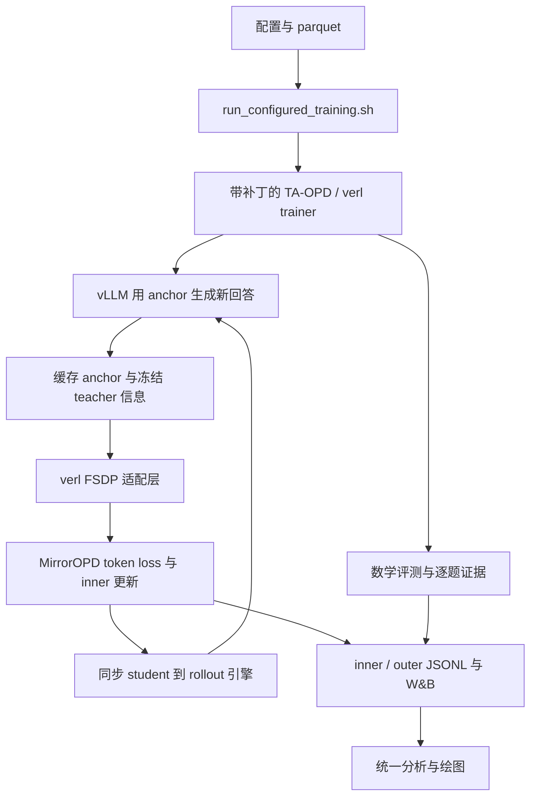

# MirrorOPD 代码架构与跨机器复现

本文对应 2026-10-12 的训练实现。目标是在新机器重建源码、数学判分器和运行配置，并留下可以核验的日志。新默认数学评测已经采用 MD-OPD 的每题 16 次采样；已有三算法正式实验采用每题一次 greedy，两套协议应分别复现。当前没有完成新机器安装验证，也没有完成新默认长预算评测的 GPU canary。

## 代码职责与数据流

MirrorOPD 的生产算法由本仓库维护，分布式调度由带补丁的 TA-OPD/verl 执行。算法源码、框架适配、运行设置有各自的维护位置。

| 层次         | 入口                                                       | 职责                                          |
| ------------ | ---------------------------------------------------------- | --------------------------------------------- |
| 数学参考     | `src/mirroropd/token_inner.py` 等研究模块                  | 离散分布、镜像目标与估计量的参考验证          |
| 生产内核     | `src/mirroropd/training/losses.py`                         | 注册算法的 token loss、停止梯度和诊断量       |
| 冻结缓存     | `src/mirroropd/training/cache.py`                          | outer 起点的 anchor、teacher 信息和固定支持集 |
| 支持集与统计 | `support.py`、`metrics.py`                                 | Top-J 三对重叠、有效 token 归约与全局统计     |
| 评测与日志   | `evaluation.py`、`tracking.py`                             | 逐题 UID、采样完整性、mean/pass 与事件轴      |
| verl 适配    | `src/mirroropd/integrations/verl/fsdp.py`                  | prediction position、张量布局与缓存运输       |
| 框架接入     | `patches/ta-opd-mirror-token-loss.patch`                   | trainer、actor、rollout 和验证链路的接线      |
| 分布式框架   | `upstream/TA-OPD/verl`                                     | Ray worker、FSDP、vLLM、模型同步与数据加载    |
| 启动设置     | `training/run_configured_training.sh`、`training/configs/` | 合并 Hydra 设置，保存实际配置和运行证据       |
| 结果分析     | `experiments/analysis/math_training_review.py`             | 从完整记录计算统计并统一生成报告图            |



一次 outer 开始时冻结学生锚点，并用它生成回答和固定前缀。在这些前缀上缓存 anchor 与 teacher 的信息；随后 inner 更新学生，固定采样记录和 anchor 信息继续复用。outer 结束后同步学生权重，下一轮重新生成。OPD-on-policy 的配置每轮一次更新；MDPO/BPO 的旧正式比较每轮 16 次更新。多个 mini-batch 时更新数还取决于 batch 划分，应读实际记录。

当前生产入口接受 `mirror_pmd_mean`、`mirror_bpo`、`mirror_mdpo`、`mirror_opd_onpolicy`、`mirror_opd_is` 和 `mirror_opd_is_no_baseline`。PMD-Part 仍属于参考实现，尚未接入生产训练入口。MDPO 使用重要性比率，BPO 的系数没有重要性比率；各算法公式和度量解释在[统一指标规范](2026-10-12-蒸馏统一日志与评测指标规范.md)维护。

`upstream/` 与 `runs/` 不入库。上游变更必须保存为 manifest 指定的补丁，不能只修改本机 checkout。模型、checkpoint 和完整运行目录需要独立搬运；`make data` 恢复的是 manifest 中的研究数据与归档日志，不下载数学模型，也不准备 DAPO 数据。

## 复现层级与环境

绘图复现只需要归档数据和分析依赖。训练复现还需要 GPU、完整模型、数学 parquet、MD-OPD 判分器、上游补丁和 GPU 软件环境。相同代码与设置并不保证逐 token 一致：异步生成调度和 GPU 算子影响确定性，已有训练没有开启全确定性。

旧正式设置在四张 H800 80 GiB 上运行，FSDP=4、TP=1。换更小显存或不同 GPU 后，应重新测量并发、KV cache、主存和吞吐。新默认评测的最大 response 从 7168 增加到 31744，每题生成数从 1 增加到 16；已有旧配置的成功训练不能替代新配置的容量测试。

本次从现有数学环境导出的依赖记录位于 `training/environments/`。基础包清单位于 `2026-10-12-math-cu126-base.txt`；GPU 包版本、两个本地 wheel 的文件名、字节数和 SHA-256 位于 `2026-10-12-math-cu126-wheels.json`。清单用于重建现有环境。原机器的 `pip check` 已通过；新机器安装仍需验证。

| 项目               | 当前环境                                                    |
| ------------------ | ----------------------------------------------------------- |
| 平台 / Python      | Linux x86_64 / Python 3.12                                  |
| PyTorch            | 2.7.1+cu126                                                 |
| vLLM               | 0.10.0+cu126，本地 wheel                                    |
| FlashAttention     | 2.8.3.post1，cu12 / torch2.7 / CXX11 ABI TRUE / cp312 wheel |
| transformers / Ray | 4.57.6 / 2.59.0                                             |
| NumPy / datasets   | 1.26.4 / 4.8.5                                              |

TA-OPD 自带的 `requirements.txt` 指定 torch 2.8.0 和 vLLM 0.11.0，与当前实验环境不同。复现当前实验时使用本次导出的环境记录，并搬运匹配的两个 wheel。直接复制 virtualenv 也不能保证可移植，解释器路径、系统库与二进制 ABI 必须一致。仓库的 `pyproject.toml` 没有锁定 GPU 训练栈；`make bootstrap` 初始化维护工具，不能替代训练环境安装。

## 新机器准备

### 获取固定源码与补丁

将 MirrorOPD 放到例如 `~/src/MirrorOPD`，MD-OPD 放到相邻的 `~/src/MD-OPD`。`prepare_math_backend.py` 当前从相邻 MD-OPD 读取判分器，这个目录关系属于实际依赖。

```bash
mkdir -p "$HOME/src"
cd "$HOME/src"
git clone https://github.com/WncFht/MirrorOPD.git
git clone git@github.com:WncFht/MD-OPD.git
git -C MD-OPD checkout cef14fa0b552b40033f8b7296ce3853d10bf479b
cd MirrorOPD
# checkout 要复现的 MirrorOPD 提交；本地提交须先推送或用 git bundle 搬运。
make upstream
make data
```

`make upstream` 读取 `upstream-manifest.json`，获取固定基线并应用补丁。TA-OPD 基线是 `62669afb5101bfdf57dc5ddf81e78f000c5ce2fc`。新机器生成真实 checkout；本机当前的上游软链指向隔离后端，不随 Git 搬运。已有 checkout 出现补丁冲突时先核对本地变更，不覆盖仍在训练的后端。

### 重建 GPU 环境

以下命令以 Linux x86_64、Python 3.12、兼容 CUDA 12.6 的驱动和同 ABI wheel 为条件。先从原机器的 `cache/wheels/` 搬运 JSON 清单中的两个文件到新机器的 `$HOME/wheels`，按清单核验 SHA-256。

```bash
python3.12 -m venv .venv
export PYTHON_BIN="$PWD/.venv/bin/python"
"$PYTHON_BIN" -m pip install --upgrade pip
"$PYTHON_BIN" -m pip install --index-url https://download.pytorch.org/whl/cu126 \
  torch==2.7.1 torchaudio==2.7.1 torchvision==0.22.1 xformers==0.0.31
"$PYTHON_BIN" -m pip install --no-deps \
  -r training/environments/2026-10-12-math-cu126-base.txt
"$PYTHON_BIN" -m pip install --no-deps \
  "$HOME/wheels/flash_attn-2.8.3.post1+cu12torch2.7cxx11abiTRUE-cp312-cp312-linux_x86_64.whl" \
  "$HOME/wheels/vllm-0.10.0+cu126-cp38-abi3-manylinux1_x86_64.whl"
"$PYTHON_BIN" -m pip install --no-deps -e upstream/TA-OPD/verl -e .
"$PYTHON_BIN" -m pip check
nvidia-smi
```

基础包以 `--no-deps` 按记录安装，GPU 依赖由上一条命令安装，避免解析器自动升级 PyTorch。`pip check` 如报告不一致，应记录具体冲突并在 canary 前处理；现有环境库存不等于经过解析器证明的一致锁文件。无法取得相同 wheel 时，重编译或换环境属于新软件设置，需要单独验证。

### 准备模型与数据

完整搬运学生 `DeepSeek-R1-Distill-Qwen-1.5B` 和教师 `JustRL-DeepSeek-1.5B`，包括 tokenizer、config、所有权重分片与原生 chat template。仅有同名目录无法确认 checkpoint 一致，应比较文件 SHA-256。旧运行未固定模型 revision，已有 model-data-audit 可以验证部分模型配置和数据哈希，不能替代完整权重哈希。

搬运 MD-OPD 的以下数据，保留列结构和标准答案：

- `data/math/DAPO/train.parquet`：17917 条旧正式训练记录。
- `data/math/MATH-500/test.parquet`：500 题。
- `data/math/AMC23/test.parquet`：40 题。
- `data/math/AIME25/test.parquet`：30 题。

旧训练数据与 MATH-500 有 2 条、与 AMC23 有 5 条精确题目重叠。去重数据属于另一设置，不能沿用旧成绩作直接复现依据。

## 可移植启动

`run_dapo_math_4gpu.sh` 当前依赖父目录的 `.bashrc`、`fht-mirror` 函数和本机模型路径。新机器使用下面的公共配置入口，显式给出路径。路径示例使用不含空格或逗号的绝对路径，便于 Hydra 解析。

```bash
cd "$HOME/src/MirrorOPD"
export MIRROR_UPSTREAM_ROOT="$PWD/upstream/TA-OPD"
export PYTHON_BIN="$PWD/.venv/bin/python"
export MIRROR_SETTING_FILE="$PWD/training/configs/dapo-deepseek-4gpu.json"
export MIRROR_STUDENT_MODEL="$HOME/models/DeepSeek-R1-Distill-Qwen-1.5B"
export MIRROR_TEACHER_MODEL="$HOME/models/JustRL-DeepSeek-1.5B"
export MIRROR_REWARD_SCRIPT="$PWD/training/math_reward.py"
export MIRROR_TEXT_DATA="$PWD/runs/math-input"
export MIRROR_TEST_FILE="$HOME/src/MD-OPD/data/math/MATH-500/test.parquet"
export CUDA_VISIBLE_DEVICES=0,1,2,3
export CUDA_DEVICE_ORDER=PCI_BUS_ID
export MIRROR_MONITOR_GPU_IDS=0,1,2,3
export VLLM_USE_V1=1
export MIRROR_INFERENCE_EXPLICIT_OFFLOAD=1
export MIRROR_AUDIT_NATIVE_PAIR=1
export MIRROR_ENABLE_WANDB=0
export MIRROR_TMPDIR="$PWD/runs/math-runtime/tmp"
export MIRROR_RAY_TMPDIR="$HOME/.cache/mopd-ray"
mkdir -p "$MIRROR_TEXT_DATA" "$MIRROR_TMPDIR" "$MIRROR_RAY_TMPDIR"
ln -s "$HOME/src/MD-OPD/data/math/DAPO/train.parquet" "$MIRROR_TEXT_DATA/train.parquet"
printf '%s\n' '{"source":"MD-OPD math recipe","model_paths":{}}' \
  > "$MIRROR_TEXT_DATA/manifest.json"
"$PYTHON_BIN" training/prepare_math_backend.py
"$PYTHON_BIN" training/check_math_evaluation_backend.py "$MIRROR_UPSTREAM_ROOT"
```

判分器准备会检查 MD-OPD 与目标后端的兼容性并保存文件哈希；差异会中止，不能强行覆盖。backend 检查确认独立 validation 长度、UID 与 finish reason 接线存在，GPU 容量仍需实际验证。Ray 临时目录放本地磁盘并使用短路径，避免 socket 路径过长及 `/tmp` 容量不足。

### 两轮 canary

```bash
MIRROR_METHOD=mirror_mdpo bash training/run_configured_training.sh math-mdpo-canary \
  actor_rollout_ref.actor.ppo_epochs=16 \
  trainer.total_training_steps=2 trainer.test_freq=2 data.val_max_samples=16
```

canary 保留新默认每题 16 次生成和长 response 预算，用 MATH-500 的 16 题检查容量、有效结束与逐题完整性。它只验证启动和小规模评测链路，不能证明全 570 题的整体耗时与内存峰值。确认退出码为 0，检查 `console.log`、`gpu.csv`、inner/outer 记录和 validation 逐题输出；检查 teacher 冻结、每个 outer 的实际更新数、首次 rollout 的 student-anchor 重叠与 ESS、后续更新后指标变化。

### 正式三算法运行

新默认训练 batch=64、mini-batch=64、每题训练生成 1 次、lr=$10^{-6}$、eta=0.3、Top-J=16、50 个 outer；训练 prompt/response=2048/7168。新默认验证 prompt/response=4096/31744、context=35840、每题 16 次、temperature=0.7、top-p=0.9。完整验证有 $570\times16=9120$ 条回答，分别统计 mean@16 与 pass@16。

```bash
val_files="[$MIRROR_TEST_FILE,$HOME/src/MD-OPD/data/math/AMC23/test.parquet,$HOME/src/MD-OPD/data/math/AIME25/test.parquet]"
MIRROR_METHOD=mirror_opd_onpolicy bash training/run_configured_training.sh math-opd-o50-r16 \
  actor_rollout_ref.actor.ppo_epochs=1 "data.val_files=$val_files"
MIRROR_METHOD=mirror_mdpo bash training/run_configured_training.sh math-mdpo-o50-r16 \
  actor_rollout_ref.actor.ppo_epochs=16 "data.val_files=$val_files"
MIRROR_METHOD=mirror_bpo bash training/run_configured_training.sh math-bpo-o50-r16 \
  actor_rollout_ref.actor.ppo_epochs=16 "data.val_files=$val_files"
```

三条命令依次执行，使用不同运行名。入口拒绝已存在的运行目录，失败后重跑使用新名称。默认关闭 W&B 时本地证据仍保存；需要上线日志时先登录，再设置 `MIRROR_ENABLE_WANDB=1`、`WANDB_MODE=online` 和自己的项目设置。W&B 是辅助展示，本地完整记录是核验基础。

如需复现旧 greedy 比较，在各正式命令末尾追加下面的覆盖。它恢复旧解码与长度设置，同时仍使用当前 UID 与日志修正代码；要复现旧代码行为，应另 checkout 对应旧 source commit 和补丁。

```bash
actor_rollout_ref.rollout.val_kwargs.n=1 \
actor_rollout_ref.rollout.val_kwargs.do_sample=false \
actor_rollout_ref.rollout.val_kwargs.temperature=0 \
actor_rollout_ref.rollout.val_kwargs.top_p=1 \
actor_rollout_ref.rollout.val_kwargs.max_tokens=7168 \
data.val_max_prompt_length=2048 \
actor_rollout_ref.rollout.max_model_len=9216
```

## 产物与完成判定

每次运行保存于 `runs/<运行名>/`。`setting.json` 是输入设置，`overrides.txt` 是追加参数，`resolved-config.yaml` 是最终生效设置；判断实际参数时优先读取 resolved config。`source-commit.txt` 与 `source-provenance.json` 记录第一方版本、补丁后端和运行包版本；运行前保持代码已提交，避免仅凭 commit hash 描述未提交源码。

`inner.jsonl` 记录更新前诊断，`outer.jsonl` 记录完成轮、评测和阶段耗时；`gpu.csv` 是设备级每秒采样，不能把设备占用等同于某一个模型的独占显存。`evaluation-protocol.json` 记录解码协议；`validation/` 中逐题回答、score、UID、sample index 和 finish reason 支持完整性核验。完整评测要求每个题目恰有 16 个样本，题数、总生成数、分数据集 mean/pass 和外层记录一致。

训练结束以 `exit-code.txt=0`、完整 outer 边界、最后一次完整测试和预期更新数共同确认。运行证据归档到 `data/` 或 `results/`，文档只引用已归档数据。不同方法至少比较 outer、新生成 token、实际更新数和训练时间四种预算；不能直接用 W&B 默认 `_step` 比较。

归档绘图按[三算法主报告](../experiments/2026-10-12-数学三算法日志审计与学习效率比较.md)末尾命令重建。当前固定图位于 `results/training/math-4gpu/review-20261012/figures/`，实时图位于 `runs/math-policy-followup/live/figures/`。旧的师生评测文档入口已经合并到主报告和指标规范，其重定向文件删除；原始训练记录和历史书稿继续保留。
