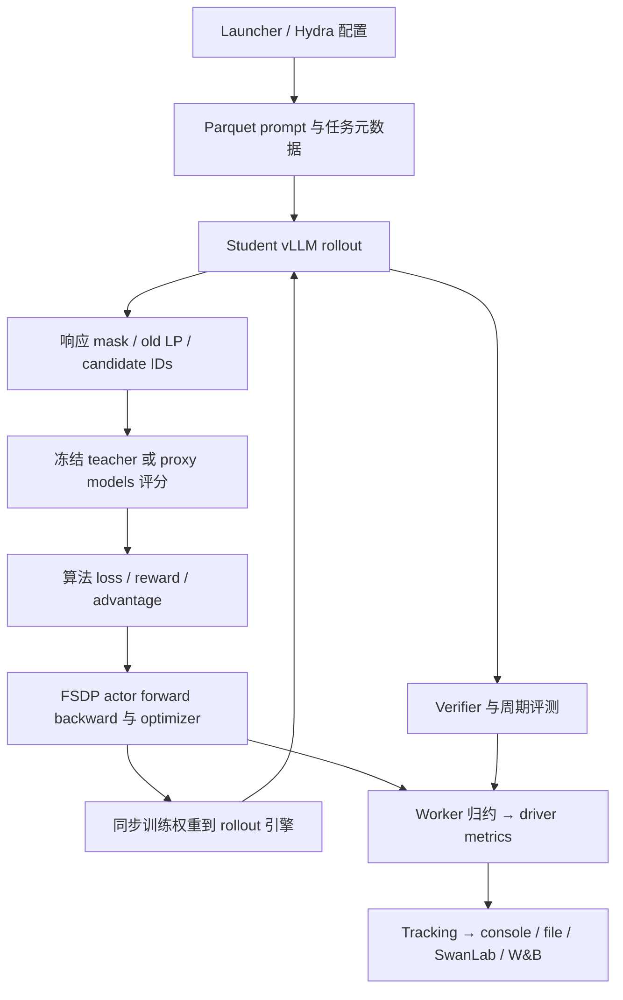

# 六个 OPD 项目训练架构与日志指标比较

## 阅读结论与核验范围

六个项目都复用 verl 的分布式生命周期，但算法接入点有三类：ResOPD/TA-OPD 将教师稀疏评分送入 logits loss 接口，Rethinking-OPD/One-Shot-OPD 将教师评分变成 reward/advantage 后进入 PPO，LSPD 在 actor 中直接回归教师 log-prob。A2-OPD 在 PPO 路径上增加四模型相对评分、异构更新编排和可选 controller。共享 trainer 生命周期不代表共享 objective、采样合同或日志语义。

本文依据 2026-10-12 的固定本地源码，逐项跟踪 launcher → trainer → rollout → teacher scoring → actor loss → metric reduction → Tracking.log。没有下载作者在线 W&B history，没有运行六个项目的完整训练。因此“可上传指标”表示代码路径可到达 logger，并列出条件；它不声称作者的某个云端 run 已经产生该字段。

| 项目                            | 完整 HEAD                                  | 工作树 | 核验主入口                                                | 主入口默认 logger                                 |
| ------------------------------- | ------------------------------------------ | ------ | --------------------------------------------------------- | ------------------------------------------------- |
| ResOPD[^res-source]             | `3bdf019daf9818419fe38dbc6516e41ca5a70dcb` | clean  | `examples/resopd/run_resopd.sh`                           | console                                           |
| TA-OPD[^ta-source]              | `62669afb5101bfdf57dc5ddf81e78f000c5ce2fc` | clean  | `train.sh`                                                | console                                           |
| Rethinking-OPD[^rethink-source] | `ac26e38d6f1572eb027597b48a9f4e01f6915ef8` | clean  | `on_policy_distillation.sh`                               | console + SwanLab                                 |
| A2-OPD[^a2-source]              | `d6cf55ce2be5d9a525a602ed39afcd209498e1f0` | clean  | `scripts/a2opd_math.sh` / `a2opd_code.sh`                 | console + W&B                                     |
| One-Shot-OPD[^oneshot-source]   | `6b6b1782cc3f04749dd077de19353f839f6bc048` | clean  | `recipe/opd.sh` / `mopd.sh`                               | 有 SwanLab key 时 console + SwanLab，否则 console |
| LSPD[^lspd-source]              | `e65cd1281371b7fbe9e44dd1de1180fda02c4a6f` | clean  | `train_lspd.sh` / `train_lspd_rb.sh` → `scripts/train.py` | console + file                                    |

这里的 TA-OPD 是无 MirrorOPD 补丁的原始 checkout，不能将我们自己的 `mirror/*`、inner logger 或三对 overlap 归入作者实现。One-Shot 也与邻仓 MD-OPD 的后续修改分开。旧[上游审阅](2026-10-11-上游OPD与KLPO代码审阅.md)曾包含本地修改的 TA 工作树，本文按上表重新固定边界。

版本、关键源码 SHA-256、各 `metric_utils.py` 的静态字段和共同集合保存在[来源核验记录](../../results/analysis/2026-10-12-six-opd-source-metrics-audit.json)。[字段位置索引](../../results/analysis/2026-10-12-six-opd-metric-source-index.json)保留 literal 和动态模板，包含未启用分支；它用于定位源码，实际可达性以本文表格为准。所有设置仍应以一次运行的 resolved config 为最终依据。

统一符号、逐步kernel伪代码、算法分类和实现前的决策表见[OPD统一伪代码与算法决策分类](2026-10-12-OPD统一伪代码与算法决策分类.md)。

## 共同执行链与架构分界

### 主链路

每轮 prompt 先由 student 生成，再对已访问的 prefix 和动作进行 teacher forcing 评分。教师通常不在主蒸馏步骤生成替代答案。生成、评分、训练和同步的服务可以并发；`async` agent/server 命名本身不证明跨 outer 采用 stale-policy 异步训练。

| 维度           | ResOPD                                     | TA-OPD                                    | Rethinking                              | A2                                              | One-Shot                                   | LSPD                                        |
| -------------- | ------------------------------------------ | ----------------------------------------- | --------------------------------------- | ----------------------------------------------- | ------------------------------------------ | ------------------------------------------- |
| 算法接入       | distillation registry + 独立 tensor kernel | registry + logits processor               | teacher reward + candidate PPO          | 四模型 prep + 专属 OPD actor/controller         | OPD mixin + teacher worker + PPO           | actor 直接调用 regression kernel            |
| 教师执行       | 独立 vLLM teacher pool                     | 独立 vLLM teacher pool                    | FSDP causal LM 的 RewardModel role      | target base / proxy expert / proxy base scoring | FSDP teacher，与 actor pool 共置并 offload | frozen RewardModelWorker，独立 teacher pool |
| 主要支持       | teacher Top-K + 实际动作                   | teacher Top-K + 聚合 tail；SC 另需动作    | student/teacher/intersection/union 候选 | student candidate set；支持跨 tokenizer 映射    | sampled；可选 student Top-K reward/metric  | sampled；可选 candidate regression          |
| 默认训练形式   | 停止系数的校正梯度                         | direct coarse reverse KL                  | PPO clipped candidate surrogate         | state-centered relative utility + PPO           | sampled teacher-gap + PPO                  | Huber log-prob regression + entropy         |
| 回放           | 发布入口单次 batch 更新                    | SC 有行为 LP correction；非 replay buffer | 主入口新 rollout 更新                   | 编排 OPD/GRPO schedule，非 LSPD FIFO            | 主入口新 rollout 更新                      | RB 明确 CPU FIFO replay                     |
| 内部更新可见性 | outer 汇总                                 | outer 汇总                                | outer 汇总                              | driver cycle + actor RPC count                  | outer 汇总                                 | outer 汇总；RB 内部更新再归约               |

### 主入口设置对照

这些值是固定源码中的代表性发布入口，而不是六项目的公平 benchmark。模型规模、任务、GPU 划分、响应预算、评测协议和更新次数均不同。

| 项目       | 代表模型 / GPU 组织                                                | 训练生成与 batch                                                   | 主要算法设置                                                    | 评测入口特点                                        |
| ---------- | ------------------------------------------------------------------ | ------------------------------------------------------------------ | --------------------------------------------------------------- | --------------------------------------------------- |
| ResOPD     | Qwen3.5-4B → 27B；4 student + 4 teacher GPU                        | batch8、n1、mini8、epochs1；prompt1024/response2048                | teacher K4、lr1e-6、full-support sampling、无额外 PG/KL/entropy | 发布脚本不测初始；框架默认 greedy n1                |
| TA-OPD     | Qwen3-1.7B → 30B-A3B；6 student + 2 teacher GPU                    | batch72、n4、mini36；prompt1024/response7168                       | K16、lr1e-6、默认 TA；teacher TP1                               | 初始验证；默认 val n1、T0.7、top-p0.95              |
| Rethinking | launcher 指定 student/teacher；8 GPU Slurm 模板                    | n4、K16、mini64；batch由并行参数生成；response7168                 | only_stu、student_p、lr1e-6、PPO                                | 默认 test_freq=-1；主要使用独立离线生成/判分        |
| A2         | target Qwen3-8B、proxy expert/base Qwen3-4B；8 GPU、rollout TP2    | batch1024、n1、mini1024；response16384                             | K16、state baseline、lr1e-6、seq-mean-token-mean                | 初始验证关闭；每10步测试；默认 n16、T1              |
| One-Shot   | recipe 可切单/多 teacher 与任务                                    | one-shot 题目重复成 batch，仍持续 student rollout；默认训练 Top-K0 | token_reward_direct + vanilla PPO，额外 KL关闭                  | 数学 recipe 默认 n16、T0.7、top-p0.9、response31744 |
| LSPD       | student/teacher 受 preflight 合同限制；默认2 actor + 2 teacher GPU | 64 prompt × n4；普通版4 updates/outer；RB256 updates/outer         | 默认 Huber阈值5、entropy0.1、sampled Top-K0                     | n16、T0.7、top-p0.95、response7168                  |

ResOPD README 表格的 response32768 与实际 launcher2048不同，本文采用 launcher。TA dataclass 的 clamp 默认值也被 Hydra distillation YAML 的 null 覆盖，发布入口实际不启用该 clamp。类默认值、配置文件和 CLI 覆盖必须沿实际链路核对。

## 符号与训练量

沿用书稿的 $\pi_{k,n}$、$\pi_k$、$\pi_T$：分别是当前 student、冻结 rollout snapshot 和 teacher。固定已访问 prefix $s$，简记 $p=\pi_{k,n}(\cdot\mid s)$、$b=\pi_k(\cdot\mid s)$、$t=\pi_T(\cdot\mid s)$，动作记 $a$，score 为 $\psi(a)=\nabla\log p(a)$。A2 的 proxy 与 base 分布另定义，不能全部塞进 teacher 角色。

下文表格同一单元格中无斜线的简写继承首项的 namespace，花括号展开为并列字段；这些模板不是 W&B 自动生成的统一 schema。

Top-K 诊断集合记 $H^S=\operatorname{TopK}(p)$、$H^T=\operatorname{TopK}(t)$；实际 loss 使用的支持集记 $S$ 或 $C$。原生 Top-K、训练 candidate set、采样 top-k 截断和 KL 的 tail partition 是不同对象。

令有效 prefix/token 数为 $M$，响应条数为 $B$，第 i 条有效响应长度为 $T_i$。global token mean 使用 $1/M$；sequence-mean-token-mean 使用 $B^{-1}\sum_iT_i^{-1}\sum_t$；candidate sum 后再 token mean 与 candidate mean 也不同。日志比较需要同时给出这些分母。

## ResOPD：稀疏教师评分与事件控制梯度

### pipeline 和维护位置

发布脚本调用 `verl.trainer.main_ppo`，Ray driver 初始化 student 与独立 teacher 服务。student 生成完成后，agent loop 通过 teacher manager 对完整 student 序列查询 teacher prompt log-probs，返回 teacher 原生 Top-K IDs/LP，以及实际动作的 teacher LP。动作在 Top-K 外时也必须评分。

actor 使用完整 student logits 计算所需概率，FSDP adapter 处理 packed/nested 布局，纯 PyTorch `resopd_loss` 返回逐 token backward surrogate 和诊断。collector 恢复 padding、应用 response mask；engine 做 loss 全局缩放与 worker metric 归约；driver 同步 rollout 权重，最后一次性上传 outer 记录。

关键源码是 [`resopd.py`](../../upstream/ResOPD/verl/trainer/distillation/resopd.py)、[`distillation/losses.py`](../../upstream/ResOPD/verl/trainer/distillation/losses.py)、[`teacher_manager.py`](../../upstream/ResOPD/verl/experimental/teacher_loop/teacher_manager.py)与 [`ray_trainer.py`](../../upstream/ResOPD/verl/trainer/ppo/ray_trainer.py)。独立 kernel 对数学验证友好，layout、服务和训练调度仍留在 verl。

### 梯度与 forward value

取 $S=H^T$，定义 $x_a=\log(p_a/t_a)$、$P_S=\sum_{a\in S}p_a$、$\tau_p=1-P_S$、$\tau_t=1-\sum_{a\in S}t_a$。令

$$
H_g=\sum_{a\in S}p_ax_a\psi(a),\qquad \mu_B=\log(\tau_p/\tau_t)\nabla\log\tau_p.
$$

其事件控制梯度写成

$$
\widehat g=H_g+\tau_p\mu_B+1[a\notin S]\bigl(x_a\psi(a)-\mu_B\bigr),\qquad a\sim p.
$$

对当前完整 student 分布取期望，最后两项的控制部分消去，得到完整 reverse-KL gradient。发布入口限制 full-support sampling、一个全 batch optimizer 更新，保护这一采样条件；多 inner 或截断采样需要另加合同。

代码用 `head_hit-P_S` 实现中心化事件，并分开 forward value 与 backward surrogate。forward 是 head-hit 时条件 head log-ratio 均值、tail-hit 时 sampled log-ratio，单点可以为负。`actor/distillation/loss` 不是确定性 head-tail KL。tail 的 dtype epsilon guard 也要与理想公式的边界区分。

### 实际蒸馏指标

以下完整名称已包含 driver 追加的 `actor/`。

| 最终上传 key                               | 定义与条件                                                  |
| ------------------------------------------ | ----------------------------------------------------------- |
| `actor/distillation/loss`                  | 训练归约后的 forward 估计值；其 backward 为 ResOPD 梯度程序 |
| `actor/distillation/loss_min`、`loss_max`  | 有效 token 上 forward value 的极值                          |
| `actor/distillation/student_mass`          | student 在 teacher 支持 $S$ 上的概率质量均值                |
| `actor/distillation/teacher_mass`          | teacher 在自身支持 $S$ 上的质量均值                         |
| `actor/distillation/resopd_head_hit`       | $1[a\in S]$ 的均值                                          |
| `actor/distillation/resopd_centered_event` | $1[a\in S]-P_S$ 的均值；理想当前分布下期望0                 |
| `actor/distillation/resopd_tail_log_ratio` | $\log(\tau_p/\tau_t)$ 的均值，含数值 guard                  |

默认 `resopd` collector 不输出 overlap、mass extrema 或 `sample_correction`。仓库存在其他蒸馏模式的这些字段，不能因此归入 ResOPD 默认指标。诊断先取每 micro-batch 有效 token 均值再框架归约；loss 的 global scaling 不自动保证诊断也是全 token sum/count 归约。

## TA-OPD：分区 KL 与采样尾部校正

### pipeline 和三种主要模式

TA 主链与 Res 相近：独立 vLLM teacher 查询 student 已生成序列，输出真实 teacher IDs/LP；actor logits processor 先产生逐 token 蒸馏量，随后 loss registry 聚合并与可选任务项组合。框架初始化 checkpoint 后先同步 rollout，默认在训练前验证 student，然后从 global step1开始更新。

源码分界是 [`distillation/losses.py`](../../upstream/TA-OPD/verl/verl/trainer/distillation/losses.py)的 registry/collector、[`fsdp/losses.py`](../../upstream/TA-OPD/verl/verl/trainer/distillation/fsdp/losses.py)的概率与梯度程序，以及 teacher/agent 服务。稀疏 teacher payload 降低通信量，student full normalizer 仍然存在。

令 $S=H^T$。三个公开模式的对象如下。

| 模式                         | 优化或梯度对象                                                    | 额外输入                                                      |
| ---------------------------- | ----------------------------------------------------------------- | ------------------------------------------------------------- |
| `normalized_reverse_kl_topk` | 对 $p(\cdot\mid S)$ 与 $t(\cdot\mid S)$ 的 conditional reverse KL | teacher Top-K                                                 |
| `taopd_reverse_kl_topk`      | $S$ 中各 token 与一个聚合 tail 的 coarse reverse KL               | teacher Top-K                                                 |
| `sample_corrected_ta_opd`    | coarse score 程序加 sampled within-tail correction                | teacher Top-K、实际动作 teacher LP、direct 路径的 behavior LP |

默认 TA 目标是

$$
L_{\mathrm{TA}}=\sum_{a\in S}p_a\log(p_a/t_a)+\tau_p\log(\tau_p/\tau_t).
$$

它遗漏 tail 内部的条件 KL：

$$
\operatorname{KL}(p\Vert t)=L_{\mathrm{TA}}+\tau_p\operatorname{KL}(p(\cdot\mid S^c)\Vert t(\cdot\mid S^c)).
$$

SC 模式使用 sampled correction 补梯度，direct 分支有当前 action / behavior action ratio，代码没有为该 ratio 输出专属 ESS。它与框架的 rollout/FSDP mismatch correction 分开。

### 实际指标与分支条件

| 最终上传族                                                          | 默认 TA | normalized / unnormalized | SC-TA | 定义                                                |
| ------------------------------------------------------------------- | ------- | ------------------------- | ----- | --------------------------------------------------- |
| `actor/distillation/loss`、`loss_min`、`loss_max`                   | 有      | 有                        | 有    | 模式对应 forward loss/估计值及极值                  |
| `actor/distillation/{student,teacher}_mass`                         | 有      | 有                        | 有    | 两策略在 teacher 原生 head 上的质量                 |
| `actor/distillation/{student,teacher}_mass_{min,max}`               | 有      | 有                        | 无    | head mass 极值                                      |
| `actor/distillation/overlap_ratio`                                  | 有      | 有                        | 有    | 原生 student/teacher Top-K 的 $I/K$                 |
| `actor/distillation/overlap_token_advantage`                        | 有      | 有                        | 有    | 非空交集 prefix 上的负 forward-KL 单 token 贡献诊断 |
| `actor/distillation/sampled_outside_topk_frac`                      | 无      | 无                        | 有    | 实际动作不在 teacher head 的比例                    |
| `actor/distillation/sample_correction`                              | 无      | 无                        | 有    | SC forward scalar 减 stopped coarse scalar 的均值   |
| `actor/distillation/cov_student_log_student{,_min,_max}`            | 无      | 有                        | 无    | head 权重与 student log-prob 的协方差式诊断         |
| `actor/distillation/cov_student_log_teacher{,_min,_max}`            | 无      | 有                        | 无    | head 权重与 teacher log-prob 的协方差式诊断         |
| `actor/distillation/cov_student_minus_teacher_residual{,_min,_max}` | 无      | 有                        | 无    | 上面两个量之差                                      |
| `actor/distillation/tail_weighted_cov{,_min,_max}`                  | 无      | 有                        | 无    | head/tail mass 加权的残差诊断                       |

上表 `{,_min,_max}` 展开为三个具体名称。normalized 模式令 $h_a=p_a/P_S$、$j_a=t_a/T_S$，其中一个协方差式量为

$$
C_{sp}=\sum_a h_a^2\log h_a-\left(\sum_a h_a^2\right)\left(\sum_a h_a\log h_a\right).
$$

teacher 对应量把 $\log h_a$ 换成 $\log j_a$；residual 为二者差，tail-weighted 项为 $P_S(1-P_S)$ 乘 residual。unnormalized 分支使用不同的原始 head 权重，字段同名不保证与 normalized 数值直接可比。这些量也不是参数梯度的实测 covariance。

默认 TA/coarse 与 SC 的 overlap-token 诊断在交集上使用原始 full-normalized 概率；normalized 路径使用 head 重新归一化后的概率。固定某 prefix，默认路径的诊断形式是

$$
-\frac1{\lvert H^S\cap H^T\rvert}\sum_{a\in H^S\cap H^T}t_a\log(t_a/p_a).
$$

随后只在交集非空的 prefix 上平均。它不是 score-function 前面的训练 coefficient，也不是完整 forward KL。

默认 direct TA 路径仍先计算 PPO 诊断再将任务 policy loss 置零，所以 `actor/pg_loss`、clipfrac、ppo_kl 的出现不证明 PPO 参与优化。Res direct 路径已跳过这段无用计算。当前 SC + `use_policy_gradient=True` 非默认路径存在对 None behavior LP 调用 `.detach()` 的问题，不能列为验证通过的支持组合。

## Rethinking-OPD：真实候选集合与候选 PPO

### pipeline 与支持集

主脚本调用 Ray PPO trainer。actor/FSDP 先给出 old student LP 与原生 student Top-K；causal teacher 通过 RewardModelWorker 返回 teacher 原生 IDs、teacher 在 student IDs 上的 LP 和 membership mask。teacher-only 或 union 路径还取得 student 在 teacher IDs 上的概率，形成真实 candidate set，再计算 reward/advantage 与 PPO 更新。

主结构位于 [`fsdp_workers.py`](../../upstream/Rethinking-OPD/verl/verl/workers/fsdp_workers.py)、[`dp_actor.py`](../../upstream/Rethinking-OPD/verl/verl/workers/actor/dp_actor.py)、[`core_algos.py`](../../upstream/Rethinking-OPD/verl/verl/trainer/ppo/core_algos.py)和 [`ray_trainer.py`](../../upstream/Rethinking-OPD/verl/verl/trainer/ppo/ray_trainer.py)。默认 student/teacher 同温度1，完整采样，teacher 冻结；训练权重通过 actor worker 的 rollout-mode 切换发布给 vLLM。

与本地 MD-OPD 的不完整 candidate 路径不同，这个固定 Rethinking checkout 确实构造 teacher-only 与去重 union。union 张量可达2K宽，teacher部分重复 IDs 用 mask 排除。 进一步核对复用路径发现，only_tch虽然传递teacher IDs，却未传相同IDs上的old cross LP；其多更新分支可退回student-slot LP。单次更新路径避开该错配，teacher-only集合构造与任意reuse安全性须分别验收。

候选贡献为

$$
A(a)=w_C(a)[\log t_a-\log b_a],\qquad a\in C.
$$

常规 student_p/teacher_p 权重在 $C$ 上归一化，none 为均匀权重；`union-intersection` 表示对称差，却使用 `normalize=False` 的原始权重。因此切换集合策略还改变权重尺度。该 helper 的 `kl_estimator` 参数没有实际改变 log-ratio 算式。

每个 candidate 的 current/old ratio 经 PPO clipping 后对 K 求和，再做 token/sequence 归约。它与直接对 conditional KL autograd 不同。主脚本默认关闭内部周期验证，使用独立 vLLM 生成与 grade 程序评估保存的模型；仓库附带 SFT、rejection sampling、GKD 与 GRPO 路径，本文不把这些日志混入主 OPD。

### Top-K 训练诊断字段

下列名称不追加 actor 前缀。**`val-topk` 和 `val-extrema` 实际来自训练 rollout 的更新前诊断。** 有字段名字并不代表它来自测试集。

| 最终 key / 模板                                                                     | 定义与条件                                                     |
| ----------------------------------------------------------------------------------- | -------------------------------------------------------------- |
| `val-topk/overlap_ratio`                                                            | 有效 prefix 上 $I/K$，非 Jaccard                               |
| `val-topk/adv_intersection`、`adv_only_stu`、`adv_only_tch`                         | 相应集合内有效 candidate 的加权 A 均值；集合非空且对应概率可得 |
| `val-topk/{student,teacher}_p_sum_intersection`                                     | 每非空交集 prefix 上先加原始概率，再平均                       |
| `val-topk/max_student_p_intersection`                                               | 每非空交集 prefix 的最大 student 概率，再平均                  |
| `val-topk/{teacher_p,adv}_at_max_student_intersection`                              | 上述同一个 candidate 的 teacher 概率或 A                       |
| `val-topk/max_teacher_p_intersection`                                               | 每非空交集 prefix 的最大 teacher 概率，再平均                  |
| `val-topk/{student_p,adv}_at_max_teacher_intersection`                              | 上述同一个 candidate 的 student 概率或 A                       |
| `val-extrema/{max,min}_adv_{intersection,only_stu,only_tch}`                        | 每个 prefix 的集合内 A 极值，再对非空 prefix 平均              |
| `val-extrema/{student,teacher}_p_at_{max,min}_adv_{intersection,only_stu,only_tch}` | A 极值 candidate 上的原始概率，再平均                          |
| 上述族的 `_chunk_{start}_{end}` 后缀                                                | 按每1024个 response 位置切段重算；不是另一测试 split           |

这些 extrema 表示“逐 prefix 极值的平均”，不能当 batch 全局极值。symmetric-difference 训练时，overlap 仍观察原生两集合的交集，说明诊断集合与训练集合确实分开。

训练数据统计另有 `critic/true_reward/{mean,max,min}` 和更细的 `critic/advantages/*`：`abs_mean`、`abs_max`、`std`、`extreme_count`、`direct_{mean,max,min}`、`mean_overall`、`mean_sum_over_k`，以及动态 `mean_first_{cutoff}` / `direct_mean_first_{cutoff}`。部分 mean 排除零，3D max/min 又可能包含零槽；与四个较新 verl 路径的 mask 均值不同。

### SwanLab 图像与 W&B 支持

`viz/candidate_counts`、`viz/overlap_ratio_student`、`viz/overlap_ratio_teacher` 在第1步及每10步构造 `swanlab.Image` 后进入 Tracking。额外 `is_plot` 分支还直接 `swanlab.log` teacher entropy/advantage scatter 和均值 line 图，绕过 Tracking。

所以切 logger 为 W&B 可以转发通用标量，但这些 SwanLab 对象和直连图像没有自动变成 W&B artifact 的合同。README 提到官方 verl 的 `distillation/overlap_ratio` 与这里主实现的 `val-topk/overlap_ratio` 也要分开。

## A2-OPD：四分布相对信号与可选自适应

### pipeline 与四模型评分

定义当前 target $P$、固定 target base $B_0$、proxy expert $E$ 和 proxy base $F$。target base 是初始化 target snapshot，proxy expert/base 定义要转移的能力变化。主数学脚本先启动独立 HTTP verifier server，再由 Ray trainer 生成 student 回答和任务正确率。

trainer 按 prompt group 的 all-correct/mixed/all-wrong 划分候选，GRPO 消费 mixed，OPD 消费 student rows。schedule 决定 OPD/GRPO/both/alternate/warmup；默认 GRPO关闭且 n1，不能把 `update_mode=both` 解读为默认训练两种 loss。

both模式中GRPO先更新，OPD随后准备的old scorer可能已不同于生成时student。OPD prep 在同一 prefix 和 candidate IDs 上收集四分布的 LP，构造 frozen utility、baseline 和候选 contribution；专门 `update_policy_opd` 做 PPO 更新，再把控制器统计和阶段指标送给 driver。主要边界是 [`a2opd_utils.py`](../../upstream/A2-OPD/verl/verl/trainer/ppo/a2opd_utils.py)、[`a2opd_controller.py`](../../upstream/A2-OPD/verl/verl/trainer/ppo/a2opd_controller.py)、[`dp_actor.py`](../../upstream/A2-OPD/verl/verl/workers/actor/dp_actor.py)与 [`ray_trainer.py`](../../upstream/A2-OPD/verl/verl/trainer/ppo/ray_trainer.py)。

跨 tokenizer 路径使用 text-span bridge 和 candidate 翻译，交会后的有效 mask 才能进入概率比较；Top-K 可要求至少两个可翻译候选。数值 token ID 不能跨词表直接比较。

### utility、KL 与 controller

默认 $C$ 是 target student Top-K。令 old target 为 $P_0$，定义

$$
d_a=\log E_a-\log F_a,\qquad u_a=d_a-\lambda(\log P_{0,a}-\log B_{0,a}).
$$

在 $C$ 上重新归一化后，state baseline 与 contribution 是

$$
b_C=\sum_{a\in C}P_{0,C}(a)u_a,\qquad A_a=P_{0,C}(a)(u_a-b_C).
$$

proxy KL、anchor KL、transfer KL 与 transfer gap 都是同一个 $C$ 上重新归一化的 categorical KL，没有 aggregate tail：

$$
K_{proxy}=\operatorname{KL}(E_C\Vert F_C),\qquad K_{anchor}=\operatorname{KL}(P_{0,C}\Vert B_{0,C}),
$$

$$
G_C=\operatorname{softmax}(\log B_0+d),\qquad K_{transfer}=\operatorname{KL}(G_C\Vert B_{0,C}),\qquad K_{gap}=\operatorname{KL}(P_{0,C}\Vert G_C).
$$

K=0 sampled 分支使用单动作 k3 式量；由于样本来自 target，proxy KL 数值不能自动获得 proxy-distribution 下的无偏性。

[`algorithm/a2opd.yaml`](../../upstream/A2-OPD/verl/verl/trainer/config/algorithm/a2opd.yaml)默认 enable=true，但 adaptive budget、dual lambda 和 token emphasis 全部关闭。可选功能分别为：proxy/transfer/额外验证 reward 更新预算；根据 anchor-KL/budget 更新 lambda；根据候选 utility 方差给 token 重新加权。`token_sampling` 当前是 mask 权重，不是随机丢弃 token。

dual 更新形式为

$$
\lambda_{next}=\operatorname{clip}\left(\lambda\exp[\eta_\lambda(K_{anchor}/\mathcal B-1)]\right).
$$

该输入 KL 来自更新前 old target，日志中的新 lambda 面向下一次更新，同一记录不意味着同一状态。

### 最终 W&B 字段

worker 结果经 `merge_worker_metrics(prefix='opd')` 后实际为 `opd/actor/*`；driver 的 `a2opd/*` 和 `hetero/*` 保持名称。默认 OPD hetero 路径没有完整调用公共 `compute_data_metrics`，不能把它拥有的35个公共代码字段全部列为默认产物。

| 最终 key / 族                                                                                                                                  | 触发条件与解释                                             |
| ---------------------------------------------------------------------------------------------------------------------------------------------- | ---------------------------------------------------------- |
| `a2opd/proxy_kl`、`proxy_kl_ema`                                                                                                               | OPD准备启用；EMA输入经过预算范围的正值处理                 |
| `a2opd/target_transfer_kl`、`transfer_gap`                                                                                                     | Top-K>1；上面的 candidate categorical KL                   |
| `a2opd/anchor_kl`                                                                                                                              | old target 对固定 target base 的 KL                        |
| `a2opd/budget`、`lambda`                                                                                                                       | controller当前值；自适应关闭也可有固定值                   |
| `a2opd/budget_adaptive_source`                                                                                                                 | proxy=0、transfer=1、valreward=2；编码存在不代表启用自适应 |
| `a2opd/anchor_kl_ratio`                                                                                                                        | dual启用且budget就绪，$K_{anchor}/\mathcal B$              |
| `a2opd/budget_reward`、`budget_reward_delta`、`budget_reward_snr`                                                                              | val-reward自适应；delta/SNR需至少两次reward                |
| `a2opd/token_importance_mean`                                                                                                                  | token emphasis开启；候选 utility 方差均值                  |
| `a2opd/advantage_std`、`advantage_abs_mean`                                                                                                    | driver在有效prefix的K维A上统计，零无效槽仍影响分母         |
| `a2opd/topk_overlap_target_vs_base_ratio`                                                                                                      | target/base原生IDs可得；$I/K$                              |
| `a2opd/topk_overlap_target_vs_teacher_ratio`                                                                                                   | target/proxy expert；跨词表时需有效映射                    |
| `a2opd/topk_overlap_target_vs_teacher_base_ratio`                                                                                              | target/proxy base；映射条件同上                            |
| `a2opd/topk_overlap_teacher_vs_teacher_base_ratio`                                                                                             | proxy expert/base；要求共同 action space                   |
| `opd/actor/opd_loss`、`opd_weighted_loss`                                                                                                      | PPO backward surrogate；默认weight1，两者相等              |
| `opd/actor/opd_student_log_prob`、`opd_teacher_log_prob`、`opd_teacher_base_log_prob`、`opd_teacher_delta_log_prob`                            | 3D路径先sum K后agg，并受loss scale影响；不是单动作LP均值   |
| `opd/actor/opd_topk`                                                                                                                           | 当前candidate张量K                                         |
| `opd/actor/opd_advantages_{mean,std,max,min,abs_mean,positive_frac,negative_frac}`                                                             | worker先sum K再统计prefix，含中心化消去                    |
| `opd/actor/{pg_clipfrac,ppo_kl,pg_clipfrac_lower}`                                                                                             | current/old PPO诊断；不是teacher KL                        |
| `opd/actor/{grad_norm,lr}`                                                                                                                     | OPD更新的优化器量                                          |
| `opd/actor/opd_cross_token_mask_ratio`                                                                                                         | cross-token mask存在时的有效覆盖率                         |
| `opd/actor/a2opd_token_emphasis_mean`                                                                                                          | token emphasis开启                                         |
| `opd/entropy_mean`、`opd/top_k`                                                                                                                | 更新前target entropy与配置K                                |
| `opd/memory/{max_allocated_gb,max_reserved_gb,cpu_used_gb}`                                                                                    | 专属OPD worker的allocator peak和整机CPU used               |
| `hetero/student_{all_correct,mixed,all_wrong}_group_count`                                                                                     | 任务正确率分组计数                                         |
| `hetero/{grpo,opd}_candidate_group_count`、`hetero/opd_candidate_row_count`                                                                    | 分支可用组/行数                                            |
| `hetero/student_response_length_mean`、`student_rollout_correct_mean`、`student_rollout_correct_std`、`student_rollout_correct_group_mean_std` | 学生任务/长度统计                                          |
| `hetero/update_phase_is_{grpo,opd}`                                                                                                            | schedule phase编码；both时两个值都为false                  |
| `hetero/{grpo,opd}_skip_{no_candidate,by_schedule}`                                                                                            | 相应跳过分支发生才出现                                     |
| `training/{actor,grpo,opd}_update_steps`                                                                                                       | 成功actor更新RPC次数，不是内部optimizer steps              |
| `critic/score/{mean,std,max,min}`、`critic/rewards/mean`、`grpo/rollout_correct_group_mean_std`                                                | driver直接写任务正确率；没有critic也出现                   |
| `a2opd-val/{original-val-key}`                                                                                                                 | 额外budget验证loader和val-reward source开启                |

额外 GRPO 分支启用后有 `grpo/actor/grpo_pg_loss`、`grpo/actor/grpo_advantages_*`、`grpo/actor/{grad_norm,lr,pg_clipfrac,ppo_kl,pg_clipfrac_lower}` 和 `grpo/entropy_mean`。纯 GRPO非hetero路径另回填普通 `actor/*` aliases；不要把这些条件字段混入默认 OPD。

独有时间族包括 `timing_s/opd_{actor_load,actor_forward,base_forward,ref_forward,base_ref_forward,proxy_parallel_wall,ref_models_wall,actor_offload,prepare_total}` 与 `timing_s/update_policy_opd`。`timing_s/opd_student_base_parallel_enabled` 和 `timing_s/opd_actor_param_offload` 实际是布尔值，通用 namespace 重命名将它们放进 seconds 类，不能按秒解释。

跨词表还输出 `hetero/cross_token_topk_{translatable_candidate_ratio,translatable_prob_mass,min2_candidates_ratio}` 和 ref-axis 对齐覆盖模板；完整位置见字段索引。独立 distribution-KL eval 输出 JSON/CSV/文本，没有沿主 Tracking 上传。定义但未调用的 `_add_topk_overlap_metrics` 中 intersection/union/top1 字段也不属于现有训练日志。

### 中心化下的零均值陷阱

state baseline 保证

$$
\sum_{a\in C}A_a=\sum_aP_{0,C}(a)u_a-b_C\sum_aP_{0,C}(a)=0.
$$

worker 的 advantage 先sum K，所以该族接近零是定义结果。两个候选的 $A=(0.5,-0.5)$ 也有零和，但 $-\sum_aA_a\nabla\log P_a$ 可以非零。检查学习和收敛应看 candidate-level RMS、更新梯度、transfer gap与任务质量，不能只看 worker 的 sum-K mean/std。

## One-Shot-OPD：单题协议、teacher routing 与 PPO

### pipeline 和模块

recipe 层准备任务、单题/full/template数据和 teacher 路由，公共脚本构造 Hydra 参数。actor 使用较新的 engine worker，teacher 在相同 resource pool 初始化并参数 offload；多teacher按 ability分组评分，再按原row index scatter回来。

一次 outer 为 student rollout → old student LP → verifier outcome → teacher在student action上的LP → dense teacher reward → direct token advantage → PPO actor update → CheckpointManager权重同步 →周期验证与日志。原 verifier 另存在 `true_token_level_scores`，但实际 `compute_data_metrics` 的 `critic/score` 仍读已覆盖的 `token_level_scores`；保留字段的注释不能替代 consumer 核验。

主要边界是 [`opd_trainer_mixin.py`](../../upstream/One-Shot-OPD/verl/verl/trainer/ppo/opd_trainer_mixin.py)、[`fsdp_teacher_worker.py`](../../upstream/One-Shot-OPD/verl/verl/workers/fsdp_teacher_worker.py)、[`opd_core_algos.py`](../../upstream/One-Shot-OPD/verl/verl/trainer/ppo/opd_core_algos.py)和 actor [`losses.py`](../../upstream/One-Shot-OPD/verl/verl/workers/utils/losses.py)。

one-shot 指数学单题重复成批，仍每轮生成新的 student response。template模式让student先写输入，内容过滤后训练，限单teacher；多teacher MOPD按math/code/instruction following路由，与Mirror算法中的Mean/BPO/MDPO名称无关。

### sampled 与 Top-K 训练形式

默认信号为

$$
A_t=\log\pi_T(a_t\mid s_t)-\log\pi_{old}(a_t\mid s_t).
$$

默认没有baseline/discount，随后进入 PPO ratio/clipping，而不是直接 $-\operatorname{sg}(A)\log p$。额外 GRPO task advantage 是另一可选 estimator。主recipe的 `LOG_PROB_TOP_K` 与 `METRIC_TOP_K` 默认都0：前者开启3D候选reward，后者只测支持集而继续训练sampled reward。

Top-K reward路径要求单epoch、一个完整optimizer batch等限制，避免当前Top-K与old槽位在更新后错配。这是保护条件，不能解读为已经具备任意多inner的冻结candidate合同。teacher-only/union所需完整交叉概率也不能由此student候选路径推断。

### 独有和条件指标

| 最终 key                                                | 定义与条件                                                                      |
| ------------------------------------------------------- | ------------------------------------------------------------------------------- |
| `opd/token_reward_mean`                                 | 全有效token teacher-gap平均；3D候选时先sum K                                    |
| `opd/teacher_logp_mean`                                 | 实际sampled action teacher LP的token均值                                        |
| `mopd/routed/{teacher}`                                 | 每teacher路由的response行数，单teacher也可有默认名称                            |
| `opd/top_k_overlap_ratio`                               | 任一Top-K用途开启；原生师生集合 $I/K$，worker scalar再归约                      |
| `opd/top_k_mode`                                        | 1=驱动训练，0=metric-only                                                       |
| `opd/top_k_student_mass`                                | student在student候选集合上的质量                                                |
| `opd/top_k_teacher_mass`                                | teacher在同student集合上的质量，非teacher原生Top-K覆盖率                        |
| `opd/top_k_reward_mean`                                 | 候选reward sum K / 有效token；metric-only也计算                                 |
| `template/valid_ratio`、`valid_count`、`rejected_count` | template生成输入的过滤统计                                                      |
| `template/reject_{reason}`                              | 动态拒绝原因计数，例如too_short、empty_response、meta_response、no_math_content |

优化字段已有 `actor/*` 时 `rename_dict` 不重复加前缀；engine的裸 `grad_norm/lr/loss` 变为 `actor/*`，资源量变成 `actor/perf/*`，mfu特判为 `perf/mfu/actor`。teacher Top-K诊断先在worker内部取scalar，再平均worker，缺token分子分母时不能恢复全局token加权值。

`variance_proxy/*` 是共享框架功能，默认recipe未开启 `calculate_sum_pi_squared`。它不是One-Shot独有算法量，也不代表实际参数梯度方差。

## LSPD：直接 log-prob 回归与 FIFO replay

### pipeline 与 loss

`scripts/train.py`执行模型/tokenizer preflight、准备配置并启动老式FSDP actor/vLLM与独立teacher RewardModelWorker。teacher EOS151645被映射到student EOS151643的共同action class；这改变教师条件分布，应与原始模型路径一起记录。

student rollout后，teacher对实际动作返回冻结LP。actor重新计算current LP与完整entropy，直接调用 [`compute_opd_squared_logprob_objective`](../../upstream/LSPD/verl/verl/trainer/ppo/core_algos.py)，不消费PPOold-LP/advantage来构造回归梯度。[`dp_actor.py`](../../upstream/LSPD/verl/verl/workers/actor/dp_actor.py)负责live forward和优化；[`replay_buffer.py`](../../upstream/LSPD/verl/verl/trainer/ppo/replay_buffer.py)负责RB轨迹采样。

定义 $\delta_{it}=\log p(a_{it}\mid s_{it})-\operatorname{sg}\log t(a_{it}\mid s_{it})$。默认Huber形式是

$$
P_c(\delta)=\begin{cases}\delta^2,&|\delta|\le c,\\2c|\delta|-c^2,&|\delta|>c,\end{cases}\qquad c=5,
$$

$$
L=\frac1B\sum_i\frac1{T_i}\sum_tP_c(\delta_{it})-0.1\frac1B\sum_i\frac1{T_i}\sum_tH(p(\cdot\mid s_{it})).
$$

可选squared和clamp是不同数值目标。sampled二维路径不再乘action概率，完整categorical采样已经提供频率权重；它仍是sampled动作回归，不是每prefix全词表精确平方积分。三维candidate路径可以使用归一化uniform/student/teacher/mixture权重，但默认Top-K0。

### 普通训练与 RB

普通版每outer为64prompt×4response，mini16prompt等价量在框架内乘n4，所以共有4次optimizer update。RB将响应、mask、模型输入与teacher LP拷贝入CPU FIFO，容量65536response行；本轮加入后立即采样，每次64行，默认256次更新，update之间重新抽样。

replay不保存behavior LP做IS，不重算teacher target；它是固定target regression的旧state/action重用。没有IS/ESS不等于没有state distribution shift。下一rollout前同步当前student到vLLM。scheduler按实际update调用推进，RB配置已据reuse次数调整计划。

### 实际字段

| 最终 key                                                           | 定义与条件                                                  |
| ------------------------------------------------------------------ | ----------------------------------------------------------- |
| `actor/opd_objective`                                              | regression penalty减entropy项，固定seq-mean-token-mean      |
| `actor/opd_squared_logprob_token_mean`                             | 实际penalty均值；默认Huber，因此字段名不总对应平方          |
| `actor/opd_student_entropy_token_mean`                             | current完整词表entropy均值，非sampled surprisal             |
| `actor/opd_entropy_coeff`、`opd_log_ratio_clip`                    | 实际entropy系数与阈值                                       |
| `actor/opd_teacher_rollout_weight`                                 | 双source混合权重；默认单source时不代表teacher生成比例       |
| `actor/opd_log_ratio_clipfrac`                                     | 阈值外比例；squared模式硬置0                                |
| `actor/opd_log_ratio_tailfrac`                                     | 各模式都测 $\lvert\delta\rvert>c$ 的比例                    |
| `actor/opd_log_ratio_abs_max_unclipped`                            | 有效candidate最大原始 $\lvert\delta\rvert$；max归约保留极值 |
| `actor/opd_sampled_full_vocab`                                     | 二维sampled路径1、三维candidate路径0                        |
| `actor/opd_topk_effective_k`                                       | 二维1；三维候选权重的 $1/\sum w^2$，非IS ESS                |
| `replay/size`、`max_size`、`trajectories_added`                    | RB当前行数、容量、本outer入队行数                           |
| `replay/batch_size`、`updates_per_rollout`、`trajectories_sampled` | 每次行数、更新RPC次数、抽样行数总和（含重复）               |
| `eval/num_training_rollouts_generated`                             | 固定batch公式 `global_steps × train_batch_size × n`         |

有source标签时另有 `actor/opd_{student_rollout,teacher_rollout}_{squared_logprob_token_mean,student_entropy_token_mean,objective,response_count}`；发布普通/RB入口默认不提供该source。`actor/opd_updates_per_rollout_batch` 只属于另一个 `opd_off_policy` loss分支，不能用它表示默认RB的256次更新。EOPD字段也是其他模式。

LSPD worker使用list metrics，归约按key含max取max、含min取min、其他取mean；RB先归约每次更新，再同样归约整个reuse窗口，lr例外保留最后值。因此mean字段仍隐藏256次内部轨迹，max字段却保留极值；不能把二者都概括成“均值之均值”。

开启W&B且 `log_eval_by_rollouts` 生效时，仅 `val-core/AMC23/*`、`AIME24/*`、`AIME25/*` 绑定到上述rollout计数轴，`step_sync=True`。MATH-500与val-aux仍使用global step。LSPD另实现实际sample集合的 `pass@N`，One-Shot当前验证分类没有对应pass分支；bootstrap `best@N` 与经验pass不能同名混写。

## 相同字段、条件字段与同名不同义

### 六仓共有的框架能力

静态检查六个 `compute_data_metrics` 得到35个共有literal key。下面按族展开；A2主hetero路径只直接写其中部分，值模型/multi-turn字段也各有条件。

| 共同字段族                                                                        | 基本定义                             | 比较限制                                             |
| --------------------------------------------------------------------------------- | ------------------------------------ | ---------------------------------------------------- |
| `training/global_step`、`training/epoch`                                          | driver cycle与数据epoch              | 不是optimizer update计数                             |
| `critic/score/{mean,max,min}`                                                     | token_level_scores沿响应求和后的统计 | One-Shot被teacher reward覆盖；A2直接写正确率         |
| `critic/rewards/{mean,max,min}`                                                   | token_level_rewards的sequence统计    | 可包含teacher signal或KL reward，非统一task accuracy |
| `critic/advantages/{mean,max,min}`、`critic/returns/{mean,max,min}`               | 所配置advantage/returns统计          | direct蒸馏/回归可能不消费它们；零过滤和3D口径不同    |
| `critic/values/{mean,max,min}`、`critic/vf_explained_var`                         | value与return统计                    | 仅use_critic；不能由critic前缀推断启用critic         |
| `response_length/{mean,max,min,clip_ratio}`                                       | 有效响应长度，等于长度上限的比例     | clip_ratio不是从finish_reason统计                    |
| `response_length_non_aborted/{mean,max,min,clip_ratio}`、`response/aborted_ratio` | 排除零长响应后的长度、零长比例       | 六仓代码都有，不能归为某一仓独有                     |
| `prompt_length/{mean,max,min,clip_ratio}`                                         | 有效prompt长度与等于上限比例         | 受各数据schema、截断与模板影响                       |
| `num_turns/{mean,max,min}`、`tool_call_counts/{mean,max,min}`                     | 多轮/tool元数据统计                  | 只有batch携带元数据才出现                            |
| `timing_s/{stage}`                                                                | marked_timer或服务返回的stage统计    | 不保证所有key单位真是秒；阶段可嵌套                  |
| `timing_per_token_ms/{stage}`                                                     | stage毫秒/对应token分母              | gen用response，常规训练stage用prompt+response        |
| `perf/total_num_tokens`、`time_per_step`、`throughput`                            | batch全有效token、outer秒、每GPU吞吐 | 不等于新增response tokens/s；不乘inner reuse         |
| `global_seqlen/*`                                                                 | 分配前后batch负载均衡统计            | 属于调度诊断，非算法性能目标                         |

公共吞吐公式为

$$
\mathrm{throughput}=\frac{\sum_i(T_i^{prompt}+T_i^{response})}{\mathrm{step\_seconds}\times N_{GPU}}.
$$

GPU分母来自所使用resource pool；独立teacher pool成本不保证自动计入。LSPD-RB同一batch训练256次也没有让上述分子自动乘256，所以此字段不足以表示训练token处理吞吐。

二维路径的 score/reward 一般沿响应维求和。三维候选路径还存在实现差异：One-Shot 先 `flatten(start_dim=1)` 再求和，得到每条响应的全部 token/candidate 总和；Rethinking/LSPD 的 helper 仍只 `sum(-1)`，输入三维时先消去 K，随后均值还会平均时间位置。例子中一条响应有两个位置，candidate贡献分别为(1,2)和(3,4)，前者序列总和为10，后者均值为5。因此 `critic/score/mean` 的“sequence score”注释不能保证三维实际统计是同一对象；padding位置也会进一步影响旧路径均值。

### 优化与显存 namespace

| 类别          | Res / TA / One-Shot                                              | Rethinking / LSPD                         | A2主OPD                                                     |
| ------------- | ---------------------------------------------------------------- | ----------------------------------------- | ----------------------------------------------------------- |
| 梯度与LR      | `actor/{grad_norm,lr}`                                           | 同左                                      | `opd/actor/{grad_norm,lr}`                                  |
| PPO诊断       | `actor/{pg_loss,pg_clipfrac,ppo_kl,pg_clipfrac_lower}`，路径条件 | 同名，但LSPD默认regression不消费PPO       | `opd/actor/{opd_loss,pg_clipfrac,ppo_kl,pg_clipfrac_lower}` |
| allocator峰值 | `actor/perf/max_memory_{allocated,reserved}_gb`                  | `perf/max_memory_{allocated,reserved}_gb` | `opd/memory/max_{allocated,reserved}_gb`                    |
| CPU used      | `actor/perf/cpu_memory_used_gb`                                  | `perf/cpu_memory_used_gb`                 | `opd/memory/cpu_used_gb`                                    |
| MFU           | `perf/mfu/actor`                                                 | `perf/mfu/actor`                          | generic分支可有；专属OPD路径不能照搬                        |

`actor/entropy`、`actor/entropy_loss` 与 LSPD 的 `actor/opd_student_entropy_token_mean` 还要区分评分时点和计算方式：old-policy forward 的完整 entropy、训练 loss 中的 entropy 项和 current-policy regression 诊断不是一个字段。A2对应 `opd/entropy_mean`。同名PPO配置也需核对实际使用值：A2候选分支读取dual-clip配置后又将 `clip_ratio_c` 固定为10，该参数不能直接按配置名进行有效消融。

allocator max通常是该PyTorch进程的历史峰值，CPU used来自整机 `psutil.virtual_memory()`；它们都不能代替全部teacher/vLLM进程的显存和主存成本。微batch/DP/更新窗口归约又取决于Metric对象或max/min/mean规则。日志中的 `actor/loss`、`actor/pg_loss` 和算法objective也不是自动同义。

### validation与生成样例

共同动态格式是 `val-core/{data_source}/{var}/{metric}` 与 `val-aux/{data_source}/{var}/{metric}`。primary var通常优先acc，否则reward；最大生成数对应的mean/majority/best进入core，其他变量和样本数进入aux，LSPD额外包含pass。A2可配置省略var层和按benchmark宏平均的math_avg，所以固定名称还要读配置。

mean@N是逐题N条评分均值后按题平均；majority/best可以涉及bootstrap子集，`/std`是子集重采样统计再跨题聚合，不能直接当均值的标准误。LSPD经验pass@N是每题至少一条正确后按题平均。A2的math_avg对benchmark宏平均，与570题合并的micro均值不同。

`val/generations` 是条件启用的Table，而非scalar；需要W&B开启和log_val_generations>0。Rethinking的SwanLab训练图像、独立离线eval文件，以及A2 distribution-KL文件是另外的输出合同。

### rollout correction、方差proxy与ESS

较新verl中的rollout/FSDP mismatch correction、IS/clip统计、speculative decode指标属于框架能力，不是TA/Res/One-Shot独有算法定义。它们按配置和实际batch字段出现。TA SC内部的tail ratio和LSPD replay也不能与这个correction混称。

Res/TA/One-Shot共享的 `variance_proxy/{proxy1_signal_strength,proxy2_total_power,proxy3_pure_noise,expected_a_squared,expected_w}` 要求 `sum_pi_squared`、old LP、advantages齐备。其基本构造为

$$
W_i=\sum_t\left[1-2b(a_{it}\mid s_{it})+\sum_vb(v\mid s_{it})^2\right],\qquad Q=\mathbb E_i[\bar A_i^2W_i].
$$

proxy1用日志grad_norm平方，proxy2用上述logit score范数式量，proxy3再作差并截非负。两种范数空间、实际distillation gradient和所用task advantages未必一致，因此不能解释为ResOPD control-variate的实测参数梯度方差。原生缺少输入时这些字段不出现，部分缺grad情况填0也不是观测到零信号。

LSPD的 `opd_topk_effective_k` 仅是候选权重有效数。真正IS ESS为 $(\sum w)^2/\sum w^2$，须声明ratio角色、有效token分母和采样测度；LSPD-RB没有IS，不能把effective_k当它的off-policy安全性指标。

### Top-K clipfrac 的分母问题

Rethinking、One-Shot和A2的候选PPO存在相同口径：values是 $[B,T,K]$，mask为 $[B,T,1]$，`masked_mean`的分子广播覆盖K，分母仍只sum prefix mask。因此日志等价于

$$
\mathrm{clipfrac}_{logged}=\frac{\sum_{i,t,a}m_{it}1[\mathrm{candidate\ clipped}]}{\sum_{i,t}m_{it}},
$$

范围为 $[0,K]$。候选比例应在分母再乘K或有效candidate计数。`ppo_kl`同样可变成候选log-ratio的和，而非概率加权KL。三仓这个同名量不能直接和sampled二维PPO的0–1 clipfrac叠图。

### overlap 的可比性

| 项目       | 主算法实际overlap                       | 支持与归约                                                |
| ---------- | --------------------------------------- | --------------------------------------------------------- |
| Res        | 默认resopd collector没有                | 不以别的mode字段补齐                                      |
| TA         | `actor/distillation/overlap_ratio`      | 师生原生等K集合 $I/K$，masked micro均值再归约             |
| Rethinking | `val-topk/overlap_ratio`                | 训练rollout上的师生 $I/K$，另有位置chunk                  |
| A2         | 四对 `a2opd/topk_overlap_*`             | target/base/proxy各角色，跨词表有映射条件                 |
| One-Shot   | `opd/top_k_overlap_ratio`               | teacher worker metric-only或reward模式，worker scalar归约 |
| LSPD       | 主sampled regression没有独立默认overlap | 继承Top-K分析代码不等于默认启用                           |

这些交集比例通常不是Jaccard，也没有同时报告macro/pooled Jaccard。head mass还必须标明“哪一个分布在谁选出的集合上求和”。overlap-token advantage、candidate weighted A和sampled score coefficient有不同公式，应保留不同名称。

## 对 MirrorOPD 统一工作的直接启示

第一方可以保留一种canonical数学定义，backend提供所需证据，reporter统一事件，而不是收集所有旧key并认为已经统一。

| 来源       | 值得保留的设计                                                | 迁入前需要调整的部分                                      |
| ---------- | ------------------------------------------------------------- | --------------------------------------------------------- |
| Res        | 纯tensor estimator、forward/backward分离、teacher动作评分要求 | scorer/proposal合同、独立梯度诊断、全局sum/count          |
| TA         | loss registry、head-tail与SC独立接口                          | 真实最终namespace、模式条件、clamp与非法组合检查          |
| Rethinking | 真实union IDs、cross LP、细粒度集合诊断                       | val-topk命名、SwanLab硬编码、候选分母与归一化变化         |
| A2         | 四角色评分、controller状态、跨tokenizer覆盖度                 | candidate-KL命名、sum-K优势、phase/measurement与RPC计数   |
| One-Shot   | sampled与metric-only分开、teacher routing、template计数       | verifier score consumer、候选身份/多inner、worker诊断归约 |
| LSPD       | 明确回归objective、entropy、replay成本、经验pass              | penalty字段命名、实际更新轴、source/长度/replay测度       |

统一日志最少记录event type、outer、真实optimizer updates、模型版本、measurement、prefix set、生成/训练/teacher token预算和评测protocol。probability量在pre/post状态上分开；资源量注明process/device/system范围。只有重新测量才填post值，未测字段保持缺失。

六项目比较质量时先统一数据、模型角色、解码和评测协议，再分别对齐新生成token、实际optimizer updates、teacher评分成本和wall time。对齐global_steps只比较采样刷新轮数，无法消除LSPD-RB的256步复用、四模型评分或独立teacher服务的成本差异。

## 源码定位与复核入口

| 项目       | 关键代码位置（本次HEAD）                                                                                                                                                                |
| ---------- | --------------------------------------------------------------------------------------------------------------------------------------------------------------------------------------- |
| Res        | `resopd.py:26`独立kernel；`distillation/losses.py:183`collector、`:261`direct路径；`ray_trainer.py:1371`actor namespace、`:1802`logger；`teacher_manager.py:116`payload                 |
| TA         | `fsdp/losses.py:35`SC、`:323`covariance、`:588`TA；`distillation/losses.py:242`聚合、`:409`诊断；`ray_trainer.py:1328`namespace、`:1750`logger                                          |
| Rethinking | `dp_actor.py:450`support、`:875`actor；`core_algos.py:1109`candidate PPO；`ray_trainer.py:1384`Top-K诊断、`:2052`SwanLab图像、`:2337`logger                                             |
| A2         | `a2opd_utils.py:89`overlap、`:544`advantage、`:654`KL；`ray_trainer.py:1649`controller prep、`:2740`分支merge、`:2889`logger；`dp_actor.py:1200`OPD日志                                 |
| One-Shot   | `opd_trainer_mixin.py:141`metric-only、`:246`teacher reward；`opd_core_algos.py:188`3D clipping；`ray_trainer.py:1407`namespace、`:1847`logger；`metric_utils.py:455`真实score consumer |
| LSPD       | `dp_actor.py:1026`regression；`core_algos.py:1069`objective；`ray_trainer.py:1213`replay入队、`:1252`更新、`:2738`logger；`ray_trainer.py:905`自定义eval轴                              |

源码链接指向本地固定checkout；新机器可按来源核验JSON中的origin和HEAD重建。当前 `upstream-manifest.json` 并没有列全本文六个项目，`make upstream`不能被视为自动获得所有审阅来源。字段位置索引包含代码字符串和动态模板，不运行Ray/CUDA，也不替代真实backend或在线history验证。

### 参考文献

[^res-source]: ResOPD authors. ResOPD 源码。GitHub，固定提交 3bdf019，2026. [固定源码树](https://github.com/InternLM/ResOPD/tree/3bdf019daf9818419fe38dbc6516e41ca5a70dcb).

[^ta-source]: TA-OPD authors. TA-OPD 源码。GitHub，固定提交 62669af，2026. [固定源码树](https://github.com/HuipengHuang/TA-OPD/tree/62669afb5101bfdf57dc5ddf81e78f000c5ce2fc).

[^rethink-source]: Thinking-Space. Rethinking-OPD 源码。GitHub，固定提交 ac26e38，2026. [固定源码树](https://github.com/Thinking-Space/Rethinking-OPD/tree/ac26e38d6f1572eb027597b48a9f4e01f6915ef8).

[^a2-source]: KnowledgeXLab. A2-OPD 源码。GitHub，固定提交 d6cf55c，2026. [固定源码树](https://github.com/KnowledgeXLab/A2-OPD/tree/d6cf55ce2be5d9a525a602ed39afcd209498e1f0).

[^oneshot-source]: Thinking-Space. One-Shot-OPD 源码。GitHub，固定提交 6b6b178，2026. [固定源码树](https://github.com/Thinking-Space/One-Shot-OPD/tree/6b6b1782cc3f04749dd077de19353f839f6bc048).

[^lspd-source]: UNCSciML. LSPD 源码。GitHub，固定提交 e65cd12，2026. [固定源码树](https://github.com/UNCSciML/LSPD/tree/e65cd1281371b7fbe9e44dd1de1180fda02c4a6f).
