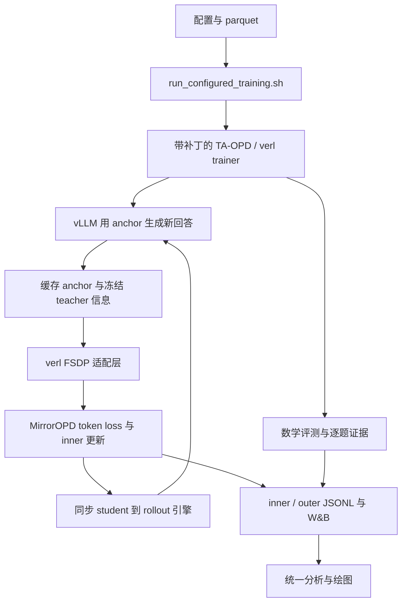

# 旧架构与复现记录

本文保留 0.2 切换前的源码审阅、改进建议、环境库存和复现步骤。下文的“当前”指原记录时点；`training/`、旧模式、邻仓判分器及环境变量包装均不属于当前 0.2.1 接口。当前职责见[架构](../架构.md)，实际操作见[运行与复现](../运行与复现.md)，单仓及后端选择见[架构决定](../../.agents/notes/implemented/architecture/2026-10-12-单仓交付与固定后端.md)。

## 与当前实现的关系

| 原建议或记录                                | 当前归属与状态                                                             |
| ------------------------------------------- | -------------------------------------------------------------------------- |
| 分离 reward、目标、诊断与缓存合同           | 已体现在 `core/` 的配置、缓存、目标及诊断模块，入口见当前架构              |
| 合并实验控制器、显式配置和进程管理          | 当前由 `runtime/` 和统一 CLI 编排；旧 launcher 不提供兼容层                |
| 明确 surrogate、中心、计量单位与全局归约    | 当前实现已有对应合同；完整指标规范的后续审阅仍需逐字段核对                 |
| 单请求 seed 与权重版本                      | 当前逐题证据记录请求 seed 和实际权重版本，不能继续沿用原文的旧随机数流描述 |
| 完整词表长回答内存与整链路成本              | 原成本分析仍有来源价值；kernel 收益不能外推为长序列吞吐结论                |
| 完整训练恢复                                | 当前仍缺完整续训协议，保存 checkpoint 不等于恢复保证                       |
| 环境清单、H800 设置、旧 greedy 与新采样协议 | 保留各自历史条件，不作为新机器安装或当前成绩的承诺                         |

下列正文与实验数字保留原有语境，未按新接口替换旧执行步骤。已退役源码由[旧源码归档](../../data/refactor-20261015/legacy-source.tar.gz)恢复；当前版本的验证证据在[全面重构说明](../2026-10-15-MirrorOPD全面重构说明.md)维护。

## 原记录正文

本文以 2026-10-12 的训练实现为基础，补充 2026-10-15 的幂均值 reward 与代码审查。目标是在新机器重建源码、数学判分器和运行配置，并留下可以核验的日志。新默认数学评测已经采用 MD-OPD 的每题 16 次采样；已有三算法正式实验采用每题一次 greedy，两套协议应分别复现。新机器安装尚未验证；本机新默认长预算评测的 GPU canary 状态见[生产实验报告](../experiments/2026-10-15-固定监督蒸馏动力学与BPO优化实验报告.md)。

### 代码职责与数据流

MirrorOPD 的生产算法由本仓库维护，分布式调度由带补丁的 TA-OPD/verl 执行。算法源码、框架适配、运行设置有各自的维护位置。

| 层次         | 入口                                                       | 职责                                          |
| ------------ | ---------------------------------------------------------- | --------------------------------------------- |
| 数学参考     | `src/mirroropd/token_inner.py` 等研究模块                  | 离散分布、镜像目标与估计量的参考验证          |
| 生产内核     | `src/mirroropd/training/losses.py`                         | 注册算法的 token loss、停止梯度和诊断量       |
| 冻结缓存     | `src/mirroropd/training/cache.py`                          | outer 起点的 anchor、teacher 信息和固定支持集 |
| 支持集与统计 | `support.py`、`metrics.py`                                 | Top-J 三对重叠、有效 token 归约与全局统计     |
| 评测与日志   | `evaluation.py`、`tracking.py`                             | 逐题 UID、采样完整性、mean/pass 与事件轴      |
| verl 适配    | `src/mirroropd/integrations/verl/fsdp.py`                  | prediction position、张量布局与缓存运输       |
| 框架接入     | `patches/ta-opd-mirror-token-loss.patch`                   | trainer、actor、rollout 和验证链路的接线      |
| 分布式框架   | `upstream/TA-OPD/verl`                                     | Ray worker、FSDP、vLLM、模型同步与数据加载    |
| 启动设置     | `training/run_configured_training.sh`、`training/configs/` | 合并 Hydra 设置，保存实际配置和运行证据       |
| 结果分析     | `experiments/analysis/math_training_review.py`             | 从完整记录计算统计并统一生成报告图            |



一次 outer 开始时冻结学生锚点，并用它生成回答和固定前缀。在这些前缀上缓存 anchor 与 teacher 的信息；随后 inner 更新学生，固定采样记录和 anchor 信息继续复用。outer 结束后同步学生权重，下一轮重新生成。OPD-on-policy 的配置每轮一次更新；MDPO/BPO 的旧正式比较每轮 16 次更新。多个 mini-batch 时更新数还取决于 batch 划分，应读实际记录。

当前生产入口接受 `mirror_pmd_mean`、`mirror_bpo`、`mirror_mdpo`、`mirror_opd_onpolicy`、`mirror_opd_is` 和 `mirror_opd_is_no_baseline`。PMD-Part 仍属于参考实现，尚未接入生产训练入口。MDPO 使用重要性比率，BPO 的系数没有重要性比率；各算法公式和度量解释在[统一指标规范](2026-10-12-蒸馏统一日志与评测指标规范.md)维护。

三种主要算法现在都支持 κ、η 定义的幂均值 reward。on-policy 每轮新采样、每个完整 batch 更新一次，在更新前 $p=q$；MDPO/BPO 在同一冻结 batch 上做多次 inner 更新。`mirror_center_mode` 选择 Top-J＋tail 或完整中心，`mirror_action_mode` 选择采样动作或完整词表积分；完整积分当前用于镜像方法。公式、有效域、停止梯度和锚点处梯度关系见[实现报告](../experiments/2026-10-15-幂均值镜像蒸馏实现与估计器对照.md)。

训练 reward 是教师与学生概率比的变换 $A_{\kappa,\eta}$。`training/math_reward.py` 提供的数学正确性分数用于任务评测及监测；共同配方设置 `use_task_rewards=false`，不把标准答案正确性加入当前蒸馏梯度。Top-16 是中心估计支持集，训练生成仍为 temperature=1、top-p=1、top-k=-1。完整词表积分覆盖已采样前缀下的动作，仍沿用 rollout 提供的前缀分布。

`upstream/` 与 `runs/` 不入库。上游变更必须保存为 manifest 指定的补丁，不能只修改本机 checkout。模型、checkpoint 和完整运行目录需要独立搬运；`make data` 恢复的是 manifest 中的研究数据与归档日志，不下载数学模型，也不准备 DAPO 数据。

### 代码审查与渐进重构

2026-10-15 的第一方 `src/mirroropd` 共 21 个 Python 文件、约 2000 行；核心规模有限。复杂性集中在训练控制脚本、框架集成和多套实验的生命周期管理。以下判断来自源码读取；没有给未测量的改动预填加速比例。

#### 保留算法内核与框架适配边界

`proximal.py` 保存幂均值 target、稳定 reward 和完整条件目标；`training/cache.py` 保存冻结锚点与教师的生产缓存；`training/losses.py` 提供采样 score 与完整积分；`integrations/verl/fsdp.py` 负责 prediction position、mask 和 nested tensor。Ray、FSDP、vLLM 的调度由上游承担。这条边界使数学核验能够在 CPU 运行，应继续保留。

`token_inner.py`、`opd_pg.py`、`opd_lm.py`、`opd_categorical.py` 还包含 κ=0 的参考算法，`proximal.py` 的独立 target 构造又与生产损失形成对照。应明确参考路径的适用范围，避免把旧研究入口当成已经支持全部新配置的生产入口。独立推导与测试 oracle 保持独立；运行时重复的工具与参数解析可以共用。

#### 把 reward、中心与 score 从诊断中分离

`compute_mirror_opd_token_loss` 同时计算全词表 log-softmax、学生中心、幂均值 reward、六个模式的系数、完整损失、熵和三对 Top-J 重叠。方法校验还在 `configuration.py` 与函数开头重复。此前 κ=0 限制同时存在两处，新增算法参数容易漏改。

建议拆成有限的显式函数：共享 reward；按当前学生或冻结锚点求中心；按算法求停止梯度后的 score；按动作积分方式生成 loss；按选定级别收集诊断。配置按 target shape、center estimator、action integration 和 algorithm 分别表达。不能把 OPD 当前 reward 的 $p$ 与镜像冻结 reward 的 $q$ 合并成含义不清的一个参数。

成功条件是独立完整目标梯度、κ=0 历史行为、锚点处三算法关系、padding/EOS 和完整词表积分全部保持。先做接口分离，再测性能；不把去掉诊断开销与改变数学估计量混在同一提交。

#### 给缓存增加明确的契约与生命周期

当前缓存用字符串字典和多个长参数表传递。字段常量已集中，但可选字段组合、shape 检查和 κ/η 一致性检查分散在 cache、adapter 与 loss；κ/η 还以每 token 张量运输。rollout version 由 trainer 单独校验，tokenizer、temperature、anchor version 与估计器信息没有统一描述对象。

建议在第一方引入轻量缓存描述与构造校验，记录 schema version、anchor version、teacher/tokenizer 身份、temperature、κ/η 和 center mode；张量仍按现有字段运输，避免直接把复杂 Python 对象塞入分布式 batch。验证失败应在 outer 构造边界报告，inner 保留必需的 shape 和版本检查。能否减少每 token metadata 的运输需验证 verl 的非张量 metadata 合并与切分行为。

#### 合并实验控制器的基础设施

`gpu_exclusive.py` 与 `scalar_gpu_lease.py` 各自实现目录预约；`scalar_large_gpu.py` 又实现一套 driver PID 记录。`oneshot_suite.py`、`power_mean_suite.py`、`power_implementation_suite.py` 和新生产 suite 共享部分功能，却仍相互导入实验专用模块。新生产 suite 借用了实现验证脚本中的预约函数，说明基础设施尚未形成独立维护位置。

建议提取 GPU 预约、源码快照、子进程生命周期、阶段状态与产物校验到共用运行模块，实验文件只声明 stage 和配置。生产 Ray 多进程与单 rank 单 context 的所有权模型不同，不能直接套用后者的 PID 数量断言。旧控制器的暂停与预约借用状态必须保留，迁移后仍需验证失败退出只清理自己的进程、不会重跑已完成 stage，也不会在占卡冲突后擅自重试。

`run_configured_training.sh` 已有可移植的显式参数入口；数学包装脚本仍依赖父目录 `.bashrc`、固定目录关系与默认本机路径。后续将本机环境装配移到外层，公共 runner 只消费显式配置，并固定合并顺序为基础配方、算法参数、运行路径与最后的用户覆盖。

新的单机四卡 suite 为每个 stage 使用独立的本地磁盘 FileStore rendezvous 路径，并向 Ray worker 显式传递 `DIST_INIT_METHOD`；vLLM 的 TCPStore 使用 `USE_LIBUV=0`。四进程 Gloo barrier、实际 FSDP/vLLM 初始化、两次 on-policy 更新与两轮长预算 avg@16 小样本评测均已通过，[审计记录](../../results/training/math-avg-k05-e02-20261015/canary-verification.json)关联配置和逐题证据。该配置属于单机运行，不作为多机 rendezvous 的通用替代。

当前生产配方沿用实验 5 的 `save_freq=-1` 和 `resume_mode=disable`。长评测增加运行时间以后，建议补充 outer 边界的恢复契约，保存 actor、Adam、数据迭代位置、随机数约定和 rollout version，并跳过已经通过完整性核验的评测产物。固定前缀 worker 已有恢复核验，不能据此声称原生整条生产链已经支持等价恢复；改变 checkpoint 设置也需在运行配方中显式记录。

#### 先修正日志语义，再增加诊断与性能开关

`tracking.py` 仍把 teacher center 归入 `04_kl_centers`，W&B summary 只摘录 method、topk、eta，尚未摘录 κ、center mode 与 action mode；完整原始配置仍保留这些值。κ>0 的 teacher center 是 reward 的负均值，数值不能解释成普通教师 KL。建议增加显式语义 metadata 与新显示名称，历史 JSONL 和旧 W&B 字段保持可识别；如需普通 KL，单独计算并使用独立字段。

`mirror_teacher_center` 在镜像分支指冻结的 $K_T$，在 OPD 分支指当前学生下的 baseline，无 baseline IS 模式则输出零。后续应分别记录缓存教师中心和实际使用的 baseline，避免用一个名字比较不同对象。`mirror_token_advantage` 当前又直接复用 loss score coefficient；展示时需要区分梯度下降的系数与 reward advantage 的符号约定。

采样路径的 `distillation_losses` 是用于产生梯度的 score surrogate，完整动作路径则返回条件目标。二者的前向数值不能直接比较；监测优化误差应使用共同完整目标或明确标注的独立读出。后续接口和日志应显式记录 surrogate/conditional objective 的区别。

生产 loss 无条件计算熵和当前学生 Top-J；完整积分路径再次执行 log-softmax。`token_moments` 对每个诊断量依次执行有限性判断、求和、平方和、最小和最大并转换为 Python 数，GPU 上可能形成重复同步。候选优化是复用概率结果、把诊断设为完整/轻量/关闭三个明确等级、在设备端批量归约后统一传回。收益应分别测量，不能仅凭代码结构声称已经更快。

#### 按长回答规模约束内存和评测成本

Top-J 缓存降低的是保存与传输量，当前 LM head、归一化和 tail 计算仍访问完整词表。合法词表为 151665，7168 个位置的单份 FP32 完整概率数组约 4.05 GiB；完整锚点与教师缓存各保存一份，不能将短前缀实验的峰值推广到完整 batch。优先核对真实 prefix chunking、prompt 位置上的无效计算、临时全词表复制和 FSDP/rollout 切换峰值，再决定是否实现分块 LM head 或融合归约。

avg@16 的三组正式配方共计划生成 $3\times11\times570\times16=300960$ 条评测回答。应分别测量 rollout、判分、结果拼接、JSONL 写入和权重同步；评测缓存/分块要保持 570 个 UID、每题 16 个 sample index 和相同长度预算。用户指定的评测频率与采样数不因工程优化自动缩减。

当前生成 seed 按 replica 设置，agent-loop 构造的逐请求 sampling params 没有独立 seed。训练和验证经过同一 rollout 服务，异步排队也影响随机数的使用顺序。后续可按 phase、outer、UID 和 sample index 指定并记录请求 seed，区分训练与评测随机数流；这属于需要版本化的复现约定，不能回填到历史运行并声称生成记录逐位相同。

建议基准固定真实模型、相同 prefix/动作、Top-16 与完整词表、OPD/MDPO/BPO、完整和轻量诊断，记录 warm-up 后的 forward/backward 时间、缓存时间、显存及主存峰值。接纳性能改动的前提是独立梯度核验和分布式 token 归约保持，通过后才比较吞吐。

#### 整理测试入口与部署检查

当前 `Makefile` 显式枚举多个 pytest 和独立脚本；部分旧验证写在 `main()` 中，单独执行 pytest 不会运行。此次已把新 on-policy 测试和原 OPD baseline 脚本加入默认回归。后续逐步把脚本式断言改为可收集测试，保留数学、缓存、分布式适配、GPU canary、正式任务评测几个验证层次。

把全部测试放到同一个 pytest 进程时，`test_kl_estimators.py` 在导入阶段调用 `torch.set_default_dtype(torch.float64)`，导致评测测试依赖的默认浮点精度改变。现已改为只给该脚本的两个输入张量显式指定 FP64；246 项可收集测试全部通过，原 Monte Carlo 脚本的数值结果保持。该问题支持统一测试收集与隔离全局状态的优先级。

上游补丁约 1500 行，涉及 trainer、engine、padding、rollout 和日志接线。已有固定基线、补丁重放与真实链路检查应继续保留；可将 prediction-position 字段构造等第一方逻辑移入 adapter，只在上游留下必要调用点。部署检查结合源码 replay、接口契约和 GPU canary；不能把源码包含某个字符串当成运行语义证明。

重构顺序建议为日志与配置语义、算法/诊断分离、缓存契约、共用 runner，随后按基准处理高成本算子。每一步独立提交并保留已测算法的梯度与运行证据；正式对照训练使用冻结版本，避免在同一组结果中混入重构前后实现。

### 复现层级与环境

绘图复现只需要归档数据和分析依赖。训练复现还需要 GPU、完整模型、数学 parquet、MD-OPD 判分器、上游补丁和 GPU 软件环境。相同代码与设置并不保证逐 token 一致：异步生成调度和 GPU 算子影响确定性，已有训练没有开启全确定性。

旧正式设置在四张 H800 80 GiB 上运行，FSDP=4、TP=1。换更小显存或不同 GPU 后，应重新测量并发、KV cache、主存和吞吐。新默认评测的最大 response 从 7168 增加到 31744，每题生成数从 1 增加到 16；已有旧配置的成功训练不能替代新配置的容量测试。

本次从现有数学环境导出的依赖记录位于 `training/environments/`。基础包清单位于 `2026-10-12-math-cu126-base.txt`；GPU 包版本、两个本地 wheel 的文件名、字节数和 SHA-256 位于 `2026-10-12-math-cu126-wheels.json`。清单用于重建现有环境。原机器的 `pip check` 已通过；新机器安装仍需验证。

| 项目               | 当前环境                                                    |
| ------------------ | ----------------------------------------------------------- |
| 平台 / Python      | Linux x86_64 / Python 3.12                                  |
| PyTorch            | 2.7.1+cu126                                                 |
| vLLM               | 0.10.0+cu126，本地 wheel                                    |
| FlashAttention     | 2.8.3.post1，cu12 / torch2.7 / CXX11 ABI TRUE / cp312 wheel |
| transformers / Ray | 4.57.6 / 2.59.0                                             |
| NumPy / datasets   | 1.26.4 / 4.8.5                                              |

TA-OPD 自带的 `requirements.txt` 指定 torch 2.8.0 和 vLLM 0.11.0，与当前实验环境不同。复现当前实验时使用本次导出的环境记录，并搬运匹配的两个 wheel。直接复制 virtualenv 也不能保证可移植，解释器路径、系统库与二进制 ABI 必须一致。仓库的 `pyproject.toml` 没有锁定 GPU 训练栈；`make bootstrap` 初始化维护工具，不能替代训练环境安装。

### 新机器准备

#### 获取固定源码与补丁

将 MirrorOPD 放到例如 `~/src/MirrorOPD`，MD-OPD 放到相邻的 `~/src/MD-OPD`。`prepare_math_backend.py` 当前从相邻 MD-OPD 读取判分器，这个目录关系属于实际依赖。

```bash
mkdir -p "$HOME/src"
cd "$HOME/src"
git clone https://github.com/WncFht/MirrorOPD.git
git clone git@github.com:WncFht/MD-OPD.git
git -C MD-OPD checkout cef14fa0b552b40033f8b7296ce3853d10bf479b
cd MirrorOPD
# checkout 要复现的 MirrorOPD 提交；本地提交须先推送或用 git bundle 搬运。
make upstream
make data
```

`make upstream` 读取 `upstream-manifest.json`，获取固定基线并应用补丁。TA-OPD 基线是 `62669afb5101bfdf57dc5ddf81e78f000c5ce2fc`。新机器生成真实 checkout；本机当前的上游软链指向隔离后端，不随 Git 搬运。已有 checkout 出现补丁冲突时先核对本地变更，不覆盖仍在训练的后端。

#### 重建 GPU 环境

以下命令以 Linux x86_64、Python 3.12、兼容 CUDA 12.6 的驱动和同 ABI wheel 为条件。先从原机器的 `cache/wheels/` 搬运 JSON 清单中的两个文件到新机器的 `$HOME/wheels`，按清单核验 SHA-256。

```bash
python3.12 -m venv .venv
export PYTHON_BIN="$PWD/.venv/bin/python"
"$PYTHON_BIN" -m pip install --upgrade pip
"$PYTHON_BIN" -m pip install --index-url https://download.pytorch.org/whl/cu126 \
  torch==2.7.1 torchaudio==2.7.1 torchvision==0.22.1 xformers==0.0.31
"$PYTHON_BIN" -m pip install --no-deps \
  -r training/environments/2026-10-12-math-cu126-base.txt
"$PYTHON_BIN" -m pip install --no-deps \
  "$HOME/wheels/flash_attn-2.8.3.post1+cu12torch2.7cxx11abiTRUE-cp312-cp312-linux_x86_64.whl" \
  "$HOME/wheels/vllm-0.10.0+cu126-cp38-abi3-manylinux1_x86_64.whl"
"$PYTHON_BIN" -m pip install --no-deps -e upstream/TA-OPD/verl -e .
"$PYTHON_BIN" -m pip check
nvidia-smi
```

基础包以 `--no-deps` 按记录安装，GPU 依赖由上一条命令安装，避免解析器自动升级 PyTorch。`pip check` 如报告不一致，应记录具体冲突并在 canary 前处理；现有环境库存不等于经过解析器证明的一致锁文件。无法取得相同 wheel 时，重编译或换环境属于新软件设置，需要单独验证。

#### 准备模型与数据

完整搬运学生 `DeepSeek-R1-Distill-Qwen-1.5B` 和教师 `JustRL-DeepSeek-1.5B`，包括 tokenizer、config、所有权重分片与原生 chat template。仅有同名目录无法确认 checkpoint 一致，应比较文件 SHA-256。旧运行未固定模型 revision，已有 model-data-audit 可以验证部分模型配置和数据哈希，不能替代完整权重哈希。

搬运 MD-OPD 的以下数据，保留列结构和标准答案：

- `data/math/DAPO/train.parquet`：17917 条旧正式训练记录。
- `data/math/MATH-500/test.parquet`：500 题。
- `data/math/AMC23/test.parquet`：40 题。
- `data/math/AIME25/test.parquet`：30 题。

旧训练数据与 MATH-500 有 2 条、与 AMC23 有 5 条精确题目重叠。去重数据属于另一设置，不能沿用旧成绩作直接复现依据。

### 可移植启动

`run_dapo_math_4gpu.sh` 当前依赖父目录的 `.bashrc`、`fht-mirror` 函数和本机模型路径。新机器使用下面的公共配置入口，显式给出路径。路径示例使用不含空格或逗号的绝对路径，便于 Hydra 解析。

```bash
cd "$HOME/src/MirrorOPD"
export MIRROR_UPSTREAM_ROOT="$PWD/upstream/TA-OPD"
export PYTHON_BIN="$PWD/.venv/bin/python"
export MIRROR_SETTING_FILE="$PWD/training/configs/dapo-deepseek-4gpu.json"
export MIRROR_STUDENT_MODEL="$HOME/models/DeepSeek-R1-Distill-Qwen-1.5B"
export MIRROR_TEACHER_MODEL="$HOME/models/JustRL-DeepSeek-1.5B"
export MIRROR_REWARD_SCRIPT="$PWD/training/math_reward.py"
export MIRROR_TEXT_DATA="$PWD/runs/math-input"
export MIRROR_TEST_FILE="$HOME/src/MD-OPD/data/math/MATH-500/test.parquet"
export CUDA_VISIBLE_DEVICES=0,1,2,3
export CUDA_DEVICE_ORDER=PCI_BUS_ID
export MIRROR_MONITOR_GPU_IDS=0,1,2,3
export VLLM_USE_V1=1
export MIRROR_INFERENCE_EXPLICIT_OFFLOAD=1
export MIRROR_AUDIT_NATIVE_PAIR=1
export MIRROR_ENABLE_WANDB=0
export MIRROR_TMPDIR="$PWD/runs/math-runtime/tmp"
export MIRROR_RAY_TMPDIR="$HOME/.cache/mopd-ray"
mkdir -p "$MIRROR_TEXT_DATA" "$MIRROR_TMPDIR" "$MIRROR_RAY_TMPDIR"
ln -s "$HOME/src/MD-OPD/data/math/DAPO/train.parquet" "$MIRROR_TEXT_DATA/train.parquet"
printf '%s\n' '{"source":"MD-OPD math recipe","model_paths":{}}' \
  > "$MIRROR_TEXT_DATA/manifest.json"
"$PYTHON_BIN" training/prepare_math_backend.py
"$PYTHON_BIN" training/check_math_evaluation_backend.py "$MIRROR_UPSTREAM_ROOT"
```

判分器准备会检查 MD-OPD 与目标后端的兼容性并保存文件哈希；差异会中止，不能强行覆盖。backend 检查确认独立 validation 长度、UID 与 finish reason 接线存在，GPU 容量仍需实际验证。Ray 临时目录放本地磁盘并使用短路径，避免 socket 路径过长及 `/tmp` 容量不足。

#### 两轮 canary

```bash
MIRROR_METHOD=mirror_mdpo bash training/run_configured_training.sh math-mdpo-canary \
  actor_rollout_ref.actor.ppo_epochs=16 \
  trainer.total_training_steps=2 trainer.test_freq=2 data.val_max_samples=16
```

canary 保留新默认每题 16 次生成和长 response 预算，用 MATH-500 的 16 题检查容量、有效结束与逐题完整性。它只验证启动和小规模评测链路，不能证明全 570 题的整体耗时与内存峰值。确认退出码为 0，检查 `console.log`、`gpu.csv`、inner/outer 记录和 validation 逐题输出；检查 teacher 冻结、每个 outer 的实际更新数、首次 rollout 的 student-anchor 重叠与 ESS、后续更新后指标变化。

#### 正式三算法运行

新默认训练 batch=64、mini-batch=64、每题训练生成 1 次、lr=$10^{-6}$、eta=0.3、Top-J=16、50 个 outer；训练 prompt/response=2048/7168。新默认验证 prompt/response=4096/31744、context=35840、每题 16 次、temperature=0.7、top-p=0.9。完整验证有 $570\times16=9120$ 条回答，分别统计 mean@16 与 pass@16。

```bash
val_files="[$MIRROR_TEST_FILE,$HOME/src/MD-OPD/data/math/AMC23/test.parquet,$HOME/src/MD-OPD/data/math/AIME25/test.parquet]"
MIRROR_METHOD=mirror_opd_onpolicy bash training/run_configured_training.sh math-opd-o50-r16 \
  actor_rollout_ref.actor.ppo_epochs=1 "data.val_files=$val_files"
MIRROR_METHOD=mirror_mdpo bash training/run_configured_training.sh math-mdpo-o50-r16 \
  actor_rollout_ref.actor.ppo_epochs=16 "data.val_files=$val_files"
MIRROR_METHOD=mirror_bpo bash training/run_configured_training.sh math-bpo-o50-r16 \
  actor_rollout_ref.actor.ppo_epochs=16 "data.val_files=$val_files"
```

三条命令依次执行，使用不同运行名。入口拒绝已存在的运行目录，失败后重跑使用新名称。默认关闭 W&B 时本地证据仍保存；需要上线日志时先登录，再设置 `MIRROR_ENABLE_WANDB=1`、`WANDB_MODE=online` 和自己的项目设置。W&B 是辅助展示，本地完整记录是核验基础。

如需复现旧 greedy 比较，在各正式命令末尾追加下面的覆盖。它恢复旧解码与长度设置，同时仍使用当前 UID 与日志修正代码；要复现旧代码行为，应另 checkout 对应旧 source commit 和补丁。

```bash
actor_rollout_ref.rollout.val_kwargs.n=1 \
actor_rollout_ref.rollout.val_kwargs.do_sample=false \
actor_rollout_ref.rollout.val_kwargs.temperature=0 \
actor_rollout_ref.rollout.val_kwargs.top_p=1 \
actor_rollout_ref.rollout.val_kwargs.max_tokens=7168 \
data.val_max_prompt_length=2048 \
actor_rollout_ref.rollout.max_model_len=9216
```

### 产物与完成判定

每次运行保存于 `runs/<运行名>/`。`setting.json` 是输入设置，`overrides.txt` 是追加参数，`resolved-config.yaml` 是最终生效设置；判断实际参数时优先读取 resolved config。`source-commit.txt` 与 `source-provenance.json` 记录第一方版本、补丁后端和运行包版本；运行前保持代码已提交，避免仅凭 commit hash 描述未提交源码。

`inner.jsonl` 记录更新前诊断，`outer.jsonl` 记录完成轮、评测和阶段耗时；`gpu.csv` 是设备级每秒采样，不能把设备占用等同于某一个模型的独占显存。`evaluation-protocol.json` 记录解码协议；`validation/` 中逐题回答、score、UID、sample index 和 finish reason 支持完整性核验。完整评测要求每个题目恰有 16 个样本，题数、总生成数、分数据集 mean/pass 和外层记录一致。

训练结束以 `exit-code.txt=0`、完整 outer 边界、最后一次完整测试和预期更新数共同确认。运行证据归档到 `data/` 或 `results/`，文档只引用已归档数据。不同方法至少比较 outer、新生成 token、实际更新数和训练时间四种预算；不能直接用 W&B 默认 `_step` 比较。

归档绘图按[三算法主报告](../experiments/2026-10-12-数学三算法日志审计与学习效率比较.md)末尾命令重建。当前固定图位于 `results/training/math-4gpu/review-20261012/figures/`，实时图位于 `runs/math-policy-followup/live/figures/`。旧的师生评测文档入口已经合并到主报告和指标规范，其重定向文件删除；原始训练记录和历史书稿继续保留。
