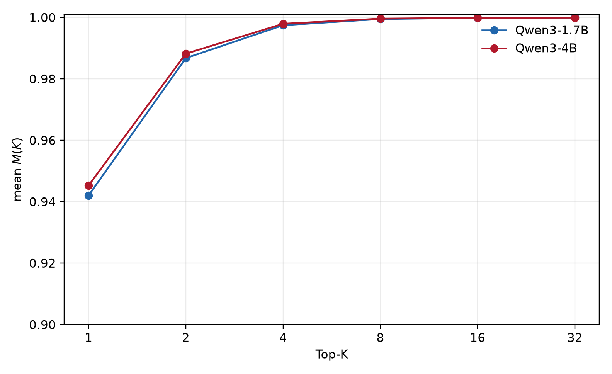
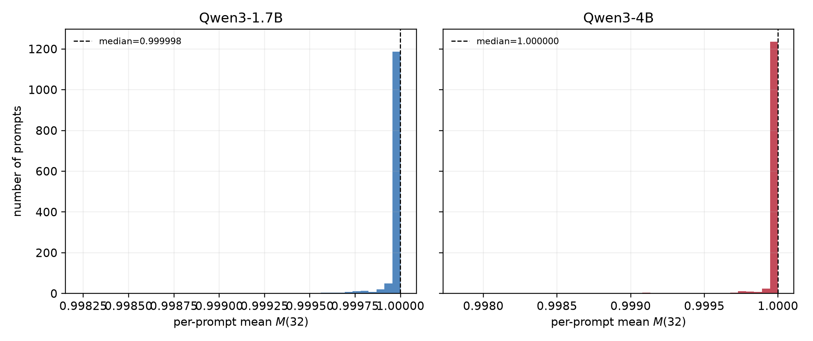

# Qwen3 在 GSM8K 上的完整轨迹与 Top-$K$ 质量

## 实验问题

本实验回答两个问题。第一，Qwen3-1.7B 与 Qwen3-4B 在 GSM8K 的真实生成轨迹上，top-$K$ 集合承载了多少下一 token 概率质量。第二，当 $K=32$ 时，尾部质量 $1-M(32)$ 是否普遍足够小，从而解释 Trunc 与 sampled-token Corrected 估计量的实际差异。

这里的 $M(K)$ 是每个 prefix 的模型分布 $pi(\cdot\mid s)$ 的 top-$K$ 概率质量：

$$
M_s(K)=\sum_{v\in\operatorname{TopK}(\pi(\cdot\mid s),K)}\pi(v\mid s).
$$

它只描述概率分布的质量集中程度，不包含 teacher/student 的 log-ratio。因此 $M(32)$ 很大可以直接说明截断 KL 的概率尾部很小，但不能单独决定 KL 数值误差或 Corrected 估计量的方差。

## 数据与计算设置

使用 GSM8K test split 的全部 1319 个 prompt。每个 prompt 只生成一条完整轨迹，temperature 为 1.0，最大新 token 数为 512；轨迹在模型自然结束时提前停止。Qwen3-1.7B 的轨迹来自已有全量 rollout，Qwen3-4B 在 archbox 上重新完成了 1319 条 rollout。

对每条保存的轨迹，使用同一个模型再次进行 teacher-forcing forward。对于 prefix $s_t$，输入是 prompt 加上此前已经生成的 token，模型输出完整 vocabulary logits；在完整 softmax 上取 $K\in\{1,2,4,8,16,32\}$ 的 top-$K$，并记录每一个 prefix 的 $M_s(K)$。模型加载采用 NF4 4-bit 权重和 bf16 计算，以适配 archbox 的 12GB GPU；softmax 仍在完整词表上计算，top-$K$ 不是 vLLM 的截断 logprob 近似。

1.7B 共得到 350166 个 prefix，4B 共得到 335570 个 prefix。每个模型均覆盖全部 1319 个 prompt。

## 总体结果

表中 prefix 级统计先把所有生成位置放在一起；prompt 级统计先在每个 prompt 内求平均，再对 1319 个 prompt 求统计量。

| 模型       | 层级        | mean $M(1)$ | mean $M(2)$ | mean $M(4)$ | mean $M(8)$ | mean $M(16)$ | mean $M(32)$ |
| ---------- | ----------- | ----------: | ----------: | ----------: | ----------: | -----------: | -----------: |
| Qwen3-1.7B | prefix      |    0.942075 |    0.986763 |    0.997471 |    0.999493 |     0.999878 |     0.999961 |
| Qwen3-1.7B | prompt mean |    0.945931 |    0.988731 |    0.998114 |    0.999662 |     0.999923 |     0.999976 |
| Qwen3-4B   | prefix      |    0.945300 |    0.988205 |    0.997941 |    0.999612 |     0.999899 |     0.999952 |
| Qwen3-4B   | prompt mean |    0.949406 |    0.990109 |    0.998515 |    0.999752 |     0.999938 |     0.999970 |

两个模型都表现出非常尖锐的 next-token 分布。对 prefix 直接平均时，$K=32$ 的尾部质量均值分别为 $3.90\times10^{-5}$ 和 $4.79\times10^{-5}$。换句话说，从概率质量角度看，大多数 prefix 的 top-32 已经接近完整词表。

## $M(32)$ 的分布，而不是只有均值

prompt 级的 $M(32)$ 几乎全部集中在 1 附近，但仍有少量困难 prompt 的平均尾部质量明显更大。具体地说，prompt 级尾部质量 $1-\overline{M(32)}$ 的统计为：

| 模型       |                mean |              median |                 p90 |                 p99 | 尾部 $<10^{-3}$ | 尾部 $<10^{-4}$ | 尾部 $<10^{-5}$ |
| ---------- | ------------------: | ------------------: | ------------------: | ------------------: | --------------: | --------------: | --------------: |
| Qwen3-1.7B | $2.39\times10^{-5}$ | $1.68\times10^{-6}$ | $4.40\times10^{-5}$ | $3.77\times10^{-4}$ |          99.92% |          94.47% |          77.48% |
| Qwen3-4B   | $2.99\times10^{-5}$ | $4.27\times10^{-7}$ | $1.78\times10^{-5}$ | $8.93\times10^{-4}$ |          99.17% |          95.22% |          87.11% |

prefix 级分布更重尾，因为一个 prompt 只要出现少数几个高熵位置，就会贡献少量大尾部 prefix。

均值和中位数之间的巨大差距正是这个现象：Qwen3-4B 的 prefix 级 median tail32 只有 $7.83\times10^{-12}$，但 mean tail32 是 $4.79\times10^{-5}$。因此“$M(32)$ 很大”对典型位置成立，对每一个位置的统一上界不成立。

## 为什么 $M(32)$ 大时 Trunc 经常比 Corrected 好

固定 prefix，令 $p=\pi_k(\cdot\mid s)$、$q=\pi_\theta(\cdot\mid s)$，并记

$$
\ell(v)=\log\frac{p(v)}{q(v)},\qquad H=\sum_{v\in S_{32}}p(v)\ell(v),\qquad T=\sum_{v\notin S_{32}}p(v)\ell(v),
$$

其中 $S_{32}$ 是 p 的 top-32 集合。真实单步 KL 为 $D=H+T$。

Trunc 估计量为 $\widehat D_{\mathrm{trunc}}=H$，所以它的条件偏差和方差是

$$
\operatorname{Bias}(\widehat D_{\mathrm{trunc}})=-T,
\qquad
\operatorname{Var}(\widehat D_{\mathrm{trunc}})=0,
\qquad
\operatorname{MSE}(\widehat D_{\mathrm{trunc}})=T^2.
$$

sampled-token Corrected 估计量先从 $p$ 采样 $Y$，若 $Y\in S_{32}$ 则回退到 $H$，若 $Y$ 在尾部则补上 $\ell(Y)$：

$$
\widehat D_{\mathrm{corr}}=H+\mathbf 1\{Y\notin S_{32}\}\ell(Y).
$$

它在条件于 prefix 时无偏，但方差为

$$
\operatorname{Var}(\widehat D_{\mathrm{corr}})
 =\sum_{v\notin S_{32}}p(v)\ell(v)^2-T^2.
$$

令尾部概率为 $\delta=1-M(32)$。当尾部 log-ratio 有界 $|\ell(v)|\le L$ 时，

$$
|T|\le \delta L,
\qquad
\operatorname{Var}(\widehat D_{\mathrm{corr}})\le \delta L^2.
$$

这给出关键的尺度差异：Trunc 的 RMSE 上界按 $O(\delta)$ 缩小，Corrected 的标准差按 $O(\sqrt\delta)$ 缩小。于是当 $\delta$ 很小时，Corrected 虽然无偏，单样本 RMSE 仍然可能大于 Trunc；它的优势是消除系统性尾部偏差，而不是保证每个 prefix 的单次 RMSE 更小。

因此，对本实验的 $M(32)$ 结果，正确结论是：$M(32)$ 大时 Trunc 通常更低方差、也常有更小 RMSE，但“只要 $M(32)$ 大就必然更好”不成立。还必须看尾部的 $\ell(v)^2$ 加权二阶矩，以及任务是否要求无偏 KL。尾部质量很小但 teacher 在尾部给出极端 log-ratio 时，Corrected 的方差仍会被少数事件主导。

## $M(K)$ 对 KL 截断误差的真正保证

仅知道 $M_s(K)=1-\delta$ 很大，不能推出 top-$K$ KL 的 RMSE 很小。原因可以通过尾部的精确分解看清楚。令

$$
S=S_K(p),\qquad
\delta=p(S^c),\qquad
\beta=q(S^c),
$$

并定义尾部条件分布

$$
p_T(v)=\frac{p(v)}{\delta},\qquad q_T(v)=\frac{q(v)}{\beta},\qquad v\in S^c.
$$

当 $\delta,\beta>0$ 时，Trunc KL 所遗漏的项满足恒等式；若 $\beta=0$ 且 $\delta>0$，则 $q$ 在 student 的尾部存在零概率，真实 KL 直接为 $+\infty$。

$$
\begin{aligned}
T
&=\sum_{v\in S^c}p(v)\log\frac{p(v)}{q(v)}\\
&=\delta\log\frac{\delta}{\beta}
  +\delta D_{\mathrm{KL}}(p_T\Vert q_T).
\end{aligned}
$$

这个公式把两个因素分开了。$M(K)$ 只给出 $\delta$，而 $T$ 还取决于 teacher 在尾部给出的总质量 $\beta$，以及两个模型在尾部条件分布上的 KL。只要 $D_{\mathrm{KL}}(p_T\Vert q_T)$ 没有统一上界，$\delta$ 再小也不能给出统一的 KL 截断误差上界。

### 无假设时的反例

考虑只有两个 token 的分布，top-1 集合为第一个 token：

$$
p=(1-\delta,\delta),
\qquad
q=(1-\delta e^{-A},\delta e^{-A}),
$$

其中 $0<\delta<1/2$，$A>0$。此时 $M(1)=1-\delta$ 可以任意接近 1，但被截断的尾部项为

$$
T=\delta\log\frac{\delta}{\delta e^{-A}}=\delta A.
$$

固定任意很小的 $\delta$，让 $A\to\infty$，就得到 $M(1)\to1$ 而 Trunc 的 bias 和 RMSE 任意大。这里 teacher 与 student 在尾部的距离是由 $q$ 的极小尾部概率造成的。因而“teacher 与 student 距离很远”确实会破坏仅根据 $M(K)$ 作出的 RMSE 判断。

反例还说明，teacher 的全局 KL 很大并不自动意味着 Trunc 一定很差：如果差异集中在 $S$ 内，Trunc 仍然可以准确保留全部主要 KL；真正决定截断误差的是被丢弃尾部的 KL，而不是总 KL 的大小。

### 需要什么额外假设

若在所有被截断 token 上有统一的 log-ratio 上界

$$
\left|\log\frac{p(v)}{q(v)}\right|\le L_K,\qquad v\in S^c,
$$

则

$$
|T|\le \delta L_K,
\qquad
\operatorname{RMSE}(\widehat D_{\mathrm{trunc}})le \delta L_K.
$$

若进一步使用尾部条件分布的上界

$$
D_{\mathrm{KL}}(p_T\Vert q_T)\le C_K,
\qquad
\left|\log(\delta/\beta)\right|\le B_K,
$$

则由精确分解得到

$$
|T|\le \delta(B_K+C_K).
$$

这才是可以把 $M(K)$ 转换为 KL 截断误差保证的条件。若 $B_K$ 或 $C_K$ 随 $K$ 增长，或者 teacher 的尾部概率 $\beta$ 远小于 student 的 $\delta$，$M(K)$ 的高质量并不能抵消尾部 log-ratio 的增长。

### Corrected 方差也需要尾部二阶矩

令 $Y\sim p$，sampled-token Corrected 估计量为

$$
\widehat D_{\mathrm{corr}}=H+\mathbf 1\{Y\in S^c\}\ell(Y),
\qquad
\ell(v)=\log\frac{p(v)}{q(v)}.
$$

写成尾部条件分布的形式，令

$$
\mu_T=\mathbb E_{p_T}[\ell(V)],
\qquad
\sigma_T^2=\operatorname{Var}_{p_T}(\ell(V)).
$$

则 $T=\delta\mu_T$，并且

$$
\operatorname{Var}(\widehat D_{\mathrm{corr}})
=\delta\sigma_T^2+\delta(1-\delta)\mu_T^2.
$$

因此 Corrected 的方差不仅由 tail event 的概率 $\delta$ 决定，还由尾部 log-ratio 的条件方差和均值决定。即使 $\delta$ 达到 $10^{-5}$，若某些尾部 token 的 teacher 概率极小，$\sigma_T^2$ 或 $\mu_T^2$ 仍可使单样本 RMSE 很大。要得到可用的 variance bound，需要假设尾部 log-ratio 有界，或者直接估计尾部二阶矩

$$
S_{2,T}=\sum_{v\in S^c}p(v)\left(\log\frac{p(v)}{q(v)}\right)^2.
$$

在实际 OPD 实验中，$M(K)$ 应当与 $\beta$、尾部条件 KL 以及 $S_{2,T}$ 一起报告；单独报告 $M(K)$ 只能说明 top-$K$ 对 student 概率质量的覆盖率，不能单独说明 KL 估计量的 bias、variance 或 RMSE。

## 与已有 pair-KL 结果的关系

前一组 Qwen3-1.7B rollout 上的 student--teacher pair-KL 实验显示，$K=32$ 时 Trunc RMSE 为约 $2.17\times10^{-3}$，sampled-token Corrected 的理论 RMSE 为约 $2.25\times10^{-2}$。这并不矛盾：本报告测量的是 student 分布的尾部概率质量，而 KL 估计量的 Corrected 方差还乘上尾部 log-ratio 的平方。当前 pair-KL 的 scoring 模型使用 NF4 量化，而 rollout 由 bf16 vLLM 产生；量化差异还会使经验 Corrected bias 偏离理想条件无偏结论。

## 可复现实验文件

- `1p7b/prefix_mk.csv` 与 `4b/prefix_mk.csv`：逐 prefix 的 $M(K)$ 和直接计算的 `tail32`。
- `1p7b/prompt_mk.csv` 与 `4b/prompt_mk.csv`：逐 prompt 的均值和中位数。
- `mk_distribution_stats.csv`：全部分位数统计。
- `tail32_summary.csv`：尾部质量阈值比例。
- `mean_mk_vs_k.{png,pdf}`、`prompt_mean_m32_histogram.{png,pdf}`、`tail32_ecdf.{png,pdf}`：图像及可打印版本。
- `vllm_gsm8k_rollout.py` 和 `score_single_model_mk.py`：rollout 与完整词表评分脚本。
